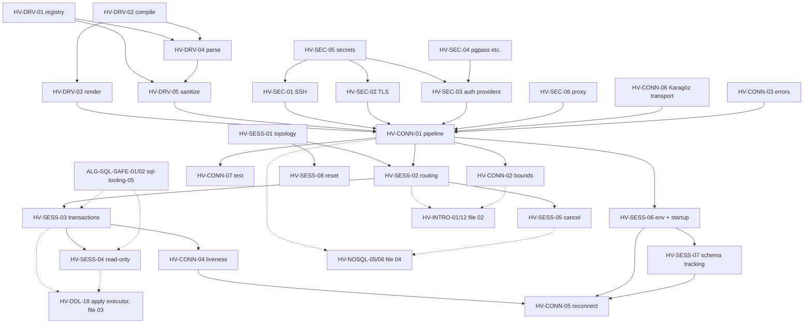

# 01 — Connectivity and Sessions: canonical algorithm catalog

> Status: canonical, implementation-ready. Date: 2026-11-11. Owner: Hacivat core.
> Scope: engine/driver registry, connection URL templates, the connect pipeline (secrets, SSH, proxy, TLS, auth providers, remote Karagöz transport), error classification, liveness and reconnect, session topology and routing, transactions, read-only modes, cancellation, startup scripts, current-schema tracking and session reset.
> For implementation purposes this file **supersedes** the source specs listed under "Sources merged" in each section (DataGrip `ALG-URL-*`, `ALG-CONN-*`, `ALG-SESS-*`, `ALG-RO-01`, `ALG-ARCH-01`; DBeaver `ALG-DBV-CONN-*`; Beekeeper/TUI `ALG-EXEC-02`; access `ALG-CRED-01` client-side parts; datagrip/10 `ALG-TOOL-09`). Where a source conflicts with `verification/01-db-behavior-tests.md` or `verification/02-external-fact-check.md`, the verification report wins and the spec says so.
> Companion catalogs: `02-introspection-and-metadata.md` (HV-MODEL-*, HV-INTRO-*), `03-ddl-and-schema-compare.md` (HV-DDL-*), `04-nosql-redis-mongo.md` (HV-NOSQL-*). Statement classification (what a SQL text *does*) is owned by the SQL-tooling catalog (`clients/sql-tooling-05` ALG-SQL-SAFE-01/02/03); this file consumes it.

## 0.1 Conventions

- Evidence tags and the clean-room rules are those of `docs/research/README.md`. DataGrip is proprietary (behavior described, no shipped text copied); Beekeeper Studio is GPL-3.0 (prose only); DBeaver is Apache-2.0 (its URL test vectors may be ported with attribution, but every algorithm here is our own pseudocode); rainfrog is MIT.
- Every spec uses the README ALG template plus: **Sources merged**, **Decision**, **Verification status**, **Rust placement**, **Per-DBMS matrix**, **i18n notes**.
- Verification status vocabulary: **Observed** (seen in a source: docs, shipped resources, OSS code), **Docker-verified** (reproduced in `verification/01`; anchor cited), **Inferred** (reasoned; must be covered by the listed tests before shipping).
- Priority tags: `[v1]` must ship in the first public release; `[v1.x]` follow-up minor releases; `[later]` not scheduled.
- Rust placement follows the workspace layout: `hacivat-core` (`core::caps`, `core::driver`, `core::conn`, `core::session`, `core::cancel`), `hacivat-net` (`net::ssh`, `net::tls`, `net::proxy`, `net::karagoz`), `hacivat-secrets` (`secrets::store`, `secrets::providers`), `hacivat-i18n`. Core crates never depend on `hacivat-ui` (ADR 0001); they publish state and events that the GPUI layer renders.
- Crate versions are "version to check" at implementation time; numbers given are the last ones the research saw, not pins.
- Fluent message ids: lowercase, hyphenated, area prefix (`drv-`, `conn-`, `sec-`, `sess-`). Server text is never interpolated into a translated sentence; it is shown verbatim in its own field (ALG-I18N-08 rule).

## 0.2 Priority table

| ID | Name | Tag | Depends on |
|---|---|---|---|
| HV-DRV-01 | Engine registry and capability resolution | v1 | — |
| HV-DRV-02 | URL template compilation | v1 | — |
| HV-DRV-03 | Render fields → URL (and safe endpoint rewrite) | v1 | DRV-02 |
| HV-DRV-04 | Parse URL → fields (multi-template, native schemes) | v1 | DRV-02, DRV-01 |
| HV-DRV-05 | Connection property sanitization by trust origin | v1 | DRV-01, DRV-04 |
| HV-CONN-01 | Connect pipeline (ordered steps with cleanup stack) | v1 | DRV-01, DRV-03, DRV-05, SEC-01..06, CONN-03, CONN-06, SESS-06 |
| HV-CONN-02 | Connection-bounds rewrite (another database, same server) | v1 | CONN-01, DRV-01 |
| HV-CONN-03 | Error classification and quick fixes | v1 | DRV-01 |
| HV-CONN-04 | Liveness, keep-alive, idle disconnect | v1 | SESS-01, SESS-03 |
| HV-CONN-05 | Reconnect and recovery (state replay) | v1 | CONN-01, CONN-03, CONN-04, SESS-06, SESS-07 |
| HV-CONN-06 | Remote Karagöz transport step | v1.x (hook in v1) | CONN-01, CONN-03, SESS-05 |
| HV-CONN-07 | Test connection and connection diagnostics | v1 | CONN-01, CONN-03 |
| HV-SEC-01 | SSH tunnel manager (jump chain, sharing, host keys) | v1 | SEC-05 |
| HV-SEC-02 | TLS modes, verification and pinning | v1 | SEC-05 |
| HV-SEC-03 | Auth providers and credential resolution order | v1 (password/none/pgpass/cert), v1.x (cloud IAM), later (Kerberos) | SEC-04, SEC-05 |
| HV-SEC-04 | Client credential files (pgpass, pg_service, my.cnf) | v1 (pgpass, pg_service), v1.x (my.cnf) | — |
| HV-SEC-05 | Secret storage, retention and export stripping | v1 | — |
| HV-SEC-06 | Proxy transports (SOCKS5, HTTP CONNECT) | v1.x | CONN-01 |
| HV-SESS-01 | Execution-context topology and connection budget | v1 | DRV-01 |
| HV-SESS-02 | Session routing by department | v1 | SESS-01, CONN-01 |
| HV-SESS-03 | Transaction modes (auto/manual/smart), isolation, protocol-derived state | v1 | SESS-02, ALG-SQL-SAFE-01 |
| HV-SESS-04 | Read-only modes per DBMS (defence in depth) | v1 | SESS-03, SESS-06, ALG-SQL-SAFE-01/02 |
| HV-SESS-05 | Cancellation escalation | v1 | SESS-02, CONN-01 |
| HV-SESS-06 | Session environment and startup scripts | v1 | CONN-01, SESS-04 |
| HV-SESS-07 | Current-schema / search-path tracking | v1 | SESS-06 |
| HV-SESS-08 | Session reset when reusing a connection | v1 | SESS-01 |

## 0.3 Dependency map



Reading order for implementers: DRV-01 → SEC-05 → DRV-02/03/04 → CONN-03 → SEC-02 → SEC-01 → SEC-03/04 → CONN-01 → SESS-01/02 → SESS-06/07/08 → SESS-03/04/05 → CONN-04/05/07 → CONN-02 → SEC-06 → CONN-06.

## 0.4 Shared vocabulary (types referenced by several specs)

```rust
// hacivat-core::core::driver
enum DbmsKind { Postgres, Redshift, Cockroach, Yugabyte, Timescale, MySql, MariaDb, TiDb, MsSql, AzureSql,
                Sqlite, ClickHouse, Redis, Valkey, MongoDb, DocumentDb, Oracle, Unknown }
struct ServerInfo { kind: DbmsKind, product: String, version: SemVerLoose, raw_version: String,
                    edition: Option<String>, is_replica: Option<bool>, detected_at: Timestamp }
struct ProfileId(Uuid);        // stable, never reused
enum Department { Console, DataEditor, Procedure, Function, Executor, RunConfiguration, DataImport,
                  Introspection, QuickDoc, CodeGeneration, Refactoring, DataExport, TextSearch,
                  Debugger, TestRunner, Mcp, Cancel, Unknown }   // stable ids, also the Karagöz audit `source`
enum Interaction { Interactive(UiPort), Headless }   // headless => never prompt; fail with NeedsInteraction
```

---

## 1. Driver registry and URLs

### HV-DRV-01: Engine registry and capability resolution `[v1]`

- **Sources merged:** ALG-ARCH-01 (`datagrip/01-architecture-overview.md`), ALG-CONN-06 (`datagrip/02-connectivity-and-drivers.md`), ALG-DBV-CONN-02 (`clients/dbeaver-01-architecture-drivers-connections.md`), datagrip/02 §2 items 1, 4, 5 and §5 items 1–2.
- **Problem:** Hacivat must know, for every supported engine and server version, which implementation of each capability (connector, introspector, DDL producer, error classifier, cancel mechanism, keep-alive, read-only guard, identifier rules) to use, what defaults to apply, and which features are available — without JVM-style driver downloads and with clean fallbacks for wire-compatible forks (TiDB, Cockroach, Yugabyte, Redshift, DocumentDB, Valkey).
- **Decision:**
  - A **declarative engine catalog** (TOML, schema-versioned, embedded at build time, overridable by a user file only for non-security fields) describes each engine: `id`, `family`, `fallback` edge, connection types (templates, see DRV-02), default options **each with a `rationale` string** (preserves the hard-won "why" that DataGrip keeps only implicitly), keep-alive statement, connection bounds (CONN-02), version-gated feature flags, TLS mapping, cancel mechanism id, auth providers offered.
  - **Capability lookup walks explicit fallback edges** (`TiDb → MySql`, `MariaDb → MySql`, `Cockroach → Postgres`, `Yugabyte → Postgres`, `Redshift → Postgres`, `Timescale → Postgres`, `AzureSql → MsSql`, `DocumentDb → MongoDb`, `Valkey → Redis`) and stops at `Unknown`; a registration that intentionally disables a capability registers a `Null` implementation rather than relying on absence (DataGrip practice, `[Observed]`).
  - **Family sets** (e.g. `PostgresLike`, `MySqlLike`, `TransactSql`) are predicates for feature toggles only, never for implementation lookup.
  - **Native Rust backends are compiled in** (Cargo features per engine). Rejected: DBeaver/DataGrip-style on-demand driver download (offline-first requirement, supply-chain risk, no JVM). Rejected: `sqlx` as the single backend (no protocol cancel handle exposure for all engines, no SQL Server, limited streaming/portal control). Out-of-process "driver plugins" (Oracle Instant Client, ODBC bridge) are `[later]`, and when added must use a signed manifest with SHA-256 pins, HTTPS only, atomic writes, explicit license acceptance (DBV-CONN-02 lessons).
  - **Version gates replace driver-version constraints:** instead of choosing an older JDBC jar for an old server (DataGrip ALG-CONN-06), features declare `since`/`until` server versions and the connector adapts (e.g. MySQL < 5.7 lacks `MAX_EXECUTION_TIME`; Redis < 6.2 lacks `RESET`, `GETDEL`, `COPY`; Redis < 7 lacks `COMMAND DOCS`; PG < 15 lacks `has_parameter_privilege` for `lc_messages`).
  - **Server detection runs on every connect** (stale detection after upgrades is a DataGrip risk `[Observed: datagrip/02 §7]`) and is stored in `ServerInfo`; a user "forced DBMS" override wins over detection.
- **Inputs / outputs:** `(DbmsKind, CapabilityKind)` → `Option<Arc<dyn Capability>>`; `(DbmsKind, ServerInfo, FeatureId)` → `bool`; post-connect probe results → `ServerInfo`.
- **Algorithm:**
  1. At startup: load catalog; validate schema version; build `registry: HashMap<(DbmsKind, CapabilityKind), Arc<dyn Capability>>` from code registrations; build `fallback: HashMap<DbmsKind, DbmsKind>` from the catalog; reject cycles (DFS with colour marking) and unknown targets; precompute transitive closure of family sets.
  2. `resolve(kind, cap)`: `cur = kind`; loop { if `registry[(cur, cap)]` → return it; if `fallback[cur]` → `cur = fallback[cur]`; else if `cur != Unknown` → `cur = Unknown`; else return `None` }.
  3. `detect(conn)` (post-connect, engine family known from the connector used): run the family's probe set (matrix below), parse versions with a loose semver parser that keeps the raw string; apply **fork detectors in declared order** (first match wins): e.g. MySQL family checks `@@version_comment`/`@@version` for `MariaDB`, then `SELECT tidb_version()` success → TiDb; PG family checks `version()` text for `CockroachDB`, `Redshift`, `YugabyteDB`, then `pg_extension` for `timescaledb` (only as a family flag, not a kind change unless configured); Redis `INFO server` → `valkey_version` present → Valkey; Mongo `buildInfo` + `hello` (DocumentDB reports a Mongo version — detect via `hello.msg`/unsupported commands, `[Inferred]`).
  4. `feature_enabled(kind, server, f)`: catalog lookup with fallback edges; compare `server.version` against `since/until`; if version unknown → use the catalog's `assume_when_unknown` (default false for risky features).
  5. If a user forced a kind, step 3 still runs and a mismatch raises a non-blocking warning (`drv-forced-kind-mismatch`).
- **Data structures:** `EngineSpec { id, family_sets, fallback, conn_types: Vec<ConnTypeSpec>, defaults: Vec<DefaultOption{key, value, rationale}>, keepalive: KeepAliveSpec, bounds: BoundsSpec, features: Vec<FeatureGate{id, since, until, assume_when_unknown}>, tls: TlsMapping, cancel: CancelMechanism, auth: Vec<AuthProviderId> }`.
- **Rust placement:** `hacivat-core::core::caps` (`CapabilityRegistry`, `CapabilityKind`), `hacivat-core::core::driver` (`EngineSpec`, `ServerInfo`, `detect`).
  ```rust
  trait Capability: Send + Sync + 'static { fn kind(&self) -> CapabilityKind; }
  struct CapabilityRegistry { impls: HashMap<(DbmsKind, CapabilityKind), Arc<dyn Any + Send + Sync>>, fallback: HashMap<DbmsKind, DbmsKind> }
  impl CapabilityRegistry {
      fn resolve<T: Capability>(&self, kind: DbmsKind) -> Option<Arc<T>>;
      fn feature(&self, kind: DbmsKind, server: &ServerInfo, f: FeatureId) -> bool;
  }
  #[async_trait] trait ServerDetector { async fn detect(&self, conn: &mut dyn RawConn) -> Result<ServerInfo, ConnError>; }
  ```
  Backend crates to evaluate (version to check): `tokio-postgres` 0.7.x (+ `postgres-types`), `mysql_async` 0.3x, `tiberius` 0.12.x, `rusqlite` 0.3x (bundled SQLite), `clickhouse` (HTTP, RowBinary) and/or `klickhouse` (native TCP), `redis` (redis-rs), `mongodb` 3.x + `bson` 2.x, `serde` + `toml` for the catalog.
- **Per-DBMS matrix (detection probes and defaults that matter):**

  | Engine | Detection probe | Notable defaults (with rationale) |
  |---|---|---|
  | PostgreSQL family | `SHOW server_version_num`, `SELECT version()`, `SELECT pg_is_in_recovery()` | `application_name=Hacivat`; `client_encoding=UTF8`; `extra_float_digits=3` (round-trip floats); never rely on `search_path` default |
  | MySQL / MariaDB / TiDB | handshake server version; `SELECT @@version, @@version_comment, @@read_only, @@lower_case_table_names`; TiDB: `SELECT tidb_version()` | `NAMES utf8mb4`; treat `TINYINT(1)` as integer, not bool (DataGrip `tinyInt1isBit=false` rationale); zero dates → NULL with a visible marker, not an error; `LOCAL INFILE` off (DRV-05) |
  | SQL Server / Azure SQL | PRELOGIN version; `SELECT SERVERPROPERTY('ProductVersion'), SERVERPROPERTY('EngineEdition'), @@VERSION` (EngineEdition 5/6/8 → Azure) | `Application Name=Hacivat`; send time values as `time`, not `datetime` (DataGrip `sendTimeAsDatetime=false` rationale); TLS `encrypt=true` + verify for Azure, `Auto` (SEC-02) on-prem |
  | SQLite | `sqlite_version()`, `PRAGMA compile_options` | extension loading **off** (DataGrip enables it; we do not — safety); `foreign_keys` reported, not forced |
  | ClickHouse | `SELECT version()`; HTTP `X-ClickHouse-Server-Display-Name` | database term = schema (DataGrip `databaseTerm=schema` rationale); explicit `query_id` per query (needed for cancel) |
  | Redis / Valkey | `HELLO 3` (fallback `INFO server`), `redis_version`/`valkey_version`, `redis_mode` | RESP3 when available; `CLIENT SETNAME hacivat-<session>`; `CLIENT SETINFO lib-name hacivat` (≥ 7.2) |
  | MongoDB | `hello`, `buildInfo` | `appName=Hacivat`; `retryWrites` default from driver except DocumentDB → false (DataGrip default rationale) |
  | Oracle (later) | `v$version` | `auto-commit=false` default; `v$session.program=Hacivat` |
- **Complexity / performance notes:** lookup O(chain length ≤ 3); detection costs 1–3 round trips, pipelined where the protocol allows (PG simple-query multi-statement, Redis pipeline).
- **Verification status:** registry/fallback semantics Observed (DataGrip `extensionFallback`, datagrip/01); fork detection probes Inferred; `@@lower_case_table_names` relevance Docker-verified (`verification/01#mysql-turkish`).
- **i18n notes:** engine display names are product names (not translated); connection-type labels are Fluent ids (`drv-conntype-default`, `drv-conntype-unix-socket`, `drv-conntype-cluster`, `drv-conntype-srv`); the stable ids in the catalog are English and never shown. Version parsing is locale-invariant (ASCII digits only; never `to_lowercase()` on product strings without ASCII folding — Turkish `I` trap, datagrip/02 §6).
- **Edge cases (exhaustive):** fallback cycle in catalog → load error naming the cycle; capability registered for a fork and its parent → fork wins; capability intentionally disabled (`Null`) → returns the Null impl, not the parent's; unknown product string → `Unknown` + generic capabilities; forced kind contradicting detection → warning, forced wins; version strings with suffixes (`16.15 (Debian 16.15-1.pgdg13+2)`, `8.0.46-0ubuntu`, `10.11.6-MariaDB-1:10.11.6+maria~ubu2204`, `7.4.12`, `24.8.14.39`) → loose parse keeps raw; MariaDB's `5.5.5-` prefix in the handshake version → strip; TiDB/Cockroach pretending to be MySQL/PG → fork detector must run before features are evaluated; detection probe denied by privileges → degrade (`ServerInfo.version = unknown`) without failing connect; replica/hot standby detection (`pg_is_in_recovery()`, `@@read_only`, Redis `role`, Mongo `hello.isWritablePrimary`) → `is_replica` used by SESS-04 messaging; detection across Karagöz transport → same probes (proxy is transparent).
- **Test cases:**
  - `resolve(TiDb, Introspector)` with only MySQL registered → MySQL impl.
  - `resolve(Yugabyte, Introspector)` with Yugabyte registered → Yugabyte impl (own registration wins).
  - `resolve(Valkey, KeyBrowser)` → Redis impl.
  - catalog with `A → B → A` → load error `drv-catalog-cycle`.
  - parse `"10.11.6-MariaDB-1:10.11.6+maria~ubu2204"` → kind MariaDb, version 10.11.6.
  - parse handshake `"5.5.5-10.11.6-MariaDB"` → 10.11.6.
  - `feature(Redis, 6.0.9, Reset)` → false; `feature(Redis, 7.4.12, Reset)` → true.
  - `[docker: postgres:16]` detect → Postgres 16.x, `is_replica=false`; `[docker: mariadb:11.4]` → MariaDb 11.4.x; `[docker: mysql:8.4]` → MySql 8.4.x; `[docker: clickhouse/clickhouse-server:24.8]` → ClickHouse 24.8.x; `[docker: valkey/valkey:8]` → Valkey; `[docker: mcr.microsoft.com/mssql/server:2022-latest]` → MsSql 16.0.x.
- **Used by:** Hacivat; Karagöz (same catalog for classifier tables and guards); Perde (validates profile descriptors against the catalog schema).

### HV-DRV-02: URL template compilation `[v1]`

- **Sources merged:** ALG-URL-01 (`datagrip/02`), ALG-DBV-CONN-01 steps 1–3 (`clients/dbeaver-01`).
- **Problem:** Each connection type of an engine needs one template that is used *bidirectionally*: to render form fields into a URL and to parse a pasted URL back into fields.
- **Decision:** Own minimal grammar, a strict subset of what DataGrip expresses, compiled once to an AST shared by render (DRV-03) and parse (DRV-04). Kept: named typed placeholders with defaults and escape mode; optional groups with alternatives; repeat lists with separator (host lists, `k=v` parameter lists); a nameless pass-through `{:key}={:value}` item capturing extra properties; negative look-ahead. Dropped: DataGrip's visibility markers `#`/`##` and `!!` (semantics `[Unknown]` in the source) — UI visibility is a field attribute in the catalog, not part of the template. Rejected: regex-only templates (cannot render), and DBeaver's untyped `{name}` (cannot validate ports/hosts or choose escaping).
- **Inputs / outputs:** `&str` → `Result<Template, TemplateError{pos, kind}>`.
- **Grammar (own notation):**
  ```
  template   := node*
  node       := literal | escape | placeholder | optional | list | notahead | node '?'
  escape     := '\' any
  placeholder:= '{' name? (':' type ('/' regex)?)? (':' default)? (':' escape_mode)? '}'
  type       := host | port | ident | param | path | file | ipv6 | text
  escape_mode:= '%' (percent-encode/decode) | 'none'
  optional   := '[' seq ('|' seq)* ']'
  list       := '<' sep ',' seq (',' seq)* '>'      // each seq is an item alternative
  notahead   := '!(' literal_text ')'
  ```
- **Algorithm:** recursive descent over chars with a context-dependent stop set (`]`/`|` inside optional, `>`/`,` inside list, `}` inside placeholder). Placeholder fields split on unescaped `:` (max 4 fields after the name); type `/` regex split on first unescaped `/`; regex compiled with the `regex` crate with a size limit; default regex per type (host `[^:/?;,\[\]@]+`, port `[0-9]{1,5}`, param `[^&;]*`, ident `[^&;=,:/]+`, path `.+?`, file `.+`, ipv6 `[0-9A-Fa-f:.%]+`). A `?` after a node wraps it in `MaybeEmpty`. Empty template string is legal and means "URL only" for that connection type.
- **Data structures:**
  ```rust
  enum Node { Lit(String), Ph(Placeholder), Opt(Vec<Vec<Node>>), List{ sep: String, items: Vec<Vec<Node>> },
              NotAhead(String), MaybeEmpty(Box<Node>) }
  struct Placeholder { name: Option<FieldId>, ty: PhType, regex: Option<Regex>, default: Option<String>, escape: Escape }
  struct Template { id: ConnTypeId, nodes: Vec<Node>, field_set: BTreeSet<FieldId>, has_passthrough: bool }
  ```
- **Rust placement:** `hacivat-core::core::driver::url::template` — `fn compile(src: &str, id: ConnTypeId) -> Result<Template, TemplateError>`; crate `regex` (version to check) with `RegexBuilder::size_limit`.
- **Per-DBMS matrix (shipped connection types, ids stable):** PostgreSQL `default`, `ipv6`, `unix_socket`, `dsn` (libpq key=value), `url_only`; MySQL/MariaDB `default`, `unix_socket`, `named_pipe` (Windows), `url_only`; SQL Server `default` (host[\instance][,port]), `named_instance`, `localdb` (`later`), `url_only`; SQLite `file`, `memory`; ClickHouse `http`, `https`, `native` (if native backend enabled); Redis `default`, `tls`, `cluster`, `sentinel`, `unix_socket`; MongoDB `default` (host list), `srv`, `url_only`.
- **Complexity / performance notes:** O(n) in template length; compiled templates cached in the registry.
- **Verification status:** grammar semantics Observed (107 shipped DataGrip templates, DBeaver `StringTemplate`); our subset Inferred.
- **i18n notes:** templates and field ids are ASCII and locale-invariant; field labels are Fluent ids `drv-field-host`, `drv-field-port`, `drv-field-database`, `drv-field-user`, `drv-field-instance`, `drv-field-file`, `drv-field-hosts`, `drv-field-replica-set`.
- **Edge cases (exhaustive):** escaped colon in defaults (`{host:ipv6:\:\:1}`); anonymous placeholder with escape; nested optionals `[[{user}:]{password}@]`; escaped or multi-char list separator (`\,`); optional literal suffix (`user[Name]`); empty template; unbalanced brackets/braces → error with byte position; regex that fails to compile or exceeds size limit → error; duplicate named placeholder in one template (legal for render, flagged for rewrite in DRV-03); placeholder name not in the engine's field set → error (catches catalog typos in CI).
- **Test cases:** `"postgresql://{host:host:localhost}[:{port:port:5432}]"` → `[Lit, Ph(host, default=localhost), Opt([[Lit(":"), Ph(port, default=5432)]])]`; `"{host:ipv6:\:\:1}"` → default `::1`; `"<\,,{host}[:{port}]>"` → `List{sep:","}`; `"[a|b]"` → `Opt([[a],[b]])`; `"{x"` → error at 0; `"<,{:ident}={:param}>"` → list with pass-through item; template referencing unknown field `{hots}` → `TemplateError::UnknownField`.
- **Used by:** Hacivat (connection dialog); Perde (descriptor validation).

### HV-DRV-03: Render fields → URL, and safe endpoint rewrite `[v1]`

- **Sources merged:** ALG-URL-02 (`datagrip/02`), ALG-DBV-CONN-01 steps 4 and 6 (`clients/dbeaver-01`), ALG-TOOL-09 scrub rules (`datagrip/10`).
- **Problem:** Show and copy a URL that matches the structured fields; produce driver input when an engine needs a URL; and—only for profiles that are *URL only*—redirect host/port to a tunnel endpoint without corrupting the URL.
- **Decision:**
  - **Structured config is the source of truth.** Rust drivers take structured configs (`tokio_postgres::Config`, `mysql_async::OptsBuilder`, `tiberius::Config`, `mongodb::options::ClientOptions`, `redis::ConnectionInfo`); the URL is a UX artifact. Render is used for display/copy and for the few engines whose client takes only a URL.
  - **Three render targets:** `Display` (secrets masked as `****`, never contains a password), `Copy` (no secrets unless the user explicitly chooses "copy with password", which asks once), `Driver` (in-memory only, may contain secrets, zeroized after use).
  - **Endpoint rewrite is structural**, not textual: the pipeline replaces `host/port` fields before render. For `url_only` profiles, rewrite parses the URL with DRV-04 and replaces exactly the host and port spans; anything ambiguous (multi-host, literal port in template, duplicated host placeholder, trailing junk) is **refused** with `drv-url-cannot-redirect` (DBeaver's newest behavior; rejected alternative: regex replacement, which corrupts query parameters named `host`/`port`).
- **Inputs / outputs:** `render(t: &Template, fields: &FieldMap, extra: &[(String, String)], target: RenderTarget) -> Result<SecretString, RenderError>`; `rewrite_endpoint(t, url, new_host, new_port) -> Result<String, RenderError>`.
- **Algorithm (render):**
  1. Walk nodes; `Lit` → append; named `Ph` → user value or default; secrets (field kind `Secret`) → value for `Driver`, `****` for `Display`, omitted (the whole optional group collapses) for `Copy`; apply escape mode (percent-encode reserved characters of the component: `@ / ? # % : [ ] ;` and space; UTF-8 bytes percent-encoded).
  2. `Opt(alts)` → render the first alternative in which at least one named placeholder has a non-empty user value (defaults do not count); literal-only alternatives render only when a selector field chooses them; else render nothing.
  3. `List{sep, items}` → for each item alternative bound to a named field with a value, emit one entry; then each `extra` pair not already emitted through the pass-through item, in insertion order; join with `sep`; if empty, the list renders nothing and an enclosing optional collapses.
  4. Host lists take `fields.hosts: Vec<(host, Option<port>)>`; IPv6 literals are bracketed.
  5. `NotAhead` renders nothing. A missing mandatory field (outside optional, no default) → `RenderError::MissingField(id)`, never a half URL.
- **Algorithm (rewrite_endpoint for `url_only`):** parse with DRV-04 using strict host/port regexes plus a synthetic trailing `{__suffix}` capture; accept only if exactly one host and one port span were bound and the suffix is empty or starts with `?`, `;`, `#` or lies inside the query; replace those byte spans (bracket an IPv6 host); otherwise refuse.
- **Rust placement:** `hacivat-core::core::driver::url::render`; secrets as `secrecy::SecretString`; crate `percent-encoding` (version to check).
- **Per-DBMS matrix:** PostgreSQL: render to `postgresql://` URI for display; `Driver` target unused (structured `Config`). MySQL: display `mysql://`. SQL Server: display ADO-style `Server=tcp:h,1433;Database=d;…` (users paste this form) and `sqlserver://` (JDBC-ish) as alternate copy. SQLite: `file:` URI with `mode=ro` when read-only (SESS-04). ClickHouse: `http(s)://h:8123/?database=d`. Redis: `redis://` / `rediss://` (TLS); cluster displayed as a seed list. MongoDB: `mongodb://h1,h2/?replicaSet=rs` / `mongodb+srv://` (no port allowed).
- **Complexity / performance notes:** O(template + values).
- **Verification status:** semantics Observed (DataGrip General↔URL sync; DBeaver render/rewrite tests); masking/copy targets are a Hacivat decision (Inferred).
- **i18n notes:** URL text is locale-invariant; no locale-aware number formatting for ports (always ASCII digits); error messages `drv-url-missing-field` (`$field`), `drv-url-cannot-redirect` (`$reason`), `drv-url-copied-without-password`.
- **Edge cases (exhaustive):** password must never appear in Display/Copy targets; user name absent → `[{user}:{password}@]` disappears entirely (no stray `:`/`@`); default database vs explicitly empty database; percent-encoding of `@ / ? # % :` in user/password/database; non-ASCII database names (UTF-8 percent-encoded in URIs, raw in ADO strings); duplicate extra keys (keep both in order, warn); stable key order; IPv6 requires brackets; Windows paths for SQLite (`C:\…` → `file:///C:/…`); SQL Server ADO values containing `;` must be wrapped `{a;b}` (`}` doubled); rewrite of multi-host URL → refuse; rewrite where template has a literal port → refuse; rewrite where the URL lacks a port → refuse (cannot place the new port unambiguously) unless template has an optional port group, in which case it is inserted; query params named `host`/`port` untouched.
- **Test cases:**
  - PG `{host:"db", port:"", database:"app"}` → Display `postgresql://db/app`.
  - with `extra=[("sslmode","require")]` → `postgresql://db/app?sslmode=require`.
  - user `a@b`, password `p:w`, target Display → `postgresql://a%40b:****@db/app`; target Copy → `postgresql://a%40b@db/app`.
  - Redis cluster hosts `[(h1,7000),(h2,7001)]` → `redis://h1:7000,h2:7001` (display form).
  - Mongo SRV with port set → `RenderError::FieldNotAllowed(port)`.
  - SQL Server ADO with password `{a;b}` (Driver target) → `Password={{a;b}}}` escaping rule applied (`}` doubled inside braces).
  - rewrite(pg, `postgresql://db.example:5432/my%20db?host=db.example&port=5432#x`, `127.0.0.1`, 49505) → `postgresql://127.0.0.1:49505/my%20db?host=db.example&port=5432#x` (port DBeaver vector 9).
  - rewrite(pg, `postgresql://first:5432,second:5432/demo`) → refuse.
  - rewrite(pg, `postgresql://[2001:db8::1]:5432/данные?option=%2520`) → `postgresql://127.0.0.1:49505/данные?option=%2520`.
- **Used by:** Hacivat; Karagöz (publishes discovered endpoints as structured fields, never URLs).

### HV-DRV-04: Parse URL → fields (multi-template matching and native schemes) `[v1]`

- **Sources merged:** ALG-URL-03 (`datagrip/02`), ALG-DBV-CONN-01 step 5 and test vectors (`clients/dbeaver-01`).
- **Problem:** Users paste connection strings from many tools; Hacivat must recognise the engine, the connection type and the fields, keep unknown parameters as extra properties, and move secrets out of the text.
- **Decision:**
  - **Two recognisers, tried in order:** (a) **native-scheme parsers** for strings users actually paste today — `postgres://`/`postgresql://` URIs and libpq `key=value` DSNs, `mysql://`/`mariadb://`, ADO.NET-style `Server=…;Database=…` and `sqlserver://`, `jdbc:<engine>:…` (the `jdbc:` prefix is accepted and stripped, then routed to the same parser), `redis://`/`rediss://`/`redis+sentinel://`/`unix://`, `mongodb://`/`mongodb+srv://`, `clickhouse://`/`http(s)://…:8123`, SQLite file paths and `file:` URIs; (b) **template matcher** (memoised backtracking over the DRV-02 AST) for engine connection types whose native parser does not apply.
  - The native parsers use the `url` crate only for RFC-3986-shaped inputs; DSN and ADO forms have hand-written tokenizers (quoted values, `{}` escapes).
  - **Secrets extracted on paste:** a password found in the text is moved into the secret store (SEC-05) under the chosen retention mode and removed from any persisted URL (DataGrip stores `URL only` strings in plain text and only warns `[Observed]` — we fix that).
  - **Driver switching:** if the current engine's recognisers fail but another engine's succeed, propose switching engine (`drv-url-switch-engine`), never silently.
- **Inputs / outputs:** `parse(input: &str, preferred: Option<DbmsKind>) -> ParseOutcome { kind, conn_type, fields: FieldMap, extra: Vec<(String,String)>, secrets: Vec<(FieldId, SecretString)>, warnings: Vec<ParseWarning> }` or `Unrecognised`.
- **Algorithm (template matcher):**
  1. `match(nodes, pos) -> Option<(pos', bindings)>` with memo `(node_id, pos)`; global step budget 100 000 (exceeded → treat as no match).
  2. `Lit` matches case-sensitively except the scheme prefix, which matches ASCII-case-insensitively (`JDBC:` == `jdbc:`; never Unicode case folding).
  3. `Ph`: greedy over the maximal span allowed by its regex, backtracking to shorter spans; percent-decode if escape `%` (invalid escapes `%4G`, trailing `%` → no match).
  4. `Opt`: each alternative then empty. `List`: item, separator, repeat; named items bind fields (case-insensitive key match for well-known aliases: `user`/`username`/`uid`), pass-through binds `extra`.
  5. Success requires consuming the whole input. Candidate order: preferred engine's types in catalog order, then other engines; tie-break by fewest `extra` entries, then catalog order.
- **Algorithm (libpq DSN):** tokens `key = value` separated by whitespace; values may be single-quoted with `\'` and `\\` escapes; unknown keys → extra; `host`/`hostaddr`/`port` may be comma lists → host list; `password` → secret.
- **Algorithm (ADO style):** split on `;` outside `{…}`/quotes; keys case-insensitive (ASCII) with alias table (`Server`/`Data Source`/`Address`/`Addr`; `Database`/`Initial Catalog`; `User ID`/`UID`/`User`; `Password`/`PWD`; `Encrypt`; `TrustServerCertificate`; `Application Intent`); `tcp:` prefix and `,port` / `\instance` suffixes parsed from server.
- **Rust placement:** `hacivat-core::core::driver::url::parse`; `url` 2.x, own tokenizers; secrets moved via `hacivat-secrets::store`.
- **Per-DBMS matrix (parse specifics):**

  | Engine | Accepted inputs | Pitfalls handled |
  |---|---|---|
  | PostgreSQL | URI, multi-host URI, DSN, `jdbc:postgresql:` incl. `jdbc:postgresql:dbname` (no `//`), Unix socket via `host=/var/run/postgresql` or `%2Fvar%2Frun…` host | `sslmode`, `target_session_attrs` → fields; `options=-c search_path=x` kept as extra and reflected in SESS-06 |
  | MySQL/MariaDB | `mysql://`, `mariadb://`, `jdbc:mysql:`, `jdbc:mariadb:`, `?socket=` | `useSSL`/`sslMode` mapped to SEC-02 modes; `allowLoadLocalInfile` → rejected by DRV-05 |
  | SQL Server | ADO, `sqlserver://`, `jdbc:sqlserver://srv\INST;databaseName=x` | `server\instance` vs `;instanceName=`; `{a;b}` values; `Authentication=ActiveDirectory…` → auth provider id |
  | SQLite | absolute/relative paths, `file:` URI with `mode`, `jdbc:sqlite:`, `:memory:` | Windows paths, `%USERNAME%` kept literal (no env expansion without consent) |
  | ClickHouse | `clickhouse://`, `http(s)://host:8123/?database=`, `jdbc:clickhouse:` | HTTP vs native port mismatch flagged (`8123/8443` HTTP, `9000/9440` native) |
  | Redis | `redis://[user[:pw]@]h[:p][/db]`, `rediss://`, `unix:///path?db=`, `redis+sentinel://h1,h2/master/db` | db index range; ACL user vs legacy password-only |
  | MongoDB | `mongodb://u:p@h1,h2/db?replicaSet=rs&authSource=admin`, `mongodb+srv://` | SRV forbids port; `authMechanism`, `tls`, `directConnection` → fields; password with `@` must be percent-encoded per spec (split on last `@` before host as a tolerant fallback, with a warning) |
- **Complexity / performance notes:** native parsers linear; template matcher bounded by memo × budget.
- **Verification status:** grammar and examples Observed (DataGrip templates, DBeaver `DatabaseURLTest`/`StringTemplateTest` vectors); native parser behavior Inferred (follows libpq, MongoDB connection-string spec, Microsoft connection-string docs).
- **i18n notes:** parsing is locale-invariant: ASCII case folding for keys (`USER`, `user`, `User` equal; Turkish `I`/`ı` never folded — use `eq_ignore_ascii_case`); non-ASCII values preserved byte-exactly. Warnings are Fluent ids: `drv-url-duplicate-key` (`$key`), `drv-url-password-moved`, `drv-url-switch-engine` (`$engine`), `drv-url-unrecognised`.
- **Edge cases (exhaustive):** IPv6 `[::1]` vs optional brackets; no `//`; `server\instance`; duplicate keys (`user=` twice → last wins + warning); empty values `?user=`; valueless params (`?flag`); `=` inside values (`expression=a=b=c`); trailing separator; percent-encoded separators inside values (`%26`); invalid percent escapes → unrecognised; SRV with port; `jdbc:` omitted; IDN hosts kept as typed (punycode only at connect); password containing `@`/`:`; `?` inside database names; whitespace around the input (trimmed) and inside (ADO tolerates spaces around `=`); Unicode in query values (`path=/tmp/данные; x`); malformed queries (`?=value`, `&broken`, `&=missing`) → unrecognised in strict mode; leading-zero ports (`05432`) preserved on recognition; extremely long input (> 64 KiB) → rejected before matching; prefix-only match accepted only in "detect engine" mode, never for import.
- **Test cases:**
  - `jdbc:postgresql://h:6543/d?sslmode=verify-full&user=u` → Postgres/default `{host:h, port:6543, database:d, user:u}`, `tls_mode=VerifyFull`.
  - `postgres://u:p%40ss@[::1]/d` → ipv6, user u, secret password `p@ss` moved, `drv-url-password-moved`.
  - `host=/var/run/postgresql dbname=app user=alice` → Postgres/unix_socket.
  - `Server=tcp:srv,1444;Initial Catalog=x;User ID=sa;Password={a;b}};Encrypt=true` → MsSql, port 1444, database x, user sa, secret `a;b}`, `tls_mode=Require`.
  - `jdbc:sqlserver://srv\SQLEXPRESS;databaseName=x;encrypt=true` → instance `SQLEXPRESS`.
  - `redis://default:pw@h:6380/2` → Redis, db 2, ACL user `default`.
  - `rediss://h` → Redis/tls.
  - `mongodb+srv://u:p@cluster0.x.net/db?retryWrites=true` → Mongo/srv, extra `retryWrites=true`.
  - `mongodb+srv://h:27017/db` → unrecognised (`drv-url-srv-port`).
  - `jdbc:mysql://localhost/demo?empty=&custom.option[0]=a%20b&expression=a=b=c&path=/tmp/данные; x&other=last` → extras exactly `{empty:"", custom.option[0]:"a b" (decoded), expression:"a=b=c", path:"/tmp/данные; x", other:"last"}`.
  - `…/demo?valid=value&=missing` → unrecognised.
  - paste `mysql://h/db` while editing a Postgres profile → `drv-url-switch-engine(MySQL)` proposal.
  - `garbage` → `Unrecognised` (profile stays URL only, and no secret is guessed).
- **Used by:** Hacivat (paste, import from other tools); Karagöz (normalises discovered endpoints); Perde (stores canonical structured form).

### HV-DRV-05: Connection property sanitization by trust origin `[v1]`

- **Sources merged:** ALG-DBV-CONN-10 (`clients/dbeaver-01`), datagrip/10 ALG-TOOL-09 import review rule, mcp/02 "no secrets in host configs" rule.
- **Problem:** A connection definition can come from a source the user did not author (import file, Perde team template, deep link, MCP request, clipboard). Some driver options turn a "connect" into local file reads, code loading or credential exfiltration (MySQL `LOAD DATA LOCAL INFILE`, SQLite extension loading, client cert/key paths pointing at arbitrary files, startup scripts with `COPY … TO PROGRAM`).
- **Decision:** Every profile carries `origin: Origin { UserTyped, Imported{file}, PerdeManaged{org}, DeepLink, Mcp }`. Non-`UserTyped` origins are checked against a **per-engine allow-list** of option keys (deny by default), decoded once and re-checked for residual `%` escapes (double-encoding → reject). Some options are **always** denied regardless of origin unless the user flips an explicit per-profile "unsafe" toggle (with a warning): MySQL local infile, SQLite `load_extension`, PG `sslkey`/`sslcert`/`sslrootcert` paths outside the user's approved directories when origin ≠ UserTyped. Startup scripts and before-connect commands from non-UserTyped origins are **quarantined** until reviewed (shown with a diff, classified by ALG-SQL-SAFE-01). Rejected: DBeaver's deny-list regex scan (bypassable by new driver options, false positives on values containing words).
- **Inputs / outputs:** `(profile, origin)` → `Ok(SanitizedProfile)` or `Err(Vec<Violation{key, reason}>)`; quarantined items list.
- **Algorithm:**
  1. Collect keys from fields, extra properties, and parsed URL query/DSN items (DRV-04).
  2. For each key: ASCII-lowercase; look up engine allow-list entry; if absent and origin ≠ UserTyped → violation `unknown_option`.
  3. For each value: percent-decode once if the key is URL-sourced; if the decoded value still contains `%[0-9A-Fa-f]{2}` → violation `double_encoding`.
  4. Apply always-deny rules; apply path rules (canonicalise, must be inside approved roots; symlinks resolved).
  5. Quarantine `startup_script`, `before_connect_command`, `init_sql` when origin ≠ UserTyped.
  6. Run again after auth providers and Karagöz grant processing add options (they may inject keys) — DBeaver runs its validator after auth for the same reason `[Observed]`.
- **Rust placement:** `hacivat-core::core::driver::sanitize` — `fn sanitize(p: &Profile, origin: &Origin, spec: &EngineSpec) -> Result<SanitizedProfile, Vec<Violation>>`.
- **Per-DBMS matrix (always-deny / sensitive keys):** MySQL/MariaDB: local infile handler never installed (mysql_async requires an explicit handler — we install none), `allowLoadLocalInfile`, `allowUrlInLocalInfile`, `autoDeserialize`-style JDBC keys rejected when pasted. PostgreSQL: `sslkey`, `sslcert`, `sslrootcert`, `sslcrl`, `passfile`, `service` file paths (path rule); `options` with `-c` values allowed only for a safe GUC list (`search_path`, `statement_timeout`, `application_name`, `DateStyle`, `TimeZone`, `lc_messages`). SQL Server: `TrustServerCertificate=true` from non-UserTyped origin → requires confirmation. SQLite: extension loading; `file:` URIs with `vfs=` → reject. ClickHouse: arbitrary query settings in URL from non-UserTyped origin → allow-list. Redis: none critical. MongoDB: `tlsCAFile`/`tlsCertificateKeyFile` (path rule), `tlsInsecure`/`tlsAllowInvalidCertificates` from non-UserTyped → confirmation.
- **Complexity / performance notes:** O(#keys).
- **Verification status:** DBeaver behavior Observed; allow-list policy is a Hacivat decision (Inferred).
- **i18n notes:** violation reasons are Fluent ids `drv-sanitize-unknown-option`, `drv-sanitize-double-encoding`, `drv-sanitize-path-outside-roots`, `drv-sanitize-always-denied`, `drv-sanitize-quarantined-script`; option keys are shown verbatim (code font), never translated.
- **Edge cases (exhaustive):** double encoding (`%2561llow…`); option names embedded in other options' values (e.g. `options=-c …`); legitimate values containing a sensitive word (allow-list avoids false positives); case variants and ASCII-only folding (Turkish `İ` in a key must not fold to `i`); Unicode homoglyph keys → unknown → rejected for non-UserTyped; paths via `~`, `..`, symlinks, UNC paths, WSL paths; Perde-managed profiles with Karagöz transport (most keys irrelevant: DB-side options are owned by Karagöz) → only client-side keys allowed; re-sanitization after the user edits an imported profile (origin stays Imported until the user confirms "I reviewed this", then becomes UserTyped).
- **Test cases:** `mysql://h/db?allowLoadLocalInfile=true` (Imported) → violation always_denied; same as UserTyped → still denied unless unsafe toggle; `?x=%2561utoDeserialize` → `double_encoding`; PG `sslkey=/etc/shadow` from Perde → `path_outside_roots`; imported profile with startup script `COPY t TO PROGRAM 'x'` → quarantined, classifier reason shown; `[docker: mysql:8.4]` connect with server `local_infile=1` and a `LOAD DATA LOCAL INFILE` statement → client refuses (no handler), server error surfaced.
- **Used by:** Hacivat; Karagöz (configs received from Perde); Perde (validation at write time).

---

## 2. Connect pipeline

### HV-CONN-01: Connect pipeline (ordered steps with cleanup stack) `[v1]`

- **Sources merged:** ALG-CONN-01 (`datagrip/02`, interceptor inventory §3.9), ALG-DBV-CONN-03 (`clients/dbeaver-01`), ALG-PERDE-06 step 9 integration modes (`networking/05`), ALG-SQL-SAFE-02 session-init parts (`clients/sql-tooling-05`).
- **Problem:** Turn a saved profile into a live, configured connection deterministically: secrets, client config files, name resolution, transport (direct, SSH chain, proxy, Karagöz), TLS, authentication, driver handshake, server detection and session environment — with every partially acquired resource released on failure or cancel, prompts only where a UI exists, and no duplicated work when several consumers connect at once.
- **Decision:**
  - DataGrip-style **ordered steps** (`phase`, `order`) each returning an optional async cleanup guard, rather than DBeaver's hard-coded method; steps are unit-testable and Karagöz reuses the same pipeline minus UI.
  - The **transport phase produces a stream factory**, not a rewritten host/port: `Box<dyn Fn() -> BoxFuture<Result<BoxedStream>>>` where `BoxedStream: AsyncRead + AsyncWrite + Unpin + Send`. Drivers that accept custom streams (tokio-postgres `connect_raw`, tiberius, redis via custom connector, mongodb via its stream abstraction only if available — `[Inferred]`, verify per crate) get in-process streams (no local port exposed to other local users; DBeaver recommendation `[Observed]`). Drivers that cannot take a stream get a **loopback forwarder** bound to `127.0.0.1:0` (or a `0600` Unix socket) owned by the pipeline's cleanup stack.
  - The same factory is reused for **side channels** (PG CancelRequest, MySQL `KILL QUERY` connection, Redis `CLIENT KILL` connection) so cancel always traverses the same SSH/TLS/Karagöz path (DBeaver edge case "protocol cancel goes over a new socket" `[Observed]`).
  - **Single-flight per `(profile_id, purpose_key)`**: concurrent connects share one in-flight attempt, one credential prompt and one tunnel acquisition (DBeaver's non-atomic `connecting` flag is a known race `[Observed]`).
  - **Interaction is explicit:** steps that need a UI (password prompt, host-key decision, SSO browser, password change) call `Interaction::ask`; in `Headless` (background introspection, MCP, Karagöz) they fail fast with `NeedsInteraction{what}` and the caller decides.
  - **Late connections are always dropped:** connect timeout via `tokio::time::timeout`; if the inner future completes after timeout it is dropped and the socket closed (DBeaver edge case 3).
- **Inputs / outputs:** `connect(profile: &Profile, purpose: Purpose, interaction: Interaction, cancel: CancelToken) -> Result<LiveConnection, ConnectError{stage, class, source}>`.
- **Algorithm:**
  0. `Validate`: DRV-05 sanitize; catalog validators ("no host", "file missing", "TLS key file unreadable"); if invalid → `ConnectError{stage: Validate}`.
  1. `PreHooks` (order 10): user-defined before-connect command (opt-in, approved per profile, timeout, cancellable; quarantined if not UserTyped).
  2. `CredentialFiles` (order 20): SEC-04 lookups (pgpass, pg_service, my.cnf) using the **original** host/port/database, before any tunnel rewrite (DataGrip runs pgpass first for this reason `[Observed: order=first]`).
  3. `NameResolution` (order 30): `mongodb+srv` SRV/TXT lookup; `pg_service` expansion; (later) Oracle TNS alias. When a tunnel is configured, resolution of the *database* host is deferred to the far side (remote DNS, SEC-01).
  4. `Transport` (order 40): exactly one of `Direct` (TCP connect with Happy-Eyeballs, or Unix socket/named pipe), `SshChain` (SEC-01), `Proxy` (SEC-06; may be combined *under* SSH as the way to reach the first hop), `Karagoz` (CONN-06). Output: `StreamFactory` + `cleanup`.
  5. `Tls` (order 50): build `TlsParams` (SEC-02) handed to the driver, because most DB protocols negotiate TLS *inside* the protocol (PG `SSLRequest`, MySQL capability switch, TDS PRELOGIN); for engines with TLS-from-byte-0 (Redis `rediss`, Mongo, ClickHouse HTTPS) the step wraps the stream itself. Skipped for Karagöz transport (QUIC/TLS 1.3 end-to-end to Karagöz; Karagöz owns upstream TLS).
  6. `Auth` (order 60): SEC-03 resolution order; produces `AuthMaterial` (password, client cert, token, Kerberos context, Karagöz grant) — fetched lazily, held as `SecretString`, zeroized on drop.
  7. `DriverConnect` (order 70): engine connector with `StreamFactory`, `TlsParams`, `AuthMaterial`, defaults from DRV-01; timeout = profile `connect_timeout` (default 15 s; 30 s when transport ≠ Direct).
  8. On error → CONN-03 classify; retry policies: `PasswordExpired` + Interactive → change-password flow then retry once; `InvalidCredentials` + Interactive + retention ≠ Forever-with-confirmed-secret → re-prompt, retry (max 3, then stop to avoid lockouts); `TunnelBroken` → invalidate shared tunnel, retry once; `TlsUnverified` + Interactive → offer pin (SEC-02), retry once; everything else → fail.
  9. `PostConnect`: DRV-01 detection; SESS-04 read-only setup; SESS-06 environment (incl. startup script); SESS-07 baseline; register with SESS-01.
  10. On final failure or cancel: run cleanup guards **LIFO** (forwarders closed, SSH refs released in reverse hop order, temp files removed), drop secrets, emit `ConnectFailed{stage, class}`.
- **Data structures:**
  ```rust
  enum Phase { Validate, PreHooks, CredentialFiles, NameResolution, Transport, Tls, Auth, DriverConnect, PostConnect }
  #[async_trait] trait ConnectStep: Send + Sync {
      fn phase(&self) -> Phase; fn order(&self) -> i32;
      fn applies(&self, req: &ConnectRequest) -> bool;
      async fn apply(&self, req: &mut ConnectRequest, ix: &Interaction, cancel: &CancelToken) -> Result<Option<CleanupGuard>, StepError>;
  }
  struct ConnectRequest { profile: Arc<Profile>, purpose: Purpose, fields: FieldMap, options: OptionMap,
                          stream: Option<StreamFactory>, tls: Option<TlsParams>, auth: Option<AuthMaterial>,
                          trace: Vec<StepTrace> }   // StepTrace{step, started, elapsed, outcome} feeds CONN-07
  struct CleanupGuard(Box<dyn FnOnce() -> BoxFuture<'static, ()> + Send>);
  struct LiveConnection { id: ConnId, server: ServerInfo, raw: Box<dyn RawConn>, side_channel: StreamFactory, guards: Vec<CleanupGuard> }
  ```
- **Rust placement:** `hacivat-core::core::conn::pipeline` (`Pipeline`, `ConnectStep`, `ConnectRequest`), `hacivat-core::core::conn::singleflight` (keyed `futures::future::Shared`), step implementations in `hacivat-net` and `hacivat-secrets`. Crates: `tokio` 1.x, `futures`, `async-trait` (or native async fn in traits), `secrecy`, `zeroize`, `hickory-resolver` (SRV; version to check).
- **Per-DBMS matrix:**

  | Engine | Stream injection | TLS negotiation | Notes |
  |---|---|---|---|
  | PostgreSQL | `Config::connect_raw(stream, tls)` | in-protocol `SSLRequest` (and PG17 direct TLS `sslnegotiation=direct`, version-gated) | cancel side channel needs backend key + same transport |
  | MySQL/MariaDB | limited custom-stream support → loopback forwarder (`[Inferred]`, verify `mysql_async` API) | capability-flag switch after handshake | side channel = second connection for `KILL QUERY` |
  | SQL Server | `tiberius::Client::connect(config, stream)` takes any stream | PRELOGIN; TDS 8 strict TLS (version-gated) | attention packet is in-band (no side channel) |
  | SQLite | n/a (file) | n/a | open flags from SESS-04; path checks from DRV-05 |
  | ClickHouse | HTTP client with custom connector (hyper) | HTTPS from byte 0 | session via `session_id` param; cancel = `KILL QUERY` on another HTTP request |
  | Redis | custom connector (verify redis-rs API) or forwarder | TLS from byte 0 (`rediss`) | cluster/sentinel need per-node streams (SEC-01 on-demand channels) |
  | MongoDB | driver-managed pool; custom stream support `[Inferred]` limited → forwarder per seed host + address mapping | TLS from byte 0 | SRV resolution before transport |
- **Complexity / performance notes:** network-bound; target p50 local connect < 50 ms, SSH 1 hop < 600 ms on 50 ms RTT; pipeline overhead negligible. Single-flight prevents N parallel SSH handshakes when a workspace restores N tabs.
- **Verification status:** step order Observed (DataGrip `order=` attributes; DBeaver `connect0`); stream-injection capabilities per crate Inferred (must be verified by the listed tests); behavior of retries Inferred.
- **i18n notes:** stage names are stable enum ids; UI text via `conn-stage-validate`, `conn-stage-transport-ssh` (`$hop`, `$host`), `conn-stage-tls`, `conn-stage-auth`, `conn-stage-driver`, `conn-stage-post-connect`; failure banner `conn-failed` (`$stage`) with server text verbatim in a details field; prompts `sec-prompt-password` (`$user`, `$profile`), `conn-cancelled`.
- **Edge cases (exhaustive):** auth provider changes host/port after tunnel rewrite (cloud connectors) → forbidden combination detected at Validate (DBeaver edge case 1); password and SSH passphrase both unsaved → two prompts in one modal sequence; cancel in either aborts cleanly; driver ignores timeout → outer timeout + late drop; driver returns success but post-connect detection fails (privileges) → connect succeeds with `ServerInfo.version=unknown`; startup-script failure → session connected but flagged (SESS-06); default schema missing → warning; server demands password change (PG `28P01` with expiry, MSSQL 18488, MySQL 1862 / `ER_MUST_CHANGE_PASSWORD_LOGIN`, Oracle `ORA-28001`) → change flow; concurrent connects → single-flight; Headless needs prompt → `NeedsInteraction`; SSO/browser steps run in the UI process only; IPv6-only hosts; Happy-Eyeballs with mixed A/AAAA; Unix socket path not existing; Windows named pipes; profile edited while a connect is in flight → in-flight attempt completes with the old snapshot, next connect uses new; app shutdown during connect → cancel token fires, cleanups run with a 2 s budget; secret retrieval from OS keyring blocked by a system dialog (macOS keychain prompt) → treated as interaction, counts toward the timeout only after it returns.
- **Test cases:**
  - PG + SSH + pgpass profile → `StepTrace` order `Validate, CredentialFiles(pgpass), Transport(ssh), Tls, Auth, DriverConnect, PostConnect`.
  - Failure in TLS step after SSH succeeded → SSH forwarder released, no listening local port (`lsof` shows none), SSH session closed if refcount 0. `[docker: linuxserver/openssh-server + postgres:16 with ssl=on and a bad CA]`
  - Expired password path retries exactly once. `[docker: postgres:16]` with `ALTER ROLE u VALID UNTIL '2000-01-01'` → note: under `trust` hba `VALID UNTIL` is not enforced (`verification/01#local-auth`), so the test must connect over the `scram-sha-256` TCP rule from another container.
  - Cancel during SSH handshake → `ConnectError::Cancelled`, no tunnel.
  - Two concurrent `connect()` for the same profile → one SSH handshake (counter), both get connections.
  - `connect_timeout=2s` against toxiproxy with 10 s latency → error at ~2 s; late connection closed when it arrives. `[docker: ghcr.io/shopify/toxiproxy + postgres:16]`
  - Headless introspection on profile without saved password → `NeedsInteraction(password)` and no prompt shown.
  - `[docker: mysql:8.4]` via SSH → forwarder path used (or custom stream if supported), `SELECT CONNECTION_ID()` works, KILL side channel uses the same tunnel.
- **Used by:** Hacivat (all connections); Karagöz (its connections to local DBs use the same pipeline with `Headless` and its own credential step).

### HV-CONN-02: Connection-bounds rewrite (another database on the same server) `[v1]`

- **Sources merged:** ALG-CONN-05 (`datagrip/02`), ALG-DBV-CONN-08 step 5 (`clients/dbeaver-01`).
- **Problem:** PostgreSQL, SQL Server (Azure), Redshift and Cockroach bind a physical connection to one database; browsing or querying another database on the same server needs another connection (or a `USE` where allowed). MySQL "databases" are schemas switched in-session.
- **Decision:** catalog-declared `BoundsSpec { bound_to: Database|Schema, rewrite: [FieldId], default_db, use_statement: Option<Template>, allowed_in_read_only: bool }`. A request for `target_db` produces either a new `ConnectRequest` (cloned profile, field rewritten, same transport/tunnel shared) or a session statement. Connections for non-default databases are opened lazily and **closed when idle** (60 s for introspection connections) — DBeaver keeps them forever and exhausts `max_connections` `[Observed: #36180 class of issues]`.
- **Inputs / outputs:** `(profile, target_db, purpose)` → `BoundsAction::{NewConnection(ConnectRequest), UseStatement(String), Reject(reason)}`.
- **Algorithm:** 1) `bound_to == Schema` → `UseStatement(render(use_statement, target_db))` with identifier quoting from the dialect; 2) else if profile `single_database_mode` → `Reject(single_db)`; 3) else if `target_db` is known non-connectable (PG `datallowconn=false`, Azure SQL non-current DB, `template0`) → `Reject(not_connectable)`; 4) else clone request, set rewrite fields to `target_db` (empty → `default_db`), keep transport key so SEC-01 reuses the tunnel; budget check (SESS-01); return `NewConnection`.
- **Rust placement:** `hacivat-core::core::conn::bounds` — `fn bounds_action(p: &Profile, target: &DbName, spec: &BoundsSpec) -> BoundsAction`.
- **Per-DBMS matrix:** PostgreSQL / Redshift / Cockroach / Yugabyte: new connection (`dbname`); default `postgres` (`defaultdb` for Cockroach). SQL Server on-prem: `USE [db]` allowed (cheap) but changes session state → for introspection open a separate connection, for consoles issue `USE`; Azure SQL DB: `USE` unsupported → new connection. MySQL/MariaDB/TiDB: `USE \`db\``. SQLite: other files = `ATTACH` (not bounds; denied in read-only, SESS-04). ClickHouse: database is a per-query setting (`database=` param) — no new connection. MongoDB: database is per-operation — no new connection. Redis: `SELECT n` per connection (not in cluster mode, where only db 0 exists).
- **Complexity / performance notes:** a new connection per database; idle-close keeps the server connection count bounded.
- **Verification status:** Observed (DataGrip `connection-bounds` in driver XML; DBeaver per-database instances); idle close is a Hacivat decision.
- **i18n notes:** `conn-bounds-single-db` , `conn-bounds-not-connectable` (`$database`); database names displayed verbatim.
- **Edge cases (exhaustive):** single-database mode; PgBouncer configured per database (target may not exist in pgbouncer.ini → connection error classified `UnknownDatabase`); Azure `USE` error; databases with names needing quoting (`"My DB"`, Turkish `"Müşteri"`); case-sensitive names (PG folds unquoted to lower ASCII only — `verification/01#pg-turkish`); MySQL `lower_case_table_names` affects database name matching; target database dropped meanwhile; read-only profile and `USE` (allowed, no write); Karagöz grants scoped per database (resource → database list) → reject if outside grant.
- **Test cases:** PG profile on `app`, introspect `analytics` → new connection with `dbname=analytics` via same tunnel; MySQL → `USE \`analytics\``; `[docker: postgres:16]` `template0` → `Reject(not_connectable)`; Azure-like profile (forced `AzureSql`) → new connection; 61 s idle → introspection connection to `analytics` closed (server `pg_stat_activity` count drops).
- **Used by:** Hacivat (explorer, introspection, consoles); Karagöz (per-database authorization must account for one profile opening many database connections).

### HV-CONN-03: Error classification and quick fixes `[v1]`

- **Sources merged:** ALG-CONN-04 (`datagrip/02` §3.13), ALG-I18N-08 (`i18n/02`, presentation rules), ALG-PERDE-06 step 8 error codes (`networking/05`), ALG-DBV-CONN-05 step 5 (`clients/dbeaver-01`).
- **Problem:** Map heterogeneous driver/transport errors to a stable taxonomy with: a localized explanation, the verbatim server text, a retryability flag, a stage, an optional SQL position, and actionable quick fixes — without ever parsing localized server text when a code exists.
- **Decision:** **Code-first rule tables** per engine (SQLSTATE / vendor code / Redis error prefix / Mongo `code`), then a small set of message-regex rules only for engines/drivers with no code (English-only patterns, tagged `fragile`), then base rules from transport errors (`std::io::ErrorKind`, TLS alert, SSH disconnect reason). One taxonomy is shared with Karagöz audit (`class` ids identical) and with MCP (machine sink gets codes, not localized text).
- **Inputs / outputs:** `(kind: DbmsKind, stage: Stage, err: &RawError)` → `Classified { class: ErrClass, retryable: bool, user_action: Option<FixId>, fixes: Vec<FixId>, position: Option<SqlPosition>, server: ServerMessage{code, text, detail, hint, lang_hint} }`.
- **Taxonomy (stable ids):** `network.dns`, `network.refused`, `network.timeout`, `network.reset`, `network.unreachable`, `network.ipv6_unavailable`; `tls.handshake`, `tls.untrusted`, `tls.hostname`, `tls.protocol`, `tls.client_cert_required`, `tls.not_supported_by_server`; `ssh.host_key_unknown`, `ssh.host_key_changed`, `ssh.auth`, `ssh.channel_open` (with hop), `ssh.agent_unavailable`; `auth.invalid`, `auth.expired`, `auth.expiring` (warning), `auth.locked`, `auth.method_unsupported`, `auth.mfa_required`; `authz.database`, `authz.object`; `config.unknown_database`, `config.mode_mismatch` (Redis cluster vs standalone), `config.wrong_port_protocol` (ClickHouse HTTP vs native), `config.pooler_prepared_statements` (PgBouncer); `server.too_many_connections`, `server.starting`, `server.shutdown`, `server.read_only` (replica/RO); `karagoz.forbidden`, `karagoz.grant_expired`, `karagoz.revoked`, `karagoz.upstream_unreachable`, `karagoz.upstream_auth`, `karagoz.overloaded`, `karagoz.protocol`, `karagoz.session_timeout`, `karagoz.resume_expired`, `karagoz.direct_path_unavailable`, `karagoz.peer_identity_mismatch`; `exec.*` (statement-level, consumed by the SQL tooling catalog); `cancelled`; `internal`.
- **Algorithm:**
  1. Walk the cause chain (innermost first) to find a structured DB error; extract `(sqlstate, vendor_code, prefix)`.
  2. Engine rules by code (matrix below) → class.
  3. If none: transport rules (`ConnectionRefused` → `network.refused`; `TimedOut` → `network.timeout`; TLS alert `unknown_ca`/`bad_certificate` → `tls.untrusted`; hostname mismatch → `tls.hostname`; russh `HostKeyMismatch` → `ssh.host_key_changed`; Karagöz stream reset code → `karagoz.*`).
  4. If none: fragile message rules (English text only; skipped when `lang_hint` ≠ en).
  5. Else `internal` with verbatim text.
  6. Position extraction: PG `P` (1-based character index into the statement *as sent*; map through Hacivat's rewrite offset map and statement offset in script; convert to editor UTF-16/char index as required by the editor), MySQL "at line N", MSSQL line number, SQLite none, ClickHouse `(at row N, col M)` from structured exception text `[Inferred]`.
  7. Fix selection by class (+ engine): e.g. `tls.untrusted` → `PinCertificate`, `ImportCa`; `config.mode_mismatch` → `SwitchToCluster`/`SwitchToStandalone`; `config.pooler_prepared_statements` → `DisableServerPreparedStatements`; `server.too_many_connections` → `UseSingleSessionMode`, `LowerConnectionBudget`; `auth.expired` → `ChangePassword`; `ssh.host_key_changed` → `ReviewHostKey` (never one-click accept).
  8. Retryable: network.timeout/reset/refused (on reconnect paths only), server.starting, karagoz.overloaded, karagoz.upstream_unreachable; never auth/tls/ssh-host-key.
- **Rust placement:** `hacivat-core::core::conn::errors` — `enum ErrClass`, `fn classify(kind, stage, &RawError) -> Classified`, rule tables in the engine catalog (`errors.toml`), CI check that every class has Fluent messages in `en` and `tr`.
- **Per-DBMS matrix (code → class, non-exhaustive seed):**

  | Engine | Codes |
  |---|---|
  | PostgreSQL | `28P01` auth.invalid (or auth.expired when `VALID UNTIL` passed — PG reports the same code; distinguish only via our known expiry info, never by text), `28000` authz.database/auth.invalid, `3D000` config.unknown_database, `53300` server.too_many_connections, `57P03` server.starting, `57P01`/`57P02` server.shutdown, `25006` server.read_only (in RO txn), `26000` + pooler detection → config.pooler_prepared_statements, `08006`/`08001` network.* |
  | MySQL/MariaDB | `1045` auth.invalid, `1862`/`1820` auth.expired, `3118` auth.locked, `1049` config.unknown_database, `1040` server.too_many_connections, `1290`/`1792` server.read_only, `1044` authz.database, `2059`/`2061` auth.method_unsupported (caching_sha2 without TLS/RSA) |
  | SQL Server | `18456` auth.invalid, `18487`/`18488` auth.expired, `4060` config.unknown_database, `18452` auth.method_unsupported, `40613`/`40501` (Azure) server.starting/overloaded → retryable, `3906` server.read_only |
  | SQLite | `SQLITE_CANTOPEN` config.unknown_database (file), `SQLITE_BUSY`/`SQLITE_LOCKED` exec (WSL file lock fix), `SQLITE_READONLY` server.read_only, `SQLITE_NOTADB` config |
  | ClickHouse | `516` auth.invalid, `81` config.unknown_database, `194`/`192` auth.*, `164` server.read_only (readonly setting), HTTP 404/400 on native port → config.wrong_port_protocol |
  | Redis | `WRONGPASS` auth.invalid, `NOAUTH` auth.invalid (missing), `NOPERM` authz.object, `ERR This instance has cluster support disabled` / `MOVED` on standalone profile → config.mode_mismatch, `LOADING` server.starting, `READONLY` server.read_only, `MASTERDOWN` server.starting |
  | MongoDB | `18` auth.invalid, `13` authz.*, `11600`/`91` server.shutdown, `10107`/`13435` (NotWritablePrimary) server.read_only, `189` server.starting |
- **Complexity / performance notes:** O(chain × rules); rules compiled once.
- **Verification status:** codes Observed (vendor docs, DataGrip error-info inventory); MySQL `1792`, `1290`, `3118`, `1142`, `1410` and Redis `NOPERM`, ClickHouse `516` Docker-verified (`verification/01#mysql-ro`, `#mysql-super-ro`, `#mysql-ephemeral`, `#redis-acl`, `#ch-default`).
- **i18n notes:** follows ALG-I18N-08: title from `conn-err-<class>` (e.g. `conn-err-auth-invalid` with `$user` = the user name *we* sent, never parsed from text), server message verbatim with `lang` hint, code chip, English copy text for support; fixes `conn-fix-pin-certificate`, `conn-fix-switch-to-cluster`, `conn-fix-change-password`, `conn-fix-disable-prepared`, `conn-fix-single-session`. Turkish servers return Turkish text (e.g. PG `HATA` severity) — classification must not depend on it (Docker test below).
- **Edge cases (exhaustive):** wrapped causes; localized server messages; errors after partial results (exec stage); errors inside SSH vs DB; same code different meaning across forks (Redshift vs PG, TiDB vs MySQL) → fork-specific rules first via DRV-01 fallback; driver-synthesized errors without codes; TLS errors that look like resets (server closed during handshake because it requires TLS) → `tls.not_supported_by_server`/`tls.required` heuristics using stage; Karagöz-mediated errors carry upstream codes inside `StreamReject{code, message_key, params}` → classify by message_key; repeated auth failures (lockout policies) → stop retries; NOTICE/WARNING are not errors (routed to messages pane).
- **Test cases:** MySQL `1045` → `auth.invalid`, fixes `[EditCredentials]`; PG with Turkish server messages: `[docker: custom image FROM postgres:16 + locales package generating tr_TR.UTF-8]` (the official image ships no `tr_TR` libc locale — `verification/01#pg-turkish`), `ALTER SYSTEM SET lc_messages='tr_TR.UTF-8'`, wrong password → class `auth.invalid` from `28P01` although severity text is `ÖLÜMCÜL`/`HATA`, title in the UI language, server text verbatim with `lang=tr`; Redis standalone with cluster profile → `config.mode_mismatch` + `SwitchToStandalone` `[docker: redis:7]`; ClickHouse native client to `8123` → `config.wrong_port_protocol` `[docker: clickhouse/clickhouse-server:24.8]`; ClickHouse no-password `default` user from another container → `516` `auth.invalid` (`verification/01#ch-default`); `[docker: mysql:8.4]` `ALTER USER u ACCOUNT LOCK` then connect → `3118` `auth.locked`; SQL Server `18456` `[docker: mcr.microsoft.com/mssql/server:2022-latest]`; PgBouncer transaction pooling + prepared statements → `config.pooler_prepared_statements` `[docker: edoburu/pgbouncer + postgres:16]`.
- **Used by:** Hacivat; Karagöz (audit classification, same ids); MCP (machine sink).

### HV-CONN-04: Liveness, keep-alive and idle disconnect `[v1]`

- **Sources merged:** ALG-SESS-03 (`datagrip/03`), ALG-DBV-CONN-05 steps 1–3 (`clients/dbeaver-01`), DBeaver connection-type defaults table (`clients/dbeaver-01` §3.7), ALG-PERDE-09 (`networking/05`).
- **Problem:** Keep idle connections alive through NATs and proxies, close idle ones to save server resources, notice dead connections early, and handle laptop sleep — without interfering with running statements or open transactions.
- **Decision:**
  - **One supervisor per live connection** (part of the session actor) with a `tokio::time::interval` tick of 1 s; no global polling thread.
  - **Protocol-level pings** where possible (MySQL `COM_PING`, Redis `PING`, Mongo `{ping:1}`, PG empty simple query `""` — returns `EmptyQueryResponse` and works inside an aborted transaction, unlike `SELECT 1` which fails with `25P02`; SQL Server `SELECT 1`; ClickHouse HTTP `GET /ping` — `[Inferred]` the PG empty-query behaviour in aborted txns, test below); custom keep-alive statement allowed per profile (classified, must be side-effect free).
  - **Keep-alive never updates `last_activity`**, otherwise idle disconnect never fires (DataGrip semantics).
  - **Idle disconnect with an open transaction never commits silently.** Interactive: notify at threshold with Commit / Roll back / Keep; Headless: keep and log. Auto-rollback of idle transactions is **off by default** (unresolved product decision §9-2).
  - **Connection-type presets** (dev/test/prod) provide defaults; values from DBeaver's table are reused as starting points (idle-connection close dev 4 h, test 2 h, prod 1 h; keep-alive 60 s when the transport is SSH/proxy/Karagöz-loopback, otherwise off).
  - **Sleep/wake:** OS notifications when available (macOS `NSWorkspaceWillSleepNotification`/`DidWake`, Windows `WM_POWERBROADCAST`, systemd-logind `PrepareForSleep`), plus clock-jump detection (`wall_delta − monotonic_delta > 5 s`, the networking/05 rule) as fallback → mark all network connections `Suspect`; next use or the first tick pings once; failure → CONN-05. Never fire a burst of missed keep-alives.
  - Karagöz transport: QUIC liveness is iroh's (5 s path keep-alive) — DB keep-alive is still useful for upstream DB idle timeouts, so it remains a per-profile option; connection lifetime rules come from ALG-PERDE-09 (lazy (device, agent) connection, closed 10 min after last stream).
- **Inputs / outputs:** per connection `last_activity`, `last_ping`, `keepalive_every: Option<Duration>`, `idle_disconnect_after: Option<Duration>`, `tx_state`, `busy` → actions `{Ping, Disconnect, PromptIdleTx, MarkBroken}`.
- **Algorithm (per tick):**
  1. If `busy` (a statement or fetch in progress) → skip.
  2. If `idle_disconnect_after` and `now − last_activity ≥ after`: if `tx_state ∈ {InTx, Failed}` → Interactive: post `PromptIdleTx` once; Headless: log once; else → graceful disconnect (state `Disconnected`, clients stay attached, lazy reconnect on next use).
  3. Else if `keepalive_every` and `now − max(last_activity, last_ping) ≥ every` → run ping as a *silent* op with timeout `min(every/2, 10 s)`; failure → `MarkBroken` + one notification (`conn-keepalive-failed`); success → `last_ping = now`.
  4. On wake/clock jump → `Suspect` → step 3 immediately, ignoring the interval.
- **Rust placement:** `hacivat-core::core::conn::liveness` (`LivenessPolicy`, `Supervisor`), `hacivat-core::core::platform::power` (sleep notifications behind a trait; implementations per OS in a small platform crate). Crates: `tokio`; OS hooks via `objc2` (macOS), `windows` (Windows), `zbus` (logind) — version to check.
- **Per-DBMS matrix (ping):** PG empty query (works in failed txn — verify) ; MySQL `COM_PING` (does not reset `LAST_INSERT_ID`/`ROW_COUNT`); SQL Server `SELECT 1` (changes `@@ROWCOUNT` — acceptable only between user statements; never inside a user's batch); SQLite none (embedded; never disconnected on sleep); ClickHouse `/ping` over HTTP (stateless; session expiry governed by `session_timeout`, default 60 s on server — keep-alive must be < that if a CH session holds temp tables) `[Inferred]`; Redis `PING` (in RESP2 subscribe mode only `PING` is allowed — fine); MongoDB `{ping:1}` (driver also runs its own heartbeats — disable our ping for Mongo unless the driver's heartbeat is off).
- **Complexity / performance notes:** O(1) per tick per connection; no allocations on the hot path.
- **Verification status:** semantics Observed (DataGrip help, DBeaver monitor job); PG empty-query-in-aborted-txn and ClickHouse session timeout Inferred (tests below); iroh constants Observed (`verification/02` P16).
- **i18n notes:** settings labels `conn-keepalive-every`, `conn-idle-disconnect-after`; durations stored as integer seconds, displayed with locale-aware number formatting (Turkish uses `,` decimal — integers only here); prompts `conn-idle-tx-prompt` (`$profile`, `$minutes`), notifications `conn-keepalive-failed`, `conn-disconnected-idle`.
- **Edge cases (exhaustive):** keep-alive inside aborted PG transaction (`25P02`) → use empty query, never mark broken because of `25P02`; MySQL `wait_timeout` lower than keep-alive interval → warn in Test connection (CONN-07) using `@@wait_timeout`; SSH keep-alive independent from DB keep-alive (SEC-01 handles SSH); sleep while a query runs (busy) → on wake the query fails with network error → CONN-05 rules (no auto-retry of user SQL); thousands of pings after wake prevented; keep-alive must not change session-visible state (`LAST_INSERT_ID()`, `@@ROWCOUNT`, `FOUND_ROWS()`); keep-alive on replicas/standbys is fine; Redis in MONITOR or SUBSCRIBE mode (busy by definition — skip); embedded SQLite never closed; PgBouncer may close idle server connections — harmless; app in background with macOS App Nap throttling timers → opt out while sessions are open (networking/05 edge case).
- **Test cases:** every=60, idle=300, idle 301 s, no tx → disconnected at ~300 s with pings at 60/120/180/240; open tx at 300 s → prompt, not disconnected; keep-alive during running query → skipped; simulated clock jump of 2 h → one ping, not 120; `[docker: postgres:16]` `BEGIN; SELECT 1/0;` (txn failed) then ping → succeeds, state stays `Failed`; `[docker: mysql:8.4]` `SET SESSION wait_timeout=5`, keep-alive 3 s → connection survives 30 s idle; toxiproxy dropping traffic → `MarkBroken` within `every + timeout`.
- **Used by:** Hacivat; Karagöz (server-side idle reaping of P2P sessions uses the same semantics).

### HV-CONN-05: Reconnect and recovery (state replay) `[v1]`

- **Sources merged:** ALG-DBV-CONN-05 steps 4–5 (`clients/dbeaver-01`), ALG-SESS-05 replay requirement (`datagrip/03`), ALG-PERDE-07 (`networking/05`), ALG-EXEC-02 step 3 (`clients/oss-clients-beekeeper-and-tui.md`).
- **Problem:** Recover from dead connections (network loss, server restart, admin kill, sleep) without losing editor state, without duplicating writes, and while telling the user exactly which session state was lost.
- **Decision:**
  - **Never auto-retry user statements.** A statement that failed with a connection error may have committed on the server (DBeaver retries generically — edge case 3 duplicate writes `[Observed]`). Only **app-internal idempotent reads** (introspection queries, completion lookups, metadata refresh, keep-alive) are retried once after reconnect.
  - **Reconnect is lazy** for consoles (next user action) and **eager with backoff** for background consumers that need it (introspection in progress): attempts at 0 s, 1 s, 2 s, 4 s, 8 s, then every 30 s up to 5 min, with ±20 % jitter; immediate attempt on network-up/wake events.
  - **State replay** after reconnect: SESS-06 environment (incl. startup script), SESS-07 last known current schema/search path, transaction mode and isolation, read-only guards (SESS-04). **Not replayable and reported as lost**: open transaction (with its uncommitted changes), temp tables, session variables set by SQL (`SET @x`, `SET` GUCs not tracked), prepared statements, advisory/`GET_LOCK` locks, `LISTEN` registrations (re-issued automatically only for Hacivat-owned listeners), cursors, Redis `SELECT n` is re-applied, Redis `CLIENT TRACKING`/subscriptions re-established by the owner component.
  - **Group invalidation:** connections sharing a broken SSH session or Karagöz QUIC connection are invalidated together under a per-transport lock (de-duplicated; DBeaver regression #42151 shows the risk `[Observed]`).
  - **Karagöz session resume** (ALG-PERDE-07 layer 3) is transparent to this spec: if the transport resumes the stream within `resume_grace`, the DB session is intact and no replay happens; if resume fails (`karagoz.resume_expired`), proceed as a normal reconnect.
- **Inputs / outputs:** `on_failure(conn, classified_error)` → `RecoveryOutcome{ Reconnected{lost: LostState}, Failed{class}, Deferred }`; `LostState { open_tx: bool, temp_objects: bool, session_vars: bool, prepared: usize, locks: bool }`.
- **Algorithm:**
  1. Classify (CONN-03). If not `network.*`/`server.shutdown`/`server.starting`/`karagoz.upstream_unreachable`/`karagoz.resume_expired` → not a recovery case.
  2. Compute `LostState` from the session actor's bookkeeping (tx state from protocol, temp objects created via tracked DDL in this session, prepared count, lock-taking statements seen by the classifier).
  3. Mark session `Broken`; complete queued requests with `ConnLost`; if the failing request was app-internal and idempotent → re-enqueue it once at the head.
  4. Acquire per-transport invalidation lock; if another task already invalidated this transport generation → wait for it.
  5. Reconnect via CONN-01 (Headless for background; Interactive for user-triggered), replay state (SESS-06/07, tx mode, isolation, RO).
  6. If `LostState` non-empty → non-modal banner `conn-reconnected-state-lost` listing items; if `open_tx` → modal-free but sticky warning in the console (`conn-tx-lost`) because the user may believe changes are pending.
  7. On repeated failure → backoff; after the eager window → `Disconnected` with a reconnect button.
- **Rust placement:** `hacivat-core::core::conn::recovery` (`RecoveryPolicy`, `LostState`, `TransportGeneration`).
- **Per-DBMS matrix (what is lost / special handling):** PG: txn, temp tables, GUCs from `SET`, prepared statements, advisory session locks, `LISTEN` (Hacivat re-LISTENs its own channels); MySQL: txn, temp tables, user variables, `GET_LOCK` locks, `LAST_INSERT_ID`; SQL Server: txn, `#temp` tables, `SET` options, `CONTEXT_INFO`; SQLite: no network — "reconnect" only after file replaced/unlocked (detect file identity change by inode/size+mtime and warn); ClickHouse: HTTP is stateless; `session_id` sessions expire server-side (temp tables lost); Redis: `SELECT n`, `CLIENT SETNAME`, `READONLY` (cluster replicas) replayed; subscriptions re-subscribed by owner; MongoDB: driver reconnects internally; client-side sessions/transactions aborted → surface `TransientTransactionError` label to the user, do not auto-retry user writes (the driver's `retryWrites` applies only to single retryable writes; we keep driver default except DocumentDB).
- **Complexity / performance notes:** bounded backoff; invalidation lock prevents storms.
- **Verification status:** DBeaver behavior Observed; retry policy is a Hacivat decision (Inferred); `DISCARD`/session-state facts Docker-verified for PG (`verification/01#pg-discard`).
- **i18n notes:** `conn-reconnecting` (`$attempt`), `conn-reconnected-state-lost` with a Fluent list of items (`conn-lost-tx`, `conn-lost-temp`, `conn-lost-vars`, `conn-lost-prepared`, `conn-lost-locks`) — list joined with locale-aware list formatting (Turkish uses `ve`); never build the sentence by string concatenation.
- **Edge cases (exhaustive):** INSERT that committed before the socket died → user sees `ConnLost` with "outcome unknown" (`conn-outcome-unknown`), never a silent retry; manual-commit txn lost; server restarts quickly vs stays down (backoff, stop eager after 5 min); `pg_terminate_backend` of the introspection connection → transparent retry once; credentials changed meanwhile → reconnect fails `auth.invalid` → stop and prompt (no loop); SSH session dies → group invalidation; Karagöz grant expired during outage → refresh grant via Perde (CONN-06) before reconnect; laptop wakes on another network → transport-level roaming first; PgBouncer transaction pooling → session state was never reliable (warn at connect, CONN-07); SQLite file deleted/replaced; read-only replica promoted/demoted (`server.read_only` appears/disappears) → re-detect `is_replica`; recovery during app shutdown → abort.
- **Test cases:** `[docker: postgres:16]` `pg_terminate_backend(<introspection pid>)` → next metadata read succeeds after one transparent retry; terminate a console backend with an open transaction → console shows `conn-tx-lost`, next statement runs on a fresh connection with `search_path` and startup script replayed; `[docker: mysql:8.4]` `KILL <id>` during `INSERT` in autocommit → user sees "outcome unknown", no duplicate row; stop container 20 s then start → eager reconnect succeeds within ~30 s; two profiles over the same SSH bastion, kill sshd session → one invalidation, both recover; `[docker: redis:7]` `CLIENT KILL ID <id>` → reconnect replays `SELECT 2` and `CLIENT SETNAME`.
- **Used by:** Hacivat; Karagöz (agent-side pool health uses the same backoff).

### HV-CONN-06: Remote Karagöz transport step `[v1.x]` (pipeline hook in v1)

- **Sources merged:** ALG-PERDE-03, -04, -05, -06, -07, -09 (`networking/05-perde-network-architecture-options.md`), datagrip/02 §5 item 6, ALG-DBV-CONN-08 note on Karagöz budgets, ALG-SESS-02 Karagöz note (`datagrip/03`).
- **Problem:** For Perde-managed data sources, the database is reachable only through a Karagöz agent over a P2P QUIC connection (relay fallback). Hacivat's connect pipeline must obtain a grant, open an authorized per-session stream, hand it to the native driver, route cancel and map remote errors — while keeping everything after the transport (driver protocol, session environment, classification) identical to direct connections.
- **Decision:**
  - Karagöz is a **Transport-phase step** (`order 40`) producing a `StreamFactory`; each call opens one QUIC bidirectional stream with `StreamOpen{kind: db_session, resource_id, session_id (UUIDv7), db_params{database, requested_role, application_name}, priority}` on the pooled `(device, agent)` connection.
  - **Auth phase uses the `KaragozGrant` provider**: the grant (Perde-signed, bound to the device endpoint key) is presented on the control stream; DB credentials never reach Hacivat. For the in-process stream the Karagöz protocol-aware proxy terminates the client side of the DB protocol; Hacivat's driver performs the protocol startup with the principal name returned in `StreamAccept.effective_principal` and an **empty/trust** authentication exchange inside the already-authorized stream (proxy answers the protocol's "auth ok"). For the loopback forwarder mode (external tools such as `psql`), a per-forwarder one-time password is required (networking/05 step 9). This handshake shape needs Karagöz confirmation — unresolved §9-6.
  - **TLS phase skipped** (QUIC TLS 1.3 to the agent with endpoint-id pinning; Karagöz owns upstream TLS).
  - **Cancel** uses a `kind=cancel` stream referencing `session_id`; Karagöz performs the engine-specific cancel next to the DB (SESS-05).
  - **Budgets** (SESS-01) for Karagöz profiles are enforced by Karagöz (`max_concurrent_bidi_streams`, per-user session limits); Hacivat still applies its own soft budget to avoid surprises.
  - Path policy (`relay_policy`), roaming and resume are the transport's concern (ALG-PERDE-04/07); this step only maps their outcomes.
- **Inputs / outputs:** `(profile.transport = Karagoz{org, agent_id, resource_id}, grant_cache, perde_client)` → `StreamFactory` + `CleanupGuard` (stream close; connection idle-close handled by pool).
- **Algorithm:**
  1. `grant = grant_cache.get(resource_id)` valid for ≥ 60 s, else `perde.request_grant(resource_id, purpose)` (Interactive may show approval-pending UI; Headless → `NeedsInteraction(approval)` if approval required).
  2. `conn = pool.get_or_connect(agent_id)` (ALG-PERDE-03; pins agent endpoint id; `Authenticate{grants}` on control stream; reuse for all sessions).
  3. For each stream request: open bidi stream, send `StreamOpen`, await `StreamAccept`/`StreamReject` (timeout 10 s). Reject → CONN-03 `karagoz.*` class with `message_key` and params from the agent.
  4. Return the stream as `BoxedStream`; register `session_id` for cancel routing and audit correlation (`Department` sent in `db_params.application_name` suffix and in `StreamOpen.priority`: interactive=Console/DataEditor, introspection=Introspection/QuickDoc, bulk=DataExport/DataImport).
  5. Grant refresh: background task refreshes at 80 % of lifetime via `GrantRefresh`; failure → warn; at expiry the agent resets streams with `grant_expired` → CONN-05 (grant refresh then reconnect).
- **Rust placement:** `hacivat-net::net::karagoz` (`KaragozTransport: ConnectStep`, `AgentPool`, `GrantCache`); crates: `iroh` 1.x (1.4.1 verified current at 2026-10-21, `verification/02` P16), `prost` for frames, `ed25519-dalek`/`coset` or `pasetors` for grant verification hints (client side only checks expiry; agent verifies signatures).
- **Per-DBMS matrix:** PG: stream carries v3 protocol; `CancelRequest` → cancel stream. MySQL: protocol over stream; `KILL QUERY` → cancel stream (agent uses its own second upstream connection). SQL Server: attention packet stays in-band (no cancel stream needed). SQLite: not applicable remotely in v1 (file DB on the agent host would need a Karagöz query API — `[later]`). ClickHouse: HTTP over the stream (one HTTP/1.1 connection per stream; keep-alive); cancel via cancel stream (`KILL QUERY WHERE query_id`). Redis: RESP over stream; blocking commands cancelled by closing the stream (agent closes upstream). MongoDB: OP_MSG over stream; driver pooling must be pointed at a single "host" served by the forwarder; `killOperations` via cancel stream.
- **Complexity / performance notes:** one QUIC connection per (device, agent); per-session stream open ≈ 1 RTT; interactive priority over bulk; back-pressure end to end.
- **Verification status:** protocol and constants Observed in networking/05 (design doc) and `verification/02` (iroh facts); DB-proxy auth handshake shape Inferred.
- **i18n notes:** reject/reset codes map to `conn-err-karagoz-forbidden`, `-grant-expired`, `-revoked`, `-upstream-unreachable`, `-upstream-auth`, `-overloaded`, `-protocol`, `-session-timeout`, `-resume-expired`, `-direct-path-unavailable`, `-peer-identity-mismatch`; path badges `conn-path-direct`, `conn-path-relayed` (diagnostics per ALG-PERDE-10).
- **Edge cases (exhaustive):** agent offline (no grant issued) → `karagoz.upstream_unreachable` with "agent offline" variant; approval workflow pending → spinner with cancel; grant expired mid-handshake → refresh once; endpoint id mismatch → hard failure + security event, never retried; `direct_only` policy and only relay available → `karagoz.direct_path_unavailable` after 10 s; agent revokes while streaming → streams closed within 1 s, CONN-05 shows `karagoz.revoked` (no reconnect loop); multiple windows → one pooled connection; loopback forwarder exposure → one-time password + UI indicator; MongoDB driver discovering replica-set members through `hello` (must be disabled: `directConnection=true` to the forwarder) ; Redis cluster through Karagöz (agent must expose cluster topology mapping — `[later]`); laptop sleep → resume or reconnect; Perde unreachable but grant valid → proceed; Perde unreachable and grant expired → fail with `karagoz.grant_expired` and offline hint.
- **Test cases:** integration harness with a local Karagöz + Perde (dev compose) and `postgres:16` behind it: connect → `StreamAccept`, `SELECT current_user` returns the ephemeral principal; cancel `pg_sleep(60)` via cancel stream → `57014` within 1 s; revoke grant → console error `karagoz.revoked`; kill agent process → reconnect after restart with backoff; `direct_only` + forced relay → `direct_path_unavailable`; grant with `exp` in 30 s → refresh observed before expiry; wrong agent key in address book → `peer_identity_mismatch` and no stream opened.
- **Used by:** Hacivat (initiator); Karagöz (responder, authoritative enforcement); Perde (grant issuer, address book).

### HV-CONN-07: Test connection and connection diagnostics `[v1]`

- **Sources merged:** datagrip/02 §3.13 (Test Connection status format), ALG-DBV-CONN-04 edge case 11 (test must not share tunnels), ALG-PERDE-10 (diagnostics report, for Karagöz paths).
- **Problem:** Let users validate a profile before saving, with a report that pinpoints the failing stage and surfaces risky settings (no TLS, unverified TLS, pooler limitations, low `wait_timeout`), without disturbing live sessions.
- **Decision:** Test connection runs the full CONN-01 pipeline with `purpose=Test`, **no sharing** of SSH sessions or Karagöz streams with live connections (fresh resources, torn down afterwards), Interactive prompts allowed but nothing persisted unless the user saves. The report is structured (`TestReport`) and copyable as English text.
- **Inputs / outputs:** `test(profile_draft) -> TestReport { ok, stages: Vec<StepTrace>, server: Option<ServerInfo>, tls: TlsSummary{mode, version, cipher, verified, pinned}, auth_method, ping_ms, keepalive_ok, warnings: Vec<Warning>, error: Option<Classified> }`.
- **Algorithm:** 1) run pipeline with fresh transport; 2) after connect, run keep-alive once and measure round trip (median of 3); 3) run warning probes (matrix); 4) disconnect, run cleanups; 5) render report.
- **Rust placement:** `hacivat-core::core::conn::test` (`TestReport`).
- **Per-DBMS matrix (warning probes):** PG: `SHOW ssl` vs our TLS state, `pg_is_in_recovery()`, pooler detection (`SHOW pool_mode` succeeds only on PgBouncer admin; heuristically detect via `application_name` echo / `server_version` from PgBouncer `[Inferred]`), `SHOW lc_messages`; MySQL: `@@wait_timeout`, `@@read_only`, `@@super_read_only`, `@@lower_case_table_names`, `@@require_secure_transport`, `@@local_infile`; SQL Server: `SELECT encrypt_option FROM sys.dm_exec_connections WHERE session_id=@@SPID`, server collation (Turkish warning for catalog queries: `verification/01#mssql-turkish`); SQLite: journal mode, file writable?; ClickHouse: readonly setting of user; Redis: `protected-mode` and `ACL WHOAMI` (warn "no authentication" when default user nopass — `verification/01#redis-noauth`), `redis_mode`; MongoDB: auth disabled detection (`connectionStatus` with no users), `hello.setName`.
- **Verification status:** DataGrip report format Observed; warning probes partly Docker-verified (`#redis-noauth`, `#mongo-localhost`, `#mssql-turkish`, `#mysql-super-ro`), rest Inferred.
- **i18n notes:** `conn-test-ok` (`$ms`), `conn-test-tls-unverified`, `conn-test-no-tls`, `conn-test-pooler`, `conn-test-low-wait-timeout` (`$seconds`), `conn-test-no-auth`, `conn-test-turkish-collation`; numbers formatted with the UI locale.
- **Edge cases (exhaustive):** test while a live connection with the same tunnel exists (must not share — fresh session even though a shared one exists); test cancelled; test against a profile whose secret is not saved → prompt but do not store unless "save" checked; Karagöz test requires a grant (may require approval) → clearly labelled; probes denied by privileges → skip silently; Headless test (CLI/MCP) → no prompts.
- **Test cases:** `[docker: redis:7]` default image → warning `conn-test-no-auth`; `[docker: mongo:7]` without auth → `conn-test-no-auth`; `[docker: postgres:16]` without SSL → `conn-test-no-tls`; `[docker: mysql:8.4]` with `wait_timeout=10` → low-wait-timeout warning; SSH profile test while another profile uses the same bastion → two separate SSH TCP connections observed, test's closed afterwards.
- **Used by:** Hacivat; Perde UI (Karagöz-side diagnostics share the report shape).

---

## 3. Security: SSH, TLS, proxies, authentication, secrets

### HV-SEC-01: SSH tunnel manager (jump chain, sharing, host keys) `[v1]`

- **Sources merged:** ALG-CONN-02 (`datagrip/02` §3.10), ALG-DBV-CONN-04 (`clients/dbeaver-01`), datagrip/02 §5 item 4.
- **Problem:** Reach databases through 0–N jump hosts and a bastion; reuse SSH sessions and forwards across profiles and sessions; support clusters whose nodes announce internal addresses; never leak ports or accept unknown host keys silently.
- **Decision:**
  - **`russh` client** with keys via `ssh-key`/`russh-keys`; auth methods: password, key file (OpenSSH format; PuTTY `.ppk` import `[v1.x]`), inline key, **ssh-agent** (Unix socket / Windows OpenSSH agent pipe / Pageant `[v1.x]`), keyboard-interactive (for OTP/MFA prompts).
  - **Explicit jump chain** in the profile (list of hops), and **`~/.ssh/config` import** that resolves `Host`, `HostName`, `User`, `Port`, `IdentityFile`, `IdentitiesOnly`, `ProxyJump` (chains, comma lists), `ServerAliveInterval`, `StrictHostKeyChecking`, `UserKnownHostsFile` (DataGrip/DBeaver lack explicit ProxyJump UI `[Observed]`). `ProxyCommand` is **not** executed by default (arbitrary command execution) — `[v1.x]` behind an explicit per-profile opt-in.
  - **In-process `direct-tcpip` channels** are the default way to reach the DB (no local listener); a loopback listener is created only for drivers that cannot take a stream (CONN-01 matrix) and for external tools.
  - **Sharing keys:** a session is keyed by the **full hop chain fingerprint** — for each hop `(host, port, user, auth identity fingerprint, host-key policy)` — so the same bastion with different credentials never shares (DBeaver edge case 3). Forwards are keyed by `(session_key, remote_host, remote_port)` and reference-counted.
  - **Remote name resolution only:** the DB host name is sent in the `direct-tcpip` request and resolved by the far end (DataGrip "resolved on the machine with SSH server" `[Observed]`); `localhost` means the bastion itself.
  - **Cluster address mapping on demand:** for Redis Cluster / Sentinel and Mongo replica sets, the driver's connector asks the tunnel manager for a stream to each announced `host:port`; the manager opens channels lazily on the same session. This beats DataGrip's "list every node in the URL" requirement `[Observed: bundle:error.message.redis.missed.port.forwarding]` — subject to per-crate connector support (`[Inferred]`; fallback: pre-declared node list + loopback forwarders with an address map).
  - **Host keys:** policies `Ask` (default) / `AcceptNew` / `Strict`; never "No" (accept everything). Known hosts read from `~/.ssh/known_hosts` (incl. hashed entries and `@cert-authority`/`@revoked` markers) and from Hacivat's own store; a changed key is a hard stop with a review dialog showing old/new SHA-256 fingerprints; no headless auto-accept (DBeaver headless auto-accepts `[Observed]` — explicitly rejected).
  - **Keep-alive per hop** (`ServerAliveInterval` or profile value; default 30 s; `ServerAliveCountMax` 3).
  - **Release in reverse hop order**, including on partial failure (DBeaver leaks earlier hops `[Observed]`); idle grace of 30 s before closing a session with zero users, to absorb reconnect storms.
  - **Group invalidation:** when a session dies, all dependents (profiles/sessions using it) are invalidated together (CONN-05) under the transport generation lock.
- **Inputs / outputs:** `acquire(chain: &[HopSpec], target: Target, owner: OwnerId, ix: &Interaction) -> Result<TunnelLease, SshError>`; `TunnelLease::stream(&self, host, port) -> BoxFuture<Result<BoxedStream>>`; `TunnelLease::loopback(&self, host, port) -> Result<SocketAddr>`; drop = release.
- **Algorithm:**
  1. Resolve hops (profile + ssh config import); compute `session_key` per prefix of the chain (`hop[0..=i]`).
  2. For i in 0..n: if a live shared session exists for prefix i → `users += 1`; else connect: i == 0 → TCP (optionally via SEC-06 proxy) to hop 0; i > 0 → open `direct-tcpip` channel on session i−1 to hop i, run SSH over that channel. Verify host key (policy), authenticate (methods in order: agent if configured, key, password, keyboard-interactive), set keep-alive; register.
  3. On failure at hop k → release hops k−1..0 in reverse, return `SshError{hop: k, kind}`.
  4. For the DB target: `stream(host, port)` opens a `direct-tcpip` channel on the last session (one channel per DB connection; channels are cheap); or `loopback` binds `127.0.0.1:0` (or forced port), forwards each accepted socket to a new channel, refcounts the listener by `(session_key, host, port)`.
  5. Forced local port and more than one target → error `sec-ssh-forced-port-multi` (DataGrip rule `[Observed]`); forced port already used by a different target → error.
  6. Keep-alive failures → session `Dead`, generation bump, notify dependents.
  7. Release: decrement forward/listener refs (close at 0), decrement session users; at 0 start 30 s idle timer, then close; jump sessions release their parent channel and session.
- **Data structures:** `TunnelManager { sessions: HashMap<SessionKey, Arc<SharedSession>>, listeners: HashMap<(SessionKey, Host, Port), Arc<Listener>> }`, `SharedSession { users: AtomicUsize, generation: u64, handle: russh::client::Handle, parent: Option<(Arc<SharedSession>, ChannelId)> }`.
- **Rust placement:** `hacivat-net::net::ssh` (`TunnelManager`, `HopSpec`, `HostKeyPolicy`, `KnownHosts`, `SshConfigImport`); crates: `russh` (0.5x, version to check), `ssh-key`, `russh-keys` or `ssh-key` agent client, `ssh2-config` or own parser for `~/.ssh/config` (license check), `tokio`.
- **Per-DBMS matrix:** all TCP engines supported; SQLite not applicable (remote files out of scope); MySQL via loopback forwarder if `mysql_async` lacks stream injection; Redis Cluster/Sentinel and Mongo replica sets need address mapping (on-demand channels); Mongo SRV resolution happens locally (DNS) unless the user marks the SRV as "resolve via bastion" (then it fails with a clear error — no DNS over SSH in v1).
- **Complexity / performance notes:** first connect O(hops) handshakes; subsequent connections reuse sessions (one channel open ≈ 1 RTT to the last hop).
- **Verification status:** semantics Observed (DataGrip help/bundle, DBeaver SSHJ controller); russh channel-stream usage and per-crate connector hooks Inferred (tests below).
- **i18n notes:** `sec-ssh-host-key-unknown` (`$host`, `$fingerprint`, `$algorithm`), `sec-ssh-host-key-changed` (`$host`, `$old`, `$new`), `sec-ssh-auth-failed` (`$hop`, `$user`, `$host`), `sec-ssh-hop-unreachable` (`$hop`, `$host`), `sec-ssh-agent-unavailable`, `sec-ssh-forced-port-multi`, `sec-ssh-passphrase-prompt` (`$key`). Fingerprints shown as `SHA256:<base64>` (locale-invariant).
- **Edge cases (exhaustive):** forced local port in use; partial chain failure; same bastion different credentials; shared session dies → group invalidation without N parallel reconnects; host key unknown (Ask) / changed (hard stop) / revoked marker; hashed known_hosts; `@cert-authority` host certificates; encrypted key without saved passphrase (prompt per hop, not only last hop — DBeaver TODO `[Observed]`); agent configured but not running; agent with many keys (server `MaxAuthTries` exhaustion → try `IdentityFile` first when `IdentitiesOnly`); remote host `localhost`; cluster topology changes (new node announced → on-demand channel; failure → `ssh.channel_open` with node address); IPv6 bastions and targets; `AllowTcpForwarding no` on bastion → `ssh.channel_open` "administratively prohibited" with fix hint; keyboard-interactive MFA every connect → recommend single-session mode (SESS-02); Windows OpenSSH agent pipe; test connection must not share (CONN-07); sleep/wake (keep-alive failure → invalidate).
- **Test cases:**
  - `[docker: linuxserver/openssh-server (bastion) + postgres:16 on a private network]` two profiles same bastion+creds → one SSH TCP connection (server `ss -tn` count 1); close A keeps B; close B → session closed after 30 s grace.
  - same bastion, different users → two SSH sessions.
  - chain jump1 → jump2 → bastion with jump2 auth failure → error `hop=2`, no SSH sessions remain open on jump1 (server side count 0 after release).
  - `[docker: redis:7 cluster (3 masters) behind bastion]` connect with one seed → on-demand channels to all 3 announced nodes, `CLUSTER SLOTS` routing works.
  - known_hosts entry changed → `sec-ssh-host-key-changed`, connection refused, no "accept" in Headless.
  - forced local port 6000 with 2 targets → `sec-ssh-forced-port-multi`.
  - kill bastion sshd child → dependents invalidated once; reconnect succeeds.
- **Used by:** Hacivat; Karagöz (if it reaches DBs on other hosts, `[later]`).

### HV-SEC-02: TLS modes, verification and pinning `[v1]`

- **Sources merged:** datagrip/02 §3.11 (modes Require / Verify CA / Full Verification, per-DBMS property mapping), ALG-CRED-01 edge case 10 (TOFU fingerprint pinning for local endpoints, `access/04`), ALG-DBV-CONN-03 step 9.4 (`fixupConnectionProperties`).
- **Problem:** Each engine negotiates TLS differently and names modes differently; users need one consistent model, safe defaults, and a non-dangerous path for self-signed servers.
- **Decision:**
  - **Unified modes:** `Disable`, `Auto`, `Require` (encrypt, no verification), `VerifyCa`, `VerifyFull` (chain + hostname). Map per engine (matrix).
  - **Default `Auto`** for new profiles: if the server offers TLS → **VerifyFull**; if verification fails because the chain is untrusted → Interactive offers **pinning** (SHA-256 of the server leaf SPKI stored in the profile, shown as a fingerprint) or importing a CA; if the server does not offer TLS → connect in plaintext **only** for loopback / Unix sockets / RFC 1918 + RFC 4193 private addresses, with a persistent "unencrypted" badge; for other addresses ask (Interactive) or fail (Headless). Rejected: libpq's `prefer` default (silent downgrade, no verification) and DataGrip's "no SSL unless configured". This is an unresolved product decision (§9-1) because it can break some first connections.
  - **Trust store:** `rustls` with `rustls-platform-verifier` (OS trust store, incl. enterprise roots) plus per-profile CA files; client certificates (PEM, PKCS#8/PKCS#1, encrypted keys with passphrase from SEC-05; PKCS#12 import `[v1.x]`).
  - **Pins** stored per profile per endpoint (host:port); a changed pinned certificate is a hard stop like an SSH host-key change.
  - **Minimum TLS 1.2**; TLS 1.0/1.1 servers (old MySQL/SQL Server) require an explicit per-profile "legacy TLS" toggle (and `native-tls` backend where rustls cannot speak it — `[v1.x]`).
- **Inputs / outputs:** `TlsSettings{mode, ca_files, client_cert, client_key, key_pass_ref, pins, sni_override, min_version}` → `TlsParams` (rustls `ClientConfig` + verifier) for the driver, `TlsSummary` after connect.
- **Algorithm:** 1) build root store (platform + CA files); 2) build verifier by mode: `Require` → accept any chain but record the leaf fingerprint (for the badge and future pin), `VerifyCa` → chain only (custom verifier skipping hostname), `VerifyFull` → standard, `Auto` → VerifyFull with fallback hooks; 3) attach client auth; 4) on `UnknownIssuer` in `Auto` + Interactive → present cert details, options Pin / Import CA / Cancel; on `Headless` → fail `tls.untrusted`; 5) after handshake report version, cipher, verified, pinned.
- **Rust placement:** `hacivat-net::net::tls` (`TlsSettings`, `TlsParams`, `PinStore`, `build_client_config`); crates: `rustls` 0.23.x, `rustls-platform-verifier`, `rustls-pemfile`/`rustls-pki-types`, `x509-parser` (display), `tokio-rustls`, `tokio-postgres-rustls` (or own `MakeTlsConnect`), `tiberius` with `rustls` feature, `mysql_async` rustls feature, `redis` `tls-rustls`, `mongodb` rustls (default) — versions to check.
- **Per-DBMS matrix:**

  | Engine | Negotiation | Mode mapping | Notes |
  |---|---|---|---|
  | PostgreSQL | `SSLRequest` then TLS; PG17+ `sslnegotiation=direct` | `sslmode` disable/prefer→Auto*/require/verify-ca/verify-full | `sslrootcert=system` honoured as platform store; `Auto` differs from `prefer` by verifying when TLS is present |
  | MySQL/MariaDB | capability flag, then TLS | `ssl-mode` DISABLED/PREFERRED→Auto*/REQUIRED/VERIFY_CA/VERIFY_IDENTITY | `caching_sha2_password` over plaintext needs RSA key exchange (`2061`) → Auto prefers TLS |
  | SQL Server | PRELOGIN encrypt flag; TDS 8 strict | `Encrypt`=no/optional→Auto*/yes(+`TrustServerCertificate=true` → Require)/strict | Azure → VerifyFull forced (cannot lower) |
  | SQLite | n/a | n/a | — |
  | ClickHouse | HTTPS (8443) / native TLS (9440) | port/scheme decides | `Auto` cannot negotiate on HTTP; scheme chosen by user |
  | Redis | `rediss://` from byte 0 | Disable/Require/VerifyFull | no in-protocol negotiation → `Auto` = try TLS then plaintext only for private addresses |
  | MongoDB | TLS from byte 0 (`tls=true`) | `tlsAllowInvalidCertificates`→Require, `tlsAllowInvalidHostnames`→VerifyCa | Atlas/SRV → VerifyFull forced |
- **Complexity / performance notes:** one handshake per connection; session resumption via rustls cache keyed per profile endpoint.
- **Verification status:** mode semantics Observed (DataGrip help, vendor docs); `Auto` behavior is a Hacivat decision (Inferred; tests below).
- **i18n notes:** `sec-tls-mode-disable|auto|require|verify-ca|verify-full`, `sec-tls-untrusted` (`$subject`, `$issuer`, `$fingerprint`, `$not-after` — dates formatted with the UI locale), `sec-tls-pin-changed`, `sec-tls-plaintext-badge`, `sec-tls-legacy-version`. Certificate subject/issuer strings are shown verbatim (may contain Turkish characters; never case-folded).
- **Edge cases (exhaustive):** self-signed server (pin flow); hostname mismatch with IP-only certs (SAN IP entries); SNI must not be sent for IP literals; client cert required (`tls.client_cert_required`); encrypted client key with wrong passphrase; expired cert (pin does not override expiry? Decision: pins override chain trust but **not** expiry — show warning and require re-pin); TLS through SSH (TLS end-to-end to the DB; SNI = original DB host name, not `127.0.0.1`); Karagöz transport (skipped); PgBouncer TLS termination (cert is the pooler's); server TLS 1.0 only; certificate rotated legitimately on a pinned endpoint (re-pin flow); corporate MITM proxies (platform store contains their root → VerifyFull passes; documented); Redis/Mongo `Auto` on public host without TLS → ask/fail.
- **Test cases:** `[docker: postgres:16 with ssl=on, self-signed]` `Auto` Interactive → untrusted prompt → Pin → reconnect verifies pin; same with Headless → `tls.untrusted`; `[docker: postgres:16 ssl=off]` on `127.0.0.1` with `Auto` → plaintext + badge; same server reached as a public-looking host (`/etc/hosts` mapping to a non-private address in a netns test) → ask; `[docker: mysql:8.4]` default (auto-generated certs) `Auto` → untrusted → pin; `VerifyFull` with wrong hostname → `tls.hostname`; `[docker: mcr.microsoft.com/mssql/server:2022-latest]` `Encrypt=yes TrustServerCertificate=true` → mode Require reported; `[docker: redis:7 --tls-port 6379 --port 0 …]` `rediss` with pin.
- **Used by:** Hacivat; Karagöz (upstream TLS to DBs uses the same builder, with TOFU pinning for local endpoints per ALG-CRED-01).

### HV-SEC-03: Auth providers and credential resolution order `[v1]` (password, none, pgpass, client cert) · `[v1.x]` (cloud IAM, Azure AD) · `[later]` (Kerberos/GSSAPI, Windows integrated)

- **Sources merged:** datagrip/02 §3.8 (auth methods per DBMS) and §3.9 (provider order), ALG-CONN-01 steps 5 (password expiry), ALG-DBV-CONN-03 step 6 (origin → global → prompt), ALG-CRED-01 (`access/04`, Karagöz-side resolution order — referenced, not implemented in Hacivat), datagrip/02 §5 item 3.
- **Problem:** Determine *how* to authenticate and *where* the secret comes from, per engine, deterministically, with password-expiry handling, no lockouts, and support for token-based cloud auth that must be refreshed on reconnect.
- **Decision:**
  - **Pluggable `AuthProvider`s** registered per engine family (DRV-01); the profile selects one provider; the provider declares which secrets it needs and whether it needs interaction.
  - **Secret resolution order for the selected provider (client side):** (1) session-template override (SESS-06 templates) → (2) Karagöz grant (if transport is Karagöz; terminates the search) → (3) client credential files when the provider is `PgPass`/`PgService`/`MyCnf` (SEC-04) → (4) secret store per retention mode (SEC-05) → (5) **explicit** environment-variable reference in the profile (`${PGPASSWORD}`-style, opt-in, never implicit) → (6) interactive prompt (with "remember" choice) → (7) `NoAuth` if the provider is `None`. First hit wins; failures are not silently retried with another source (prevents lockouts; ALG-CRED-01 backoff idea).
  - **Token providers** (RDS IAM, Azure AD, GCP Cloud SQL IAM) mint short-lived tokens at connect time and on every reconnect; tokens are never stored.
  - **Password-expiry flow** (DataGrip PasswordExpiration interceptor `[Observed]`): detect via CONN-03 `auth.expired`; Interactive dialog (new + confirm) → engine-specific change → retry once; MySQL "sandbox mode" (`ER_MUST_CHANGE_PASSWORD`) handled by connecting with the expired-password capability then `ALTER USER CURRENT_USER() IDENTIFIED BY …`.
  - Karagöz's own credential discovery (ALG-CRED-01: operator overrides → Karagöz admin principal → socket/peer → labels → env conventions → loopback trust → log harvest → exec) is **agent-only** and out of scope here; Hacivat never reads container env or logs.
- **Inputs / outputs:** `resolve_auth(profile, provider, ix) -> Result<AuthMaterial, AuthError>`.
- **Provider inventory (v1 unless tagged):**

  | Provider id | Engines | Secrets | Notes |
  |---|---|---|---|
  | `password` | all except SQLite | user + password | empty password distinct from "no password" (DataGrip "Set empty" `[Observed]`) |
  | `none` | all | — | Redis/Mongo default images run without auth (`verification/01#redis-noauth`, `#mongo-localhost`) → CONN-07 warns |
  | `pgpass`, `pg_service` | PG family | file | SEC-04 |
  | `my_cnf` `[v1.x]` | MySQL/MariaDB | file | SEC-04 |
  | `client_cert` | PG, MySQL, Mongo X.509, Redis (TLS client auth), ClickHouse (`[v1.x]`) | key passphrase | via SEC-02 |
  | `redis_acl` | Redis ≥ 6 | user + password | `AUTH user pass`; legacy `AUTH pass` for < 6 |
  | `mongo_scram` | MongoDB | user + password + `authSource` + mechanism (SCRAM-SHA-1/256) | SASLprep handled by driver |
  | `aws_rds_iam` `[v1.x]` | PG, MySQL/MariaDB (RDS/Aurora) | AWS profile/SSO session | SigV4 token, 15 min validity, regenerate per connect |
  | `aws_profile` `[v1.x]` | Mongo `MONGODB-AWS`, DocumentDB | AWS creds | |
  | `azure_ad` `[v1.x]` | SQL Server/Azure SQL, PG flexible server | device code / interactive browser / managed identity | browser step runs in UI process |
  | `gcp_iam` `[v1.x]` | Cloud SQL PG/MySQL | ADC | |
  | `kerberos` `[later]` | SQL Server, PG GSSAPI, Mongo GSSAPI | ticket cache | feature-gated (`libgssapi`) |
  | `windows_integrated` `[later]` | SQL Server | SSPI | Windows only |
  | `karagoz_grant` `[v1.x]` | all via CONN-06 | grant (no DB secret) | |
- **Algorithm:** 1) `provider = registry.resolve(profile.auth.provider_id)`; validate applicability (engine, transport); 2) walk the resolution order for each declared secret; 3) build `AuthMaterial` (secrets as `SecretString`, tokens with expiry); 4) after connect failure with `auth.invalid` and source = store → Interactive re-prompt (pre-filled user), update store only after a successful connect; Headless → fail; 5) limit: at most 3 interactive attempts per connect, then stop with lockout warning.
- **Rust placement:** `hacivat-secrets::secrets::providers` (`AuthProvider` trait, `AuthMaterial`, `ProviderRegistry`); crates: `aws-config` + `aws-sigv4` (`[v1.x]`), `azure_identity` (`[v1.x]`), `gcp_auth` (`[v1.x]`), `libgssapi` (`[later]`) — versions to check.
  ```rust
  #[async_trait] trait AuthProvider: Send + Sync {
      fn id(&self) -> AuthProviderId; fn engines(&self) -> &[DbmsKind];
      fn required_secrets(&self) -> &[SecretSlot];        // e.g. Password, KeyPassphrase
      fn needs_interaction(&self) -> bool;                  // SSO/browser
      async fn materialize(&self, p: &Profile, src: &SecretSources, ix: &Interaction) -> Result<AuthMaterial, AuthError>;
  }
  ```
- **Per-DBMS matrix (expiry handling):** PG: `VALID UNTIL` expiry yields `28P01` without a distinct code → we can only show "invalid or expired" (Docker-verified that `VALID UNTIL` is ignored under `trust`: `verification/01#local-auth`); change via `ALTER ROLE CURRENT_USER PASSWORD …` requires a working login → expiry cannot be fixed client-side in PG; MySQL: `1862` sandbox mode → change flow; SQL Server: `18487/18488` → TDS change-password login (`tiberius` support `[Inferred]`, verify); Oracle `ORA-28001`/`28002` `[later]`; MongoDB/Redis/ClickHouse: no expiry concept in v1.
- **Complexity / performance notes:** token minting adds 50–300 ms (cloud) — cached for its lifetime within one connect burst only.
- **Verification status:** provider inventory Observed (DataGrip); PG/MySQL expiry/lock behavior Docker-verified (`verification/01#local-auth`, `#mysql-ephemeral` for `ACCOUNT LOCK` → `3118`); cloud providers Inferred.
- **i18n notes:** provider labels `sec-auth-password`, `sec-auth-none`, `sec-auth-pgpass`, `sec-auth-client-cert`, `sec-auth-aws-iam`, `sec-auth-azure-ad`, …; prompts `sec-prompt-password`, `sec-prompt-new-password`, `sec-password-expired` (`$user`); never show which part (user vs password) was wrong beyond what the server says.
- **Edge cases (exhaustive):** empty password vs none; user typed `DOMAIN\user` with password provider on SQL Server → hint (DataGrip `MsDomainInUserNameValidator` `[Observed]`); env reference to an unset variable → error, not empty password; secret store locked (keychain prompt denied) → treat as missing → prompt; password containing non-UTF-8 bytes (PG/MySQL accept bytes; store as bytes in SEC-05); SCRAM requires SASLprep (Mongo) → driver error mapped; token expiry mid-session is fine (DB sessions stay authenticated) but reconnect must mint a new one; Redis < 6 with ACL user → fall back to password-only `AUTH` with warning; Mongo `authSource` default (`admin` vs database) mismatch → `auth.invalid` with hint; MySQL `caching_sha2_password` over plaintext without RSA public key → `2061` → fix: enable TLS or allow public key retrieval (allowed only for UserTyped origin, DRV-05); lockout protection (3 attempts); Headless background connect never prompts.
- **Test cases:** `[docker: postgres:16]` wrong password from store → Interactive prompt; correct → store updated; Headless → `NeedsInteraction`; `[docker: mysql:8.4]` user with `PASSWORD EXPIRE` → `1862` → change flow → login works; `[docker: mysql:8.4]` `caching_sha2` user over plaintext → `2061` → Auto TLS avoids it; `[docker: redis:7]` ACL user `hv_r` → `AUTH hv_r pw1` works; `[docker: mongo:7]` with `MONGO_INITDB_ROOT_*` and wrong `authSource` → `auth.invalid` with hint; env reference `${HV_TEST_PW}` unset → `sec-env-unset`.
- **Used by:** Hacivat; Karagöz (its own resolution order is ALG-CRED-01; it reuses the provider trait for engines' auth exchanges).

### HV-SEC-04: Client credential files (pgpass, pg_service, my.cnf) `[v1]` (pgpass, pg_service) · `[v1.x]` (my.cnf)

- **Sources merged:** ALG-CONN-03 (`datagrip/02`), ALG-DBV-CONN-07 (`clients/dbeaver-01`).
- **Problem:** Read passwords and connection parameters from files users already maintain, with libpq/libmysqlclient-compatible semantics, so no secret has to be stored by Hacivat.
- **Decision:** **libpq-exact semantics** (case-sensitive matching, first match wins, `\:` and `\\` escapes, `*` wildcard, file ignored with a warning when group/world readable on Unix) plus DBeaver's useful extension: when tunnelled, try the **original (pre-tunnel) host first**, then the tunnel host — because pgpass runs before transport (CONN-01 step 2). Re-read on every connect (DBeaver caches and misses edits `[Observed: #26852]`). Rejected: DBeaver's case-insensitive matching (can pick the wrong line for case-sensitive database names).
- **Inputs / outputs:** `pgpass_lookup(host, port, db, user) -> Result<Option<(Option<User>, SecretString)>, FileWarning>`; `pg_service(name) -> FieldMap`; `my_cnf(group="client") -> FieldMap + secret`.
- **Algorithm (pgpass):** 1) path = `$PGPASSFILE` → Windows `%APPDATA%\postgresql\pgpass.conf` → `~/.pgpass`; missing → `None`; 2) Unix: if `mode & 0o077 != 0` → ignore + warning `sec-pgpass-permissions`; 3) for each line: strip trailing `\r`; skip empty and lines starting with `#` (after no trimming of leading spaces — libpq treats leading spaces literally; we follow libpq); split on unescaped `:` into exactly 5 fields (the 5th = rest of line with escapes processed); fewer than 5 → skip; 4) match host (`localhost` also matches Unix-socket connections; socket directory paths match literally), port (default 5432 when absent in profile), database (`replication` special value), user; `*` matches anything; first match wins; 5) if profile user is empty, take the line's user (unless `*`).
- **Algorithm (pg_service):** `PGSERVICEFILE` → `~/.pg_service.conf`, then `PGSYSCONFDIR/pg_service.conf`; INI sections; keys mapped to fields; `password` key → secret (with the same permission warning).
- **Algorithm (my.cnf):** `~/.my.cnf`, `~/.mylogin.cnf` (obfuscated login path file — read support `[later]`), groups `[client]`, `[mysql]`, `[client-mariadb]`; `!include`/`!includedir` followed with a depth limit of 5; `password` key → secret; Unix permission warning when world-writable (MySQL ignores world-writable option files).
- **Rust placement:** `hacivat-secrets::secrets::files` (`PgPass`, `PgService`, `MyCnf`); `ini`-style parser of our own (pgpass is not INI), `dirs` crate for paths.
- **Per-DBMS matrix:** PG family: pgpass + pg_service; MySQL/MariaDB: my.cnf `[v1.x]`; SQL Server: none (no standard file); Mongo/Redis/ClickHouse: none in v1 (ClickHouse client config `~/.clickhouse-client/config.xml` `[later]`).
- **Complexity / performance notes:** files are tiny; read per connect.
- **Verification status:** libpq semantics Observed (PostgreSQL docs); DBeaver deviations Observed; libpq handling of unescaped extra colons Inferred → follow libpq docs ("rest of line" for password is our reading; test against `psql`).
- **i18n notes:** `sec-pgpass-permissions` (`$path`, `$mode` octal), `sec-pgpass-no-match`, `sec-mycnf-world-writable`; paths shown verbatim (may contain non-ASCII user names).
- **Edge cases (exhaustive):** CRLF; trailing whitespace (part of the value in libpq — keep); missing fields; empty password field (valid empty password); `database = replication`; default port; Windows path; file absent; tunnel host vs original host; `localhost` vs socket; escaped colons/backslashes in any field; password containing an unescaped colon (libpq: rest of line — verify with `psql`); case differences (no match); file changed between connects (re-read); symlinked file (follow, check target permissions); `PGPASSFILE` pointing to a directory → warning; `!include` loops in my.cnf (depth limit).
- **Test cases:** line `db.example:5432:app:alice:s3cr\:et` + (db.example, 5432, app, alice) → `s3cr:et`; empty profile user → user alice; `*:*:*:bob:pw` with alice → no match; `DB.EXAMPLE` vs `db.example` → no match (libpq-exact); mode 0644 → ignored with warning; tunnelled profile host `db.internal` (tunnel `127.0.0.1:49505`) with line for `db.internal` → match; `[docker: postgres:16]` compare with `psql` using the same file for 10 vectors → identical outcome.
- **Used by:** Hacivat; Karagöz (may use local pgpass so no credential leaves the host).

### HV-SEC-05: Secret storage, retention and export stripping `[v1]`

- **Sources merged:** datagrip/02 §3.8 (retention modes, URL-only plain text warning) and §5 item 7, dbeaver-01 §3.7 (constant-key `credentials-config.json`, secure storage opt-in) and §5 table, ALG-TOOL-09 (`datagrip/10`), datagrip/11 settings rule "secrets never in settings files", mcp/02 "no secrets in host configs".
- **Problem:** Store database, SSH, TLS-key and proxy secrets so that profile files are shareable and sync-safe, secrets never hit disk in recoverable form, and exports/clipboard/MCP never leak them.
- **Decision:**
  - **OS keychain via `keyring`** (macOS Keychain, Windows Credential Manager, Linux Secret Service / KWallet). Entry key `hacivat/<profile-uuid>/<slot>` (slot = `db-password`, `ssh-<hop>-password`, `ssh-<hop>-passphrase`, `tls-key-passphrase`, `proxy-password`); entry comment = profile name for user recognisability.
  - **Fallback vault** when no OS keyring is available (headless Linux, broken D-Bus): an encrypted file (XChaCha20-Poly1305, key derived with Argon2id from a master password, parameters stored in the header) — opt-in; otherwise secrets are kept for the session only. Rejected: DBeaver's constant embedded key (equivalent to plaintext `[Observed]`).
  - **Retention modes** (DataGrip `[Observed]`): `Never` (ask every connect), `UntilRestart` (process memory), `ForSession` (forgotten on disconnect), `Forever` (keychain/vault).
  - **Split profile files:** `connections.toml` (shareable: no secrets, no absolute machine paths when marked portable) and `connections.local.toml` (machine-local: paths, pins, last schema) — DataGrip's `dataSources.xml` / `.local.xml` split `[Observed]`.
  - **In memory:** `secrecy::SecretString`/`SecretBox<[u8]>` with `zeroize` on drop; never `Debug`/`Display`; tracing layer redacts known secret fields; core dumps disabled for release builds where the OS allows.
  - **Export / clipboard / Perde sharing** (ALG-TOOL-09): strip secrets, scrub URLs (`user:pass@`, `password=`/`pwd=` query items, ADO `Password=`/`PWD=`), scrub option keys matching `(?i)pass|pwd|secret|token|key` (values removed, key kept with `<removed>` marker), mark machine-local paths, add `requires_secret` list. Import: origin `Imported` (DRV-05), prompt for secrets lazily at first connect, never auto-connect.
  - **MCP never receives secrets**; MCP-initiated sessions reference profiles by id and use stored secrets inside the Hacivat process only (mcp/02).
- **Inputs / outputs:** `SecretStore::{get, put, delete, list_for(profile)}`; `export(profiles) -> PortableDoc`; `import(doc) -> Vec<ImportedProfile>`.
- **Algorithm (get):** 1) `UntilRestart`/`ForSession` cache (in-memory map keyed by `(profile, slot)`) → 2) keyring → 3) vault (if unlocked; else Interactive unlock prompt or `NeedsInteraction`) → 4) `None`. **put**: only after a successful connect when the user chose to remember; atomic replace. **delete**: on profile deletion, all slots; on retention downgrade.
- **Rust placement:** `hacivat-secrets::secrets::store` (`SecretStore` trait, `KeyringStore`, `VaultStore`, `MemoryStore`), `hacivat-secrets::secrets::export` (`scrub_url`, `scrub_options`). Crates: `keyring` 3.x, `secrecy` 0.10, `zeroize`, `chacha20poly1305`, `argon2`, `rand_core` — versions to check.
- **Per-DBMS matrix:** not engine-specific, except URL/option scrubbing patterns per engine (PG URI and DSN `password=`, MySQL URI, ADO `Password`/`PWD`, Mongo URI userinfo, Redis URI userinfo, ClickHouse `password=` query param and `X-ClickHouse-Key` header in saved HTTP settings).
- **Complexity / performance notes:** keychain calls can block (OS dialogs) — always on a blocking thread, never on the UI thread.
- **Verification status:** DataGrip and DBeaver storage behavior Observed; vault design Inferred.
- **i18n notes:** `sec-retention-never|until-restart|for-session|forever`, `sec-vault-unlock` (`$attempts`), `sec-keyring-unavailable`, `sec-export-secrets-removed` (`$count`); keychain entry comments use the profile name (user data, not translated).
- **Edge cases (exhaustive):** keyring present but locked (prompt per access on macOS — batch reads per connect); Linux without Secret Service; KWallet vs GNOME Keyring differences; Windows Credential Manager blob size limit (2560 bytes — long tokens/keys must be chunked or stored in the vault); profile UUID reused after delete (never reuse); secrets for imported profiles; "URL only" profiles (secret extracted at parse — DRV-04); passwords embedded in host field (`user:pw@host`) → extracted; env-var references stay references; Perde-managed profiles (no DB secret at all); vault file corruption (AEAD failure → do not overwrite, offer reset); master password forgotten (vault unrecoverable by design); clipboard managers retaining copied URLs (Copy target never includes secrets unless explicitly chosen); crash dumps.
- **Test cases:** save profile with Forever → `connections.toml` contains no password (grep), keyring has entry `hacivat/<uuid>/db-password`; ForSession → after disconnect a reconnect prompts; export `postgres://u:p@h/db` → `postgres://u@h/db` and `requires_secret=["db-password"]`; `jdbc:postgresql://h/db?user=u&password=p` → `password` removed; option `sslpassword=x` removed; ADO `Server=h;Password=x;` → `Password` removed; import over existing id → Replace/Keep both/Skip prompt; vault on CI Linux (no D-Bus) with master password → round-trip; tampered vault → AEAD error, file untouched.
- **Used by:** Hacivat; Perde (team templates without secrets; Karagöz holds real credentials).

### HV-SEC-06: Proxy transports (SOCKS5, HTTP CONNECT) `[v1.x]`

- **Sources merged:** dbeaver-01 §3.8 network handlers (`socks_proxy`, order 3; ≤ 1 tunnel + 1 proxy active), datagrip/02 §3.10 (HTTP/SOCKS proxy for the SSH hop) and §3.12 (IDE proxy for HTTP-based drivers).
- **Problem:** Corporate networks require SOCKS5 or HTTP CONNECT proxies to reach databases or SSH bastions; HTTP-based engines (ClickHouse HTTP) must honour system proxy settings.
- **Decision:** Proxy is a transport building block: either the whole transport (`Proxy → DB`) or the way to reach SSH hop 0 (`Proxy → SSH chain → DB`). SOCKS5 with remote DNS (`socks5h` semantics) and username/password auth; HTTP CONNECT with Basic auth (NTLM/Negotiate `[later]`). System proxy (PAC/env vars) is used **only** for HTTP-based engine traffic (ClickHouse HTTP), never implicitly for raw DB TCP. Rejected: implicit system proxy for TCP (surprising, breaks local connections).
- **Inputs / outputs:** `ProxySpec{kind, host, port, auth_ref, remote_dns: bool}` → `StreamFactory`.
- **Algorithm:** connect TCP to proxy → handshake (SOCKS5: method negotiation, auth, CONNECT with domain name when `remote_dns`; HTTP: `CONNECT host:port HTTP/1.1` + `Host` + `Proxy-Authorization`, expect `2xx`) → return stream; errors classified `network.*` with `proxy` sub-stage.
- **Rust placement:** `hacivat-net::net::proxy`; crates: `tokio-socks` (version to check), own minimal HTTP CONNECT client (or `async-http-proxy`), `system-proxy`/`proxy_cfg`-like crate for ClickHouse HTTP (version to check).
- **Per-DBMS matrix:** all TCP engines through SOCKS/HTTP CONNECT; ClickHouse HTTP may also use a forward HTTP proxy (absolute-URI requests) when CONNECT is not allowed; SQLite n/a; Redis cluster / Mongo replica sets need a proxied stream per node (same on-demand mapping as SEC-01).
- **Verification status:** Observed (DBeaver/DataGrip feature presence); implementation Inferred.
- **i18n notes:** `sec-proxy-auth-failed`, `sec-proxy-connect-refused` (`$status`), `sec-proxy-kind-socks5|http`.
- **Edge cases (exhaustive):** proxy requires auth but none configured (`407` / SOCKS method `0xFF`); proxy disallows non-443 ports; remote DNS disabled and target only resolvable inside the corporate network; IPv6 targets via SOCKS (ATYP 4); HTTP proxy closes idle CONNECT tunnels (keep-alive in CONN-04 helps); proxy + SSH + TLS stacking order (TLS end-to-end to the DB); PAC files with JavaScript (only for ClickHouse HTTP; evaluate with a sandboxed PAC parser or ignore PAC in v1.x).
- **Test cases:** `[docker: serjs/go-socks5-proxy + postgres:16 on a private network]` connect through SOCKS5 with remote DNS → `SELECT 1`; wrong proxy password → `sec-proxy-auth-failed`; `[docker: ubuntu/squid]` HTTP CONNECT to `mysql:8.4` port 3306 when squid allows only 443 → `sec-proxy-connect-refused(403)`; proxy → SSH bastion → PG chain works.
- **Used by:** Hacivat.

---

## 4. Sessions and transactions

### HV-SESS-01: Execution-context topology and connection budget `[v1]`

- **Sources merged:** ALG-DBV-CONN-08 (`clients/dbeaver-01`), datagrip/03 §2 items 1–4, ALG-PERDE-06 (one stream per session over a pooled QUIC connection), ALG-SQL-SAFE-02 (per-(connection, access level) pools at Karagöz).
- **Problem:** Decide how many physical connections a profile opens and which consumer uses which, balancing isolation (no blocking, independent transactions) against server connection limits, file locks (SQLite) and per-connection auth costs (MFA).
- **Decision:**
  - **Session = actor** owning at most one physical connection, a FIFO queue, protocol-derived transaction state, environment, and a cancel side channel; clients (consoles, grids, editors) attach/detach.
  - **Session kinds:** `Console(id)` (sticky, visible, owns tx and session state), `Editor(table)` (data editor; uses its own session in Multiple mode), `Introspection` (hidden, **pooled**, auto-commit, read-only where supported, short-lived: idle-closed after 60 s), `Service` (quick doc, completion lookups, text search; pooled with Introspection), `Job` (dedicated per import/export job and per schema-compare/DDL apply job — HV-DDL-18 runs its own DDL context here, never on a user console), `Cancel` (transient side channel, not counted in budget).
  - **Explicit per-profile budget** `max_connections` (default 4 for remote engines; 1 for SQLite in rollback-journal mode; WAL: 1 writer + up to 2 readers) with priority: Console > Editor > Job > Introspection/Service. When the budget is exhausted, new consoles queue with a visible "waiting for a connection" state (or the user switches to single-session mode). DBeaver opens `main + meta + one per editor` per database without a cap `[Observed]` → explicitly rejected.
  - **PG multi-database:** introspection connections per database opened lazily (CONN-02) and idle-closed.
  - **Karagöz profiles:** each session is a QUIC stream; budgets are enforced authoritatively at Karagöz; Hacivat's budget remains as a soft cap.
- **Inputs / outputs:** `SessionManager::acquire(profile, kind) -> SessionHandle`; `release(handle)`.
- **Algorithm:** 1) find existing session for sticky kinds (`Console(id)`) → return; 2) pooled kinds: take an idle pooled session; else if `open < budget` → create (lazy connect via CONN-01 on first request); else wait on a fair semaphore with priority; 3) on release of pooled sessions: SESS-08 reset → back to idle pool; idle timer closes after 60 s; 4) embedded engines with exclusive locks force `budget=1` and single-session semantics.
- **Rust placement:** `hacivat-core::core::session::manager` (`SessionManager`, `SessionKind`, `Budget`), `hacivat-core::core::session::actor` (`SessionActor`, mailbox via `tokio::sync::mpsc`).
  ```rust
  enum SessionKind { Console(ClientId), Editor(ObjectRef), Introspection{ database: Option<DbName> }, Service, Job(JobId, JobKind) }   // JobKind: Export | Import | DdlApply | DriftCheck
  struct SessionHandle { id: SessionId, tx: mpsc::Sender<SessionMsg>, kind: SessionKind }
  enum SessionState { Disconnected, Connecting, Idle, Busy{ req: ReqId, since: Instant }, Cancelling, Broken(ErrClass) }
  ```
- **Per-DBMS matrix:** PostgreSQL: 1 connection per database per session kind; MySQL: `USE` switches DB inside a session; SQL Server: introspection uses its own connection to avoid `USE` side effects; SQLite: budget 1 (rollback journal) or 1 writer + readers (WAL), single-session forced for `:memory:` (each connection would be a different database!); ClickHouse: HTTP stateless — sessions are logical (a `session_id` only for consoles that need temp tables/settings); Redis: Console sessions need their own connection (`SELECT n`, `MULTI`, `SUBSCRIBE` are connection state), Introspection uses a pooled connection (SCAN); MongoDB: driver-managed pool; sessions map to driver `ClientSession` only when a transaction is open.
- **Complexity / performance notes:** O(1) acquire; semaphore fairness prevents starvation of consoles by background introspection.
- **Verification status:** DBeaver topology Observed; DataGrip sessions Observed; budget policy Inferred.
- **i18n notes:** session default names `console`, `console_2` stay English-neutral (they appear in audit logs across locales — datagrip/03 §6) while UI labels around them are translated (`sess-name-console` used only for display when the user opts in); `sess-waiting-for-connection` (`$budget`).
- **Edge cases (exhaustive):** server `max_connections` reached (classify `server.too_many_connections`, suggest single-session); SQLite `:memory:` (single connection only); SQLite file locked by another process; temp tables invisible across sessions (expected; documented in UI); `SET`/`USE` in one console not affecting others; PgBouncer transaction pooling (session features unreliable — warn at test); serverless DBs with tiny connection limits (budget 1–2 preset); multi-host failover URLs where sessions land on different hosts (`target_session_attrs=read-write` for consoles); budget reduced while sessions open (do not kill; enforce on next acquire); MFA per connection (single-session mode recommended).
- **Test cases:** PG with 3 databases expanded + 2 consoles, defaults → at most 4 server connections (`pg_stat_activity` filtered by `application_name`); introspection idle 61 s → closed; SQLite `:memory:` profile with 2 consoles → both see the same tables (single session); `[docker: postgres:16 -c max_connections=5]` with 3 superuser-reserved → budget exhaustion surfaces `sess-waiting-for-connection`, not an error storm.
- **Used by:** Hacivat; Karagöz (enforces per-user session limits).

### HV-SESS-02: Session routing by department `[v1]`

- **Sources merged:** ALG-SESS-01 (`datagrip/03`), datagrip/03 §5 items 1–2.
- **Problem:** Map each request `(profile, client, department)` to a session, honouring single/multiple session modes, isolation of background work, transaction context and lazy connect.
- **Decision:** DataGrip's two modes — **Multiple sessions** (default) and **Single session** (all consoles and background work share one session; for MFA-per-connection, PgBouncer, or temp-object visibility) — plus a stable `Department` enum (DataGrip's list + `Mcp` + `Cancel`) that doubles as the Karagöz audit `source` and a policy dimension. Requests that need the client's transaction context are never moved to another session.
- **Inputs / outputs:** `route(Request{profile, client: Option<ClientId>, department, needs_tx_context, isolated}) -> SessionHandle`.
- **Algorithm:**
  1. If `profile.single_session` → the profile's default session (create if absent).
  2. Else if `client` attached → its session.
  3. Else if department ∈ {Introspection, QuickDoc, CodeGeneration, TextSearch, Refactoring} → pooled Introspection/Service session (never shares tx with consoles).
  4. Else if department ∈ {DataExport, DataImport, CodeGeneration-apply (schema compare / Modify Object apply)} → new `Job` session.
  5. Else if department = Mcp → an MCP-dedicated console session per MCP client (visible in the sessions panel, labelled with the host app), read-only by default per mcp/02.
  6. Else → new Console session named `console`, `console_2`, …
  7. If `isolated` and the target session is busy and `!needs_tx_context` → borrow a temporary pooled connection with the same environment (DataGrip `TemporaryClient` `[Observed]`); if `needs_tx_context` → queue.
  8. If session `Disconnected|Broken` → connect (CONN-01) and apply environment (SESS-06) before executing.
  9. Enqueue; the actor executes one request at a time.
- **Rust placement:** `hacivat-core::core::session::router` (`Router`, `Department`, `RoutingMode`).
- **Per-DBMS matrix:** single-session mode is recommended automatically when: PG behind PgBouncer transaction pooling (detected), SSH keyboard-interactive/MFA on every connect, SQLite `:memory:`; in single-session mode introspection runs on the shared session (sees temp objects; queued behind running statements — documented trade-off).
- **Complexity / performance notes:** O(1).
- **Verification status:** Observed (DataGrip help and class names); Mcp department is a Hacivat addition.
- **i18n notes:** department ids are stable English ids (audit); display labels `sess-dept-console`, `sess-dept-introspection`, … ; mode labels `sess-mode-multiple`, `sess-mode-single`.
- **Edge cases (exhaustive):** toggling single-session while sessions exist (ask: disconnect others or keep until closed); closing a session with attached clients (detach first); app restart (restore sessions empty, reconnect lazily); client switching session mid-transaction (warn: tx stays in old session); introspection in single-session mode must use the shared session to see temp objects; isolated borrow when budget is exhausted (queue); MCP requests while a human console holds a transaction on the same profile (separate sessions — never share); Karagöz policy forbidding a department (e.g. DataExport denied) → reject before connect.
- **Test cases:** two consoles in Multiple mode → two physical connections; Single → one; introspection during a 60 s console query (Multiple) → runs on pooled session, not blocked; same in Single → queued; MCP query while user console has open tx → separate session, sees only committed data.
- **Used by:** Hacivat; Karagöz (session = audit unit; department in `StreamOpen`).

### HV-SESS-03: Transaction modes, isolation and protocol-derived state `[v1]`

- **Sources merged:** ALG-SESS-04 (`datagrip/03`), ALG-DBV-CONN-06 smart commit (`clients/dbeaver-01`), ALG-EXEC-01 confirm-in-transaction (`clients/oss-clients-beekeeper-and-tui.md`), datagrip/03 §2 item 5 and §5 item 6, `verification/01#mysql-ro` (DDL implicit commit).
- **Problem:** Offer auto-commit, manual and smart-commit modes with correct transaction state shown at all times, safe mode switching, isolation levels per engine, and no implicit commits by the client.
- **Decision:**
  - **Transaction state comes from the protocol**, never from client bookkeeping: PG `ReadyForQuery` status (`I`/`T`/`E`), MySQL `SERVER_STATUS_IN_TRANS` (+ `SERVER_STATUS_IN_TRANS_READONLY`), SQL Server ENVCHANGE begin/commit/rollback tokens (fallback `@@TRANCOUNT`), SQLite `sqlite3_get_autocommit()`, Mongo driver `ClientSession` state, Redis `MULTI` queued state (client-tracked, since RESP has no status flag), ClickHouse: no transactions (experimental transactions out of scope) → mode fixed to Auto.
  - **Modes:** `Auto`, `Manual`, `Smart` (DBeaver idea, rebuilt on the real classifier ALG-SQL-SAFE-01 instead of first-token checks: switch to manual before `Write`, `ReadWithLocks`, `Call(unknown)`, `Unknown`; `EXPLAIN ANALYZE <stmt>` inherits the inner class; DBeaver's `WITH … SELECT` and `EXPLAIN ANALYZE DELETE` misclassifications `[Observed]` are test cases). After COMMIT/ROLLBACK in Smart mode → back to Auto.
  - **Never commit implicitly.** Switching Manual→Auto while in a transaction is refused until the user commits or rolls back (JDBC drivers commit on `setAutoCommit(true)` — rejected). Closing a session/app with an open transaction asks Commit / Roll back / Cancel (DataGrip message `[Observed]`).
  - **Implicit-commit DDL warning:** in MySQL/MariaDB (and Oracle) a DDL statement in Manual mode commits the open transaction and executes even inside `START TRANSACTION READ ONLY` (Docker-verified `verification/01#mysql-ro` (b)–(d), (m)) → the console shows "this statement will commit your open transaction" before running it in Manual mode (classifier `Ddl{implicit_commit: true}`), and the tx badge updates from protocol flags afterwards.
  - **Confirm-in-transaction** for risky DML on production-tagged profiles (ALG-EXEC-01): run inside a transaction (savepoint if already in one), show affected rows, Commit/Roll back, auto-rollback after a timeout; not offered where DDL auto-commits.
  - **Connection-type presets:** dev → Auto; test → Auto + confirm data changes; prod → Manual (DataGrip-like safety; DBeaver uses `autocommit=false` for prod `[Observed]`); Smart is opt-in (unresolved §9-4).
- **Inputs / outputs:** `set_mode(session, mode) -> Result<(), TxError>`; `set_isolation(session, level)`; `TxState { Idle, InTx{ since, read_only, isolation }, Failed }` events.
- **Algorithm (Auto → Manual):** no server statement until the next statement; before it, send engine begin (PG `BEGIN [ISOLATION LEVEL …] [READ ONLY]`, MySQL `START TRANSACTION [READ ONLY]` with `SET TRANSACTION ISOLATION LEVEL` first, SQL Server `BEGIN TRANSACTION` (we do not use `IMPLICIT_TRANSACTIONS`), SQLite `BEGIN` (`DEFERRED`; `IMMEDIATE` when the first statement writes — avoids `SQLITE_BUSY` upgrades), Mongo `startTransaction` (replica set/sharded only)). **Manual → Auto:** if `InTx|Failed` → refuse `sess-tx-in-progress`; else mode flag only. **User-typed `BEGIN`/`COMMIT` in Auto mode:** allowed; badge follows protocol state. **Isolation:** applied at next transaction begin; unsupported levels disabled per engine.
- **Rust placement:** `hacivat-core::core::session::tx` (`TxMode`, `TxState`, `IsolationLevel`, `TxController`), classifier from `hacivat-sql::safety`.
- **Per-DBMS matrix:**

  | Engine | Tx state source | Isolation levels | Transactional DDL | Notes |
  |---|---|---|---|---|
  | PostgreSQL | ReadyForQuery `I/T/E` | RU(=RC), RC, RR, SER | yes | `E` = failed: only ROLLBACK/ROLLBACK TO accepted |
  | MySQL/MariaDB | status flags | RU, RC, RR (default), SER | no (implicit commit, verified) | `SET TRANSACTION` fails inside an active txn (`1568`, verified) |
  | SQL Server | ENVCHANGE / `@@TRANCOUNT` | RU, RC, RR, SER, SNAPSHOT (if enabled), RCSI is a DB option | yes (most DDL) | `XACT_ABORT` off by default — errors may leave txn open |
  | SQLite | `get_autocommit` | SERIALIZABLE only (+`read_uncommitted` pragma for shared cache) | yes | `BEGIN IMMEDIATE` for writes |
  | ClickHouse | — | — | — | Auto only |
  | Redis | client-tracked `MULTI` | — | — | `MULTI`/`EXEC` is not rollback-capable; WATCH for optimistic checks (file 04) |
  | MongoDB | driver session | snapshot (txn), read/write concerns | n/a | transactions require replica set; 60 s default txn lifetime (`transactionLifetimeLimitSeconds`) |
- **Complexity / performance notes:** no extra round trips (state rides on protocol responses); `@@TRANCOUNT` fallback only when ENVCHANGE is unavailable.
- **Verification status:** MySQL implicit commit and `1568` Docker-verified (`verification/01#mysql-ro`); PG RO pin Docker-verified (`#pg-ro-pin`); others Observed (vendor docs) / Inferred.
- **i18n notes:** `sess-tx-mode-auto|manual|smart`, `sess-tx-in-progress`, `sess-tx-commit-on-close` (`$profile`), `sess-tx-implicit-commit-warning`, `sess-tx-failed-needs-rollback`; isolation names are SQL keywords shown untranslated with translated descriptions (`sess-iso-read-committed-desc`, …).
- **Edge cases (exhaustive):** user types `BEGIN` in Auto (badge shows InTx); MySQL DDL inside Manual tx (tx ends implicitly — badge Idle after); `LOCK TABLES` implicit commit (MySQL, verified (m)); PG failed txn (`E`) → only rollback allowed; SQL Server error with `XACT_ABORT OFF` leaving txn open; nested transactions → savepoints for confirm-in-tx; `COMMIT` typed in Smart mode → recover to Auto; procedures that commit internally (PG `CALL` with COMMIT inside a txn block fails `invalid transaction termination`, verified table `#pg-ro-blocked`); Mongo standalone (no transactions → Manual disabled); Redis `MULTI` with a failing command (others still execute) → warn; connection loss in tx (CONN-05 `conn-tx-lost`); auto-disconnect with open tx (CONN-04 prompt); isolation change while in tx → applied next tx (message); read-only transactions per SESS-04.
- **Test cases:** `[docker: postgres:16]` type `BEGIN;` in Auto → badge InTx; `SELECT 1/0` → Failed; `[docker: mysql:8.4]` Manual + `INSERT` + `CREATE TABLE x(a int)` → badge Idle, warning shown before execution, row committed; Smart mode `WITH c AS (SELECT 1) SELECT * FROM c` → stays Auto; `EXPLAIN ANALYZE DELETE FROM t` (PG) → switches to Manual; failing `INSERT` (constraint) in Smart → back to Auto with no open txn; Manual→Auto with open tx → refused; `[docker: mongo:7 replica set (--replSet rs0)]` Manual → `startTransaction` used; on standalone `mongo:7` → Manual disabled with reason.
- **Used by:** Hacivat; Karagöz (audit tx boundaries; policy "require explicit transaction for writes").

### HV-SESS-04: Read-only modes per DBMS (defence in depth) `[v1]`

- **Sources merged:** ALG-RO-01 (`datagrip/03`), ALG-SQL-SAFE-02 guards (`clients/sql-tooling-05`), ALG-DBV-CONN-03 step 9.7 (`setReadOnly`), datagrip/03 §5 item 4; verification overrides: `verification/01#pg-ro-pin`, `#pg-ro-blocked`, `#pg-ro-escapes`, `#pg-ro-temp`, `#pg-canary`, `#mysql-ro`, `#mysql-comments`, `#mysql-super-ro`, `#sqlite-ro`, `#redis-acl`, `#mongo-read`.
- **Problem:** A "read-only connection" toggle must actually prevent persistent changes, per engine, knowing that session flags alone are bypassable and that a classifier alone can be fooled.
- **Decision:**
  - **Three layers:** (1) **server-side principal** (best: a read-only DB role/ACL user — recommended in UI, created by Karagöz for managed profiles); (2) **session/transaction guards** set by Hacivat (matrix); (3) **classifier** (ALG-SQL-SAFE-01, fail-closed: unknown → block) that blocks statements the server guards are known *not* to stop. Karagöz enforces the same layers authoritatively for remote sessions (ALG-SQL-SAFE-02); Hacivat's direct mode reuses the same guard code.
  - **Read-only toggle never relies only on a session flag the user can flip with SQL** (MySQL session RO is trivially bypassed — verified (h)–(j); SQLite `query_only` can be reset — verified). The classifier blocks the flip statements (`SET SESSION TRANSACTION READ WRITE`, `SET @@transaction_read_only`, `SET default_transaction_read_only`, `PRAGMA query_only`, `RESET`/`SET SESSION CHARACTERISTICS`).
  - The UI says "read-only (guarded)" vs "read-only (enforced by server role)" honestly.
- **Algorithm (per user request in a read-only session):** 1) classify; block if class ∉ {ReadOnly, SessionControl-allowed}; 2) engine guard wrapper (matrix); 3) execute; 4) post-checks (PG canary; SQL Server `@@TRANCOUNT`); anomaly → mark session tainted, discard connection, alert.
- **Per-DBMS matrix (guards and verified gaps):**

  | Engine | Session setup | Per-request wrapper | Known gaps the classifier must block (verified) |
  |---|---|---|---|
  | PostgreSQL | `SET default_transaction_read_only = on` | `BEGIN READ ONLY; SELECT 1` (pins RO — `SET TRANSACTION READ WRITE` fails after the first query, `#pg-ro-pin`) → statement → `SELECT txid_current_if_assigned()` canary → `ROLLBACK` | not stopped by RO txn (`#pg-ro-escapes`): `LOCK TABLE`, `pg_advisory_lock` (survives ROLLBACK), `SET ROLE`/`set_config`, `NOTIFY`, `COPY … TO PROGRAM`/`TO file`, `lo_export`, `pg_read_file`, `dblink_exec`, `pg_terminate_backend`, `CHECKPOINT`, `pg_stat_reset`, `pg_create_physical_replication_slot` (survives ROLLBACK), `pg_logical_emit_message`, `pg_switch_wal`, `postgres_fdw` remote side effects, mislabelled IMMUTABLE functions even under plain `EXPLAIN`; canary misses `dblink_exec` and `COPY TO PROGRAM` and false-alarms on `LOCK … ACCESS EXCLUSIVE`, temp-table DML, `txid_current()` (`#pg-canary`) → canary is a tripwire only. `CREATE TEMP TABLE` is blocked by RO (`#pg-ro-temp`). `txid_current()` works in RO txns (refutes the source claim). After a user `COMMIT` the session is read-write → the wrapper owns transaction control; user `BEGIN/COMMIT` are rejected in RO mode |
  | MySQL/MariaDB | `SET SESSION TRANSACTION READ ONLY` (blocks DDL — `#mysql-ro` (k)); `local_infile` handler absent | `START TRANSACTION READ ONLY` → statement → `ROLLBACK` | inside `START TRANSACTION READ ONLY`, DDL and `LOCK TABLES` implicitly commit and execute (`#mysql-ro` (b)(c)(d)(m)) — session RO is what stops DDL; session RO flip statements; executable comments `/*!NNNNN … */` execute incl. whole statements (`#mysql-comments`) → classifier must lex them as code; `/*M! */` ignored by MySQL but executed by MariaDB; `GET_LOCK` survives ROLLBACK; optimizer hints cannot lift RO (`SET_VAR(transaction_read_only=0)` → 1792); `super_read_only` is server-wide, not per user (`#mysql-super-ro`) |
  | SQL Server | none (no session RO) ; `ApplicationIntent=ReadOnly` only routes to AG secondaries | `SET XACT_ABORT ON; BEGIN TRAN` → batch → `IF @@TRANCOUNT>0 ROLLBACK` (0 → user ended txn → alarm) | everything non-transactional (`xp_cmdshell`, `BACKUP`, `DBCC`, linked servers, `sp_send_dbmail`) → classifier; principal permissions are the real guard (not Docker-verified) |
  | SQLite | open `SQLITE_OPEN_READONLY` (`mode=ro`) **and** `PRAGMA query_only=1` **and** an authorizer that denies `ATTACH`, `PRAGMA query_only`, `PRAGMA writable_schema`; `sqlite3_stmt_readonly` must be true | — | `mode=ro` alone still allows `VACUUM INTO` and `ATTACH` + writes to the attached file (`#sqlite-ro`); `query_only` blocks both but leaves a 0-byte file and can be reset by the session; temp tables writable on `mode=ro` (harmless, in memory/temp) |
  | ClickHouse | per-query setting `readonly=1` (sent as a query setting; cannot be relaxed by the query) `[Inferred]` — not Docker-verified (`verification/01` §1 "Not tested") | — | `SYSTEM`, `KILL`, table functions writing (`INSERT INTO FUNCTION`) → classifier; prefer a readonly profile user |
  | Redis | no session RO exists (`READONLY` is only for cluster replica reads — not a guard) | — | classifier from command flags (`write`, `admin`, `dangerous`); recommend ACL user `-@all +@read +@connection -@dangerous` (verified best); `+@read -@write` still allows `KEYS` and `SORT_RO`; `+@scripting` after `-@write` re-grants `FUNCTION FLUSH/LOAD/DELETE/RESTORE` and `SCRIPT FLUSH` (`#redis-acl`); Lua runs under the caller's ACL (verified) |
  | MongoDB | none | — | classifier blocks write methods, `$out`/`$merge` (a user with `read` on this DB but `readWrite` elsewhere can `$out`/`$merge` into the other DB — `#mongo-read`), `runCommand` writes, `$where`/`$function` (run under `read` — allowed by server; block or warn in strict mode) |
- **Rust placement:** `hacivat-core::core::session::readonly` (`ReadOnlyGuard` trait per engine: `fn session_setup()`, `fn wrap(&self, stmt) -> GuardedPlan`, `fn post_check()`), shared with Karagöz via a common crate (`hacivat-guard`, published under the core license).
  ```rust
  trait ReadOnlyGuard: Send + Sync {
      fn session_setup(&self) -> Vec<Stmt>;
      fn before(&self) -> Vec<Stmt>; fn after(&self) -> Vec<Stmt>;
      fn check_post(&self, outcome: &ExecOutcome) -> Result<(), GuardViolation>;
      fn blocked_by_classifier(&self, c: &Classification) -> Option<ReasonId>;
  }
  ```
- **Complexity / performance notes:** PG +2 round trips per request (pipelined into one flight with the extended protocol); MySQL +2; SQL Server +2 inside one batch; SQLite none.
- **Verification status:** PG, MySQL, SQLite, Redis, Mongo behaviors Docker-verified (anchors above); SQL Server and ClickHouse guards Inferred.
- **i18n notes:** `sess-ro-blocked-dml`, `sess-ro-blocked-ddl`, `sess-ro-blocked-routine`, `sess-ro-blocked-side-effect` (`$reason` — a Fluent reference to a reason id, not English text), `sess-ro-guarded-badge`, `sess-ro-server-enforced-badge`, `sess-ro-tainted` — whole-sentence keys per variant (Turkish verb-final word order; datagrip/03 §6).
- **Edge cases (exhaustive):** user `COMMIT` inside wrapper (PG: "no transaction in progress" on our ROLLBACK → alarm, discard connection); multi-statement batches (each statement wrapped or the batch rejected if not splittable); procedures/functions with side effects (classifier uses introspected volatility; unknown → block); `EXPLAIN ANALYZE` of writes; executable comments; dynamic SQL; replicas/hot standby (already RO — still wrap); PgBouncer transaction pooling (session SETs lost → per-transaction `SET LOCAL`); prepared statements created before RO toggle; toggle RO on a session with an open transaction (refuse until closed); SQLite DB file replaced underneath; Redis `MULTI` blocks with writes; Mongo aggregation with `$out` nested in `$facet` (not allowed by server) and `$merge` in sub-pipelines (`$lookup` cannot contain them — server rejects).
- **Test cases (run the bypass catalogue with classifier disabled, then enabled):** `[docker: postgres:16|17|18]` every row of `#pg-ro-blocked` fails under the wrapper; every row of `#pg-ro-escapes` is blocked by the classifier when enabled; `BEGIN READ ONLY; SELECT 1; SET TRANSACTION READ WRITE` → error (pin); `[docker: mysql:8.0|8.4]` session RO + `CREATE TABLE` → `1792`; `START TRANSACTION READ ONLY; CREATE TABLE …` with classifier disabled and session RO **off** → table created (documents why session RO is mandatory); `/*!50000 DROP TABLE x */` → classifier blocks; `[docker: keinos/sqlite3]` `mode=ro` + `VACUUM INTO '/tmp/c.db'` → blocked by `query_only` + authorizer, and no 0-byte file is left because the authorizer rejects before execution; `ATTACH` → authorizer denies; `[docker: redis:7]` read-only profile with default user → `SET` blocked by classifier, `KEYS *` warned; `[docker: mongo:7]` `aggregate([{$out:{db:"scratch",coll:"x"}}])` → blocked.
- **Used by:** Hacivat (direct read-only connections, MCP default); Karagöz (authoritative, same guard crate).

### HV-SESS-05: Cancellation escalation `[v1]`

- **Sources merged:** ALG-SESS-02 (`datagrip/03`), ALG-DBV-CONN-09 (`clients/dbeaver-01`), ALG-EXEC-02 (`clients/oss-clients-beekeeper-and-tui.md`), ALG-PERDE-06 step 5 (`networking/05`).
- **Problem:** Stop running work quickly and safely, through any transport, without cancelling the wrong statement, escalating only with user consent.
- **Decision:**
  - A **`CancelHandle` is captured at statement start** (PG `CancelToken` with backend PID + secret key; MySQL thread id; SQL Server attention capability; SQLite/DuckDB interrupt handle; ClickHouse explicit `query_id`; Mongo `comment` tag = request id for `killOperations`/`currentOp` lookup; Redis client id), tagged with the session's **request sequence number**.
  - **Stale-cancel guard:** a cancel is sent only if `session.running == Some(req_seq)`; the actor does not dispatch the next request until the previous one reached a terminal protocol state (PG `ReadyForQuery`), so a late PG CancelRequest cannot hit the next statement (DataGrip/DBeaver/rainfrog pitfall `[Observed]`).
  - **Side channels use the same transport** (`StreamFactory` from CONN-01: same SSH session, same TLS settings, Karagöz cancel stream).
  - **Escalation ladder (DataGrip UX `[Observed]`):** (1) drop queued requests; (2) protocol cancel; (3) after 10 s non-modal "taking too long — Keep waiting / Disconnect"; (4) a second cancel click opens the same choice immediately; (5) Disconnect closes the socket, marks session Broken, warns that the server may continue, and offers **server-side kill** when a privileged side connection is possible (PG `pg_terminate_backend`, MySQL `KILL CONNECTION`, SQL Server `KILL <spid>`, ClickHouse `KILL QUERY … SYNC`, Mongo `killOp`); (6) cancel during connect aborts the pipeline (CONN-01).
  - Never block the UI thread on cancellation.
- **Inputs / outputs:** `cancel(session) -> CancelOutcome{ Cancelled, AlreadyFinished, StillRunning, Disconnected, Failed(reason) }`.
- **Algorithm:** 1) mark `Cancelling(req_seq)`; complete queued requests with `Cancelled`; 2) stop fetching (close portal/cursor client-side; keep reading protocol until terminal message for PG/MySQL to keep the connection usable); 3) send engine cancel on side channel (matrix); 4) wait up to 2 s for terminal state → `Cancelled` (PG `57014`, MySQL `1317` or interrupted result, MSSQL attention ack) or `AlreadyFinished`; 5) start 10 s timer → notify; on user Disconnect → close socket → `Broken` → optional server-side kill; 6) in manual transactions: PG txn becomes Failed (needs ROLLBACK); MySQL statement-level rollback only (txn continues); SQL Server depends on `XACT_ABORT`; report tx state from protocol.
- **Rust placement:** `hacivat-core::core::cancel` (`CancelHandle` trait, `CancelOutcome`, `Escalation`), engine impls in each backend module.
  ```rust
  #[async_trait] trait CancelHandle: Send + Sync {
      fn request_seq(&self) -> u64;
      async fn cancel(&self, side: &StreamFactory) -> Result<(), CancelError>;
      async fn kill(&self, admin: &mut dyn RawConn) -> Result<(), CancelError>; // server-side terminate
  }
  ```
- **Per-DBMS matrix:**

  | Engine | Protocol cancel | Server-side kill | Notes |
  |---|---|---|---|
  | PostgreSQL | CancelRequest (PID + secret) on a new stream via same transport | `pg_terminate_backend(pid)` | PgBouncer forwards cancel keys; RDS proxy may not |
  | MySQL/MariaDB | second connection `KILL QUERY <thread_id>` | `KILL CONNECTION <id>` | needs `CONNECTION_ADMIN`/same user; MariaDB also `KILL QUERY ID <query_id>` |
  | SQL Server | TDS attention (in-band) | `KILL <spid>` | attention ack must be drained |
  | SQLite | `sqlite3_interrupt` | n/a | also checked between rows during fetch |
  | ClickHouse | HTTP `KILL QUERY WHERE query_id = '…'` on another request (or close the HTTP connection: server cancels on client disconnect when `cancel_http_readonly_queries_on_client_close=1`) | same with `SYNC` | always set `query_id` |
  | Redis | close the connection for blocking commands (`BLPOP`, `XREAD BLOCK`); `CLIENT UNBLOCK <id>` from a second connection (≥ 5); `SCRIPT KILL`/`FUNCTION KILL` for read-only scripts | `CLIENT KILL ID <id>` | `SHUTDOWN NOSAVE` only for write scripts — never offered |
  | MongoDB | `killOperations` / `killOp` by opId found via `$currentOp` filtered on `comment` | same | driver `maxTimeMS` as preventive timeout |
- **Complexity / performance notes:** O(1); one side-channel connection per cancel (cached for MySQL within 30 s).
- **Verification status:** mechanisms Observed (vendor docs, DataGrip help, DBeaver/rainfrog code); PG cancel over SSH and stale-cancel guard Inferred (tests below).
- **i18n notes:** `sess-cancelling`, `sess-cancel-taking-long` (`$seconds`), `sess-cancel-disconnect`, `sess-cancel-keep-waiting`, `sess-cancel-server-may-continue`, `sess-cancel-kill-server` (`$id`), `sess-tx-failed-needs-rollback`.
- **Edge cases (exhaustive):** cancel races with completion (AlreadyFinished); cancel arriving for the next statement (prevented by guard); cancel through SSH needs the session alive (if dead → Disconnect path); PgBouncer/proxies; Redis blocking commands; driver ignores cancel; cancel during COPY/LOAD streaming (abort the copy stream: PG `CopyFail`); cancel during result fetch (client-side stop); cancel of COMMIT (outcome unknown → query state afterwards); privileges missing for `KILL`/`pg_terminate_backend` (offer only when allowed: PG same role can terminate own backends); long non-interruptible DDL; Karagöz path (cancel stream; agent authorizes cancel for the same user/session); Mongo operations without our comment tag (shell-typed `aggregate` gets the tag injected); multiple statements queued in a script (all dropped).
- **Test cases:** `[docker: postgres:16]` `SELECT pg_sleep(60)` cancel → `57014` in < 1 s, session usable; same through `linuxserver/openssh-server` bastion → same; stale-cancel harness: statement A finishes at t, cancel sent at t+ε → B (started after) is not cancelled; `[docker: mysql:8.4]` `SELECT SLEEP(60)` → interrupted < 1 s; `[docker: redis:7]` `BLPOP k 0` → connection closed, lazy reconnect; `[docker: clickhouse/clickhouse-server:24.8]` `SELECT sleepEachRow(1) FROM numbers(60)` (with `max_block_size=1`) → `KILL QUERY` by id; `[docker: mongo:7]` `find({$where:"sleep(100)||true"})` → `killOp` via comment; second cancel within 10 s → choice dialog; PG Manual tx + cancel → badge Failed.
- **Used by:** Hacivat; Karagöz (executes cancels locally next to the DB on behalf of remote clients).

### HV-SESS-06: Session environment and startup scripts `[v1]`

- **Sources merged:** ALG-SESS-05 (`datagrip/03`), ALG-DBV-CONN-03 steps 9.7–9.10 (bootstrap queries), ALG-I18N-08 step 9 (English server messages option), ALG-SQL-SAFE-02 session init, datagrip/03 §2 item 9 (session templates).
- **Problem:** Make every (re)connected session match the intended environment, identically on first connect and on reconnect, with mandatory (policy) settings applied before user scripts.
- **Decision:** A fixed, ordered environment plan built from: engine defaults (DRV-01) → profile settings → **session template** (named per-profile overrides: auth, read-only, startup script, options — maps to Perde roles) → **Karagöz-mandated** settings (applied by Karagöz upstream; Hacivat shows them read-only) → user **startup script last**. The plan is data (`EnvPlan`), so reconnect replays it exactly.
- **Algorithm (ordered):** 1) detect server (DRV-01); 2) client identity (`application_name`, etc.); 3) read-only setup (SESS-04); 4) time zone (if set); 5) server message language (option "English if allowed": PG `SET lc_messages='C'` only if `has_parameter_privilege(current_user,'lc_messages','SET')` (PG ≥ 15) or superuser; MySQL `SET SESSION lc_messages='en_US'`; SQL Server never automatic); 6) current database/schema (bounds + SESS-07 restore for Automatic mode; Manual: chosen; Disabled: nothing); 7) engine extras (ClickHouse `session_id` for consoles needing it; Redis `SELECT n`, `CLIENT SETNAME`; Oracle DBMS_OUTPUT `[later]`); 8) startup script — split (SQL tooling splitter), each statement classified; executed with errors collected; 9) record baseline state (current schema, search path, tx status) for SESS-07.
- **Startup-script rules:** errors → session stays connected but flagged (`sess-startup-script-failed`, per statement details), user chooses Disconnect / Continue; a script that leaves a transaction open (`BEGIN` without end) → warn and roll back after the script unless the profile explicitly allows it; scripts from non-UserTyped origins are quarantined (DRV-05); read-only sessions reject write statements in the script like any other request; macro expansion limited to `${profile.name}`, `${user}`, `${database}`, `${os.user}` (no shell expansion).
- **Rust placement:** `hacivat-core::core::session::env` (`EnvPlan`, `EnvStep`, `apply_env`), templates in `hacivat-core::core::session::template`.
- **Per-DBMS matrix (client identity + time zone):** PG `application_name`, `SET TIME ZONE`; MySQL connection attribute `program_name` + `SET time_zone`; SQL Server `Application Name` login field, time zone not settable per session (display-only conversion); SQLite none; ClickHouse `http_user_agent`/client name + `session_timezone` setting (≥ 23.x, version-gated); Redis `CLIENT SETNAME`, `CLIENT SETINFO lib-name/lib-ver` (≥ 7.2); MongoDB `appName` in handshake.
- **Complexity / performance notes:** steps pipelined where possible; typical cost 1–2 round trips.
- **Verification status:** order Observed (DataGrip help, DBeaver bootstrap); PG `lc_messages` privilege rule Observed (PG docs, cited by i18n/02); script failure policy is a Hacivat decision (DataGrip behavior `[Unknown]` in source).
- **i18n notes:** `sess-startup-script-failed` (`$count`), `sess-startup-script-left-tx-open`, `sess-env-mandated-by-policy`, `sess-server-messages-english`. Server-reported values shown verbatim.
- **Edge cases (exhaustive):** startup script errors; script with `BEGIN`; script changing schema vs Automatic mode (script wins; record result); script with `SET ROLE` (allowed; SESS-07 records `current_user` for display); PgBouncer transaction pooling (SETs not preserved — warn; use `options=-c` startup parameters instead where supported); reconnect replays identically; non-idempotent statements in script (e.g. `CREATE TEMP TABLE` fails on replay if temp table survived — not possible after a real reconnect, but possible after SESS-08 reset without DISCARD — use `IF NOT EXISTS` hint); very long scripts (timeout per statement); Karagöz-mandated `SET ROLE` must come before user script and user script cannot `RESET ROLE` (Karagöz guard); template switch while connected (applies on next connect; offer reconnect).
- **Test cases:** `[docker: postgres:16]` startup `SET search_path = app, public` → after connect and after forced reconnect `SHOW search_path` = `app, public`; script error in statement 2 of 3 → flagged, statements 1 and 3 applied; script `BEGIN;` → rolled back with warning; `[docker: mysql:8.4]` `program_name=Hacivat` visible in `performance_schema.session_connect_attrs`; English messages option on PG 16 as non-superuser → skipped silently.
- **Used by:** Hacivat; Karagöz (injects mandatory environment such as `SET ROLE`, `statement_timeout` before user scripts).

### HV-SESS-07: Current-schema / search-path tracking `[v1]`

- **Sources merged:** ALG-SESS-06 (`datagrip/03`), datagrip/03 §2 item 10.
- **Problem:** Keep the UI's current database/schema correct when the user changes it via SQL or when a rollback reverts it, and restore it for new connections in Automatic mode — without parsing localized text and without case-folding mistakes.
- **Decision:** **Receiver/sender model**: after statements that may change schema context (classifier `SessionControl{schema}` or `USE`), after ROLLBACK/errors in a transaction, and after reconnect, **re-query** server state (cheap, exact) rather than simulate it; UI selector changes send the equivalent statement with dialect quoting. Rejected: pure syntactic tracking (misses `SET LOCAL`, function-level `SET`, rollbacks).
- **Algorithm:** 1) on trigger, run the probe (matrix) as a silent op; 2) compare with session env; update and emit `CurrentSchemaChanged`; 3) Automatic mode persists the last value per profile (machine-local file) and restores on new sessions; 4) selector change → render statement with identifier quoting (never case-fold: send exactly the catalog name, quoted if needed).
- **Rust placement:** `hacivat-core::core::session::schema_ctx` (`SchemaContext`, `SchemaMode::{Automatic, Manual, Disabled}`).
- **Per-DBMS matrix:** PG: `SELECT current_database(), current_schema(), current_schemas(true), current_user` / `SET search_path TO "a", "b"` (`$user` kept literally); MySQL/MariaDB: `SELECT DATABASE()` / `USE \`x\``; SQL Server: `SELECT DB_NAME(), SCHEMA_NAME()` / `USE [x]` (default schema is per user — not switchable per session); SQLite: `main` + attached list via `PRAGMA database_list` (no switch); ClickHouse: `SELECT currentDatabase()` / database as query setting; Redis: tracked `SELECT n` (client-side; `CLIENT INFO` `db=` field to confirm); MongoDB: client-side current db (no server state).
- **Verification status:** Observed (DataGrip SearchPathSender/Receiver classes); PG case-folding facts Docker-verified (`verification/01#pg-turkish`).
- **i18n notes:** schema names displayed verbatim, never case-converted with locale rules; label `sess-current-schema`; mode labels `sess-schema-mode-automatic|manual|disabled`.
- **Edge cases (exhaustive):** `SET LOCAL` (reverts at txn end → re-probe on COMMIT/ROLLBACK); function-level `SET search_path` (no effect after call); `BEGIN; SET search_path=x; ROLLBACK;` reverts; PgBouncer transaction pooling (state not preserved — warn); quoted/case-sensitive names (`"App"` vs `app`); Turkish dotted/dotless I in names (no folding); `$user` in search_path; schema dropped while current (probe returns NULL `current_schema()` → show "none"); MySQL `USE` of a database the user lost access to; SQL Server Turkish collation (`Turkish_CI_AS`) where `USE [ıtems]` vs `[ITEMS]` resolve differently (`verification/01#mssql-turkish`) → always send the exact catalog name.
- **Test cases:** `[docker: postgres:16]` `BEGIN; SET search_path=x; ROLLBACK;` → UI reverts to previous; `SET LOCAL search_path=x` inside txn then COMMIT → reverts; `[docker: mysql:8.4]` `USE analytics` typed in console → selector updates; Automatic mode: close app, reopen, new console → previous schema restored; selector to schema `"Müşteri"` (created quoted in PG) → `SET search_path TO "Müşteri"` (quoted, exact).
- **Used by:** Hacivat (explorer highlight, completion context, unqualified name resolution in file 02/SQL tooling).

### HV-SESS-08: Session reset when reusing a connection `[v1]`

- **Sources merged:** ALG-SQL-SAFE-02 step 5 (per-request reset), `verification/01#pg-discard`, ALG-DBV-CONN-08 (pooled meta contexts).
- **Problem:** Pooled sessions (introspection/service, Karagöz pools) must not leak state between uses: roles, GUCs, temp tables, prepared statements, locks, listeners, open transactions.
- **Decision:** On release to the pool, run the engine's **full reset**, then re-apply SESS-06 (minus the user startup script for pooled kinds); if reset fails or the session is in a transaction that cannot be ended → discard the connection instead. Console sessions are never reset implicitly.
- **Algorithm:** 1) if tx state ≠ Idle → `ROLLBACK` (engine form); 2) engine reset (matrix); 3) verify (cheap probe, e.g. PG `SELECT current_user = session_user`); 4) re-apply env; 5) failure at any step → close connection.
- **Rust placement:** `hacivat-core::core::session::reset` (`SessionReset` trait per engine).
- **Per-DBMS matrix:** PG: `DISCARD ALL` — resets roles (`SET ROLE`), GUCs, prepared statements, `LISTEN`, temp tables, advisory locks; **cannot run inside a transaction block** (Docker-verified `#pg-discard`) → always after ROLLBACK; MySQL/MariaDB: `COM_RESET_CONNECTION` (`mysql_async` `reset_connection`) — clears user variables, temp tables, prepared statements, `GET_LOCK` locks? (`[Inferred]` — verify; otherwise `RELEASE_ALL_LOCKS()`); SQL Server: reset flag on the next TDS packet (`sp_reset_connection` semantics; `tiberius` support `[Inferred]`, else reconnect); SQLite: n/a (no pooled multi-use needed; clear temp schema if used); ClickHouse: new `session_id` (stateless HTTP); Redis: `RESET` (≥ 6.2; clears `SELECT`, `MULTI`, `WATCH`, `CLIENT TRACKING`, pub/sub, `READONLY`; re-auth required? `RESET` keeps authentication as default user? — `[Inferred]`, verify: `RESET` performs `AUTH` reset to default user, so re-`AUTH` after); MongoDB: no server session state outside explicit sessions → end any `ClientSession`.
- **Verification status:** PG Docker-verified (`#pg-discard`); others Inferred.
- **i18n notes:** internal only; failures logged with `sess-reset-failed` for diagnostics.
- **Edge cases (exhaustive):** reset inside transaction (PG error) → rollback first; PgBouncer with `server_reset_query` configured (double reset harmless); reset denied by permissions (none of the listed need special privileges); session tainted by RO guard alarm → discard instead of reset; Redis `RESET` dropping AUTH → re-AUTH or discard; advisory locks held by a crashed request; long-running server-side cursor (`WITH HOLD`) closed by DISCARD.
- **Test cases:** `[docker: postgres:16]` pooled session runs `SET ROLE ro; PREPARE p AS SELECT 1; LISTEN c; CREATE TEMP TABLE t(a int); SELECT pg_advisory_lock(1)` → release → next borrower sees `current_user=postgres`, 0 prepared, 0 listening, no temp table, no advisory lock; reset attempted inside txn → rollback then reset succeeds; `[docker: mysql:8.4]` `SET @x=1; CREATE TEMPORARY TABLE t(a int)` → after reset `@x` NULL, `t` gone; `[docker: redis:7]` `SELECT 3; MULTI` → after `RESET` db 0, no MULTI, AUTH re-applied.
- **Used by:** Hacivat (introspection/service pools); Karagöz (per-(connection, level) pools).

---

## 5. Cross-cutting test infrastructure

- Docker images used across this file: `postgres:16`, `postgres:17`, `postgres:18`, `mysql:8.0`, `mysql:8.4`, `mariadb:11.4`, `mcr.microsoft.com/mssql/server:2022-latest` (amd64 emulation on Apple Silicon — slow; run in CI on amd64), `keinos/sqlite3:latest`, `clickhouse/clickhouse-server:24.8`, `redis:7`, `valkey/valkey:8`, `mongo:7` (standalone and `--replSet rs0`), `linuxserver/openssh-server` (bastions, chained via a compose network), `ghcr.io/shopify/toxiproxy` (latency/drops), `edoburu/pgbouncer` (transaction pooling), `serjs/go-socks5-proxy`, `ubuntu/squid`. Bitnami images are avoided (moved to `bitnamilegacy/*`, `verification/02` P27).
- Every Docker test runs twice: direct and through the SSH bastion, to prove that the stream factory is used for main and side channels.
- Property tests: URL render∘parse round trip for every catalog template (DRV-02/03/04); pgpass parser vs `psql` reference outcomes (SEC-04).

## 6. i18n summary for this file

- Locale-invariant: URL/DSN parsing, option keys, engine/version strings, identifier comparison (exact, no case folding unless the dialect's documented ASCII rule applies — `i18n/02` ALG-I18N-05), error classification (codes only), fingerprints, durations stored as integer seconds.
- User-facing text: Fluent ids listed per spec (`drv-*`, `conn-*`, `sec-*`, `sess-*`); EN and TR bundles must both contain every id (CI check); server text is displayed verbatim with a `lang` hint, never concatenated into translated sentences.
- Turkish pitfalls specific to this file: never fold option keys or identifiers with locale-aware case mapping (ICU/`icu_casemap` with a `tr` locale maps `I`→`ı`, so `INSTANCE` would become `ınstance` and never match `instance`); Rust's `str::to_lowercase` is locale-independent but still Unicode-aware, so use `eq_ignore_ascii_case`/`to_ascii_lowercase` for keys; session default names stay English in audit logs; list formatting for lost-state banners via locale-aware list joiners.

## 7. Unresolved product decisions

1. **Default TLS mode `Auto`** (verify when offered, plaintext only for private/loopback addresses, ask otherwise) vs libpq-compatible `prefer`. `Auto` is safer but will prompt on some first connects to self-signed servers.
2. **Idle transactions on production profiles:** notify only (current spec) vs auto-rollback after a threshold (DBeaver ends idle transactions after 600 s on prod). Auto-rollback protects the server from held locks but can surprise users.
3. **Connection budget default** (4 per remote profile) and whether consoles beyond the budget queue or fail.
4. **Smart commit:** opt-in everywhere (current spec) vs default on for `test`/`prod`; prod default is Manual either way.
5. **No-keyring Linux:** offer the master-password vault (current spec) vs refuse to persist secrets.
6. **Karagöz in-process DB auth handshake:** trust-inside-authorized-stream (current spec) vs a per-stream one-time password for every mode. Needs Karagöz proxy design sign-off.
7. **`ProxyCommand` support** (arbitrary command execution) — v1.x opt-in or never.
8. **MCP sessions default to read-only** on all profiles (current spec, from mcp/02) — confirm for local dev profiles.

## 8. Source coverage

| Source ALG | Doc | Canonical spec |
|---|---|---|
| ALG-ARCH-01 | datagrip/01 | HV-DRV-01 |
| ALG-URL-01 / 02 / 03 | datagrip/02 | HV-DRV-02 / 03 / 04 |
| ALG-CONN-01 | datagrip/02 | HV-CONN-01 |
| ALG-CONN-02 | datagrip/02 | HV-SEC-01 |
| ALG-CONN-03 | datagrip/02 | HV-SEC-04 |
| ALG-CONN-04 | datagrip/02 | HV-CONN-03 |
| ALG-CONN-05 | datagrip/02 | HV-CONN-02 |
| ALG-CONN-06 | datagrip/02 | HV-DRV-01 (version gates) |
| ALG-SESS-01 | datagrip/03 | HV-SESS-02 |
| ALG-SESS-02 | datagrip/03 | HV-SESS-05 |
| ALG-SESS-03 | datagrip/03 | HV-CONN-04 |
| ALG-RO-01 | datagrip/03 | HV-SESS-04 (enforcement); statement classification itself → sql-tooling-05 ALG-SQL-SAFE-01 |
| ALG-SESS-04 | datagrip/03 | HV-SESS-03 |
| ALG-SESS-05 | datagrip/03 | HV-SESS-06 |
| ALG-SESS-06 | datagrip/03 | HV-SESS-07 |
| ALG-DBV-CONN-01 | clients/dbeaver-01 | HV-DRV-02/03/04 |
| ALG-DBV-CONN-02 | clients/dbeaver-01 | HV-DRV-01 (plugins `[later]`) |
| ALG-DBV-CONN-03 | clients/dbeaver-01 | HV-CONN-01 |
| ALG-DBV-CONN-04 | clients/dbeaver-01 | HV-SEC-01 |
| ALG-DBV-CONN-05 | clients/dbeaver-01 | HV-CONN-04, HV-CONN-05 |
| ALG-DBV-CONN-06 | clients/dbeaver-01 | HV-SESS-03 |
| ALG-DBV-CONN-07 | clients/dbeaver-01 | HV-SEC-04 |
| ALG-DBV-CONN-08 | clients/dbeaver-01 | HV-SESS-01 |
| ALG-DBV-CONN-09 | clients/dbeaver-01 | HV-SESS-05 |
| ALG-DBV-CONN-10 | clients/dbeaver-01 | HV-DRV-05 |
| ALG-EXEC-01 | clients/oss-clients-beekeeper-and-tui | HV-SESS-03 (confirm-in-transaction); classification → sql-tooling-05 |
| ALG-EXEC-02 | clients/oss-clients-beekeeper-and-tui | HV-SESS-05 |
| ALG-DATA-01, ALG-EDIT-01 | clients/oss-clients-beekeeper-and-tui | out of scope here (grid/editing catalog; NoSQL editing → file 04) |
| ALG-CRED-01 | access/04 | HV-SEC-03 (client side); Karagöz resolution order stays in access/04 |
| ALG-DISC-*, ALG-EPH-*, ALG-K8S-01 | access/04 | out of scope (Karagöz discovery/provisioning) |
| ALG-PERDE-03/04/05/06/07/09 | networking/05 | HV-CONN-06 (client integration), HV-CONN-04/05 (liveness/resume interplay) |
| ALG-PERDE-01/02/08/10 | networking/05 | out of scope (enrollment, signaling, relays, diagnostics) — referenced |
| ALG-TOOL-09 | datagrip/10 | HV-SEC-05 |
| ALG-I18N-08 | i18n/02 | HV-CONN-03 (presentation rules), HV-SESS-06 (English messages option) |
| ALG-SQL-SAFE-02 | clients/sql-tooling-05 | HV-SESS-04, HV-SESS-06, HV-SESS-08 (session guards and reset) |
