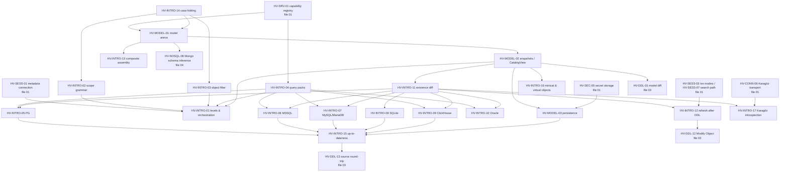

# 02 — Introspection and the Metadata Model (canonical algorithm catalog)

> Status: canonical, implementation-ready. Date: 2026-11-11.
> Scope: the in-memory metadata model (arena, object kinds per DBMS, stable identity), immutable catalog snapshots, cache persistence and migration, introspection levels and orchestration, schema-scope and object-filter grammars, catalog query packs, incremental introspection per DBMS, existence diffs, refresh after DDL, composite-object assembly, up-to-dateness checks, pre-introspected system catalogs, Karagöz-side introspection, and identifier case folding inside catalog queries.
> For implementation purposes this file **supersedes** the source specs listed under "Sources merged" in each section: `ALG-INTRO-01..08`, `ALG-SCOPE-01..02`, `ALG-MODEL-01` (datagrip/04), `ALG-ARCH-01` (datagrip/01, model/capability part only), `ALG-DBV-META-01, 02, 04, 05, 07, 08` (clients/dbeaver-02), and the catalog-query part of `ALG-I18N-05` (i18n/02). Where a source contradicts `verification/01-db-behavior-tests.md` or `verification/02-external-fact-check.md`, the verification report wins and this file already reflects it.
> Sibling catalogs: `01-connectivity-and-sessions.md` (HV-DRV/CONN/SEC/SESS), `03-ddl-and-schema-compare.md` (HV-DDL), `04-nosql-redis-mongo.md` (HV-NOSQL). Out of scope here: DDL text generation (`ALG-DBV-META-03/06/09` → file 03), Redis key trees and Mongo schema inference (file 04), SQL parsing/completion internals (SQL-tooling catalog).

---

## 0. Priority table

| ID | Name | Priority | Depends on |
|---|---|---|---|
| HV-MODEL-01 | Metadata model arena, identity and object kinds per DBMS | v1 | HV-DRV-01, HV-INTRO-14 |
| HV-MODEL-02 | Catalog snapshots (immutable, Arc-swapped) and the tri-state `CatalogView` | v1 | HV-MODEL-01 |
| HV-MODEL-03 | Cache persistence, format versioning, migration, crash safety | v1 | HV-MODEL-02, HV-SEC-05 |
| HV-INTRO-01 | Introspection levels, task types and orchestration | v1 | HV-MODEL-02, HV-SESS-01, HV-INTRO-02/03/04 |
| HV-INTRO-02 | Schema scope grammar and matcher | v1 | HV-INTRO-14 |
| HV-INTRO-03 | Object filter grammar, view filter and server-side pushdown | v1 | HV-INTRO-14 |
| HV-INTRO-04 | Catalog query packs and preprocessor | v1 | HV-DRV-01 |
| HV-INTRO-05 | PostgreSQL incremental introspection (xmin age, BETWEEN fix) | v1 | HV-INTRO-04, HV-INTRO-11 |
| HV-INTRO-06 | SQL Server incremental (modify_date + checksums + fingerprint) | v1.x (full introspection in v1) | HV-INTRO-04, HV-INTRO-11 |
| HV-INTRO-07 | MySQL/MariaDB incremental (CREATE_TIME + per-kind markers) | v1 (MySQL), v1.x (MariaDB marker) | HV-INTRO-04, HV-INTRO-11 |
| HV-INTRO-08 | SQLite change detection (schema_version + digest) | v1 | HV-INTRO-11 |
| HV-INTRO-09 | ClickHouse introspection and change detection | v1.x (full in v1) | HV-INTRO-04, HV-INTRO-11 |
| HV-INTRO-10 | Oracle incremental and levels | later | HV-INTRO-04, HV-INTRO-11 |
| HV-INTRO-11 | Existence diff merge and catalog delta | v1 | HV-MODEL-02 |
| HV-INTRO-12 | Refresh after DDL (affected-object analysis, transaction-aware) | v1 | HV-INTRO-11, HV-SESS-03, HV-SESS-07, `hacivat-sql` classifier |
| HV-INTRO-13 | Composite object assembly (indexes, keys, FKs) | v1 | HV-MODEL-01 |
| HV-INTRO-14 | Identifier case folding and name predicates in catalog queries | v1 | — (shared with SQL tooling ALG-I18N-05) |
| HV-INTRO-15 | Up-to-dateness check, staleness signals and background validation | v1 | HV-INTRO-05..09, HV-MODEL-03 |
| HV-INTRO-16 | Pre-introspected system catalogs and virtual-object overlays | v1.x | HV-MODEL-02, HV-MODEL-03 |
| HV-INTRO-17 | Remote introspection at Karagöz with RBAC-filtered deltas | v1.x | HV-INTRO-11, HV-CONN-06, Karagöz policy engine |

## 0.1 Dependency map



Consumers outside this file: SQL completion and resolution (sql-tooling-04 `CatalogView`, tri-state lookups), schema explorer (`hacivat-ui` tree, keyed by `ObjectKey` path), DDL generation and schema compare (file 03; consumes two snapshots), diagrams (datagrip/10 ALG-TOOL-04/11; consumes tables, views, FKs and virtual FKs from a snapshot), the local MCP server (`list_tables`, `describe_table`, `get_ddl`, `refresh_metadata` answered from snapshots with freshness metadata), and Karagöz audit ("objects affected" uses HV-INTRO-12's analyzer).

## 0.2 Conventions

- Evidence tags as in `docs/research/README.md`: `[Observed: …]`, `[Inferred: …]`, `[Unknown]`. "Verification status" uses **Observed** (seen in a source or a product), **Docker-verified** (reproduced in `verification/01-db-behavior-tests.md`, anchor cited), **Inferred**.
- Clean-room: DataGrip is proprietary — its shipped catalog SQL is described, never copied; Hacivat writes its own catalog queries from vendor documentation. DBeaver is Apache-2.0, but this file still uses own pseudocode only. No GPL/AGPL/SSPL code (Beekeeper GPL, RedisInsight/Compass SSPL) is used.
- Crate layout and Fluent key conventions follow the shared conventions of the algorithms folder: `hacivat-meta` (model, snapshots, persistence), `hacivat-introspect` (engine, per-DBMS introspectors, scope/filter), `hacivat-core` (capabilities, sessions), `hacivat-i18n` (Fluent). Core crates have no UI dependency (ADR 0001); they publish state and events.
- Fluent ids are lowercase-hyphenated with area prefixes `intro-` and `model-`. Server text is never interpolated into a translated sentence; it is shown verbatim in a separate field (ALG-I18N-08 rule).

## 0.3 Where Hacivat must beat the prior art (summary of decisions)

| Weakness observed | Where | Hacivat decision | Spec |
|---|---|---|---|
| No persistence; every session re-reads the catalog; a 14k-table Oracle schema needs > 60 s before completion appears | DBeaver CE (#42474, #42465) `[Observed: dbeaver-02 §7.1]` | Persistent per-connection cache, shown immediately, validated in the background | HV-MODEL-03, HV-INTRO-15 |
| No change detection at all; refresh = full re-read of a container | DBeaver CE `[Observed: dbeaver-02 summary 7]` | Incremental watermarks per DBMS + existence diff | HV-INTRO-05..11 |
| `age(xmin) <= N` re-reads ancient rows forever after 2^31 XIDs (negative age) | DataGrip's PG strategy as described in datagrip/04 `[Docker-verified: verification/01#pg-xmin-freeze]` | `age(xmin) BETWEEN 0 AND :txage`, full fallback when the watermark is too old | HV-INTRO-05 |
| `txid_current()` used for the watermark assigns an XID (a write) and trips no-write canaries | datagrip/04 (CurrentXid) `[Docker-verified: verification/01#pg-canary]` | Use snapshot functions (`pg_current_snapshot`), which never assign an XID | HV-INTRO-05 |
| MySQL treated as "no change marker" → full per schema | DataGrip 2024.3 `[Observed: help]` | `CREATE_TIME` is a reliable per-table DDL marker on 8.0/8.4 (verified), plus per-kind markers and overlap window | HV-INTRO-07 |
| `synchronized` loaders block readers; UI freezes | DBeaver (#21928) | Immutable snapshots, lock-free readers, single-flight loaders | HV-MODEL-02, HV-INTRO-01 |
| N+1 query storms (one query per table) | DBeaver (#42468) | Loader-owned bulk policy; aggregate queries returning one row per object | HV-INTRO-01, HV-INTRO-13 |
| Object filter hides objects from completion; `_`/`%` are wildcards; literal masks ignore case-sensitivity | DBeaver `[Observed: dbeaver-02 META-04]` | Scope (what is loaded) separate from view filter (what is shown); glob + `{regex}`; uniform per-dialect case rules | HV-INTRO-02, HV-INTRO-03 |
| Locale-dependent upper-casing of cache keys (Turkish JVM) | DBeaver (`AbstractObjectCache`) `[Inferred]`, #40901 `[Observed]` | `IdentKey` newtype built only by per-dialect folding; never locale case mapping | HV-INTRO-14 |
| Rename seen as drop + create (expanded tree state lost) | DBeaver META-07 | Identity by server id when the DBMS has one (PG OID, MSSQL object_id, CH uuid) | HV-MODEL-01, HV-INTRO-11 |
| Metadata filters are UX only, yet remote users see every schema | both (single-user tools) | Karagöz applies a mandatory RBAC scope before shipping deltas | HV-INTRO-17 |

---
## 1. Metadata model

### HV-MODEL-01: Metadata model arena, identity and object kinds per DBMS  `[v1]`

- **Sources merged:** ALG-ARCH-01 (datagrip/01-architecture-overview.md, capability/kind resolution part); datagrip/04-introspection-and-metadata-model.md §3.8–3.9 (kinds, per-kind properties, dual id+name references, `NameSurrogate`), §3.3.8 (NoSQL namespaces); clients/dbeaver-02-metadata-and-ddl.md §5.1 items 1–2, 11 (snapshot arena, `Facet<T>` lazy properties), ALG-DBV-META-07 recommendation (`ObjectKey` path identity); clients/sql-tooling-04-completion-and-resolution.md summary item 11 (what completion needs from the catalog).
- **Problem:** Represent every introspected object of every supported DBMS in one typed, compact, cheaply shareable structure that (a) keeps a stable identity across refreshes and renames, (b) keeps references valid across partial reloads, (c) separates cheap structural data from expensive facets (sources, statistics, privileges), and (d) never conflates server names with case-folded lookup keys.
- **Decision:**
  - One **flat `ObjectKind` enum** shared by all dialects (about 70 kinds in v1, `#[non_exhaustive]`), with a per-DBMS **kind schema** (allowed parent→child kinds) registered in the HV-DRV-01 capability registry. Rejected: one Rust type per DBMS object (DBeaver's per-dialect class trees) — explodes code size and makes diff/DDL generic code impossible; rejected: a stringly-typed property bag (DataGrip-style XML in memory) — no compile-time exhaustiveness for DDL producers (file 03 needs an exhaustive `match` over kind × dialect).
  - **Per-namespace arenas**: objects live in `Vec<Obj>` owned by a `NamespaceSnapshot` (one per schema/database/attached file/Redis DB/Mongo database), addressed by `ObjId { ns: NsIdx, idx: u32 }`. A refresh replaces one namespace's arena wholesale, so structural sharing happens at namespace granularity (HV-MODEL-02). Rejected: one global arena — every incremental refresh would copy the whole catalog; rejected: `Rc`/`Arc` object graph — cycles (FK↔table), no cheap snapshotting.
  - **Two identities**: `ObjId` is valid only inside one snapshot generation; `ObjectKey` is the stable identity used by the UI tree, persisted overlays, filters, history, MCP, and diff matching. `ObjectKey = { kind, path: [Name] (exact server names, ancestors first), server_id: Option<ServerId>, overload_sig: Option<Sig> }`. Equality prefers `server_id` when both sides have one (so a rename keeps identity — beats DBeaver META-07), else path + overload signature.
  - **References store both id and name** (`Ref { target_key_by_name, server_id, resolved: Option<ObjId> }`) as DataGrip does, so a reference survives a partial reload of the target namespace and is re-resolved after merge (HV-INTRO-11).
  - **Facets** (source text, statistics, privileges/grants, partition details, dependency lists) are side tables with their own `LoadState`, never required for an object to exist. Source text lives in a content-addressed store (HV-MODEL-03); the model keeps `(hash, len)`.
  - **Names** are stored exactly as the server reports them (`Name` = `CompactString`); lookup keys are a separate `IdentKey` computed by HV-INTRO-14 per dialect and collation. No code path upper/lower-cases a `Name` with locale rules.
  - **NoSQL boundary:** Redis keys and Mongo documents never enter the model. Redis contributes only `Database(index)` namespaces with keyspace statistics and module list; keys are HV-NOSQL-02's key tree. Mongo contributes `Database → Collection/View/TimeSeries → Index`, plus `InferredField` objects produced by HV-NOSQL-08 (flagged `inferred`, with a presence ratio), so completion and the grid can use them without pretending they are declared columns.
- **Inputs / outputs:** introspector rows (HV-INTRO-05..10, 13) → `NamespaceSnapshot`; queries: `children(ObjId, kind)`, `lookup(ns, kind_group, IdentKey)`, `resolve(Ref)`, `key(ObjId) -> ObjectKey`.
- **Algorithm (namespace build):**
  1. Receive the parent chain (root → database → schema) and the rows of every kind for this namespace at the requested level.
  2. Insert major objects (tables, views, routines, types, sequences …) in dependency order: types and domains first, then relations, then routines, then sequences, then child objects (columns, indexes, keys, FKs, checks, triggers, rules, policies, partitions). Assign `idx` in insertion order; record `parent` and `kind`.
  3. Build per-kind-group name indexes keyed by `IdentKey` (HV-INTRO-14). Kind groups follow the server's namespace rules: PostgreSQL relations (tables, views, matviews, sequences, indexes, foreign tables, composite types) share one group because they share `pg_class`; SQL Server objects share `sys.objects` names per schema; MySQL tables and views share one group; routines are grouped by name and disambiguated by `overload_sig`.
  4. Resolve intra-namespace references immediately; leave cross-namespace references unresolved (`resolved = None`) for the snapshot-level resolver (HV-MODEL-02 step 4).
  5. Freeze: the arena becomes immutable (`Arc<NamespaceSnapshot>`).
- **Data structures:**
  ```text
  enum ObjectKind { Root, Database, Schema, Table, View, MaterializedView, ForeignTable, Column,
                    Index, PrimaryKey, UniqueKey, ForeignKey, Check, Default, Trigger, Rule, Policy,
                    Routine, Procedure, Aggregate, Argument, Sequence, Domain, EnumType, CompositeType,
                    RangeType, AliasType, TableType, Synonym, Extension, Collation, Operator, OperatorClass,
                    OperatorFamily, Cast, Language, AccessMethod, ForeignDataWrapper, ForeignServer,
                    UserMapping, EventTrigger, Role, User, Login, Tablespace, Partition, Subpartition,
                    Event /*MySQL*/, VirtualTableModule /*SQLite*/, Dictionary /*ClickHouse*/,
                    RowPolicy, SettingsProfile, Quota /*ClickHouse*/, Package, PackageBody, ObjectType /*Oracle*/,
                    DbLink, Collection, MongoView, TimeSeries, InferredField /*Mongo*/, RedisDatabase,
                    RedisModule, … }
  struct Obj { kind: ObjectKind, name: Name, parent: Option<u32>, server_id: Option<ServerId>,
               state: StateMark, flags: ObjFlags /*system, temp, server_generated_name, invalid, inferred*/,
               props: KindProps /*enum: TableProps, ColumnProps, IndexProps, RoutineProps, …*/,
               first_child: u32, child_count: u32 }   // children contiguous after build
  enum ServerId { Oid(u32), ObjectId(i32), ObjNum(u64), Uuid([u8;16]), RowId(i64) }
  enum StateMark { None, Xmin(u32), Modified(ServerTime), Created(ServerTime), SchemaVersion(u32), Hash(u64) }
  struct Ref { by_name: KeyPath, server_id: Option<ServerId>, resolved: Option<ObjId> }
  struct Facet<T> { state: LoadState, value: Option<Arc<T>> }
  ```
  `ColumnProps` carries: ordinal, declared type text (raw, as the server prints it), parsed `TypeRef` (Ref to a type object or builtin), nullability, default expression (raw text, never re-quoted heuristically — DBeaver pitfall), generated/identity kind and expression, collation, comment, ClickHouse `default_kind` (DEFAULT/MATERIALIZED/ALIAS/EPHEMERAL), SQLite `hidden` (0/1/2/3).
- **Rust placement:** `hacivat-meta::model` (`ObjectKind`, `Obj`, `KindProps`, `ObjectKey`, `Ref`, `Facet`), `hacivat-meta::kinds` (per-DBMS kind schema tables, registered through `hacivat-core::caps`). Key API:
  ```rust
  pub struct NamespaceSnapshot { pub key: NsKey, objs: Vec<Obj>, names: NameIndex, pub level: Level,
                                 pub watermark: Watermark, pub loaded_at: SystemTime, pub generation: u64 }
  impl NamespaceSnapshot {
      pub fn children(&self, id: u32, kind: ObjectKind) -> impl Iterator<Item = (u32, &Obj)>;
      pub fn lookup(&self, group: KindGroup, key: &IdentKey) -> SmallVec<[u32; 2]>;
      pub fn object_key(&self, id: u32) -> ObjectKey;
  }
  pub trait KindSchema { fn allowed_children(&self, parent: ObjectKind) -> &'static [ObjectKind];
                         fn kind_group(&self, k: ObjectKind) -> KindGroup; }
  ```
  Crates to evaluate: `compact_str` (0.8, version to check) or `smol_str` for names; `smallvec` (1.x); `hashbrown` (0.15) for name indexes; `serde` (1.x) derive for persistence.
- **Per-DBMS matrix (namespaces and kinds in v1):**

  | DBMS | Namespace chain | Major kinds | Child kinds | Server id | Notes |
  |---|---|---|---|---|---|
  | PostgreSQL | Root → Database → Schema | Table (r/p), View, MaterializedView, ForeignTable, Sequence, Routine/Procedure/Aggregate, Domain/Enum/Composite/Range type, Collation, Operator(+Class/Family), Extension (db), Cast, Language, AccessMethod, FDW → ForeignServer → UserMapping, EventTrigger, Role/Tablespace (root) | Column, Index, PK/UK/FK/Check/Exclusion, Default, Trigger, Rule, Policy, Partition | OID (`u32`; reusable after wrap) | `pg_class` kinds share one name group |
  | MySQL / MariaDB | Root → Schema (= database) | Table, View, Routine (function/procedure), Event, User/Role (root) | Column, Index, PK/UK/FK, Check (8.0.16+ / MariaDB 10.2+), Trigger, Partition → Subpartition | none stable in `information_schema` (InnoDB `TABLE_ID` needs extra privilege) | rename = drop + create unless `TABLE_ID` available |
  | SQL Server | Root → Database → Schema | Table, View, Routine, AliasType, TableType, Sequence, Synonym, Default/Rule (legacy); Login, LinkedServer (root); Role, Assembly, Filegroup, PartitionFunction/Scheme, CMK/CEK (database) | Column, Index (incl. fulltext), PK/UK/FK, Check, Default, Trigger, SecurityPolicy | `object_id` (per database); index id = (object_id, index_id) | names compared by database collation |
  | SQLite | Root → Schema (`main`, `temp`, attached) | Table (incl. WITHOUT ROWID, STRICT), View, Trigger, VirtualTable, VirtualTableModule, Routine (from `function_list`), Collation | Column, Index, PK/UK/FK, Check | none (`rowid` of `sqlite_schema` row is not stable) | `temp` is per connection |
  | ClickHouse | Root → Schema (= database) | Table (engine + engine params), View, MaterializedView, Dictionary, Routine (SQL UDF, root-level), User, Role, RowPolicy, SettingsProfile, Quota | Column (default_kind), Index (data-skipping), Projection, Partition key / sorting key as table props | table `uuid` (Atomic engine) | no constraints except CHECK-like `CONSTRAINT … CHECK` |
  | Redis | Root → RedisDatabase (index 0..N-1, or a single DB in cluster mode) | RedisModule (root) | — (keys are not model objects) | DB index | keyspace stats as `RedisDatabase` props |
  | MongoDB | Root → Database | Collection, MongoView, TimeSeries | Index, InferredField (nested path, type lattice, presence) | collection UUID (`listCollections` `info.uuid`) | validator `$jsonSchema` kept as a facet |
  | Oracle (later) | Root → Schema (user) | Table, View, MaterializedView, Package/Body, Routine, ObjectType, Sequence, Synonym, DbLink, Cluster | Column, Index, PK/UK/FK, Check, Trigger, Partition | `obj#` | levels L1–L3 (HV-INTRO-10) |

- **Complexity / performance notes:** target memory ≤ 250 bytes per column object and ≤ 600 bytes per table object excluding facets, so 15k tables / 160k columns (DBeaver #42465 scale) fit in ≈ 50 MB. Name lookups O(1) average. Children are contiguous (`first_child`, `child_count`) after build, so iteration needs no allocation.
- **Verification status:** kind hierarchy per DBMS Observed (datagrip/04 §3.8 from model caches; dbeaver-02 §3.1); memory targets Inferred (to be measured in the GPUI spike harness).
- **i18n notes:** kind labels are whole-phrase Fluent messages with plural selectors (`model-kind-table = { $count -> [one] table *[other] tables }`), one key per kind, overridable per dialect where terminology differs (`model-kind-schema-mysql = database`). Names are user data: displayed verbatim, never translated, never case-mapped; explorer sorting uses ICU4X collation of the UI locale for display only, never for identity or DDL order. Bidi/invisible characters in names get a visible badge (`model-name-has-invisible-chars`).
- **Edge cases (exhaustive):**
  1. Two objects whose names differ only by case (PG `"Users"` and `users`) → two objects, two different `IdentKey`s; both valid.
  2. Same name in different kind groups (PG function `f` and table `f`) → no conflict.
  3. Overloaded routines → same name, `overload_sig` = normalized argument type list; identity includes it.
  4. Server-generated constraint/index names (`t_pkey`, `SYS_C0012`, `PK__t__3213E83F…`) → `flags.server_generated_name`; diff (file 03) may match them structurally.
  5. Object whose parent is outside the scope (FK to a table in a non-introspected schema) → `Ref.resolved = None`, `by_name` kept; resolution returns `Unknown`, not `Missing`.
  6. OID reuse after wraparound (PG) or `obj#` reuse (Oracle) → identity check compares `(server_id, kind)` and treats a changed name with a changed creation marker as a new object (HV-INTRO-11).
  7. Inherited/partitioned tables: child partitions are `Table` with `props.partition_of = Ref`; inherited columns flagged `inherited` (not duplicated in DDL).
  8. Temp objects (PG `pg_temp_N`, SQLite `temp`, SQL Server `#t`) → `flags.temp`, owned by a session namespace, never persisted (HV-MODEL-03).
  9. Mongo `InferredField` paths containing `.` or `$` in key names → path stored as a vector of segments, never a dotted string.
  10. ClickHouse `Replicated*` tables on a cluster → model reflects only the node connected to (noted in props).
  11. Unknown kind returned by a newer server (e.g. a PG 19 relkind) → stored as `ObjectKind::Unknown { raw }` with name, so the tree still shows it; DDL producers refuse it explicitly.
  12. Names with NUL, lone surrogates (SQL Server UTF-16 data) → stored lossily with a `flags.lossy_name` marker and never used to generate DDL.
  13. Non-NFC names from the server → stored exactly; no normalization (servers compare bytes/code units).
  14. Extremely wide tables (SQL Server 30k sparse columns, PG 1600) → children contiguous; no quadratic paths.
- **Test cases (input → expected):**
  1. PG rows: table `public.t` (oid 16400) with columns `a`, `b` → `ObjectKey{Table, [db, public, t], Oid(16400)}`; `children(t, Column)` yields `a`, `b` by ordinal.
  2. Rename: before `t`(oid 16400), after `u`(oid 16400) → `object_key(before) == object_key(after)` by server id.
  3. MySQL rename `t`→`u` (no server id) → keys differ (drop + create) and the UI receives a `renamed?` hint only if HV-INTRO-11's structural heuristic fires.
  4. Overloads `f(int)`, `f(text)` → two objects, lookup by name returns both, `resolve(f(text))` picks one.
  5. FK to `other_schema.t2` not in scope → `resolved=None`; `CatalogView::resolve` → `Unknown`.
  6. `[docker: postgres:16]` create `"Users"` and `users`; introspect → 2 tables; lookup `IdentKey(users)` (from unquoted input) → only `users`.
  7. `[docker: clickhouse/clickhouse-server:24.8]` `CREATE TABLE t (a UInt8, b UInt8 MATERIALIZED a*2) ENGINE=MergeTree ORDER BY a` → column `b.default_kind = Materialized`, table `engine = MergeTree`, `uuid` set.
  8. `[docker: keinos/sqlite3]` `CREATE TABLE g(a, b AS (a*2) STORED)` → column `b.hidden = 3` (stored generated), `generated_kind = Stored`.
  9. `[docker: mongo:7]` collection `orders` with docs `{a:{"x.y":1}}` → `InferredField` path `["a", "x.y"]` (one segment containing a dot).
- **Used by:** Hacivat (all catalog consumers) | Karagöz (same model types for agent-side introspection, HV-INTRO-17) | Perde (only hashed fingerprints, never full models by default).

### HV-MODEL-02: Catalog snapshots (immutable, Arc-swapped) and the tri-state `CatalogView`  `[v1]`

- **Sources merged:** ALG-DBV-META-01 Hacivat recommendation (immutable `Arc<CatalogSnapshot>` via `arc_swap`, `LoadState`, negative cache with TTL), dbeaver-02 §5.1 items 2, 3, 6 (cache-only reads that enqueue loads); clients/sql-tooling-04 ALG-SQL-SEMA-01/02 (layered `CatalogView`, tri-state `Found | Missing | Unknown`); datagrip/04 §3.5 (name-based references re-resolved after merge).
- **Problem:** Many readers (explorer, completion on every keystroke, diagnostics, diagrams, MCP tools, schema compare) must read a consistent catalog without locks while introspection updates it in the background; a long operation (schema compare) needs a stable view while refreshes continue.
- **Decision:** One `Catalog` per connection profile holds `ArcSwap<CatalogSnapshot>`; a `CatalogSnapshot` is an immutable persistent map from `NsKey` to `Arc<NamespaceSnapshot>` plus per-container `LoadState`s. Writers (only the HV-INTRO-01 scheduler) build a new namespace arena, then publish a new snapshot that shares every untouched namespace (`Arc` clone) — O(number of namespaces) per publish, not O(objects). Readers call `catalog.current()` and keep the `Arc` as long as they like (schema compare "pins" a generation). Lookups are **tri-state**: `Found`, `Missing` (only when the container is loaded at a level that would contain the object and no filter excludes it), `Unknown` (container not loaded, failed, out of scope, or name references an unmodelled area). Rejected: `RwLock<Model>` (DBeaver-style synchronized loaders: UI freezes, #21928); rejected: per-object `Arc` with interior mutability (no consistent multi-object view); rejected: binary "found / not found" (produces false "unknown table" diagnostics on partially loaded catalogs).
- **Inputs / outputs:** new or replaced `NamespaceSnapshot`s and `LoadState` transitions → new `CatalogSnapshot` generation + `CatalogEvent`s; `CatalogView` queries → `Lookup<Def>`.
- **Algorithm:**
  1. `publish(changes)`: `old = current.load_full()`; `next = old.clone_shallow()`; apply namespace inserts/replacements/removals and load-state updates; `next.generation = old.generation + 1`.
  2. Run the cross-namespace reference resolver only for references that point into replaced namespaces or originate from them (tracked via a reverse index `ns → referencing ns set`).
  3. Compute the `CatalogDelta` (from HV-INTRO-11) and attach it to the event; `current.store(Arc::new(next))`.
  4. Broadcast `CatalogEvent::Published { generation, delta }` on a `tokio::sync::broadcast` channel; the UI maps deltas to tree updates keyed by `ObjectKey` path (keeps expansion state — HV-INTRO-11 handles renames).
  5. `CatalogView::lookup(path, kind)`: walk the dialect search path (from HV-SESS-07 session state) → for each namespace: if `LoadState` is not `Loaded` at a sufficient level → remember `Unknown` and enqueue a background load (cache-only read, never blocking); if loaded and found → `Found`; if loaded, not found, and the negative-cache entry is younger than its TTL → `Missing`; at the end return `Found` if any, else `Unknown` if any namespace was unknown, else `Missing`.
  6. Negative cache: a `Missing` answer for a name typed by the user schedules (at most once per TTL = 30 s, per namespace) a cheap `exists?` probe (HV-INTRO-15), so objects created by other sessions appear without a full refresh.
- **Data structures:**
  ```rust
  pub struct Catalog { current: ArcSwap<CatalogSnapshot>, events: broadcast::Sender<CatalogEvent> }
  pub struct CatalogSnapshot { pub generation: u64, pub server: Arc<ServerInfo>,
                               pub namespaces: im::OrdMap<NsKey, Arc<NamespaceSnapshot>>,
                               pub states: im::OrdMap<ContainerKey, LoadState>,
                               pub overlays: Arc<Overlays> /* HV-INTRO-16 */ }
  pub enum LoadState { NotLoaded, Loading { generation: u64, level: Level },
                       Loaded { level: Level, at: SystemTime, watermark: Watermark, stale: bool },
                       Failed { at: SystemTime, error: IntroError, retry_after: Duration }, OutOfScope }
  pub enum Lookup<T> { Found(T), Missing(MissingReason), Unknown(UnknownReason) }
  pub trait CatalogView: Send + Sync {
      fn lookup(&self, path: &[NamePart], kind: KindGroup) -> Lookup<Def>;
      fn children(&self, parent: &ObjectKey, kind: ObjectKind) -> Lookup<Vec<Def>>;
      fn freshness(&self, ns: &NsKey) -> Freshness; // loaded_at, watermark, stale
  }
  ```
  Session overlays (temp objects, uncommitted DDL of this console, file-level DDL simulation) are layered **above** the snapshot by the SQL-tooling resolver; this file only provides the base layer.
- **Rust placement:** `hacivat-meta::snapshot` (`Catalog`, `CatalogSnapshot`, `LoadState`, `CatalogView` impl), `hacivat-meta::resolve` (cross-namespace resolver). Crates: `arc-swap` (1.7, version to check), `im` (15.x) or `rpds` (1.x) for persistent maps — pick by benchmark (im's `OrdMap` with ~10³ namespaces is sufficient), `tokio` (1.x) broadcast.
- **Per-DBMS matrix:** search path for step 5 — PG: `pg_temp` (relations/types) → `search_path` entries with `$user` → `pg_catalog` (implicit first if absent); MySQL/MariaDB: current database; SQL Server: user default schema → `dbo` (→ `sys` for system views); SQLite: `temp` → `main` → attached in attach order; ClickHouse: current database; Mongo: current database; Oracle: current schema → private synonyms → public synonyms.
- **Complexity / performance notes:** publish O(N_namespaces · log) + O(references into replaced namespaces); reader `load_full` is one atomic increment; completion lookups never allocate on hits. Old generations are freed when the last reader drops its `Arc`.
- **Verification status:** Inferred (architecture); tri-state semantics Observed in pgls (`lookup.rs`, sql-tooling-04).
- **i18n notes:** freshness shown via `intro-freshness-loaded-ago = Loaded { $ago }` where `$ago` is preformatted with ICU4X relative time (Fluent `NUMBER()` in fluent-rs is locale-insensitive — `verification/02-external-fact-check.md` P31 — so counts and durations are preformatted). `UnknownReason`/`MissingReason` map to message ids (`intro-unknown-not-loaded`, `intro-unknown-out-of-scope`, `intro-missing-not-found`).
- **Edge cases (exhaustive):**
  1. Reader holds generation N for minutes (schema compare) while N+5 is current → memory of replaced namespaces retained until released; expose `pinned_generations()` diagnostics.
  2. Two publishes race → the scheduler is the only writer per connection (HV-INTRO-01), so no CAS loop is needed; still use `rcu` to be safe against misuse.
  3. Namespace removed (schema dropped) while a reader resolves into it → reader's generation still contains it (consistent), next generation reports `Missing`.
  4. Lookup in a namespace being loaded for the first time → `Unknown` (never `Missing`), no diagnostic.
  5. Lookup in a namespace whose last load `Failed` (permission) → `Unknown` with reason; retries back off.
  6. Object filtered by the **view filter** → still `Found` (filters never affect resolution); object outside the **scope** → `Unknown`.
  7. Name created by another session after a `Missing` answer → found after the TTL probe or the next incremental pass.
  8. Search path change in the session (HV-SESS-07) → lookups use the new order immediately; no republish needed.
  9. Connection switches database (HV-CONN-02 bounds rewrite) → snapshot for the new database is a different `NsKey` subtree; the old one stays cached.
  10. Very many namespaces (PG cluster with 5,000 schemas) → `im::OrdMap` publish cost measured; fall back to a two-level map (database → schemas) if > 1 ms.
- **Test cases (input → expected):**
  1. Snapshot with `public` loaded and `{t}`; lookup `t` → `Found`; lookup `zz` → `Missing`.
  2. `sales` NotLoaded; lookup `sales.x` → `Unknown(NotLoaded)` and exactly one background load enqueued even after 100 lookups.
  3. Publish replacing `public` → readers holding the old `Arc` still see old `t`; new readers see the new arena; untouched namespace `Arc::ptr_eq` between generations.
  4. View filter hides `audit_*`; lookup `audit_log` → `Found`.
  5. Scope excludes schema `hr`; lookup `hr.emp` → `Unknown(OutOfScope)`.
  6. `[docker: postgres:16]` session A runs `CREATE TABLE public.n(a int)` outside Hacivat; Hacivat console types `select * from n` → first lookup `Missing`, TTL probe finds it, next lookup `Found`, diagnostic cleared.
  7. Property test: 10k random publish/lookup interleavings on 8 threads → no torn reads (each lookup's results all come from one generation).
- **Used by:** Hacivat | Karagöz (agent keeps its own `Catalog` per managed database for delta computation).

### HV-MODEL-03: Cache persistence, format versioning, migration and crash safety  `[v1]`

- **Sources merged:** ALG-MODEL-01 (datagrip/04: tmp+rename, header, flat records, content-addressed sources, migration chain, discard on unknown version); datagrip/04 §3.10 (`format-version`, separate source store with per-file meta); ALG-DBV-META-01 recommendation and dbeaver-02 §5.1 item 7, §7.2 (persist per-connection snapshot in SQLite with format version; DBeaver #42474 "store raw rows" idea); clients/sql-tooling-04 §6 item 2 (snapshot cached on disk per profile, encrypted at rest with the profile key).
- **Problem:** Show a usable catalog instantly on connect (and offline), survive crashes mid-write, migrate across Hacivat versions, never leak secrets, and treat the cache as disposable.
- **Decision:**
  - Storage = **one SQLite database per connection profile and major format version**: `<data_dir>/catalog/<profile-uuid>.v<major>.sqlite` (WAL mode). Each namespace is one row whose payload is `zstd(postcard(NamespaceSnapshot))`; sources are content-addressed rows; watermarks and level live in columns. A namespace refresh is one SQLite transaction → atomic and crash-safe without tmp+rename of a monolithic file, and loading is lazy per namespace. Rejected: DataGrip-style monolithic XML with tmp+rename — rewrites tens of MB per change and must be parsed fully at startup; rejected: storing raw catalog rows and replaying them (DBeaver #42474 idea) — robust to model changes, but doubles the introspection code path and still needs versioning of the queries; our format version + discard rule gives the same robustness because the cache is disposable.
  - **Versioning:** `format = (major, minor)`. Minor bumps are additive (new optional fields with serde defaults) and are readable by older minors of the same major (unknown fields ignored by a tagged envelope). Major bump → new file name (`.v<major+1>`), old file left untouched so a downgraded Hacivat keeps working; files of majors not opened for 30 days are garbage-collected. A file whose header says a *newer minor* than we know is read (forward-compatible) but never rewritten by us (written to a sibling namespace row version instead — see step 5).
  - **Secrets never enter the cache** (no passwords, tokens, connection strings with credentials); the profile key is the UUID. Object comments and source text are stored (they are catalog data).
  - **Encryption at rest:** payloads and sources are encrypted with a per-profile data key from HV-SEC-05 (XChaCha20-Poly1305 per row; key in the OS keychain) when the profile is marked *sensitive* or is managed by Perde/Karagöz; plaintext with `0600` permissions otherwise. Org policy may set `catalog_persistence = off` (memory only). *(Default for unmanaged profiles is an open product decision — see §6.)* Rejected: SQLCipher (build complexity, OpenSSL dependency) — application-level row encryption is enough because we never query inside payloads.
  - **User data is not cache:** virtual FKs/columns/views, annotations, per-object notes, and scope/filter settings are stored in the profile config (versioned, never auto-discarded), keyed by `ObjectKey`.
- **Inputs / outputs:** `NamespaceSnapshot` + watermark → persisted row; profile open → lazily loaded namespaces with `LoadState::Loaded { stale: true }` until validated (HV-INTRO-15).
- **Algorithm:**
  1. **Open:** open/create the file; `PRAGMA journal_mode=WAL; PRAGMA synchronous=NORMAL`; read `header` (`format_major`, `format_minor`, `app_version`, `dbms`, `server_fingerprint`, `created_at`). If `format_major` ≠ ours → impossible by naming (different file). If the file fails to open or `PRAGMA quick_check` fails after an error → rename to `*.corrupt-<ts>` and start empty (emit `model-cache-rebuilt`).
  2. **Server identity check:** compare stored `server_fingerprint` (PG `system_identifier` + database OID when readable, else host+port+database+`pg_postmaster_start_time` lineage; MSSQL database fingerprint; MySQL `@@server_uuid` + schema names; SQLite file path + inode; ClickHouse `serverUUID()` when available, else host+port) with the live server after connect. Mismatch (profile now points to another server) → mark every namespace `stale` and force full introspection per namespace on first access; keep the old rows until replaced so offline completion still works.
  3. **Load namespace on demand:** `SELECT payload, watermark, level, loaded_at, minor FROM namespace WHERE ns_key = ?` → decrypt → decompress → deserialize with the minor-version migration chain (`migrate_minor(from, to)` functions, each pure and tested) → publish via HV-MODEL-02 with `stale = true`.
  4. **Save namespace:** after a successful publish, in a background task: serialize → compress (zstd level 3) → encrypt (if required) → `BEGIN IMMEDIATE; UPSERT namespace; UPSERT sources (new hashes); DELETE orphaned object_source rows for this ns; COMMIT`. Debounce saves per namespace (1 s) and coalesce.
  5. **Multi-instance:** two Hacivat processes on the same profile: SQLite serializes writers; each row carries `generation` and `writer_id`; a writer only overwrites if its watermark is not older than the stored one (compare-and-set in SQL), so an older instance never clobbers newer data.
  6. **Sources:** `source(hash BLOB PRIMARY KEY, len, zstd_text)` with `blake3` hash of the exact UTF-8 text; `object_source(ns_key, object_key_blob, source_kind, hash)`; garbage-collect unreferenced hashes on save.
  7. **Eviction:** cap per-profile cache (default 512 MB) and global cache (default 4 GB); evict least-recently-loaded namespaces first; never evict the current database's namespaces.
- **Data structures (SQLite schema, illustrative):**
  ```text
  header(key TEXT PRIMARY KEY, value BLOB)
  namespace(ns_key BLOB PRIMARY KEY, kind INT, level INT, minor INT, generation INT, writer_id BLOB,
            watermark BLOB, digest BLOB, loaded_at INT, last_used_at INT, payload BLOB)
  source(hash BLOB PRIMARY KEY, len INT, text BLOB)
  object_source(ns_key BLOB, object_key BLOB, source_kind INT, hash BLOB, PRIMARY KEY(ns_key, object_key, source_kind))
  ```
- **Rust placement:** `hacivat-meta::persist` (`CacheStore`, `NamespaceRecord`, `migrate_minor`), encryption through `hacivat-secrets::store::DataKey`. Crates: `rusqlite` (0.3x with `bundled`, version to check), `postcard` (1.x) with `serde`, `zstd` (0.13), `blake3` (1.x), `chacha20poly1305` (0.10, XChaCha variant), `fs4`/`fd-lock` only if a whole-file lock proves necessary.
- **Per-DBMS matrix:** server fingerprint sources as in step 2; temp namespaces (PG `pg_temp_*`, SQLite `temp`, MSSQL `tempdb` `#` tables) are never persisted; SQLite profiles additionally store the file's `(dev, inode)` and `schema_version` per schema; Redis/Mongo namespaces persist only collection/index/inferred-field data (no keys or documents).
- **Complexity / performance notes:** load of a 160k-column schema payload (≈ 8–15 MB uncompressed, ≈ 2–4 MB zstd) target < 300 ms on a laptop SSD; warm completion < 1 s from cold start (DBeaver #42465 scale target).
- **Verification status:** Inferred (design); DataGrip format/layout Observed (datagrip/04 §3.10); DBeaver lack of persistence Observed (#42474).
- **i18n notes:** messages `model-cache-rebuilt` (with `$reason` selector: `corrupt`, `server-changed`, `incompatible`), `model-cache-offline` ("Showing cached metadata from { $date }" — date preformatted with ICU4X), `model-cache-disabled-by-policy`. Persisted data is locale-invariant: no localized strings, no display-sorted lists.
- **Edge cases (exhaustive):**
  1. Kill -9 during save → WAL rollback; previous row intact.
  2. Disk full during save → transaction fails; in-memory snapshot unaffected; warn once (`model-cache-write-failed`).
  3. Read-only data directory → memory-only mode.
  4. File from a newer minor → read, never overwrite unknown fields (row rewritten only with our own minor after a fresh introspection of that namespace).
  5. File from an older minor → migrated in memory; rewritten on next save.
  6. Older Hacivat opens a newer major's profile → it uses its own `.v<major>` file (may be empty) — no corruption.
  7. Same profile UUID imported on another machine (settings sync) → server fingerprint check decides validity; cache files are not synced by default.
  8. Profile deleted → its cache files deleted.
  9. Keychain unavailable for an encrypted profile → cache disabled for that session, introspection still works.
  10. Clock jumps (laptop) → `loaded_at` only for display; correctness relies on server-side watermarks.
  11. Two windows of one process → single `CacheStore` per profile (shared `Arc`).
  12. Corrupted payload of one namespace (bit flip) → AEAD/zstd/postcard failure → drop that row only, re-introspect namespace.
  13. Cache for a server whose version changed (minor upgrade) → keep; major upgrade (PG 16→17 via `pg_upgrade` changes `system_identifier`? — not guaranteed) → server version change forces full re-introspection of every namespace (catalog semantics may change).
- **Test cases (input → expected):**
  1. Save namespace, kill process inside `COMMIT` (fault injection) → reopen → old row readable, generation unchanged.
  2. Write v1.2 file, open with v1.3 code → loads, migration `1.2→1.3` applied, saved as 1.3.
  3. Write v1.3 file, open with v1.2 code → loads (unknown fields ignored), no save of that row until re-introspected.
  4. Write v1.x file, open with v2.0 code → new `.v2` file; `.v1` untouched.
  5. Profile host changed from server A to server B (different `system_identifier`) → all namespaces stale, first access triggers full introspection, offline completion still works before reconnect.
  6. Encrypted profile, wrong key → rows undecryptable → rebuilt, warning shown, no panic.
  7. `[docker: postgres:16]` introspect 2,000 tables, restart Hacivat offline → explorer shows 2,000 tables from cache within 300 ms; reconnect → incremental validation (HV-INTRO-15) runs, no full re-read.
  8. Secrets scan: grep the cache file for the profile password after a session → not found.
- **Used by:** Hacivat | Karagöz (agent caches per managed database with the same format; encrypted always).

---
## 2. Introspection engine, levels, scope and filters

### HV-INTRO-01: Introspection levels, task types and orchestration  `[v1]`

- **Sources merged:** datagrip/04 §3.1 (task types: complete, incremental, fragment, brief, check up-to-dateness, elevation, refresh affected; one introspection per data source at a time; periodic interval), ALG-INTRO-04 (Oracle levels L1–L3 with auto thresholds; generalized here), ALG-DBV-META-02 (lazy hierarchical loading, bulk vs per-parent, cancellation never publishes partial state; loader-owned bulk policy, single-flight, parallel metadata pool), ALG-DBV-META-01 steps 1 and 8 (coalescing, cancellation keeps cache consistent), dbeaver-02 §5.1 items 3–5, 12 (load-state machine, separate metadata connection, scale targets).
- **Problem:** Decide *what* to load, *how much* of it, *when*, and *on which connection*, so that the explorer streams results progressively, completion has names quickly, huge schemas stay responsive, the database is not hammered, and cancelled or failed loads never leave a half-filled catalog.
- **Decision:**
  - **Levels for every DBMS** (generalizing DataGrip's Oracle-only L1–L3): `Names` (major object names + routine signatures), `Structure` (everything except source text and expensive facets), `Sources` (source text of views/routines/triggers + definitions). Facets (statistics, privileges, dependency lists, partition bounds detail) are loaded on demand only. Rejected: DBeaver's per-container lazy-only loading (completion has nothing until the user expands nodes) and DataGrip's level-less mode for non-Oracle DBMSs (huge PG/MySQL schemas load everything).
  - **Auto level per namespace** from a cheap object count (taken during the `Names` pass): current namespace → `Sources` if ≤ 2,000 major objects, `Structure` if ≤ 20,000, else `Names`; other user namespaces → `Structure` if ≤ 5,000, else `Names`; system namespaces → `Names` (plus pre-introspected snapshots, HV-INTRO-16). User overrides per database/schema, inherited by children (DataGrip's pill semantics). *(Threshold defaults are a product decision; values here are the engineering proposal — see §6.)*
  - **Elevation:** opening an object's source, the Modify Object dialog (file 03), or hovering a column list for an object below the needed level triggers a **fragment** load of that object at the needed level — never a namespace-wide raise.
  - **Task types:** `Full(ns)`, `Incremental(ns)`, `Fragment(ns, [ObjectKey])`, `Brief(ns)` (names only, used for progressive first paint), `Elevate(ObjectKey, Level)`, `CheckState([ObjectKey])` (HV-INTRO-15), `ScopeRefresh` (list databases/schemas).
  - **Scheduler:** exactly one scheduler per connection profile; tasks are coalesced (same ns + mode), deduplicated (single-flight futures keyed by `(ns, facet, level)`), prioritized (user-visible > completion-triggered > background validation > periodic), and executed on the **metadata connection pool** from HV-SESS-01 (1 connection by default, up to 3 for parallel independent catalog queries; SQLite and single-connection profiles share the user session under a read lock).
  - **Loader-owned bulk policy:** a request for children of one table runs a per-object query immediately; if ≥ 3 distinct objects of the same namespace are requested within 500 ms, or the namespace has < 2,000 tables, it upgrades to one bulk query per kind for the namespace. Per-kind bulk queries (columns, constraints, indexes, triggers) run in parallel on the pool.
  - **Atomic publish per namespace:** results accumulate in a private builder; only a complete namespace (or a complete fragment) is published (HV-MODEL-02). Cancellation or error → nothing published; previous state stays, `LoadState::Failed` only if there was no previous state.
- **Inputs / outputs:** triggers (connect, explorer expand, completion miss, DDL executed, manual refresh, periodic timer, scope change, Karagöz "schema changed" push) → tasks → published namespaces + progress events.
- **Algorithm:**
  1. On connect: load persisted namespaces lazily (HV-MODEL-03); run `ScopeRefresh` (databases/schemas with cheap counts); compute the target namespace set from the scope (HV-INTRO-02).
  2. For the current namespace: if persisted → `Incremental` (validation, HV-INTRO-15); else `Brief` → publish names → `Full` at the auto level.
  3. For other in-scope namespaces: if persisted → `Incremental` in background (lower priority); else `Brief` on first expansion, `Full` at auto level after.
  4. Each task: acquire a metadata connection (read-only, autocommit, application name `Hacivat (metadata)`, statement timeout 60 s default) → open one read-only transaction with a consistent snapshot where the DBMS supports it (PG `REPEATABLE READ READ ONLY`, MySQL `START TRANSACTION WITH CONSISTENT SNAPSHOT, READ ONLY`, SQL Server default `READ COMMITTED` — catalog views are not snapshot-consistent; tolerate with existence diff) → run the DBMS strategy (HV-INTRO-05..10) → assemble (HV-INTRO-13) → merge (HV-INTRO-11) → publish → persist.
  5. Progress events: `{task, ns, phase, done, total?}` with phases from a closed enum (`ListNamespaces`, `Tables`, `Columns`, `Indexes`, `Constraints`, `Routines`, `Sources`, …).
  6. Periodic validation: every `N` minutes (default off for remote/managed, 10 min for local dev; configurable) run `Incremental` for loaded namespaces; skip while the user's session is in a transaction on a single-connection profile.
  7. Back-pressure: if a catalog query exceeds its timeout twice for a namespace, lower its auto level by one and show a hint (`intro-hint-level-lowered`).
- **Data structures:** `TaskQueue { pending: BTreeMap<(Priority, Seq), Task>, inflight: HashMap<TaskKey, Shared<BoxFuture<Result<…>>>> }`; `NamespaceBuilder { rows_by_kind, errors }`; `LevelPolicy { current: Thresholds, other: Thresholds, system: Level, overrides: HashMap<ContainerKey, Level> }`.
- **Rust placement:** `hacivat-introspect::engine` (`Scheduler`, `Task`, `LevelPolicy`, `Introspector` trait), per-DBMS modules implement:
  ```rust
  #[async_trait]
  pub trait Introspector: Send + Sync {
      async fn list_namespaces(&self, c: &mut MetaConn) -> Result<Vec<NsInfo>, IntroError>;
      async fn introspect(&self, c: &mut MetaConn, ns: &NsKey, mode: Mode, level: Level,
                          prev: Option<&NamespaceSnapshot>, cancel: &CancelToken)
                          -> Result<NamespaceResult, IntroError>; // existent ids + changed rows + new watermark
      async fn fragment(&self, c: &mut MetaConn, ns: &NsKey, keys: &[ObjectKey], level: Level,
                        cancel: &CancelToken) -> Result<FragmentResult, IntroError>;
      async fn check_state(&self, c: &mut MetaConn, keys: &[ObjectKey]) -> Result<Vec<StateMark>, IntroError>;
      fn capabilities(&self) -> IntroCaps; // incremental?, fragment?, levels?, consistent_snapshot?
  }
  ```
  Crates: `tokio` (1.x), `futures` (0.3, `Shared`), `async-trait` (or native async fn in traits with `Send` bounds when MSRV allows), `tokio-util` `CancellationToken`.
- **Per-DBMS matrix:**

  | DBMS | Consistent snapshot for catalog reads | Incremental | Fragment | Notes |
  |---|---|---|---|---|
  | PostgreSQL | yes (`REPEATABLE READ READ ONLY`) | yes (HV-INTRO-05) | yes (by OID list) | PgBouncer transaction pooling: whole task in one transaction |
  | MySQL 8.0/8.4 | yes for InnoDB data; data dictionary reads are transactional in 8.0 `[Inferred]` | yes (HV-INTRO-07) | yes (by name list) | set `information_schema_stats_expiry=0` only if statistics facets requested |
  | MariaDB | partial | v1.x | yes | |
  | SQL Server | no (catalog views not snapshot-isolated by default) | v1.x (HV-INTRO-06) | yes (by object_id) | cross-database via `[db].sys.*` |
  | SQLite | yes (read transaction) | yes (HV-INTRO-08) | trivial (cheap full) | single connection |
  | ClickHouse | no | v1.x (HV-INTRO-09) | yes (by name) | `system.*` tables |
  | Oracle | no | later (HV-INTRO-10) | yes | levels are native |
  | Redis / MongoDB | n/a | n/a (namespaces only) | n/a | details in file 04 |

- **Complexity / performance notes:** scale target 15k tables / 160k columns per schema: cold `Names` < 2 s, cold `Structure` < 10 s at 100 ms RTT (≈ 10 bulk queries + paging), warm (persisted) < 1 s. Never issue per-object queries in loops; every per-kind query is bounded by namespace and returns aggregated rows (HV-INTRO-13).
- **Verification status:** task taxonomy and Oracle levels Observed (datagrip/04 §3.1, §3.3.4); DBeaver bulk/cancellation behavior Observed (dbeaver-02 META-02 tests); thresholds and timing targets Inferred.
- **i18n notes:** progress phases are whole-phrase keys, one per phase and mode (`intro-progress-tables-incremental = Checking tables for changes…`); never "Retrieving { $kind }" concatenation (Turkish case suffixes). Namespace names appear as isolated variables wrapped in bidi isolation (Fluent default). Logs use the stable phase enum names, not translations.
- **Edge cases (exhaustive):**
  1. Cancellation between bulk batches → nothing published; next request retries all batches (DBeaver test `cancellationBeforeSecondBatchDoesNotMarkBulkLoadComplete`).
  2. Bulk query returns zero rows for a driver that cannot do bulk (SQLite PRAGMA-based) → do not mark complete; fall back to per-object.
  3. Legitimately empty namespace → complete with zero objects.
  4. Child rows naming a parent not in the parent list (created concurrently, filtered, case mismatch) → skip row, mark namespace for a follow-up incremental pass.
  5. Metadata connection lost mid-task → HV-CONN-05 reconnect once, restart the task from the beginning (never resume partial).
  6. Permission denied on one kind (e.g. `pg_user_mappings`, `sys.server_permissions`) → that kind's `LoadState::Failed`; other kinds publish; existence diff for that kind disabled (HV-INTRO-11 edge 1).
  7. Statement timeout on huge catalogs → lower level (step 7), user-visible hint.
  8. Scope change during a running task → task result for out-of-scope namespaces discarded.
  9. User's session holds an exclusive lock that blocks catalog reads (MSSQL schema locks during long DDL) → metadata query waits until timeout → task fails softly; UI keeps the old snapshot.
  10. Profile in single-connection mode → metadata tasks wait for the user's idle state; never interleave inside the user's transaction.
  11. Read replica / hot standby → introspection works (reads only); incremental may degrade to full (HV-INTRO-05).
  12. Server restart during task → connection error → retry → watermark identity check triggers full (HV-INTRO-05 step 1).
  13. Two windows request the same namespace → single-flight shares one future.
  14. Elevation for an object whose namespace is being re-introspected → fragment waits for the namespace task, then checks whether the new snapshot already satisfies the level.
- **Test cases (input → expected):**
  1. Request columns of `t1`, `t2`, `t3` within 200 ms in a 50,000-table schema → first request per-object, upgrade to bulk after the third; total catalog queries ≤ 4.
  2. Request columns of `t1` only in a 100-table schema → bulk (namespace below 2,000 tables).
  3. 100 concurrent `children(public, Table)` calls during first load → exactly one catalog query.
  4. Cancel after the first of two column batches → snapshot unchanged, `LoadState` unchanged.
  5. `[docker: postgres:16]` schema with 20,001 tables (generated) as current schema → auto level `Names`; open one view's source → fragment loads only that view's source.
  6. `[docker: mysql:8.4]` revoke `SELECT` on `mysql.*` from the login → users/roles kind fails, tables publish, UI shows a partial-load badge.
  7. `[docker: postgres:16]` `pgbouncer` (image `edoburu/pgbouncer`, transaction pooling) in front → incremental works because every task is one transaction.
  8. Fault injection: drop the TCP connection during the `Indexes` phase → task retried once, final snapshot complete, no duplicate objects.
- **Used by:** Hacivat | Karagöz (same engine on the agent).

### HV-INTRO-02: Schema scope grammar and matcher  `[v1]`

- **Sources merged:** ALG-SCOPE-01 (datagrip/04: `db:sch,sch|db:sch`, `@`, `*`, `{regex}`, union semantics, negative nodes), datagrip/04 §3.6 (persisted scope tree, "list schemas from all databases" cost, track creation/deletion), ALG-DBV-META-04 recommendation (scope = what is loaded vs view filter = what is shown; key by stable identifiers), ALG-I18N-05 (case rules for names).
- **Problem:** Let users choose which databases and schemas are introspected (performance and noise control) with a compact text form and an equivalent tree form, independent of display filters.
- **Decision:** Adopt the DataGrip pattern syntax as the text form (users migrating from DataGrip know it) with three changes: (1) exact names are matched with the dialect's `IdentKey` rules (HV-INTRO-14), not with case-insensitive string equality; (2) a leading `!` on a clause makes it negative (explicit text form for DataGrip's negative tree nodes); (3) regexes are **full-match**, Unicode-aware, compiled with `regex` crate syntax, with case-insensitivity only when the dialect folds that name class (no locale folding). The tree editor and the text form round-trip through one AST. Scope is never a security boundary (Karagöz enforces RBAC separately, HV-INTRO-17). Rejected: DBeaver's per-type masks for schema selection (two systems for one concept).
- **Grammar (EBNF):**
  ```text
  pattern  := clause ( '|' clause )*
  clause   := '!'? ( dbterm ( ':' schlist )? )          // dialects with databases + schemas
            | '!'? schlist                               // single-level dialects (MySQL, ClickHouse, SQLite, Mongo, Redis)
  schlist  := term ( ',' term )*
  dbterm   := term
  term     := '@' | '*' | '{' regex '}' | name
  name     := bare | '"' ( '""' | [^"] )* '"'            // bare: no ':', ',', '|', '{', '}', '!', whitespace
  regex    := brace-balanced text; '\}' escapes a brace
  ```
- **Semantics:** a clause selects a set of `(db, schema)` pairs: `@` = current/default database or schema (as detected at connect; HV-SESS-07), `*` = all, `{re}` = names fully matching `re`, `name` = names whose `IdentKey` equals `IdentKey(name)` (quoted → exact). A clause with only a database term selects the database node and its default schema (DataGrip: "database only"). Result = union of positive clauses minus union of negative clauses (order-independent). Empty pattern = nothing beyond the current schema (we always keep `@:@` implicitly so the session's default schema resolves; documented).
- **Algorithm:** parse → AST (`Vec<Clause>`); evaluate against `ScopeRefresh` results `[(db, [schema])]`; the evaluation is re-run whenever the namespace list changes (track creation/deletion), so `{tenant_.*}` picks up new tenants automatically; persist the AST (not the expanded set) in the profile.
- **Data structures:** `ScopePattern { clauses: Vec<Clause> }`, `Clause { negative: bool, db: Option<Term>, schemas: Vec<Term> }`, `Term::{Current, All, Regex(regex::Regex), Name(NamePart)}`.
- **Rust placement:** `hacivat-introspect::scope` (`parse_scope(&str, Dialect) -> Result<ScopePattern, ScopeError{offset, kind}>`, `ScopePattern::select(&self, &[NsInfo], &CurrentCtx) -> BTreeSet<NsKey>`, `to_text`). Crates: `regex` (1.x).
- **Per-DBMS matrix:** PG and SQL Server: two levels (database:schema); listing schemas of non-current databases needs one connection per database on PG (connection-bounds rewrite, HV-CONN-02) — expensive, so `*:*` on PG prompts once (`intro-scope-all-databases-cost`); SQL Server lists via `[db].sys.schemas` on one connection (needs `VIEW DEFINITION`/access per db; Azure SQL Database cannot cross databases → per-database connections). MySQL/MariaDB, ClickHouse, SQLite (main/temp/attached), MongoDB, Redis (`0..15`): single level, the text form is `s1,s2` (or `*:s1,s2` accepted for DataGrip compatibility). Oracle: schemas = users.
- **Complexity / performance notes:** O(clauses × namespaces); regexes compiled once.
- **Verification status:** grammar and semantics Observed (DataGrip bundle hints and help, datagrip/04 §3.6); negation operator and IdentKey matching are Hacivat decisions (Inferred).
- **i18n notes:** syntax errors as `intro-scope-syntax-error = Pattern error at character { $column }: { $reason }` with `$reason` from a closed set of keys (`intro-scope-err-unclosed-brace`, `intro-scope-err-bad-regex`, …); the regex engine's own message, if shown, is verbatim in a details field. Character offsets count Unicode scalar values, not bytes.
- **Edge cases (exhaustive):**
  1. Names containing `:`, `,`, `|`, `{`, `!`, spaces → must be quoted.
  2. Regex containing `|` or `,` inside braces → brace-balanced scan keeps them in the regex.
  3. `{` unclosed → error with offset.
  4. Invalid regex → error, pattern not applied (previous scope kept).
  5. `@` when the current database/schema cannot be detected → selects nothing for that term + warning (`intro-scope-current-unknown`).
  6. PG quoted mixed-case schema `"Sales"` vs bare `Sales` (→ `sales`) → different namespaces.
  7. SQL Server `Turkish_CI_AS` database: bare `ITEMS` does not match schema `items` (server rule, HV-INTRO-14), `İTEMS` does.
  8. MySQL `lower_case_table_names=1` → schema names compared lower-cased with Unicode default folding (never Turkish).
  9. Negative clause removing the current schema → current schema still resolvable for completion (implicit `@:@` rule) but not shown; documented.
  10. Very many databases (PG cluster with 2,000 databases) and `*:*` → cost prompt; listing is lazy per expanded database.
  11. Single-level dialect given `db:schema` form → `db` term ignored with a warning unless it is `*`.
  12. Duplicate clauses → idempotent.
  13. Pattern references a database that no longer exists → no match, no error; tree editor shows it greyed.
- **Test cases (input → expected):**
  1. `*:*` → all pairs. 2. `@:@` → only current schema. 3. `*:dbo|@:@|db1:s1,s2,s3` → union. 4. `{t.*}:@` → default schema of every database whose name fully matches `t.*` (`t1` yes, `at1` no).
  5. `*:*|!*:{tmp_.*}` → everything except schemas named `tmp_…`. 6. `db{1:x` → error at column 3 (`unclosed-brace`).
  7. `"a:b":s` → database `a:b`, schema `s`. 8. MySQL `{tenant_\d+}` with schemas `tenant_1, tenant_x` → `tenant_1` only.
  9. `[docker: mcr.microsoft.com/mssql/server:2022-latest]` database `trdb COLLATE Turkish_CI_AS` with schema `items`: `trdb:ITEMS` → no match; `trdb:İTEMS` → match.
  10. Round trip: `to_text(parse(p)) == normalize(p)` for 10k generated patterns (property test).
- **Used by:** Hacivat | Perde (policy scopes may reuse the grammar for "namespaces a role can see"; enforcement happens at Karagöz).

### HV-INTRO-03: Object filter grammar, view filter and server-side pushdown  `[v1]`

- **Sources merged:** ALG-SCOPE-02 (datagrip/04: `type:[-]regex` joined by `||`, filtered objects not resolved), ALG-DBV-META-04 (DBeaver include/exclude masks, pushdown to `LIKE`, wildcard pitfalls, Oracle filter tests, recommendation: glob syntax, uniform case rules, client matcher after pushdown, scope vs view filter), dbeaver-02 §6 (Turkish names and server collation in pushdown).
- **Problem:** Restrict which objects are loaded (scope filter) and which are displayed (view filter) per kind with include/exclude rules, pushing the loaded-object filter into catalog SQL to cut transfer, without the inconsistencies of existing tools.
- **Decision:**
  - Two filter roles with one grammar: **scope filter** (affects loading; filtered objects are `Unknown` for resolution because they are not loaded) and **view filter** (display only; filtered objects remain `Found` for completion/FK resolution). DataGrip conflates them (filtered objects are not resolved); DBeaver too (OracleTableFilterTest). Default UI action ("hide") creates a view filter; scope filters are an advanced setting.
  - Grammar: `filter := item ('||' item)*`, `item := (kind ':')? '-'? pattern`, `pattern := glob | '{' regex '}'`. Globs use `*`, `?`, `[...]` and `\` escaping only — `_` and `%` are literal characters (DBeaver pitfall). `{…}` holds a full-match regex (same delimiter as HV-INTRO-02).
  - Matching semantics (DataGrip-compatible): for object of kind `k`, name `n`: `P` = items whose kind is `k` (or a parent kind group: `table` also applies to partitions) or untyped; included iff (`P` has no positive items, or some positive item matches) and no negative item matches. Kinds with no applicable items are included.
  - Case sensitivity: identical for globs, regexes and literals — determined per dialect and name class by HV-INTRO-14 (`IdentKey` comparison for literals; for globs/regexes, case-insensitive only if the dialect folds that class, using Unicode simple case folding — never Turkish folding unless the database collation is Turkish/Azeri on SQL Server, mirroring the server).
  - Pushdown: compile positive globs into `name LIKE ? ESCAPE '\'` (with `*`→`%`, `?`→`_`, and literal `%`, `_`, `\` escaped) OR'ed; negative items **not** pushed down (conservative: the server can only return a superset); regex items not pushed down (dialect regex flavors differ). The client matcher always runs after pushdown. On dialects where the catalog name column's comparison is case-sensitive (PG `name` uses `C` collation; MySQL I_S `TABLE_NAME` is `utf8mb3_bin` with `lower_case_table_names=0` — Docker-verified), case-insensitive positive items are not pushed down (no `UPPER()`/`LOWER()`/`ILIKE` on catalog columns — HV-INTRO-14).
  - Filters are keyed by `ObjectKey` of their container (schema), not by display name, so renaming a container keeps its filters.
- **Inputs / outputs:** filter text + dialect + kind → `CompiledFilter { matcher, pushdown: Option<SqlPredicate{sql, binds}> }`.
- **Algorithm:** parse → validate kind names against the dialect's kind schema (unknown kind → error) → compile globs with `globset`-like translation to anchored regex (or `globset::GlobMatcher` with case option) → produce pushdown predicate per kind where allowed → at load time the introspector appends the predicate to the per-kind catalog query (via query-pack bind slots, HV-INTRO-04) → client matcher filters rows → for the view filter, the UI tree filters at render.
- **Rust placement:** `hacivat-introspect::filter` (`parse_filter`, `CompiledFilter::matches(kind, &Name) -> bool`, `CompiledFilter::pushdown(kind, Dialect) -> Option<SqlPredicate>`). Crates: `globset` (0.4) or own glob→regex translation (small; preferred to control case folding), `regex` (1.x).
- **Per-DBMS matrix (pushdown eligibility of case-insensitive items):** PG — never (catalog `name` is `C` collation; folding unquoted input happens before compare); MySQL/MariaDB — only when `lower_case_table_names ∈ {1,2}` for table/database names (stored lower-case) — column names: client-side; SQL Server — push `LIKE` without functions, the database collation decides (correct by construction, including Turkish); SQLite — `LIKE` is ASCII-case-insensitive by default: push only ASCII-only patterns, else client-side; ClickHouse — `LIKE` case-sensitive, `ILIKE` exists: client-side for CI items; Oracle — names stored upper-case unquoted: push `LIKE` with the user pattern as typed.
- **Complexity / performance notes:** O(items) per object; pushdown can reduce transfer by orders of magnitude on 10⁵-object schemas.
- **Verification status:** DataGrip grammar Observed; DBeaver behaviors and tests Observed (Apache-2.0 source); case behavior of catalog columns Docker-verified (`verification/01#pg-turkish`: `pg_collation_for(relname) = "C"`; `#mysql-turkish`: I_S `TABLE_NAME` is `utf8mb3_bin`; `#mssql-turkish`; `#sqlite-case`).
- **i18n notes:** errors `intro-filter-unknown-kind`, `intro-filter-bad-regex`, `intro-filter-bad-glob` with `$item`; kind names in the grammar are English, locale-invariant tokens (`table`, `view`, `routine`…) — the UI offers localized pickers that insert these tokens. Example strings in help text are not translated.
- **Edge cases (exhaustive):**
  1. Literal `my_table` → matches only `my_table` (not `myXtable`).
  2. `my\*table` → literal asterisk.
  3. `||` inside `{…}` regex → part of the regex (brace-balanced scan precedes splitting).
  4. Single `|` outside braces → literal character in a glob (not alternation).
  5. Empty item (`a||||b`) → ignored with a warning.
  6. Only negative items → everything except matches.
  7. Unknown kind `tabel:` → error; filter not applied.
  8. Kind aliases per dialect (`function`/`procedure` → `routine`, `mview` → materialized view, `collection` → Mongo collection, `key` → Redis key-tree filter delegated to HV-NOSQL-02).
  9. Overloaded routines → match on name; `{…}` may match the signature form `name(argtypes)` when the item starts with `routine:sig:` (power-user form).
  10. System catalogs needed for type resolution (`pg_catalog`, `sys`, `information_schema`) are never removed by **scope** filters at object level for builtin types (types come from pre-introspected snapshots, HV-INTRO-16).
  11. Turkish names: `*fiş*` on PG matches only exact-case `fiş` substrings when the dialect class is case-sensitive; on SQL Server Turkish_CI collation pushdown decides (`FİŞ` matches, `FIŞ` does not).
  12. Pushdown predicate with many positive items (> 200) → no pushdown (avoid giant SQL), client-side only.
  13. Filter edited while a load runs → the running task completes with the old filter, a follow-up task applies the new one.
- **Test cases (input → expected):**
  1. `table:-OLD_*||routine:DO*||view:V_*` → tables except `OLD_…`; routines starting `DO`; views starting `V_`; sequences unaffected.
  2. `table:actor*` → only tables starting with `actor`.
  3. `*_tmp` (untyped) → only objects ending `_tmp` of every kind.
  4. `table:{t\d+}` → `t1`, `t22`; not `t1x`.
  5. PG pushdown of `table:ord*` → predicate `c.relname LIKE $1 ESCAPE '\'` bind `ord%`; client matcher also applied.
  6. PG pushdown of `table:a_b` → bind `a\_b` (underscore escaped).
  7. View filter hides `audit_*` → completion still resolves `audit_log` (`Found`).
  8. Scope filter excludes `audit_*` → completion returns `Unknown` for `audit_log`; no "unknown table" diagnostic.
  9. `[docker: mysql:8.4]` `lower_case_table_names=0`, table `Items`, filter `table:items` → no match (exact, case-sensitive as server); same with lctn=1 image option (`--lower-case-table-names=1`) → match.
  10. `[docker: postgres:16]` tr-ICU database, table `ITEMS` created quoted, filter `table:items` → no match; `table:ITEMS` → match; no `ILIKE` in the generated SQL (assert by query log).
- **Used by:** Hacivat | Karagöz (scope filters are honored by agent-side introspection, but RBAC is separate).

### HV-INTRO-04: Catalog query packs and preprocessor  `[v1]`

- **Sources merged:** ALG-INTRO-01 (datagrip/04 §3.2: named sections, version/mode/privilege gates, macros, binds, list expansion; CI renders all variants), dbeaver-02 §5.1 item 1 (SQL in `include_str!` files with named sections), dbeaver-02 §7.1 (always constrain by schema; `EXPLAIN` catalog queries on large fixtures).
- **Problem:** Keep per-DBMS catalog SQL readable, reviewable and testable as data, with variants for server versions, introspection modes (full/incremental/fragment), privileges and platform flavors (Azure SQL, Aurora, MariaDB), while preventing injection and invalid variant combinations.
- **Decision:** Hacivat-authored query packs (`*.hvq.sql`, one per DBMS family) embedded with `include_str!`, using a **small directive language with explicit, well-formed blocks** instead of DataGrip's inline `#X: A #: B #.` (which made it easy to leave dangling `UNION`s). Directives are line-oriented only: `--# if <expr>` / `--# elif <expr>` / `--# else` / `--# end`, where `<expr>` is a boolean over `version >= 12.0`, `mode == incremental|full|fragment`, `flag(super)`, `flag(azure)`, `flavor == mariadb`, `level >= structure`. Placeholders: `:name` (bind), `:[name]` (list bind, expanded or passed as array where supported), `#{macro}` (validated literal substitution from a closed set: catalog prefix, `ALL_`/`DBA_`, numeric limits). Sections are delimited by `--- name: <Section> ---` with a declared result schema (`--- returns: oid u32, name text, … ---`) checked at test time. Rejected: DataGrip-style inline gates (hard to validate); rejected: SQL embedded in Rust string literals (DBeaver/DataGrip MySQL style — unreviewable diffs); rejected: a full template engine (Tera/minijinja — too powerful, risk of string-built SQL).
- **Inputs / outputs:** `(pack, section, RenderCtx{version, flavor, mode, level, flags, params})` → `RenderedQuery { sql: String, binds: Vec<BindValue> }`.
- **Algorithm:**
  1. Build time (`build.rs` or a `const fn`-free startup parse cached in `OnceLock`): split pack into sections; parse directive blocks into a tree; reject unknown directives, unbalanced blocks, directives inside SQL string literals or comments other than `--#` lines.
  2. Render: walk the tree evaluating conditions; concatenate kept lines; substitute macros from a closed enum (never user strings); map `:name` to positional binds in order of appearance (dialect placeholder style: `$n` PG, `?` MySQL/SQLite/ClickHouse, `@Pn` SQL Server); expand `:[name]` into `ANY($n)` with an array bind on PG, `IN (?, ?, …)` elsewhere, chunked by dialect limits (SQL Server 2,100 parameters; Oracle 1,000 IN items; SQLite 32,766 variables); empty list → section skipped (returns no rows) rather than `IN (NULL)`.
  3. Cache rendered SQL by `(section, ctx_hash)`; binds are per call.
  4. CI: for each pack × every reachable combination of conditions (enumerated from the tree) × Docker matrix image, `PREPARE`/describe the query (PG `Parse`/describe, MySQL `PREPARE`, SQL Server `sp_describe_first_result_set`, SQLite `prepare`, ClickHouse `DESCRIBE (query)`), assert the declared result schema, and run `EXPLAIN` on a large fixture (≥ 10k tables) to reject sequential scans of user-data-sized structures without a namespace predicate.
- **Data structures:** `Pack { sections: HashMap<&'static str, Section> }`, `Section { tree: Vec<Node>, returns: Vec<ColDecl> }`, `Node::{Line(&str), If{branches: Vec<(Cond, Vec<Node>)>, else_: Vec<Node>}}`.
- **Rust placement:** `hacivat-introspect::pack` (`Pack::parse`, `Pack::render`, `Cond`), packs in `hacivat-introspect/packs/{pg,mysql,mssql,sqlite,clickhouse,oracle}.hvq.sql`, CI harness in `hacivat-introspect/tests/packs_matrix.rs` with `testcontainers` (0.2x, version to check).
- **Per-DBMS matrix:** version encodings — PG `server_version_num` (e.g. 160015); MySQL `80046`; MariaDB `110402` plus `flavor == mariadb`; SQL Server `ProductMajorVersion` + `EngineEdition` (5 = Azure SQL DB, 8 = Managed Instance); SQLite `sqlite_version()` as `3054001`; ClickHouse `version()` major.minor; Oracle `20/21/23` + CDB/PDB flag. Placeholder style per dialect as in step 2.
- **Complexity / performance notes:** render O(section length); negligible.
- **Verification status:** DataGrip directive semantics Observed (datagrip/04 §3.2); Hacivat syntax is a design decision (Inferred); CI approach Inferred.
- **i18n notes:** packs contain only SQL; no localized text. Catalog-name literals in packs follow HV-INTRO-14 rule 4 (canonical case, e.g. `INFORMATION_SCHEMA.TABLES`, `sys.indexes`).
- **Edge cases (exhaustive):**
  1. Directive-looking text inside a string literal (`'--# if'`) → lines are only directives when the trimmed line starts with `--#`; packs are linted to forbid such literals anyway.
  2. Nested `if` blocks → supported to depth 4; deeper is a lint error.
  3. A branch removes the only `SELECT` of a `UNION` arm → CI enumeration catches the syntax error.
  4. Version strings of forks (CockroachDB, Aurora, TiDB) → mapped by HV-DRV-01 to a family + version; packs see the family version.
  5. List bind larger than dialect limit → chunked; results concatenated (order not guaranteed — consumers must not rely on it).
  6. Names are always binds, never macros (SQL injection impossible by construction; macros are a closed enum).
  7. Unknown placeholder name at render → panic in debug, error in release (test-covered).
  8. Section missing for a flavor → explicit `--# if flavor == …` with an `else` error stub so absence is deliberate.
- **Test cases (input → expected):**
  1. Section with `--# if version >= 12.0` / `else` on PG 11 → else branch rendered.
  2. `mode == incremental` line on full mode → removed.
  3. Fragment with `:[names] = ["t1","t2"]` on MySQL → `IN (?, ?)` with 2 binds; on PG → `= ANY($1)` with one array bind.
  4. SQL Server list of 3,000 ids → 2 chunks under 2,100 parameters each.
  5. Empty list → no query executed, empty result.
  6. Unbalanced `--# if` → pack parse error at startup test.
  7. `[docker: postgres:16, postgres:17, postgres:18, mysql:8.0, mysql:8.4, mariadb:11.4, mcr.microsoft.com/mssql/server:2022-latest, keinos/sqlite3, clickhouse/clickhouse-server:24.8]` every section × reachable variant prepares successfully and returns the declared columns.
- **Used by:** Hacivat | Karagöz.

---
## 3. Incremental introspection per DBMS

All strategies in this section return the same shape to HV-INTRO-11: `NamespaceResult { existent: per-kind sets of ids (or names), changed: rows of new/altered objects with their children, categories_to_reload: set, new_watermark, identity }`. A strategy may always fall back to `Full` (which is `existent = all`, `changed = all`); correctness never depends on incremental succeeding.

### HV-INTRO-05: PostgreSQL incremental introspection (xmin age with the BETWEEN fix)  `[v1]`

- **Sources merged:** ALG-INTRO-02 (datagrip/04 §3.3.1: `StateNumber` = xmin, `age(xmin) <= #TXAGE`, oldest running xid watermark, startup time, existence queries, comments by `pg_description.xmin`); ALG-DBV-META-01 recommendation (xmin-age + current xid); verification/01 `#pg-xmin`, `#pg-xmin-freeze`, `#pg-canary` (corrections). Applies to PostgreSQL 12–18 and families that keep `xmin` semantics (Greenplum, Redshift local objects; CockroachDB/YugabyteDB only after their own Docker verification — default `Full` for them).
- **Problem:** Re-read only catalog rows written since the previous introspection of a namespace, detect drops, and never miss a change — on clusters of any age, through poolers, without writing to the database.
- **Decision:**
  - Watermark from **snapshot functions** (`pg_current_snapshot()` + `pg_snapshot_xmin`/`pg_snapshot_xmax` on PG ≥ 13; `txid_current_snapshot()` + `txid_snapshot_xmin/xmax` on 12), taken inside the task's `REPEATABLE READ READ ONLY` transaction. These are 64-bit, epoch-extended and **never assign an XID**. Rejected: `txid_current()`/`pg_current_xact_id()` (DataGrip's `CurrentXid`) — they succeed even in read-only transactions on a primary but **assign an XID** (a write, visible to `txid_current_if_assigned()` canaries and wasteful under wraparound pressure) `[Docker-verified: verification/01#pg-canary]`; rejected: `pg_locks` oldest transaction scan — the snapshot xmin already covers running and prepared transactions.
  - Change predicate: **`age(x.xmin) BETWEEN 0 AND :txage`** for every tracked catalog row. Rows older than 2^31 transactions report a **negative** age (freezing keeps the raw xmin since 9.4), and `age(xmin) <= N` would match them on every pass (spurious re-reads of ancient objects — the DataGrip-described behavior); negative age is treated as unchanged. Bootstrap rows (xmin 1/2) report `INT_MAX` and are never matched (correct, they never change) `[Docker-verified: verification/01#pg-xmin-freeze]`.
  - `txage = (xmax_now − W_prev) + 1 + margin` computed **client-side in 64-bit** (`margin = 64`); if `txage > 2^31 − 2^20` → `Full` (no reliable age arithmetic). Because the watermark `W` is the snapshot xmin captured at the start of the previous run, transactions that were still running then (including prepared ones) and commit later are re-read next time (their xid ≥ W).
  - **Per-kind change sources** follow the verified matrix: a table is "changed" if any of its own rows changed in `pg_class` (ADD COLUMN, table GRANT, first trigger, CHECK), `pg_attribute` (column GRANT, SET DEFAULT, DROP COLUMN), `pg_attrdef`, `pg_constraint`, `pg_trigger`, `pg_index` / index `pg_class`, `pg_rewrite` (views/rules), `pg_policy`, `pg_description` (comments), `pg_statistic_ext`, `pg_inherits`/partition bound; routines by `pg_proc`; types by `pg_type` + `pg_enum` + domain `pg_constraint`; sequences by `pg_class` + `pg_sequence`; schemas by `pg_namespace` (+ `pg_description`); extensions by `pg_extension`; database-level by `pg_database`, `pg_shdescription`, `pg_default_acl`. `CREATE INDEX` does **not** touch the table's `pg_class.xmin` — indexes must be tracked through their own rows `[Docker-verified: verification/01#pg-xmin]`.
  - **Drops** are invisible to xmin → per-kind existence queries (OID lists per namespace) on every incremental pass.
  - **Identity guard:** `(system_identifier from pg_control_system() when permitted, else host lineage) + timeline + pg_postmaster_start_time() + server_version_num + database OID`. Restart → we cannot prove the XID horizon is continuous after crash recovery/failover/restore (`pg_resetwal`, PITR) → `Full`. `[Inferred]` — conservative; a clean restart keeps XIDs, but distinguishing it from a restore is not reliable.
  - **Hot standby:** `Full` in v1 (incremental on standbys not verified; snapshot functions work there but replay-applied catalog xmins and `age()` behavior on standbys must be Docker-verified with a replica first — open research item).
- **Inputs / outputs:** previous `NamespaceSnapshot` (with `Watermark::PgXid { w: u64, identity }` and per-object `StateMark::Xmin`) + live connection → `NamespaceResult`.
- **Algorithm:**
  1. `BEGIN ISOLATION LEVEL REPEATABLE READ READ ONLY;` then one query returning `server_version_num`, `pg_is_in_recovery()`, `pg_postmaster_start_time()`, database OID, identity fields, and `snap_xmin`, `snap_xmax` from the current snapshot.
  2. If no previous watermark, identity changed, server major version changed, in recovery, cache format changed, or the namespace's previous load level is lower than the requested level → **Full** (still record `W = snap_xmin`).
  3. `txage = (snap_xmax − W_prev) + 1 + 64`; if `txage ≥ 2^31 − 2^20` → Full.
  4. For each kind (in dependency order types → relations → columns → constraints/indexes/triggers/rules/policies → routines → sequences → comments):
     a. Existence: `SELECT oid FROM <catalog> WHERE <namespace predicate>` (bulk, one query per kind group, cheap).
     b. Changed parents: the union of parent OIDs whose own or child-row xmin satisfies `age(xmin) BETWEEN 0 AND :txage` (one query per kind group that unions the relevant catalogs and returns distinct parent OIDs).
     c. Retrieve full rows (at the namespace's level) for changed parents and all their children (child collections are replaced wholesale).
     d. Comments: retrieve `pg_description` rows with young xmin for objects in the namespace, even when the parent is otherwise unchanged (COMMENT changes only `pg_description` — verified).
  5. `COMMIT`; return `existent`, `changed`, `new_watermark = W = snap_xmin (this run)`.
  6. HV-INTRO-11 merges; per-object `StateMark::Xmin` = max of the xmins seen for that object's rows (used by HV-INTRO-15).
- **Data structures:** `Watermark::PgXid { w: u64, identity: PgIdentity }`; per object `StateMark::Xmin(u32)`.
- **Rust placement:** `hacivat-introspect::pg::{incremental, packs}`; pack sections `pg/ListExistent*`, `pg/ChangedParents*`, `pg/Retrieve*`. Driver: `tokio-postgres` (0.7, version to check; owned by file 01).
- **Per-DBMS matrix (PG family):**

  | Variant | Strategy |
  |---|---|
  | PostgreSQL 13–18 primary | `pg_current_snapshot()` watermark, BETWEEN predicate |
  | PostgreSQL 12 | `txid_current_snapshot()` watermark (bigint), same predicate |
  | Hot standby / read replica | Full (v1); research item to verify incremental |
  | PgBouncer transaction pooling | supported (all queries in one transaction) |
  | PgBouncer statement pooling | Full only (no multi-statement transaction) |
  | Greenplum, Redshift | `Full` until Docker/CI-verified; DataGrip uses xmin for Redshift local objects `[Observed]` |
  | CockroachDB, YugabyteDB | Full (xmin semantics differ or are emulated) `[Inferred]` |

- **Complexity / performance notes:** existence queries are O(objects in namespace) but return only OIDs (4 bytes each); change queries scan catalogs (no xmin index) — fast in practice (catalogs are small relative to I/O; measured on 10k-table fixtures in CI). One task = O(kinds) round trips (~15–25), not O(objects).
- **Verification status:** Docker-verified (postgres:16/17/18): per-DDL xmin movement matrix (`verification/01#pg-xmin`), negative age after wraparound and frozen raw xmin (`#pg-xmin-freeze`), `txid_current()` works and assigns an XID in RO transactions while snapshot functions work without assigning (`#pg-canary`). Identity/restart rule and standby behavior: Inferred.
- **i18n notes:** fallback reasons logged as stable codes and shown via `intro-full-reason = { $reason -> [restart] The server restarted since the last refresh *[other] A full refresh was required }` with codes `restart`, `identity`, `wraparound`, `version`, `standby`, `no-watermark`. Catalog predicates compare OIDs and exact names only (HV-INTRO-14).
- **Edge cases (exhaustive):**
  1. `CREATE INDEX` on unchanged table → index's own rows young → table's indexes re-read; table row unchanged (verified).
  2. Second `CREATE TRIGGER` on a table (no `relhastriggers` flip) → detected via `pg_trigger.xmin` (verified table xmin does not move).
  3. `DROP INDEX` / `DROP TRIGGER` / `DROP` anything → only existence queries detect it (verified).
  4. `ALTER TABLE … ALTER COLUMN … SET DEFAULT` → `pg_attribute` + `pg_attrdef` young (verified attribute xmin moves).
  5. `COMMENT ON COLUMN` → only `pg_description` young (verified) → comments pass picks it up.
  6. Column-level `GRANT` → `pg_attribute.xmin` (verified); table `GRANT` → `pg_class.xmin` (verified); schema `GRANT` → `pg_namespace.xmin` `[Inferred]`; `ALTER DEFAULT PRIVILEGES` → `pg_default_acl`.
  7. `ALTER FUNCTION` / `CREATE OR REPLACE FUNCTION` → `pg_proc.xmin` (verified).
  8. `ALTER TYPE … ADD VALUE` (enum) → new `pg_enum` row `[Inferred]`; dependent columns unchanged.
  9. `ALTER TABLE … SET SCHEMA other` → OID unchanged, `pg_class.relnamespace` changed (row young): disappears from the old namespace's existence set and appears in the new one's changed set → HV-INTRO-11 treats it as a move when both namespaces are in scope, else drop/create.
  10. `ALTER TABLE … RENAME` → same OID, new name → rename (identity kept).
  11. `ATTACH/DETACH PARTITION` → child `pg_class` row and `pg_inherits` young `[Inferred]`; parent partition list re-read via the child's change.
  12. DDL in a transaction still open at our snapshot → not visible now; its xid ≥ `W` → re-read next pass.
  13. Prepared (2PC) transaction holding DDL → included in snapshot xmin → handled like 12.
  14. Long-running idle transaction holds back `snap_xmin` → `txage` larger → more rows re-read (harmless), still < 2^31 unless pathological → else Full.
  15. Cluster older than 2^31 XIDs with ancient catalog rows → negative age → not re-read (BETWEEN fix; verified 220/416 `pg_class` rows would otherwise match).
  16. Watermark older than ~2^31 XIDs (cache unused for a long time on a busy cluster) → Full.
  17. Wraparound protection mode (`txid_current()` fails with HINT) → snapshot functions and reads still work (verified reads work) → incremental proceeds.
  18. `VACUUM FULL pg_class` / `CLUSTER` on catalogs rewrites rows with new xmin? `[Unknown]` — would cause spurious re-reads only (no misses); acceptable.
  19. `pg_dump`/`pg_restore` into the same database name on another server → identity changes → Full.
  20. Database dropped and recreated with the same name → database OID changes → Full.
  21. Extension upgrade (`ALTER EXTENSION … UPDATE`) → member objects' rows young → re-read.
  22. Objects in `pg_temp_N` → excluded (session-scoped, HV-MODEL-01 edge 8).
  23. Permission to `pg_control_system()` denied (non-superuser on some versions) → identity falls back to postmaster start time + database OID + server address.
  24. `age()` evaluated relative to the "stable" latest XID; `margin = 64` absorbs XIDs consumed between snapshot capture and query execution `[Inferred]`; any mis-estimate errs toward re-reading.
- **Test cases (input → expected):**
  1. `[docker: postgres:16, postgres:17, postgres:18]` Baseline full introspection of schema `xs`; then `CREATE INDEX xi1 ON xs.x(a)` → incremental pass reports table `x` indexes changed, table props unchanged, `xi1` created.
  2. Same image: `ALTER TABLE xs.x ADD COLUMN c int` → table `x` re-read with column `c`.
  3. `COMMENT ON TABLE xs.x IS 't'` → only comment updated; columns not re-read (assert query log shows no column retrieve for `x`).
  4. Second trigger `tr2` on `x` → `tr2` created in the model.
  5. `DROP INDEX xs.xi2` → `xi2` removed via existence diff.
  6. `ALTER TABLE xs.x DROP COLUMN c` → column `c` removed.
  7. `ALTER FUNCTION xs.fn() STABLE` → routine `fn` volatility = stable.
  8. Open a second session with `BEGIN; CREATE TABLE xs.late(a int);` (not committed); run incremental; then commit; run incremental again → `late` appears in the second pass.
  9. `[docker: postgres:17]` wraparound simulation per `verification/01#pg-xmin-freeze` (`pg_resetwal -x 2^31+2000`): incremental pass with `W` just before the jump → Full (txage too large); a subsequent incremental pass re-reads **zero** ancient objects (BETWEEN predicate), whereas the `<=` predicate would re-read ≈ half of `pg_class` (regression test asserts both).
  10. Canary: run an incremental pass inside a session and check `txid_current_if_assigned()` stays NULL (no XID assigned by Hacivat's metadata transaction).
  11. Restart the container between passes → Full with reason `restart`.
  12. `ALTER TABLE xs.x SET SCHEMA ys` with both schemas in scope → one move event (same `ObjectKey` server id, new path).
- **Used by:** Hacivat | Karagöz (agent-side incremental, HV-INTRO-17).

### HV-INTRO-06: SQL Server incremental (modify_date + checksums + fingerprint)  `[v1.x; full introspection in v1]`

- **Sources merged:** ALG-INTRO-03 (datagrip/04 §3.3.3: fingerprint, `modify_date >= :since`, existent object/index lists, checksums for permissions, extended properties, user types; server time watermark).
- **Problem:** Incremental refresh for SQL Server / Azure SQL where no transaction-id marker exists.
- **Decision:** DataGrip's approach, with three hardening changes: (1) the watermark is server **local** `SYSDATETIME()` captured at task start, and the stored watermark also records the server's UTC offset (`DATEDIFF(minute, SYSUTCDATETIME(), SYSDATETIME())`); if the offset changed (DST fall-back can make new `modify_date` values smaller than the watermark) → `Full`; (2) an overlap window of 2 s (`modify_date >= W − 2s`) because `datetime` precision is 3.33 ms and clocks of statement start vs commit differ; (3) checksum categories are computed as order-independent aggregates in SQL (`CHECKSUM_AGG(BINARY_CHECKSUM(...))` is collision-prone — use `HASHBYTES('SHA2_256', STRING_AGG(... ) WITHIN GROUP (ORDER BY …))` on 2017+ and a sum of `CAST(HASHBYTES('SHA2_256', row) AS BIGINT)` fallback on 2016). Rejected: `rowversion`-based detection — catalog views expose none; rejected: DDL triggers or Event Notifications installed by Hacivat — writes to the server, needs privileges.
- **Inputs / outputs:** as HV-INTRO-05 with `Watermark::MsTime { at: ServerLocalTime, utc_offset_min: i32, fingerprint, checksums: HashMap<Category, [u8;32]> }`.
- **Algorithm:**
  1. Fingerprint = `(database_id, create_date, service_broker_guid, @@SERVERNAME, recovery fork guid from sys.database_recovery_status when readable)` → mismatch → Full.
  2. Capture `now = SYSDATETIME()`, offset.
  3. Existence: `object_id`s per schema from `sys.objects` (types U, V, P, FN, IF, TF, TR, SN, SO, D, C, F, PK, UQ, TT …), index ids `(object_id, index_id)` from `sys.indexes`, fulltext index ids, `sys.types` user types, `sys.sequences`.
  4. Changed: objects with `modify_date >= W − 2s`; for changed tables re-read columns, indexes, keys, FKs, checks, defaults, triggers, partitions; for changed modules re-read `sys.sql_modules` definitions (at `Sources` level).
  5. Checksum categories (compare each with the stored value; reload only mismatching categories): user-defined types & table types; database permissions; schema permissions; server permissions (only if server objects in scope); extended properties (comments, `MS_Description`); synonyms' base object names.
  6. Store `W = now`, offset, checksums.
- **Rust placement:** `hacivat-introspect::mssql::incremental`; driver `tiberius` (0.12, version to check; owned by file 01).
- **Per-DBMS matrix:** SQL Server 2017+ (STRING_AGG) vs 2016 (fallback aggregate); Azure SQL Database: no cross-database `[db].sys` → per-database connections (HV-CONN-02); Synapse dedicated pools: Full only `[Inferred]`; Babelfish (Aurora PG with T-SQL): Full only.
- **Complexity / performance notes:** one existence query per kind group + one changed query per kind group + ≤ 6 checksum queries.
- **Verification status:** strategy Observed (DataGrip packs); `modify_date` coverage of every ALTER variant Inferred → Docker test matrix required before enabling (v1.x gate).
- **i18n notes:** catalog names emitted in canonical case (`sys.objects`, `INFORMATION_SCHEMA.TABLES`) — on `Turkish_CI_AS` or case-sensitive databases `information_schema.tables` and `SYS.INDEXES` fail `[Docker-verified: verification/01#mssql-turkish]`; names compared via `IdentKey` derived from the database collation (HV-INTRO-14).
- **Edge cases (exhaustive):**
  1. `GRANT`/`REVOKE`/`DENY` → no `modify_date` change → permissions checksum.
  2. `sp_addextendedproperty` (comments) → extended-properties checksum.
  3. `sp_rename` of a column → table `modify_date` changes `[Inferred]`; covered by test.
  4. `CREATE INDEX` → table `modify_date` changes `[Inferred]`; plus index existence list.
  5. Statistics updates → no change (correct).
  6. DST fall-back on a server in local time → offset change → Full.
  7. Database restored from backup with same name → `create_date`/recovery fork changes → Full.
  8. AG failover → `@@SERVERNAME` changes → Full (conservative).
  9. Contained users / `VIEW DEFINITION` missing → objects invisible (metadata visibility) → existence shrinks → HV-INTRO-11 must not delete on permission change unless the user confirms? No: visibility loss is real for this login → delete, but annotate `intro-visibility-changed` if > 50 % of a namespace disappears in one pass.
  10. Schema-bound views affected by a base table ALTER → view `modify_date` unchanged; dependent views re-read when a base table changes (dependency facet) `[Inferred]`.
  11. Temporal tables (history table pairs), ledger tables → children re-read with the parent.
  12. `#temp` tables → excluded (tempdb, session-scoped).
- **Test cases (input → expected):**
  1. `[docker: mcr.microsoft.com/mssql/server:2022-latest]` `ALTER TABLE t ADD c int` → `t` re-read.
  2. `GRANT SELECT ON t TO u` → only permissions category reloaded.
  3. `EXEC sp_addextendedproperty 'MS_Description', 'x', 'SCHEMA','dbo','TABLE','t'` → extended-properties category reloaded, `t.comment = 'x'`.
  4. `CREATE INDEX i ON t(a)` → `i` created; `DROP INDEX i ON t` → removed via existence diff.
  5. `EXEC sp_rename 't.c', 'c2', 'COLUMN'` → column renamed.
  6. Backup + restore under the same name → Full with reason `identity`.
  7. Same image with `MSSQL_COLLATION=Turkish_CI_AS`: all pack queries run (canonical-case catalog names) — regression for `verification/01#mssql-turkish`.
- **Used by:** Hacivat | Karagöz.

### HV-INTRO-07: MySQL/MariaDB incremental (CREATE_TIME and per-kind markers)  `[v1 MySQL 8.0/8.4; v1.x MariaDB marker]`

- **Sources merged:** ALG-INTRO-06 (datagrip/04 §3.3.5: full per schema + fragments + affected objects; Hacivat signature heuristic), verification/01 `#mysql-is-times` (CREATE_TIME changes on every tested ALTER, not on CREATE TRIGGER, 1-second granularity, not cached; UPDATE_TIME unusable), `#mysql-turkish` (I_S `TABLE_NAME` is `utf8mb3_bin`), ALG-DBV-META-01 recommendation.
- **Problem:** Avoid re-reading whole MySQL schemas on every refresh even though MySQL has no transaction-id marker in its catalog.
- **Decision:** Use **`information_schema.TABLES.CREATE_TIME` as the per-table DDL marker** on MySQL 8.0/8.4 (it changed on every tested `ALTER TABLE` — INSTANT add column, INPLACE add index, table comment, column type change with COPY, rename column — and is not subject to `information_schema_stats_expiry` caching) with an **overlap window** (`CREATE_TIME >= W − 1 s`, where `W` is server time at the previous task start, both read under `time_zone='+00:00'`) to cover the 1-second granularity; per-kind markers for objects without `CREATE_TIME` (triggers: `TRIGGERS.CREATED`; routines: `ROUTINES.LAST_ALTERED`; events: `EVENTS.LAST_ALTERED`; views: `VIEWS` has no timestamp → per-view hash of `VIEW_DEFINITION, CHECK_OPTION, SECURITY_TYPE, DEFINER`; privileges: per-schema hash of `SCHEMA_PRIVILEGES`/`TABLE_PRIVILEGES`/`COLUMN_PRIVILEGES`); existence by name per kind. `UPDATE_TIME` is never used (cached statistic, NULL unless stats expiry is 0, reset by ALTER). Rejected: DataGrip's full-per-schema (slow on 10⁴-table schemas); rejected: the source doc's per-schema `COLUMNS` hash as primary mechanism (unnecessary given verified CREATE_TIME; kept as an optional paranoid mode and as the **MariaDB** default until MariaDB's CREATE_TIME behavior is Docker-verified).
- **Inputs / outputs:** as above with `Watermark::MyTime { at_utc: NaiveDateTime, server_uuid, version, view_hashes, priv_hash }`.
- **Algorithm:**
  1. Session setup on the metadata connection: `SET time_zone = '+00:00'`; read `@@server_uuid`, `@@version`, `@@lower_case_table_names`, `UTC_TIMESTAMP(6)` as `now`.
  2. Identity: `server_uuid` + version major changed → Full.
  3. Existence per schema: `(TABLE_NAME, TABLE_TYPE)` from `TABLES`; `ROUTINE_NAME, ROUTINE_TYPE` + `SPECIFIC_NAME`; `TRIGGER_NAME`; `EVENT_NAME`.
  4. Changed tables: `CREATE_TIME >= W − 1s` (base tables); for each, re-read columns, indexes (`STATISTICS`), constraints (`TABLE_CONSTRAINTS`, `KEY_COLUMN_USAGE`, `REFERENTIAL_CONSTRAINTS`, `CHECK_CONSTRAINTS`), partitions, and (at Sources level) `SHOW CREATE TABLE` only when needed by file 03.
  5. Changed triggers: `CREATED >= W − 1s`; their tables' trigger lists re-read (trigger creation does not move `CREATE_TIME` — verified).
  6. Changed routines/events: `LAST_ALTERED >= W − 1s`.
  7. Views: compute per-view hash in SQL (`SHA2(CONCAT_WS(0x1f, …), 256)`) and compare with stored; re-read columns of changed views; also re-read view columns when any base table changed (views over altered tables can change column types) — dependency via `VIEW_TABLE_USAGE` (8.0.13+).
  8. Privileges: per-schema hash; mismatch → reload privilege facets.
  9. Store `W = now`.
- **Rust placement:** `hacivat-introspect::mysql::incremental`; driver `mysql_async` (0.3x/0.36, version to check; owned by file 01).
- **Per-DBMS matrix:**

  | Server | Table marker | Trigger | Routine/Event | Views | Status |
  |---|---|---|---|---|---|
  | MySQL 8.0 / 8.4 | `CREATE_TIME` + 1 s overlap | `CREATED` | `LAST_ALTERED` | definition hash | Docker-verified (8.0.46, 8.4.13) |
  | MySQL 5.7 | `CREATE_TIME` semantics differ (file-per-table `.frm`) `[Inferred]` | `CREATED` (5.7.2+) | `LAST_ALTERED` | hash | Full until verified |
  | MariaDB 10.6 / 11.4 | `CREATE_TIME` `[Unknown]` → per-table hash of `COLUMNS` + `STATISTICS` rows as marker | `CREATED` | `LAST_ALTERED` | hash | v1.x after `mariadb:11.4` test |
  | Aurora MySQL, PlanetScale/Vitess, TiDB, SingleStore | partial `information_schema` | — | — | — | Full |

- **Complexity / performance notes:** markers come from 4–6 cheap I_S queries per schema; only changed tables cost per-table work. `information_schema` in 8.0 is backed by the data dictionary (fast); avoid `SHOW TABLE STATUS` (statistics).
- **Verification status:** CREATE_TIME/UPDATE_TIME facts Docker-verified (`verification/01#mysql-is-times`, mysql:8.0/8.4); collation of I_S names Docker-verified (`#mysql-turkish`); time-zone handling of `CREATE_TIME` Inferred (test 7 below must confirm); MariaDB Inferred.
- **i18n notes:** name predicates bind exact names; `TABLE_NAME` compares are binary with `lower_case_table_names=0` (Docker-verified) — never wrap I_S columns in `LOWER()`/`UPPER()` to "make it case-insensitive" (HV-INTRO-14).
- **Edge cases (exhaustive):**
  1. Two DDLs on one table within the same second as the watermark → overlap window catches the later one.
  2. `CREATE TRIGGER` → table `CREATE_TIME` unchanged (verified) → caught by `TRIGGERS.CREATED`.
  3. `DROP TRIGGER` → existence diff.
  4. `RENAME TABLE a TO b` → `a` missing, `b` new (no stable id) → drop + create; UI rename hint via structural similarity (HV-INTRO-11 step 6).
  5. `ALTER TABLE … COMMENT='x'` → CREATE_TIME changed (verified).
  6. `OPTIMIZE TABLE` / `ALTER TABLE … FORCE` → CREATE_TIME changes → spurious re-read (harmless).
  7. Clock skew between Hacivat and server → irrelevant (server time on both sides).
  8. Server time zone change / DST → all comparisons in UTC session time zone.
  9. `information_schema_stats_expiry` default 86400 → irrelevant for `CREATE_TIME` (verified); relevant only for statistics facets (set to 0 for that query only).
  10. Views over altered base tables → re-read via dependency.
  11. Generated column expressions missing in old MariaDB I_S (< 10.2.5) → `SHOW CREATE TABLE` fallback (DataGrip option, Observed).
  12. Routine bodies hidden without privileges (`ROUTINE_DEFINITION` NULL) → `Sources` facet `Failed(permission)`, structure still loaded.
  13. `lower_case_table_names=1/2` → names stored lower-case (1) or as given but compared lower-case (2): `IdentKey` per HV-INTRO-14.
  14. Partitioned table `ALTER TABLE … ADD PARTITION` → CREATE_TIME changes `[Inferred]`; covered by test.
  15. Temporary tables → not in `information_schema.TABLES` for other sessions; never modeled from the metadata connection.
- **Test cases (input → expected):**
  1. `[docker: mysql:8.0, mysql:8.4]` baseline, then `ALTER TABLE tt ADD COLUMN b int` (INSTANT) → `tt` re-read with `b`.
  2. `ALTER TABLE tt ADD INDEX ia(a)` → `tt` indexes include `ia`.
  3. `CREATE TRIGGER trg BEFORE INSERT ON tt …` → trigger appears although `CREATE_TIME` unchanged.
  4. `INSERT` rows only → no table re-read (assert query log).
  5. Same-second test: run DDL immediately after a refresh (within 1 s) → next pass re-reads `tt`.
  6. `CREATE OR REPLACE VIEW v AS SELECT 2 AS x` → view hash changes → `v.x` re-read.
  7. Time zone: server started with `--default-time-zone=+03:00`, session `+00:00` → markers still compare correctly (regression).
  8. `[docker: mariadb:11.4]` record CREATE_TIME behavior for the same ALTER list; until the test passes, the MariaDB path uses the COLUMNS/STATISTICS hash marker and test 1–3 must still pass.
- **Used by:** Hacivat | Karagöz.

### HV-INTRO-08: SQLite change detection (schema_version + schema digest)  `[v1]`

- **Sources merged:** ALG-INTRO-05 (datagrip/04: `PRAGMA schema_version` per schema, file identity, per-schema full re-read, temp per connection), verification/01 `#sqlite-schema-version`, `#sqlite-case`.
- **Problem:** Skip re-reading unchanged SQLite schemas (main, temp, attached) cheaply, including after DDL executed by other processes, and detect file replacement.
- **Decision:** Two-tier check per schema: (1) fast path `PRAGMA <schema>.schema_version` (increments on every schema change and on `VACUUM`, not on `INSERT`, not on rolled-back DDL; temp has its own counter — Docker-verified) compared with the stored value; (2) on connect and whenever the file identity `(dev, inode)` of the main/attached file changed, a **schema digest** = BLAKE3 of the ordered `(type, name, tbl_name, sql)` rows of `<schema>.sqlite_schema` (one local query) — protects against a file replaced in place by another database whose `schema_version` happens to match. A change → full re-read of that schema (SQLite introspection is cheap: local, PRAGMA-based). Rejected: per-object incremental for SQLite (no per-object markers; full schema read is milliseconds to low seconds even for thousands of tables); rejected: relying only on `schema_version` (writable by `PRAGMA schema_version=` and colliding across files).
- **Algorithm:**
  1. `PRAGMA database_list` → schemas with file paths; stat each file for `(dev, inode)` (Karagöz-hosted SQLite: the agent stats).
  2. For each schema: read `schema_version`; if equal to stored and identity unchanged → skip; if identity changed → compute digest; if digest equal → update stored identity, skip; else full re-read.
  3. Full re-read: `sqlite_schema` rows; `PRAGMA <s>.table_xinfo(t)` per table (or the table-valued `pragma_table_xinfo` joined in one query); `index_list`/`index_xinfo`; `foreign_key_list`; `function_list`, `module_list`, `collation_list` once per connection.
  4. `temp` schema: introspected only on the user session's own connection (single-connection topology, HV-SESS-01), never persisted.
- **Rust placement:** `hacivat-introspect::sqlite`; driver `rusqlite` (0.3x, bundled; version to check) via `spawn_blocking`.
- **Per-DBMS matrix:** SQLite ≥ 3.26 (`table_xinfo`, pragma table-valued functions); `sqlite_schema` alias ≥ 3.33 (use `sqlite_master` before); STRICT tables ≥ 3.37; generated columns ≥ 3.31.
- **Complexity / performance notes:** the fast path is one PRAGMA per schema; digest is one scan of `sqlite_schema`.
- **Verification status:** Docker-verified (`keinos/sqlite3`, SQLite 3.54.1): baseline 1, INSERT unchanged, CREATE INDEX +1, ADD COLUMN +1, CREATE TEMP TABLE bumps only temp, CREATE/DROP VIEW +1, rolled-back CREATE unchanged, VACUUM +1 (`verification/01#sqlite-schema-version`). Digest approach Inferred.
- **i18n notes:** identifiers and `LIKE`/`upper`/`lower` are ASCII-only case-insensitive in SQLite (Docker-verified `#sqlite-case`): `IdentKey` = ASCII lowercase; `Müşteri` and `müşteri` are different tables.
- **Edge cases (exhaustive):**
  1. `VACUUM` → spurious full re-read (harmless).
  2. Rolled-back DDL → no change (verified).
  3. `PRAGMA schema_version = N` written by a tool → digest on identity change only; possible miss if same file and same N but different schema → documented limitation; manual refresh fixes it.
  4. File replaced via atomic rename (new inode) → identity change → digest.
  5. File on a network share where inode is unstable → digest every pass (config).
  6. Attached database detached → schema disappears (existence via `database_list`).
  7. Read-only / immutable URI (`mode=ro`, `immutable=1`) → no change possible from us; others may still change it (except `immutable`).
  8. WAL mode: readers see a consistent snapshot per read transaction; fine.
  9. Virtual tables whose module is not loaded (FTS5 absent in a custom build) → table listed, columns `Unknown`.
  10. `WITHOUT ROWID`, STRICT, generated (hidden 2/3), hidden virtual-table columns (hidden 1) → props.
  11. Database locked (writer holding an exclusive lock) → retry with busy timeout, then fail softly.
  12. Encrypted SQLite (SQLCipher) → out of scope for v1 (open fails → connect error, file 01).
- **Test cases (input → expected):**
  1. `[docker: keinos/sqlite3]` `CREATE TABLE t(id)`; pass; `INSERT` → pass skips (no `table_xinfo` calls in log).
  2. `CREATE INDEX i ON t(id)` → schema_version +1 → re-read → `i` present.
  3. `BEGIN; CREATE TABLE z(a); ROLLBACK;` → skip.
  4. `CREATE TEMP TABLE tt(a)` on the user session → temp schema re-read on that connection; main untouched.
  5. Replace the file with a different DB that has the same `schema_version` (crafted) via copy-in-place → no detection on fast path; after reconnect (identity check uses digest on connect) → detected.
  6. `ATTACH 'b.db' AS b` → new namespace `b` introspected.
- **Used by:** Hacivat | Karagöz (agent-hosted SQLite files).

### HV-INTRO-09: ClickHouse introspection and change detection  `[v1.x incremental; full in v1]`

- **Sources merged:** datagrip/04 §3.3.7 (query holders, `system.tables/columns/functions/users/roles`, cache props `Engine`, `EngineParams`, `Uuid`, `ColumnKind`; no state numbers; `metadata_modification_time` as Hacivat opportunity), datagrip/04 §5 item 3.
- **Problem:** Introspect ClickHouse databases (which behave as schemas) including engines, sorting/partition keys, materialized views, dictionaries and SQL UDFs; avoid full re-reads where possible.
- **Decision:** v1 = full per database from `system.*` tables (cheap, single round trip per kind, server-side filtering by `database`). v1.x = incremental using `system.tables.metadata_modification_time >= W − 1 s` (W = server `now()` at previous task start) + existence by `(database, name, uuid)`; dictionaries via `system.dictionaries`; functions via `system.functions WHERE origin = 'SQLUserDefined'` hashed (`create_query`). Rejected for v1: incremental without a Docker matrix confirming which ALTERs touch `metadata_modification_time` (ALTER … MODIFY COLUMN, ADD INDEX, MODIFY TTL, COMMENT) `[Inferred]`.
- **Algorithm (v1 full):** `system.databases` (name, engine, uuid, comment) → `system.tables` filtered by database (name, engine, engine_full, uuid, is_temporary, partition_key, sorting_key, primary_key, sampling_key, create_table_query at Sources level, comment, metadata_modification_time) → `system.columns` (database, table, name, type, position, default_kind, default_expression, comment, is_in_partition_key/sorting_key/primary_key, compression_codec) → `system.data_skipping_indices` → `system.projections` (24.x) `[Inferred availability]` → `system.dictionaries` → `system.functions` (UDFs) → `system.users`, `system.roles`, `system.row_policies`, `system.settings_profiles`, `system.quotas` only if the user has access management rights (errors → facet `Failed(permission)`).
- **Rust placement:** `hacivat-introspect::clickhouse`; driver `clickhouse` crate (0.1x, HTTP; version to check) or native TCP crate (owned by file 01).
- **Per-DBMS matrix:** Atomic database engine (uuid stable across `RENAME TABLE` → rename detection); Ordinary engine (no uuid → name identity); Replicated database engine (DDL replicated, uuid stable) `[Inferred]`; `Lazy`, `MySQL`, `PostgreSQL`, `SQLite` database engines (proxied tables; columns from remote) → Full, no incremental.
- **Complexity / performance notes:** `system.columns` over many databases can be large; always filter by database list.
- **Verification status:** catalog tables Observed (datagrip holder names) + Inferred (columns); `metadata_modification_time` semantics Inferred → required Docker test on `clickhouse/clickhouse-server:24.8` before enabling incremental.
- **i18n notes:** ClickHouse identifiers are case-sensitive, no folding (`IdentKey` = exact).
- **Edge cases (exhaustive):**
  1. `ALTER TABLE … UPDATE/DELETE` (mutations) → data, not metadata; must not mark structure changed (verify).
  2. `ON CLUSTER` DDL → other replicas change asynchronously; model is per-node.
  3. Materialized view with `TO` target vs inner `.inner_id.<uuid>` table → hide inner tables (flag system-generated), link MV → target.
  4. Temporary tables (`is_temporary`) → session-scoped, excluded.
  5. Dictionaries defined by DDL vs XML config → both listed; config dictionaries are read-only.
  6. `system` and `information_schema`/`INFORMATION_SCHEMA` databases → system namespaces (Names level).
  7. Users without `SHOW` privilege on some tables → invisible.
  8. `Nullable(LowCardinality(String))` nested types → stored raw text + parsed type tree.
- **Test cases (input → expected):**
  1. `[docker: clickhouse/clickhouse-server:24.8]` `CREATE TABLE t(a UInt8, b String DEFAULT 'x') ENGINE=MergeTree ORDER BY a PARTITION BY a % 4` → table props: engine MergeTree, sorting_key `a`, partition_key `a % 4`; column `b.default_kind = Default`.
  2. `CREATE MATERIALIZED VIEW mv ENGINE=MergeTree ORDER BY a AS SELECT a FROM t` → `mv` with hidden inner table.
  3. Incremental gate test: record `metadata_modification_time` before/after each of `ALTER … ADD COLUMN`, `MODIFY COLUMN`, `ADD INDEX`, `COMMENT COLUMN`, `MODIFY TTL`, `RENAME TABLE`, `ALTER … DELETE` → table of results checked into `verification/` before enabling v1.x incremental.
  4. `RENAME TABLE t TO u` in an Atomic database → same uuid → rename event.
- **Used by:** Hacivat | Karagöz.

### HV-INTRO-10: Oracle incremental and levels  `[later]`

- **Sources merged:** ALG-INTRO-04 (datagrip/04 §3.3.4: fast `sys.*$` vs `ALL_/DBA_` dictionary paths, `mtime`/`last_ddl_time` watermark, schema-id check, hashes for comments/db links/tablespaces, invalid objects, LONG/XML variants, auto levels L1–L3 with thresholds).
- **Problem / decision (summary, to be expanded when Oracle enters scope):** adopt the DataGrip model with Hacivat's generalized levels (HV-INTRO-01) — Oracle's native thresholds (current schema: Sources ≤ 1,000 objects, Structure ≤ 3,000, else Names; non-current: Structure ≤ 3,000 else Names; system: Structure ≤ 100 else Names) are Observed defaults for Oracle specifically. Watermark = `last_ddl_time >= W − 1 s` (standard path) or `obj$.mtime` (fast path with `SELECT ANY DICTIONARY`), user id per schema as identity, order-independent hashes for comments/db links/tablespaces, existence by `object_id` lists, invalid-object list each pass. `GRANT` updates `last_ddl_time` → harmless re-reads. LONG columns (`DATA_DEFAULT`, view `TEXT`, `SEARCH_CONDITION`) need 12c `*_VC` columns or XML conversion; IN-lists chunked at 1,000.
- **Rust placement:** `hacivat-introspect::oracle` (driver choice open: `oracle` crate via ODPI-C requires Instant Client — product/licensing decision).
- **Verification status:** Observed (DataGrip packs and help); nothing Docker-verified (image `gvenzl/oracle-free:23-slim` proposed).
- **Test cases (when implemented):** `[docker: gvenzl/oracle-free:23-slim]` 5,000-object non-current schema → auto Names; open a package body → fragment loads source; `GRANT` only → object re-read; recycle-bin `BIN$…` objects excluded.
- **Used by:** Hacivat (feature-gated) | Karagöz.

---
## 4. Merge, refresh and assembly

### HV-INTRO-11: Existence diff merge and catalog delta  `[v1]`

- **Sources merged:** ALG-INTRO-07 (datagrip/04 §3.5: `M \ E` dropped, upsert `C`, keep the rest; child collections replaced wholesale; name-based references re-resolved; id reuse; moves; permission failures must not cause mass deletion), ALG-DBV-META-07 (child reconciliation keeping tree state; recommendation: key tree state by `ObjectKey`, O(n) hash diff, rename hints from stable ids), ALG-DBV-META-01 edge cases (drop, rename, kind change, case-only differences).
- **Problem:** Apply a strategy's `NamespaceResult` to the previous namespace snapshot correctly and produce a minimal, typed delta for the UI, completion caches, persisted cache and Karagöz delta shipping.
- **Decision:** Pure function `merge(prev, result) -> (NamespaceSnapshot, CatalogDelta)`, executed off the UI thread, never mutating `prev`. Identity matching uses server ids when the DBMS has them (PG OID, MSSQL object_id, CH uuid, Mongo collection UUID), else `(kind group, IdentKey(name), overload_sig)`. Deletions require a **successful** existence query for that kind in this pass; a failed or permission-denied existence query disables deletions for that kind (keep cached objects, mark them `stale`). A **mass-deletion guard** asks for confirmation (UI) or skips (background) when > 50 % of a namespace with ≥ 20 objects would disappear in one background pass (typical cause: lost privileges or wrong database) — the merge result is held as `pending_confirmation`. Rejected: DBeaver's O(n²) name-based merge and identity loss on rename.
- **Inputs / outputs:** `prev: Option<&NamespaceSnapshot>`, `result: NamespaceResult` → `next: NamespaceSnapshot`, `delta: CatalogDelta { created: Vec<ObjectKey>, altered: Vec<(ObjectKey, ChangedFacets)>, dropped: Vec<ObjectKey>, renamed: Vec<(ObjectKey /*old path*/, ObjectKey /*new*/)>, moved: Vec<(NsKey, NsKey, ObjectKey)> }`.
- **Algorithm:**
  1. For each kind group in dependency order (types → relations → children → routines → others): `E_k` (existent identities), `C_k` (changed rows), `M_k` (previous objects).
  2. If the existence query for `k` failed → `E_k := M_k.ids` (no deletions), mark `k` stale.
  3. `dropped = M_k.ids − E_k`; `created = C_k.ids − M_k.ids`; `kept = M_k.ids ∩ E_k − C_k.ids` (copied unchanged, including their children and facets); `maybe_altered = C_k.ids ∩ M_k.ids`.
  4. For `maybe_altered`: compare props and children structurally; record `altered` with the changed facet set (e.g. `{columns, comment}`); if the kind changed (table → view, same name, no server id; or same OID with different kind after reuse) → `dropped + created`.
  5. Same server id, different name → `renamed`; same server id, different namespace (PG `SET SCHEMA`) → `moved` when both namespaces are being merged in the same publish, else `dropped` here + `created` there.
  6. No server id (MySQL, SQLite): a `dropped` + `created` pair of the same kind in one pass with ≥ 90 % identical column signatures → emit `renamed` as a **hint** only (`confidence < 1`), used by the UI to keep expansion state; identity in the model is still new.
  7. Children of `created`/`altered` parents come entirely from `C` (wholesale replacement); children of `kept` parents are copied.
  8. Facets (sources, stats, privileges) of `altered` objects are invalidated unless the strategy re-read them; facets of `kept` objects are kept.
  9. Rebuild name indexes; resolve references within the namespace; mark cross-namespace refs for HV-MODEL-02 step 2.
  10. Run the mass-deletion guard; return.
- **Rust placement:** `hacivat-meta::merge` (`fn merge(prev: Option<&NamespaceSnapshot>, r: NamespaceResult, policy: &MergePolicy) -> MergeOutcome`), `CatalogDelta` in `hacivat-meta::delta` (serde-serializable for Karagöz shipping and MCP).
- **Per-DBMS matrix:** identity source — PG OID (+ kind; OIDs can be reused after wraparound), SQL Server `object_id` per database (`(object_id, index_id)` for indexes), MySQL/MariaDB/SQLite names only, ClickHouse uuid (Atomic) or name, Mongo collection UUID, Oracle `object_id`.
- **Complexity / performance notes:** O(|M| + |C| + |E|) with hash maps; 160k-column schemas merge in tens of milliseconds.
- **Verification status:** algorithm Inferred from DataGrip paired queries (Observed) and DBeaver merge behavior (Observed); "drops invisible to xmin" Docker-verified (`verification/01#pg-xmin`).
- **i18n notes:** mass-deletion confirmation `intro-mass-drop-confirm = { $count } objects in { $schema } are no longer visible. This can happen after a privilege change. Remove them from the cache?` (count preformatted). Rename hints are not user-facing text.
- **Edge cases (exhaustive):**
  1. Existence query denied → no deletions, kind stale (DataGrip pitfall).
  2. Namespace dropped on server → namespace-level existence (`ScopeRefresh`) removes the whole namespace; per-kind guard not applied (explicit namespace drop is unambiguous) but the UI shows a notice.
  3. OID reuse: new object with an OID previously used by a dropped object of another kind → kind differs → drop + create.
  4. OID reuse with the same kind but different name and new xmin → treated as rename; acceptable (indistinguishable; very rare).
  5. Case-only rename on case-sensitive DBMS (PG `"Foo"` → `foo`) → rename via OID.
  6. Same-named objects of different kinds (MySQL table → view) → drop + create.
  7. Child references to dropped objects (FK to a dropped table in another namespace) → reference stays name-based, resolution `Missing` after the other namespace merges.
  8. Changed child without changed parent row (PG index-only change) → strategies return the parent in `C` with all children; never a partial child list.
  9. Parent missing for a changed child (inconsistent catalog read on non-snapshot DBMS) → treat parent as changed; schedule fragment re-read.
  10. Object appears in `C` but not in `E` (created and dropped between the two queries on non-snapshot DBMS) → ignore it (`E` wins).
  11. Object in `E` but not in `M` and not in `C` (created exactly at the watermark boundary) → schedule fragment read; never invent an empty object.
  12. Duplicate identities in `C` (bug or concurrent DDL) → last row wins + debug assertion.
  13. Huge delta (> 10k objects) → UI receives a coarse `NamespaceReplaced` event instead of per-object events.
- **Test cases (input → expected):**
  1. `M={a,b}`, `E={a,c}`, `C={c}` → created `c`, dropped `b`, kept `a` (same `ObjectKey`, `Arc`-shared children).
  2. Rename via OID: `M={16400:t}`, `E={16400}`, `C={16400:u}` → `renamed (t→u)`, children intact.
  3. Existence query fails for indexes, `C={}` → no index deleted, kind stale.
  4. MySQL: `M={a(cols x,y,z)}`, `E={b}`, `C={b(cols x,y,z)}` → dropped `a`, created `b`, rename hint `a→b` confidence 1.0.
  5. Mass-drop: 100 cached tables, `E` has 10 (background pass) → outcome `pending_confirmation`; snapshot unchanged until confirmed.
  6. PG `SET SCHEMA` with both namespaces merged in one publish → one `moved` entry.
  7. `[docker: postgres:16]` revoke `USAGE` on schema `s` from the login, run incremental → existence returns nothing for `s` → mass-drop guard fires (not silent deletion).
- **Used by:** Hacivat | Karagöz (deltas are the wire format of HV-INTRO-17).

### HV-INTRO-12: Refresh after DDL (affected-object analysis, transaction-aware)  `[v1]`

- **Sources merged:** ALG-INTRO-08 (datagrip/04: parse executed statements → affected objects → fragment refresh; dynamic SQL → namespace incremental; indirect changes missed), ALG-DBV-META-08 (DDL statement → refresh target classification, multi-target statements, `SELECT INTO`, temp tables, `USE`/`SET search_path`), ALG-DBV-META-01 step 5 (transaction coordination: refresh now in auto-commit or non-transactional DDL; defer to commit when transactional; compensating refresh on rollback and savepoint rollback; ASK/ALWAYS/NEVER preference).
- **Problem:** After the user (or an MCP agent) executes SQL in Hacivat, refresh exactly the catalog parts it could have changed, at the right time relative to the transaction, without full re-reads.
- **Decision:** Classification uses the **same parser/classifier as execution** (`hacivat-sql`), producing object-level targets `(action, kind, qualified name parts)`; unqualified names are resolved with the session's search path/current schema **at execution time** (HV-SESS-07 snapshot captured per statement). Timing rules per DBMS transactional-DDL capability (HV-SESS-03): auto-commit or non-transactional DDL (MySQL/MariaDB implicit commit — verified that DDL inside `START TRANSACTION READ ONLY` executes and commits, `verification/01#mysql-ro`; Oracle; ClickHouse) → refresh immediately; transactional DDL (PG, SQL Server, SQLite) inside an open transaction → record targets as **pending**, feed the executed DDL into the console's session overlay (SQL-tooling layer, so completion in that console sees its own uncommitted objects), and refresh after `COMMIT`; on `ROLLBACK` drop pending targets and run a compensating refresh only for targets refreshed during the transaction (none, by construction, except when the metadata connection *is* the session — SQLite single connection → refresh happens in-session and rollback triggers compensation; savepoint rollback likewise). Opaque statements (`DO` blocks, `CALL`, `EXEC`, `EXECUTE IMMEDIATE`, dynamic SQL, unparseable) → namespace-level incremental of the current schema (and of every schema named in the text). Preference ASK/ALWAYS/NEVER is honored for non-Hacivat-initiated scripts only; Hacivat's own Modify Object flow (file 03) always refreshes.
- **Inputs / outputs:** executed statement list with per-statement success flags, session state snapshot (search path, current db), transaction state → `RefreshPlan { now: Vec<Target>, pending: Vec<Target> }`, `Target::{Object(ObjectKey-by-name, level), NamespaceNames(NsKey), Namespace(NsKey), Database(db), DataSource}`.
- **Algorithm:**
  1. For each **successful** statement (failed ones never count): classify → `(action, kind, name_parts, extra)`.
  2. Map to targets:
     - `CREATE/ALTER/DROP/RENAME <kind> name` → `Object(name)` + `NamespaceNames(ns)` for create/drop/rename (name list changes).
     - `CREATE INDEX i ON t` / `DROP INDEX i` → `Object(t)` (indexes facet) + `Object(i)`; PG `DROP INDEX i` needs the table: resolve via snapshot (`i`'s parent) — unknown → `Namespace`.
     - `ALTER TABLE t ADD FOREIGN KEY … REFERENCES u` → `Object(t)` + `Object(u)` (referencing set).
     - `COMMENT ON` → `Object(target)` comment facet; `GRANT/REVOKE` → privileges facet of targets (or namespace privileges for `ON ALL TABLES IN SCHEMA`).
     - `CREATE TABLE … AS SELECT`, SQL Server `SELECT … INTO t` → `Object(t)` (create).
     - MySQL `RENAME TABLE a TO b, c TO d` → four objects; `DROP TABLE a, b, c` → three.
     - `CREATE/DROP SCHEMA` → `NamespaceNames(database)` + `ScopeRefresh`; `DROP SCHEMA … CASCADE` → namespace removal + `ScopeRefresh`; `CREATE/DROP DATABASE` → `ScopeRefresh(DataSource)`.
     - `ALTER TYPE … ` → `Object(type)` + every table in the snapshot with a column referencing the type (via references index) + namespace incremental (conservative).
     - `TRUNCATE`, DML, `SELECT` → nothing (unless the statement is a `SELECT INTO`); `USE db`/`SET search_path` → session-state update only.
     - Temp objects (PG `CREATE TEMP`, `#t`, SQLite `temp.`) → session overlay only, no catalog refresh.
     - Opaque → `Namespace(current)` + namespaces literally named in the text.
  3. Deduplicate and widen: > 50 object targets in one namespace → `Namespace` incremental instead.
  4. Decide timing per transaction state (Decision paragraph).
  5. Execute as `Fragment` tasks (DBMS supports fragments) or `Incremental` namespace tasks with high priority; Modify Object refreshes are awaited by the dialog (file 03), others are background.
  6. After refresh, run HV-INTRO-15 `CheckState` on the targets to confirm the change is visible (catches replication-lagged reads through a pooler or a different node).
- **Rust placement:** `hacivat-introspect::ddl_effects` (`fn plan_refresh(stmts: &[ExecutedStmt], session: &SessionStateAtExec, txn: TxnState, caps: &IntroCaps) -> RefreshPlan`), coordinator subscribed to `hacivat-core::session` transaction events (`Committed`, `RolledBack`, `RolledBackToSavepoint(name)`).
- **Per-DBMS matrix:**

  | DBMS | DDL transactional? | Timing | Fragment support |
  |---|---|---|---|
  | PostgreSQL | yes (except `CREATE DATABASE`, `CREATE INDEX CONCURRENTLY`, `ALTER TYPE … ADD VALUE` before 12, `VACUUM`) | pending until COMMIT; immediate for non-transactional statements | yes |
  | SQL Server | yes (most DDL) | pending until COMMIT | yes |
  | SQLite | yes | in-session; compensate on rollback | n/a (cheap full) |
  | MySQL / MariaDB | no (implicit commit, also ends a RO transaction — Docker-verified) | immediate | yes |
  | ClickHouse | no | immediate (ON CLUSTER: delayed recheck after 2 s) | yes |
  | Oracle | no (implicit commit) | immediate | yes |
  | MongoDB | n/a (collection/index commands) | immediate; HV-NOSQL-08 re-sampling on demand | — |

- **Complexity / performance notes:** classification is O(statements); refresh cost proportional to targets.
- **Verification status:** DataGrip/DBeaver behaviors Observed; MySQL implicit-commit DDL Docker-verified (`verification/01#mysql-ro`); per-DBMS transactional-DDL table Inferred from vendor docs.
- **i18n notes:** preference prompt `intro-refresh-after-ddl-ask = Refresh the database explorer to reflect { $count } changed objects?`; notice when an opaque statement triggered a broader refresh: `intro-refresh-broad-dynamic-sql`. The classifier uses locale-invariant keyword tests (HV-INTRO-14 / ALG-I18N-05).
- **Edge cases (exhaustive):**
  1. Script with a failing statement in the middle → only successful statements produce targets.
  2. `DROP TABLE IF EXISTS x` when `x` did not exist → target harmless.
  3. DDL in an open PG transaction, then `ROLLBACK` → pending targets discarded; console overlay reverted; nothing refreshed.
  4. `SAVEPOINT s; CREATE TABLE a; ROLLBACK TO s; COMMIT` → `a` not refreshed (pending targets after `s` discarded).
  5. PG `CREATE INDEX CONCURRENTLY` (cannot run in a transaction block) → immediate refresh after success; index may be `INVALID` if the build failed → props reflect `indisvalid=false`.
  6. MySQL `START TRANSACTION; CREATE TABLE t …; ROLLBACK` → table exists (implicit commit) → refreshed immediately; the console overlay must not drop it on ROLLBACK.
  7. Statement executed through MCP (agent) → same pipeline; audit event lists targets (Karagöz reuses the analyzer).
  8. DDL executed by triggers/event triggers/procedures → not visible to analysis → `Namespace` incremental only when the statement is opaque; otherwise missed → HV-INTRO-15 background validation eventually catches it.
  9. `ALTER TABLE … RENAME TO` with search path ambiguity → resolution uses the search path at execution time (not current).
  10. `USE other_db; CREATE TABLE t` (MySQL/SQL Server) → target in `other_db`.
  11. Quoted identifiers with mixed case → exact names; `IdentKey` from HV-INTRO-14.
  12. Very large migration script (5,000 statements) → widened to namespace incrementals.
  13. Connection lost after COMMIT acknowledged but before refresh → refresh runs after reconnect (pending list persisted in memory with the session).
  14. User disabled auto-refresh (NEVER) → snapshot marked `stale` for the targets; badge shown.
- **Test cases (input → expected):**
  1. `create table s1.t(x int)` (auto-commit) → `Object(s1.t)` + `NamespaceNames(s1)` refreshed immediately.
  2. `drop schema s2` → namespace removed + scope refresh.
  3. `alter table t rename to u` with search_path `public` → `public.t → public.u` rename event (PG OID identity).
  4. `create database d` → scope refresh.
  5. `select 1` → no targets.
  6. `DO $$ BEGIN EXECUTE 'create table z(a int)'; END $$` → namespace incremental of current schema; `z` appears.
  7. `[docker: postgres:16]` `BEGIN; CREATE TABLE p(a int);` → completion in the same console sees `p` (overlay), explorer does not; `COMMIT` → explorer shows `p` within one task.
  8. `[docker: postgres:16]` same, then `ROLLBACK` → overlay reverted, no catalog query issued for `p`.
  9. `[docker: mysql:8.4]` `START TRANSACTION; CREATE TABLE m(a int); ROLLBACK;` → `m` refreshed and stays visible.
  10. `[docker: mcr.microsoft.com/mssql/server:2022-latest]` `SELECT 1 AS a INTO dbo.newt` → `dbo.newt` created in the model.
  11. `[docker: keinos/sqlite3]` single-connection: `BEGIN; CREATE TABLE q(a); ROLLBACK;` → in-session refresh then compensation; `q` absent at the end.
- **Used by:** Hacivat | Karagöz (audit "objects affected").

### HV-INTRO-13: Composite object assembly (indexes, keys, foreign keys)  `[v1]`

- **Sources merged:** ALG-DBV-META-05 (grouping per-column rows into multi-column objects, broken-object handling, PG arrays; recommendation: one row per object with aggregated arrays, `pg_get_indexdef` in the same query), datagrip/04 §3.9 (per-kind properties: `ColNames`, `ReverseColNames`, `RefTableId`, `RefKeyColPositions`, `NameSurrogate`, `Condition`, `IncludedColNames`).
- **Problem:** Build indexes, primary/unique keys, foreign keys, check and exclusion constraints with ordered column references from catalog data robustly and without N+1 queries.
- **Decision:** Catalog queries return **one row per object** with ordered arrays/aggregates (PG arrays from `pg_index.indkey`/`pg_constraint.conkey`/`confkey` with `WITH ORDINALITY`; MySQL 8 `JSON_ARRAYAGG(JSON_OBJECT(... ) ORDER BY SEQ_IN_INDEX)` is not ordered → use `GROUP_CONCAT(col ORDER BY SEQ_IN_INDEX SEPARATOR 0x1f)` with `group_concat_max_len` raised for the session, or decode per-column rows client-side grouped by `(table, index)` sorted by ordinal; SQL Server `STRING_AGG … WITHIN GROUP (ORDER BY key_ordinal)` on 2017+, per-column rows on 2016; SQLite `pragma_index_xinfo` joined per index; ClickHouse data-skipping indices are expression-based). Column references are stored as `(attnum/ordinal, name)` pairs and resolved against the table's columns after load; expression keys store the expression text (PG `pg_get_indexdef(oid, k, true)` for expression columns, fetched in the same query via `LATERAL`). Rejected: DBeaver's generic client-side grouping by name as the primary path (name collisions, unnamed constraints, N+1 expression queries).
- **Algorithm:** 1) load tables and columns of the namespace (or the fragment); 2) run the per-kind aggregate queries; 3) for each row: locate the parent by server id (or name); resolve each column reference by ordinal then name; unresolved → mark object `broken` (kept with flag, not dropped, so DDL tooling can warn); 4) FK: store `ref_table: Ref` (server id + names), `ref_columns` by position, `ref_constraint: Ref` (the unique key it relies on, PG `conindid`; MSSQL `key_index_id`); 5) PK/UK backed by an index with a different name → link `backing_index`; 6) sort objects per table by name for deterministic output.
- **Rust placement:** `hacivat-introspect::assemble` (`fn assemble_keys(rows: KeyRows, cols: &ColumnIndex) -> Vec<KeyObj>` per dialect adapter).
- **Per-DBMS matrix:**

  | Feature | PG | MySQL/MariaDB | SQL Server | SQLite | ClickHouse |
  |---|---|---|---|---|---|
  | Expression index columns | yes (attnum 0) | functional key parts 8.0.13+ (`EXPRESSION` column) | computed columns only | yes (`index_xinfo.cid = -2`) | skip indices are expressions |
  | INCLUDE columns | 11+ (`indnkeyatts`) | — | `is_included_column` | — | — |
  | Descending | `indoption` bit 0 | `COLLATION='D'` (8.0) | `is_descending_key` | `index_xinfo.desc` | — |
  | Partial/filtered | `indpred` | — | `filter_definition` | `partial` flag + SQL | — |
  | Deferrable / NOT VALID | yes | — | `is_not_trusted`, disabled | `DEFERRABLE` parsed from SQL | — |
  | Unnamed constraints | always named | named | system-named | often unnamed (`sqlite_autoindex_*`) | — |

- **Verification status:** DBeaver assembly behavior Observed; catalog columns per DBMS Inferred from vendor documentation → covered by the pack CI matrix (HV-INTRO-04 test 7).
- **i18n notes:** no user-facing text except broken-object warnings (`intro-object-broken = { $kind } { $name } references a column that could not be resolved.`).
- **Edge cases (exhaustive):** FK whose referenced table is out of scope (keep FK, `Ref` unresolved → `Unknown`); FK column count ≠ referenced column count (broken flag); expression column; INCLUDE columns; descending columns; partial index predicates; unnamed SQLite constraints (synthesize a stable display name `<table>_pk`, `flags.server_generated_name`); duplicate constraint names across tables (key includes parent); constraints on views (excluded); invalid/disabled/NOT VALID constraints; deferrable FKs; PK backed by an index of a different name; PG exclusion constraints (operator per column); multi-column FK referencing a unique index rather than a constraint (PG allows) → `ref_constraint` points to the index; MySQL FK on a table whose engine does not support FKs (MyISAM: FK silently ignored by server — nothing to assemble); `GROUP_CONCAT` truncation (raise limit; detect warnings `1260`).
- **Test cases (input → expected):**
  1. `[docker: mysql:8.4]` `CREATE INDEX idx_ab ON t(a, b DESC)` → index `idx_ab` columns `[a asc, b desc]`.
  2. `[docker: postgres:16]` `PRIMARY KEY (b, a)` → columns in key order `[b, a]`.
  3. `[docker: postgres:16]` `CREATE INDEX ON t (lower(name)) INCLUDE (id) WHERE active` → expression column `lower(name)`, include `[id]`, predicate `active`.
  4. FK to a table in an out-of-scope schema → FK kept, ref `Unknown`.
  5. `[docker: keinos/sqlite3]` `CREATE TABLE t(a UNIQUE, b, PRIMARY KEY(b))` → PK `[b]`, unique key on `a` with server-generated name `sqlite_autoindex_t_1`.
  6. `[docker: mcr.microsoft.com/mssql/server:2022-latest]` filtered index `WHERE x IS NOT NULL` with `INCLUDE (y)` → filter and include captured.
  7. MySQL table with 600 indexed columns across indexes → no truncation (group_concat limit raised), no warning 1260.
- **Used by:** Hacivat | Karagöz.

### HV-INTRO-14: Identifier case folding and name predicates in catalog queries  `[v1]`

- **Sources merged:** ALG-I18N-05 (i18n/02: locale-invariant keyword tests, `fold_unquoted`, `needs_quoting`, `match_key`/`IdentKey` per dialect and collation, Turkic folding only for SQL Server Turkish/Azeri CI collations), verification/01 `#pg-turkish`, `#mysql-turkish`, `#mssql-turkish`, `#sqlite-case`; dbeaver-02 §6 (locale-sensitive upper-casing in cache keys).
- **Problem:** Catalog queries and cache lookups must find exactly the objects the server would find, regardless of the process locale, the UI language, or a Turkish server collation; naive `lower()`/`ILIKE`/`UPPER()` in catalog predicates silently return zero rows under Turkish collations, and lowercase catalog view names fail on Turkish/case-sensitive SQL Server databases.
- **Decision:** This spec **reuses ALG-I18N-05 unchanged** for `fold_unquoted`, `needs_quoting`, `quote` and `match_key`, and adds five catalog-query rules (owned here):
  1. **Bind exact names, never fold in SQL.** Catalog predicates compare against server-stored names with `=`/`IN` on exact strings obtained from (a) the snapshot, or (b) user input folded client-side by `fold_unquoted` for the dialect. No `lower()`, `upper()`, `ILIKE` or `COLLATE` tricks on catalog name columns. Rationale: under PG ICU `tr-TR`, `lower('ITEMS') = 'ıtems'` and `'ITEMS' ILIKE 'items'` is false; `lower(relname) = lower('ITEMS')` returned 0 rows (Docker-verified `#pg-turkish`); MySQL `LOWER/UPPER` are not Turkish-tailored and I_S `TABLE_NAME` is `utf8mb3_bin` (Docker-verified `#mysql-turkish`).
  2. **Canonical-case catalog object names** in all generated catalog SQL: `INFORMATION_SCHEMA.TABLES`, `sys.objects`, `sys.indexes`, `pg_catalog.pg_class`, `information_schema` in PG (lowercase is canonical there), `sqlite_schema`. On a `Turkish_CI_AS` SQL Server database `information_schema.tables` and `SYS.INDEXES` fail while the canonical forms work (Docker-verified `#mssql-turkish`). Packs are linted for canonical spelling per dialect.
  3. **Unknown fold → ask the server.** When `fold_unquoted` returns `ServerDependent` (PG single-byte encodings such as LATIN5 with non-ASCII input; Oracle non-ASCII), resolve via a server round trip (`SELECT to_regclass($1)` / `quote_ident` / `parse_ident` on PG) and cache the answer per session.
  4. **Collation-aware keys only where the server is collation-aware.** `IdentKey` for SQL Server names is derived from the **database** collation (`DATABASEPROPERTYEX(DB_NAME(),'Collation')`), and for variables/temp tables from the **instance** collation (they differ — Docker-verified: `@ID`/`#temp` follow the instance collation). PG catalog names use `C` collation (`pg_collation_for(relname) = "C"`, Docker-verified) → exact keys. MySQL: tables/databases exact under `lower_case_table_names=0`, lowercase under 1/2 (Unicode default folding, never Turkish); columns/routines case-insensitive with Unicode default simple folding. SQLite: ASCII lowercase. ClickHouse: exact. Mongo/Redis: exact.
  5. **Process locale never matters.** All folding uses explicit Unicode/ASCII functions (`str::to_ascii_lowercase`, `icu_casemap` simple fold, `fold_turkic` only for SQL Server Turkish/Azeri CI collations). Rust's `to_lowercase` is forbidden for identifiers (`İ` → `i̇`, ALG-I18N-05 test 17); a Clippy `disallowed_methods` lint enforces it in `hacivat-meta`/`hacivat-introspect`.
- **Inputs / outputs:** `(dialect, ServerCtx{encoding, lctn, db_collation, instance_collation}, name, quoted, kind)` → `IdentKey`; catalog predicate builders → SQL fragments with binds.
- **Rust placement:** folding functions live in `hacivat-sql::ident` (shared with the SQL-tooling catalog); this crate uses them via `hacivat-meta::ident_key` (newtype `IdentKey`, constructible only through `IdentKey::for_dialect`). Crates: `icu_casemap` (ICU4X 2.x; version to check), `unicode-normalization` only for diagnostics (never for keys).
- **Per-DBMS matrix:** see rule 4; plus quoting characters (`"` PG/SQLite/Oracle/ClickHouse-ANSI, `` ` `` MySQL/ClickHouse, `[]` SQL Server).
- **Verification status:** Docker-verified (PG ICU tr-TR, MySQL `utf8mb4_tr_0900_ai_ci`, SQL Server `Turkish_CI_AS` under amd64 emulation, SQLite ASCII-only); MySQL lctn=1/2 folding rules Inferred.
- **i18n notes:** this spec *is* the locale-invariance contract for metadata; no user-facing messages besides `intro-name-server-dependent` (debug-level).
- **Edge cases (exhaustive):** all 20 of ALG-I18N-05 plus: catalog lookups from user input `MÜŞTERİ` on PG UTF-8 → folded to `mÜŞterİ` (ASCII-only folding, verified) → not found if the table is `müşteri` (correct: server agrees, `SELECT … FROM müşteri` errors when created as `MÜŞTERİ`); PG tr-ICU database: `ILIKE` must never be used for explorer search → explorer search uses ALG-I18N-06 client-side on snapshot names; SQL Server case-sensitive database (`Latin1_General_CS_AS`): `SYS.OBJECTS` fails, `sys.objects` works (verified); `INFORMATION_SCHEMA.TABLES` works in all tested collations (verified) → prefer `sys.*` lowercase + `INFORMATION_SCHEMA` uppercase; MySQL I_S compares with `utf8mb3_bin` → a bind of `items` for table `Items` returns nothing under lctn=0 (correct).
- **Test cases (input → expected):** ALG-I18N-05 table (18 cases) plus:
  1. `[docker: postgres:16]` tr-ICU database (`LOCALE_PROVIDER icu ICU_LOCALE 'tr-TR'`), table created as unquoted `ITEMS` → introspection finds `items`; user types `ITEMS` in the explorer "go to object" → `IdentKey(items)` → found; no `lower()`/`ILIKE` in the query log.
  2. Same database, Hacivat runs under `LANG=tr_TR.UTF-8` and under `LANG=C` → byte-identical catalog queries and snapshot.
  3. `[docker: mysql:8.4]` database `trdb` collate `utf8mb4_tr_0900_ai_ci`, table `Items`, user input `items` → `Missing` (server agrees: ERROR 1146).
  4. `[docker: mcr.microsoft.com/mssql/server:2022-latest]` database `Turkish_CI_AS`: every pack query succeeds (canonical names); lookup `ITEMS` for table `items` → `Missing`; `İTEMS` → `Found` (as the server).
  5. Same with `MSSQL_COLLATION=Turkish_CI_AS` (instance): session-scoped temp-table lookup `#items` for `#Items` → `Missing` (instance collation rule).
  6. `[docker: keinos/sqlite3]` `Müşteri` vs input `müşteri` → `Missing`; `ITEMS` vs `items` → `Found`.
- **Used by:** Hacivat | Karagöz (policy name matching must use the same keys) | Perde (policy authoring UI).

---
## 5. Freshness, overlays and remote introspection

### HV-INTRO-15: Up-to-dateness check, staleness signals and background validation  `[v1]`

- **Sources merged:** datagrip/04 §3.1 (`CheckUptodatenessIntrospectionTask`, "Warn when editing outdated DDL"), ALG-INTRO-02 (`RetrieveStates` by OID list), ALG-INTRO-03 (`RetrieveStates` object_id → modify_date), ALG-DBV-META-01 recommendation (load persisted snapshot at connect, validate in background; negative cache TTL), dbeaver-02 §5.2 (agent pushes "schema changed" notifications, #6398), sql-tooling-04 §7 (stale snapshots cause false diagnostics).
- **Problem:** Know, cheaply and precisely, whether specific cached objects (or a namespace) are still current: before opening an editable DDL/Modify dialog, before generating a migration from the cache, after loading a persisted cache, and when completion reports a missing name.
- **Decision:** A per-DBMS `check_state(keys) -> Vec<StateMark>` primitive returning the current change marker of each object (one round trip per ≤ 1,000 keys), compared against the snapshot's `StateMark`. A namespace-level `check_namespace` returns a cheap aggregate (count + max marker + existence digest) used for background validation without a full incremental pass. Outcomes: `Current`, `Changed`, `Dropped`, `Unknown` (no marker for this DBMS/kind → treat as `Changed` for safety in editing flows). File 03's Modify Object and source round-trip (HV-DDL-12/13) **must** call `check_state` before generating ALTER scripts and again inside the execution transaction where the DBMS allows (optimistic concurrency for DDL — DataGrip only warns; Hacivat blocks with a diff).
- **Algorithm:**
  1. `check_state(keys)`: group by kind group; run the pack section `StateOf<kind>` with the id list (PG: max of row xmins across the object's catalog rows, returned as `age`-free raw xmin and compared for equality — equality, not ordering, avoids wraparound arithmetic; MSSQL: `modify_date`; MySQL: `CREATE_TIME`/`CREATED`/`LAST_ALTERED`/definition hash; SQLite: `schema_version` of the object's schema; ClickHouse: `metadata_modification_time`; Mongo: collection options + index list hash).
  2. Compare with the snapshot: equal → `Current`; different → `Changed`; absent → `Dropped`.
  3. `Changed`/`Dropped` → enqueue a `Fragment` refresh and return the outcome to the caller.
  4. Background validation on connect: for each persisted namespace in scope, `check_namespace`; mismatch → `Incremental`; match → clear `stale` flag.
  5. Negative-cache probes (HV-MODEL-02 step 6) use `check_state` with name-based keys.
  6. Karagöz-backed connections: the agent runs periodic `check_namespace` locally (every 60 s default) and pushes `SchemaChanged{ns}` to subscribed Hacivat clients instead of each client polling.
- **Rust placement:** `hacivat-introspect::freshness` (`check_state`, `check_namespace`, `Staleness`), method on the `Introspector` trait (HV-INTRO-01).
- **Per-DBMS matrix:** PG (xmin equality, exact), MSSQL (`modify_date` + checksum categories), MySQL (markers per kind; views by hash), SQLite (schema-level only), ClickHouse (table-level; v1.x), MongoDB (collection-level hash of `listIndexes` + `options`), Redis (n/a — key-level freshness is HV-NOSQL-04's optimistic checks).
- **Verification status:** markers Docker-verified where cited in HV-INTRO-05/07/08; equality-based PG check Inferred (sound: any rewrite of a row changes its xmin).
- **i18n notes:** `intro-stale-object = { $name } changed on the server since it was loaded.`, `intro-stale-namespace-badge = Out of date`, `intro-dropped-object = { $name } no longer exists on the server.`
- **Edge cases (exhaustive):** marker unchanged but object changed (PG `COMMENT` only touches `pg_description` → state query must include description xmin; MySQL trigger creation does not change table `CREATE_TIME` → include `TRIGGERS.CREATED` max for the table); object dropped and recreated with the same name between checks (PG: new OID → `Dropped`+new; MySQL: new `CREATE_TIME` → `Changed`); permission loss → `Unknown` (never `Dropped`); 1,000+ keys → chunked; check during the user's own open transaction on a single-connection profile → deferred; Karagöz push lost (network) → client falls back to its own periodic check after 5 min without heartbeat.
- **Test cases (input → expected):**
  1. `[docker: postgres:16]` load table `t`; another session `COMMENT ON TABLE t IS 'x'` → `check_state(t)` = `Changed`.
  2. Same: `DROP TABLE t; CREATE TABLE t(...)` → `Dropped` (old OID) and the fragment refresh adds the new `t`.
  3. `[docker: mysql:8.4]` load `tt`; other session `CREATE TRIGGER` on `tt` → `Changed` (trigger marker included).
  4. Modify Object on a stale table → dialog blocks with "changed on server" and offers reload (file 03).
  5. Persisted cache, server unchanged → background validation clears `stale` without any retrieve queries (query log shows only state queries).
- **Used by:** Hacivat | Karagöz (push notifications).

### HV-INTRO-16: Pre-introspected system catalogs and virtual-object overlays  `[v1.x]`

- **Sources merged:** datagrip/04 §3.7 (minicat snapshots per DBMS for non-introspected system schemas; model external data with virtual views like `sessions` and hundreds of virtual FKs between catalog tables; user virtual FKs/columns/views), datagrip/04 §5 item 5, dbeaver-02 §5.3 (shared annotations keyed by `ObjectKey`), ALG-DBV-META-04 edge 12 (system catalog needed for types).
- **Problem:** Completion and type resolution need system objects (`pg_catalog` functions, `sys` views, `information_schema`, builtin types) without introspecting huge system schemas on every connection; users need virtual relationships (FKs not declared in the database) for diagrams, navigation and join completion.
- **Decision:**
  - **System snapshots:** generated in CI from real servers (one per DBMS family × supported major version: PG 13–18, MySQL 8.0/8.4, MariaDB 10.6/11.4, SQL Server 2019/2022, SQLite current, ClickHouse 24.x) by running Hacivat's own introspector at `Structure` level on a fresh Docker container, serialized in the HV-MODEL-03 namespace format, compressed, and embedded (or downloaded on demand to keep the binary small — size budget decision in §6). At connect, system namespaces not in scope are served from the closest snapshot version (`flags.pre_introspected`); per-namespace override "introspect live" exists. No DataGrip minicat content is used (proprietary) — snapshots are ours.
  - **Overlays:** `Overlays { virtual_fks, virtual_columns (with expressions), virtual_views (with statements), annotations }` stored as user data in the profile (not cache), keyed by `ObjectKey` (survive renames when the DBMS has server ids), layered above the snapshot in `CatalogView` with `layer = Virtual` so consumers can distinguish them (diagrams draw dashed edges; DDL generation never emits virtual objects). Shipped overlays (ours) add virtual FKs between catalog tables (e.g. `pg_class.relnamespace → pg_namespace.oid`) and a `sessions` virtual view per DBMS for an Activity panel.
- **Rust placement:** `hacivat-meta::overlay`, snapshot assets in `hacivat-introspect/assets/system/<dbms>-<major>.hvsnap.zst`, generator binary `xtask gen-system-snapshots`.
- **Per-DBMS matrix:** PG (`pg_catalog`, `information_schema`), MySQL/MariaDB (`information_schema`, `mysql`, `performance_schema`, `sys`), SQL Server (`sys`, `INFORMATION_SCHEMA`), SQLite (builtin functions via `function_list` is cheap → live), ClickHouse (`system`, `information_schema`), Oracle (`SYS`, `SYSTEM`, later).
- **Verification status:** DataGrip approach Observed; generation pipeline Inferred.
- **i18n notes:** overlay annotations are user text (any language, stored UTF-8); `intro-pre-introspected-badge = Built-in catalog (version { $version })`.
- **Edge cases:** server minor version newer than the snapshot (new catalog columns missing → completion `Unknown`, not `Missing`, for system namespaces); extension-provided objects in `pg_catalog` (live introspection needed → extension objects live in their own schema usually); virtual FK pointing to a dropped table (kept, shown broken); virtual FK duplicating a real FK added later (real wins, virtual hidden); overlays imported from another machine with different server ids (fallback to path match).
- **Test cases:** completion of `pg_stat_activity.` columns with `pg_catalog` out of scope → served from the PG 16 snapshot; snapshot for PG 17 used against PG 17.11 → version label shown; virtual FK `orders.cust_id → customers.id` → diagram dashed edge, join completion suggests it, generated DDL omits it.
- **Used by:** Hacivat.

### HV-INTRO-17: Remote introspection at Karagöz with RBAC-filtered deltas  `[v1.x]`

- **Sources merged:** datagrip/04 §5 item 4 (Karagöz introspection mode: run next to the DB, ship deltas; filter by grants), dbeaver-02 §5.2 (agent-side introspection, compressed snapshot deltas, metadata is an authorization surface, mandatory server-side scope, push notifications), dbeaver-02 §7.2 (shared snapshot per database vs per user), networking/05 (P2P transport, consumed through HV-CONN-06).
- **Problem:** Over a P2P or relayed link (tens to hundreds of ms RTT), introspection by many round trips is slow; and a remote user must not learn names of objects outside their permissions.
- **Decision:** For Karagöz-managed connections, introspection runs **on the agent** with the same engine (HV-INTRO-01..14). The agent keeps one full `Catalog` per managed database (one introspection per database, shared by all users — load reduction on production servers), and for each connected user computes a **filtered view**: namespaces and objects the user's role may see (Karagöz policy engine; RBAC rules on namespaces/kinds/names using `IdentKey` matching per HV-INTRO-14). It ships `CatalogDelta`s (HV-INTRO-11 format) of the filtered view, compressed (zstd), over a dedicated metadata stream (HV-CONN-06), with a per-user generation counter; the client applies them to its local snapshot and persists them like any other namespace (encrypted, HV-MODEL-03). Filtering is applied **before** serialization (never ship and hide). Rejected: client-side introspection through the tunnel (slow, and requires granting catalog access to every user's DB principal beyond policy); rejected: per-user agent introspection with the user's ephemeral principal (N× load, though it naturally applies DB-level grants — retained only as a fallback when policy evaluation cannot express DB-level grants).
- **Algorithm:** 1) client connects → requests `MetadataSubscribe{db, since_generation?}`; 2) agent evaluates the user's metadata policy → `VisibleSet` predicate; 3) agent ensures its catalog is fresh (incremental) → computes filtered snapshot → sends a full filtered snapshot if `since_generation` is missing or too old, else filtered deltas since then; 4) on later agent-side changes (own periodic validation, DDL through any session), recompute and push deltas; 5) on policy change, recompute the visible set and send removals/additions; 6) every message is authenticated by the session (signed grants per networking/05 ALG-PERDE-05) and audited coarsely (subscribe, full snapshot sent, DDL view of sensitive objects).
- **Rust placement:** agent: `karagoz-meta::publish` (reuses `hacivat-meta`, `hacivat-introspect` crates); client: `hacivat-net::karagoz::metadata` stream consumer applying deltas via `hacivat-meta::merge::apply_delta`.
- **Per-DBMS matrix:** identical to the engine; SQLite files on the agent host included; Redis/Mongo namespace data likewise (key trees are separate, file 04).
- **Verification status:** Inferred (design); depends on networking/05 transport (Inferred) and Karagöz policy engine (access/05).
- **i18n notes:** `intro-remote-filtered-notice = Some objects are hidden by your access policy.` (shown only if policy allows revealing that filtering exists — product decision); agent never sends localized text, only codes.
- **Edge cases:** policy denies a schema that contains a table referenced by a visible FK → FK shown with an opaque, unnamed target (`Ref` with redacted name) or omitted per policy; object names themselves sensitive (customer names in schema names) → filtered before delta computation; client offline then reconnect with old generation → full filtered snapshot; agent restart → generation counter reset with a new epoch id → client discards and resyncs; delta larger than 16 MB → chunked stream; two users with different visibility on one client machine → separate profiles/caches.
- **Test cases:** user with `sales` access only subscribes → receives only `sales` namespace; policy adds `hr` → delta adds `hr`; DDL in `sales` by another user → delta within 2 s; tampered delta (bad signature) → rejected, resync; `[docker: postgres:16 + karagoz test agent]` RTT 150 ms (tc netem) cold introspection of 15k tables arrives in < 5 s via agent vs > 30 s direct (benchmark target).
- **Used by:** Karagöz (producer) | Hacivat (consumer) | Perde (policy authoring; never stores catalogs, optionally a hashed fingerprint for drift alerts).

---

## 6. Unresolved product decisions

1. **Catalog cache encryption default for unmanaged profiles** (HV-MODEL-03): plaintext + `0600` (proposed) vs always encrypted with a keychain-held key (sql-tooling-04 §6 suggests encrypted at rest). Trade-off: keychain prompts on Linux without a secret service vs leaking schema structure from a stolen laptop.
2. **Auto-level thresholds** (HV-INTRO-01): proposed 2,000 / 20,000 / 5,000 object counts; needs product sign-off and benchmarking on the GPUI spike machines.
3. **System catalog snapshots: embed vs download** (HV-INTRO-16): embedding all DBMS × versions may add ~10–20 MB to the binary; downloading contradicts "works fully offline with no login" unless bundled per platform package.
4. **Mass-deletion guard UX** (HV-INTRO-11): confirm dialog vs silent "stale" badge for background passes.
5. **Revealing policy filtering to remote users** (HV-INTRO-17): show "some objects are hidden" or not.
6. **Shared agent-side catalog vs per-user principal introspection** (HV-INTRO-17): proposed shared catalog + policy filter; requires that Karagöz policy can express everything DB-level grants express, or a hybrid.
7. **Oracle driver** (HV-INTRO-10): ODPI-C/Instant Client dependency vs a pure-Rust thin driver (none mature) — affects packaging and licensing.

Open research items (not product decisions): PG hot-standby incremental behavior (needs a replica Docker test); MariaDB 10.6/11.4 `CREATE_TIME` behavior; ClickHouse `metadata_modification_time` ALTER matrix; MySQL 5.7 `CREATE_TIME`; SQL Server `modify_date` coverage of `sp_rename` and `CREATE INDEX`; `VACUUM FULL pg_class` effect on catalog xmin.

## 7. Source coverage

| Source spec | Source doc | Canonical spec |
|---|---|---|
| ALG-ARCH-01 | datagrip/01-architecture-overview.md | HV-DRV-01 (file 01) for capability resolution; kind schemas registered through it → HV-MODEL-01 |
| ALG-INTRO-01 | datagrip/04-introspection-and-metadata-model.md | HV-INTRO-04 |
| ALG-INTRO-02 | datagrip/04 | HV-INTRO-05 (with verification corrections) |
| ALG-INTRO-03 | datagrip/04 | HV-INTRO-06 |
| ALG-INTRO-04 | datagrip/04 | HV-INTRO-10 (Oracle), levels generalized in HV-INTRO-01 |
| ALG-INTRO-05 | datagrip/04 | HV-INTRO-08 |
| ALG-INTRO-06 | datagrip/04 | HV-INTRO-07 (CREATE_TIME facts replace the signature heuristic) |
| ALG-INTRO-07 | datagrip/04 | HV-INTRO-11 |
| ALG-INTRO-08 | datagrip/04 | HV-INTRO-12 |
| ALG-SCOPE-01 | datagrip/04 | HV-INTRO-02 |
| ALG-SCOPE-02 | datagrip/04 | HV-INTRO-03 |
| ALG-MODEL-01 | datagrip/04 | HV-MODEL-03 |
| ALG-DBV-META-01 | clients/dbeaver-02-metadata-and-ddl.md | HV-MODEL-02 (snapshots, negative cache), HV-INTRO-12 (transaction-aware DDL refresh), HV-INTRO-15 |
| ALG-DBV-META-02 | clients/dbeaver-02 | HV-INTRO-01 (bulk policy, single-flight, cancellation) |
| ALG-DBV-META-03 | clients/dbeaver-02 | out of scope: file 03 (HV-DDL-07) |
| ALG-DBV-META-04 | clients/dbeaver-02 | HV-INTRO-03 |
| ALG-DBV-META-05 | clients/dbeaver-02 | HV-INTRO-13 |
| ALG-DBV-META-06 | clients/dbeaver-02 | out of scope: file 03 (HV-DDL-06) |
| ALG-DBV-META-07 | clients/dbeaver-02 | HV-INTRO-11 (identity-preserving reconciliation), HV-MODEL-01 (`ObjectKey`) |
| ALG-DBV-META-08 | clients/dbeaver-02 | HV-INTRO-12 |
| ALG-DBV-META-09 | clients/dbeaver-02 | out of scope: file 03 (HV-DDL-12) |
| ALG-I18N-05 | i18n/02-turkish-and-db-specific-pitfalls.md | HV-INTRO-14 (catalog-query rules; folding functions remain owned by ALG-I18N-05 / SQL tooling) |
| ALG-SQL-SEMA-01/02 (consumer contract) | clients/sql-tooling-04-completion-and-resolution.md | HV-MODEL-02 (`CatalogView`, tri-state) |
| ALG-TOOL-04/11 (consumer) | datagrip/10-tools-history-import-export.md | consumer of HV-MODEL-02 snapshots and HV-INTRO-16 virtual FKs (diagrams) |
| Redis/Mongo introspection rows | datagrip/04 §3.3.8, datagrip/05 | namespaces in HV-MODEL-01; key tree and schema inference in file 04 (HV-NOSQL-02, HV-NOSQL-08) |
| Verification anchors `#pg-xmin`, `#pg-xmin-freeze`, `#pg-canary`, `#mysql-is-times`, `#sqlite-schema-version`, `#pg-turkish`, `#mysql-turkish`, `#mssql-turkish`, `#sqlite-case`, `#mysql-ro` | verification/01-db-behavior-tests.md | HV-INTRO-05, -07, -08, -12, -14, HV-INTRO-03 |
| P31 (fluent-rs `NUMBER()` locale-insensitive) | verification/02-external-fact-check.md | i18n notes of HV-MODEL-02/03 (preformat numbers/dates with ICU4X) |
