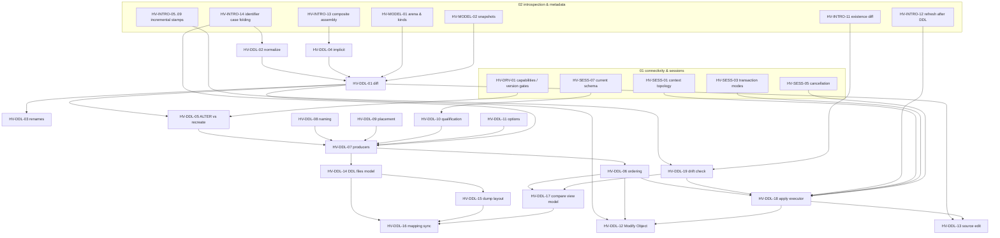

# 03 — DDL Generation, Object Modification and Schema Compare (canonical algorithm catalog)

> Status: canonical, implementation-ready. Date: 2026-11-11. Part of `docs/research/algorithms/`.
> For implementation purposes this file **supersedes** the source specs listed under "Sources merged" in each section (ALG-DDL-01..15 in `datagrip/09`, ALG-DBV-META-03/06/09 in `clients/dbeaver-02`, the preview/apply/optimistic-check pattern of ALG-EDIT-01 in `clients/oss-clients-beekeeper-and-tui.md`, DDL-relevant parts of ALG-EXEC-01 and `clients/sql-tooling-05`, and the quoting/case rules of ALG-I18N-05 in `i18n/02`). Those documents stay the evidence base; this file is the decision.
> Verification reports override everything: `verification/01-db-behavior-tests.md` (Docker) and `verification/02-external-fact-check.md`.
> Sibling catalogs: `01-connectivity-and-sessions.md` (HV-SESS-*, HV-CONN-*), `02-introspection-and-metadata.md` (HV-MODEL-*, HV-INTRO-*), `04-nosql-redis-mongo.md` (HV-NOSQL-*).

## 0.1 Priority table

| ID | Name | Tag | Depends on |
|---|---|---|---|
| HV-DDL-01 | Model diff / matching | v1 | HV-MODEL-01, HV-MODEL-02, HV-DDL-02, HV-DDL-04, HV-INTRO-14 |
| HV-DDL-02 | Normalization for compare | v1 | HV-MODEL-01, HV-INTRO-14, `hacivat-sql` lexer/parser |
| HV-DDL-03 | Rename detection (suggested renames) | v1.x | HV-DDL-01 |
| HV-DDL-04 | Implicit-object classification | v1 | HV-INTRO-13 (catalog facts), HV-MODEL-01 |
| HV-DDL-05 | Delta → ALTER vs recreate per dialect (rule table, data-loss analysis) | v1 (PG, SQLite, MySQL/MariaDB, SQL Server) / v1.x (ClickHouse) / later (Oracle) | HV-DRV-01 (version gates), HV-DDL-01 |
| HV-DDL-06 | Scenario ordering with dependency graph and cycle breaking | v1 | HV-DDL-05, HV-DDL-07, HV-MODEL-01 (dependency edges) |
| HV-DDL-07 | DDL producers per DBMS (typed IR + renderers) | v1 (PG, SQLite, MySQL/MariaDB, SQL Server) / v1.x (ClickHouse) / later (Oracle) | HV-DDL-08..11, HV-INTRO-14 |
| HV-DDL-08 | Naming templates | v1.x | HV-INTRO-14 |
| HV-DDL-09 | Constraint placement | v1 | HV-DDL-06 |
| HV-DDL-10 | Schema qualification | v1 | HV-SESS-07 (current schema / search_path) |
| HV-DDL-11 | Generator options & categories | v1 (core subset) / v1.x (full) | HV-DDL-07 |
| HV-DDL-12 | Modify Object flow (edit session → minimal script) | v1 (structured edits) / v1.x (preview → structure reverse sync) | HV-DDL-01, -06, -07, -18, -19 |
| HV-DDL-13 | Object source edit round-trip & conflict detection | v1 | HV-DDL-01, -07, -18, -19, HV-INTRO-05..09 (stamps) |
| HV-DDL-14 | DDL files as a virtual data source | v1.x | HV-DDL-07, `hacivat-sql` parser, HV-MODEL-01 |
| HV-DDL-15 | File-per-object dump layout | v1.x | HV-DDL-06, -07, -14 |
| HV-DDL-16 | DDL mapping synchronization (schema-as-code) | v1.x | HV-DDL-01, -14, -15, -17 |
| HV-DDL-17 | Schema-compare view model (UI-agnostic) | v1 | HV-DDL-01, -06, -18, -19 |
| HV-DDL-18 | Migration apply executor (transactional / journaled, dry-run) | v1 | HV-SESS-01, HV-SESS-03, HV-SESS-05, HV-INTRO-12 |
| HV-DDL-19 | Pre-apply drift check (optimistic concurrency on schema) | v1 | HV-INTRO-05..09, HV-INTRO-11, HV-MODEL-02 |

Rationale for v1 scope: PostgreSQL and SQLite first (PG is the reference dialect; SQLite has the unique rebuild path), MySQL/MariaDB and SQL Server in v1 because Modify Object must work on all v1 relational targets. ClickHouse DDL (no FKs, mutations, ORDER BY immutability) is v1.x. Oracle is optional/later across the product.

## 0.2 Dependency map



Plain-text reading order for implementers: 02 → 04 → 01 → 05 → 08/09/10/11 → 07 → 06 → 19 → 18 → 17 → 12 → 13 → 03 → 14 → 15 → 16.

## 0.3 Conventions and clean-room note

- Evidence tags and template: `docs/research/README.md`. Each spec adds **Sources merged, Decision, Rust placement, Per-DBMS matrix, Verification status, i18n notes**.
- Verification status vocabulary: **Observed** (seen in docs/source/screenshots), **Docker-verified** (anchor in `verification/01-db-behavior-tests.md`), **Inferred** (reasoning; DBMS documentation knowledge — must be pinned by the listed Docker tests before shipping).
- Clean room: DataGrip is proprietary (behaviour and names only; no shipped text, no layout script text). Beekeeper Studio is GPL-3.0, RedisInsight/Compass are SSPL — behaviour only. DBeaver CE is Apache-2.0 (file paths cited in sources), but this catalog uses **own pseudocode only**. Prior-art projects migra, Skeema, Atlas (Apache-2.0) and pg_dump's `pg_dump_sort.c` (PostgreSQL License) are cited for ideas, not code.
- Crate layout (binding, see conventions): `hacivat-ddl` with modules `ddl::diff`, `ddl::normalize`, `ddl::delta`, `ddl::produce::{pg,mysql,mssql,sqlite,clickhouse,oracle}`, `ddl::order`, `ddl::compare`, plus `ddl::apply`, `ddl::drift`, `ddl::files`, `ddl::srcedit`, `ddl::naming`, `ddl::options` (additions inside the same crate). Model types come from `hacivat-meta` (`meta::model`, `meta::snapshot`), identifier rules from `hacivat-sql::ident` (implements HV-INTRO-14 / ALG-I18N-05), execution from `hacivat-core::session`.
- Generated SQL, including comments inside generated SQL, is **never localized** and is byte-stable (golden tests depend on it). Everything shown around it is a Fluent message.
- Fluent key prefixes in this file: `ddl-`, `compare-`.

### Shared core types (referenced by every spec below)

```rust
// hacivat-meta (owned by file 02; repeated here only for readability)
pub struct ObjectId(u32);                       // arena index, stable within one snapshot
pub struct ObjectPath { segs: SmallVec<[PathSeg; 4]> }   // database/schema/kind/name[/sub]
pub struct PathSeg { kind: Kind, name: Ident, disambig: Option<Signature> } // routines: arg types
pub enum Kind { Database, Schema, Table, Column, Key, ForeignKey, Index, Check, Default, View, MatView,
                Sequence, Routine, Trigger, Type, Domain, Enum, Rule, Policy, Partition, Role, Grant,
                Comment, Extension, Synonym, Event, Dictionary /*CH*/, Projection /*CH*/, Other(u16) }
pub struct Snapshot { /* immutable model version, Arc-shared; see HV-MODEL-02 */ }

// hacivat-ddl
pub enum Dialect { Postgres, MySql, MariaDb, SqlServer, Sqlite, ClickHouse, Oracle }
pub struct ServerVersion { major: u16, minor: u16, patch: u16, flavor: Flavor }
pub struct DdlTarget { dialect: Dialect, version: ServerVersion, caps: Arc<Capabilities> /* HV-DRV-01 */,
                       ident: Arc<dyn IdentRules> /* HV-INTRO-14 */, current_schema: Option<Ident> }
```

---
## 1. Diff engine

### HV-DDL-01: Model diff / matching  `[v1]`
- **Sources merged:** ALG-DDL-01 (`datagrip/09` §4, §3.9 Compare Structure options), ALG-DBV-META-09 Hacivat recommendation "desired model, not command log" (`clients/dbeaver-02`), DBeaver CE compare-by-display-name critique (`clients/dbeaver-02` §3.11.5), DDL-I-05/13/17/18 (`datagrip/13`).
- **Problem:** Given two models (live introspected snapshot, DDL-file model, or an edited copy) compute the set of changes that make **Target** equal to **Source**, with stable identities, property-level differences and inclusion flags. The same engine serves Compare, Modify Object, source edit submit and DDL mapping apply.
- **Decision:**
  - One diff engine for every entry point (DataGrip's approach; DBeaver CE has only a report-only compare matched by display name). Edits are expressed as a *desired model* and diffed; there is **no command log** of UI edits (rejected: DBeaver's merge-able command queue — ordering bugs such as #7512/#11917 come from replaying a log; a model diff is order-independent and reuses the compare test corpus).
  - Terminology: **Source** (desired state) and **Target** (database to be changed). The script always makes Target equal to Source. DataGrip's "Origin" is renamed to "Source" in UI copy; *Swap* exchanges roles.
  - Matching key = `(kind, identity)` where identity is dialect-aware (below). Rejected: matching by display name (DBeaver) — wrong for overloaded routines and system-named constraints.
  - Properties absent on one side because of server version or missing privileges compare as **Unknown**, never as Different (rejected: treating `None` as a value → spurious ALTERs on cross-version compare).
  - Cross-DBMS compare (e.g. PG vs MySQL) produces a **report only** (diff tree, no script) in v1; DataGrip refuses ("Migration Not Available"); a cross-dialect script needs type mapping (owned by the data-transfer catalog) and is `later`.
- **Inputs / outputs:** `diff(source: &Snapshot, src_root: ObjectId, target: &Snapshot, tgt_root: ObjectId, opts: &DiffOptions) -> DiffTree`.
  `DiffOptions { ignore_order, ignore_case, ignore_implicit (default true), ignore_source, ignore_owner, ignore_grants, ignore_comments, ignore_storage, detect_column_insertion (default true), renames: RenameMode{Off|Suggest|Auto} (default Suggest, v1 = Off until HV-DDL-03 lands), surrogate_names: SurrogateNameMode{MatchByDefinition (default)|MatchByName} }`.
- **Algorithm:**
  1. **Normalize** both sides lazily through HV-DDL-02 with `NormCtx{dialect, src_root_path, tgt_root_path}` (references qualified with the compared root container become root-relative; so `testing.seq` ≡ `public.seq` when roots are `testing` vs `public`).
  2. **Classify implicit objects** on both sides (HV-DDL-04). With `ignore_implicit`, implicit objects are excluded from matching and only travel with their owner.
  3. **Match level by level** (database → schema → kind family → object → sub-object), within a parent pair only:
     - identity key per kind: plain objects → `IdentKey(name)` from `IdentRules::match_key` (HV-INTRO-14); with `ignore_case` → ASCII-plus-Unicode simple case fold (never Turkish-tailored unless the server collation is Turkic, as HV-INTRO-14 rules); routines → `(name, normalized argument type list)` (return type and OUT params are properties); triggers → `(table, name)`; partitions → `(parent, bound spec)` when unnamed else name; grants → `(grantee, privilege, column?)`; comments → owner path.
     - constraints and indexes with **surrogate (system-generated) names** (`is_system_named` flags from HV-INTRO-13: PG `t_pkey`/`t_a_check` pattern only when created unnamed, MSSQL `is_system_named=1`, Oracle `SYS_C…`, SQLite `sqlite_autoindex_*`, MySQL auto FK index) are matched by **definition signature** `(kind, column list, referenced table + columns, normalized predicate/expression, uniqueness, method)`; user-named ones by name. If a name matches but the definition differs → Modified. If two candidates share a definition → pair in model order, report `compare-warn-ambiguous-match`.
  4. Leftovers: Source-only → `Added`, Target-only → `Removed`. If `renames != Off`, run HV-DDL-03 over leftovers per `(parent, kind)`.
  5. **Property compare** for matched pairs with the per-kind `PropertySchema` (from HV-MODEL-01 metamodel). Each property has a category `{Structure, Order, Source, Owner, Grants, Comment, Storage, Stats}`; `Stats` (row counts, sizes, last analyze) is never compared; categories switched off by options are skipped. Value comparison uses the property's comparator (`Eq`, `NormalizedExpr`, `TokenStream`, `SetEq`, `UnknownTolerant`).
  6. **Order**: column order is compared only when `!ignore_order`. With `detect_column_insertion`, compute LCS over matched column identities; columns outside the LCS get a single `Order` difference on the table (`moved: [col]`), never N Modified columns.
  7. **Roll-up:** a node is `Modified` if it has property diffs or any non-identical child; `Identical` nodes are kept in the tree (the view model hides them unless *Show identical*).
  8. **Inclusion:** every non-identical node `included = true`, except suggested renames (`included = false` until accepted) and `Removed` nodes under `ProtectDrops` (HV-DDL-11 option `drops: Include|Exclude|Ask`, default `Ask` on production-tagged connections → excluded with a warning badge).
  9. Return `DiffTree` with a deterministic child order: Source model order, then Target-only objects in Target model order.
- **Data structures:**
  ```rust
  pub struct DiffTree { nodes: Vec<DiffNode>, root: DiffNodeId }   // arena, pre-order
  pub struct DiffNode { src: Option<ObjectId>, tgt: Option<ObjectId>, kind: Kind, status: DiffStatus,
                        props: SmallVec<[PropDiff; 4]>, children: Range<u32>, included: Tri, flags: NodeFlags }
  pub enum DiffStatus { Identical, Added, Removed, Modified, Renamed { from: Ident }, Unknown }
  pub struct PropDiff { prop: PropId, category: PropCategory, src: PropValue, tgt: PropValue }
  pub enum PropValue { Known(Value), Unknown /* not introspected / unsupported on that version */, Absent }
  bitflags! { pub struct NodeFlags: u16 { IMPLICIT, SURROGATE_NAME, DESTRUCTIVE, DATA_LOSS, AMBIGUOUS, CONFLICT } }
  ```
- **Rust placement:** `hacivat-ddl::ddl::diff`. `pub fn diff(src: &SnapshotView, tgt: &SnapshotView, opts: &DiffOptions) -> Result<DiffTree, DiffError>`; `trait PropertyComparator { fn eq(&self, a: &Value, b: &Value, ctx: &NormCtx) -> Tri; }`. Crates: `indexmap` (2.x, check), `hashbrown` via std; `smallvec` (1.x); LCS: own (columns are small) or `similar` (2.x, Apache-2.0/MIT — check) for token streams.
- **Per-DBMS matrix:**

  | Aspect | PostgreSQL | MySQL/MariaDB | SQL Server | SQLite | ClickHouse | Oracle |
  |---|---|---|---|---|---|---|
  | Containers compared | database→schema | schema(=database) | database→schema | main/attached db | database | schema(=user) |
  | Routine identity | name + IN arg types | name (no overloading) | name (no overloading in one schema) | n/a | function name (SQL UDF) | package + name + args |
  | Surrogate-name patterns | `<t>_pkey`, `<t>_<c>_key`, `<t>_<c>_fkey`, `<t>_<c>_check` (only if created unnamed — PG does not store the flag; heuristic + definition match) | auto FK index = FK name; `PRIMARY` | `is_system_named` (exact) | `sqlite_autoindex_<t>_<n>` | n/a | `SYS_C\d+` (`generated='GENERATED NAME'`) |
  | Column order meaningful | yes (cannot reorder without rebuild) | yes (`AFTER`) | yes (rebuild) | yes (rebuild) | yes (`AFTER`/`FIRST`) | yes |
  | Case of names | folded lower if unquoted | depends on `lower_case_table_names` (tables), CI for columns | collation-dependent | ASCII-CI | exact | folded upper |
- **Complexity / performance notes:** hash matching O(N) per level, total O(N log N) with sorting for stable output; definition-signature hashing for surrogate names O(N); LCS O(c²) per table (c ≤ few hundred). Target: 15k tables / 160k columns diff < 1.5 s on a laptop (single thread); parallelize per schema with `rayon` when > 2k objects.
- **Verification status:** Observed (DataGrip help/screenshots for options and the `public` vs `testing` sequence normalization; DBeaver CE compare code); Inferred (surrogate-name heuristics for PG — PG does not record "generated name"; pin with `[docker: postgres:16]` tests below).
- **i18n notes:** identity keys are locale-invariant (HV-INTRO-14; tests run with `LANG=tr_TR.UTF-8`). `ignore_case` uses Unicode simple folding or Turkic folding only when mirroring a Turkic server collation. Status labels: `compare-status-added`, `compare-status-removed`, `compare-status-modified`, `compare-status-renamed`, `compare-status-identical`, `compare-status-unknown`; warnings `compare-warn-ambiguous-match`, `compare-warn-cross-dbms-report-only`.
- **Edge cases (exhaustive):**
  1. Names differing only by case (`"Users"` vs `users` on PG) — distinct unless `ignore_case`.
  2. Turkish names (`MÜŞTERİ` vs `müşteri`): never equal under default rules; equal only on SQL Server `Turkish_CI_*` when the folded keys match per server.
  3. Overloaded routines; signature change ⇒ Removed + Added (never Modified).
  4. Return type change with same args (PG) ⇒ Modified with property `returns` (HV-DDL-05 decides DROP+CREATE).
  5. System-named vs user-named constraint with same definition ⇒ Identical under `MatchByDefinition`.
  6. Two system-named checks with identical predicates on one table ⇒ ambiguous; pair in order + warning.
  7. Column order differs, `ignore_order` on/off; middle insertion with `detect_column_insertion`.
  8. Type aliases (`int4`/`integer`, `character varying`/`varchar`, MySQL `int(11)` display width) — handled by HV-DDL-02.
  9. Defaults referencing sequences in differently named compared schemas.
  10. `serial` vs `identity` (behaviourally similar, structurally different) ⇒ Modified (identity kind), never silently equal.
  11. Partitioned tables: partitions compared as children; partition bounds as identity when unnamed.
  12. Inherited columns (PG `INHERITS`): compared on the parent only; child reports `inherited` flag.
  13. Extension-owned objects (PG `pg_depend` deptype `e`): excluded unless option `include_extension_members`.
  14. Generated/computed columns: expression compared normalized; stored vs virtual is a property.
  15. Collation differing only by provider version: ignored unless the collation name differs.
  16. Comment-only change ⇒ Modified with only `Comment` category diff.
  17. Grants to roles absent on Target ⇒ diff kept, flagged `compare-warn-grantee-missing`; script generation skips with a comment.
  18. Cross-version compare (PG 12 vs 16): property unknown on one side ⇒ `Unknown`, excluded from script.
  19. References to objects in schemas outside the compare scope: kept qualified, not normalized.
  20. Source is a DDL data source with unnamed schema ⇒ root-relative mapping via default-schema table (HV-DDL-14).
  21. Empty roots; same object selected twice (diff = identical, view shows info).
  22. Kinds unsupported by the Target dialect (cross-DBMS) ⇒ report only.
  23. Objects not yet fully introspected on one side (level < required; HV-INTRO-01) ⇒ diff triggers targeted introspection or marks subtree `Unknown`; never treats missing children as Removed.
  24. Huge enum label lists / huge check predicates: compared by hash first.
  25. MySQL `lower_case_table_names=1` Target vs `0` Source ⇒ table identity uses Target's rule; warn `compare-warn-lctn-mismatch`.
- **Test cases (input → expected):**

  | # | Source | Target | Options | Expected |
  |---|---|---|---|---|
  | 1 | `t(a int, b text)` | `t(a int)` | default | `t` Modified; `b` Added |
  | 2 | `t(a int)` | `t(a int, c int)` | default | `c` Removed (included unless drops excluded) |
  | 3 | schema `public`: `t(id serial)` | schema `testing`: `t(id serial)` | roots differ | Identical (sequence ref normalized) |
  | 4 | `CHECK (x>0)` unnamed (stored `t_x_check`) | `CONSTRAINT t_x_check CHECK (x > 0)` | MatchByDefinition | Identical |
  | 5 | `f(int)` | `f(int, int)` | default | `f(int)` Added, `f(int,int)` Removed |
  | 6 | `"Users"` | `users` | ignore_case off / on | Added+Removed / Identical |
  | 7 | cols (a,b,c) | (a,c,b) | ignore_order on / off | Identical / table Modified with one `Order` diff |
  | 8 | (a,x,b,c) | (a,b,c) | detect insertion | one Added `x`, no Modified for b/c |
  | 9 | function body differs | | ignore_source on | Identical |
  | 10 | PG 16 table with property `access_method=heap` | PG 12 equivalent (property unknown) | | Identical with `Unknown` prop, no script |
  | 11 | `[docker: postgres:16]` create `t(id int primary key)` in schema a, `CREATE TABLE b.t(id int, CONSTRAINT t_pkey PRIMARY KEY(id))` | compare a vs b | | Identical |
  | 12 | `[docker: mcr.microsoft.com/mssql/server:2022-latest]` `c int DEFAULT 0` on two DBs (system default names differ) | | ignore_implicit on | Identical |
  | 13 | `[docker: mysql:8.4]` two schemas with `int(11)` vs `int` | | | Identical |
  | 14 | LANG=tr_TR.UTF-8 process, PG `ITEMS` vs `items` table names | | ignore_case on | Identical (ASCII fold); `İTEMS` vs `items` → not identical |
- **Used by:** Hacivat (Compare, Modify Object, source submit, DDL mapping apply, MCP `compare_schemas`), Karagöz (optional drift job using the same crate), Perde (stores only schema fingerprints, never the diff).

### HV-DDL-02: Normalization for compare  `[v1]`
- **Sources merged:** ALG-DDL-12 (`datagrip/09`), ALG-DBV-META-03 "store defaults raw, never quote heuristically" (`clients/dbeaver-02`), ALG-I18N-05 (`i18n/02`).
- **Problem:** Servers canonicalize types, defaults, predicates and view text; compared containers have different names. Without normalization every compare shows false differences.
- **Decision:** Normalize into a **comparison form** that is never emitted as SQL (emission always uses the original server text or the model value). Expressions are compared as **parsed token trees** via `hacivat-sql` with redundant-cast and parenthesis stripping limited to semantics-preserving rules. View/routine bodies compare server-rendered text on both sides when both sides are live (PG re-renders view text) and token streams otherwise. Rejected: regex-based normalization (DBeaver-style heuristics) — fragile; rejected: semantic equivalence via the server (`EXPLAIN` both) — needs both sides live and is slow.
- **Inputs / outputs:** `normalize(value: &PropValue, prop: PropId, ctx: &NormCtx) -> NormValue` (cached per `(ObjectId, PropId)`), `NormCtx { dialect, version, root_path, current_schema, ident: &dyn IdentRules }`.
- **Algorithm:**
  1. **Types:** per-dialect alias table → canonical name + parameters. PG: `int4→integer`, `int8→bigint`, `int2→smallint`, `bool→boolean`, `character varying→varchar`, `character→char`, `timestamp without time zone→timestamp`, `timestamptz→timestamp with time zone`, `float8→double precision`, `float4→real`, `decimal→numeric`, `_int4→integer[]`. MySQL: drop integer display width (8.0.19+ servers don't report it; older do), `bool→tinyint(1)`, charset/collation folded into the column's effective values. MSSQL: `sysname→nvarchar(128)`, `(max)` canonical. SQLite: type affinity is **not** used for equality (declared type text compared case-insensitively ASCII, since SQLite stores what was written). ClickHouse: `Nullable(T)`/`LowCardinality(T)` wrappers kept as structure.
  2. **Expressions** (defaults, checks, index expressions, partial-index predicates, generated columns): lex+parse with the dialect parser; rewrite: (a) strip casts that the server adds to literals where the cast target equals the literal's natural/declared type (`'a'::text` on a text column, `'0'::numeric` only if column numeric); (b) strip redundant parentheses; (c) normalize literal spellings (`TRUE`/`true`, numeric `1.0` stays distinct from `1`); (d) synonyms: `now()` ≡ `CURRENT_TIMESTAMP` (PG), `getdate()` ≢ `sysdatetime()` (different types). Unparsable → fall back to whitespace-collapsed token stream.
  3. **References:** qualified names whose schema equals the compared root (or the current schema when comparing within one database) become unqualified; others stay. Never rewrite inside string literals except recognized regclass literals (`'testing.seq'::regclass`, `nextval('testing.seq')`) whose content is an object reference.
  4. **Source text** (views, routines, triggers, rules): if both sides were rendered by the same server family/version (`pg_get_viewdef` etc.) compare normalized token streams (comments dropped only where the server drops them — PG views; kept for PG functions, MySQL routines, MSSQL modules); keywords ASCII-case-folded; identifiers folded per HV-INTRO-14; whitespace collapsed. MySQL: strip `DEFINER=` and the `ALGORITHM/SQL SECURITY` prefix into properties.
  5. **Collations/charsets:** resolve `default` to the effective container value when known; unknown → `Unknown`.
  6. **Owners/grants:** role names compared exactly; with a role-mapping table (user-provided, v1.x) mapped first.
- **Data structures:** `NormValue { Exact(Value) | Expr(ExprTreeHash, Arc<ExprTree>) | Tokens(TokenHash, Arc<[Token]>) | Unknown }`; alias tables as `phf` maps per dialect/version.
- **Rust placement:** `hacivat-ddl::ddl::normalize`; `pub trait Normalizer { fn norm(&self, prop: PropId, v: &PropValue, ctx: &NormCtx) -> NormValue; }` with one impl per dialect; parsing via `hacivat-sql` (pg_query 18.1.0 for PG — verified version in `verification/02` P36; sqlparser 0.64.0 for others — P33/P37). Crates: `phf` (0.11, check), `blake3` (1.x, check) for hashes.
- **Per-DBMS matrix:**

  | Normalization | PostgreSQL | MySQL/MariaDB | SQL Server | SQLite | ClickHouse |
  |---|---|---|---|---|---|
  | Default source | `pg_get_expr(adbin)` (server-rendered, casts added) | `COLUMN_DEFAULT` raw literal (MariaDB quotes strings, MySQL doesn't — normalize) | `sys.default_constraints.definition` wrapped in `(( ))` → strip outer parens | `dflt_value` as written | `default_expression` |
  | View text | server-rendered (`pg_get_viewdef`) | `VIEW_DEFINITION` (rewritten, fully qualified) | module text as written | text as written | `create_table_query` |
  | Type aliases | many | display widths, bool | sysname | none (declared text) | wrappers |
  | Case folding of identifiers inside expressions | lower (ASCII) unless quoted | exact | collation | ASCII-CI | exact |
- **Complexity:** parse once per expression (cached by text hash); O(total expression length).
- **Verification status:** Observed (DataGrip screenshot: `nextval('testing.seq')` vs `nextval('seq')` equal; `varchar(45)` vs `varchar` different); Inferred (per-DBMS default rendering differences — pin with tests 4–7).
- **i18n notes:** no locale-dependent folding (ASCII for keywords; HV-INTRO-14 for identifiers). String literals are compared byte-exact (no NFC normalization: servers compare bytes); a non-NFC literal difference shows a `compare-hint-unicode-normalization` hint.
- **Edge cases (exhaustive):** casts that change semantics (`'1'::int` vs `'1'` on a text column) must be kept; `now()` vs `CURRENT_TIMESTAMP` vs `transaction_timestamp()`; sequences in non-root schemas keep qualifier; strings containing schema names; quoted vs unquoted identical names (`"a"` ≡ `a` on PG); Turkish-locale case folding forbidden; PG 15 vs 16 `pg_get_viewdef` formatting differences; MariaDB `current_timestamp()` vs MySQL `CURRENT_TIMESTAMP`; MySQL `DEFAULT NULL` reported as NULL vs absent; MSSQL `((0))` vs `(0)`; SQLite default `'abc'` vs `"abc"` (double-quoted string literal legacy); numeric precision `numeric(10,0)` vs `numeric(10)`; arrays `integer[]` vs `int4[]`; domain types (compare by domain name, not base type); enum labels order significant; unparsable expressions (token fallback); expression containing comments; MySQL 8.0.13+ expression defaults `(uuid())`; ClickHouse `DEFAULT` vs `MATERIALIZED` vs `ALIAS` (kind is a property).
- **Test cases:**
  1. `nextval('testing.seq'::regclass)` in root `testing` vs `nextval('seq'::regclass)` in root `public` → equal.
  2. `varchar(45)` vs `varchar` → different.
  3. View text differing only in whitespace and keyword case (token path) → equal.
  4. `[docker: postgres:16]` column `d text DEFAULT 'x'` (server renders `'x'::text`) vs DDL-file model `DEFAULT 'x'` → equal.
  5. `[docker: mysql:8.4]` vs `[docker: mariadb:11.4]` `DEFAULT 'x'` → equal after quote normalization.
  6. `[docker: mcr.microsoft.com/mssql/server:2022-latest]` default `((0))` vs file `DEFAULT 0` → equal.
  7. `[docker: keinos/sqlite3]` `INTEGER` vs `integer` → equal; `INT` vs `INTEGER` → different (declared text) but with `compare-hint-sqlite-affinity-equal`.
  8. `'1'::integer` default on an integer column vs `1` → equal; on a text column vs `'1'` → different.
- **Used by:** Hacivat (HV-DDL-01, HV-DDL-13 conflict comparison, HV-DDL-19 fingerprints).

### HV-DDL-03: Rename detection (suggested renames)  `[v1.x]`
- **Sources merged:** ALG-DDL-10 (`datagrip/09`), DDL-I-05 (`datagrip/13`), ALG-DBV-META-09 rename collapsing (`clients/dbeaver-02`).
- **Problem:** A renamed column/table appears as Removed + Added → the script drops data.
- **Decision:** Suggest renames (Hacivat improvement; DataGrip shows drop+add, Atlas/Skeema need explicit hints). Default mode **Suggest**: suggested pairs shown as a single "Renamed?" row, **not included** until the user accepts; *Auto* is opt-in. Renames entered explicitly in Modify Object are exact (not suggestions). Rejected: Auto by default — a false positive silently changes semantics.
- **Inputs / outputs:** per `(parent, kind)`: unmatched Removed `R`, Added `A` → `Vec<RenameSuggestion{from, to, score}>`.
- **Algorithm:**
  1. Score same-kind pairs: columns: `0.5·[type eq] + 0.2·[nullability eq] + 0.2·[default eq] + 0.1·[ordinal eq]`; tables: Jaccard over `(column name, normalized type)` ≥ 0.8 and equal PK definition → score = Jaccard; indexes/constraints: equal definition signature → 1.0; routines: equal normalized body and signature → 1.0; schemas: Jaccard over child names.
  2. Drop pairs with score < τ (0.8). Ambiguity: if a row or column of the score matrix has two entries within 0.05 of its max → drop those (no suggestion).
  3. Maximum-weight bipartite matching (Hungarian; n is small) over the remaining matrix.
  4. Cross-schema moves: same-kind object Removed in schema X and Added in Y with score 1.0 → suggest `SET SCHEMA` (PG/MSSQL `ALTER SCHEMA … TRANSFER`), not rename.
  5. Emit suggestions; accepted ones become `DiffStatus::Renamed` and the diff recomputes their properties as a matched pair.
- **Rust placement:** `hacivat-ddl::ddl::diff::rename`; `fn suggest(r: &[DiffNodeId], a: &[DiffNodeId], tree: &DiffTree) -> Vec<RenameSuggestion>`. Crate: `pathfinding` (4.x, `kuhn_munkres`; check license MIT/Apache) or own O(n³).
- **Per-DBMS matrix:** rename support — PG all kinds; MySQL `RENAME COLUMN` 8.0+, MariaDB 10.5.2+ (else `CHANGE COLUMN` with full definition); SQL Server `sp_rename` (object, column, index; warns about breaking scripts); SQLite `RENAME COLUMN` 3.25+, `RENAME TO` (tables), indexes not renamable (drop+create); ClickHouse `RENAME COLUMN` (MergeTree; not for key columns), `RENAME TABLE`.
- **Complexity:** O(|R|·|A|) scoring + O(n³) matching per parent.
- **Verification status:** Inferred (scoring is a Hacivat design; rename syntax per DBMS from vendor docs — pinned by HV-DDL-07 tests).
- **i18n notes:** `compare-rename-suggested = Renamed from { $from }?`, `compare-rename-accept`, `compare-rename-reject`.
- **Edge cases:** swap renames (`a↔b`) — both suggested, emitted through a temp name (HV-DDL-06); rename + type change (below τ → drop+add, but show a hint "possible rename with type change"); several identical candidates (no suggestion); renamed table whose columns were also renamed (table score uses types only fallback when names differ: second pass with type-multiset similarity); constraint renames implied by table rename (system names follow — suppress separate suggestions); DBMS without rename support (rebuild path); rename to a reserved word (quoted by producer); case-only rename on a case-insensitive server (MSSQL CI: `sp_rename` works; MySQL lctn=1: two-step via temp name).
- **Test cases:** `t(a int)` vs `t(b int)` → suggest `a→b` (1.0); `t(a int)` vs `t(b text)` → none; `users(id,name)` vs `accounts(id,name)` → suggest table rename; `(a int, b int)` → `(b int, a int)` swapped names with same types → ambiguous → no suggestion (ordinal breaks ties only when other features differ); `[docker: mariadb:11.4]` accepted rename → `ALTER TABLE t RENAME COLUMN a TO b`; `[docker: keinos/sqlite3]` index rename → DROP INDEX + CREATE INDEX.
- **Used by:** Hacivat.

### HV-DDL-04: Implicit-object classification  `[v1]`
- **Sources merged:** ALG-DDL-11 (`datagrip/09`), ALG-DBV-META-03 edge cases (PK-backing indexes skipped) and ALG-DBV-META-05 composite assembly (`clients/dbeaver-02`).
- **Problem:** DBMSs create objects automatically (PK indexes, serial sequences, system default constraints); comparing or generating them separately produces wrong scripts.
- **Decision:** Classification is computed **at introspection time** from catalog facts (HV-INTRO-13 stores `implicit_owner: Option<ObjectId>` on the object) and re-derived for DDL-file models from the statements that created them. Implicit objects never get their own operations; they ride on the owner (CREATE/DROP of the owner) and are compared only as owner properties.
- **Inputs / outputs:** object + catalog facts → `Implicitness { Explicit | Implicit { owner: ObjectId, reason: ImplicitReason } }`.
- **Algorithm / rules:**
  - PG: index with `pg_constraint.conindid = index oid` for PK/UNIQUE/EXCLUDE; sequence with `pg_depend.deptype='a'` (serial) or `'i'` (identity) on a column; table row type and array type; TOAST tables; extension members (`deptype='e'`, separate flag `extension_member`).
  - MySQL/MariaDB: `PRIMARY` index; index auto-created for an FK (same name as the FK, created because no usable index existed — detect: index name == FK name and columns are FK columns prefix) — after the FK is dropped such an index becomes explicit.
  - SQL Server: default constraints with `is_system_named=1` (explicit when user-named, but still owned by the column → compared as column property `default` with name as secondary property), PK/UQ backing indexes, auto-created statistics (`_WA_Sys_*`, never compared).
  - SQLite: `sqlite_autoindex_*` indexes; `sqlite_sequence` table.
  - ClickHouse: `.inner.`/`.inner_id.` target tables of materialized views without `TO`.
  - Oracle: `SYS_C…` constraint names, LOB segments/indexes, PK/UK indexes of same name.
- **Rust placement:** classification in `hacivat-introspect` per DBMS (writes the model flag); consumer helpers in `hacivat-ddl::ddl::diff::implicit` (`fn owner_of(id) -> Option<ObjectId>`).
- **Per-DBMS matrix:** see rules; ClickHouse has no FKs/serials; SQLite `INTEGER PRIMARY KEY` is the rowid alias (no index object at all).
- **Complexity:** O(1) per object given catalog facts.
- **Verification status:** Observed (DataGrip option text names FK indexes and MSSQL default constraints; DBeaver skips PK-backing indexes); Inferred (catalog columns — pinned by tests).
- **i18n notes:** tooltip `compare-implicit-object = Created automatically by { $dbms } for { $owner }`.
- **Edge cases:** user-created index identical to an FK auto index (explicit); serial converted to identity (`ALTER … ADD GENERATED` — sequence deptype changes `a`→`i`); renamed implicit PG index (`ALTER INDEX t_pkey RENAME TO x` — still implicit, name becomes a property of the constraint's index); MSSQL user-named default (explicit name, owned by column); MySQL FK dropped leaves index (now explicit — diff must not emit DROP INDEX just because ownership changed); SQLite `WITHOUT ROWID` tables (PK is the clustered key); ClickHouse MV with `TO table` (target is explicit).
- **Test cases:** `[docker: postgres:16]` `id serial primary key` → implicit sequence + implicit PK index; ignore_implicit hides a missing `t_id_seq` on Target; `[docker: mcr.microsoft.com/mssql/server:2022-latest]` `DF__t__c__1234` vs `DF__t__c__9876` → identical; `[docker: mysql:8.4]` FK without index → implicit index named like the FK; after `DROP FOREIGN KEY` → index explicit, diff stable; `[docker: keinos/sqlite3]` `UNIQUE(a)` → `sqlite_autoindex_t_1` implicit.
- **Used by:** Hacivat; Karagöz (drift job).

---
## 2. Delta, producers and ordering

### HV-DDL-05: Delta → ALTER vs recreate per dialect (rule table + data-loss analysis)  `[v1 PG/SQLite/MySQL/MariaDB/SQL Server; v1.x ClickHouse; later Oracle]`
- **Sources merged:** ALG-DDL-03 and §3.17 capability matrix (`datagrip/09`), ALG-EXEC-01 DDL rules (`clients/oss-clients-beekeeper-and-tui.md`), `clients/sql-tooling-05` effect model (`Ddl` effect, PG01/PG02 lint rules: excessive locks, FK `NOT VALID` then validate), DDL-I-03/04/08/10/11/19/20/21 (`datagrip/13`).
- **Problem:** For each property change choose the least destructive, version-correct statement sequence, and tell the user what it costs (rewrite, lock, data loss, non-transactional).
- **Decision:**
  - A **data-driven rule table** keyed by `(dialect, kind, property)` with version ranges (most specific range wins), evaluated against `DdlTarget.version` and capability flags (HV-DRV-01). Rejected: hand-coded per-producer `if version >= …` (DataGrip's 1,282 producer classes are the cost of that approach).
  - Every strategy carries a **cost annotation** `{rewrite: bool, lock: LockLevel, data_loss: DataLoss, transactional: bool, online_variant: Option<…>}`; the compare view and Modify Object preview show it. Recreate and data-loss strategies are **never silent**: they require `allow_recreate` (default on for SQLite rebuild of tables because there is no alternative, **off** for everything else) and an explicit confirmation (HV-DDL-18). This beats DataGrip (shows only the script) and DBeaver (no analysis).
  - Two-phase constraint creation (`NOT VALID` + `VALIDATE`, MSSQL `WITH NOCHECK` + `CHECK CONSTRAINT`) is an **option** (`online_constraints`, default on for production-tagged connections), not default everywhere — it changes semantics for MSSQL (untrusted constraint) unless the validate step runs.
- **Inputs / outputs:** `plan_change(target: &DdlTarget, change: &DiffNode, opts: &GenOptions) -> Strategy`; `enum Strategy { Alter(AlterOps), AlterWithUsing(AlterOps, Expr), AlterWithDependents { pre_drop: Vec<ObjectId>, ops: AlterOps, recreate: Vec<ObjectId> }, Recreate(RecreatePlan), TwoPhase(Vec<AlterOps>), Unsupported(Reason) }`.
- **Algorithm:**
  1. For each `PropDiff` (and Added/Removed child) look up rules; merge per object: if any property needs `Recreate`, the object is recreated once (other properties ride along); else group ALTER clauses that the dialect allows in one statement (MySQL/ClickHouse multi-clause `ALTER TABLE`, PG comma-separated actions; MSSQL one action per statement).
  2. **Dependents:** if the rule says "blocked by dependents" (PG type change with dependent views/rules; MSSQL schemabound views or indexes on the column; SQLite views referencing a table being rebuilt), compute the dependent closure from model dependency edges (HV-MODEL-01; PG `pg_depend`/`pg_rewrite`, MSSQL `sys.sql_expression_dependencies`, MySQL/SQLite view text parse fallback) → `AlterWithDependents`.
  3. **Data-loss analysis:** `DataLoss::{None, Possible(reason), Certain(reason)}`: narrowing types (length/precision decrease, `bigint→int`, `text→varchar(n)`), type family change without lossless cast, dropping a column/table, enum label removal, SET NOT NULL on a column that may contain NULLs (Possible; offer `backfill: Expr` option), `Recreate` of a table without full column mapping. Optional live probe (user-triggered, read-only, on the metadata session): `SELECT count(*) WHERE col IS NULL`, `max(length(col))` — results attached to the warning.
  4. If the strategy is `Recreate` and `allow_recreate=false` → `Unsupported` naming the property (`ddl-unsupported-requires-recreate`).
  5. Return strategy + cost.
- **Rule table (core rows; full table in code as data files `rules/<dialect>.toml`):**

  | Change | PostgreSQL 13–18 | MySQL 8.0/8.4 | MariaDB 10.6–11.4 | SQL Server 2019/2022 | SQLite 3.35+ | ClickHouse 24.x (MergeTree) |
  |---|---|---|---|---|---|---|
  | Add nullable column | `ADD COLUMN` (metadata) | `ADD COLUMN [FIRST/AFTER]` (`ALGORITHM=INSTANT`; any position 8.0.29+) | `ADD COLUMN [IF NOT EXISTS]` (instant 10.3+) | `ADD` | `ADD COLUMN` (end only) | `ADD COLUMN [AFTER/FIRST]` (metadata) |
  | Add NOT NULL + default | metadata if default non-volatile (PG11+); volatile default → rewrite | yes | yes | yes, named default constraint | only with constant non-NULL default; else rebuild | yes |
  | Drop column | `DROP COLUMN` (Certain loss) | yes | yes `[IF EXISTS]` | drop dependent default/check/index first | 3.35+ unless PK/UNIQUE/indexed/FK/in view/trigger/generated-ref → rebuild | `DROP COLUMN` (not key columns) |
  | Rename column | `RENAME COLUMN` | `RENAME COLUMN` | 10.5.2+ else `CHANGE` | `sp_rename 't.c','n','COLUMN'` | 3.25+ | `RENAME COLUMN` (not key columns) |
  | Change type | `ALTER COLUMN TYPE` (+`USING` if no implicit cast); rewrite unless binary-coercible (e.g. varchar length increase, varchar→text) ; blocked by dependent views → AlterWithDependents | `MODIFY COLUMN <full def>` (COPY algorithm for most) | same | `ALTER COLUMN` (indexes/constraints/stats referencing → drop+recreate them) | rebuild | `MODIFY COLUMN` (mutation rewriting parts; async unless `mutations_sync`); key columns: only metadata-compatible changes |
  | Nullability | `SET/DROP NOT NULL` (SET scans; PG12+ skips scan if a valid `CHECK (c IS NOT NULL)` exists) | `MODIFY` full def | same | `ALTER COLUMN … [NOT] NULL` (repeat type) | rebuild | `MODIFY COLUMN Nullable(T)` ↔ `T` (mutation) |
  | Default | `SET/DROP DEFAULT` | `ALTER COLUMN SET/DROP DEFAULT` | same | drop + add default constraint | rebuild | `MODIFY COLUMN … DEFAULT` |
  | Column order | rebuild (default Unsupported; option) | `MODIFY … AFTER x` | same | rebuild (Unsupported default) | rebuild | `MODIFY COLUMN c AFTER x` |
  | Add PK/UK | `ADD CONSTRAINT` (option: `CREATE UNIQUE INDEX CONCURRENTLY` + `ADD CONSTRAINT … USING INDEX`) | `ADD PRIMARY KEY/UNIQUE` | same | `ADD CONSTRAINT` | rebuild | n/a (ORDER BY/PRIMARY KEY immutable except `MODIFY ORDER BY` appending newly added columns) |
  | Add FK | `ADD CONSTRAINT` / TwoPhase `NOT VALID` + `VALIDATE CONSTRAINT` | `ADD CONSTRAINT … FOREIGN KEY` (InnoDB; needs index — auto-created) | same | `ADD CONSTRAINT` / TwoPhase `WITH NOCHECK` + `CHECK CONSTRAINT` | rebuild | n/a |
  | Add CHECK | `ADD CONSTRAINT … CHECK` / `NOT VALID` | enforced 8.0.16+ (older: parsed, ignored → warn) | enforced 10.2+ | `ADD CONSTRAINT` | rebuild | `ADD CONSTRAINT … CHECK` (checked on insert only) |
  | Drop constraint | `DROP CONSTRAINT` | `DROP PRIMARY KEY / FOREIGN KEY / INDEX / CHECK` | same (+`DROP CONSTRAINT`) | `DROP CONSTRAINT` | rebuild | `DROP CONSTRAINT` |
  | Index create/drop | `CREATE INDEX [CONCURRENTLY]` (concurrently: not in txn) | `ALGORITHM=INPLACE, LOCK=NONE` | same | `ONLINE = ON` (edition-gated) | `CREATE INDEX` | data-skipping: `ADD INDEX` + `MATERIALIZE INDEX` (mutation) |
  | Index definition change | drop + create (or create new + drop old + rename for online) | drop + add in one ALTER | same | `CREATE INDEX … WITH (DROP_EXISTING = ON)` | drop + create | drop + add |
  | View change | `CREATE OR REPLACE VIEW` iff existing columns keep names/types/order and new ones are appended; else drop dependents + drop + create | `CREATE OR REPLACE VIEW` | same | `CREATE OR ALTER VIEW` (2016 SP1+) | drop + create | `CREATE OR REPLACE VIEW` |
  | Materialized view | drop + create (+`REFRESH`; data recomputed) | n/a | n/a | indexed view: drop + create | n/a | `ALTER TABLE mv MODIFY QUERY` behind setting (Inferred) else drop + create (target table with `TO` keeps data) |
  | Routine change | `CREATE OR REPLACE` iff same IN signature and same return type/OUT params; else DROP (full signature) + CREATE + re-GRANT | DROP + CREATE (no OR REPLACE for routines in MySQL; MariaDB has `CREATE OR REPLACE`) | `CREATE OR REPLACE` | `CREATE OR ALTER` | n/a | `CREATE OR REPLACE FUNCTION` (SQL UDF) |
  | Trigger change | `CREATE OR REPLACE TRIGGER` (PG14+) else drop + create | drop + create | `CREATE OR REPLACE` | `CREATE OR ALTER TRIGGER` | drop + create | n/a |
  | Enum add value | `ALTER TYPE … ADD VALUE [BEFORE/AFTER]` (PG12+ allowed in txn block, value unusable until commit) | `MODIFY` column enum list (append = instant) | same | n/a | n/a | `MODIFY COLUMN Enum(...)` (append ok) |
  | Enum remove/reorder value | recreate type: new type, `ALTER COLUMN TYPE … USING col::text::new`, drop old, rename (Possible loss) | `MODIFY` (Possible loss) | same | n/a | n/a | `MODIFY COLUMN` (mutation; Possible loss) |
  | Identity add/drop | `ADD/DROP IDENTITY` | `AUTO_INCREMENT` via `MODIFY` | same | not alterable → Recreate (Unsupported default) | `INTEGER PRIMARY KEY` only at create → rebuild | n/a |
  | Comment | `COMMENT ON` | inline `COMMENT` via `MODIFY` (column) / `ALTER TABLE … COMMENT=` | same | `sp_addextendedproperty`/`sp_updateextendedproperty` (`MS_Description`) | none (unsupported; keep in Hacivat annotations) | `COMMENT COLUMN` / `MODIFY COMMENT` |
  | Owner | `ALTER … OWNER TO` | n/a (DEFINER on routines/views → recreate) | same | `ALTER AUTHORIZATION` | n/a | n/a |
  | Table engine / sorting key / partition key | partition key immutable → Recreate | `ENGINE=` (COPY), `PARTITION BY` via `ALTER` | same | partition scheme → Recreate | n/a | Recreate: `CREATE TABLE new … ; INSERT INTO new SELECT … ; EXCHANGE TABLES` (Atomic database) or `RENAME` swap |
  | Transactional DDL | yes except `CONCURRENTLY`, `CREATE/DROP DATABASE`, `ALTER SYSTEM`, `VACUUM`, tablespaces | **no** — each DDL implicitly commits (atomic per statement in 8.0) | no (atomic per statement 10.6+, Inferred) | mostly yes (except database-level, full-text) | yes | no (each ALTER independent; mutations async) |

- **Data structures:** `RuleTable { rows: Vec<Rule> }`, `Rule { dialect, kind, prop: PropSelector, versions: VersionRange, guard: Option<Guard>, strategy: StrategyTemplate, cost: Cost }`; guards are small predicates (`binary_coercible(old,new)`, `appended_columns_only`, `has_dependents`, `same_signature`).
- **Rust placement:** `hacivat-ddl::ddl::delta`; `pub trait DeltaPlanner { fn plan(&self, t: &DdlTarget, n: &DiffNode, o: &GenOptions) -> Strategy; }`; rules loaded from `include_str!("rules/pg.toml")` via `toml` (0.8, check) + `serde`; property tests with `proptest` (1.x, check).
- **Complexity:** O(1) per property lookup (index by `(kind, prop)`), dependents closure O(V+E) on the dependency subgraph.
- **Verification status:** Observed (DataGrip: PG OUT param change → DROP FUNCTION + CREATE FUNCTION; SQLite drop column via recreate; dialect matrix §3.17 was Inferred there). Docker-verified only for the MySQL implicit-commit fact (`verification/01#mysql-ro`: DDL inside `START TRANSACTION READ ONLY` executes and commits). Everything else Inferred from vendor docs → each row has a pinned Docker test (below) before release.
- **i18n notes:** cost badges `ddl-cost-rewrite`, `ddl-cost-lock = Takes { $lock } lock on { $object }`, `ddl-cost-nontransactional`, `ddl-cost-async-mutation`; data loss `ddl-dataloss-possible = Possible data loss: { $reason }`, `ddl-dataloss-certain`; `ddl-unsupported-requires-recreate = Changing { $property } requires recreating { $object }. Enable "Allow object recreation" to proceed.` Reasons are message keys, never server text.
- **Edge cases (exhaustive):** narrowing type (warn + probe); NOT NULL on column with NULLs (offer backfill `UPDATE … SET c = <expr> WHERE c IS NULL` before SET NOT NULL, flagged as data change); identity changes on MSSQL; collation change with dependent indexes (PG reindex implied; MSSQL drop/recreate indexes); partitioned tables (PG: ALTER on parent propagates for most; index creation on partitioned table cannot be CONCURRENTLY → per-partition + `ATTACH`); online options availability (MSSQL Standard has no `ONLINE`); MySQL implicit commit; SQLite FK-enforced rebuild (`PRAGMA foreign_keys` cannot change inside a txn); PG `USING` required for non-implicit casts (text→int); routine overloads (DROP with full arg types); views with `WITH CHECK OPTION`/`security_barrier`/`security_invoker` (properties preserved on recreate); MySQL DEFINER preservation on recreate (option `skip_definer` from HV-DDL-11); MSSQL schemabound views blocking column changes; PG `ALTER TYPE … ADD VALUE` inside the same txn as a statement using the value (split into separate txn segment, HV-DDL-18); ClickHouse ALTER on `Replicated*`/`Distributed` tables (`ON CLUSTER` required — option `on_cluster: Option<String>`); ClickHouse key columns (no DROP/RENAME/most MODIFY); ClickHouse mutations already running (`system.mutations` not done → warn); PG generated column expression change (drop + add column → Certain loss of nothing but rewrite; PG has `SET EXPRESSION` since 17); MySQL `ALTER TABLE … MODIFY` resets column comment/charset if omitted (producer must render the full definition); MariaDB vs MySQL syntax drift (`IF EXISTS` clauses only MariaDB); SQL Server `ALTER COLUMN` to the same type with different NULL-ability must repeat collation for string types.
- **Test cases (input change → expected strategy/script):**
  1. PG `varchar(10)→varchar(20)` → `ALTER TABLE t ALTER COLUMN c TYPE varchar(20)`; cost: no rewrite.
  2. PG `text→int` → `… TYPE integer USING c::integer`; DataLoss Possible.
  3. `[docker: postgres:16]` `int→bigint` on column used by view `v` → `DROP VIEW v; ALTER … TYPE bigint; CREATE VIEW v …` (DDL-I-03) in one txn; applying it succeeds and `v` returns rows.
  4. PG function gains OUT param → `DROP FUNCTION f(integer); CREATE FUNCTION f(…)` + re-GRANT of previous grants.
  5. `[docker: keinos/sqlite3]` change column type → 12-step rebuild (HV-DDL-07 SQLite producer); `PRAGMA foreign_key_check` returns no rows; data preserved.
  6. `[docker: mcr.microsoft.com/mssql/server:2022-latest]` default `0→1` → `ALTER TABLE t DROP CONSTRAINT [DF__t__c__…]; ALTER TABLE t ADD CONSTRAINT … DEFAULT 1 FOR c` (name kept if user-named) (DDL-I-20).
  7. `[docker: mysql:8.4]` move column `b` after `c` → `ALTER TABLE t MODIFY COLUMN b <full def> AFTER c` (comment/charset preserved).
  8. MSSQL add identity, allow_recreate off → Unsupported with `ddl-unsupported-requires-recreate`.
  9. `[docker: postgres:16]` add enum value → `ALTER TYPE e ADD VALUE 'x'` (DDL-I-10); remove value (DDL-I-11) → recreate-type plan flagged Possible loss.
  10. `[docker: clickhouse/clickhouse-server:24.8]` change `ORDER BY` → Recreate with `EXCHANGE TABLES`; allow_recreate off → Unsupported.
  11. `[docker: clickhouse/clickhouse-server:24.8]` `UInt32→UInt64` → `ALTER TABLE t MODIFY COLUMN c UInt64` with `ddl-cost-async-mutation`, executed with `SETTINGS mutations_sync = 2` when the user chooses "wait".
  12. `[docker: mysql:8.0]` add CHECK → enforced (8.0.16+); on a MySQL 5.7 target model → warning `ddl-warn-check-not-enforced`.
  13. `[docker: postgres:16]` SET NOT NULL with existing NULLs → DataLoss Possible; probe shows count; without backfill the apply fails with server error shown verbatim.
- **Used by:** Hacivat; Karagöz (authorizes per operation using `cost.data_loss` and `kind`).

### HV-DDL-06: Scenario ordering with dependency graph and cycle breaking  `[v1]`
- **Sources merged:** ALG-DDL-02 (`datagrip/09`), ALG-DBV-META-06 (`clients/dbeaver-02`), pg_dump `pg_dump_sort.c` idea (PostgreSQL License, prose only), DDL-I-01/02/09/16 (`datagrip/13`).
- **Problem:** Order operations so every prerequisite holds; break cycles deterministically; respect transaction boundaries.
- **Decision:** Effect-based scheduling (provides/requires/destroys facts) + **Kahn with a priority key** `(phase, pre-order position, model sequence)` for determinism; Tarjan SCC to break cycles with a fixed set of rewrite rules. Rejected: DBeaver's repeated passes over tables only (O(T²·F), views unordered, external references treated as cycles); rejected: pure phase ordering without a graph (fails on view-on-view and function-in-default chains).
- **Inputs / outputs:** `Vec<Operation>` → `Plan { segments: Vec<Segment> }` where a `Segment` is a run of operations that can share one transaction (HV-DDL-18), plus diagnostics.
- **Algorithm:**
  1. Producers (HV-DDL-07) emit `Operation { id, kind: Create|Alter|Drop|Rename|Grant|Revoke|Comment|Data, path: ObjectPath, provides: Vec<Effect>, requires: Vec<Effect>, destroys: Vec<Effect>, phase: Phase, txn: TxnClass, cost: Cost, sql: Vec<Stmt> }`.
     Effects: `Exists(path)`, `Absent(path)`, `Shape(path, hash)`, `NotReferenced(path)`, `NameFree(path)`.
     Declarations (examples): CreateTable provides `Exists(t)`, `Exists(t.c*)`; requires `Exists(schema)`, `Exists(types used)`, `Exists(functions used in defaults/checks/generated)`, `Exists(sequences used)`, `NameFree(t)`. AddFK requires `Exists(t)`, `Exists(ref)`, `Exists(ref key)`. DropTable requires `NotReferenced(t)` and destroys `Exists(t)`. AlterColumnType requires `Absent(dependent views)` (PG). Rename `a→b` requires `NameFree(b)` and provides `NameFree(a)`.
  2. Requirements satisfied by the Target state that the plan does not destroy are pre-satisfied (references outside the selection are treated as already present — fixes DBeaver's pessimism).
  3. Build edges `A → B` if `A.provides ∩ B.requires ≠ ∅`, or `B.requires Absent(x)`/`NotReferenced(x)` and `A` drops/destroys the referencing object, or `B` destroys something `A` requires (A before B).
  4. Phases (tie-break only; edges dominate): 1 drop dependents (FKs, views, triggers, policies, grants on dropped objects) · 2 drop objects · 3 renames · 4 create schemas, extensions, types, domains, sequences, functions needed by tables · 5 create/alter tables (without FKs) · 6 keys, indexes · 7 FKs, checks, validate steps · 8 views, matviews, remaining routines (topological among themselves) · 9 triggers, rules, policies · 10 comments, owners, grants · 11 data steps (refresh matviews, sequence `setval`).
  5. Kahn with `BinaryHeap<Reverse<(phase, preorder_pos, seq)>>`.
  6. **Stall → cycle breaking:** compute SCCs (Tarjan) of the remaining graph; apply the first applicable rule to each SCC, then resume:
     - FK cycle among creates → split each CreateTable into CreateTable-without-FKs + AddFK (phase 7) — same as "After table" placement (HV-DDL-09).
     - Drop cycle (mutually referencing tables) → drop FKs first.
     - View ↔ function cycle (PG: function body references view, view calls function) → create function stub (`RETURNS … LANGUAGE sql AS 'SELECT NULL::<type>'`), view, then `CREATE OR REPLACE` real function; if return type cannot be stubbed → diagnostic `ddl-cycle-unbreakable`.
     - Rename cycle (`a↔b`, or chain) → `a→tmp_<hash>`, `b→a`, `tmp→b`.
     - Otherwise → diagnostic listing the cycle (paths), plan not executable.
  7. **Segmenting by transaction class:** walk the ordered list; `TxnClass::{Transactional, MustRunOutsideTxn (PG CONCURRENTLY, PG <12 ADD VALUE, CREATE DATABASE), ImplicitCommit (MySQL/MariaDB/ClickHouse/Oracle DDL), NeedsOwnBatch (MSSQL CREATE VIEW/PROC/TRIGGER/FUNCTION must be first in batch → `GO` separator)}`. A new segment starts whenever the class changes or a `MustRunOutsideTxn` op appears; PG `ADD VALUE` followed by a statement using the value forces a segment boundary.
  8. Emit with dialect delimiters (`;`, `GO` for MSSQL batches, `/` for Oracle PL/SQL units) unless `semicolon_only`.
- **Data structures:** `petgraph::stable_graph::StableGraph<OpId, EdgeReason>`; `HashMap<Effect, SmallVec<[OpId; 2]>>` for provider lookup; `ObjectPathTrie` for pre-order positions.
- **Rust placement:** `hacivat-ddl::ddl::order`; `pub fn schedule(ops: Vec<Operation>, target: &DdlTarget) -> Result<Plan, Vec<CycleDiag>>`; debug dump to DOT (`ddl-plan.dot`) behind a dev flag. Crates: `petgraph` (0.6/0.7, check; MIT/Apache).
- **Per-DBMS matrix:** FK cycles — PG/MSSQL/MySQL split; SQLite: FKs are not checked at CREATE, so cycles are legal inline (no split; constraints cannot be added later anyway); ClickHouse: no FKs; dependency sources — PG `pg_depend`+`pg_rewrite`, MSSQL `sys.sql_expression_dependencies`, MySQL `information_schema.VIEW_TABLE_USAGE` (8.0.13+) else parse, SQLite parse of view/trigger SQL, ClickHouse `system.tables.dependencies_*` (MV source/target).
- **Complexity:** O((V+E) log V); SCC O(V+E).
- **Verification status:** Observed (DataGrip names `Scenario`, `Effect`, `LinkedPriorityQueue`, `PreOrderComparator` and the "postponed FK" option text; DBeaver algorithm in code); Inferred (effect model details) — pinned by tests below.
- **i18n notes:** `ddl-cycle-broken = Foreign keys of { $tables } are added after table creation to resolve a dependency cycle.`, `ddl-cycle-unbreakable`, `ddl-segment-boundary = The following statements run outside a transaction`.
- **Edge cases (exhaustive):** self-referencing FK (inline legal); mutual FKs; FK to another schema in same migration; views on views; materialized views (refresh after recreate); functions used in defaults/checks/generated columns/index expressions; types (enum/domain/composite) used by tables and functions; PG enum ADD VALUE txn restrictions; enum value removal recreates type + dependents; sequences owned by columns (dropping the column drops the sequence → don't emit separate DROP SEQUENCE); triggers referencing functions; dropping a column used by an index/view/FK; renames before alters (rename chains need temp names); grants re-applied on recreated objects; PG `CREATE INDEX CONCURRENTLY` outside txn; MSSQL batch separation; Oracle `/`; partitions after parents, `INHERITS` children after parents; policies (RLS) after tables and functions; extension objects before use; equal priority keeps model order (reproducible output, golden tests); references to objects outside the selection (pre-satisfied, never cyclic).
- **Test cases (input → expected order):**
  1. Source tables a, b with FKs a→b and b→a; Target empty → `CREATE a`, `CREATE b`, `ALTER a ADD FK`, `ALTER b ADD FK` (DDL-I-01).
  2. v2 on v1; v1 column list changed (PG, not append-only) → `DROP v2`, `DROP v1`, `CREATE v1`, `CREATE v2` (DDL-I-02).
  3. int→bigint on column used by view → `DROP view`, `ALTER COLUMN TYPE`, `CREATE view` (DDL-I-03).
  4. New function used in new table's DEFAULT → `CREATE FUNCTION` before `CREATE TABLE` (DDL-I-16).
  5. Trigger + function added → function, then trigger (DDL-I-09).
  6. Rename swap `a↔b` → `a→tmp_…`, `b→a`, `tmp_…→b`.
  7. A→X where X exists on Target but not in selection → A is ordered normally (not cyclic).
  8. `[docker: postgres:16]` new index with `concurrently` option + new column → two segments: txn {ADD COLUMN}, non-txn {CREATE INDEX CONCURRENTLY}.
  9. `[docker: mcr.microsoft.com/mssql/server:2022-latest]` CREATE TABLE + CREATE VIEW → `GO` between them; script runs via the batch splitter.
  10. `[docker: keinos/sqlite3]` mutual FKs → inline FKs, single CREATE each, runs with `PRAGMA foreign_keys=ON`.
- **Used by:** Hacivat; Karagöz (receives the ordered operation list; authorizes and audits per operation).

### HV-DDL-07: DDL producers per DBMS (typed IR + renderers)  `[v1 PG/SQLite/MySQL/MariaDB/SQL Server; v1.x ClickHouse; later Oracle]`
- **Sources merged:** ALG-DBV-META-03 table DDL composition + Hacivat recommendation (typed IR, pure function, golden tests, server-authoritative text where exact) (`clients/dbeaver-02`), `datagrip/09` §3.3/§3.10 producer families and observed generation examples, ALG-DDL-08 (emission side), ALG-I18N-05 quoting (`i18n/02`).
- **Problem:** Turn object models and planned changes into correct, deterministic, minimal SQL per dialect.
- **Decision:**
  - **Two layers:** *producers* build a typed IR (`DdlOp`) from model objects / strategies; *renderers* (one per dialect) turn IR into text. The same IR serves CREATE scripts, migration scripts, Modify Object previews and DDL dumps. Rejected: string-concatenating managers (DBeaver) and per-kind×dialect class explosion (DataGrip).
  - **Exhaustive match** over `(Dialect, Kind)` at compile time; unsupported combinations return `Unsupported` explicitly (DBeaver silently emits a "Can't generate DDL" comment).
  - **Server-authoritative text** is used for *display* ("Definitions provided by server": PG `pg_get_viewdef`/`pg_get_functiondef`/`pg_get_indexdef`/`pg_get_constraintdef`/`pg_get_triggerdef`, MySQL `SHOW CREATE …`, MSSQL `sys.sql_modules.definition`, SQLite `sqlite_schema.sql`, ClickHouse `SHOW CREATE TABLE`) and for **source-bearing objects' bodies** in generated scripts; tables/columns/constraints are always synthesized from the model (needed for diff and cross-version output).
  - **Minimal clauses:** properties equal to the DBMS default for that version are not emitted (DataGrip observed: `CREATE USER guest SUPERUSER CREATEDB CREATEROLE` omits defaults). Defaults table lives with the rule tables (data, versioned).
  - **Defaults stored raw** (`DefaultExpr::Raw(server text)`) and emitted verbatim; no quoting heuristics.
  - Identifier quoting only through `IdentRules::needs_quoting`/`quote` (HV-INTRO-14); exact catalog case always (SQL Server Turkish collations make `information_schema` vs `INFORMATION_SCHEMA` matter — `verification/01#mssql-turkish`).
- **IR:**
  ```rust
  pub enum DdlOp {
      CreateSchema(SchemaDef), CreateTable(TableDef /* columns, inline constraints per HV-DDL-09, modifiers */),
      AlterTable { table: QName, actions: Vec<AlterAction> }, DropObject { kind: Kind, name: QName, sig: Option<Signature>, if_exists: bool, cascade: bool },
      CreateIndex(IndexDef), CreateView(ViewDef), CreateRoutine(RoutineDef), CreateTrigger(TriggerDef),
      CreateSequence(SeqDef), CreateType(TypeDef), Rename { kind: Kind, from: QName, to: Ident },
      SetSchema { kind: Kind, name: QName, to: Ident }, Comment { target: CommentTarget, text: Option<String> },
      Grant(GrantDef), Revoke(GrantDef), Owner { kind: Kind, name: QName, owner: Ident },
      TableRebuild(RebuildPlan /* SQLite / generic */), Exchange { a: QName, b: QName } /* CH */,
      Raw { sql: String, origin: RawOrigin /* ServerText | UserEdited */ }, Data(DataStep /* backfill, setval, refresh */) }
  pub trait Renderer { fn render(&self, op: &DdlOp, ctx: &RenderCtx) -> Result<Vec<Stmt>, RenderError>; }
  pub struct Stmt { text: String, txn: TxnClass, delimiter: Delim, source_map: Option<SourceRef> }
  ```
- **Algorithm (CREATE TABLE composition, all dialects):**
  1. Object filter / options exclusion → nothing.
  2. Columns in model order, skipping hidden/pseudo (`oid`, `ctid`, `ROWID`) and inherited (PG) columns; per column: quoted name, type (canonical display form of the *server* spelling), collation if non-default, generated/identity clause, `DEFAULT` raw, `NOT NULL`/`NULL` (emit `NULL` only where the dialect default is NOT NULL — ClickHouse is non-nullable by default via type, MySQL TIMESTAMP legacy).
  3. Constraints placed per HV-DDL-09 (inline column, table element, or deferred `ALTER TABLE ADD`).
  4. Close; append table modifiers per dialect (PG: `PARTITION BY`, `INHERITS`, `USING am`, `WITH (…)`, `TABLESPACE`; MySQL: `ENGINE`, `DEFAULT CHARSET`, `COLLATE`, `COMMENT`, partitioning; MSSQL: `ON [filegroup]`, `WITH (DATA_COMPRESSION…)`; SQLite: `WITHOUT ROWID`, `STRICT`; ClickHouse: `ENGINE = …`, `ORDER BY`, `PARTITION BY`, `PRIMARY KEY`, `SAMPLE BY`, `TTL`, `SETTINGS`).
  5. Separate ops after the table: indexes not backing constraints, comments (PG/Oracle `COMMENT ON`; MSSQL extended properties), triggers, policies, grants, owner.
  6. Partitions: PG `CREATE TABLE p PARTITION OF parent FOR VALUES …` (no column list).
- **Per-DBMS producer notes:**

  | Dialect | Producer specifics |
  |---|---|
  | PostgreSQL | `COMMENT ON` separate statements (Observed DataGrip/DBeaver); `GENERATED ALWAYS AS IDENTITY` or `GENERATED BY DEFAULT AS IDENTITY` (with sequence options); serial emitted as declared when model says `serial_origin` (implicit sequence) else `int + DEFAULT nextval`; routines from `pg_get_functiondef` text; DROP FUNCTION always with IN arg types; `CREATE INDEX CONCURRENTLY` option; extension members skipped unless option. |
  | MySQL / MariaDB | Inline `COMMENT '…'` (escape `'`→`''`, `\`→`\\` unless `NO_BACKSLASH_ESCAPES` in session `sql_mode` — read from session, HV-SESS-06); FKs always table-level (inline `REFERENCES` is parsed but ignored by InnoDB); `MODIFY COLUMN` renders full definition incl. charset/collation/comment/default/on update/auto_increment; routines/triggers/events with `DELIMITER` only in *file* output (not when executing via protocol); `DEFINER` per `skip_definer`; MariaDB-only clauses (`IF EXISTS` on columns, `CREATE OR REPLACE`) version-gated; executable comments `/*! … */` in server text are preserved verbatim in display and **flagged** when they appear in a script to be executed (they execute — `verification/01#mysql-comments`). |
  | SQL Server | Bracket quoting; named default constraints (`CONSTRAINT [DF_t_c] DEFAULT … FOR [c]` when altering); extended properties for comments; `CREATE OR ALTER` for views/procs/functions/triggers (2016 SP1+); `GO` batch separators in file output, batch splitting in execution; `sp_rename` with `N'…'` literals and object type argument; computed columns `AS (expr) [PERSISTED]`; identity `IDENTITY(seed, incr)`. |
  | SQLite | Constraints inside the table (cannot be added later); `ALTER TABLE` limited to RENAME TO / RENAME COLUMN / ADD COLUMN / DROP COLUMN (3.35+); everything else → `TableRebuild` (below); `STRICT`, `WITHOUT ROWID`, `AUTOINCREMENT` only with `INTEGER PRIMARY KEY`; comments unsupported (kept as Hacivat annotations, never emitted). |
  | ClickHouse | `ENGINE` mandatory; `ON CLUSTER <name>` option for every DDL on replicated setups; data-skipping indexes `INDEX name expr TYPE t GRANULARITY n`; projections; `COMMENT` clauses; mutation-producing ALTERs annotated `TxnClass::ImplicitCommit` + `async`; `SETTINGS mutations_sync` option; dictionaries/MVs from server text. |
  | Oracle (later) | `/` after PL/SQL units; `VARCHAR2`; `COMMENT ON`; identity 12c+. |

- **SQLite `TableRebuild` (12-step, own wording of the documented procedure):** (1) if FKs enabled: segment boundary, `PRAGMA foreign_keys=OFF` **before** `BEGIN` (cannot change inside a txn); (2) `BEGIN`; (3) remember indexes/triggers/views referencing the table (from model); (4) `CREATE TABLE "new_<t>_<hash>"` with the desired definition; (5) `INSERT INTO new (cols) SELECT <mapped exprs> FROM t` (column mapping from the diff: matched/renamed columns copied, added columns take defaults, removed omitted, type changes via `CAST` when declared types differ); (6) `DROP TABLE t`; (7) `ALTER TABLE new RENAME TO t`; (8) recreate indexes, triggers; views referencing `t` are dropped before (6) and recreated after (7) (SQLite ≥3.26 rename semantics with `legacy_alter_table=OFF` would otherwise rewrite references to the temp name); (9) `PRAGMA foreign_key_check` — non-empty result aborts (`ROLLBACK`) with the rows shown; (10) `COMMIT`; (11) restore `PRAGMA foreign_keys=ON`; (12) verify `PRAGMA schema_version` advanced (HV-INTRO-08).
- **Rust placement:** `hacivat-ddl::ddl::produce::{pg,mysql,mssql,sqlite,clickhouse,oracle}` (producers + renderers per dialect), shared IR in `ddl::ir`. `pub fn produce(target: &DdlTarget, plan_items: &[PlannedChange], opts: &GenOptions) -> Vec<Operation>`; `pub fn create_script(snapshot: &SnapshotView, objects: &[ObjectId], target: &DdlTarget, opts: &GenOptions) -> Script`. Golden tests with `insta` (1.x, check) per dialect × object kind; renderer fuzzing: generated SQL must re-parse with `hacivat-sql` (round-trip test).
- **Complexity:** O(objects + output); pure functions over snapshots (no I/O) — trivially parallel.
- **Verification status:** Observed (DBeaver golden tests: PG table DDL shapes, comment escaping `PM''s`; DataGrip observed outputs: `ADD … DEFAULT … NOT NULL` + separate `COMMENT ON COLUMN`, `CREATE USER guest SUPERUSER CREATEDB CREATEROLE`); Docker-verified (MySQL executable comments execute: `verification/01#mysql-comments`; SQL Server Turkish catalog-name case: `#mssql-turkish`); Inferred (everything else; Docker golden-apply tests required).
- **i18n notes:** generated SQL never localized; comments' user text (any language) escaped per dialect and emitted as UTF-8; inline `-- comment` rendering flattens newlines. Messages: `ddl-unsupported-kind = { $dbms } does not support { $kind } DDL generation`, `ddl-warn-executable-comment`, `ddl-sqlite-rebuild-notice`.
- **Edge cases (exhaustive):** zero-column table (PG `CREATE TABLE t ()`); partitions; inherited columns; identity vs serial; expression defaults (raw); comments with `'`, `--`, `"`, newlines, NUL (reject NUL); reserved/mixed-case identifiers; Turkish identifiers (`MÜŞTERİ` on PG must be quoted to preserve case: `"MÜŞTERİ"`, since unquoted folds ASCII-only to `mÜŞterİ` — `verification/01#pg-turkish`); expression/partial indexes (server text); FKs to later tables (HV-DDL-06/09); cross-schema FK (qualified); unnamed constraints (no synthetic names leak; surrogate option); generated columns; collations; tablespaces; storage params; hidden columns; unknown data type (emit as-is + warning); views (server text); compact mode; MySQL `sql_mode` affecting literal escaping; MSSQL `QUOTED_IDENTIFIER`/`ANSI_NULLS` settings stored per module (emit `SET` before CREATE in file output); ClickHouse `Nullable` + `DEFAULT NULL`; SQLite `AUTOINCREMENT` without `INTEGER PRIMARY KEY` (invalid → error); 63-byte PG identifier limit (HV-DDL-08 truncation); empty comment vs NULL comment (`COMMENT … IS NULL` removes).
- **Test cases:**
  1. PG `test_schema.test_table(column1 int4)` → `CREATE TABLE test_schema.test_table (\n    column1 integer\n);` (Hacivat style: canonical type, `NULL` omitted — differs intentionally from DBeaver's `int4 NULL`).
  2. Column comment `PM's approver of record` → `COMMENT ON COLUMN test_schema.test_table.column1 IS 'PM''s approver of record';`.
  3. `[docker: postgres:16]` add `country varchar(3) DEFAULT 'N/A' NOT NULL` with comment to `actor` → `ALTER TABLE actor ADD COLUMN country varchar(3) DEFAULT 'N/A' NOT NULL;` + `COMMENT ON COLUMN actor.country IS '…';`; applies cleanly.
  4. `[docker: postgres:16]` new role login+superuser+createdb+createrole → `CREATE USER guest SUPERUSER CREATEDB CREATEROLE;`.
  5. `[docker: mysql:8.4]` table with FK in InsideColumn placement → FK rendered at table level; `SHOW CREATE TABLE` after apply contains the FK.
  6. `[docker: mariadb:11.4]` drop column with `if_exists` option → `ALTER TABLE t DROP COLUMN IF EXISTS c`; on MySQL target the option is not applicable (plain DROP).
  7. `[docker: mcr.microsoft.com/mssql/server:2022-latest]` comment on column → `EXEC sp_addextendedproperty N'MS_Description', N'…', N'SCHEMA', N'dbo', N'TABLE', N't', N'COLUMN', N'c';` and update path uses `sp_updateextendedproperty`.
  8. `[docker: keinos/sqlite3]` change `a INT` → `a TEXT NOT NULL DEFAULT ''` → rebuild script; data and index preserved; `PRAGMA foreign_key_check` empty.
  9. `[docker: clickhouse/clickhouse-server:24.8]` `CREATE TABLE t (id UInt64, s String) ENGINE = MergeTree ORDER BY id` round-trips: model → script → apply → introspect → diff = identical.
  10. Round-trip property (all dialects, all golden fixtures): `introspect(apply(create_script(M))) ≡ M` under HV-DDL-01 with default options.
  11. Renderer output re-parses with `hacivat-sql` for every fixture.
- **Used by:** Hacivat (generators, compare, Modify Object, dumps, MCP `generate_ddl`), Karagöz (never generates DDL itself; validates received operations against the classifier).

---
## 3. Emission policies

### HV-DDL-08: Naming templates  `[v1.x]`
- **Sources merged:** ALG-DDL-04 (`datagrip/09` §3.7, Batch indexes hint), ALG-I18N-05 identifier limits and folding (`i18n/02`).
- **Problem:** Generate default names for keys, FKs, indexes, checks (Auto Generate, batch index creation, new keys in Modify Object) that are valid, unique and stable.
- **Decision:** Template language `literal {var} {flag?then:else}` (DataGrip-compatible syntax so users can carry templates over), `{{`/`}}` escapes; per-dialect defaults mirroring each DBMS's own naming (PG `{table}_pkey`, `{table}_{columns}_key`, `{table}_{columns}_fkey`, `{table}_{columns}_idx`, `{table}_{columns}_check`; MySQL `{table}_{columns}_index`/FK `{table}_ibfk_{n}`-like replaced by `fk_{table}_{ref_table}`; MSSQL `PK_{table}`, `FK_{table}_{ref_table}`, `IX_{table}_{columns}`, `DF_{table}_{column}`; SQLite/ClickHouse like PG). Rejected: free-form scripting (DataGrip Groovy) — not needed for names.
- **Inputs / outputs:** template, `NameCtx{table, columns[], column, ref_table, ref_columns[], schema, unique, kind, expr_hint}`, `DdlTarget` (limits, namespace rules), existing names → `Ident`.
- **Algorithm:** parse template once (cache AST); evaluate (list vars joined with `_`; boolean = non-empty/true); sanitize characters not allowed unquoted per option (`sanitize: KeepQuoted | Underscore`); apply length limit (PG 63 **bytes**, MySQL 64 chars, MSSQL 128, Oracle 128 (30 before 12.2), SQLite none, ClickHouse none practical) by truncating at a char boundary and appending `_` + 4 hex of blake3(full name); uniqueness in the dialect namespace (PG: relation names schema-wide for indexes, constraint names per table but index-backed ones schema-wide; MySQL: index names per table, FK names schema-wide; MSSQL: constraint names schema-wide) → `_1`, `_2`…; never change case with locale-aware functions; reserved results get quoted by the renderer.
- **Rust placement:** `hacivat-ddl::ddl::naming`; `pub fn render_name(t: &NameTemplate, ctx: &NameCtx, target: &DdlTarget, taken: &dyn Fn(&Ident) -> bool) -> Ident`.
- **Per-DBMS matrix:** limits and namespaces as above.
- **Complexity:** O(len).
- **Verification status:** Observed (DataGrip help examples); Inferred (limits from vendor docs; PG 63-byte limit consistent with `i18n/02` ALG-I18N-05 edge case 4/18).
- **i18n notes:** non-ASCII names allowed (`müşteri_pkey`); optional ASCII transliteration (v1.x option, ICU4X-free table for Turkish: `ç→c ğ→g ı→i İ→I ö→o ş→s ü→u`); messages `ddl-name-template-unknown-var = Unknown variable { $var } in name template`, `ddl-name-truncated`.
- **Edge cases:** unknown variable (literal + warning); unbalanced braces (error at settings time); nested conditionals (allowed one level); columns with spaces/quotes/dots; non-ASCII; empty column list (expression index → `{columns}` = `expr`); multibyte truncation; collision after truncation; reserved word result; template changes after Auto Generate (re-evaluate only while the name is still "auto").
- **Test cases:** `{table}_{columns}_{unique?u:}index` on `persons(FirstName, LastName)` non-unique → `persons_FirstName_LastName_index`; unique → `persons_FirstName_LastName_uindex`; `{table}_pk` on `actor` → `actor_pk`; 70-char PG name → ≤63 bytes ending `_<4hex>`; `müşteri` × 40 chars on PG (2-byte chars) → cut at char boundary; second identical index → `_1`.
- **Used by:** Hacivat (Modify Object, batch index dialog).

### HV-DDL-09: Constraint placement  `[v1]`
- **Sources merged:** ALG-DDL-14 (`datagrip/09`), ALG-DBV-META-03/06 split FKs options (`clients/dbeaver-02`).
- **Problem:** Place constraints inline in a column, inline in the table, or after it, while honouring cycles and dialect limits.
- **Decision:** Modes `InsideColumn | InsideTable (default for Hacivat) | AfterTable`. Hacivat defaults to **InsideTable** (DataGrip's observed default is InsideColumn) because table-level constraints render uniformly across dialects and keep names visible; FKs in cycles always go AfterTable. Dialect constraints override the mode.
- **Algorithm:** for each constraint: if member of a cycle or referencing a table created later in the plan → AfterTable (except SQLite, where it must be InsideTable); else InsideColumn applies only to single-column PK/UNIQUE/CHECK-on-that-column/FK (MySQL FK never inline); InsideTable → table element after columns; AfterTable → `ALTER TABLE … ADD CONSTRAINT`. Constraint names emitted when user-named or `surrogate_names=on`; disabled constraints (Oracle/MSSQL) rendered with disable clause unless `separate_disable`.
- **Rust placement:** `hacivat-ddl::ddl::produce::placement` (consulted by every table producer).
- **Per-DBMS matrix:** PG all modes; MySQL: FK inline ignored by InnoDB → table level; MSSQL: default constraints are column-inline in CREATE, `ADD CONSTRAINT … DEFAULT … FOR` in ALTER; SQLite: only inside table (no ADD CONSTRAINT), cycles legal; ClickHouse: only CHECK (`CONSTRAINT c CHECK expr` inside table) and no FKs.
- **Complexity:** O(constraints).
- **Verification status:** Observed (DataGrip option + "postponed FK" note; DBeaver separate-FK option); Inferred (MySQL inline REFERENCES ignored — vendor docs; pinned by test 2).
- **i18n notes:** option labels `ddl-opt-placement-inside-column|inside-table|after-table`.
- **Edge cases:** multi-column PK in InsideColumn mode (table level); CHECK referencing two columns; self-referencing FK; SQLite; MySQL inline REFERENCES; MSSQL named defaults; deferrable FKs (PG); partition-key requirement (PG PK must include partition columns — validation error before generation); ClickHouse.
- **Test cases:** PG `t(id int, CONSTRAINT pk PRIMARY KEY(id))` InsideColumn → `id integer CONSTRAINT pk PRIMARY KEY`; `[docker: mysql:8.4]` FK with InsideColumn → table-level FK and `SHOW CREATE TABLE` contains it; cycle a↔b → FKs postponed; `[docker: keinos/sqlite3]` cycle a↔b with AfterTable requested → InsideTable + notice `ddl-sqlite-placement-forced`.
- **Used by:** Hacivat.

### HV-DDL-10: Schema qualification  `[v1]`
- **Sources merged:** ALG-DDL-13 (`datagrip/09`), DBeaver `useFQN` option (`clients/dbeaver-02` §3.11.2).
- **Problem:** Decide whether generated references carry the schema/database qualifier.
- **Decision:** Modes `Auto (default) | Never | Always`. **Migration scripts executed against a live target are always fully qualified** regardless of mode (Hacivat rule: execution must not depend on `search_path`/`USE`/default schema — beats DataGrip's Auto for execution safety); the mode applies to *display, copy and file output*. In DDL editors (HV-DDL-13) text is shown unqualified and re-qualified on submit.
- **Algorithm:** Always → qualify all; Never → none; Auto → leave unqualified if every object in the script is in one schema that equals the current schema (HV-SESS-07) or in a DDL-file output where all objects share a schema; also qualify any name that exists in more than one schema of the scope (ambiguity rule from DDL data source dumps). Server-provided text is never rewritten (it may contain its own qualifiers).
- **Rust placement:** `hacivat-ddl::ddl::produce::qualify`; `fn qualify(name: &QName, ctx: &RenderCtx) -> QualifiedRef`.
- **Per-DBMS matrix:** PG schema (search_path with several schemas → Auto qualifies anything not in the *first* schema); MySQL database qualifier; MSSQL `schema.name` (three-part `db.schema.name` only for cross-database compare, never executed cross-database); SQLite `main.`/attached alias (only qualify attached); ClickHouse database qualifier.
- **Verification status:** Observed (DataGrip option description); Inferred (rule for executed scripts is a Hacivat decision).
- **i18n notes:** labels `ddl-opt-qualify-auto|never|always`.
- **Edge cases:** cross-schema FK; multi-schema search_path; MySQL databases as schemas; MSSQL default schema per user (`dbo` vs user schema); temporary schemas (`pg_temp`); Go-to-DDL editing unqualified; names identical in several schemas; Turkish-collation SQL Server catalog names emitted in exact case.
- **Test cases:** selection `app.t1, app.t2`, current `public`, Auto → display unqualified, executed script qualified; selection `app.t1, sales.t2`, current `app` → `t1`, `sales.t2`; `[docker: postgres:16]` executing a migration with `search_path=other` still targets `app.t1`.
- **Used by:** Hacivat.

### HV-DDL-11: Generator options & categories  `[v1 core subset; v1.x full]`
- **Sources merged:** ALG-DDL-08 and §3.4/§3.5/§3.6 (`datagrip/09`: SQL Generator categories and ~45 options, Confirm Drop, Truncate, preview settings), DBeaver `DBPScriptObject` options (`clients/dbeaver-02` §3.11.2), DataGrip `datagrip/10` §3.x "Generate DDL to Clipboard/Console", Skip DEFINER.
- **Problem:** One option model consistently applied across the generator panel, Confirm Drop, Truncate, Modify Object, dumps and MCP.
- **Decision:** A typed `GenOptions` struct; each option declares applicability `(categories, dialects, version range)` and is hidden when not applicable. v1 categories: *Create script* (complete), *Drop*, *Truncate*, *Definitions provided by server*, *Alter (migration)*. v1.x: *Create before/after data import*, *Enable/Disable constraints & triggers*, *Refresh materialized views*, *Execute routine skeletons*, *Delete data*. Defaults differ from DataGrip where safety wins: `drop_if_exists=false`, `cascade=false`, `allow_recreate=false` (except SQLite tables), `reformat=true`, `qualify=Auto` (display), `placement=InsideTable`, `or_replace=false`, `if_not_exists=false`, `skip_grants=false`, `skip_owner=false`, `surrogate_names=false`, `seq_next_value=false`, `skip_definer=false`, `include_extension_members=false`, `online=false` (true default on production-tagged connections for PG/MSSQL index ops), `online_constraints` (see HV-DDL-05).
- **Algorithm:** (1) applicability filter; (2) selection expansion by category (Create complete = selection + nested; Drop/Truncate/Delete = reverse dependency order from HV-DDL-06; before/after-import split = tables/types/sequences vs indexes/FKs/checks/triggers); (3) map options to producer flags (`or_replace` honoured only where the dialect supports it for that kind; contradictory `if_not_exists`+`or_replace` → prefer `or_replace` where supported); (4) qualification (HV-DDL-10) and placement (HV-DDL-09) at emission; (5) reformat generated fragments only (formatter from the SQL-tooling catalog), never server text; (6) output target: clipboard, console tab, file(s) via HV-DDL-15, MCP response (size-capped, with object filter).
- **Data structures:** `GenOptions` (serde, persisted per data source + global defaults), `OptionSpec { id, applies: Applicability, default: Value }`.
- **Rust placement:** `hacivat-ddl::ddl::options`; `pub fn applicable(spec: &OptionSpec, cat: Category, t: &DdlTarget) -> bool`.
- **Per-DBMS matrix:** Skip DEFINER — MySQL/MariaDB only; `or_replace` — PG views/functions/triggers(14+), MySQL views, MariaDB most, MSSQL → `CREATE OR ALTER`, ClickHouse views/functions/tables (`CREATE OR REPLACE TABLE` = drop data → never mapped from `or_replace`); TRUNCATE options — PG `RESTART IDENTITY`/`CASCADE`, MSSQL none (FK-referenced tables cannot be truncated → `DELETE` fallback offered), SQLite no TRUNCATE (`DELETE FROM`), ClickHouse `TRUNCATE TABLE [ON CLUSTER]`, MySQL `TRUNCATE` (implicit commit, FK-referenced fails).
- **Complexity:** O(selection).
- **Verification status:** Observed (DataGrip option inventory and observed defaults; DBeaver option keys); Inferred (dialect applicability).
- **i18n notes:** each option label/tooltip is a Fluent key `ddl-opt-<id>` / `ddl-opt-<id>-tooltip`; categories `ddl-cat-<id>`.
- **Edge cases:** contradictory options; CASCADE + IF EXISTS keyword order per dialect; Skip grants vs show grants in user definition; surrogate names off but name syntactically required (MSSQL default constraint in ALTER) → keep; sequence next value for never-used sequence (omit); disabled constraints without disabling clauses (warn: would be created enabled); semicolon-only with T-SQL procedures (keep `GO`); Oracle `/`; extension members; drop of objects with dependents outside selection (warn: CASCADE would drop them — list them via dependency query).
- **Test cases:** PG view + or_replace → `CREATE OR REPLACE VIEW`; PG table + or_replace → `CREATE TABLE` (not applicable); MySQL procedure + skip_definer → no `DEFINER`; PG drop with IF EXISTS + CASCADE → `DROP TABLE IF EXISTS t CASCADE`; PG truncate restart+cascade → `TRUNCATE TABLE t RESTART IDENTITY CASCADE`; truncate with delete_instead → `DELETE FROM t`; `[docker: mcr.microsoft.com/mssql/server:2022-latest]` truncate FK-referenced table → plan offers DELETE fallback with confirmation.
- **Used by:** Hacivat; MCP `generate_ddl`.

---
## 4. Editing flows and apply

### HV-DDL-12: Modify Object flow (edit session → minimal script)  `[v1 structured edits; v1.x reverse sync]`
- **Sources merged:** ALG-DDL-07 and §3.2–§3.5 (`datagrip/09`: one dialog for Create/Modify, structure tree, tabs, preview gear Action/Script/Rename-in, editable preview, progress titles), ALG-DBV-META-09 (`clients/dbeaver-02`: command queue merging, rename-first, create aggregates children, per-command commit weakness, no optimistic check), ALG-EDIT-01 (`clients/oss-clients-beekeeper-and-tui.md`: staged changes, preview, apply in one transaction, conflict on 0 rows).
- **Problem:** Keep a structured editor, a live SQL preview and the model consistent; emit only the delta; apply safely.
- **Decision:**
  - Edit session = `M0` (snapshot subtree, immutable) + `M1` (working copy edited through typed *field binders*); the preview is `order(produce(diff(M1 as Source, M0 as Target)))`. No command log (DBeaver) — undo is a per-object stack of model patches.
  - Form fields are generated from the **property metamodel** (HV-MODEL-01), so the field set is per DBMS and version; unsupported-for-modification properties are shown disabled with a reason tooltip.
  - Preview is generated asynchronously (debounced 150 ms, cancellable generation token) and is **editable**. v1: editing the preview switches it to *user-owned* (banner, structure locked, OK runs the user text verbatim through HV-DDL-18 with classification). v1.x: reverse sync — parse the edited text, replay onto a fresh copy of `M0` (HV-DDL-14 replay engine), and if the regenerated preview is token-equal to the user text, unlock structure editing.
  - Apply = HV-DDL-19 drift check on `M0`'s objects, then HV-DDL-18 executor (single transaction where possible). DBeaver's per-command commit is rejected.
  - Dialog settings: **Action** (`ModifyExisting` default | `CreateChanged` | `CreateAll`) and **Script** (`Execute` default | `OpenInEditor` | `ReplaceInDdlFile` for DDL data sources). "Rename in usages" (DataGrip *Rename in*) is v1.x and limited to Hacivat-owned artefacts (consoles, saved queries, DDL files) — never rewrites server objects implicitly.
- **Inputs / outputs:** `EditSession::open(snapshot, root: ObjectId | NewObject(kind, parent))` → events `PreviewUpdated{text, ops, costs, warnings}`, `ValidationChanged`, `Applied{result}`.
- **Algorithm:**
  1. Open: clone subtree into `M1`; compute required introspection level for the subtree (columns, keys, indexes, checks, triggers, grants, comments) and fetch missing details (HV-INTRO-01) before enabling editing; record `stamps0 = drift::capture(M0 objects)` (HV-DDL-19).
  2. Edit: binder applies patch to `M1`; push inverse patch to the object's undo stack; validation (empty name, invalid identifier per HV-INTRO-14, name not unique in namespace, PK on partitioned table missing partition columns, FK target columns not unique) → field-level errors (no preview while invalid; last valid preview shown greyed).
  3. Regenerate: `diff(M1, M0, opts{renames: exact from binder, surrogate rules})` → HV-DDL-05 strategies → HV-DDL-07 ops → HV-DDL-06 plan → text + per-op cost badges + data-loss warnings; properties equal to defaults omitted.
  4. Special flows: rename + modify same column → rename op first, subsequent ops use new name (scheduler: rename provides `NameFree(old)`, `Exists(new)`); add column + index on it → column first; remove a column referenced by a key/index in the dialog → cascade removal in `M1` with a visible notice (or block if referenced by an FK from another table); *Make Primary Key* on nullable column → add NOT NULL; *Auto Generate* names re-evaluate only while still auto; virtual objects (Hacivat-side virtual FKs/columns) persist to Hacivat metadata, no SQL; SQLite structural change → rebuild preview with notice.
  5. Concurrent refresh: if introspection publishes a new snapshot touching `M0` objects while the dialog is open → banner "changed in database" with *Rebase* (re-diff `M1` patches onto the new `M0`; conflicts on the same property → ask) or *Keep editing* (drift check will block at apply).
  6. OK: Script=Execute → HV-DDL-19 check → HV-DDL-18 apply → on success HV-INTRO-12 targeted refresh and close; on failure keep dialog open with the server error verbatim and the executed/remaining split. OpenInEditor → new console tab with the script (not executed). ReplaceInDdlFile → HV-DDL-16 file patch.
  7. Cancel with pending changes → confirm (setting, default on).
- **Data structures:** `EditSession { m0: SnapshotView, m1: WorkingModel, undo: HashMap<ObjectPath, Vec<Patch>>, preview: PreviewState::{Generated(Script) | UserOwned(String)}, stamps0: DriftStamps, gen: u64 }`.
- **Rust placement:** core logic `hacivat-ddl::ddl::edit` (UI-agnostic, exposes state + events); dialog in `hacivat-ui` (GPUI) binds fields to `FieldBinder` trait objects: `trait FieldBinder { fn get(&self, m: &WorkingModel) -> FieldValue; fn set(&self, m: &mut WorkingModel, v: FieldValue) -> Result<Patch, FieldError>; }`.
- **Per-DBMS matrix:** transactional apply PG/SQLite/MSSQL (one txn), MySQL/MariaDB/ClickHouse (journaled, per statement); SQLite rebuild for most structural edits; ClickHouse column edits may be async mutations (dialog offers "wait for completion").
- **Complexity:** diff restricted to subtree O(size of subtree); target preview latency < 50 ms for a 300-column table.
- **Verification status:** Observed (DataGrip dialog anatomy, preview examples; DBeaver queue semantics; Beekeeper staged-apply behaviour); Docker-verified (MySQL DDL implicit commit — `verification/01#mysql-ro`, basis for journaled apply); Inferred (rest).
- **i18n notes:** dialog titles `ddl-dialog-create = Create { $kind }`, `ddl-dialog-modify = Modify { $kind }`; validation `ddl-valid-empty-name`, `ddl-valid-invalid-name = "{ $name }" is not a valid { $kind } name`, `ddl-valid-name-taken = An object named "{ $name }" already exists`; banners `ddl-preview-user-owned`, `ddl-changed-in-db-banner`. Property labels from metamodel keys `model-prop-<kind>-<prop>`; values verbatim. Counts in tree ("columns 4") use Fluent plurals.
- **Edge cases (exhaustive):** rename + property change; rename back to original (no-op, no op emitted); create then delete in same session (nothing); add column + index; delete referenced column; Make PK on nullable; auto names after column changes; disabled fields never emitted; grants to non-existent roles (validation warning); virtual objects; SQLite rebuild; preview edited then structure edited (v1: structure locked; v1.x: ask which wins); concurrent introspection; very wide tables (virtualized field lists); MySQL `MODIFY` needing full definition (producer handles); MSSQL identity edit (Unsupported unless recreate allowed); ClickHouse key column edit (disabled with reason); PG partitioned table edits propagating to partitions; editing a table the user lacks privileges on (fields enabled, apply fails with server text; optional privilege pre-check via `has_table_privilege`); connection read-only mode (HV-SESS-04) → Execute disabled, OpenInEditor allowed; Karagöz policy denies DDL → Execute disabled with policy reason.
- **Test cases:**
  1. `[docker: postgres:16]` add `country varchar(3) default 'N/A' not null` + comment to `actor` → `ALTER TABLE public.actor ADD COLUMN country varchar(3) DEFAULT 'N/A' NOT NULL;` `COMMENT ON COLUMN public.actor.country IS '…';` (executed form qualified), one transaction.
  2. No edits → empty preview, OK disabled.
  3. Rename `a→b` then `b→a` → empty preview.
  4. Create table + add column x + PK on x → single `CREATE TABLE t (x integer NOT NULL, CONSTRAINT t_pkey PRIMARY KEY (x))` (no ALTERs).
  5. Add column + index on it (DDL-I-23) → ADD COLUMN then CREATE INDEX.
  6. `[docker: mysql:8.4]` two column edits → one `ALTER TABLE` with two `MODIFY` clauses; second statement failure scenario (unique index on duplicate data) → journal shows statement 1 applied, 2 failed; dialog shows split.
  7. Another session alters the table between open and OK (`[docker: postgres:16]`) → drift check blocks with conflict view.
  8. v1.x: edit preview to add `NOT NULL` → Not Null checkbox becomes checked.
- **Used by:** Hacivat; MCP `propose_ddl` (returns the preview script and costs; never executes without UI approval).

### HV-DDL-13: Object source edit round-trip & conflict detection  `[v1]`
- **Sources merged:** ALG-DDL-09 and §3.8 (`datagrip/09`: Go to DDL, Database Changes, Object Migration, Force/Abort, Revert/Keep/Merge, outdated-DDL warning only for PG/MSSQL/Oracle/Sybase, revert-on-success), DBeaver lack of optimistic check (`clients/dbeaver-02` ALG-DBV-META-09 edge cases).
- **Problem:** Let users edit source-bearing objects (views, routines, triggers, rules, policies, MySQL events, ClickHouse views/MVs/dictionaries) as text, submit safely, and detect concurrent changes.
- **Decision:**
  - Local versions stored in Hacivat's per-data-source store (SQLite file next to the metadata cache, HV-MODEL-03), keyed by `ObjectPath` + `base_hash`. Rejected: DataGrip's zip-backed VFS (opaque) — we need queryable status for the changes panel and MCP.
  - **Staleness check for every DBMS** (DataGrip supports four): stamp-based where the catalog has stamps, fingerprint-based (re-fetch source text + hash) elsewhere — cheap because it is one object. Checked on open, on focus regain (debounced, at most every 30 s) and always at submit.
  - Submit always shows the migration preview (DataGrip's "execute silently" default is rejected).
  - After success, replace local text with the server's text (servers re-render; PG views) and record `base_hash` from the server text; the submitted text is kept in local history for diffing.
- **Inputs / outputs:** `SrcEntry{path, base_text, base_hash, base_stamp, local_text?, status}`; submit → `Plan` or `Conflict{base, local, server_now}`.
- **Algorithm:**
  1. Open: text = server source rendered **unqualified** for the object's own schema (HV-DDL-10); record `base_hash = blake3(normalized server text)`, `base_stamp` (HV-DDL-19 stamp for that object).
  2. Edit: save local version on every change (debounced); gutter diff vs base (Myers); status `Modified` (blue).
  3. Staleness: compare current stamp/fingerprint with base → if changed: status `Stale` + notification *Synchronize* / *Keep my version*.
  4. Submit: re-fetch server text `S_now` (and stamp). If `hash(S_now) ≠ base_hash`: conflict view — *Overwrite* (proceed with local), *Reload* (discard local), *Merge* (3-way: base, local, server; auto-merge non-overlapping hunks with a line-based merge, conflicts shown inline). Status `Conflict` (red) until resolved.
  5. Parse local text → model fragment `F` (dialect parser; parse error → block submit with location). Diff `F` vs cached object (HV-DDL-01 single object) → HV-DDL-05 picks `CREATE OR REPLACE`/`CREATE OR ALTER`/`ALTER`/DROP+CREATE (+ re-GRANT, + recreate dependents) → HV-DDL-06 plan → preview.
  6. Execute via HV-DDL-18 (transactional where possible). Success → targeted re-introspection (HV-INTRO-12) → replace text with server version, clear local, status `InSync`; failure → keep local, show server error verbatim, status `Modified`. Oracle-style "created with compilation errors" → status `Modified` + warnings list.
- **Data structures:** table `src_entries(path TEXT PK, base_hash BLOB, base_stamp BLOB, base_text TEXT, local_text TEXT NULL, status INT, updated_at INT)` + `src_history(path, ts, text, kind)`.
- **Rust placement:** `hacivat-ddl::ddl::srcedit`; store via `rusqlite` (0.3x, check) in `hacivat-meta::persist`; text diff `similar` (2.x) / 3-way merge own implementation on top of `similar` line diffs (diffy 0.4 is MIT/Apache — check).
- **Per-DBMS matrix:**

  | DBMS | Source fetch | Stamp for staleness | Replace strategy |
  |---|---|---|---|
  | PostgreSQL | `pg_get_viewdef`, `pg_get_functiondef`, `pg_get_triggerdef`, `pg_get_ruledef`, policies from `pg_policy` | `xmin` of `pg_class`/`pg_proc`/`pg_trigger`/`pg_rewrite` row (HV-INTRO-05; age filter `BETWEEN 0 AND :txage`) | `CREATE OR REPLACE` (view: append-only columns; function: same signature/return) else DROP+CREATE |
  | MySQL/MariaDB | `SHOW CREATE VIEW/PROCEDURE/FUNCTION/TRIGGER/EVENT` | routines `ROUTINES.LAST_ALTERED`, triggers `TRIGGERS.CREATED`, events `EVENTS.LAST_ALTERED`; **views: no stamp → fingerprint** (Docker-verified basis: `verification/01#mysql-is-times`) | views `CREATE OR REPLACE`; routines/triggers DROP+CREATE (MariaDB `CREATE OR REPLACE`) — non-transactional, journaled |
  | SQL Server | `sys.sql_modules.definition` | `sys.objects.modify_date` (+ fingerprint because resolution is ms and ALTER of dependent objects may not change it) | `CREATE OR ALTER` |
  | SQLite | `sqlite_schema.sql` | `PRAGMA schema_version` (database-wide; any change ⇒ fingerprint the object) | DROP + CREATE in txn |
  | ClickHouse | `SHOW CREATE` / `system.tables.create_table_query` | `system.tables.metadata_modification_time` (HV-INTRO-09) | `CREATE OR REPLACE VIEW`, MV `MODIFY QUERY` or drop+create |
- **Complexity:** Myers O(n·d); stamp checks O(1) query per object.
- **Verification status:** Observed (DataGrip flow and dialogs); Docker-verified (PG xmin behaviour for `pg_proc` on ALTER FUNCTION / CREATE OR REPLACE — `verification/01#pg-xmin`; MySQL timestamps — `#mysql-is-times`; SQLite schema_version — `#sqlite-schema-version`); Inferred (MSSQL/ClickHouse stamps).
- **i18n notes:** statuses `ddl-src-status-in-sync|modified|stale|conflict` (text + icon, never color only); conflict dialog `ddl-src-conflict-title = { $object } was changed in the database`, actions `ddl-src-overwrite`, `ddl-src-reload`, `ddl-src-merge`.
- **Edge cases (exhaustive):** server reformats text (no false conflict afterwards because base is re-taken from server); whitespace/case-only edits (token-equal → "no changes"); renaming the object inside the text (ask: rename vs create new); signature change (DROP+CREATE; grants and dependent objects re-created; dependents listed); dependent views on a replaced function; editing several objects and submitting a subset; Oracle compile errors; object dropped on server meanwhile (conflict: recreate?); MySQL DEFINER in text (keep or strip per option); encrypted/wrapped sources (MSSQL `WITH ENCRYPTION`, Oracle WRAPPED) read-only; huge bodies (> 1 MB; editor virtualization); PG xmin wraparound (stamp fallback to fingerprint when age negative or watermark too old — `verification/01#pg-xmin-freeze`); MySQL 1-second stamp granularity (same-second edits → fingerprint also checked); MSSQL `QUOTED_IDENTIFIER`/`ANSI_NULLS` settings preserved; text containing `GO` lines (MSSQL batch splitter must not split inside the object body).
- **Test cases:**
  1. `[docker: postgres:16]` edit view body, submit → `CREATE OR REPLACE VIEW` (DDL-I-24); editor text afterwards equals `pg_get_viewdef` output; status InSync.
  2. `[docker: postgres:16]` add OUT param to function → `DROP FUNCTION f(integer); CREATE FUNCTION …; GRANT …` (previous grants restored).
  3. `[docker: postgres:16]` other session `CREATE OR REPLACE FUNCTION` meanwhile → `pg_proc.xmin` changed → conflict dialog at submit.
  4. `[docker: mysql:8.4]` other session `CREATE OR REPLACE VIEW` meanwhile (no stamp) → fingerprint detects conflict.
  5. Non-overlapping edits + Merge → auto-resolved; overlapping → inline conflict markers.
  6. `[docker: mcr.microsoft.com/mssql/server:2022-latest]` procedure edit → `CREATE OR ALTER PROCEDURE`; `modify_date` advances.
  7. `[docker: keinos/sqlite3]` trigger edit → DROP TRIGGER + CREATE TRIGGER in one txn; `schema_version` +2.
- **Used by:** Hacivat; Karagöz (audits one operation with before/after hashes).

### HV-DDL-19: Pre-apply drift check (optimistic concurrency on schema)  `[v1]`
- **Sources merged:** ALG-DDL-09 step 4 (`datagrip/09`: Possible Loss of Changes only for source objects), ALG-DBV-META-09 "check a pre-save watermark" recommendation and its "no optimistic check" edge case (`clients/dbeaver-02`), ALG-EDIT-01 optimistic `WHERE old = …` principle (`clients/oss-clients-beekeeper-and-tui.md`), incremental stamps from `datagrip/04` as corrected by `verification/01` (`#pg-xmin`, `#pg-xmin-freeze`, `#mysql-is-times`, `#sqlite-schema-version`).
- **Problem:** Between compare/edit time and apply time, someone may change the Target. Neither DataGrip (only for source-bearing objects) nor DBeaver (nothing) checks tables, so a stale migration can drop a freshly added column or fail half-way.
- **Decision:** Two-tier optimistic check on the **touched set** (objects the plan alters/drops/renames + objects whose existence it requires or forbids + their dependents found via the dependency graph):
  1. **Stamp tier** (cheap, one batched query per DBMS): compare captured stamps with current ones.
  2. **Fingerprint tier** (always for the touched set — bounded, targeted introspection of just those objects): re-introspect at the level the diff used, normalize (HV-DDL-02), hash per object (blake3 over canonical serialization), compare with the hashes captured at diff time. Stamps alone are insufficient (PG table `xmin` does not move on CREATE INDEX or second trigger; drops are invisible; MySQL views have no stamp; 1-second granularity) — the fingerprint tier is the correctness guarantee, stamps only short-circuit the "definitely changed" case and drive the background staleness badge.
  - For transactional dialects the fingerprint check runs **inside the apply transaction** right before the first DDL (PG: after `SET LOCAL lock_timeout`, and after taking `ACCESS EXCLUSIVE` locks on touched tables in a deterministic order — only when the user enables "lock before verify", default on for production-tagged connections), closing the TOCTOU window. For MySQL/ClickHouse (implicit commit) the check runs immediately before execution; the residual window is documented in the UI.
  - Rejected: full re-introspection + re-diff before apply (slow on big schemas); rejected: trusting incremental introspection alone (it is eventually consistent).
- **Inputs / outputs:** `capture(touched: &[ObjectPath], snapshot) -> DriftStamps`; `verify(conn, stamps) -> DriftReport { unchanged | changed: Vec<(ObjectPath, ChangeKind{Altered, Dropped, Created, Unknown})> }`.
- **Algorithm:**
  1. At diff/edit time compute `touched` = plan paths ∪ required/forbidden existence paths ∪ dependents (1 level of view/routine dependents, FK referencing tables for drops).
  2. Capture per object `(stamp, fingerprint)` from the snapshot (stamps come from HV-INTRO incremental metadata stored with each object).
  3. At apply: run the stamp query; if any stamp differs or existence differs → report changed (skip fingerprint for those).
  4. Targeted re-introspection for the rest (HV-INTRO-01 "object" level by path list) → normalized fingerprints → compare.
  5. If changed: abort apply; return `DriftReport`; the compare view re-runs diff for the changed subtree only and marks rows `CONFLICT` (HV-DDL-17); user can *Re-compare* or *Apply anyway* (requires explicit confirmation and is audited).
- **Per-DBMS stamp sources (Docker-verified facts in bold):**

  | DBMS | Stamp query | Notes |
  |---|---|---|
  | PostgreSQL | `xmin` of rows in `pg_class`, `pg_attribute` (max per relation), `pg_index`, `pg_constraint`, `pg_trigger`, `pg_attrdef`, `pg_proc`, `pg_rewrite`, `pg_description`, `pg_type`; filter **`age(xmin) BETWEEN 0 AND :txage`**, negative age = unchanged | **CREATE INDEX does not change table `pg_class.xmin`; ADD COLUMN, table GRANT, first trigger, CHECK do; DROP INDEX/TRIGGER leave no trace → existence by oid list** (`#pg-xmin`); **frozen rows keep raw xmin; after 2^31 XIDs age goes negative** (`#pg-xmin-freeze`) → watermark older than 2^31 ⇒ fingerprint only. `txid_current()` works in RO txns on primaries (`#pg-canary`) so the watermark can be read on the metadata session. |
  | MySQL 8.0/8.4 | `information_schema.TABLES.CREATE_TIME` (tables), `TRIGGERS.CREATED`, `ROUTINES.LAST_ALTERED`, `EVENTS.LAST_ALTERED`; views none | **every tested ALTER TABLE changes CREATE_TIME (1 s granularity); CREATE TRIGGER does not; UPDATE_TIME unusable** (`#mysql-is-times`); compare `TABLE_NAME` with exact-case binding (I_S `TABLE_NAME` is `utf8mb3_bin`, lctn=0 — `#mysql-turkish`). Same-second changes ⇒ fingerprint tier decides. |
  | MariaDB | as MySQL | Inferred (not Docker-tested; MariaDB was out of scope of `verification/01`) |
  | SQL Server | `sys.objects.modify_date` (+ `sys.indexes`/`sys.default_constraints` existence) | Inferred; index changes do not always bump the table's `modify_date` → fingerprint |
  | SQLite | `PRAGMA schema_version` (whole database) | **increments on every schema change and on VACUUM, not on INSERT; rolled-back DDL doesn't increment; temp schema separate** (`#sqlite-schema-version`) → unchanged version ⇒ skip fingerprint entirely |
  | ClickHouse | `system.tables.metadata_modification_time`; `system.mutations` (is_done) | Inferred; pending mutations reported as `Unknown` |
- **Rust placement:** `hacivat-ddl::ddl::drift`; `pub async fn verify(sess: &MetadataSession, stamps: &DriftStamps) -> Result<DriftReport, DriftError>`; stamp queries live in the introspection query packs (HV-INTRO-04) under section `drift_stamps`.
- **Complexity:** stamp query O(touched) rows; fingerprint introspection bounded by touched set (typically < 50 objects; < 300 ms on LAN).
- **Verification status:** Docker-verified (PG, MySQL 8.0/8.4, SQLite stamp facts as cited); Inferred (MariaDB, SQL Server, ClickHouse stamps; the two-tier design).
- **i18n notes:** `ddl-drift-detected = { $count -> [one] One object was changed in the database since the comparison *[other] { $count } objects were changed in the database since the comparison }`, `ddl-drift-apply-anyway`, `ddl-drift-recompare`, `ddl-drift-residual-window = { $dbms } cannot verify and apply atomically; changes made in the next moments may still conflict.`
- **Edge cases:** object dropped and recreated with same definition (fingerprint equal → not a conflict; stamp differs → fingerprint decides); oid reuse (PG; existence query by oid **and** name); privileges insufficient to read stamps (fall back to fingerprint); PG standby target (stamps readable; DDL impossible — apply blocked earlier); MySQL same-second change; SQLite VACUUM only (schema_version moved, fingerprints equal → no conflict); ClickHouse replicated tables (local replica metadata may lag → warn); lock acquisition timeout in "lock before verify" (abort with `ddl-lock-timeout`); touched set very large (> 5k objects, e.g. full schema deploy) → stamps only + whole-schema fingerprint via aggregated hash query, warn.
- **Test cases:**
  1. `[docker: postgres:16]` compare, then other session `CREATE INDEX` on touched table → stamp of table unchanged, `pg_index` row new → fingerprint differs → blocked.
  2. `[docker: postgres:16]` other session `DROP TRIGGER` → existence check → blocked.
  3. `[docker: postgres:17]` wraparound simulation per `verification/01#pg-xmin-freeze` → old frozen rows not flagged (negative age treated as unchanged), plan proceeds.
  4. `[docker: mysql:8.4]` other session `ALTER TABLE … COMMENT='x'` → CREATE_TIME changed → blocked.
  5. `[docker: mysql:8.4]` other session `CREATE TRIGGER` → CREATE_TIME unchanged, `TRIGGERS.CREATED` new row → blocked.
  6. `[docker: keinos/sqlite3]` other connection inserts rows only → schema_version unchanged → no fingerprint, proceeds.
  7. `[docker: keinos/sqlite3]` other connection `CREATE INDEX` → schema_version moved → fingerprint of touched table differs (index list) → blocked.
  8. No concurrent change → `unchanged`, apply proceeds.
- **Used by:** Hacivat; Karagöz (runs the verify step itself when the plan is executed remotely, so the check is next to the database).

### HV-DDL-18: Migration apply executor (transactional / journaled, dry-run)  `[v1]`
- **Sources merged:** ALG-DBV-META-09 save pipeline (validate → isolated context → auto-commit off if transactional DDL → per-command commit → updateModel) and its weakness table (`clients/dbeaver-02` §3.11.4, §7.1), ALG-EDIT-01 apply-in-one-transaction + conflict handling (`clients/oss-clients-beekeeper-and-tui.md`), ALG-EXEC-01 confirm rules for DDL (`same`), `clients/sql-tooling-05` effect classes and the MySQL implicit-commit correction, `datagrip/09` §5 item 3 (dry-run idea), `verification/01#mysql-ro`.
- **Problem:** Execute a planned migration safely: atomically where the DBMS allows, resumably where it does not, with clear destructive-change confirmation, cancellation and post-apply refresh.
- **Decision:**
  - Execution on a **dedicated DDL execution context** (HV-SESS-01 isolated context), never on the user's console session (avoids inheriting an open user transaction, `SET ROLE`, `search_path`).
  - **Transactional dialects (PG, SQLite, SQL Server):** one transaction per plan *segment* (HV-DDL-06), normally one segment; `SET LOCAL lock_timeout` (PG default 5 s, option) and `statement_timeout` (option); MSSQL `SET XACT_ABORT ON` + `SET LOCK_TIMEOUT`. Any error → rollback the segment; nothing partial.
  - **Implicit-commit dialects (MySQL, MariaDB, ClickHouse, Oracle):** journaled execution — each statement is a step recorded in a local journal (`pending → running → done | failed`) before and after it runs; on failure the plan stops and the UI shows *done / failed / remaining*, offering **Resume** (after re-running HV-DDL-19 on the remaining touched set and re-planning the remainder) or *Stop*. Never wrap MySQL DDL in `START TRANSACTION` expecting rollback (verified: DDL implicitly commits and executes even inside `START TRANSACTION READ ONLY`, `verification/01#mysql-ro`).
  - **Dry-run** button for transactional dialects: run the whole segment inside a transaction and `ROLLBACK` (PG/SQLite/MSSQL) — validates syntax, dependencies and constraint validation against real data; reports duration and lock waits. Not offered for segments containing `MustRunOutsideTxn` ops or for implicit-commit dialects (UI explains why). Dry-run still takes locks → lock_timeout applies and the UI warns on production-tagged connections.
  - **Confirmation policy:** any op with `DataLoss::Certain|Possible`, `Drop*`, `Recreate`, or `TxnClass != Transactional` requires an explicit confirm listing those ops; on production-tagged connections, type-to-confirm the database name for `Certain` loss. Policy denial from Karagöz overrides (enforced remotely).
  - Statements are executed **one by one through the protocol** (no multi-statement strings), so the classifier/policy at Karagöz sees each.
  - Cancellation: HV-SESS-05 escalation; for transactional segments cancel ⇒ rollback; for journaled ⇒ current step state determined by re-checking (stamp/fingerprint of the step's object) after reconnect, journal updated (`unknown` → resolved).
  - Post-apply: targeted refresh (HV-INTRO-12) of touched objects; publish new snapshot; journal archived to local history (and Karagöz audit when remote).
- **Inputs / outputs:** `apply(plan: &Plan, ctx: ApplyCtx{session, drift: DriftStamps, opts}) -> ApplyResult { status: Applied | RolledBack(err) | Partial { done, failed, remaining } | Cancelled, timings, notices }`.
- **Algorithm:**
  1. Classify every statement with `hacivat-sql` safety classifier (effects) and compare with the op's declared kind (mismatch ⇒ refuse: protects user-edited previews from smuggling extra statements, e.g. MySQL executable comments).
  2. Require confirmations per policy; if declined → abort.
  3. Open DDL context; read session facts (MySQL `sql_mode`, PG `server_version_num`, MSSQL `@@TRANCOUNT=0`).
  4. For each segment: if transactional: `BEGIN` → session limits → (optional lock-before-verify) → HV-DDL-19 verify for the segment's touched set → execute stmts (collect notices/warnings) → `COMMIT` (or `ROLLBACK` in dry-run); on error `ROLLBACK`, stop. If journaled: verify once before the segment → per statement: journal `running` (fsync) → execute → journal `done`/`failed` → on failure stop. If `MustRunOutsideTxn`: execute in auto-commit, journal it like a non-transactional step; PG `CREATE INDEX CONCURRENTLY` failure leaves an INVALID index → follow-up op `DROP INDEX CONCURRENTLY IF EXISTS` offered.
  5. ClickHouse mutations: optionally wait (`mutations_sync=2` or poll `system.mutations` with progress), else record as `submitted`.
  6. Refresh + events.
- **Data structures:** journal table `ddl_journal(plan_id, step, op_path, sql_hash, sql TEXT, state, started_at, finished_at, error TEXT)` in the per-data-source store; `ApplyCtx`, `ApplyResult`.
- **Rust placement:** `hacivat-ddl::ddl::apply`; depends on `hacivat-core::session::{ExecContext, TxnMode}` and `hacivat-core::cancel`. `pub async fn apply(plan: &Plan, ctx: ApplyCtx<'_>, events: &mpsc::Sender<ApplyEvent>) -> ApplyResult`.
- **Per-DBMS matrix:**

  | DBMS | Atomicity | Session prelude | Dry-run | Notes |
  |---|---|---|---|---|
  | PostgreSQL | per segment txn | `SET LOCAL lock_timeout`, `statement_timeout` | yes | CONCURRENTLY ops separate; `ADD VALUE` boundary; notices captured |
  | SQLite | per segment txn | `PRAGMA foreign_keys` set **before** `BEGIN` for rebuilds; `busy_timeout` | yes | single connection: DDL context reuses the file connection only when no user txn open, else waits/asks |
  | SQL Server | per segment txn (`XACT_ABORT ON`) | `SET LOCK_TIMEOUT`; `QUOTED_IDENTIFIER ON`, `ANSI_NULLS ON` for module DDL | yes | batches split at `GO` client-side; some DDL (database-level, full-text) cannot run in txn |
  | MySQL | per statement (atomic DDL 8.0) | `SET SESSION lock_wait_timeout`, keep `sql_mode` | no | journaled/resumable; `ALGORITHM/LOCK` clauses per op |
  | MariaDB | per statement | same | no | Inferred atomic DDL 10.6+ |
  | ClickHouse | per statement; mutations async | `SETTINGS mutations_sync` option | no | `ON CLUSTER` ops return per-host status table → parse and surface per host |
- **Complexity:** dominated by server execution; journal fsync per step on non-transactional dialects (negligible vs DDL).
- **Verification status:** Docker-verified (MySQL implicit-commit semantics `#mysql-ro`; PG RO behaviours irrelevant here except `txid_current` note); Observed (DBeaver per-command commit and its consequences; DataGrip transaction-mode reuse); Inferred (rest).
- **i18n notes:** `ddl-apply-confirm-title`, `ddl-apply-confirm-destructive = { $count -> [one] This change cannot be undone *[other] These { $count } changes cannot be undone }`, `ddl-apply-type-to-confirm = Type { $database } to confirm`, `ddl-apply-partial = Applied { $done } of { $total } statements. { $dbms } cannot roll back schema changes.`, `ddl-apply-resume`, `ddl-dryrun-ok = Dry run succeeded in { $duration }; all changes were rolled back.`, `ddl-dryrun-unavailable-implicit-commit`, `ddl-lock-timeout`. Server errors shown verbatim in a separate field (ALG-I18N-08 rule).
- **Edge cases (exhaustive):** user has an open manual transaction on the console (irrelevant — separate context; but SQLite single-writer: wait/ask); MSSQL `@@TRANCOUNT>0` on the DDL context (reset); statement count mismatch after user edit (classifier refuses unexpected effects); MySQL executable comments in user-edited preview (flag + confirm); connection drop mid-segment (txn: server rolled back → state `RolledBack`; journaled: step state `unknown` → resolve by drift check); Karagöz path loss mid-plan (remote executor continues or stops per policy; client reconciles from Karagöz journal); cancellation during CONCURRENTLY (INVALID index cleanup); lock timeout (retry offered with backoff, never automatic on production); deadlock (PG/MSSQL error → rollback → retry offered); ClickHouse `ON CLUSTER` partial host failures; PG notices (e.g. "drop cascades to …") surfaced; disk-full / statement_timeout; MySQL `ER_LOCK_WAIT_TIMEOUT` on metadata lock; huge plans (10k statements: progress streaming, UI virtualized); read-only connection mode (HV-SESS-04) ⇒ apply disabled up front.
- **Test cases:**
  1. `[docker: postgres:16]` plan with an error in statement 3 of 5 → all rolled back, Target unchanged (fingerprint equal to before).
  2. `[docker: postgres:16]` dry-run of `ALTER TABLE … ADD CONSTRAINT fk …` with violating data → server error shown; Target unchanged.
  3. `[docker: mysql:8.4]` plan of 3 statements failing at #2 → journal: done, failed, pending; Resume after fixing data → only #2, #3 run.
  4. `[docker: mysql:8.0]` attempt to wrap DDL in transaction is never generated (unit: plan for MySQL has no BEGIN/COMMIT around DDL).
  5. `[docker: mcr.microsoft.com/mssql/server:2022-latest]` CREATE TABLE + CREATE VIEW + failing ALTER → rolled back including the view (XACT_ABORT).
  6. `[docker: keinos/sqlite3]` rebuild with FK violation → `foreign_key_check` non-empty → ROLLBACK, `PRAGMA foreign_keys` restored to ON.
  7. `[docker: clickhouse/clickhouse-server:24.8]` `MODIFY COLUMN` with wait → completes when `system.mutations.is_done=1`; without wait → state `submitted`.
  8. Lock timeout: second session holds `ACCESS EXCLUSIVE` on target table (`[docker: postgres:16]`) → apply fails after 5 s with `ddl-lock-timeout`, nothing applied.
  9. User-edited preview adds `; DROP TABLE x` inside a statement string → classifier sees an extra Drop effect not in plan → refused.
- **Used by:** Hacivat; Karagöz (remote executor runs the same crate next to the database: verify, apply, journal, audit per operation).

---
## 5. Schema compare view model

### HV-DDL-17: Schema-compare view model (UI-agnostic)  `[v1]`
- **Sources merged:** `datagrip/09` §3.9 (Migration dialog: aligned table-tree, include checkboxes, colors, Show identical, Swap, options, tabs Script Preview / Object Properties Diff / DDL Diff, Execute / Open in console, hidden-changes warning), ALG-DDL-01 inclusion rules, DBeaver CE report-only compare (`clients/dbeaver-02` §3.11.5), ADR 0001 (core UI-agnostic; GPUI renders).
- **Problem:** Provide a single state object that a GPUI view (and MCP, and tests) can render: aligned tree, selection, inclusion, three detail tabs, script, costs, drift conflicts.
- **Decision:**
  - The view model lives in `hacivat-ddl::ddl::compare` with **no UI dependency**; it exposes immutable *frames* (flattened, virtualizable rows) plus commands; GPUI subscribes to change events. MCP `compare_schemas` serializes the same model to JSON.
  - Status is conveyed by **text + icon + color** (accessibility; Fluent label per status).
  - The script is regenerated incrementally when inclusion changes (only the affected subtree is re-produced; ordering re-run on the whole op list, which is cheap).
  - Destructive rows (drop, data loss, recreate) are visually marked and, on production-tagged targets, excluded by default (HV-DDL-01 step 8).
  - Excluding a row whose op is *required* by an included op (e.g. include ADD FK but exclude CREATE of the referenced table) yields a **dependency warning** with "include required" quick action (DataGrip silently produces a failing script).
- **Data structures:**
  ```rust
  pub struct CompareSession {
      pub source: SourceRef, pub target: SourceRef,          // live data source + root, or DDL data source
      pub opts: DiffOptions, pub gen: GenOptions,
      tree: DiffTree, plan: Option<Plan>, drift: DriftStamps, conflicts: HashSet<DiffNodeId>,
      expanded: BitSet, show_identical: bool, filter: RowFilter /* text, kinds, statuses */,
      selection: Option<DiffNodeId>, version: u64,
  }
  pub struct RowFrame { id: DiffNodeId, depth: u16, kind: Kind, src_label: Option<Label>, tgt_label: Option<Label>,
                        status: DiffStatus, include: Tri, badges: Badges /* DESTRUCTIVE, DATA_LOSS, RECREATE, CONFLICT, IMPLICIT, ASYNC */,
                        has_children: bool, expanded: bool, counts: Option<(u32, u32)> /* identical / total under node */ }
  pub struct Label { name: String /* exact identifier */, summary: String /* type/default summary, locale-free */ }
  pub enum DetailTab { Script(ScriptView), Properties(Vec<PropRow>), DdlDiff { src_text: String, tgt_text: String, hunks: Vec<Hunk> } }
  pub struct PropRow { label_key: FluentKey /* model-prop-… */, src: Option<String>, tgt: Option<String>, differs: bool, category: PropCategory }
  pub struct ScriptView { text: String, op_spans: Vec<(OpId, Range<usize>)>, costs: Vec<CostBadge>, warnings: Vec<Warning>, editable: bool, user_owned: bool }
  pub enum CompareCmd { Toggle(DiffNodeId), IncludeAll, ExcludeAll, Expand(DiffNodeId), Collapse(DiffNodeId), ExpandAll, CollapseAll,
                        Swap, SetOption(DiffOptionId, Value), SetShowIdentical(bool), Select(DiffNodeId), AcceptRename(DiffNodeId),
                        RejectRename(DiffNodeId), Refresh, DryRun, Apply, OpenInConsole, ExportScript(PathBuf), EditScript(String) }
  ```
- **Algorithm:**
  1. `open(source, target, opts)`: ensure both sides introspected at required level (progress events), run HV-DDL-01, capture drift stamps for all non-identical nodes' touched sets, build plan (HV-DDL-05/07/06) for included nodes.
  2. `frames(range)`: pre-order walk over visible nodes (expanded ∧ (show_identical ∨ status≠Identical) ∧ filter) → `Vec<RowFrame>` for the viewport (row index maintained incrementally; O(visible)).
  3. `Toggle(n)`: tri-state propagation (children follow parent; parent becomes Partial when children mixed); recompute ops for affected subtree, reschedule, update `ScriptView`, recompute dependency warnings (an included op whose `requires` are only provided by excluded ops ⇒ warning on both rows).
  4. `Swap`: swap roles, recompute diff (cached normalization reused).
  5. Option change: recompute diff (renames/ignore flags) preserving include state by node identity where possible.
  6. Hidden-changes rule: if any included node is not visible due to filter/collapse/show_identical=false → `warnings.hidden_included = n`.
  7. `EditScript`: script becomes user-owned (inclusion toggles then ask to discard edits).
  8. `Apply`: HV-DDL-19 verify → if conflicts, mark nodes CONFLICT and re-diff those subtrees; else HV-DDL-18; after apply, re-open compare automatically to show the remaining differences (expected: none for included rows).
- **Rust placement:** `hacivat-ddl::ddl::compare`; GPUI view in `hacivat-ui::compare` renders `RowFrame`s in a two-pane aligned tree-table (same virtualization component as the data grid), detail tabs below; DDL Diff uses the `hacivat-ui` text diff viewer (side-by-side/unified, whitespace modes).
- **Per-DBMS matrix:** not dialect-specific except labels (Database vs Catalog vs Schema terms via Fluent per dialect) and badge availability (ASYNC only ClickHouse; NONTX for MySQL/MariaDB/ClickHouse).
- **Complexity:** frames O(viewport); toggles O(subtree + plan size log); target: 50k-node trees scroll at 60 fps (frames are cheap structs).
- **Verification status:** Observed (DataGrip dialog layout/options; DBeaver report-only); Inferred (view-model design).
- **i18n notes:** column headers `compare-col-source`, `compare-col-target`; statuses as in HV-DDL-01; tabs `compare-tab-script`, `compare-tab-properties`, `compare-tab-ddl-diff`; warnings `compare-warn-hidden-included = { $count -> [one] One included change is hidden *[other] { $count } included changes are hidden }`, `compare-warn-requires-excluded = { $object } needs { $required }, which is excluded`; counts with plurals; property labels from metamodel keys, values verbatim; object names never translated; sorting follows model order (not locale collation) so Turkish UI shows the same order as the script.
- **Edge cases:** both sides same data source and root (identical banner); one side a DDL data source; target read-only (Apply disabled, Export allowed); cross-DBMS (report only, Apply hidden); 100k objects (lazy subtree diff on expand? — v1: full diff, progress + cancel); option change while a plan is applying (disabled); user-edited script then toggle (ask); renamed suggestions excluded by default; implicit objects hidden but counted; drift conflicts during apply; Karagöz-backed target (apply executes remotely; progress streamed).
- **Test cases:** (unit, no Docker) tree from fixture pair with 3 Added, 2 Removed, 1 Modified → 6 included, frames with `show_identical=false` hide identical; exclude parent → children excluded, script without them; include FK row but exclude referenced table creation → warning on both; Swap → Added↔Removed; hidden-included warning when collapsed filter hides an included row; `[docker: postgres:16]` end-to-end: compare schema `a` vs `b`, apply, re-compare → all identical.
- **Used by:** Hacivat (Compare window, DDL mapping apply, Database Changes submit preview), MCP (`compare_schemas` returns tree + script JSON, never applies).

---
## 6. Schema as code

### HV-DDL-14: DDL files as a virtual data source  `[v1.x]`
- **Sources merged:** ALG-DDL-05 and §3.11 (`datagrip/09`: DDL data sources, scopes, auto sync, extend data source, default schema names), DataGrip `datagrip/10` §3 (dump to DDL data source entry points), ALG-DBV-META-03 recommendation (pure model, golden tests).
- **Problem:** Build a schema model from SQL files for offline design, VCS workflows, compare against live databases and MCP context without DB access.
- **Decision:** Replay engine over parsed statements producing the same `hacivat-meta` model as introspection (so diff/DDL work identically); two-pass (collect CREATEs, then ALTER/COMMENT/GRANT) for order-independence; per-file effect caching keyed by content hash for incremental rebuild; parse errors are diagnostics, never aborts. Dialect is explicit per DDL data source. Extending a live data source resolves references against a read-only overlay of the live snapshot.
- **Inputs / outputs:** `FileSet { files: Vec<(RelPath, Hash)> }`, dialect, default database/schema names, optional base snapshot → `Snapshot` + `SourceMap: HashMap<ObjectPath, Vec<SourceLoc>>` + diagnostics.
- **Algorithm:** collect by scope (glob include/exclude); order files (manifest order if present (HV-DDL-15), else `NNN-` prefix, else path order); per file: parse → statement list; pass 1: apply CREATE/`CREATE OR REPLACE` (unqualified names → `file_scope(path)` from layout manifest → else default schema; `SET search_path`/`USE` inside files honoured for subsequent statements in that file); pass 2: ALTER/COMMENT/GRANT/OWNER/CREATE INDEX on existing objects; DROP removes (warning); DML ignored (info); unsupported statements info; duplicates: last wins + warning + both locations kept; incremental: retract the changed file's effects (each effect tagged with file id) and re-apply that file's statements plus statements from files that previously failed to resolve.
- **Rust placement:** `hacivat-ddl::ddl::files::model`; parser `hacivat-sql`; file watching `notify` (6.x/7.x, check) when auto-sync on.
- **Per-DBMS matrix:** dialect parsers: PG via pg_query (exact server grammar), MySQL/MariaDB/MSSQL/SQLite/ClickHouse via sqlparser-rs (gaps → statement-level diagnostic `ddl-files-unsupported-statement`); MSSQL `GO` and MySQL `DELIMITER` handled by the splitter.
- **Complexity:** O(total statements); incremental O(changed file + dependents).
- **Verification status:** Observed (DataGrip DDL data source behaviour); Inferred (replay design).
- **i18n notes:** diagnostics `ddl-files-duplicate-object`, `ddl-files-parse-error = Cannot parse { $file }:{ $line }`, `ddl-files-unsupported-statement`; file content encoding UTF-8 (BOM stripped; other encodings rejected with message).
- **Edge cases:** object defined twice; ALTER before CREATE across files; IF NOT EXISTS; `search_path`/`USE`; unnamed constraints (implicit naming per dialect rules so compare with live works); excluded-but-referenced files; DML in files; mixed dialects; empty schema names; file moves (scope changes); BOM/encodings; very large files (streamed parse); `\i`/`SOURCE` includes (not followed; diagnostic); psql meta-commands (ignored with info).
- **Test cases:** single `CREATE TABLE family(...)` → model with `family`; `idx.sql` `CREATE INDEX ON t(a)` + extended live DB containing `t` → index under `t`; by-schema layout `b/v.sql` → view in schema `b`; ALTER in `001` and CREATE in `002` → resolved by two-pass; edit one file of 500 → rebuild touches only its effects (< 50 ms).
- **Used by:** Hacivat (schema-as-code, compare, MCP offline schema context).

### HV-DDL-15: File-per-object dump layout  `[v1.x]`
- **Sources merged:** ALG-DDL-06 and §3.13 (`datagrip/09`: five layouts, nearest separately-stored ancestor rule, `slash` sanitization, `anonymous/` folder, only with-order layout respects dependencies), `datagrip/10` (SQL Generator File Output, Dump to DDL Data Source), §7 risks (lossy sanitization; renumbering noise).
- **Problem:** Dump a model to a stable file tree and map files back to objects.
- **Decision:** Built-in layouts (no scripting in v1.x): `per-object`, `per-object-ordered`, `by-schema`, `by-schema-and-kind` (default), `by-database-and-schema`. Hacivat improvements: **reversible escaping** (percent-encoding of `/ \ : * ? " < > |`, control chars, trailing dot/space, Windows reserved names `CON PRN AUX NUL COM1-9 LPT1-9` → `%`-prefixed) instead of DataGrip's lossy `slash`; a **manifest** `hacivat-ddl.toml` in the root storing layout, dialect, default schema, object→file map and order (so loading never depends on file-name parsing and ordered layouts need no renumbering); **sparse ordinals** (`0100-`, `0200-`; inserts take midpoints; renumber only when gaps exhausted); overloaded routines get a signature suffix (`f(int,text).sql` escaped). Only files listed in the manifest are ever deleted.
- **Algorithm:** pick separately-stored objects (schema children and source-bearing objects); order by HV-DDL-06 (ordered layout) or model order; compute path; nested items (columns, keys, indexes, comments, grants, non-source triggers) go into the owner's file in fixed sub-order; render via HV-DDL-07 with file-output options (`qualify`, `placement`, `reformat`, delimiters incl. `GO`/`DELIMITER`); compare with existing files by **normalized token stream** (HV-DDL-02) — unchanged semantics ⇒ keep user formatting; write changed; list outdated manifest files for confirmation; update manifest atomically (write temp + rename).
- **Rust placement:** `hacivat-ddl::ddl::files::layout`; `trait Layout { fn path(&self, obj: &ObjMeta) -> RelPath; fn scope(&self, path: &RelPath) -> Option<Scope>; fn ordered(&self) -> bool; }`; manifest via `serde` + `toml`.
- **Per-DBMS matrix:** containers per dialect (MySQL/ClickHouse: database = schema → `by-schema` uses database name; SQLite: `main`/attached alias); kind folder names are fixed English ASCII (`table`, `view`, `function`, `procedure`, `trigger`, `sequence`, `type`, `index` (standalone only)).
- **Complexity:** O(objects + output).
- **Verification status:** Observed (DataGrip layouts and rules); Inferred (Hacivat manifest/escaping).
- **i18n notes:** file names keep Unicode identifiers in **NFC**; case-insensitive collision detection uses Unicode default case folding (never Turkish) plus NFC — `Users`/`users` or `İ`-variants on case-insensitive volumes get `~2` suffix recorded in the manifest; kind folder names are not localized.
- **Edge cases:** names with reserved characters; Windows reserved names; case-insensitive FS collisions; macOS NFD (normalize to NFC on write, accept NFD on read); Turkish dotted/dotless i collisions on case-insensitive volumes; path length limits (Windows 260 → hash-shortened names + manifest mapping); overloaded routines; objects without schema or database; ordinal insertion; user-added non-generated files (never deleted); symlinks in target folder (not followed); concurrent edits in the editor while dumping (dump blocked for dirty buffers).
- **Test cases:** schema `app`, table `a/b` → `app/table/a%2Fb.sql`; DataGrip-compat import of `aslashb.sql` via manifest-less heuristic (v1.x option) maps back to `a/b` only if unambiguous; ordered layout `t2` FK→`t1` → `0100-t1.sql`, `0200-t2.sql`; insert `t0` between → `0150-t0.sql`; overloaded `f(int)`, `f(text)` → two files; Windows `CON` table → `%CON.sql`; re-dump without changes → zero writes.
- **Used by:** Hacivat.

### HV-DDL-16: DDL mapping synchronization (schema-as-code)  `[v1.x]`
- **Sources merged:** ALG-DDL-15 and §3.12 (`datagrip/09`: mappings, Update from / Apply to / Dump to, outdated files, VCS workflow, not for MongoDB).
- **Problem:** Keep a live data source and a DDL file tree in sync both ways.
- **Decision:** A mapping `{data_source, ddl_source, scope: Vec<SchemaPattern>}` stored in Hacivat project settings (no secrets). Directions: **Pull** (DB → files, DataGrip "Update from"), **Push** (files → DB via HV-DDL-17 compare + HV-DDL-18 apply), **Dump** (full regeneration). Pull never overwrites files with unsaved or uncommitted local edits without a per-file confirmation (Hacivat checks `git status` for the files when the folder is a Git work tree — read-only use of `git`, optional). Rejected: automatic bidirectional sync (ambiguous merges).
- **Algorithm:** Pull: introspect scope → files model (HV-DDL-14) → diff (live as Source, files as Target) → per change: Added → new file per layout; Modified → regenerate only that object's file (or region when the file contains several objects, using `SourceMap`); Removed → propose deletion; write via HV-DDL-15 rules. Push: diff (files as Source, live as Target) → compare session (HV-DDL-17) → apply. Dump: HV-DDL-15 full.
- **Rust placement:** `hacivat-ddl::ddl::files::mapping`.
- **Per-DBMS matrix:** relational only (PG, MySQL/MariaDB, SQL Server, SQLite, ClickHouse); MongoDB/Redis not supported (no DDL).
- **Complexity:** introspection + diff + IO.
- **Verification status:** Observed (DataGrip help examples); Inferred (git-aware safety).
- **i18n notes:** `ddl-mapping-pull`, `ddl-mapping-push`, `ddl-mapping-dump`, `ddl-mapping-outdated-files = { $count -> [one] One file no longer matches an object. Delete it? *[other] { $count } files no longer match objects. Delete them? }`.
- **Edge cases:** scope excludes referenced schemas; files outside scope; local unapplied edits (Pull warns); objects in multiple files; mapping to deleted data source; dialect mismatch between DDL source and data source (block); VCS merge-conflict markers in files (parse error → block Push); production-tagged Push (normal apply confirmations); Karagöz-backed data sources (Push executes remotely).
- **Test cases:** `[docker: postgres:16]` create `actor_1` in DB, Pull → new `public/table/actor_1.sql`; add `actor_2.sql` to files, Push → compare shows CREATE TABLE, apply → table exists; drop table in DB, Dump → outdated-file prompt lists its file; file with `<<<<<<<` → Push blocked with parse diagnostic.
- **Used by:** Hacivat; Perde (optional: store mapping metadata per org, never schema content by default).

---
## 7. Unresolved product decisions

1. **Rename detection default** (HV-DDL-03): ship *Suggest* (default unchecked suggestions) or *Off* in v1.x? Recommendation: Suggest. Needs product sign-off because it changes compare UX.
2. **Online defaults on production-tagged connections** (HV-DDL-05/11): default `CREATE INDEX CONCURRENTLY`, FK `NOT VALID`+`VALIDATE`, MSSQL `ONLINE=ON`? Safer for uptime but splits transactions (partial-apply states). Recommendation: on for production, off otherwise — needs decision on what "production-tagged" means product-wide (shared with HV-SESS-04).
3. **Undo/rollback scripts for non-transactional dialects** (HV-DDL-18): generate a reverse plan for MySQL/MariaDB/ClickHouse journaled applies (diff Target-after → Target-before)? Feasible via the same engine but cannot restore dropped data; product decision whether to expose it (and how to message the data-loss limits).
4. **"Apply anyway" after drift** (HV-DDL-19): allow at all on production-tagged connections, or require Perde approval token verified at Karagöz? Depends on the open-core split (approvals are a Perde feature in `access/` research).
5. **Default constraint placement** (HV-DDL-09): Hacivat chooses InsideTable (diverges from DataGrip's InsideColumn). Low risk but visible in golden outputs and user expectations; confirm.
6. **Cross-DBMS compare scripts** (HV-DDL-01): report-only in v1; whether to build type-mapped cross-dialect migration (needs the data-transfer type-mapping spec) — roadmap decision.
7. **DataGrip layout compatibility** (HV-DDL-15): whether to read DataGrip-produced dump trees (`slash` naming, no manifest) as a migration path for DataGrip users.
8. **Git integration depth** (HV-DDL-16): read-only `git status` check only, or full commit/push UI? Recommendation: read-only check in v1.x.

## 8. Source coverage

| Source spec | Disposition |
|---|---|
| ALG-DDL-01 Model diff (`datagrip/09`) | HV-DDL-01 |
| ALG-DDL-02 Scenario ordering | HV-DDL-06 |
| ALG-DDL-03 ALTER vs recreate | HV-DDL-05 |
| ALG-DDL-04 Naming templates | HV-DDL-08 |
| ALG-DDL-05 DDL files → model | HV-DDL-14 |
| ALG-DDL-06 File-per-object layout | HV-DDL-15 |
| ALG-DDL-07 Modify dialog edit session | HV-DDL-12 |
| ALG-DDL-08 Generator options | HV-DDL-11 (+ emission parts in HV-DDL-07) |
| ALG-DDL-09 Source edit round-trip | HV-DDL-13 (+ HV-DDL-19 for the general check) |
| ALG-DDL-10 Rename detection | HV-DDL-03 |
| ALG-DDL-11 Implicit objects | HV-DDL-04 |
| ALG-DDL-12 Normalization | HV-DDL-02 |
| ALG-DDL-13 Qualification | HV-DDL-10 |
| ALG-DDL-14 Constraint placement | HV-DDL-09 |
| ALG-DDL-15 DDL mapping sync | HV-DDL-16 |
| ALG-DBV-META-03 Table DDL composition (`clients/dbeaver-02`) | HV-DDL-07 |
| ALG-DBV-META-06 Dependency ordering | HV-DDL-06 |
| ALG-DBV-META-09 Edit command queue merging | HV-DDL-12 (rejected as mechanism; edge cases kept), HV-DDL-18 |
| ALG-DBV-META-01/02/04/05/07/08 | out of scope here → `02-introspection-and-metadata.md` (HV-INTRO-*) |
| ALG-EDIT-01 (`clients/oss-clients-beekeeper-and-tui.md`) | pattern reused in HV-DDL-12/18/19; grid DML itself → data-editing catalog (not in these four files) |
| ALG-EXEC-01 | DDL confirmation rules → HV-DDL-18; general statement risk → SQL-tooling catalog |
| ALG-SQL-SAFE-01..03 (`clients/sql-tooling-05`) | referenced (classifier used by HV-DDL-18); owned by SQL-tooling catalog |
| ALG-I18N-05 (`i18n/02`) | owned by HV-INTRO-14 (file 02); consumed by HV-DDL-01/02/07/08 |
| ALG-TOOL-04/11 diagrams (`datagrip/10`) | out of scope (diagram catalog); compare does not depend on them |
| ALG-TOOL-05/07/08/10 native dump tools (`datagrip/10`) | out of scope (tools catalog); HV-DDL-15 is the model-based dump, native `pg_dump`/`mysqldump` remain separate |
| DDL-I-01..25 (`datagrip/13`) | used as test cases in HV-DDL-01/05/06/07/12/13/15 |
