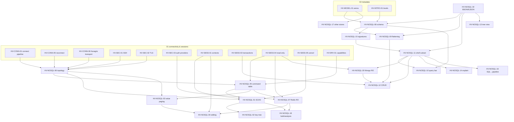

# 04 — NoSQL data access: Redis and MongoDB (canonical algorithm catalog)

- Status: canonical, implementation-ready. Date: 2026-11-11.
- Scope: Redis (and Redis-compatible servers: Valkey, KeyDB, Dragonfly, Garnet) key browsing, value paging and editing, command console, cluster/Sentinel topology, read-only safety; MongoDB schema inference, grid flattening, query bar, shell-subset parsing, CRUD with optimistic checks, BSON/EJSON fidelity, read-only enforcement; short notes on Cassandra, DynamoDB and ClickHouse JSON columns.
- Supersedes for implementation purposes: `datagrip/05-nosql.md` ALG-REDIS-01..04 and ALG-MONGO-01..03; `clients/oss-clients-redisinsight-compass.md` ALG-REDIS-01/02 and ALG-MONGO-01..04; the NoSQL parts of `clients/oss-clients-beekeeper-and-tui.md` ALG-EDIT-01 / ALG-DATA-01 and `datagrip/03-sessions-transactions-execution.md` ALG-RO-01 (Redis/Mongo paragraphs). Source docs stay as evidence.
- Related canonical files: `01-connectivity-and-sessions.md` (HV-CONN-*, HV-SEC-*, HV-SESS-*, HV-DRV-*), `02-introspection-and-metadata.md` (HV-MODEL-*, HV-INTRO-*), `03-ddl-and-schema-compare.md` (not used here beyond index DDL).
- Verification reports override sources: `verification/01-db-behavior-tests.md` anchors `#redis-noauth`, `#redis-acl`, `#mongo-localhost`, `#mongo-read`.

## 0.1 Priority table

| ID | Name | Tag | Depends on |
|---|---|---|---|
| HV-NOSQL-01 | Redis SCAN with budgets, cursor resume and metadata pipelining | v1 | HV-NOSQL-06, HV-NOSQL-05, HV-CONN-01, HV-SESS-01, HV-SESS-05 |
| HV-NOSQL-02 | Redis key tree (delimiters, hash tags, lazy counts, virtualization) | v1 | HV-NOSQL-01 |
| HV-NOSQL-03 | Redis per-type value paging and decoders | v1 | HV-NOSQL-05, HV-NOSQL-06 |
| HV-NOSQL-04 | Redis per-type editing with optimistic checks and TTL preservation | v1 | HV-NOSQL-03, HV-NOSQL-07, HV-SESS-01 |
| HV-NOSQL-05 | Redis command table, console parsing, classification and routing | v1 | HV-DRV-01, HV-NOSQL-06, HV-SESS-04 |
| HV-NOSQL-06 | Redis topology: standalone, Cluster (slots, MOVED/ASK, replicas), Sentinel | v1 (Sentinel v1.x) | HV-CONN-01, HV-CONN-05, HV-CONN-06, HV-SEC-01, HV-SEC-02 |
| HV-NOSQL-07 | Redis read-only and safety enforcement (client + ACL facts) | v1 | HV-NOSQL-05, HV-SESS-04, HV-SEC-03 |
| HV-NOSQL-08 | MongoDB schema inference (sampling, type lattice, presence, arrays) | v1 | HV-NOSQL-19, HV-MODEL-01, HV-INTRO-01, HV-SESS-05 |
| HV-NOSQL-09 | MongoDB document → grid flattening and drill-down | v1 | HV-NOSQL-08, HV-NOSQL-19 |
| HV-NOSQL-10 | MongoDB query bar (validation, paging, counting) | v1 | HV-NOSQL-11, HV-NOSQL-08, HV-SESS-05 |
| HV-NOSQL-11 | MongoDB shell-subset parsing and typed command lowering | v1 | HV-NOSQL-19, HV-NOSQL-15 |
| HV-NOSQL-12 | MongoDB CRUD with optimistic concurrency | v1 | HV-NOSQL-09, HV-NOSQL-11, HV-NOSQL-20, HV-SESS-03 |
| HV-NOSQL-13 | JSON/BSON tree view virtualization | v1 | HV-NOSQL-19 |
| HV-NOSQL-14 | Explain-plan tree → flame graph transform | v1.x | HV-NOSQL-11 |
| HV-NOSQL-15 | MongoDB completion and purity signature table | v1 | HV-NOSQL-08 |
| HV-NOSQL-16 | SQL → aggregation pipeline translation (subset) | later | HV-NOSQL-11, `hacivat-sql` parser |
| HV-NOSQL-17 | Other NoSQL / columnar notes (Cassandra, DynamoDB, ClickHouse JSON) | later | HV-MODEL-01, HV-NOSQL-08 |
| HV-NOSQL-18 | Redis bulk actions and keyspace analysis | v1.x | HV-NOSQL-01, HV-NOSQL-07 |
| HV-NOSQL-19 | BSON / Extended JSON value codec and display fidelity | v1 | — |
| HV-NOSQL-20 | MongoDB read-only enforcement and operation classification | v1 | HV-NOSQL-11, HV-SESS-04 |

## 0.2 Dependency map



## 0.3 Conventions

- Evidence tags and the ALG template follow `docs/research/README.md`. Each spec adds **Sources merged**, **Decision**, **Verification status**, **Rust placement**, **Per-DBMS matrix**, **i18n notes**.
- Clean room: RedisInsight and MongoDB Compass are **SSPL v1**, DataGrip is proprietary, Beekeeper Studio is **GPL-3.0**: behavior is described in prose and in our own pseudocode only. DataGrip's `redis-jdbc-driver` and `mongo-jdbc-driver` are Apache-2.0 and `mongodb-schema` is Apache-2.0: ideas may be reused, but we still write our own pseudocode. If code is ported later, keep attribution and NOTICE.
- Redis licensing note for bundled data: Redis ≥ 7.4 source is RSALv2/SSPL (Redis 8 adds an AGPLv3 option); Valkey is BSD-3 (`verification/02-external-fact-check.md` S39, Confirmed). Any command metadata we vendor comes from **Valkey's** BSD-3 command JSON, never from post-7.4 Redis sources `[Inferred: license history; verify the exact Valkey file set before vendoring]`.
- Crate layout: `hacivat-redis` (modules `topology`, `scan`, `tree`, `value`, `edit`, `command`, `safety`, `bulk`), `hacivat-mongo` (modules `schema`, `flatten`, `query`, `shell`, `crud`, `safety`, `explain`, `sig`), and the shared `hacivat-core::value::bson` codec. Core crates have no UI dependency (ADR 0001). The UI (`hacivat-ui`) subscribes to state and event streams.
- Fluent ids use the `redis-` and `mongo-` prefixes. Server text (error messages, key names, values) is never put inside a translated sentence. It is shown verbatim in a separate field.
- Docker test images: `redis:7` (7.4.x), `valkey/valkey:8`, `redis/redis-stack-server:7.4.0-v1` (tag to check; RedisJSON + TimeSeries + Bloom), a 6-node cluster compose `tests/docker/redis-cluster.yml` (3 primaries + 3 replicas from `redis:7` with `--cluster-enabled yes`, created by `redis-cli --cluster create … --cluster-replicas 1`), a Sentinel compose `tests/docker/redis-sentinel.yml` (1 primary, 1 replica, 3 sentinels), `mongo:7`, `mongo:8`, and a replica set compose `tests/docker/mongo-rs.yml` (`mongo:7 --replSet rs0` × 3 + `rs.initiate`).

---

## 1. Redis

### HV-NOSQL-01: Redis SCAN with budgets, cursor resume and metadata pipelining  `[v1]`

- **Sources merged:** ALG-REDIS-01 (`datagrip/05-nosql.md` §4), ALG-REDIS-01 steps 1–4 and 9 (`clients/oss-clients-redisinsight-compass.md` §5), RedisInsight scanner findings §3.2 (same doc), `mcp/02-hacivat-mcp-design-and-security.md` ALG-MCP-11 (the Redis read allow-list excludes `KEYS`).
- **Problem:** Enumerate keys without blocking the server (`KEYS` is O(N) and runs as one blocking command). Memory, time and server work must stay bounded, a scan must be resumable and cancellable, and the result must be honest about being partial. The same path must work for standalone, cluster, replicas and Redis-compatible servers.
- **Decision:**
  - Use cursor-based `SCAN` only. A **budget object** stops a batch on the first limit it hits: keys collected, number of calls, elapsed wall time, approximate elements scanned, or cancellation. The UI's "Scan more" continues from the stored cursor.
  - Exact-key fast path: a pattern with no unescaped glob metacharacters runs `EXISTS`/`TYPE`/`PTTL` and never scans. This follows RedisInsight's behavior `[Observed]`.
  - Type metadata is fetched lazily for visible rows only, in pipelines (HV-NOSQL-02 step 9). It is never fetched for every key during the scan. This beats DataGrip, which materializes every key with its `TYPE` in the model `[Observed: datagrip/05 §3.1.2, 5,006 keys in one cache]`, and RedisInsight, which runs `MEMORY USAGE … SAMPLES 0` for every loaded key `[Observed]`.
  - `MEMORY USAGE` is opt-in and uses `SAMPLES 5`. The value is labelled as an estimate.
  - Rejected: `KEYS pattern`. It blocks the server, and it is in `@dangerous`, which a sane read-only ACL denies (`verification/01#redis-acl`). It is allowed only as an explicit console command after a confirmation (HV-NOSQL-07).
  - Rejected: storing all keys in the metadata model (HV-MODEL-01). Keys are data, not schema. The model stores only the DB list, prefix aggregates when computed, and modules (HV-NOSQL-17 note).
- **Inputs / outputs:**
  - Inputs: a `RedisSession` (HV-NOSQL-06 topology), the DB index (cluster: DB 0 only), a glob `pattern` (default `*`), an optional `type_filter`, and a `ScanBudget`.
  - Output: a `ScanBatch { keys: Vec<Bytes>, next: Option<ScanCursor>, stop: StopReason, calls, elapsed, scanned_approx }`.
  - The keys go out as a stream of chunks of 1,000 so the tree can insert them incrementally.
- **Algorithm:**
  1. **Fast path.** If `pattern` has no unescaped `* ? [` characters, unescape it (strip `\`). Route by slot (HV-NOSQL-06). Pipeline `EXISTS k`, `TYPE k`, `PTTL k`. Return 0 or 1 key with `stop = Complete`.
  2. **Totals (cheap, optional).** Run `DBSIZE` (in a cluster: all primaries, summed per the command's response policy, HV-NOSQL-05). If that is denied (`NOPERM`) or unsupported, parse `INFO keyspace` `db<N>:keys=…`. Otherwise the total is `Unknown`. A total of 0 while keys are returned is treated as `Unknown`; Pika-like servers behave this way `[Observed: RI]`.
  3. **Cursor state.**
     - Standalone: `ScanCursor::Single(u64)`.
     - Cluster: `ScanCursor::PerNode(BTreeMap<NodeId, u64>)` over the primaries, or over the replicas when "read from replicas" is enabled; replica connections first send `READONLY`. Finished nodes are removed. The cursor is complete when the map is empty.
  4. **Loop** while no budget limit is hit:
     a. For each live node, with concurrency ≤ 4 (cluster only), send `SCAN cursor MATCH pattern COUNT c [TYPE t]`.
        - The `TYPE` option exists on Redis ≥ 6.0.
        - On "syntax error" or an unknown-option reply, set `type_option_unsupported`, rerun without `TYPE`, and filter client-side through the lazy `TYPE` pipeline. Some Redis-compatible servers need this fallback.
     b. Push the returned keys through the **dedup set**. `SCAN` guarantees only that a key present for the whole iteration is returned at least once, so duplicates are possible.
     c. Update the counters: `calls += 1`, `scanned_approx += c` (`COUNT` is a hint, so this is an approximation only), `elapsed`.
     d. Emit a chunk whenever ≥ 1,000 new keys are buffered.
     e. Update the node's cursor; a returned cursor of 0 means that node is finished.
  5. **Stop reasons:** `Complete` (all cursors done), `TargetReached` (`keys ≥ target_keys`), `CallLimit`, `TimeLimit`, `ScannedLimit`, `Cancelled`, `Error(node, err)`. On error, keep the other nodes' results and mark the failed node's cursor for retry.
  6. **Resume.** "Scan more" calls step 4 with the stored cursor and the same pattern and type. Changing the pattern, the type filter or the DB resets the cursor and the dedup set.
  7. **Topology change during a cluster scan.** If the slot map changes (HV-NOSQL-06 MOVED/ASK or failover), node cursors are no longer meaningful. Restart the affected nodes' cursors at 0, keep the dedup set (duplicates are suppressed) and set `restarted_nodes`.
  8. **Cancellation** (HV-SESS-05): drop the in-flight futures. `SCAN` is short, so there is nothing to kill server-side. The partial batch is still returned with `Cancelled`.
- **Data structures:**
  - `ScanBudget { count_hint: u32 = 1000, target_keys: usize = 500 (list) | 10_000 (tree), max_calls: u32 = 2_000, max_elapsed: Duration = 2s, max_scanned_approx: u64 = 1_000_000 }`. RedisInsight uses 500/10,000 targets and a 10,000 scanned threshold `[Observed]`. We count calls and time as well, because `COUNT` sums do not measure real work.
  - The dedup set is `HashSet<Bytes>` with an aHash-style hasher. Keys are raw bytes and are never assumed to be UTF-8.
  - When the dedup set holds more than `dedup_cap` (default 5M keys, about 300 MB worst case), stop deduplicating and set `may_contain_duplicates`.
- **Rust placement:** `hacivat-redis::scan`.
  ```rust
  pub struct ScanRequest { pub db: u32, pub pattern: Bytes, pub type_filter: Option<RedisType>, pub budget: ScanBudget }
  pub enum ScanCursor { Single(u64), PerNode(BTreeMap<NodeId, u64>) }
  pub enum StopReason { Complete, TargetReached, CallLimit, TimeLimit, ScannedLimit, Cancelled, Error { node: NodeId, err: RedisError } }
  pub struct ScanBatch { pub keys: Vec<Bytes>, pub next: Option<ScanCursor>, pub stop: StopReason,
                         pub calls: u32, pub elapsed: Duration, pub scanned_approx: u64, pub flags: ScanFlags }
  pub trait KeyScanner {
      fn scan(&self, req: &ScanRequest, from: Option<ScanCursor>, cancel: CancelToken)
          -> impl Stream<Item = Result<ScanChunk, RedisError>>;   // chunks; last item carries ScanBatch summary
      async fn exact(&self, key: &[u8]) -> Result<Option<KeyMeta>, RedisError>;
      async fn totals(&self, db: u32) -> Total;                    // Known(u64) | Unknown
  }
  ```
  - Crates to evaluate: `redis` (BSD-3; version to check), using `aio::MultiplexedConnection` per node. The cluster routing is our own (HV-NOSQL-06). Also evaluate `bytes` and `ahash`.
- **Per-DBMS matrix:**

  | Server | SCAN `TYPE` | DBSIZE | Notes |
  |---|---|---|---|
  | Redis ≥ 6.0 / Valkey 7–8 | yes | yes | reference behavior |
  | Redis 2.8–5.x | no → client-side filter | yes | `SCAN` since 2.8; < 2.8 → refuse key browsing; `KEYS` only via console with consent |
  | Redis Cluster | per node | per primary, summed | DB 0 only |
  | KeyDB | yes `[Inferred]` | yes | multi-master: scan one node per slot range |
  | Dragonfly | yes `[Inferred]` | yes | single node; `SCAN` order differs; dedup still needed |
  | Garnet / managed (ElastiCache, Azure, Upstash) | varies | `CONFIG` often denied | probe once, cache a capability bitset (HV-DRV-01) |

- **Complexity / performance notes:**
  - Server work is O(N) in total, spread over many short calls.
  - Client memory is O(min(N, target)) plus the dedup set.
  - One round trip per call per node.
  - Sparse `MATCH` patterns produce many empty replies, which is why the time and call budgets exist.
- **Verification status:**
  - SCAN semantics: Observed (Redis docs; RedisInsight behavior).
  - `KEYS` is denied under `-@dangerous`; `+@read -@write` still allows `KEYS`: Docker-verified (`verification/01#redis-acl`).
  - `TYPE`-option fallback on compatible servers: Inferred.
- **i18n notes:**
  - Counters are formatted with Fluent `NUMBER()`: `redis-scan-progress = Scanned ~{ NUMBER($scanned) } elements, loaded { NUMBER($loaded) } keys`.
  - `redis-scan-total-unknown = Total unknown`; `redis-scan-stopped-time = Stopped after { $seconds } s — Scan more?`; `redis-scan-may-duplicate = The list may contain duplicates`.
  - Key bytes are never case-folded or locale-sorted.
- **Edge cases (exhaustive):**
  - **Pattern:**
    - Empty pattern → `*`.
    - A literal key containing glob characters (`a*b`) → the user must escape it (`a\*b`); the fast path unescapes it.
    - Patterns with `[^…]` and `[a-z]` ranges.
    - Binary bytes in the pattern (sent as bytes).
  - **COUNT behavior:**
    - The server returns 0 keys with a non-zero cursor → keep looping.
    - The server returns far more than COUNT (small DB, listpack-like encodings) → accept and buffer.
  - **Key churn during the scan:**
    - A key expires between SCAN and TYPE → the lazy metadata returns `none` and the node is removed.
    - Keys are renamed during the scan.
    - A `FLUSHDB` runs during the scan → the cursor continues and returns nothing.
  - **Access control:**
    - The ACL denies `SCAN` → error `redis-scan-denied` and an offer of the exact-key lookup only.
    - The ACL key pattern `%R~cache:*` allows SCAN, but TYPE on other keys returns NOPERM → show those keys without metadata and with a lock badge.
    - `DBSIZE` is denied → fall back to `INFO keyspace`. `INFO` is also denied → `Unknown`.
  - **Server and topology:**
    - `CONFIG GET databases` is denied → DB list = DBs in `INFO keyspace` ∪ {0..15}.
    - A cluster with `SELECT n ≠ 0` → error.
    - A replica lags.
    - The cluster topology changes mid-scan (step 7).
    - A node is down → partial result with an `Error` stop on that node.
  - **Budgets and scale:**
    - A `TIME` budget hit at the first call (slow server) → at least one call always completes.
    - Over 10⁸ keys → the dedup cap is reached and `may_contain_duplicates` is set.
  - **Cursors:**
    - A `u64` cursor larger than `i64::MAX` → parse as unsigned.
    - Valkey 8 cluster cursors are still per node `[Inferred]`.
    - A RESP3 reply shape is identical for SCAN.
  - **Cancellation and connections:**
    - Cancellation between chunks.
    - The connection drops mid-loop → reconnect (HV-CONN-05) and resume from the last acknowledged cursor; duplicates are suppressed.
- **Test cases (input → expected):**
  1. `[docker: redis:7]` 10,000 keys `k:0..9999`, count_hint 1000, target 20,000 → `Complete`; 10,000 unique keys; calls ≥ 10.
  2. `[docker: redis:7]` same data, target 500 → `TargetReached`, 500 ≤ keys < 1,500, `next` is Some. Calling "Scan more" until `Complete` yields 10,000 unique keys in total.
  3. `[docker: redis:7]` pattern `user:42` (no glob) → no `SCAN` sent (assert with `MONITOR` in the test harness); 1 key returned.
  4. `[docker: redis:7]` 1M keys of which 3 match `rare:*`, `max_elapsed` 200 ms → `TimeLimit` with fewer than 3 keys, or `Complete` with 3; never more than 200 ms + one call.
  5. `[docker: redis:7]` ACL user `~cache:* +scan +type`, pattern `*` → only `cache:*` keys, no error.
  6. `[docker: redis-cluster compose]` 30,000 keys spread over 3 primaries → `PerNode` cursor with 3 entries that shrinks to empty; union = 30,000.
  7. `[docker: redis-cluster compose]` run `CLUSTER FAILOVER` on a replica mid-scan → batch completes; `restarted_nodes` is non-empty; no key missing; no duplicate in the output.
  8. Unit: a fake server returns `[cursor=5, keys=[a, a, b]]` and then `[0, [b, c]]` → `{a, b, c}`.
  9. `[docker: valkey/valkey:8]` tests 1–3 pass unchanged.
  10. Unit: a fake server rejects the `TYPE` option → falls back, `type_option_unsupported = true`, and keys are filtered by pipelined TYPE.
- **Used by:** Hacivat (key browser, MCP `list_keys` with small budgets); Karagöz (runs the scan next to the server for remote sessions and enforces per-role budgets).

### HV-NOSQL-02: Redis key tree (delimiters, hash tags, lazy counts, virtualization)  `[v1]`

- **Sources merged:** ALG-REDIS-02 (`datagrip/05-nosql.md`), ALG-REDIS-01 steps 5–13 (`clients/oss-clients-redisinsight-compass.md`), RedisInsight tree findings §3.3.
- **Problem:** Present a flat keyspace as a hierarchy using one or more delimiters. Counts must be honest about what has been loaded, the tree must update incrementally as scan chunks arrive, and scrolling must stay smooth at millions of keys.
- **Decision:**
  - The trie lives in the Rust core and is built incrementally. It is never rebuilt per batch.
  - Splitting is **byte-wise** using an Aho-Corasick automaton in leftmost-longest mode over the configured delimiters. Splitting is hash-tag aware (RedisInsight rule `[Observed]`).
  - Folders and leaves are kept in separate maps, so a key `a:b` and a folder `a:b` coexist without synthetic suffixes.
  - Sorting is byte-wise by default, with natural (numeric-aware) sort as an option.
  - Rejected: `localeCompare(…, 'en')` as in RedisInsight. Keys are binary, and English collation is wrong for Turkish users and unstable.
  - Rejected: storing the tree in the metadata model as DataGrip does. Changing the delimiter re-renders the tree from the dedup set without re-scanning.
  - Counts are labelled "loaded". "Count exactly" runs a dedicated prefix scan (HV-NOSQL-01) on request.
- **Inputs / outputs:**
  - Inputs: key chunks from HV-NOSQL-01, delimiters `D` (default `[":"]`), unsplittable prefix length `P` (default 0), sort mode, expansion events and viewport range.
  - Outputs: visible rows `TreeRow { node_id, depth, label: DisplayBytes, kind: Folder{loaded, exact?} | Leaf{meta?}, expanded }`, plus a total visible row count.
- **Algorithm:**
  1. **Split** (`segments(key)`):
     a. If `P > 0`, the first `P` bytes form one segment. If the key is valid UTF-8, move `P` forward to the next char boundary.
     b. Find delimiter matches leftmost-longest (so `::` beats `:`).
     c. Discard a match that lies inside a hash tag. The hash tag is the first `{` followed by a later `}` with non-empty content between them, matching the Redis Cluster rule; `{}` gives no protection.
     d. The segments are the bytes between the remaining matches. Empty segments are kept (`a::b` with `[":"]` → `a`, ``, `b`).
  2. **Insert** (`insert(key)`): walk from the root. For each segment except the last, use the child folder keyed by those segment bytes, creating it if needed, and increment its `loaded` counter. The last segment is inserted into the leaf map of the final folder. The key bytes are stored once (shared with the dedup set through `Bytes` refcounting).
  3. **Remove / rename:** remove the leaf, decrement the counters along the path, and prune empty folders that are not expanded. A rename is a remove followed by an insert.
  4. **Children order:** folders first, then leaves.
     - Byte-wise mode uses `BTreeMap<Bytes, _>`.
     - Natural mode compares runs of ASCII digits numerically (leading zeros are ties, broken by length then by bytes), and other bytes by value.
  5. **Visible-row index:**
     - Each node stores `visible = 1 + (expanded ? Σ child.visible : 0)`.
     - The children of an expanded folder are kept in an order-statistics structure: a B-tree with subtree sums, or a Fenwick tree over a sorted vector that is rebuilt when an insert lands in an expanded folder.
     - Row → node mapping descends with prefix sums in O(depth · log fanout).
     - Expand and collapse update the ancestors' sums.
  6. **Large fan-out:** a folder with more than 10,000 children inserts synthetic range groups (`[a…f]` by byte ranges, or chunks of 1,000) when expanded. This is the same chunking as HV-NOSQL-13.
  7. **Anchoring:** when a chunk arrives, the top visible `node_id` and its pixel offset are preserved, so new keys inserted above do not move the viewport.
  8. **Counts:** `loaded` is always shown, with "+" when the scan is incomplete. "Count exactly" for folder `F` calls HV-NOSQL-01 with pattern `glob_escape(F.prefix) + delim + "*"`, target ∞ and a progress stream, and stores `exact = (n, at: Instant)`. A count older than 5 minutes is shown as stale.
  9. **Lazy metadata:**
     - Visible leaves with unknown metadata are queued.
     - Every 100 ms (debounce) the queue is grouped by node (cluster slot) and pipelined: `TYPE`, `PTTL`, and `MEMORY USAGE k SAMPLES 5` if enabled. Each pipeline holds at most 500 keys.
     - Results are patched into the nodes. Keys that scrolled away before dispatch are dropped from the queue.
     - `TYPE == none` removes the leaf (it expired).
  10. **Refresh:** reset the scan and the tree, but keep the set of expanded prefixes and the selected key path, and re-expand them as their nodes reappear.
  11. **Delimiter change:** rebuild the trie from the dedup set (an O(total key bytes) background task). Expansion is restored by prefix bytes where possible.
- **Data structures:** `Node { seg: Bytes, folders: BTreeMap<Bytes, NodeId>, leaves: BTreeMap<Bytes, LeafId>, loaded: u64, exact: Option<(u64, Instant)>, expanded: bool, visible: u64, parent: NodeId }` in an arena `Vec<Node>`; `Leaf { key: Bytes, meta: Option<KeyMeta> }`; `KeyMeta { ty: RedisType, pttl_ms: i64, mem_est: Option<u64>, fetched_at }`.
- **Rust placement:** `hacivat-redis::tree`.
  ```rust
  pub struct KeyTree { /* arena, splitter, sort mode */ }
  impl KeyTree {
      pub fn new(delims: &[Bytes], prefix_len: usize, sort: TreeSort) -> Self;
      pub fn insert_chunk(&mut self, keys: &[Bytes]) -> TreeDelta;      // delta for UI invalidation
      pub fn remove(&mut self, key: &[u8]) -> TreeDelta;
      pub fn set_expanded(&mut self, id: NodeId, on: bool) -> TreeDelta;
      pub fn row_count(&self) -> u64;
      pub fn rows(&self, range: Range<u64>) -> Vec<TreeRow>;
      pub fn visible_unknown_leaves(&self, range: Range<u64>) -> Vec<Bytes>;
  }
  ```
  - Crates: `aho-corasick` (MIT/Unlicense; version to check), `bytes`.
- **Per-DBMS matrix:** the same for all Redis-compatible servers. In a cluster, hash-tag protection matters most, and metadata pipelines are grouped per node.
- **Complexity / performance notes:**
  - Insert costs O(L + depth · log fanout) per key.
  - 1M keys take about 1–2 s and tens of MB in Rust `[Inferred]`. A test enforces the bound (test 7).
  - Row lookup costs O(depth · log fanout).
- **Verification status:** Observed (RedisInsight tree and hash-tag rule, DataGrip delimiter option). The algorithmic choices (separate maps, byte-wise sort) are Inferred.
- **i18n notes:**
  - Labels are rendered from bytes. Valid UTF-8 is shown as text (with bidi isolation, FSI…PDI, to avoid Trojan-Source-style reordering). Invalid bytes are shown as `\xNN`.
  - An empty segment is shown as `redis-tree-empty-segment = (empty)`.
  - Folder counts use `redis-tree-folder-count = { NUMBER($loaded) }{ $complete -> [true] {""} *[false] + }`.
  - The sort order is locale-invariant by design. A Turkish UI does not change the order.
- **Edge cases (exhaustive):**
  - **Delimiter placement:**
    - A key that starts or ends with the delimiter (`:a`, `a:`) → empty segments.
    - Consecutive delimiters.
    - The delimiter is the whole key (`:`).
    - No delimiter at all → a flat list (with large fan-out grouping).
  - **Delimiter configuration:**
    - Multiple delimiters where one is a prefix of another (`:` and `::`).
    - A multi-byte UTF-8 delimiter (`→`) matched byte-wise.
    - Changing delimiters while the scan is running (rebuild, then continue inserting).
  - **Hash tags:**
    - A delimiter inside a hash tag `{user:1}:cart`.
    - An unbalanced `{` (no protection).
    - A `}` before the `{`.
    - An empty tag `{}`.
  - **Prefix length:**
    - `P` longer than the key (the whole key is one segment).
    - `P` splitting a UTF-8 sequence (moved forward to a char boundary).
  - **Key content:**
    - Invalid UTF-8 keys.
    - Very long keys (1 MB; the label is truncated, the full key stays available).
  - **Folder/leaf overlap and scale:**
    - Folder and leaf with the same display bytes.
    - 1M children in one folder.
    - Depth over 100 (iterative traversal).
  - **Churn and refresh:**
    - Rapid expand/collapse during insertion.
    - A key removed by TTL while visible.
    - A key re-added after removal (counted once by dedup).
    - Refresh while "Count exactly" is running (cancel the count).
- **Test cases (input → expected):**
  1. Keys `user:1`, `user:2`, `user:1:profile`, `order:9`, delimiter `:` → root: folder `order (1)`, folder `user (3)`. Inside `user`: folder `1 (1)`, then leaves `1`, `2`.
  2. `{user:1}:cart` with `:` → segments `{user:1}`, `cart`.
  3. `a::b`, delimiters `[":", "::"]` → `a`, `b`. Delimiters `[":"]` → `a`, ``, `b`.
  4. Binary key `\xff\xfe:x` → folder label `\xff\xfe`.
  5. Natural sort: `item:2`, `item:10`, `item:1` → `1, 2, 10`. Byte sort → `1, 10, 2`.
  6. Turkish UI with keys `İzmir`, `ılık`, `Irmak` in byte-sort mode → order by UTF-8 bytes: `Irmak` (0x49), `İzmir` (0xC4 0xB0), `ılık` (0xC4 0xB1). The same order in an English UI.
  7. Bench: insert 1,000,000 keys `t:{0..999}:{0..999}` in chunks of 10,000 → total < 3 s on the CI runner; the `rows(0..50)` latency is < 1 ms after each chunk.
  8. Expand folder `t`, insert more keys under `t:5:` → the viewport anchor node keeps its pixel offset (assert the anchor id and offset).
  9. `[docker: redis:7]` "Count exactly" on `user` with 5,000 `user:*` keys → 5,000.
- **Used by:** Hacivat.

### HV-NOSQL-03: Redis per-type value paging and decoders  `[v1]`

- **Sources merged:** ALG-REDIS-04 read side (`datagrip/05-nosql.md`), ALG-REDIS-02 steps 1–8 (`clients/oss-clients-redisinsight-compass.md`), RedisInsight decoder list §2.8, `mcp/02` ALG-MCP-12 (Redis value size pre-check).
- **Problem:** Show the value of one key as a grid or tree, page through aggregates with millions of members, never block the server, and decode binary values for display without executing anything.
- **Decision:**
  - Every type has a **position cursor** and an O(1) total command.
  - The commands `HGETALL`, `SMEMBERS`, `ZRANGE 0 -1`, `LRANGE 0 -1` and unbounded `XRANGE` are never issued by the browser.
  - Strings above 64 KiB are read with `GETRANGE` and require a confirmation before loading fully.
  - For sorted sets, the default browse is by rank (stable). Score-cursor browsing is an option for "jump to score".
  - Decoders are pure functions behind a trait. Pickle, Java-serialized and PHP-serialized data are parsed for display only and never deserialized into live objects.
  - Rejected: reading whole values and paging client-side (DataGrip `[Inferred]` per-type `SELECT` generators). It blocks on big keys.
- **Inputs / outputs:** Inputs: the key, its type (from metadata, re-checked), page size `n` (default 200), an optional member filter (glob or exact), order, and a `ValueCursor`. Output: `ValuePage { rows, next: Option<ValueCursor>, total: Total, flags: {unordered, approximate, may_duplicate, truncated_values} }`.
- **Algorithm (per type):**

  | Type | Total | Page (no filter) | Exact filter | Glob filter | Cursor |
  |---|---|---|---|---|---|
  | string | `STRLEN` | ≤ 64 KiB: `GET`; else `GETRANGE k off off+65535` | — | — | `ByteOffset(u64)` |
  | hash | `HLEN` | loop `HSCAN k c COUNT n` until ≥ n fields or c = 0; buffer the overflow | `HMGET` | `HSCAN … MATCH` with a budget | `Scan(u64, overflow)` |
  | list | `LLEN` | `LRANGE k i i+n-1` (negative indices for "from tail") | `LINDEX` by index; by value `LPOS k v COUNT 10` (≥ 6.0.6) | — | `Offset(i64)` |
  | set | `SCARD` | loop `SSCAN` like hash | `SMISMEMBER` (≥ 6.2) or `SISMEMBER` | `SSCAN … MATCH` | `Scan` |
  | zset | `ZCARD` | `ZRANGE k i j WITHSCORES` (`REV` for descending; Redis ≥ 6.2 syntax, else `ZREVRANGE`) | `ZSCORE` / `ZMSCORE` | `ZSCAN … MATCH` (flag `unordered`) | `Offset` or `Score(f64, member)` |
  | stream | `XLEN` | `XRANGE k (last + COUNT n` (exclusive start ≥ 6.2; else increment the sequence) / `XREVRANGE` | `XRANGE k id id` | — | `StreamId` |
  | ReJSON-RL | `JSON.TYPE k $`, `JSON.OBJLEN`/`JSON.ARRLEN` | the root's children, lazily: `JSON.OBJKEYS`, `JSON.GET k '$[i:j]'` | `JSON.GET k <path>` | — | `JsonPath + Offset` |
  | TSDB-TYPE | `TS.INFO` | `TS.RANGE k from to COUNT n` | — | — | `TimeStamp(i64)` |
  | MBbloom-- / cuckoo / CMS / topk / tdigest | `*.INFO` | info only | `BF.EXISTS` etc. on demand | — | none |
  | vectorset (Redis 8) | `VCARD` | `VRANDMEMBER`/`VLINKS` info only `[Inferred]` | — | — | none (v1.x) |
  | unknown | — | `OBJECT ENCODING`, `MEMORY USAGE` | — | — | none |

  1. Before every page, re-check the type with `TYPE k`, pipelined with the page command. If the type changed or is `none` → `ValueError::KeyChanged` and the UI refreshes the key.
  2. **SCAN-family pages:**
     - Keep a seen-set of members while it stays ≤ 1M entries; above that, set `may_duplicate`.
     - Small listpack-encoded aggregates return everything in one call. Rows beyond `n` go into the overflow buffer and are served before the next server call.
  3. **Sorted sets by score:** the cursor is `(score, member)`. The next page is `ZRANGE k score +inf BYSCORE LIMIT 0 n+k WITHSCORES`, skipping members with `(s == score && member ≤ last_member)` (member order is lexicographic within equal scores). `k` is the number of skipped duplicates seen so far at that score. If ties exceed 10,000, fall back to rank paging.
  4. **Value truncation:** member values over 4 KiB are cut for display in the grid. The full value is fetched on demand with `HGET`, `LINDEX` or `GETRANGE`, depending on the type.
  5. **Decoding** (display only), chosen per value:
     - auto-detect order: UTF-8 → JSON (when it parses) → MessagePack (when the first byte is plausible and it parses fully) → hex;
     - user-selectable decoders: UTF-8, ASCII, hex, Base64, JSON, MessagePack, Protobuf (with a user descriptor; raw wire format otherwise), Pickle (opcode listing only), Java serialization (structure view only), PHP serialize, vector f32/f64 LE, Unix timestamp → datetime.
     - The decoder choice is remembered per key pattern.
  6. **Stream consumer groups** (side panel): `XINFO GROUPS k`, `XINFO CONSUMERS k g`, `XPENDING k g` (summary) and the extended form with `COUNT` paging by ID.
  7. **Hash field TTLs** (Redis ≥ 7.4): pipeline `HPTTL k FIELDS m f1..fm` for the visible fields. A missing command (error) turns the column off.
- **Data structures:** `ValueCursor = ByteOffset(u64) | Scan{cursor: u64, overflow: VecDeque<Row>} | Offset(i64) | Score{score: f64, member: Bytes, skip: u32} | StreamId(StreamId) | Json{path: JsonPath, offset: u64} | Ts(i64)`; `StreamId { ms: u64, seq: u64 }` with `next()` = seq+1 (overflow → ms+1, seq 0).
- **Rust placement:** `hacivat-redis::value`.
  ```rust
  pub trait ValueReader {
      async fn page(&self, key: &[u8], ty: RedisType, req: PageReq, cur: Option<ValueCursor>) -> Result<ValuePage, ValueError>;
      async fn full_member(&self, key: &[u8], ty: RedisType, member: MemberRef) -> Result<Bytes, ValueError>;
  }
  pub trait Decoder: Send + Sync { fn id(&self) -> &'static str; fn sniff(&self, b: &[u8]) -> Confidence; fn decode(&self, b: &[u8], limit: usize) -> Decoded; }
  ```
  - Crates: `rmp` / `rmpv` (MIT) for MessagePack, `prost-reflect` (Apache-2.0) for Protobuf with descriptors, `base64`, `serde_json` (with `arbitrary_precision`). Versions to check.
- **Per-DBMS matrix:**

  | Feature | Redis 5 | Redis 6.0/6.2 | Redis 7.x | Redis 7.4+/8 | Valkey 8 | Dragonfly |
  |---|---|---|---|---|---|---|
  | `ZRANGE … REV/BYSCORE` unified | no (use ZREVRANGE/ZRANGEBYSCORE) | 6.2 | yes | yes | yes | yes `[Inferred]` |
  | exclusive `XRANGE (id` | no | 6.2 | yes | yes | yes | `[Inferred]` |
  | `LPOS` | no | 6.0.6 | yes | yes | yes | `[Inferred]` |
  | `HPTTL` field TTL | no | no | no | yes | 9.0 `[Inferred]` | no `[Inferred]` |
  | modules (JSON/TS/Bloom) | module | module | module | built into Redis 8 `[Inferred]` | valkey-json/bloom modules `[Inferred]` | JSON built-in `[Inferred]` |

- **Complexity / performance notes:**
  - SCAN-family calls are O(1) amortized.
  - `ZRANGE` by rank costs O(log N + n).
  - `LRANGE` costs O(S + n) from the nearer end; offsets deeper than 1M in a huge list show a cost warning.
  - `XRANGE` costs O(log N + n).
  - `GETRANGE` costs O(n).
- **Verification status:** Observed (RedisInsight per-type services; DataGrip per-type delegates). Version gates are Inferred from Redis docs and must be checked in the test matrix.
- **i18n notes:**
  - The column headers `field`, `value`, `member`, `score`, `index` and `id` are Fluent messages (`redis-col-field = Field`…).
  - Score numbers display with the data-locale formatting rules from `i18n/02` ALG-I18N-07. The underlying f64 is sent back with locale-invariant `{:?}`-style shortest round-trip text (`inf`/`-inf` as `+inf`/`-inf`).
  - Stream timestamps in IDs are displayed as a localized datetime in a tooltip only. The ID text stays verbatim.
- **Edge cases (exhaustive):**
  - **Key lifecycle:**
    - The key expires or is deleted between pages.
    - The key type changes (`WRONGTYPE`).
  - **Concurrent modification:**
    - A list is modified concurrently (offset drift: compare `LLEN` with the previous value and show "list changed").
    - A stream is trimmed (`MAXLEN`/`MINID`) while browsing.
  - **Sorted-set scores and order:**
    - A zset with equal scores (tie handling).
    - Scores of `±inf`.
    - The `-0.0` score.
    - `ZSCAN` results are unordered (flag).
  - **Encoding effects:**
    - Listpack hashes return everything.
    - `MATCH` sparse → budget plus "continue".
  - **Stream IDs:**
    - `*`-generated vs explicit stream IDs.
    - ID seq overflow `u64::MAX`.
  - **Big values and odd data:**
    - Strings of 512 MB (never fetched fully without confirmation and a size display).
    - Empty strings.
    - Binary members and field names.
    - Huge single members (MB).
    - Invalid JSON in ReJSON (impossible server-side, but a decoder failure on a string → show raw).
  - **Modules:**
    - A module type whose module is not loaded on a replica.
    - A RedisJSON v1 path syntax (`.`) vs v2 (`$`): use `$` when `MODULE LIST` reports ReJSON ≥ 2.
    - TS keys with compaction rules.
  - **Permissions:** the ACL denies a page command → per-command `NOPERM` message; the grid stays empty with the permission notice.
  - **Cluster:** the key is on a migrating slot → ASK handling (HV-NOSQL-06).
- **Test cases (input → expected):**
  1. `[docker: redis:7]` hash with 1,000,000 fields, n = 500 → page 1 has ≥ 500 rows; pages until the end yield 1,000,000 distinct fields; no `HGETALL` in `MONITOR`.
  2. `[docker: redis:7]` hash with 50 fields (listpack), n = 20 → one `HSCAN` call total for 3 pages.
  3. Unit: zset `[(a,1),(b,1),(c,1),(d,2)]`, score cursor after `(1,b)` → next page `c, d`.
  4. `[docker: redis:7]` stream with IDs `1700000000000-0..9`, cursor `1700000000000-5` → the next page starts at `-6`.
  5. `[docker: redis:6.0]` (tag to check) same stream → the client computes the start `1700000000000-6` (no `(`).
  6. `[docker: redis:7]` 10 MB string → `GETRANGE 0 65535`; `truncated = true`; "load all" requires confirmation.
  7. `[docker: redis/redis-stack-server]` JSON doc `{"a":[1,2,3],"b":{"c":1}}` → root rows `a [3]`, `b {1}`; expanding `a` issues `JSON.GET k '$.a[0:200]'`.
  8. Unit: bytes `0x82 0xa1 0x61 0x01 0xa1 0x62 0x02` → MessagePack `{a:1,b:2}` auto-detected.
  9. Unit: a pickle payload → opcode listing; no Python object is constructed (the decoder has no `eval` path).
  10. `[docker: redis:7]` `DEL` the key between page 1 and 2 → `KeyChanged`.
- **Used by:** Hacivat; Karagöz (same reader for remote sessions; per-role max value bytes).

### HV-NOSQL-04: Redis per-type editing with optimistic checks and TTL preservation  `[v1]`

- **Sources merged:** ALG-REDIS-04 edit column (`datagrip/05-nosql.md`, a Hacivat improvement because DataGrip 2024.3 has no Redis editing `[Observed]`), ALG-REDIS-02 step 9 (`clients/oss-clients-redisinsight-compass.md`), ALG-EDIT-01 change-set rules (`clients/oss-clients-beekeeper-and-tui.md`, GPL, behavior only).
- **Problem:** Turn grid edits on a Redis value into minimal commands. Concurrent changes must be detected, TTLs (key-level, and hash-field level on 7.4+) must be preserved, and every pending change must be previewable before it is applied.
- **Decision:**
  - **WATCH-based compare-and-set on a dedicated connection** (HV-SESS-01 "isolated" context; WATCH state is per connection, so it can never run on the shared multiplexed connection). The algorithm:
    1. `WATCH k`.
    2. Read the original values of the edited members.
    3. Compare them with the snapshot.
    4. `MULTI` … `EXEC`.
    5. A nil `EXEC` result means a conflict. Because WATCH is key-granular, a conflict caused by an unrelated member on a hot key is retried automatically, up to 3 times, if the re-read members still equal the snapshot. This gives member-level CAS semantics.
  - Rejected as the primary mechanism: Lua CAS scripts (`EVAL`). They need `@scripting`, which read/write ACLs often deny, and `+@scripting` has side grants (`verification/01#redis-acl`: it grants `SCRIPT FLUSH` and re-grants `FUNCTION` writes). Some managed services also restrict scripts. Lua is used only when the user enables "atomic scripts" and the ACL allows `EVAL`; it is then classified as Write.
  - Rejected: blind writes (no check). They lose concurrent updates silently.
  - TTL is preserved by construction:
    - `SET … KEEPTTL` (≥ 6.0).
    - For recreate operations, capture `PEXPIRETIME` (≥ 7.0) or `now + PTTL` before the edit and re-apply `PEXPIREAT` inside the same `MULTI`.
    - Hash field TTLs (7.4+): capture with `HPEXPIRETIME` and re-apply with `HPEXPIREAT` on field rename.
- **Inputs / outputs:**
  - Inputs: the key, its type, a `ChangeSet` (per-type ops), the snapshot of the original values of the touched members, and the session's read-only state.
  - Outputs: a preview (a command list rendered with `redis-cli` quoting) and `ApplyResult = Applied{retries} | Conflict{members: Vec<MemberRef>, current: Vec<Option<Bytes>>} | KeyGone | Denied(reason) | Error`.
- **Algorithm:**
  1. **Change-set normalization** (Beekeeper-style rules, re-expressed):
     - Editing back to the original value removes the op.
     - Editing a pending insert modifies the insert.
     - Deleting a pending insert drops it.
     - Deleting a member with pending updates becomes a plain delete.
  2. **Op → commands:**

     | Type | Edit value | Rename member/field | Insert | Delete | Compare read |
     |---|---|---|---|---|---|
     | string | `SET k v KEEPTTL` (< 6.0: `SET k v PX <remaining>` captured inside WATCH) | — | — | `UNLINK k` (whole key) | `GET k` (≤ 64 KiB) or `STRLEN` + `XXH3(GETRANGE …)` chunks |
     | hash | `HSET k f v` | `HDEL k f` + `HSET k f' v` (+ `HPEXPIREAT` if field TTL) | `HSETNX k f v` (fails if exists → conflict) | `HDEL k f` | `HMGET k f…` |
     | list | `LSET k i v` | — | `RPUSH`/`LPUSH` or `LINSERT k BEFORE|AFTER pivot v` | `LSET k i <uuid-tombstone>` + `LREM k 1 <tombstone>` | `LINDEX k i` for each touched index + `LLEN k` |
     | set | — | `SREM k m` + `SADD k m'` | `SADD k m` | `SREM k m` | `SMISMEMBER k m…` |
     | zset | `ZADD k XX s m` | `ZREM k m` + `ZADD k s m'` | `ZADD k NX s m` | `ZREM k m` | `ZMSCORE k m…` |
     | stream | (entries immutable) | — | `XADD k * f v…` (or an explicit ID) | `XDEL k id` | `XRANGE k id id` |
     | ReJSON | `JSON.SET k <path> <json> XX` | via `JSON.SET` parent | `JSON.SET k <path> <json> NX`, `JSON.ARRAPPEND` | `JSON.DEL k <path>` | `JSON.GET k <path>` |
     | key-level | TTL: `PEXPIRE k ms` / `PERSIST k` | `RENAME k k'` → use `RENAMENX` by default (no clobber) | create key (type-specific first write) | `UNLINK k` (fallback `DEL`) | `EXISTS k`, `TYPE k` |

  3. **Apply** (one key per transaction):
     ```text
     conn = isolated_connection(slot(k))           // cluster: owner of slot(k)
     for attempt in 0..=3:
         WATCH k
         cur = pipeline(TYPE k, compare_reads(ops))
         if cur.type == none           -> UNWATCH; return KeyGone
         if cur.type != expected_type  -> UNWATCH; return Conflict(type)
         diffs = members where cur != snapshot
         if diffs non-empty            -> UNWATCH; return Conflict(diffs, cur)
         ttl = need_ttl_restore(ops) ? capture(PEXPIRETIME k | PTTL k) : none
         MULTI; emit(ops); if ttl: PEXPIREAT k ttl_abs; r = EXEC
         if r != nil                   -> return Applied(attempt)
         // nil: something touched k; loop re-reads and re-compares (member-level CAS)
     return Conflict(retry_exhausted)
     ```
  4. **Lists:**
     - Index-based ops compare `LINDEX` at every touched index and also `LLEN`. If the length changed, report a conflict, because offsets have shifted even when the touched values are equal.
     - The delete tombstone is a random 16-byte value. It is unique, so `LREM 1` removes exactly that element.
  5. **Key rename in cluster:**
     - If `slot(k) != slot(k')`, `RENAME` is impossible (CROSSSLOT).
     - Offer "copy and delete": `DUMP k` → `RESTORE k' <pttl> <payload> ABSTTL`(when TTL) or `0` → `UNLINK k`, with a warning that this is not atomic.
     - Require explicit confirmation.
  6. **Read-only:** if the session or connection is read-only (HV-NOSQL-07), the editing UI is disabled and `apply` returns `Denied`. Karagöz re-checks each command against role policy.
  7. **Audit:** each applied transaction emits an audit event (key, op kinds, member count; values omitted by default) for local history and for Karagöz audit when remote.
- **Data structures:** `ChangeSet { ops: IndexMap<MemberRef, Op>, snapshot: HashMap<MemberRef, Option<Bytes>>, key_ops: Vec<KeyOp> }`; `MemberRef = Field(Bytes) | Index(i64) | Member(Bytes) | StreamId(StreamId) | JsonPath(String) | Whole`.
- **Rust placement:** `hacivat-redis::edit`.
  ```rust
  pub trait ValueEditor {
      fn preview(&self, key: &[u8], ty: RedisType, cs: &ChangeSet) -> Vec<RenderedCommand>;
      async fn apply(&self, key: &[u8], ty: RedisType, cs: &ChangeSet, policy: &EditPolicy) -> ApplyResult;
  }
  pub struct EditPolicy { pub max_retries: u8 /*3*/, pub use_lua: bool /*false*/, pub allow_non_atomic_cross_slot: bool /*false*/ }
  ```
  - The dedicated connection comes from `hacivat-core::session::IsolatedLease` (HV-SESS-01).
- **Per-DBMS matrix:**

  | Capability | Redis < 6.0 | 6.0–6.2 | 7.0–7.2 | 7.4+/8 | Valkey 8 | Dragonfly | Cluster |
  |---|---|---|---|---|---|---|---|
  | `KEEPTTL` | no (capture PTTL) | yes | yes | yes | yes | yes `[Inferred]` | yes |
  | `PEXPIRETIME` | no | no | yes | yes | yes | `[Inferred]` | yes |
  | `SMISMEMBER` | no (pipeline SISMEMBER) | 6.2 | yes | yes | yes | yes `[Inferred]` | yes |
  | WATCH/MULTI | yes | yes | yes | yes | yes | yes (single-slot) `[Inferred]` | single slot only |
  | field TTL restore | — | — | — | yes | `[Inferred]` 9.0 | — | yes |

- **Complexity / performance notes:** O(#ops) commands in one round trip of `MULTI` plus one compare round trip. Retries are bounded. Large change sets (over 10,000 ops) are split into transactions of 1,000 ops on the same key; the UI warns that the total is not atomic.
- **Verification status:** Inferred (the WATCH semantics are documented by Redis). The ACL `@scripting` side effects that drive the Lua rejection are Docker-verified (`verification/01#redis-acl`).
- **i18n notes:**
  - `redis-edit-conflict = The value changed on the server since you loaded it.`
  - `redis-edit-conflict-members = { $count -> [one] One item was *[other] { $count } items were } changed by someone else.`
  - `redis-edit-key-gone = The key no longer exists (deleted or expired).`
  - `redis-edit-cross-slot-confirm = Renaming across hash slots copies the key and deletes the original. This is not atomic.`
  - The preview command text is locale-invariant.
- **Edge cases (exhaustive):**
  - **Concurrency:**
    - A concurrent write to another member of the same key (auto-retry succeeds).
    - A concurrent write to the same member (conflict).
    - The key deleted between load and apply.
    - The key expires during `MULTI` (EXEC applies to a missing key → recreated without TTL; detect via the post-check `TYPE` + `PTTL` and report "TTL lost").
    - The type changed.
  - **Lists:**
    - The list was shifted by a push from another client (LLEN check).
    - The element value equals the tombstone (impossible by construction).
  - **Members and fields:**
    - Renaming a field to an existing field (HSETNX-style check: the rename target must not exist → compare `HEXISTS` → conflict).
    - Zset `XX` on a member deleted meanwhile (`ZADD` returns 0 changed; compare catches it first).
  - **Streams:** an ID ≤ the last ID (server error → shown verbatim).
  - **Strings and TTL:**
    - Huge string edits (over 1 MB) → stream from the file editor; hash compare via chunked XXH3.
    - Large TTL values near the `i64` limit.
    - Editing a key that has no TTL (`PTTL -1` → no restore).
  - **Module values:** JSON path not found; JSON numbers beyond f64 (send the JSON text verbatim).
  - **Server modes:**
    - An ACL that allows the write but denies `WATCH` (rare) → fall back to "unsafe write" only with an explicit per-apply confirmation.
    - A replica connection (READONLY) → writes are routed to the primary.
  - **Topology:**
    - Cluster: slot migrating (ASK during WATCH → abort and retry on the target).
    - A failover between WATCH and EXEC → the connection drops → `Error` with "not applied, state unknown"; re-read and compare to tell the user whether it applied.
- **Test cases (input → expected):**
  1. `[docker: redis:7]` hash `h {a:1,b:2}` with TTL 100 s; edit `a→9` → `HSET h a 9`; `PTTL` is still about 100 s.
  2. `[docker: redis:7]` load `h`; another client sets `b=3`; edit `a→9` → first EXEC is nil, retry compares `a==1` → applied; `retries=1`.
  3. `[docker: redis:7]` load `h`; another client sets `a=5`; edit `a→9` → `Conflict(a, current=5)`; no write.
  4. `[docker: redis:7]` string with TTL 50 s, edit → `SET … KEEPTTL`; TTL preserved.
  5. `[docker: redis:7]` list `[x,y,z]`, delete index 1 → the list becomes `[x,z]`. If another client `LPUSH`es first → `Conflict` (LLEN changed).
  6. `[docker: redis:7]` hash field rename `a→c` where `c` exists → conflict, no write.
  7. `[docker: redis:7]` (7.4) hash field `a` with field TTL 60 s, rename `a→d` → `d` has a TTL of about 60 s.
  8. `[docker: redis-cluster compose]` rename `{u}:1 → {v}:1` (different slots) → requires confirmation; DUMP/RESTORE path; TTL kept with `ABSTTL`.
  9. Read-only connection → `apply` returns `Denied`; no command sent.
- **Used by:** Hacivat; Karagöz (policy check per generated command; audit).

### HV-NOSQL-05: Redis command table, console parsing, classification and routing  `[v1]`

- **Sources merged:** ALG-REDIS-03 (`datagrip/05-nosql.md`; the hint syntax comes from DataGrip `redis-jdbc-driver@v1.5`, Apache-2.0), RedisInsight workbench findings §3.5 (command specs from `commands.json`), ALG-RO-01 Redis paragraph (`datagrip/03-sessions-transactions-execution.md`), ALG-MCP-11 Redis allow-list (`mcp/02`), and cancellation notes for blocking commands (`datagrip/03` §3).
- **Problem:** Parse console input into commands, check each against a server-accurate command table (arity, key positions, flags, ACL categories, request/response policies), classify danger, route in a cluster, execute (including blocking, pub/sub and `MONITOR` streams), and render results.
- **Decision:**
  - **Runtime command table first.** On connect, run `COMMAND DOCS` (≥ 7.0) and `COMMAND INFO` (or `COMMAND` on 6.x).
    - This yields arity, flags, ACL categories, key specs (≥ 7.0), tips (`request_policy`, `response_policy`, `nondeterministic_output`) and subcommands.
    - It covers modules automatically and matches the server version.
    - The parsed table is cached per server `(server_name, version, module list hash)`.
  - **Bundled fallback table** generated at build time from Valkey's BSD-3 command JSON. It is used when `COMMAND` is denied by ACL or unavailable (some proxies) and for offline completion.
  - Rejected: fetching `commands.json` from upstream URLs at runtime, as RedisInsight does `[Observed]`. Network dependency, license ambiguity for post-7.4 Redis docs, and version mismatch.
  - **Console grammar:**
    - One command per logical line.
    - Optional DataGrip-style hint comments, re-implemented from the Apache-2.0 driver idea: `-- node = host:port` and `-- <col> : v1 v2 …`.
    - Quoting compatible with `redis-cli`.
  - **Danger classes** are derived from table data, plus an override list (below).
  - **Unknown commands** (not in either table) are classified `Unknown`, which ranks as Write+Admin for read-only and MCP purposes (fail closed).
- **Inputs / outputs:**
  - Inputs: editor text, the caret or selection, the session (topology, current DB, read-only flag), and the command table.
  - Outputs:
    - `Vec<ParsedCommand { argv: Vec<Bytes>, span, node_hint, column_hint, class: DangerClass, route: Route, shape: ReplyShape, blocking: bool, streaming: StreamKind? }>`.
    - Execution results as `RedisReply` trees with a rendering plan.
- **Algorithm:**
  1. **Lexing (redis-cli compatible):**
     - Whitespace separates arguments.
     - `"…"` supports the escapes `\" \\ \n \r \t \b \a \xHH`.
     - `'…'` is literal except `\'`.
     - An unterminated quote is a parse error with its span.
     - Inside the editor, a `--` line comment is recognized only at line start (after whitespace), so `SET k --x` keeps `--x` as an argument.
  2. **Statement split:**
     - Each non-comment line is one command, with no backslash continuation.
     - Blank lines are ignored.
     - Hint comments apply to the next command only.
     - At most one node hint and one column hint per command; a duplicate is an error.
     - A node hint must be exactly `-- node = host:port`.
  3. **Lookup:** `name = ascii_uppercase(argv[0])`. If the command has subcommands (`CONFIG GET`, `CLIENT KILL`, `XINFO STREAM`, `FUNCTION FLUSH`), look up `name|ascii_lower(argv[1])` first.
  4. **Arity:** positive `n` = exact, negative `-n` = at least `n`. A mismatch is a client-side error before sending, with no round trip.
  5. **Key extraction:**
     - From key specs (`begin_search` index/keyword + `find_keys` range/keynum), e.g. `EVAL script numkeys k1…`, `XREAD … STREAMS k1 k2 id1 id2`, `MIGRATE`, `SORT … STORE dst`.
     - With 6.x tables: `first/last/step`.
     - `movablekeys` without key specs → treat as keyless with a cluster warning.
  6. **DangerClass** (ordered; the most severe matching rule wins):
     - `Admin`: ACL category `@admin` or `@dangerous`, or flag `admin`. Includes `FLUSHALL`, `FLUSHDB`, `CONFIG SET`, `CONFIG REWRITE`, `SHUTDOWN`, `DEBUG`, `REPLICAOF`/`SLAVEOF`, `FAILOVER`, `CLUSTER *` writes, `CLIENT KILL/PAUSE/NO-EVICT`, `ACL SETUSER/DELUSER`, `MODULE LOAD`, `SAVE`/`BGSAVE`/`BGREWRITEAOF`, `SWAPDB`, `MIGRATE`, `KEYS` (`@dangerous` in `@read`, `verification/01#redis-acl`), `SCRIPT FLUSH`, `FUNCTION FLUSH|DELETE|LOAD|RESTORE`, `MONITOR`.
     - `Script`: `EVAL`, `EVALSHA`, `FCALL` (`@scripting`, not `_RO`). Treated as Write unless the script's shebang declares `flags=no-writes` and it is sent as `EVAL_RO`/`FCALL_RO`.
     - `Write`: ACL `@write` or flag `write`. Includes `SORT` (`SORT_RO` is Read), `GEORADIUS*` with `STORE`, `XREADGROUP` (creates PEL entries), `XACK`, `XCLAIM`, `XAUTOCLAIM`, `PUBLISH`/`SPUBLISH` (side effect: classified `Write` for read-only purposes).
     - `PubSub`: `SUBSCRIBE`, `PSUBSCRIBE`, `SSUBSCRIBE` (streaming, read).
     - `Blocking`: ACL `@blocking` (BLPOP, BRPOP, BLMOVE, BLMPOP, BRPOPLPUSH, BZPOPMIN/MAX, BZMPOP, `XREAD BLOCK`, `XREADGROUP BLOCK`, `WAIT`, `WAITAOF`). This is orthogonal: combined with Read/Write.
     - `Connection`: `SELECT`, `AUTH`, `HELLO`, `CLIENT SETNAME`, `RESET`, `READONLY`, `READWRITE`, `QUIT`, `MULTI`/`EXEC`/`DISCARD`/`WATCH`/`UNWATCH`.
     - `Read`: flag `readonly` and none of the above.
     - `Unknown`: not in any table.
  7. **Session-state commands are intercepted**, not passed through blindly:
     - `SELECT n` updates the session DB. In a cluster with `n ≠ 0` it is a client-side error. The DB is replayed on reconnect (HV-CONN-05).
     - `MULTI`…`EXEC` pins one connection until EXEC or DISCARD (a transaction tab state).
     - `RESET` and `HELLO` re-sync the protocol and DB.
     - `AUTH` is accepted but redacted in history.
     - `CLIENT SETNAME` is replayed on reconnect.
  8. **Routing** (HV-NOSQL-06):
     - Node hint → that node.
     - Keys → slot of the first key. All keys must hash to the same slot, otherwise a client-side `CROSSSLOT` error is shown with a hash-tag suggestion. The exception is `request_policy:multi_shard` commands (`MGET`/`MSET`/`DEL`/`EXISTS`/`UNLINK`/`TOUCH`), which are split per slot and merged per the response policy.
     - Keyless commands → use `request_policy`:
       - `all_shards` → all primaries (e.g. `DBSIZE`, `SCAN` is handled separately, `KEYS`).
       - `all_nodes` → all nodes (`CONFIG SET`, `SCRIPT FLUSH`).
       - `special` → a per-command handler.
       - No policy → a random primary, or the node hint.
     - Response aggregation follows `response_policy`: `agg_sum` (DBSIZE), `agg_logical_and`/`or`, `all_succeeded`, `one_succeeded`, `agg_min`/`max`, and the default per-node result list.
     - This improves on DataGrip, which rejects `DBSIZE`, `WAIT` and `WAITAOF` in a cluster `[Observed]`.
  9. **Read-only gate** (HV-NOSQL-07): before sending, if `session.read_only` and class ∉ {Read, PubSub(read), Connection(non-mutating)} → blocked with a reason. If the editor is in "confirm dangerous" mode, Admin and Write commands require confirmation on production-tagged connections (HV-SESS-04 tags).
  10. **Execution modes:**
      - Normal: request/response.
      - Blocking: a dedicated connection; the timeout is the command's own (e.g. `BLPOP … 0` = infinite). Cancel = `CLIENT UNBLOCK <id>` from a side connection (≥ 5.0), else close the connection (HV-SESS-05).
      - PubSub/`MONITOR`: a dedicated connection with a streaming view (bounded ring buffer of 10,000 messages, pause/stop). `MONITOR` asks for confirmation with a server-load warning.
      - `EVAL` with a long-running script: cancel = `SCRIPT KILL` (or `FUNCTION KILL`), which only works for scripts that have not written; otherwise show the server message verbatim.
  11. **Rendering (ReplyShape):**
      - Picked from the command: scalar; flat list; map (RESP3 map or RESP2 pairs for `HGETALL`/`CONFIG GET`/`HRANDFIELD … WITHVALUES`); pairs `(member, score)` for `WITHSCORES`; stream entries `(id, field map)`; `XREAD` → stream name → entries; `INFO` → sectioned key/value; `CLIENT LIST`/`CLUSTER NODES` → parsed tables; anything else → nested tree (HV-NOSQL-13).
      - A column hint prepends a synthetic column whose row `i` = hint value `i`.
      - Replies over 100,000 elements are truncated with a notice.
  12. **Completion and signature help** come from `COMMAND DOCS` arguments (`type`, `token`, `optional`, `multiple`, `oneof`, `block`), plus key-name completion from loaded tree keys (HV-NOSQL-02) at key positions.
- **Data structures:** `CommandTable { by_name: HashMap<String, CommandSpec>, source: Runtime | Bundled, server_fp: Fingerprint }`; `CommandSpec { name, arity: i32, flags: FlagSet, acl: CategorySet, key_specs: Vec<KeySpec>, tips: Tips, args: Vec<ArgSpec>, sub: HashMap<String, CommandSpec>, since: Version }`.
- **Rust placement:** `hacivat-redis::command`.
  ```rust
  pub fn lex(text: &str) -> Result<Vec<LexedLine>, LexError>;
  pub fn parse(lines: &[LexedLine], table: &CommandTable, sess: &SessionView) -> Vec<Result<ParsedCommand, ParseError>>;
  pub fn classify(spec: &CommandSpec, argv: &[Bytes]) -> DangerClass;   // argv needed for SORT STORE, GEORADIUS STORE, XREAD BLOCK
  pub fn route(spec: &CommandSpec, argv: &[Bytes], hint: Option<NodeAddr>, topo: &Topology) -> Result<Route, RouteError>;
  pub enum DangerClass { Read, Connection, PubSub, Write, Script, Admin, Unknown }
  pub struct Blocking(pub bool);
  ```
  - The shared classifier is used by the HV-NOSQL-07 gate, the MCP classifier (`mcp/02` ALG-MCP-11 Redis branch) and Karagöz.
  - Crates: `redis` (`Value`, RESP3 support; version to check).
- **Per-DBMS matrix:**

  | Server | `COMMAND DOCS` | key specs | tips | fallback |
  |---|---|---|---|---|
  | Redis ≥ 7.0, Valkey 7–8 | yes | yes | yes | — |
  | Redis 6.x | no | first/last/step | no | bundled docs + runtime `COMMAND` |
  | Redis ≤ 5 | no | first/last/step | no | bundled table |
  | Dragonfly / KeyDB / Garnet | partial `[Inferred]` | partial | partial | merge runtime ∪ bundled; unknown → Unknown |
  | Proxies (twemproxy, Envoy) | often denied | — | — | bundled; routing by proxy |

- **Complexity / performance notes:** The table load is one-time, about 250 KB of reply data. Parsing is O(text).
- **Verification status:**
  - Hint syntax: Observed (DataGrip driver v1.5).
  - `@dangerous`/`@read` overlap (`KEYS`, `SORT_RO`) and `@scripting ∩ @write`: Docker-verified (`verification/01#redis-acl`).
  - Tips and key specs: Observed (Redis 7 command docs).
- **i18n notes:**
  - `redis-console-arity = { $command } expects { $expected } arguments, got { $actual }.` (the command name is not translated)
  - `redis-console-crossslot = Keys map to different hash slots. Use a hash tag like {user}:a and {user}:b.`
  - `redis-console-blocked-ro = { $command } is not allowed on a read-only connection ({ $class }).` (the class label comes from `redis-class-write = write`… messages)
  - The `CLIENT LIST` and `INFO` field names stay verbatim.
- **Edge cases (exhaustive):**
  - **Lexing:**
    - Mixed-case command names.
    - `\xHH` invalid hex.
    - Empty argument `""`.
    - Arguments that look like comments.
    - A trailing backslash.
    - Unicode in arguments (sent as UTF-8 bytes).
    - A very long argument (a 100 MB paste → warn).
  - **Command table:**
    - Subcommand case (`client kill`).
    - A module command with no key specs (`FT.SEARCH idx`) → keyless routing (random primary, or all shards when its tips say so); RediSearch cluster coordination differs by version `[Inferred]`.
    - `COMMAND` denied by ACL → bundled table plus a banner.
    - Renamed commands (`rename-command` in config: e.g. `FLUSHALL` renamed to an empty string → the server error is shown verbatim; the bundled class still applies to the original name; the renamed name is Unknown).
  - **Scripts and transactions:**
    - `EVAL` with `numkeys` larger than the remaining args → client-side error.
    - `MULTI` without `EXEC` when closing the tab → `DISCARD` before returning the connection.
    - `WATCH` in the console.
  - **Connection-state commands:**
    - `SELECT` inside `MULTI`.
    - `QUIT` (handled: close and mark the session disconnected).
    - `HELLO 2` switching the protocol mid-session (the parser handles both).
    - `RESET`.
  - **Streaming and blocking:**
    - Pub/sub messages arriving while a command is pending (RESP3 push frames on the same connection are routed to a notification sink).
    - `XREAD BLOCK 0` with cancel.
  - **Cluster routing:**
    - A node hint for a node that is not in the topology → error.
    - A cluster node hint combined with keys of another slot → MOVED → error, not silent re-route (the hint is explicit).
- **Test cases (input → expected):**
  1. `-- node = 10.0.0.2:7001` + newline + `INFO` → executed on that node only.
  2. `-- key : a b c` + newline + `MGET a b c` → columns `key`, `value`; 3 rows.
  3. `SELECT 3` on a cluster → client-side error; nothing sent.
  4. `[docker: redis-cluster compose]` `DBSIZE` → sum over 3 primaries equals the key count.
  5. `[docker: redis-cluster compose]` `MGET a b` (different slots) → split per slot, merged in argument order.
  6. `SET a 1 2 3 4 5 6` → server `syntax error` verbatim (the arity `-3` passes client-side).
  7. `GET` → client-side arity error.
  8. Classify: `GET k`→Read; `SET k v`→Write; `SORT l`→Write; `SORT_RO l`→Read; `KEYS *`→Admin; `EVAL_RO "return 1" 0`→Read; `EVAL "…" 0`→Script; `FUNCTION FLUSH`→Admin; `XREADGROUP GROUP g c STREAMS s >`→Write; `PUBLISH c m`→Write; `FOO.BAR x`→Unknown.
  9. `[docker: redis:7]` `BLPOP q 0` then cancel → `CLIENT UNBLOCK` sent from a side connection; the console is usable within 1 s.
  10. `[docker: redis:7]` ACL user without `+command` → bundled table used; the banner is shown; classification is still correct for `GET`/`SET`.
  11. Lexer: `SET "a b" 'c\'d'` → argv `[SET, "a b", "c'd"]`.
  12. `[docker: valkey/valkey:8]` runtime table source; `COMMAND DOCS` parsed; the `GET` spec has one key spec.
- **Used by:** Hacivat (console, completion, read-only gate); Karagöz (classification + routing at the agent); MCP (`mcp/02` Redis branch reuses `classify`).

### HV-NOSQL-06: Redis topology — standalone, Cluster, Sentinel  `[v1; Sentinel v1.x]`

- **Sources merged:** `datagrip/05-nosql.md` §3.1.1 (templates, `hostAndPortMapping`, mode verification, the SSH+cluster limitation), ALG-REDIS-01 step 1 and ALG-REDIS-03 routing (same doc), RedisInsight cluster cursor (`clients/oss-clients-redisinsight-compass.md` §2.4), `datagrip/05` §5 item 5 (Karagöz does node mapping locally).
- **Problem:** Discover and maintain the server topology. Map announced node addresses through tunnels or the Karagöz transport, route commands by slot, handle redirections and failover, optionally read from replicas, and resolve primaries through Sentinel.
- **Decision:**
  - **Own cluster router** on top of per-node connections from the `redis` crate, instead of the crate's opaque cluster client. We need:
    1. per-node cursors (HV-NOSQL-01);
    2. node hints;
    3. **address remapping** for nodes reached via SSH (HV-SEC-01, one forward per node created on demand) or via Karagöz (HV-CONN-06, where the agent dials node addresses itself);
    4. explicit `READONLY` replica connections.
  - The spike (unresolved decision U6) can swap in `fred` if its per-node APIs suffice.
  - **Mode detection on connect:**
    - `HELLO 3` (fallback `HELLO 2`, then RESP2 without HELLO).
    - `INFO server` gives `redis_mode` (standalone/cluster/sentinel), `redis_version`, `server_name` (Valkey 8), `dragonfly_version`.
    - A mode mismatch with the configured URL is a warning with a one-click fix, not a failure. DataGrip makes it a hard error with a "disable verification" escape `[Observed]`.
  - **Sentinel** is v1.x: `SENTINEL GET-MASTER-ADDR-BY-NAME`, with role verification and failover subscription.
- **Inputs / outputs:**
  - Inputs: a connection profile (seeds, mode, auth, TLS, address map, replica-read option), produced by HV-CONN-01.
  - Outputs: `Topology` and a `Router` that resolves `Route` → connection(s), with events `TopologyChanged`, `NodeDown`, `Failover`.
- **Algorithm:**
  1. **Seeds → first connection** through the HV-CONN-01 pipeline (secrets → SSH/proxy/Karagöz → TLS → `AUTH`/`HELLO … AUTH`).
  2. **Cluster discovery:**
     - `CLUSTER SHARDS` (≥ 7.0) or `CLUSTER SLOTS`, giving slot ranges, the primary and replicas with announced `endpoint`/`ip`/`hostname`/`port`/`tls-port`.
     - Build `SlotMap: [NodeId; 16384]`.
     - The node identity is the cluster node ID, not the address.
  3. **Address mapping:**
     - Every announced address passes through `AddressMap`.
     - Rules: explicit user map `host:port → host':port'` (DataGrip-style); SSH mode: allocate a local forward per node lazily (HV-SEC-01 shared tunnel); Karagöz mode: no rewrite; the agent dials announced addresses inside its network.
     - Unreachable announced private IPs with no mapping → error `redis-topology-unmapped` listing the nodes.
  4. **Slot computation:** `slot(key) = CRC16-XMODEM(tag_or_key) mod 16384`. The tag is the bytes between the first `{` and the next `}` when non-empty.
  5. **Redirections:**
     - `MOVED slot host:port` → update the slot entry (and schedule a full refresh, debounced to 1 s), then retry on the new node.
     - `ASK slot host:port` → send `ASKING` followed by the command to the target once; do not update the map.
     - `TRYAGAIN` → backoff 50 ms × 2ⁿ for at most 5 tries.
     - `CLUSTERDOWN` → error.
     - At most 5 redirects per command, else `RedirectLoop`.
     - WATCH/MULTI transactions (HV-NOSQL-04) never follow redirects mid-transaction. They abort and restart.
  6. **Replica reads (opt-in):**
     - Read-class commands (HV-NOSQL-05) may go to a replica connection that has sent `READONLY`.
     - Write/Admin commands always go to primaries.
     - The UI shows "reading from replica (may lag)".
  7. **Health:**
     - A per-node keep-alive `PING` (HV-CONN-04 timers).
     - On node failure, refresh the topology from any live node.
     - On reconnect, replay `SELECT db` (standalone), `CLIENT SETNAME`, `READONLY` (replicas) and `HELLO` protocol (HV-CONN-05 replay list).
  8. **Sentinel (v1.x):**
     - Sentinel seeds with their own optional auth.
     - `SENTINEL GET-MASTER-ADDR-BY-NAME <name>` gives the primary address (address-mapped).
     - Connect, then verify with `ROLE` that it is `master`; if not, retry another sentinel.
     - Subscribe to `+switch-master` on one sentinel connection; on an event, rebuild the primary connection and emit `Failover`.
     - Replicas come from `SENTINEL REPLICAS <name>` (for replica reads).
  9. **Standalone with replicas** (`INFO replication role:slave`): show a banner "connected to a replica (read-only)". The session's effective read-only flag is set (HV-SESS-04), because writes fail with `READONLY You can't write against a read only replica`.
- **Data structures:** `Topology::Standalone{node} | Cluster{slots: Box<[NodeId; 16384]>, nodes: HashMap<NodeId, NodeInfo>, epoch: u64} | Sentinel{name, primary: NodeId, replicas, sentinels}`; `NodeInfo { id, announced: NodeAddr, dial: DialTarget, role: Primary|Replica{of}, conn: Lazy<Conn>, ro_conn: Lazy<Conn> }`.
- **Rust placement:** `hacivat-redis::topology`.
  ```rust
  pub trait AddressMapper: Send + Sync { fn map(&self, announced: &NodeAddr) -> Result<DialTarget, MapError>; }
  pub struct Router { /* topology, mapper, connection factory from hacivat-core::conn */ }
  impl Router {
      pub async fn discover(seeds: &[DialTarget], profile: &RedisProfile) -> Result<Self, TopologyError>;
      pub async fn call(&self, route: Route, argv: Vec<Bytes>) -> Result<RoutedReply, RedisError>;   // handles MOVED/ASK/TRYAGAIN
      pub fn slot(key: &[u8]) -> u16;
      pub fn events(&self) -> broadcast::Receiver<TopologyEvent>;
  }
  ```
  - Crates: `redis` (per-node `aio::MultiplexedConnection`, TLS via `rustls` feature; version to check), `crc` (MIT/Apache-2.0, `CRC_16_XMODEM`), `tokio`.
- **Per-DBMS matrix:**

  | Server | Cluster discovery | Notes |
  |---|---|---|
  | Redis 7+/Valkey | `CLUSTER SHARDS` | `hostname` and `tls-port` announced |
  | Redis 3.0–6.x | `CLUSTER SLOTS` | IPs only |
  | KeyDB active-replica | standalone semantics `[Inferred]` | writes on any node |
  | Dragonfly | emulated cluster mode `[Inferred]` | single node shown as cluster |
  | AWS ElastiCache cluster-mode / Azure | `CLUSTER SLOTS` | `CONFIG` denied; TLS required often |
  | Sentinel | `SENTINEL …` | sentinel auth separate from data auth |

- **Complexity / performance notes:** Slot lookup is O(1). The topology refresh is debounced. Connections per node are lazy, so only the nodes actually used are dialed.
- **Verification status:**
  - Templates, address mapping and SSH+cluster limitation: Observed (DataGrip help and driver).
  - MOVED/ASK semantics: Observed (Redis cluster spec).
  - CRC16 vectors: Inferred until test 1 runs.
- **i18n notes:**
  - `redis-topology-mode-mismatch = The server runs in { $actual } mode but the connection is configured for { $configured } mode.` (mode names are message references: `redis-mode-cluster = cluster`…)
  - `redis-topology-unmapped = These cluster nodes announce addresses that are not reachable from here: { $nodes }. Add an address mapping or connect through Karagöz.`
  - `redis-replica-banner = Connected to a replica. Data may lag; writes are disabled.`
- **Edge cases (exhaustive):**
  - **Addressing and dialing:**
    - Nodes announce `?` / empty endpoint (`cluster-preferred-endpoint-type unknown-endpoint`) → use the seed host with the announced port.
    - Hostnames vs IPs.
    - IPv6 literals `[::1]:7000`.
    - TLS-only ports.
    - SNI per node.
    - SSH with one forward per node: port exhaustion (cap at 64 forwards and warn).
  - **Slot coverage:** slots without an owner (`CLUSTERDOWN`); a partial slot coverage view.
  - **Topology changes:**
    - A migration in progress (ASK storms).
    - A failover during a command.
    - A stale slot map after reshard.
    - A redirect loop from a misconfigured mapping (the same address maps to two nodes).
    - A replica promoted while `READONLY` connections exist.
  - **Sentinel:**
    - A sentinel returns an outdated primary (ROLE check).
    - All sentinels unreachable.
    - TLS between sentinels and data nodes differing.
  - **Protocol and modes:**
    - `HELLO` unsupported (Redis < 6) → RESP2 with `AUTH`.
    - `AUTH` with a username on Redis < 6 (only `AUTH password`).
    - A standalone server configured as cluster in the URL (or vice versa).
    - Cluster mode with `SELECT` in startup scripts (stripped with a warning).
- **Test cases (input → expected):**
  1. Unit: `slot("foo") = 12182`, `slot("bar") = 5061`, `slot("{user1000}.following") == slot("{user1000}.followers")`, `slot("{}foo")` = `slot` of the whole key `{}foo` (empty tag ignored), `slot("foo{}{bar}")` = `slot("foo{}{bar}")` over the whole key (first tag is empty).
  2. `[docker: redis-cluster compose]` start with 1 seed → 6 nodes discovered; 3 primaries; full slot coverage.
  3. `[docker: redis-cluster compose]` reshard 100 slots during a `GET` loop → MOVED handled; no errors surfaced; the map is updated.
  4. `[docker: redis-cluster compose]` `CLUSTER FAILOVER` on a replica → `Failover`/`TopologyChanged` event; the next writes succeed on the new primary.
  5. `[docker: redis-cluster compose + linuxserver/openssh-server]` cluster through SSH with no manual mapping → per-node forwards allocated; SCAN completes.
  6. `[docker: redis-sentinel compose]` (v1.x) kill the primary → `+switch-master` → reconnect to the new primary in under 30 s (sentinel `down-after-milliseconds` 5,000 in the compose file).
  7. `[docker: redis:7 replica]` (`--replicaof`) connect directly → replica banner; the session is read-only; `SET` is blocked client-side.
  8. Mode mismatch: URL `standalone` against the cluster → warning with a fix action; reads still work via a cluster-aware router after the fix.
- **Used by:** Hacivat; Karagöz (the same router runs at the agent; no address mapping needed).

### HV-NOSQL-07: Redis read-only and safety enforcement  `[v1]`

- **Sources merged:** ALG-RO-01 Redis branch (`datagrip/03-sessions-transactions-execution.md`), `mcp/02` ALG-MCP-11 Redis allow-list and §3.9 enforcement table, `clients/oss-clients-redisinsight-compass.md` §6 Karagöz allow-lists, `verification/01#redis-acl` and `#redis-noauth`.
- **Problem:** Make a "read-only connection" really read-only for Redis. Redis has no read-only transactions, so the guarantee must come from the client-side classification (HV-NOSQL-05), from server-side ACLs where possible, and from Karagöz policy for remote sessions. Users must also be warned about dangerous server configurations.
- **Decision — three layers, strongest available wins:**
  1. **Server-side ACL (preferred, real guarantee):**
     - When Hacivat or Karagöz provisions an ephemeral principal (access/04 ALG-EPH-01, referenced from HV-SEC-03), the read-only Redis ACL is `on >pw resetkeys ~* resetchannels -@all +@read +@connection -@dangerous`.
     - This is Docker-verified to block `SET`, `KEYS`, `SORT_RO`, `EVAL`, `FCALL`, `FUNCTION FLUSH`, `SCRIPT FLUSH`, `CLIENT *`, `CONFIG SET`, `PUBLISH` and `FLUSHALL`, while allowing `GET` and `SELECT` (`verification/01#redis-acl`, user `hv_r`).
     - **Never** use `+@read -@write` alone: it still allows `KEYS` and `SORT_RO` (both `@dangerous`).
     - **Never** append `+@scripting` after `-@write`: it re-grants `FUNCTION FLUSH|LOAD|DELETE|RESTORE`, and `@scripting` grants `SCRIPT FLUSH`.
     - Add `+scan +type +pttl +memory|usage` only if the browser needs them and they are not already in `@read` (verify per version).
  2. **Client-side gate:** `DangerClass ∈ {Write, Script, Admin, Unknown}` is blocked on read-only sessions (HV-NOSQL-05 step 9). It is fail-closed for unknown commands. `EVAL_RO`/`FCALL_RO` are allowed. Key-tree "Count exactly" and the bulk analysis use only Read commands.
  3. **Karagöz policy:** the same classifier runs at the agent. Role policies can also deny Read commands that are expensive (`KEYS`, `HGETALL`/`SMEMBERS` on big keys via `MEMORY USAGE`/`*LEN` pre-check, `MONITOR`), apply per-session scan budgets, and cap value bytes (ALG-MCP-12-style caps).
  - **Probe at connect:**
    - `ACL WHOAMI` and, if permitted, `ACL GETUSER <me>`.
    - `ACL DRYRUN <me> SET k v` (≥ 7.0) to discover whether the server would allow writes. The result is displayed: "Server enforces read-only: yes / no / unknown".
  - **No-auth warning:** if the server accepted the connection without credentials and `ACL GETUSER default` shows `nopass` + `+@all`, show a security notice. The official image runs no-auth with protected mode off and is reachable from other containers (`verification/01#redis-noauth`).
  - Rejected: relying on the replica `READONLY` command or `replica-read-only` as a read-only mode. It only applies to replicas and does not block admin commands.
- **Inputs / outputs:** Inputs: the session read-only flag, the parsed command, the ACL probe results, the Karagöz policy. Outputs: `Allow | Confirm(reason) | Deny(reason)` and a connection safety badge.
- **Algorithm:**
  ```text
  on_connect:
    who = ACL WHOAMI (ignore NOPERM)
    me  = ACL GETUSER who (optional)
    dry = for cmd in [SET k v, FLUSHALL, KEYS *, EVAL "return 1" 0]: ACL DRYRUN who cmd   (≥ 7.0, optional)
    badge = ServerEnforcedRO if all dry denied else ClientOnlyRO if session.read_only else ReadWrite
    if no credentials were used and default user is nopass with +@all: notice(redis-security-noauth)
  gate(cmd):
    if karagoz_policy.denies(cmd) -> Deny(policy)
    if session.read_only and cmd.class in {Write, Script, Admin, Unknown} -> Deny(read_only)
    if cmd.class == Admin and conn.tag == production -> Confirm
    if cmd.name in {KEYS, MONITOR, HGETALL?big, SMEMBERS?big, LRANGE 0 -1?big} -> Confirm(cost)
    -> Allow
  ```
  - "?big" means the size pre-check is over the threshold: `HLEN`/`SCARD`/`LLEN` > 10,000.
- **Rust placement:** `hacivat-redis::safety`.
  ```rust
  pub struct RedisSafetyProbe { pub user: Option<String>, pub server_ro: Tri, pub noauth_open: bool }
  pub fn gate(cmd: &ParsedCommand, sess: &SessionView, policy: &dyn PolicyCheck, probe: &RedisSafetyProbe) -> Gate;
  pub const READONLY_ACL_RULES: &str = "resetkeys ~* resetchannels -@all +@read +@connection -@dangerous";
  ```
- **Per-DBMS matrix:**

  | Server | ACL | `ACL DRYRUN` | Read-only option |
  |---|---|---|---|
  | Redis ≥ 7.0, Valkey | yes | yes | ACL user (verified rules) |
  | Redis 6.x | yes | no | ACL user; no dry run → badge `unknown` |
  | Redis < 6 | `requirepass` only | no | client-side only |
  | Managed services | provider ACL/IAM | often | provider docs; client-side always on |
  | Dragonfly / KeyDB | ACL subset `[Inferred]` | `[Inferred]` | client-side always on |

- **Complexity / performance notes:** The probe costs at most 6 commands at connect. The gate is O(1) per command.
- **Verification status:** Docker-verified (`verification/01#redis-acl` table rows for `hv_r`, `ro2`, `ro3`; category intersections on 7.4.12; `#redis-noauth`). `ACL DRYRUN` usage is Inferred (Redis 7 docs).
- **i18n notes:**
  - `redis-ro-badge-server = Read-only (enforced by server)`
  - `redis-ro-badge-client = Read-only (enforced by Hacivat only)`
  - `redis-security-noauth = This server accepts connections without a password from any client that can reach it.`
  - `redis-gate-cost = { $command } can be slow on large data sets. Run anyway?`
- **Edge cases (exhaustive):**
  - **ACL quirks:**
    - The ACL user is allowed `SELECT` but not `INFO` (probe degrades).
    - Key-pattern ACL allowing only read keys (`%R~`).
    - The channel ACL denies `SUBSCRIBE` (the pub/sub view shows NOPERM).
  - **Command naming:** a renamed `FLUSHALL` (Unknown → denied); module write commands not in the table (Unknown → denied).
  - **Scripts:**
    - `EVAL_RO` running a script that calls a write → server error (“Write commands are not allowed from read-only scripts”) shown verbatim.
    - `FCALL_RO` on a function without `no-writes` → server error.
  - **Session state:**
    - `SELECT` allowed (connection class) on read-only sessions.
    - A read-only flag toggled while `MULTI` is open (abort the transaction first).
    - Karagöz offline → local gate only, badge "client-only".
- **Test cases (input → expected):**
  1. `[docker: redis:7]` ephemeral user with `READONLY_ACL_RULES` → `SET`, `KEYS`, `SORT_RO`, `EVAL`, `FUNCTION FLUSH`, `SCRIPT FLUSH`, `PUBLISH` all return NOPERM; `GET` and `SELECT 1` OK (reproduces `verification/01#redis-acl` `hv_r`).
  2. `[docker: redis:7]` user `+@read -@write` → the probe shows `KEYS` allowed, so the badge is not "server-enforced" and a warning lists `KEYS`/`SORT_RO`.
  3. `[docker: redis:7]` user `+@read -@write +@scripting` → `ACL DRYRUN … FUNCTION FLUSH` allowed → the badge warns about scripting grants.
  4. `[docker: redis:7]` default image, no password → no-auth notice shown.
  5. Read-only session, `SET k v` → Deny without a round trip; `FOO.BAR` → Deny (Unknown).
  6. Production tag, read-write session, `FLUSHDB` → Confirm.
- **Used by:** Hacivat; Karagöz (same gate plus policies); MCP (Redis tools always run with read-only gate).

### HV-NOSQL-18: Redis bulk actions and keyspace analysis  `[v1.x]`

- **Sources merged:** RedisInsight bulk actions and database analysis (`clients/oss-clients-redisinsight-compass.md` §3.5 and §6 items 6–7).
- **Problem:** Delete keys by pattern safely, and produce a sampled memory, TTL and namespace report without overloading the server.
- **Decision:**
  - Server-side work runs in the Rust core with progress events, cancellation, a **dry-run first** (count plus type histogram), and pipelined `UNLINK` in batches of 500 (falling back to `DEL` if `UNLINK` is unsupported).
  - The analysis samples at most N keys (default 50,000) with `MEMORY USAGE SAMPLES 5`, TTL buckets and the top-15 lists.
  - Rejected: client-side `KEYS` + `DEL`.
- **Algorithm (bulk delete):**
  1. Dry run: HV-NOSQL-01 scan with the pattern and an unbounded target. Count the keys and pipeline `TYPE` for a sample of 1,000. Show the result and require typing the pattern to confirm on production.
  2. Execute: re-scan, because keys may have changed since the dry run. For each chunk, pipeline `UNLINK` per node or slot group; record the deleted count and per-key errors. Rate-limit to `max_ops_per_sec` (default 5,000) to protect the server.
  3. Report: processed / deleted / failed, with the first 100 errors verbatim. Write an audit event (pattern, count, duration).
- **Algorithm (analysis):**
  - Scan up to N keys.
  - Pipeline `TYPE`, `PTTL`, `MEMORY USAGE k SAMPLES 5` and the length command per type.
  - Aggregate:
    - namespace = bytes up to the first delimiter;
    - top 15 by memory and by length;
    - TTL buckets: none, <1 h, 1–4 h, 4–12 h, 12–24 h, 1–7 d, >7 d (RedisInsight buckets `[Observed]`);
    - type histogram;
    - extrapolation factor `DBSIZE / sampled` (labelled as an estimate).
  - Export as JSON or Markdown.
- **Rust placement:** `hacivat-redis::bulk` — `async fn bulk_unlink(&Router, pattern, opts, cancel) -> impl Stream<Item = BulkProgress>`; `async fn analyze(&Router, opts, cancel) -> AnalysisReport`.
- **Per-DBMS matrix:** `UNLINK` exists on ≥ 4.0; `MEMORY USAGE` on ≥ 4.0; a cluster runs per node in parallel (concurrency 2).
- **Verification status:** Observed (RedisInsight behavior); rate limiting is Inferred.
- **i18n notes:**
  - `redis-bulk-dry-run = { NUMBER($count) } keys match { $pattern }.` (the pattern is shown verbatim and bidi-isolated)
  - `redis-bulk-done = Deleted { NUMBER($deleted) } of { NUMBER($processed) } keys; { NUMBER($failed) } failed.`
  - The analysis bucket labels are Fluent messages; durations are localized.
- **Edge cases:**
  - Keys created during deletion matching the pattern (they may or may not be deleted; documented).
  - Read-only session → disabled.
  - ACL denies `UNLINK` but allows `DEL`.
  - Cluster node down → partial with a report.
  - A pattern of `*` → extra confirmation (type `FLUSH`-like phrase) and a suggestion of `FLUSHDB` when the user has that right.
  - Cancellation mid-way → report partial.
- **Test cases:**
  1. `[docker: redis:7]` 10,000 `tmp:*` + 10 `keep:*`, bulk delete `tmp:*` → 10,000 deleted; `keep:*` intact.
  2. Cancel at 50% → the report shows a partial count; the remaining keys exist.
  3. `[docker: redis:7]` analysis on 1,000 keys with mixed TTLs → bucket counts match ground truth.
- **Used by:** Hacivat; Karagöz (audit of bulk actions); Perde (audit display).

---

## 2. MongoDB

### HV-NOSQL-19: BSON / Extended JSON value codec and display fidelity  `[v1]`

- **Sources merged:** `datagrip/05-nosql.md` §3.2.1 (`uuidRepresentation`), §3.2.2 (lossy Java-type mapping in DataGrip's driver), and the ALG-MONGO-01 edge cases; `clients/oss-clients-redisinsight-compass.md` ALG-MONGO-02 step 5 and ALG-MONGO-03 (EJSON rendering, 64-digit numbers, `promoteValues: false`); `mcp/02` ALG-MCP-11 (Extended JSON command documents).
- **Problem:** Every value must round-trip unchanged from the server, through the grid, the editors, the clipboard and the shell, and back to the server. No numeric widening, no time-zone drift, no UUID subtype confusion, no lost key order.
- **Decision:**
  - The internal value is `bson::RawBson`/`Bson`, never `serde_json::Value`. Documents keep their field order.
  - Text formats:
    - **Shell syntax** for editing: `ObjectId("…")`, `NumberLong("…")`, `ISODate("…")`, … (HV-NOSQL-11).
    - **Canonical EJSON v2** for export and copy-as-JSON with types.
    - **Relaxed EJSON** for a human JSON view.
  - Display formatting is in the UI layer and is locale-aware. Edit and copy text is locale-invariant.
  - Rejected: DataGrip's lossy mapping (everything except Integer/Double/Date/Timestamp becomes VARCHAR, and the first type seen wins) `[Observed: MetaCollection@v1.20]`.
  - Rejected: decoding UUIDs with the legacy Java/C#/Python byte orders by default. The connection option `uuid_representation` (standard by default) controls only how subtype 3 is displayed, and is labelled as such.
- **Type table** (display is locale-dependent; edit text is shell syntax; canonical EJSON is v2):

  | BSON | Display | Edit text | Notes |
  |---|---|---|---|
  | Double | data-locale number, shortest round-trip | `1.5`, `Double(1)` for integral doubles | `NaN`, `Infinity`, `-Infinity`, `-0.0` preserved |
  | Int32 | integer | `5` (integer literal in int32 range) | — |
  | Int64 | exact integer, never via f64 | `NumberLong("9007199254740993")` | flag values > 2^53 in JSON export as relaxed-unsafe |
  | Decimal128 | exact decimal string | `NumberDecimal("0.10")` | keeps trailing zeros and exponent |
  | String | text (bidi-isolated) | `"…"` with JS escapes | may contain NUL |
  | ObjectId | 24 hex; tooltip with the embedded timestamp | `ObjectId("…")` | — |
  | Date | user time zone + UTC tooltip; ms precision | `ISODate("2026-11-11T10:00:00.000Z")` | full i64 ms range; years < 0 or > 9999 → `{"$date":{"$numberLong":…}}` |
  | Timestamp | `Timestamp(t, i)` | `Timestamp({t: 1, i: 2})` | internal replication type |
  | Binary sub 0/5/… | hex preview + size | `BinData(0, "base64")` | — |
  | Binary sub 4 | UUID text | `UUID("…")` | — |
  | Binary sub 3 | per `uuid_representation`; default hex + "legacy UUID" badge | `BinData(3, "…")` | — |
  | Binary sub 6 | "encrypted" (CSFLE/QE) | read-only | — |
  | Regex | `/pattern/flags` | same | flags are sorted canonically by the server |
  | Boolean / Null | `true` / `NULL` style | `true` / `null` | — |
  | Undefined (deprecated) | `undefined` badge | read-only | — |
  | MinKey / MaxKey | `MinKey` / `MaxKey` | `MinKey()` / `MaxKey()` | — |
  | DBPointer, Symbol, JavaScriptCode, CodeWithScope | badge + text | read-only in v1 | — |
  | Document / Array | `{n}` / `[n]` summary | nested | — |

- **Inputs / outputs:**
  - `encode_shell(&Bson) -> String`
  - `encode_ejson(&Bson, Mode::{Canonical, Relaxed}) -> String`
  - `decode_ejson(&str) -> Result<Bson>`
  - `display(&Bson, &DisplayCtx) -> DisplayText`
  - Shell decode is HV-NOSQL-11.
- **Algorithm:**
  - Encoders are recursive and iterative-safe (explicit stack for depth > 100).
  - `encode_shell` always quotes keys that are not valid JS identifiers, and escapes U+2028, U+2029 and lone surrogates (`\uD800`).
  - The Double shortest round-trip uses the `ryu` algorithm, appending `.0` only in canonical output (shell output for an integral double is `Double(n)`).
- **Rust placement:** `hacivat-core::value::bson` (shared by grid, MCP and Karagöz).
  ```rust
  pub fn to_shell(v: &RawBsonRef) -> String;
  pub fn to_ejson(v: &RawBsonRef, mode: EjsonMode) -> String;
  pub fn from_ejson(s: &str) -> Result<RawBson, EjsonError>;
  pub struct DisplayCtx { pub tz: Tz, pub data_locale: Locale, pub uuid_repr: UuidRepr, pub max_chars: usize }
  ```
  - Crates: `bson` (MIT; version to check; enable the `serde_with`/`uuid-1`/`chrono-0_4` features as needed), `ryu` (Apache-2.0/BSL-1.0), `chrono-tz` or `jiff` (time zones).
- **Per-DBMS matrix:**
  - MongoDB 7/8 support all types.
  - DocumentDB lacks some (`Decimal128` support varies `[Inferred]`).
  - Cosmos DB Mongo API: limited types `[Inferred]`.
  - FerretDB maps to PostgreSQL and loses some types `[Inferred]`.
- **Verification status:** Inferred (BSON/EJSON v2 specs; `bson` crate behavior) except where tests below pass.
- **i18n notes:**
  - Display uses the *data* locale (ALG-I18N-07): a Turkish data locale shows `1.234,5`.
  - Edit text, copy-as-JSON and shell output are locale-invariant (`1234.5`).
  - Dates are displayed in the user's time zone with the UTC value in a tooltip.
  - Badges use Fluent: `mongo-type-missing = missing`, `mongo-type-mixed = mixed`, `mongo-type-encrypted = encrypted`.
- **Edge cases (exhaustive):**
  - **Numbers:**
    - Int64 `-9223372036854775808`.
    - Decimal128 `NaN`/`-Infinity`/`1E+6144`.
    - Double `-0.0` (display `-0`).
    - NaN payloads (normalized; documented).
  - **Dates:** before 1970; year 0 and negative years; dates beyond `chrono` range (fall back to `$numberLong`).
  - **Strings and keys:**
    - Strings with NUL.
    - Invalid UTF-8 in BSON strings (the server rejects it, but corrupted data → show replacement chars with a badge, never panic).
    - Keys `""`, `$x`, `a.b` (legal since 5.0).
    - Duplicate keys in one BSON document (keep all; flag).
  - **Binary:** a UUID subtype 3 with the wrong length.
  - **Size and depth:** huge binary (only the first 64 bytes are hexed); depth 100 (the BSON maximum).
- **Test cases (input → expected):**
  1. Int64 `9007199254740993` → shell `NumberLong("9007199254740993")`, canonical `{"$numberLong":"9007199254740993"}`; round trip exact.
  2. Decimal128 `0.10` → `NumberDecimal("0.10")` (not `0.1`).
  3. Date `-62135596800000` ms → `ISODate("0001-01-01T00:00:00.000Z")`.
  4. Double `1.0` → shell `Double(1)`, relaxed `1.0`, canonical `{"$numberDouble":"1.0"}`.
  5. Binary subtype 4 → `UUID("…")`; subtype 3 with the default repr → `BinData(3, "…")` + legacy badge.
  6. Turkish data locale display of `1234.5` → `1.234,5`; copy → `1234.5`.
  7. `[docker: mongo:7]` insert every BSON type through the driver, read with Hacivat, write back unchanged via `replaceOne` → a `$$ROOT` equality check passes (byte-identical).
- **Used by:** Hacivat (grid, tree, editors, export); Karagöz (audit payload rendering); MCP (EJSON results).

### HV-NOSQL-08: MongoDB schema inference (sampling, type lattice, presence, arrays)  `[v1]`

- **Sources merged:**
  - ALG-MONGO-01 in `datagrip/05-nosql.md`: Hacivat defaults, the lattice, targeted fetch of index paths, the DataGrip `fetch_documents_for_metainfo` first-N behavior.
  - ALG-MONGO-01 in `clients/oss-clients-redisinsight-compass.md`: the mongodb-schema algorithm (Apache-2.0), Compass sampling, reservoirs, probabilities, the `Undefined` pseudo-type, `cropString`, `distinctFieldsAbortThreshold`.
  - DataGrip Mongo introspection findings §3.2.2.
- **Problem:** Infer a collection's field tree (paths, type distribution, presence, nested documents, arrays with element types and lengths, sample values) from a bounded sample. The result feeds the schema panel, completion (HV-NOSQL-15), grid flattening (HV-NOSQL-09), query validation (HV-NOSQL-10), MCP "describe collection" and the metadata model (HV-MODEL-01).
- **Decision:**
  - Sampling: `$sample` by default, size 1,000 (Compass parity), user-configurable 100–10,000.
  - DataGrip's "first 10 documents" is rejected. It biases towards the oldest schema versions and is too small `[Observed: help; driver v1.20]`.
  - The algorithm is a streaming re-implementation of mongodb-schema's counting model in Rust. It is Apache-2.0 prior art; we write our own code and keep a NOTICE attribution, because the design is closely derived.
  - Changes from mongodb-schema:
    - The default reservoir is 100 for all scalar types, not 10,000 for non-strings.
    - Hard caps on depth, distinct fields and array elements.
    - An additional `conditional_probability`.
    - A type lattice for downstream consumers.
  - The result is stored in the metadata model as an *inferred* schema with a sample timestamp and size. It is not treated as authoritative DDL. Validators (`$jsonSchema` from `listCollections` options) are stored separately and preferred for completion when present.
- **Inputs / outputs:**
  - Inputs: namespace, optional filter and projection, `SampleOpts { size: 1000, max_time_ms: 10_000, read_pref: SecondaryPreferred, strategy: Sample | First | Recent }`, `Limits { max_depth: 32, max_distinct_fields: 10_000, max_array_elems: 1_000, reservoir: 100, max_value_chars: 100 }`.
  - Output: `CollectionSchema { sampled: u64, requested: u64, at: Timestamp, fields: Vec<Field>, validator: Option<Document>, indexes: Vec<IndexInfo>, flags }`.
- **Algorithm:**
  1. **Pre-flight:**
     - `listCollections {filter: {name}}` → type (collection, view, timeseries), options (validator, capped, `timeseries.timeField`/`metaField`), `info.readOnly`.
     - `listIndexes` (skip for views).
     - `estimatedDocumentCount` for collections (not views).
  2. **Pipeline:**
     - `[ {$match: filter}? , {$sample: {size}} , {$project: proj}? ]` with `allowDiskUse: true`, `maxTimeMS`, read preference `secondaryPreferred` (falling back to primary on a standalone server), BSON returned raw (no promotion) and `batchSize = 200`.
     - Strategy `First`: `find(filter).limit(size)`.
     - Strategy `Recent`: `find(filter).sort({_id: -1}).limit(size)`; this means "recent" only for ObjectId `_id` values, as the UI states.
     - Views and time-series collections: `$sample` is allowed, but the cost is the full view pipeline; show the notice `mongo-schema-view-cost`.
  3. **Streaming analysis** per raw document (the `bson::RawDocument` iterator, no full deserialization): `root.count += 1`; for each element `(k, v)`, call `add_field(root.fields, k, [k], v, depth=1)`.
  4. `add_field(fields, name, path, v, depth)`:
     - Find or create the `Field` by exact key bytes. On create, increment `distinct_fields`; if it exceeds the cap, abort with `TooManyFields` (the partial result is kept and flagged).
     - `field.count += 1`.
     - Call `add_type(field.types, path, v, depth)`.
     - Duplicate keys within one document are each counted. If any document has a duplicate key, set `field.duplicate_keys_seen`.
  5. `add_type(types, path, v, depth)`:
     - Let `t = bson_type(v)`. Get or create the `Type` and increment its `count`.
     - Array: `lengths.push(len)`. For the first `max_array_elems` elements `e`, call `add_type(type.elem_types, path, e, depth+1)`; if truncated, set `type.truncated`.
     - Document: if `depth < max_depth`, call `add_field(type.fields, k2, path+[k2], v2, depth+1)` for each element; else set `type.depth_truncated`.
     - Scalar non-null: offer `crop(v)` to the reservoir. The reservoir is Algorithm R with a seeded `ChaCha8` RNG (seed = hash of the namespace), so results are reproducible. `crop` cuts strings at a char boundary, never splitting a surrogate pair or a grapheme cluster mid-way where cheap; it uses `max_value_chars` chars.
     - Null: counted only.
  6. **Cooperative cancellation:** check the cancel token and yield every 1,000 visits.
  7. **Finalize** (recursive, with `parent_count`):
     - `parent_count` is: `root.count` at the top; the Document type's `count` for its sub-fields; for documents inside arrays, the number of array elements that were documents.
     - `field.probability = field.count / parent_count`.
     - If `field.count < parent_count`, add the pseudo-type `Undefined{count: parent_count - field.count}`.
     - Each type gets `probability = type.count / parent_count`, so the types plus `Undefined` sum to 1 (the mongodb-schema convention `[Observed]`), and `conditional_probability = type.count / field.count`.
     - Arrays: `total_count = Σ elem type counts`; element type probabilities are relative to `total_count`; `average_length = total_count / lengths.len()`.
     - `unique = |distinct(reservoir)|`; `has_duplicates = unique < |reservoir|` (approximate; labelled).
     - Sort types by count descending. Sort fields with `_id` first, then by name **byte-wise** (locale-invariant).
  8. **Type lattice** (`summary_type(field)`):
     - Ignore `Null` and `Undefined` for the dominant type; `nullable = Null present`; `presence = 1 − P(Undefined)`.
     - Numeric join: `Int32 ⊑ Int64 ⊑ Decimal128`, and `Int32 ⊑ Double`.
       - `Int64 ⊔ Double = Double` with the flag `lossy_above_2^53`.
       - `Double ⊔ Decimal128 = Decimal128` with the flag `inexact_double_source`.
     - Every other pair is incomparable → `Mixed(set)`.
     - When the dominant type covers ≥ 99% of the non-null values, report it as `Mostly(T)` and keep the minority types visible.
  9. **Index paths not in the sample:** for each index key path never seen, run `find({path: {$exists: true}}, {projection: {path: 1}, limit: 1, maxTimeMS: 2000})` and merge the result. If it times out, add a stub field with `type = Unknown` and `from_index = true`. This follows the DataGrip driver HEAD behavior `[Observed]`.
  10. **Path catalog:** emit paths as segment vectors. Arrays use an `Elem` segment, rendered `items[].sku`. Segment text with `.` or `$` is rendered escaped (`a\.b`) but stored unescaped.
  11. **Persist:** store in the metadata model as kind `collection` → children `field` (HV-MODEL-01), with `inferred: {sample, at, probability, types}`. Cache it with a TTL (default 24 h). Re-sample on demand or when the user opens the schema panel and the TTL has expired.
- **Data structures:** `Field { name: Bytes, path: Vec<Seg>, count: u64, types: SmallVec<[Type; 2]>, flags }`; `Type { kind: BsonKind, count: u64, reservoir: Reservoir<RawBson>, lengths: Vec<u32> /*arrays*/, elem_types: Vec<Type>, fields: IndexMap<Bytes, Field> /*documents*/, flags }`; `Seg = Key(Bytes) | Elem`.
- **Rust placement:** `hacivat-mongo::schema`.
  ```rust
  pub struct SchemaAnalyzer { limits: Limits, root: FieldMap, count: u64, rng: ChaCha8Rng, visits: u64 }
  impl SchemaAnalyzer {
      pub fn new(limits: Limits, seed: u64) -> Self;
      pub fn feed(&mut self, doc: &RawDocument) -> Result<(), SchemaAbort>;
      pub fn finish(self, parent_meta: CollectionMeta) -> CollectionSchema;
  }
  pub async fn sample_schema(db: &Database, ns: &Namespace, opts: &SampleOpts, limits: Limits, cancel: CancelToken)
      -> Result<CollectionSchema, SchemaError>;
  pub fn summary_type(f: &Field) -> TypeSummary;   // lattice
  ```
  - Crates: `mongodb` (Apache-2.0; version to check), `bson`, `rand_chacha`, `indexmap`, `smallvec`.
  - The same analyzer, fed with JSON values converted to BSON, is used for SQL JSON/JSONB columns. That answers the open question in `clients/oss-clients-redisinsight-compass.md` §8.
- **Per-DBMS matrix:**

  | Target | `$sample` | Notes |
  |---|---|---|
  | MongoDB ≥ 3.2 | yes | random cursor only when `$sample` is the first stage, N < 5% of docs and the collection has > 100 docs `[Inferred: MongoDB docs]`; with `$match` first → collection scan + random sort (cost notice) |
  | Views | yes | pipeline cost; no indexes |
  | Time-series | yes | buckets hidden; `timeField` always present; `metaField` |
  | Sharded | yes | spans shards |
  | DocumentDB | `$sample` supported with limits `[Inferred]` | fall back to `First` on error |
  | Cosmos DB (Mongo API) | `[Inferred]` partial | fall back to `First` |
  | Unauthorized (code 13) | — | empty schema + notice; never a hard failure (DataGrip parity `[Observed]`) |

- **Complexity / performance notes:**
  - O(total sampled BSON elements).
  - Memory is O(distinct fields × types × reservoir).
  - 1,000 documents of 10 KB each analyze in tens of ms; network time dominates `[Inferred]`.
- **Verification status:**
  - Observed: algorithmic shape from mongodb-schema and Compass; DataGrip sampling and code 13 behavior.
  - Inferred: the lattice and the `$sample` cost conditions.
  - Docker tests below are required before claiming them.
- **i18n notes:**
  - Probabilities are formatted with `NUMBER($p, style: "percent")`.
  - BSON type names stay English identifiers (`Int64`, `ObjectId`); the descriptive labels are translated (`mongo-schema-presence = present in { NUMBER($p, style: "percent") } of sampled documents`).
  - Field order is byte-wise, independent of locale.
- **Edge cases (exhaustive):**
  - **Sample size and composition:**
    - An empty collection → `sampled = 0`, the "no documents" state.
    - Sample smaller than requested.
    - A filter matches nothing.
  - **Access and timeouts:**
    - Unauthorized (code 13) → empty plus a notice.
    - `maxTimeMS` exceeded (code 50) → error with "retry with smaller sample" (no partial schema from the server; the documents already streamed are kept and flagged partial).
    - The read preference is not satisfiable on a standalone server.
  - **Field names:** `__proto__`, `constructor`, `$foo`, `a.b`, `""`, Unicode NFC vs NFD duplicates (distinct by bytes, flagged when NFC-equal).
  - **Nesting depth:** depth > 32 (truncated); depth 100 (the BSON maximum).
  - **Arrays:**
    - Arrays with 1M elements (capped).
    - Arrays of arrays.
    - Empty arrays (`Array<empty>`).
    - Mixed arrays.
  - **Null and missing values:** `Null` vs missing; `Undefined` BSON (deprecated) vs missing.
  - **Field and type variety:**
    - 10,001 distinct fields (abort, partial).
    - Heterogeneous `_id`.
    - Encrypted fields (Binary subtype 6 → type `Encrypted`).
    - GeoJSON-looking documents (semantic tag `geo`, display only).
  - **Collection kinds:** capped collections; system collections (`system.*`: sample only on request).
  - **Validators:** a validator present but violated by legacy documents (show both validator and inferred schema).
  - **Cancellation** mid-cursor (kill the cursor via drop).
- **Test cases (input → expected):**
  1. Docs `{a:1}`, `{a:"x"}`, `{}` → `a`: count 2, p = 2/3, types Int32 1/3, String 1/3, Undefined 1/3; `summary = Mixed{Int32, String}`, presence 2/3.
  2. `{t:[1,2,"x"]}`, `{t:[]}` → `t` Array count 2, lengths [3,0], average 1.5, element types Int32 2/3, String 1/3 (total 3).
  3. `{o:{p:1}}`, `{o:null}` → `o`: Document 1/2 (field `p` p = 1 relative to 1), Null 1/2; summary `Document`, nullable.
  4. `{items:[{sku:"a"},{sku:"b",q:2}]}` → `items[].sku` presence 1.0, `items[].q` 0.5.
  5. `{n: NumberLong(1)}`, `{n: 2.5}` → summary `Double` with `lossy_above_2^53`.
  6. A 200-character string with an emoji at code units 99–100 → the cropped value has no lone surrogate.
  7. 10,001 distinct keys with a cap of 10,000 → `TooManyFields`, partial flagged.
  8. `[docker: mongo:7]` 100,000 docs, 10% with an extra field `z` → `z` presence ≈ 0.1 ± 0.03 at sample 1,000 (seeded test data and pipeline; the assertion uses a tolerance).
  9. `[docker: mongo:7]` index on `rare.path` absent from the sample → the field is added via the targeted find with `from_index`.
  10. `[docker: mongo:7]` user with no `find` privilege on the collection → empty schema plus a notice, no error dialog.
  11. `[docker: mongo:7]` time-series collection → the `timeField` type is Date, presence 1.0; view-cost notice not shown; the time-series notice is shown.
- **Used by:** Hacivat (schema panel, completion, flattening, MCP describe); Karagöz (runs sampling at the agent for remote sessions to save round trips).

### HV-NOSQL-09: MongoDB document → grid flattening and drill-down  `[v1]`

- **Sources merged:** ALG-MONGO-02 (`clients/oss-clients-redisinsight-compass.md`), DataGrip Mongo grid and editing findings (`datagrip/05-nosql.md` §3.2.5: `<unset>` vs null, Add Column, Change Type).
- **Problem:** Show heterogeneous documents in the virtualized data grid with stable columns. Missing values must stay distinct from null, nested values need drill-down, and every edit must map back to an exact path.
- **Decision:**
  - Columns are the union of (a) the inferred schema paths at the current base path, ordered `_id` first, then by presence descending, then by name, and (b) keys first seen in loaded pages, appended at the end and never reordered silently.
  - The default flatten depth is 1: embedded documents with ≤ 10 sub-fields become dotted columns. Arrays are never expanded into columns.
  - **Missing** is a first-class cell state, distinct from `Null`.
  - Drill-down uses a breadcrumb (Compass-style `[Observed]`).
  - Columns with presence < 1% are hidden behind "+N sparse fields".
- **Inputs / outputs:**
  - Inputs: a page of raw documents, the `CollectionSchema` (optional), the base path `B`, the depth `d`, and visibility preferences.
  - Outputs: `ColumnModel { cols: Vec<Col{ path, header, summary: TypeSummary, editable: bool }> }` and `cell(doc, col) -> Cell::{Present(RawBsonRef), Missing, Mismatch(kind)}`.
- **Algorithm:**
  1. **Base resolution:**
     - For each document, `node = get(doc, B)`.
     - `B` may contain `Index(i)` segments for drill-down into a specific array element of one document (single-document mode).
     - A base that points at an array of documents across many documents → "element table" mode: rows are `(doc._id, index)` pairs.
     - Documents where `node` is missing or of a different kind are skipped; the count of skipped documents is shown.
  2. **Column discovery:** as decided above. For depth `d`, replace a column whose summary is `Document` with ≤ K = 10 sub-fields by its sub-field columns (recursively up to `d`). `Mixed` columns that include `Document` are not expanded.
  3. **Header summary:** taken from the schema when available, else from the loaded page values. `Mixed` shows a tooltip with the distribution.
  4. **Cells:**
     - `Present`: rendered via HV-NOSQL-19 display.
     - `Missing`: shown in the dimmed `missing` style.
     - Array: `[n]` with a preview of the first 3 elements.
     - Document: `{n fields}`.
     - Clicking an Array or Document cell drills down (pushes a segment).
  5. **Editability:** a cell is editable iff the document has `_id`, the collection is not a view or time-series measurement (time-series allows only `metaField` updates on ≥ 5.0 `[Inferred]`; v1 treats time-series as read-only), the value type is not Encrypted/Undefined/Code/DBPointer/Symbol, and the session is not read-only.
  6. **Edit → change** (consumed by HV-NOSQL-12):
     - Edit a Present cell → `Set(path, new)`.
     - Set a Missing cell → `Set(path, new)` with original `Missing`.
     - "Remove field" → `Unset(path)`.
     - Change type → `Set(path, converted)`. The conversion is explicit, with a preview: string↔number parses locale-invariantly, number→Int64/Decimal is exact, Date↔string uses ISO-8601.
     - Add column → a schema-only placeholder; it creates no change until a value is set.
     - Add row → a new document with `_id` omitted (the server generates an ObjectId) and all fields Missing.
  7. **Copy:** a scalar copies as shell-syntax text; Missing copies as an empty string with a private clipboard flavor marking it missing; Document/Array copies as relaxed EJSON.
- **Data structures:** `PathKey = SmallVec<[Seg; 4]>`; `ColumnModel { cols, index: HashMap<PathKey, usize>, generation: u64 }`.
- **Rust placement:** `hacivat-mongo::flatten` — `fn columns(schema: Option<&CollectionSchema>, page: &[RawDocumentBuf], base: &PathKey, depth: u8, prefs: &ColPrefs) -> ColumnModel`; `fn cell<'a>(doc: &'a RawDocument, col: &Col) -> Cell<'a>`. The grid itself lives in `hacivat-ui` (ui-02 ALG-GRID-01..04).
- **Per-DBMS matrix:** the same for MongoDB, DocumentDB and Cosmos. The time-series read-only rule applies. `$setField` for literal-dot keys needs MongoDB ≥ 5.0; on older servers such fields are read-only.
- **Complexity / performance notes:** Column discovery is O(page elements). A cell lookup is O(path depth) over raw BSON (linear in the keys at each level; cache per-document key offsets for wide documents with more than 64 keys).
- **Verification status:** Observed (Compass table view; DataGrip editing help). Depth/K defaults are Inferred.
- **i18n notes:**
  - `mongo-cell-missing = (missing)`, `mongo-col-mixed = Mixed`, `mongo-sparse-fields = +{ NUMBER($count) } sparse fields`.
  - The breadcrumb segment for array indices is locale-invariant digits.
  - Field names are never translated.
- **Edge cases (exhaustive):**
  - **Document shape:**
    - Thousands of fields (column virtualization).
    - Keys with `.`, `$` or `""`.
    - The same key is a Document in some documents and a scalar in others.
  - **Drilling into arrays:**
    - Arrays of mixed scalars and documents in element mode (scalars appear in a synthetic `value` column).
    - Nested arrays (`a[][]`, drill twice).
  - **Columns:**
    - Fields that appear only in later pages (appended).
    - A projection in the query bar (only projected paths; `_id` included unless excluded).
  - **Identity:** `_id` that is a Document (compound) or an array (illegal); `_id` missing (no edits).
  - **Values:** Int64 or Decimal display; dates out of range.
  - **Read-only kinds:** encrypted fields; views (read-only).
  - **Sorting:** sorting by a column triggers a server sort (HV-NOSQL-10), never a client sort of a partial page.
- **Test cases (input → expected):**
  1. `{_id:1,a:{b:1,c:2}}`, `{_id:2,a:{b:3}}`, d = 1 → columns `_id`, `a.b`, `a.c`; doc 2 `a.c` = Missing.
  2. `{a:1}`, `{a:"x"}` → column `a` summary `Mixed`.
  3. Drill into `items` (array of documents) of 3 documents → element mode; rows `(1,0)`, `(1,1)`, `(2,0)`…; columns = the union of the element keys.
  4. Set Missing `a.c` = 5 on doc 2 → change `Set(["a","c"], Int32 5, original Missing)`.
  5. Key `"x.y"` → header `x\.y`; editing produces a `$setField`-based change (HV-NOSQL-12).
  6. A view → all cells read-only, with a lock icon.
- **Used by:** Hacivat (Mongo table view; JSON columns in SQL results with the read-only variant).

### HV-NOSQL-10: MongoDB query bar (validation, paging, counting)  `[v1]`

- **Sources merged:** Compass query bar and count behavior (`clients/oss-clients-redisinsight-compass.md` §4.3–4.4: page size 25, `countDocuments` with a 5,000 ms `maxTimeMS` cap, the field list), ALG-DATA-01 overflow probe and keyset paging (`clients/oss-clients-beekeeper-and-tui.md`, GPL, behavior only), and the DataGrip cursor modifiers (`datagrip/05` §3.2.1).
- **Problem:** Provide a structured find-query UI (filter, project, sort, collation, skip, limit, hint, maxTimeMS, comment). It must validate before sending, page efficiently, count without stalling, and support cancellation.
- **Decision:**
  - Each field is parsed with the HV-NOSQL-11 *literal* grammar (object/array/scalar literals with shell constructors). No JS evaluation.
  - Structural validation runs client-side with precise spans.
  - Paging uses an **overflow probe** (`limit n+1`).
  - Keyset paging is used only when the effective sort is exactly `{_id: ±1}` and the schema shows a single `_id` BSON type. This matters because of type bracketing: `{_id: {$gt: ObjectId(…)}}` never matches string `_id`s. Otherwise skip/limit offset paging is used, with a cost warning past skip 100,000.
  - Counting:
    - `estimatedDocumentCount` when the filter is empty and there is no collation (labelled "≈").
    - `countDocuments(filter, {maxTimeMS: 5000})` otherwise. On timeout the label reads "≥ loaded".
  - Default page size is 50 (the grid is virtualized; Compass uses 25).
  - Each run gets a `comment: "hacivat:<run-id>"` so cancellation can `killOp` reliably (HV-SESS-05).
  - The default order when the sort is empty is natural order; this is open as product decision U1.
- **Inputs / outputs:**
  - Inputs: `QueryBar { filter, project, sort, collation, skip, limit, hint, max_time_ms, comment }` as text, plus the namespace and the session.
  - Outputs: `Result<ValidatedQuery, Vec<Diag{field, span, key}>>`; execution yields `Page { docs, has_next, cursor }` and `Count::{Estimated(u64), Exact(u64), AtLeast(u64)}`.
- **Algorithm:**
  1. **Parse** each non-empty field as a literal (HV-NOSQL-11 `parse_literal`).
  2. **Validate:**
     - **filter** must be a Document.
       - A top-level `$` key must be in `{$and, $or, $nor, $expr, $text, $where, $jsonSchema, $comment, $alwaysTrue, $alwaysFalse, $sampleRate}`.
       - `$and`, `$or` and `$nor` must hold non-empty arrays of documents.
       - Within a field value document whose first key starts with `$`, all keys must be query operators from the signature table (HV-NOSQL-15 `query_expression`).
       - Mixing `$`-operator keys and plain keys in one field value is an error. In MongoDB this is not an error: it is an exact-match document, a classic silent bug. We raise a warning with the quick fix "split into operators".
       - `$regex` with an invalid PCRE → diagnostic (validated by `regex` crate as best-effort; the server is authoritative).
     - **project** must be a Document.
       - Values are `0/1/true/false` or expressions (`$slice`, `$elemMatch`, `$meta`, aggregation expressions on ≥ 4.4).
       - Mixing inclusion and exclusion is an error, except for `_id: 0`.
     - **sort** must be a Document whose values are `1`/`-1` or `{$meta: "textScore"}`. Key order is preserved (it is semantically significant).
     - **collation** must be a Document with `locale: string` (required) plus optional `strength` (1–5), `caseLevel`, `caseFirst` (`upper|lower|off`), `numericOrdering`, `alternate` (`non-ignorable|shifted`), `maxVariable`, `backwards`, `normalization`. A `tr` locale is allowed and recommended for Turkish text compare; the UI hints this when the data locale is Turkish.
     - **skip** must be an integer ≥ 0.
     - **limit** must be an integer ≥ 0, where 0 means none. A negative limit is rejected because its single-batch semantics would confuse paging.
     - **hint** must be a string (index name, checked against `listIndexes`) or a key-pattern Document (checked against the index keys). An unknown hint is an error (the server would fail with code 2).
     - **max_time_ms** must be an integer 1 ≤ v ≤ the connection cap (default 60,000; the MCP cap is in `mcp/02`).
  3. **Read-only classification:** a find with `$where` or `$function` (inside `$expr`) gets the `ServerJs` flag. HV-NOSQL-20 decides whether that is allowed.
  4. **Execute page k:**
     - Offset mode: `find(filter).project(p).sort(s).collation(c).hint(h).skip(skip + k·n).limit(n+1).maxTimeMS(t).comment(c).batchSize(n+1)`. `has_next = len > n`; drop the extra document. If the user `limit` L is set, then `n_eff = min(n, L − k·n)` and `has_next` also requires `k·n + n_eff < L`.
     - Keyset mode: the filter becomes `{$and: [filter, {_id: {$gt|$lt: last_id}}]}` with sort `{_id: ±1}`.
  5. **Count** (in parallel, cancellable): as decided above. The result is labelled and never blocks the page display.
  6. **Cancel:** drop the cursor future and send `killOp` matching `comment` via `$currentOp` lookup, or `killCursors` when the cursor id is known (HV-SESS-05 Mongo row).
  7. **History:** the query is saved to the local query history (datagrip/10 ALG-TOOL-03, owned by another catalog) as normalized shell text.
- **Rust placement:** `hacivat-mongo::query`.
  ```rust
  pub struct QueryBarText { pub filter: String, pub project: String, pub sort: String, pub collation: String,
                            pub skip: String, pub limit: String, pub hint: String, pub max_time_ms: String }
  pub fn validate(q: &QueryBarText, ctx: &ValidationCtx /*indexes, schema, server version*/) -> Result<ValidatedQuery, Vec<Diag>>;
  pub async fn fetch_page(coll: &Collection<RawDocumentBuf>, q: &ValidatedQuery, page: PageReq, cancel: CancelToken) -> Result<Page, MongoError>;
  pub async fn count(coll: &Collection<RawDocumentBuf>, q: &ValidatedQuery, cap_ms: u64) -> Count;
  ```
- **Per-DBMS matrix:**
  - Aggregation expressions in projection need MongoDB ≥ 4.4.
  - `$sampleRate` needs ≥ 4.4.2 `[Inferred]`.
  - DocumentDB does not support `$where`, `$function` or some collation options `[Inferred]`; the server error is shown verbatim.
  - The `comment` option on find works on all supported versions; `killOp` needs `inprog`/`killop` privileges, otherwise only the client cursor is dropped.
- **Complexity / performance notes:** The probe costs 1 extra document. Offset paging is O(skip) server-side. Count is capped at 5 s.
- **Verification status:** Observed (Compass count cap and page size; Beekeeper probe). Type bracketing and the keyset rule are Inferred (MongoDB query semantics) and covered by test 5.
- **i18n notes:**
  - The diagnostic messages are Fluent: `mongo-qb-not-object = { $field } must be an object.`, `mongo-qb-mixed-projection = Projection cannot mix inclusion and exclusion (except _id).`, `mongo-qb-unknown-operator = Unknown operator { $op }.` (the operator is verbatim).
  - Counts are shown as `mongo-count-estimated = ≈{ NUMBER($n) }` and `mongo-count-at-least = ≥{ NUMBER($n) }`.
  - Number fields (skip, limit, maxTimeMS) accept ASCII digits only, regardless of locale.
- **Edge cases (exhaustive):**
  - **Field parsing:**
    - Empty fields mean defaults.
    - Whitespace-only fields.
    - Comments inside fields.
    - Trailing commas.
    - Single-quoted strings.
    - Unquoted keys.
    - `$`-prefixed field names as data (impossible to query with plain syntax → `$getField` in `$expr`).
  - **Sort and collation:**
    - Sort on a text-score without `$text` → server error.
    - Collation on a view (must match the view's collation).
    - A Turkish collation changing `_id` keyset order for strings (keyset uses `_id` with the binary comparison; a collation-specified sort disables keyset).
  - **Paging:**
    - A limit smaller than the page size.
    - skip + limit overflow `i64`.
    - Concurrent inserts during offset paging (duplicates or skips, documented).
    - Mixed-type `_id` discovered mid-paging (keyset returns fewer rows than `has_next` implies → automatically switch to offset at the same position and warn).
  - **Server errors and timeouts:**
    - `maxTimeMS` hit (code 50) → verbatim error plus the hint "raise maxTimeMS".
    - A hint naming a hidden index → server error.
  - **Counting:** `countDocuments` on a view (works; slow); time-series counts.
  - **Cancellation:** cancel while the count is still running (cancel both).
- **Test cases (input → expected):**
  1. filter `{age: {$gt: 30}}`, sort `{name: 1}`, page size 50 → `find` with `limit 51`; 120 matching documents → pages 50/50/20 with `has_next` t/t/f.
  2. filter `{age: {$gt: 30, x: 1}}` → warning `mongo-qb-mixed-operator-keys`.
  3. project `{a: 1, b: 0}` → error; `{a: 1, _id: 0}` → ok.
  4. hint `"no_such_idx"` → error before sending.
  5. `[docker: mongo:7]` collection with `_id` values ObjectId and string mixed, sort `{_id:1}` → the schema shows mixed `_id` → offset mode used; all documents reachable across pages (assert the total equals the count).
  6. `[docker: mongo:7]` 10M-document collection, empty filter → `estimatedDocumentCount` (≈) in < 100 ms; filter `{x: {$regex: "a"}}` → count times out at 5 s → `≥ 50`.
  7. `[docker: mongo:7]` filter `{$where: "sleep(100) || true"}` with `maxTimeMS` 500, then cancel at 200 ms → `killOp` sent (assert via `$currentOp`), returns within 1 s.
  8. Collation `{locale: "tr", strength: 1}`, filter `{name: "istanbul"}` → matches `İstanbul` (`[docker: mongo:7]`).
- **Used by:** Hacivat (collection view); MCP (`find` tool shares `validate`); Karagöz (re-validates typed commands).

### HV-NOSQL-11: MongoDB shell-subset parsing and typed command lowering  `[v1]`

- **Sources merged:** `datagrip/05-nosql.md` §3.2.1 (an embedded mongosh via GraalJS inside DataGrip's driver; the list of supported shell operations), §3.2.3 (MongoJS language and resolve symbols), and §5 item 3 (recommendation: no GraalJS; parse a subset; optional external mongosh); `mcp/02` ALG-MCP-11 (a typed command document for Mongo MCP).
- **Problem:** Let users type familiar `mongosh` commands (`db.users.find({…}).sort({…}).limit(10)`, `use app`, `show collections`, `db.runCommand({…})`) and execute them through the Rust driver. Every statement is lowered to a typed operation that can be classified (HV-NOSQL-20), enforced remotely (Karagöz) and audited.
- **Decision:**
  - **v1 has no JavaScript engine.** Hacivat parses a strict, declarative **subset** of mongosh syntax with its own lexer and recursive-descent parser, and lowers each statement into a typed `MongoOp`. Reasons:
    1. **Safety:** read-only enforcement and Karagöz policy need a static, complete view of the operations. Arbitrary JS (loops, closures, `eval`) defeats classification, and the MCP and Karagöz paths need a typed command document anyway.
    2. **Correctness:** literal semantics follow mongosh's serialization rules (integer literals in int32 range → Int32, other numbers → Double, `NumberLong("…")` → Int64), and these are implemented exactly.
    3. **Footprint and trust:** embedding GraalJS/mongosh (DataGrip) or a JS engine (`boa`, `deno_core`/V8) adds tens of MB, a sandboxing problem and supply-chain surface, against the "native, light, trusted" product goals (ADR 0001).
    4. **Determinism:** the same text gives the same ops, so the agent can re-validate.
  - Rejected: `boa_engine` with intercepted `db` proxies. This is a possible later "scripting mode" for loops and variables, but it would still need interception of every call, plus a timeout and memory sandbox.
  - Rejected: tree-sitter-javascript as the execution parser. It is too permissive and error-tolerant for an execution grammar. It is still used by the editor for highlighting and completion contexts (HV-NOSQL-15).
  - **v1.x:** "Open in mongosh" hands an unsupported script to a user-installed `mongosh` subprocess with the same connection string, after confirmation. It is never available on read-only, MCP or Karagöz-remote sessions, because those guarantees cannot be enforced there (product decision U2).
- **Grammar (EBNF, own):**
  ```text
  program    := { stmt ( ";" | NEWLINE ) }
  stmt       := use_stmt | show_stmt | const_stmt | expr_stmt
  use_stmt   := "use" ident                                  // changes current db for following stmts
  show_stmt  := "show" ( "dbs" | "databases" | "collections" | "tables" | "users" | "roles" | "profile" | "log" [ident] )
  const_stmt := ("const"|"let"|"var") ident "=" ( chain | literal )   // v1: single assignment, no reassignment
  expr_stmt  := chain | "it"                                  // `it` = next batch of the last cursor
  chain      := receiver { "." ident | "[" string "]" | call }
  receiver   := "db" | ident(bound by const) | "sh" | "rs"    // sh/rs: status helpers only (later)
  call       := "(" [ arg { "," arg } [","] ] ")"
  arg        := literal | chain(only db.getCollection/getSiblingDB) | func_literal(→ diagnostic)
  literal    := object | array | string | number | "true" | "false" | "null" | regex | ctor | "-" number
              | "undefined"(→ diagnostic unless inside $unset value) | template(no ${})
  object     := "{" [ key ":" literal { "," key ":" literal } [","] ] "}"
  key        := ident | string | number | "$"ident           // computed keys / spread / shorthand → diagnostics
  array      := "[" [ literal { "," literal } [","] ] "]"
  ctor       := ["new"] CtorName "(" [ literal { "," literal } ] ")"
  CtorName   := ObjectId | ISODate | Date | NumberInt | Int32 | NumberLong | Long | NumberDecimal | Decimal128 | Double
              | UUID | BinData | Binary | HexData | MD5 | Timestamp | MinKey | MaxKey | RegExp | DBRef | Code
  ```
  - Comments `//` and `/* */` are allowed.
  - Strings use single, double or backtick quotes (no substitution), with the JS escapes `\n \t \r \b \f \v \0 \xHH \uHHHH \u{H…}` and line continuation.
  - `/` at a value position starts a regex literal. There is no division operator in the subset, so the ambiguity is resolved structurally.
- **Literal lowering rules:**
  - Number literal (decimal, hex `0x`, exponent, `_` separators):
    - if it is integral **and** in the i32 range **and** has no fraction or exponent in the text → Int32;
    - otherwise → Double.
    - Integral literals with |v| > 2^53 → Double plus a warning `mongo-shell-precision` (mongosh loses precision too); a quick fix wraps the literal in `NumberLong("…")`.
    - Note: `5.0` is still a JS number 5. mongosh serializes it as Int32 `[Inferred: js-bson serializes integral numbers in int32 range as Int32]`. Hacivat follows mongosh and warns ("use Double(5) for a double").
  - BigInt `123n` → Int64.
  - `new Date()` → client `now()` (UTC ms) with an info diagnostic.
  - `Date()` without `new` → a String, as in JS (warning).
  - `ISODate("…")` accepts ISO-8601 with an optional time and zone.
  - `ObjectId()` without an argument → generated client-side.
  - `UUID()` without an argument → v4.
  - `Timestamp(t, i)` and `Timestamp({t, i})` are both accepted.
  - `NumberLong(123)` with a number argument → precision check.
- **Lowering of chains to `MongoOp`** (by method; unknown → error `mongo-shell-unsupported` naming the method, with the "Open in mongosh" offer in v1.x):
  - **Database-level:**
    - `db.getName()`, `db.getCollectionNames()`, `db.getCollectionInfos(f)`, `db.stats()`, `db.version()`, `db.serverStatus()`, `db.hostInfo()`, `db.currentOp(f)`, `db.killOp(id)`.
    - `db.createCollection(n, o)`, `db.createView(n, src, pipeline, o)`, `db.dropDatabase()`.
    - `db.runCommand(doc)`, `db.adminCommand(doc)`, `db.getSiblingDB(n)`, `db.getCollection(n)`, `db.aggregate(p, o)` (db-level aggregate: `$currentOp`, `$documents`).
  - **Collection-level:**
    - Reads: `find(f, p, o)`, `findOne`, `aggregate(p, o)`, `countDocuments(f, o)`, `estimatedDocumentCount(o)`, `distinct(k, f, o)`, `getIndexes()`, `stats()`, `dataSize()`, `storageSize()`, `totalIndexSize()`, `watch(p, o)` (streaming view).
    - Writes: `insertOne/insertMany`, `updateOne/updateMany/replaceOne` (incl. pipeline-style updates, `upsert`, `arrayFilters`, `hint`, `collation`, `let`), `deleteOne/deleteMany`, `findOneAndUpdate/Replace/Delete`, `bulkWrite(ops, o)`.
    - Index and collection DDL: `createIndex(k, o)`, `createIndexes`, `dropIndex(n|k)`, `dropIndexes`, `drop()`, `renameCollection(n, dropTarget)`, `hideIndex/unhideIndex`.
    - Deprecated: `insert`, `update`, `remove`, `count`, `save` → lowered to modern equivalents with a deprecation diagnostic and a quick fix.
  - **Cursor modifiers** (after `find`/`aggregate`): `sort`, `limit`, `skip`, `project`/`projection`, `collation`, `hint`, `maxTimeMS`, `comment`, `batchSize`, `allowDiskUse`, `readPref(mode)`, `min`/`max`, `returnKey`, `showRecordId`, `noCursorTimeout`, `toArray()`, `pretty()`, `itcount()`, `count()` (deprecated: lowered to `countDocuments` with the same filter), `explain(verbosity)`. `forEach`/`map` take functions → diagnostic.
  - **Explain:** `db.c.explain(v).find(…)` and `.find(…).explain(v)` both lower to `Explain{inner, verbosity}`.
  - **`show`:** `dbs` → `listDatabases {nameOnly: false}`; `collections`/`tables` → `listCollections {nameOnly: true, authorizedCollections: true}`; `users` → `usersInfo`; `roles` → `rolesInfo`; `profile` → `find` on `system.profile` sorted by `ts` descending, limit 5; `log` → `getLog`.
  - **`use x`:** updates the session's current database. It is client-side state only, replayed on reconnect (HV-CONN-05).
- **Algorithm:**
  1. Lex to tokens with spans. Errors carry the span plus a Fluent key.
  2. Parse statements. Recovery: on error, skip to the next `;` or newline at depth 0 and continue, so later statements still get diagnostics.
  3. Resolve the chain receiver type step by step via the signature table (HV-NOSQL-15): Database → Collection → Cursor.
  4. Check each argument against the signature's argument context, using the same validators as HV-NOSQL-10 for filter, projection, sort and update documents. Update documents must be either all-`$`-operators or a pipeline array (`updateOne`); `replaceOne` must have no `$` top-level keys.
  5. Produce a `Vec<Stmt{op: MongoOp, span, db: String}>`. The execution engine runs them sequentially. A cursor-producing op becomes the result-grid source; `it` fetches the next batch.
  6. Classify each op (HV-NOSQL-20) before execution.
- **Data structures:** `MongoOp` enum (≈ 45 variants) with typed fields (`Find { ns, filter: Document, options: FindOptions }`, …); `Literal = bson::Bson`; `Diag { span, severity, key, args }`.
- **Rust placement:** `hacivat-mongo::shell`.
  ```rust
  pub fn lex(src: &str) -> (Vec<Token>, Vec<Diag>);
  pub fn parse(tokens: &[Token]) -> (Vec<StmtAst>, Vec<Diag>);
  pub fn parse_literal(src: &str) -> Result<Bson, Vec<Diag>>;            // used by HV-NOSQL-10 and the value editor
  pub fn lower(ast: &[StmtAst], sigs: &SignatureTable, ctx: &ShellCtx /*current db*/) -> (Vec<Stmt>, Vec<Diag>);
  pub async fn execute(stmts: &[Stmt], client: &Client, sess: &mut ShellSession, cancel: CancelToken) -> impl Stream<Item = StmtResult>;
  ```
  - Crates: none required beyond `bson`/`mongodb`; `chrono`/`jiff` for ISO dates, `uuid`.
- **Per-DBMS matrix:**
  - Pipeline-style updates and `$merge` need MongoDB ≥ 4.2; `let` in find/update needs ≥ 5.0; `$documents` needs ≥ 5.1 `[Inferred]`.
  - DocumentDB rejects many admin commands (verbatim errors).
  - `watch` requires a replica set or sharded cluster.
- **Complexity / performance notes:** Lex and parse are O(n). Statement-level error recovery keeps diagnostics live while typing (≤ 1 ms for typical consoles).
- **Verification status:**
  - Observed: DataGrip's mongosh embedding and the supported-operation list (test resource names).
  - Inferred: the mongosh serialization rules for numbers (js-bson behavior) — Docker test 9 is mandatory before v1 freeze.
- **i18n notes:**
  - `mongo-shell-unsupported = { $method } is not supported in the Hacivat shell.`
  - `mongo-shell-function = JavaScript functions are not supported. Use an aggregation expression or open the script in mongosh.`
  - `mongo-shell-precision = This number cannot be represented exactly. Use NumberLong("{ $digits }").`
  - Number literal parsing is ASCII and locale-invariant: `1,5` is two arguments, never one and a half.
- **Edge cases (exhaustive):**
  - **Literal syntax:**
    - A regex literal with `/` inside a character class `/[/]/`.
    - `-` before a non-number (diagnostic).
    - Template literals with `${…}` (diagnostic).
    - Unicode identifiers.
    - Keywords as keys (`{default: 1}`).
    - Numeric keys (`{1: "a"}` → key `"1"`).
    - Duplicate keys in an object literal: keep the **last** value (JS semantics) at the position of the first occurrence, and warn.
  - **Statement structure and receivers:**
    - ASI-style newlines inside a chain (`db.c\n.find()`): continuation when the next line starts with `.`.
    - Bracket access `db["my-coll"]` and `db.getCollection("a.b")`.
    - Collection names clashing with methods (`db.stats` → method; `db.getCollection("stats")` for the collection).
    - `db.getSiblingDB("x").c.find()` not changing the current DB.
  - **Constructors and value literals:**
    - `ObjectId("bad")` → error with a span.
    - `ISODate("2026-13-01")` → error.
    - `NumberDecimal("1e6145")` → error.
    - `Infinity`/`NaN` as identifiers → Double.
    - `undefined` in filters (diagnostic: the server treats it as null or errors depending on version).
  - **Unsupported JavaScript constructs:**
    - Loops, `if`, functions → diagnostics.
    - Spread `...`.
    - Optional chaining.
    - `await` (mongosh accepts it; we accept and ignore a leading `await` for compatibility).
  - **Session helpers:** `it` without a prior cursor; `use` with an invalid DB name (`/\. "$*<>:|?` characters).
  - **Size limits:** very large `insertMany` literals (10 MB → warn; the 48 MB batch split is done by the driver).
- **Test cases (input → expected):**
  1. `db.users.find({age: {$gt: 30}}, {name: 1}).sort({name: -1}).limit(10)` → `Find{ns: <cur>.users, filter:{age:{$gt:Int32 30}}, projection:{name:Int32 1}, sort:{name:Int32 -1}, limit:10}`.
  2. `use app; db.orders.countDocuments({})` → two statements; the second uses db `app`.
  3. `db.c.insertOne({n: 5, d: 5.5, big: 3000000000, l: NumberLong("9007199254740993")})` → Int32 5, Double 5.5, Double 3e9, Int64 exact.
  4. `db.c.find({x: 9007199254740993})` → warning `mongo-shell-precision` with a quick fix.
  5. `db.c.find().forEach(d => print(d))` → diagnostic `mongo-shell-function` at the arrow span.
  6. `db.c.update({}, {$set: {a: 1}})` → lowered to `UpdateOne` (legacy `multi:false` default) with a deprecation warning.
  7. `db.c.replaceOne({_id: 1}, {$set: {a: 1}})` → error: the replacement must not contain operators.
  8. `/a\/b/i` regex literal → `Regex{pattern: "a\\/b", options: "i"}`.
  9. `[docker: mongo:7]` cross-check fidelity: insert `{a: 5, b: 5.0, c: 2147483648}` via the Hacivat shell and via `mongosh` in the same container → `$type` of `a`, `b`, `c` identical in both (expected `int`, `int`, `double`; if it differs, the lowering rule follows mongosh).
  10. `show collections` → `ListCollections{nameOnly:true}`; output is a single-column grid.
- **Used by:** Hacivat (console and value editor literal parsing); Karagöz (receives a typed `MongoOp`, never script text); MCP (accepts the EJSON command document path from `mcp/02` instead).

### HV-NOSQL-15: MongoDB completion and purity signature table  `[v1]`

- **Sources merged:**
  - ALG-MONGO-02 (`datagrip/05-nosql.md`): the signature-DSL idea with argument contexts, operator lists per context, and the `pure`/`typed` flags. The DataGrip files are proprietary; we author our own table from the MongoDB docs.
  - Compass query autocompletion (`clients/oss-clients-redisinsight-compass.md` §4.4, behavior only).
  - The DataGrip SideEffects/Deprecation inspections.
- **Problem:** One authoritative, versioned table of methods, argument contexts, operators and side-effect flags. It drives completion, signature help, the shell lowering (HV-NOSQL-11), the query-bar validation (HV-NOSQL-10) and read-only classification (HV-NOSQL-20).
- **Decision:**
  - A Hacivat-authored data file in TOML, `hacivat-mongo/sig/*.toml`, compiled to static tables at build time.
  - Each entry carries `since`/`until` server versions, so completion matches the server version.
  - Contexts follow DataGrip's model, re-expressed in our own words: `QUERY`, `QUERY_EXPR`, `PROJECTION`, `SORT`, `UPDATE`, `UPDATE_EXPR`, `PIPELINE` (array of stages), `STAGE`, `AGG_EXPR`, `ACCUMULATOR`, `INDEX_KEYS`, `INDEX_OPTIONS`, `DOCUMENT`, `FIELD`, `COLLECTION`, `DATABASE`, `COLLATION`, `OPTIONS(<method>)`, `COMMAND`.
  - Operators can switch context: `$expr → AGG_EXPR`, `$match → QUERY`, `$lookup.pipeline → PIPELINE`, `$elemMatch → QUERY`, `$text → TEXT`, `$facet.* → PIPELINE`.
  - Rejected: generating the table from driver introspection. The drivers do not expose this. Rejected: Compass's flat substring list. It has no context switching.
- **Entry format (own):**
  ```toml
  [collection.find]
  args = ["QUERY", "PROJECTION", "OPTIONS(find)"]
  returns = "Cursor"
  effect = "read"            # read | write | ddl | admin | server_js | unknown
  [collection.aggregate]
  args = ["PIPELINE", "OPTIONS(aggregate)"]
  returns = "Cursor"
  effect = "read"            # upgraded by HV-NOSQL-20 when $out/$merge present
  [stage."$merge"]
  arg = "MERGE_SPEC"; effect = "write"; position = "last"; since = "4.2"
  [query_op."$where"]
  arg = "JS_STRING"; effect = "server_js"
  ```
- **Algorithm (completion):**
  1. The editor parse (tree-sitter-javascript CST for error tolerance) gives the caret path: receiver chain, call, argument index, and object-key path inside the literal.
  2. Resolve the context: `sig(method).args[i]`. Walk the literal's key path. At each `$op` key, switch to the operator's declared arg context. A plain field key inside `QUERY` switches to `QUERY_EXPR` for its value. Inside `UPDATE`, `$set: { |` gives `FIELD` keys.
  3. Candidates:
     - `FIELD` positions → schema paths (HV-NOSQL-08, dotted, presence-sorted).
     - Operator positions → operators valid in the context and version.
     - `COLLECTION` → collection names from the model.
     - Value positions → BSON constructors plus field-type-aware hints (e.g., `ObjectId(` for an ObjectId field).
  4. Ranking: prefix match first, then a camel-hump/substring match. The comparison is case-sensitive for `$` operators and ASCII case-insensitive for field names, never locale-sensitive.
  5. Signature help: the arguments of the active method and the docs link (English URL; the description string is a Fluent key when translated).
- **Rust placement:** `hacivat-mongo::sig` — `pub struct SignatureTable { methods, operators, stages, contexts }`; `fn context_at(&self, path: &CaretPath, version: Version) -> Context`; `fn candidates(&self, ctx: Context, schema: Option<&CollectionSchema>) -> Vec<Completion>`. The editor integration lives in `hacivat-ui` via a core-provided completion service.
- **Per-DBMS matrix:**
  - Version gates, for example: `$setWindowFields` 5.0, `$densify`/`$fill` 5.1/5.3, `$documents` 5.1, `$getField`/`$setField` 5.0, `$median`/`$percentile` 7.0, `$vectorSearch` Atlas only `[Inferred]`.
  - DocumentDB and Cosmos have their own subsets (data files `docdb.toml` and `cosmos.toml` later).
- **Verification status:** Observed (DataGrip DSL structure and counts: 48 collection, 31 cursor, 65 database members; 131 aggregation expressions; Compass completion sources). The table content is to be authored and Inferred until it is checked against the docs.
- **i18n notes:** Operator, stage and method names are never translated. Completion detail text (`mongo-sig-desc-<op>`) is translatable, with English fallback.
- **Edge cases:**
  - The caret inside an unterminated literal (tree-sitter recovery).
  - A variable bound by `const c = db.x` (resolved through the const table).
  - Collections with dots or dashes.
  - Fields with `$` or `.` (offered with `$getField` snippets).
  - Unknown server version (show all, flag version-gated items).
- **Test cases:**
  1. `db.users.find({age: {$|}})` → `QUERY_EXPR` operators (`$gt`, `$in`, …).
  2. `db.users.updateOne({}, {$set: {|}})` → users' field paths.
  3. `db.c.aggregate([{$match: {$expr: {$|}}}])` → `AGG_EXPR` operators.
  4. Server version 4.4 → `$setWindowFields` not offered.
  5. `db.|` → collections plus database methods.
- **Used by:** Hacivat (editor, query bar, shell); Karagöz (effect flags for classification).

### HV-NOSQL-20: MongoDB read-only enforcement and operation classification  `[v1]`

- **Sources merged:** ALG-RO-01 Mongo branch (`datagrip/03-sessions-transactions-execution.md`), ALG-MONGO-02 step 4 purity (`datagrip/05-nosql.md`), `mcp/02` ALG-MCP-11 Mongo allow-list and denied operators, `verification/01#mongo-read` and `#mongo-localhost`.
- **Problem:** Decide for every `MongoOp` whether it reads, writes, changes DDL, runs server-side JS or administers the server. Enforce read-only sessions and give a truthful guarantee label, knowing the verified fact that the `read` role does **not** prevent `$out`/`$merge` into another database where the user has `readWrite`.
- **Decision:**
  - **Client-side classification is mandatory and fail-closed:**
    - Every op has an effect: `Read | Write | Ddl | Admin | ServerJs | Unknown`.
    - `aggregate` is walked deeply: every stage and sub-pipeline (`$lookup.pipeline`, `$facet.*`, `$unionWith.pipeline`, `$graphLookup`). `$out` or `$merge` anywhere → `Write`, and a cross-database target (`$out: {db: …}`, `$merge: {into: {db: …}}`) adds the flag `CrossDbWrite`.
    - `runCommand`/`adminCommand` are classified by the first key against an allow-list: Read = {find, aggregate (walked), count, distinct, listCollections, listIndexes, listDatabases, collStats, dbStats, serverStatus, buildInfo, hello, isMaster, ping, connectionStatus, hostInfo, getLog, explain (of a read), usersInfo, rolesInfo}; `currentOp` and `getCmdLineOpts` are Admin (read-only side effects, but sensitive). Everything else is `Unknown`, which is denied on read-only sessions.
  - **Server JS** (`$where`, `$function`, `$accumulator`, `mapReduce` functions):
    - The `read` role permits these (`verification/01#mongo-read`). They cannot write in modern MongoDB, but they can burn CPU.
    - Policy: **allowed on human read-only sessions only after a per-session confirmation**; denied for MCP (`mcp/02`); denied when the Karagöz role has `deny_server_js`.
    - Product decision U3 may change the human default.
  - **Server-side guarantee:** the strongest is an ephemeral principal with only `read` on the target DB and **no write role on any DB**, provisioned by Karagöz (access/04 ALG-EPH-01). The connection badge is "server-enforced" only if `connectionStatus {showPrivileges: true}` shows no write actions (`insert`, `update`, `remove`, `createCollection`, `createIndex`, `dropCollection`, …) on any resource. If any DB grants write, the badge reads "client-enforced" and the session explicitly blocks `CrossDbWrite`.
  - `readPreference` is never treated as a read-only mechanism.
  - **No-auth warning:** if the connection succeeded without credentials and `connectionStatus` reports no authenticated users while `listDatabases` works, show the no-auth notice. The official image without `MONGO_INITDB_ROOT_*` runs no-auth (`verification/01#mongo-localhost`).
  - **Transactions:** a read-only session may still start a read transaction (snapshot reads). That is allowed.
- **Inputs / outputs:**
  - Inputs: the `MongoOp` (from HV-NOSQL-11, HV-NOSQL-10, HV-NOSQL-12 or MCP), the session read-only flag and the probe results.
  - Outputs: `Classification { effect, flags: {CrossDbWrite, ServerJs, ChangeStream, Unbounded}, objects: Vec<Namespace> }` and `Gate::{Allow, Confirm(reason), Deny(reason)}`.
- **Algorithm:**
  ```text
  classify(op):
    match op:
      Find{filter,..}            -> Read + flags(server_js if walk(filter) has $where/$function)
      Aggregate{pipeline,..}     -> e = Read; for stage in deep_stages(pipeline):
                                       if stage in {$out,$merge}: e = Write; if target_db(stage) != op.db: flag CrossDbWrite
                                       if stage in {$currentOp,$listSessions,$listLocalSessions}: e = max(e, Admin)
                                       if has_js(stage): flag ServerJs
                                       if stage unknown to sig table: e = max(e, Unknown)
      Count|Distinct|ListX|Stats -> Read
      Watch                      -> Read + ChangeStream
      Insert*|Update*|Replace*|Delete*|FindOneAnd*|BulkWrite -> Write
      CreateIndex*|DropIndex*|CreateCollection|CreateView|Drop|Rename|DropDatabase|collMod -> Ddl
      KillOp|currentOp|setParameter|fsync|shutdown|createUser|grantRoles… -> Admin
      RunCommand(doc)            -> by first key (allow-list), aggregate/find recurse; else Unknown
      Explain{inner, verbosity}  -> classify(inner) if verbosity == executionStats|allPlansExecution and inner is a write
                                    (explain of a write with executionStats does not apply the write [Inferred: MongoDB docs]
                                     → classify as Read but flag "explain-of-write"); queryPlanner → Read
  gate(c, sess):
    if karagoz_policy.denies(c) -> Deny
    if sess.read_only:
       if c.effect in {Write, Ddl, Admin, Unknown} -> Deny
       if ServerJs in c.flags and not sess.server_js_ack -> Confirm(server_js)
    if c.effect == Ddl|Admin and conn.tag == production -> Confirm
    if c.effect == Write and c.objects is whole-collection (deleteMany({}) / updateMany({})) -> Confirm(typed)
    -> Allow
  ```
- **Rust placement:** `hacivat-mongo::safety` — `pub fn classify(op: &MongoOp, sigs: &SignatureTable) -> Classification`; `pub fn gate(c: &Classification, sess: &SessionView, policy: &dyn PolicyCheck) -> Gate`; `pub async fn probe(client: &Client) -> MongoSafetyProbe`. The MCP Mongo branch in `mcp/02` reuses `classify` over EJSON command documents.
- **Per-DBMS matrix:**

  | Target | Server-side read-only option | Notes |
  |---|---|---|
  | MongoDB 7/8 | custom user with `read` only (no other DB grants) | verified: mixed grants allow cross-DB `$out`/`$merge` |
  | Atlas | Data API / DB user roles `readAnyDatabase` | same caveat for custom mixes |
  | DocumentDB | `read` role | `$out` support differs `[Inferred]` |
  | Secondary with `readPreference` | not a guarantee | writes go to the primary anyway |

- **Complexity / performance notes:** The deep walk is O(pipeline size). The probe is one `connectionStatus` call at connect.
- **Verification status:**
  - Docker-verified: a pure `read` user is blocked from insert, `$out`, `$merge`, createIndex and killOp; `$where` and `$function` run under `read`; a user with `readWrite` on another DB can `$out`/`$merge` into that DB (`verification/01#mongo-read`); the no-auth default and the localhost exception (`#mongo-localhost`).
  - Inferred: explain-of-write semantics.
- **i18n notes:**
  - `mongo-ro-denied = This operation { $effect -> [write] writes data [ddl] changes collections or indexes *[other] is not allowed } on a read-only connection.`
  - `mongo-ro-crossdb = The pipeline writes to another database ({ $db }). This is blocked on read-only connections.`
  - `mongo-serverjs-confirm = This query runs JavaScript on the server ($where/$function). It cannot change data but may be slow. Continue?`
  - `mongo-security-noauth = This server accepts connections without authentication.`
- **Edge cases (exhaustive):**
  - **Hidden write stages:**
    - `$merge` inside `$facet` (the server rejects it, but classify Write anyway).
    - `$out` as a non-last stage (server error; still Write).
    - `$lookup` with a sub-pipeline containing `$merge` (illegal; still Write).
  - **Server-side JS:**
    - `$function` nested in `$expr` in `find`.
    - `mapReduce` with `out: {inline: 1}` (ServerJs + Read) vs `out: "coll"` (Write).
  - **Indirect writes via other operations:**
    - `findOneAndUpdate` with `returnDocument` (Write).
    - `bulkWrite` with only `deleteOne` (Write).
    - `db.collection.watch` with `$changeStreamSplitLargeEvent` (Read).
  - **runCommand parsing:**
    - Unknown commands via `runCommand` (Unknown → denied on read-only).
    - Command name case (`Find` is not valid server-side; classify by exact key; unknown → Unknown).
    - A command document with the command key not first (the server uses the first key; we use the first key too).
  - **Admin operations:**
    - `$currentOp` as an aggregate stage on `admin` (Admin).
    - `killCursors` on own cursors (allowed: Connection-class internal).
- **Test cases (input → expected):**
  1. `db.c.aggregate([{$match:{}}, {$out: "x"}])` → Write; read-only → Deny.
  2. `db.c.aggregate([{$merge: {into: {db: "scratch", coll: "e"}}}])` → Write + CrossDbWrite.
  3. `db.c.find({$where: "this.a > 1"})` → Read + ServerJs → read-only: Confirm once, then Allow.
  4. `db.runCommand({dropDatabase: 1})` → Ddl/Admin → read-only: Deny.
  5. `db.runCommand({foo: 1})` → Unknown → read-only: Deny.
  6. `[docker: mongo:7 --auth]` user `hv_mixed` (`read@app`, `readWrite@scratch`) on a read-only session targeting `app` → the probe finds write privileges on `scratch` → badge "client-enforced"; test 2 is denied client-side. Executing it with the gate bypassed (test harness) succeeds server-side, reproducing `verification/01#mongo-read`.
  7. `[docker: mongo:7 --auth]` pure `read` user → badge "server-enforced"; even with the gate bypassed, `$out` → Unauthorized.
  8. `[docker: mongo:7]` (no auth) → no-auth notice.
- **Used by:** Hacivat; Karagöz (same classifier; enforcement point for P2P sessions); MCP (`mcp/02` Mongo branch).

### HV-NOSQL-12: MongoDB CRUD with optimistic concurrency  `[v1]`

- **Sources merged:**
  - Compass optimistic updates (`clients/oss-clients-redisinsight-compass.md` §2.16 and §4.3: `findOneAndUpdate`/`findOneAndReplace` with `_id` + the original values of changed fields + shard keys).
  - ALG-MONGO-02 step 7 (`$set`/`$unset`/`$setField`) in the same doc.
  - ALG-EDIT-01 change-set rules, conflict UX and preview (`clients/oss-clients-beekeeper-and-tui.md`, GPL, behavior only).
  - DataGrip Mongo editing (`datagrip/05-nosql.md` §3.2.5: pending-changes preview, `<unset>`).
- **Problem:** Apply grid and JSON edits as minimal, safe updates. Changes made in the background must be detected precisely (including type changes and array-shape subtleties), shard keys must be handled, multi-document edits should be atomic when possible, and every change must be previewable in shell syntax.
- **Decision:**
  - **Field edits:** `updateOne(filter, {$set, $unset})`, where the filter is `{_id, …shardKeyFields}` plus a concurrency predicate on the **original value and BSON type of every changed path**, expressed with `$expr` + `$literal`. Plain equality filters would be wrong:
    - `{tags: "a"}` also matches arrays containing `"a"`;
    - `{n: 1}` matches both `1` (int) and `1.0` (double);
    - document equality is field-order-sensitive.
  - A path whose original was **missing** is checked with `{$eq: [{$type: <expr>}, "missing"]}`.
  - Paths through arrays, or with `.`/`$` key segments, use `$getField` chains (MongoDB ≥ 5.0). On older servers they fall back to whole-document comparison.
  - **Whole-document replace** (JSON editor): `replaceOne({_id, …shard, $expr: {$eq: ["$$ROOT", {$literal: original}]}}, new)`. The original is the raw BSON as loaded, so field order is preserved and equality is exact.
  - **Version-field mode (opt-in per collection):** if the user designates a version field (e.g. `__v`, `version`, `_rev`), the predicate is `{_id, version: v}` and the update adds `$inc: {version: 1}`. This is cheaper and matches app-level locking conventions.
  - **Atomicity:**
    - Multiple documents in one apply run in a transaction when the topology supports it (replica set or sharded, MongoDB ≥ 4.0/4.2).
    - Otherwise they run sequentially with per-document results. The UI says "not atomic" before applying.
  - **Result check:** `matchedCount == 1` means applied. `matchedCount == 0` → re-fetch by `_id` (+ shard key): missing → `Deleted`; present → `Conflict{current}`, with a three-way view (original / mine / theirs) and the actions reload, overwrite (re-apply with the new original) or discard.
  - Rejected: `findOneAndUpdate` as the default. It returns the document but is heavier, and it is not needed because we re-fetch only on conflict. It is used only where the caller needs the post-image in the same round trip.
  - Rejected: blind `updateOne({_id})`. It loses concurrent updates.
- **Inputs / outputs:**
  - Inputs: the `ChangeSet` from HV-NOSQL-09 or the JSON editor (`Set(path, new, original)`, `Unset(path, original)`, `Insert(doc)`, `Delete(_id, original_doc)`, `Replace(_id, original_doc, new_doc)`), the collection metadata (shard key from `config.collections` or `$collStats`, the version field, time-series/view flags), and the session (transaction capability, read-only).
  - Outputs: a preview (shell text), `ApplyReport { per_doc: Vec<DocResult::{Applied, Conflict{current}, Deleted, Error(verbatim, code)}>, atomic: bool }`.
- **Algorithm:**
  1. **Normalize the change set** (Beekeeper-style rules): a value edited back to the original removes the change; deleting a pending insert drops it; a delete supersedes updates; a `Set` on a child path of an `Unset` path is merged.
  2. **Conflict-free path set:**
     - Remove redundant children: when both `a` and `a.b` are set, keep `a` with the merged value.
     - MongoDB rejects updates touching both a path and its prefix, which is why the redundancy must go.
  3. **Build the update document:**
     - `$set` for Sets on simple dotted paths.
     - `$unset: {path: ""}` for Unsets.
     - Paths with `.`/`$` in key segments use a pipeline update `[{$replaceWith: {$setField: {field: "<literal key>", input: "$$ROOT", value: {$literal: v}}}}]`, nested for deep paths, `$unsetField` for removal.
     - Pipeline and classic updates cannot be mixed. If any path needs a pipeline, the whole update becomes a pipeline (`$set` stages with `$literal` values).
  4. **Build the concurrency predicate** for each touched path `p` with original `o`:
     ```text
     expr(p) = "$" + dotted(p)                         if p has no array ancestors and no special keys
             = getField chain                          if p has special keys (≥5.0)
             = WHOLE_DOC                               if p crosses an array in the original document
     pred(p) = o is Missing  -> {$eq: [{$type: expr(p)}, "missing"]}
               otherwise     -> {$and: [{$eq: [expr(p), {$literal: o}]}, {$eq: [{$type: expr(p)}, bson_type_name(o)]}]}
     filter = {_id: id, <shard key fields: original values>, $expr: {$and: [pred(p) for p in touched]}}
     if any WHOLE_DOC: filter.$expr = {$eq: ["$$ROOT", {$literal: original_doc}]}
     version-field mode: filter = {_id: id, <shard>, <vf>: original_vf}; update adds $inc: {<vf>: 1}
     ```
  5. **Inserts:** `insertMany(docs, {ordered: true})`. A duplicate `_id` → per-document error. With a server-generated `_id`, refresh the grid row from the returned inserted ids.
  6. **Deletes:** `deleteOne({_id, …shard, $expr: {$eq: ["$$ROOT", {$literal: original}]}})`. This deletes only an unchanged document, as an option that is on by default; "force delete by _id" is available on conflict.
  7. **Transaction wrapper:** if `n_docs > 1` and transactions are supported, use `startSession` → `withTransaction` (retry `TransientTransactionError`), and abort everything on the first `Conflict` (atomic all-or-nothing). Otherwise apply sequentially and continue after conflicts.
  8. **Shard key updates:**
     - Changing a shard key value requires a transaction or a retryable write on MongoDB ≥ 4.2, with the full shard key in the filter. If it is not satisfiable → error `mongo-crud-shardkey`.
     - Time-series collections: only `metaField` updates are allowed (≥ 5.0); everything else is read-only in v1.
  9. **Gate:** each generated op passes HV-NOSQL-20 (Write class). On read-only sessions the editing UI is disabled.
  10. **Audit:** namespace, `_id` list, operation counts. Values are omitted unless audit-values is enabled; Karagöz uses the same record.
  11. **Preview:** render each op with `to_shell` (HV-NOSQL-19), e.g. `db.getSiblingDB("app").getCollection("users").updateOne({_id: ObjectId("…"), $expr: …}, {$set: {"a.c": 5}})`. A toggle hides the concurrency predicate for readability.
- **Data structures:** `ChangeSet { per_doc: IndexMap<DocKey, DocChange> }`; `DocKey { id: Bson, shard: Option<Document> }`; `DocChange::{Fields{sets: BTreeMap<PathKey, (Original, Bson)>, unsets: BTreeMap<PathKey, Original>}, Replace{original: RawDocumentBuf, new: Document}, Insert(Document), Delete{original: RawDocumentBuf}}`; `Original = Missing | Present(RawBson)`.
- **Rust placement:** `hacivat-mongo::crud`.
  ```rust
  pub fn plan(cs: &ChangeSet, meta: &CollectionMeta, server: &ServerCaps, mode: ConcurrencyMode) -> Result<Vec<PlannedOp>, PlanError>;
  pub fn preview(ops: &[PlannedOp], show_predicates: bool) -> String;
  pub async fn apply(client: &Client, ops: Vec<PlannedOp>, tx: TxPolicy, cancel: CancelToken) -> ApplyReport;
  pub enum ConcurrencyMode { OriginalValues /*default*/, VersionField(PathKey), WholeDocument, None /*explicit opt-out per apply*/ }
  ```
- **Per-DBMS matrix:**

  | Feature | 4.0 | 4.2 | 4.4 | 5.0+ | 7/8 | DocumentDB | Standalone |
  |---|---|---|---|---|---|---|---|
  | `$expr` in update filter | yes | yes | yes | yes | yes | partial `[Inferred]` | yes |
  | pipeline updates | no | yes | yes | yes | yes | `[Inferred]` limited | yes |
  | `$getField`/`$setField` | no | no | no | yes | yes | no `[Inferred]` | yes |
  | multi-doc transactions | RS | RS + sharded | yes | yes | yes | yes (limits) | **no** → sequential |
  | shard key value update | no | yes (tx/retryable) | yes | yes | yes | n/a | n/a |

- **Complexity / performance notes:**
  - One round trip per document (or a batched `bulkWrite` with ordered=false when not transactional and conflicts are tolerated).
  - The `$expr` predicate is evaluated on a single document located by `_id`, so the cost is negligible.
  - `$$ROOT` literal comparison is O(document size).
- **Verification status:** Observed (Compass predicate pattern, Beekeeper change-set rules). The `$expr`/`$type` strictness and `$$ROOT` comparison are Inferred from MongoDB semantics and **must** pass Docker tests 2–6 before release.
- **i18n notes:**
  - `mongo-crud-conflict = This document was changed by someone else after you loaded it.`
  - `mongo-crud-deleted = This document no longer exists.`
  - `mongo-crud-not-atomic = Your changes to { NUMBER($count) } documents will be applied one by one, not as a single transaction.`
  - `mongo-crud-shardkey = Changing the shard key requires MongoDB 4.2+ and a transaction.`
  - Server error text is shown verbatim, with the code.
- **Edge cases (exhaustive):**
  - **Value types and equality:**
    - A concurrent type change with an equal numeric value (int 1 → double 1.0): detected by the `$type` check.
    - An array original (`tags: ["a"]`) changed to `["a","b"]`: detected (exact `$literal` equality).
    - A document original whose field order changed concurrently (`{a,b}` → `{b,a}`): **detected as a conflict** (BSON equality is order-sensitive), which can be a false positive. The user can choose to overwrite.
    - NaN originals: `$eq` NaN = NaN is true in MongoDB's comparison `[Inferred]` (test 6).
    - Decimal128 `0.10` vs `0.1` (equal numerically, different representation → `$eq` true; the `$type` check passes; the representation change is not detected — documented).
  - **Paths:**
    - Paths through arrays (`items.0.sku` positional): use `WHOLE_DOC`.
    - Keys with `.`/`$`.
    - Unsetting a path that the other user already removed: the original was Present, so the predicate fails and a conflict is reported (the user can confirm, because the end state is the same).
    - Setting a path whose parent is now a scalar (server error `Cannot create field … in element` → shown verbatim).
  - **`_id` and document size:**
    - `_id` of type Document (compound; equality is order-sensitive and uses the raw original).
    - Editing `_id` itself → not allowed (immutable); offer "duplicate as new document".
    - Exceeding 16 MB after the edit (server error).
  - **Write context:**
    - Write concern errors after apply (`writeConcernError` → applied but not acknowledged: warn).
    - Retryable write retried after a network error (idempotent with the predicate: the second attempt matches 0 → re-fetch shows our value → treat as Applied when current == new).
    - Validator rejection (`DocumentValidationFailure`, code 121) → verbatim plus `errInfo` details rendered as a tree.
  - **Collection kinds:**
    - Capped collections (deletes not allowed on < 5.0; size-changing updates rejected).
    - Views and time-series (read-only).
  - **Sessions and transactions:**
    - The session is in a user-started transaction in the shell (apply inside it; do not commit).
    - A large change set (> 1,000 documents) in a transaction hits the 60 s `transactionLifetimeLimitSeconds` → chunk and warn "not atomic".
  - **Generated `_id`:** an insert with `_id` omitted where the server is configured with a non-ObjectId `_id` default (n/a for MongoDB; documented for compat servers).
- **Test cases (input → expected):**
  1. Unit: edit `a.c` Missing → 5 on `{_id: 2, a: {b: 3}}` → `updateOne({_id: 2, $expr: {$and: [{$eq: [{$type: "$a.c"}, "missing"]}]}}, {$set: {"a.c": 5}})`.
  2. `[docker: mongo:7]` load `{_id:1, n:1}`; another client sets `n` to `1.0` (double); edit `n` → 2 → `Conflict` (type predicate).
  3. `[docker: mongo:7]` load `{_id:1, tags:["a"]}`; another client pushes "b"; edit `tags` → `Conflict`.
  4. `[docker: mongo:7]` load `{_id:1, a:1, b:2}`; another client changes `b`; edit `a` → Applied (field-level predicate ignores `b`).
  5. `[docker: mongo:7]` key `"x.y": 1`; edit to 2 → pipeline update with `$setField`; the document now has `"x.y": 2` and no nested `x`.
  6. `[docker: mongo:7]` original `{v: NaN}`; edit `v` → 1 → Applied (NaN `$eq` NaN), or a documented conflict if the server says otherwise; the assertion records the actual behavior.
  7. `[docker: mongo-rs compose]` edits on 3 documents, the 2nd conflicts → transaction aborted; none applied; report shows 1 conflict, 2 not applied.
  8. `[docker: mongo:7]` standalone, the same scenario → documents 1 and 3 applied, 2 conflicts; "not atomic" warning shown before apply.
  9. `[docker: mongo:7]` JSON-editor replace with an unchanged original → Applied; after a concurrent `$set` on any field → Conflict.
  10. Version-field mode `__v`: load `__v: 3`, edit → filter `{_id, __v: 3}`, update `$inc {__v: 1}`; a concurrent increment → Conflict.
  11. Read-only session → the editing UI is disabled; `apply` is not callable (Deny).
- **Used by:** Hacivat; Karagöz (receives the planned ops, re-gates and audits them).

### HV-NOSQL-13: JSON/BSON tree view virtualization  `[v1]`

- **Sources merged:** ALG-MONGO-03 (`clients/oss-clients-redisinsight-compass.md`; Compass "show more" and height estimation are behavior-only, SSPL), ui-02 ALG-GRID-01 (row virtualization; referenced, owned by the UI catalog).
- **Problem:** Render huge documents and JSON values (multi-MB, deep, 10⁶-element arrays) as an expandable tree with constant-time scrolling, keyboard navigation, search and editing hooks. The same component serves Mongo documents, SQL JSON/JSONB cells, RedisJSON values, Redis reply trees and MCP result inspection.
- **Decision:**
  - The node model lives in the core, the rendering in `hacivat-ui`.
  - Nodes are lazily materialized: BSON children are indexed by scanning element headers, since BSON is length-prefixed. JSON is parsed once into a compact tape with child offsets in a background task.
  - Visible sizes are tracked per expanded container with a Fenwick tree.
  - Large containers are shown as **synthetic chunk groups** (`[0…99]`, nested for > 10⁴). This was chosen over Compass's incremental "show more", because chunking keeps scroll extents bounded and supports random access.
  - "Expand all" is capped at 100,000 visible rows.
- **Algorithm:** as specified in the source ALG-MONGO-03 steps 1–9 (node model; visible-size bookkeeping; row → node descent with Fenwick prefix search; chunking with CHUNK = 100; expansion updates of ancestors; single-column rendering; background search with chunk auto-expand; edit hooks to HV-NOSQL-12 and to JSON-cell text edits; height estimation for document-card lists with anchor-preserving correction). Hacivat specifics:
  - JSON numbers keep their source text (never forced through f64).
  - Duplicate JSON keys are all kept, with a warning badge.
  - Search uses Unicode default case folding (not locale-tailored), with an optional "Turkish-aware" toggle (`i18n/02` ALG-I18N-06).
- **Data structures:** `TreeNode { parent, kind, key: KeyRef, first_child: u32, child_count: u32, expanded: bool }` in an arena; `Fenwick<u64>` per expanded container with > 64 children; `Tape` for JSON (simd-json style); `RawDocument` offsets for BSON.
- **Rust placement:** `hacivat-core::tree` (model), with the UI component `hacivat-ui::json_tree`.
  ```rust
  pub trait TreeSource { fn root_count(&self) -> u64; fn children(&self, n: NodeRef) -> ChildIter; fn preview(&self, n: NodeRef, max: usize) -> Preview; }
  pub struct TreeView<S: TreeSource> { /* expansion state, fenwicks */ }
  impl<S: TreeSource> TreeView<S> { pub fn rows(&self, r: Range<u64>) -> Vec<TreeRow>; pub fn toggle(&mut self, id: NodeId); pub fn reveal(&mut self, path: &PathKey) -> u64 /*row*/; }
  ```
  - Crates: `simd-json` (Apache-2.0/MIT) or `serde_json` with `RawValue` (tape builder spike), `bson` raw.
- **Per-DBMS matrix:** source adapters exist for Mongo BSON, PG `json`/`jsonb` (text), MySQL JSON (text), SQLite JSON text, ClickHouse JSON/Object (text), RedisJSON (`JSON.GET` text) and Redis replies (`redis::Value`).
- **Complexity / performance notes:**
  - Tape build is O(size), done once in the background.
  - Row lookup is O(depth · log n).
  - Expand and collapse cost O(depth · log n).
  - A 50 MB JSON paints its first rows before full parsing; the root shows a "parsing…" placeholder.
- **Verification status:** Observed (Compass list view and height estimation); the algorithm design is Inferred.
- **i18n notes:**
  - Keys and values are data (bidi-isolated).
  - Chunk labels use **locale-formatted** numbers for readability (`[1.000…1.999]` in a Turkish UI), while copied paths stay locale-invariant (`items[1000]`).
  - `json-tree-chunk = [{ NUMBER($from) }…{ NUMBER($to) }]`.
- **Edge cases (exhaustive):** the source list applies (deep nesting, 1M-element arrays, long keys, duplicate keys, invalid JSON shown raw with an error position, BSON types without JSON equivalents, multi-MB strings, NaN/Infinity, RTL text, expansion persistence by path, document replaced while expanded, keyboard navigation). Additionally:
  - A value changed by an edit while a search is running (restart the search).
  - A tape build cancelled when the cell scrolls away.
- **Test cases:**
  1. A 1,000,000-number array → 1 + 100 group rows at the first level; no element nodes materialized until a sub-group expands.
  2. Search `foo` inside chunk `[500…599]` → navigation auto-expands that chunk.
  3. A 64-digit JSON number → exact text.
  4. Turkish UI chunk label `[1.000…1.999]`; "copy path" gives `items[1000]`.
  5. Expand a 3-child node among 10 documents → total visible rows +3.
- **Used by:** Hacivat (Mongo, JSON cells, Redis JSON and replies, MCP inspector).

### HV-NOSQL-14: Explain-plan tree → flame graph transform  `[v1.x]`

- **Sources merged:** ALG-MONGO-04 (`clients/oss-clients-redisinsight-compass.md`; Compass explain helper and tree, behavior only).
- **Problem:** Turn MongoDB `executionStats` (and also PostgreSQL `EXPLAIN (ANALYZE, FORMAT JSON)` and the MySQL `EXPLAIN ANALYZE` tree) into a flame or icicle chart plus a self-time table.
- **Decision:**
  - Adopt the source spec wholesale with one change: Compass applies max-over-children to every node, which assumes parallel execution `[Observed]`. Hacivat uses a **per-stage-kind combine table** instead:
    - parallel (max): shard children of `SHARD_MERGE`/`SHARDING_FILTER`, PG `Gather`/`Gather Merge` workers;
    - sequential (sum): everything else.
  - Children that exceed the parent are scaled with a `scaled` flag.
  - A "parallel lanes" layout is an alternative view.
  - Shared with the SQL engines; owned here because the Mongo normalization is the most complex.
- **Algorithm:** source ALG-MONGO-04 steps 1–8 (normalize children keys `inputStage`, `inputStages[]`, `innerStage`, `outerStage`, `thenStage`, `elseStage`, `shards[]`, `executionStages`; aggregation `stages[]` as a chain; bottom-up totals with PG `actual_total_time × loops`; self = max(0, total − childTime); proportional layout; a minimum width for zero-time nodes; category colors plus patterns; outlier ratios `docsExamined/nReturned`; self-time table; zoom and keyboard navigation; an accessible tree table).
- **Rust placement:** `hacivat-mongo::explain` (normalizer for Mongo); `hacivat-core::plan` (shared `PlanNode`, combine and layout); the chart in `hacivat-ui`.
  ```rust
  pub struct PlanNode { pub id: u32, pub kind: StageKind, pub label: String, pub children: Vec<u32>, pub total_ms: Option<f64>, pub rows: Option<u64>, pub loops: u64, pub metrics: Metrics, pub flags: PlanFlags }
  pub fn compute_times(nodes: &mut [PlanNode], combine: &dyn Fn(StageKind) -> Combine);
  pub fn layout(nodes: &[PlanNode], root: u32, mode: LayoutMode) -> Vec<Rect>;
  ```
- **Per-DBMS matrix:**
  - MongoDB: `executionTimeMillisEstimate` (ms granularity), sharded `shards[]`, `$cursor` and `$lookup` subplans.
  - PostgreSQL: per-loop times, workers, InitPlan/SubPlan.
  - MySQL 8.0.18+: the `EXPLAIN ANALYZE` text tree, parsed `[Inferred]`.
  - SQL Server: showplan XML (later).
  - ClickHouse: `EXPLAIN PIPELINE` has no times → node-count widths.
- **Verification status:** Observed (Compass); the combine table is Inferred.
- **i18n notes:** Stage names are verbatim; tooltips and the banner are Fluent (`plan-no-timing = No timing information. Widths show plan structure only.`); numbers are localized; the accessible table headers are translated.
- **Edge cases:** the source list applies (queryPlanner-only verbosity, rejected plans, `MULTIPLE` indexes across shards, embedded find plans, `$lookup` subpipelines, PG `never executed`, CTE/InitPlans, timer-granularity zeros → toggle to the work metric, wide `Append` grouping).
- **Test cases:** the source tests 1–4 (FETCH→IXSCAN self times; SHARD_MERGE max then scaled 24.6/15.4; PG nested loop clamp with a timing-inconsistency flag; all-zero banner). Plus `[docker: mongo:7]` `find` on an indexed field with `explain("executionStats")` → normalized tree `FETCH → IXSCAN` with `docsExamined == nReturned`.
- **Used by:** Hacivat (plan view for all engines); Perde (optional captured plans in audit details).

### HV-NOSQL-16: SQL → aggregation pipeline translation (subset)  `[later]`

- **Sources merged:** ALG-MONGO-03 (`datagrip/05-nosql.md`; DataGrip "SQL for MongoDB" behavior and limits).
- **Problem:** Let SQL users query collections with a restricted `SELECT`, translated into a visible, editable aggregation pipeline.
- **Decision:**
  - Deferred until after v1. The shell, the query bar and the MCP EJSON path cover the core needs.
  - When built: parse with `hacivat-sql` (generic dialect), translate to `MongoOp::Aggregate`, and **always show the generated pipeline** before execution ("Show JS script" parity).
  - The limits match DataGrip's documented subset:
    - single-equality `JOIN … ON` → `$lookup` + `$unwind` (`preserveNullAndEmptyArrays` for LEFT);
    - `WHERE` → `$match` (`$expr` for field-to-field comparisons; `LIKE` literals → anchored escaped regex; `BETWEEN`, `IN`, `IS NULL` → `{$in: [null]}` or `$exists`, documented as differing);
    - `GROUP BY` → `$group` (`COUNT(*)` only);
    - `HAVING` → `$match` after the group;
    - the select list → `$project` (`_id: 0` unless selected);
    - `DISTINCT` → `$group` + `$replaceRoot`;
    - `ORDER BY`/`OFFSET`/`LIMIT` → `$sort`/`$skip`/`$limit`.
  - Unsupported constructs are explicit errors with Fluent keys.
  - Rejected: silent best-effort translation. NULL vs missing semantics differ and must be visible.
- **Rust placement:** `hacivat-mongo::sql` — `fn translate(stmt: &SelectAst, catalog: &MongoCatalog) -> Result<Vec<Document>, SqlToMongoError>`.
- **Per-DBMS matrix:** MongoDB ≥ 4.4 (`$lookup` with `let`/pipeline not used in the subset); DocumentDB is subject to its `$lookup` limits `[Inferred]`.
- **Verification status:** Observed (DataGrip help: behavior and limits); the translation rules are Inferred.
- **i18n notes:** Error keys `mongo-sql-unsupported-join`, `mongo-sql-count-expr`, … The generated pipeline text is locale-invariant.
- **Edge cases:** the source list applies (three-valued logic vs missing/null, type coercion, LIKE case (`ILIKE` → `i` flag), ORDER BY alias resolution, nested-path GROUP BY, dotted references vs table aliases). Plus a Turkish-collation `LIKE` (regex is binary: document that a collation does not apply to `$regex`).
- **Test cases:**
  1. `SELECT name FROM users WHERE age > 30 ORDER BY name LIMIT 10` → `[{$match:{age:{$gt:30}}},{$sort:{name:1}},{$limit:10},{$project:{name:1,_id:0}}]`.
  2. `SELECT COUNT(x) FROM t` → error `mongo-sql-count-expr`.
  3. `SELECT u.name, o.total FROM users u JOIN orders o ON u._id = o.user_id` → `$lookup` + `$unwind` + `$project`.
- **Used by:** Hacivat.

### HV-NOSQL-17: Other NoSQL and columnar notes (Cassandra, DynamoDB, ClickHouse JSON)  `[later]`

- **Sources merged:** `datagrip/05-nosql.md` §3.3 (Cassandra), §3.4 (DynamoDB), §3.5–3.7 (Couchbase, Elasticsearch, comparison table), §5 item 1 (native clients behind capability traits); ALG-DATA-01 token paging mode (`clients/oss-clients-beekeeper-and-tui.md`, behavior).
- **Problem:** Make sure the v1 abstractions do not block later wide-column and key-value stores, and record how ClickHouse JSON columns reuse the NoSQL machinery.
- **Decision (architectural guardrails for v1):**
  1. Engines expose **capability traits**, not a JDBC-like table facade: `KeyValueSession` (Redis), `DocumentSession` (Mongo), `WideColumnSession` (Cassandra, later), `ItemSession` (DynamoDB, later). The grid consumes *projections* (HV-NOSQL-09-style column models). Capabilities are resolved via HV-DRV-01.
  2. Paging cursors are an enum that already includes `Token(Bytes)` (Cassandra paging state, DynamoDB `LastEvaluatedKey` encoded as EJSON) next to `Offset` and `Keyset`, so the grid and MCP never assume offsets.
  3. **Cassandra (later):**
     - Introspection from `system_schema.*` (plus `system_virtual_schema.*`; legacy 2.x tables are not supported).
     - Model kinds: keyspace → table (partition/clustering keys), materialized view, UDT, function, aggregate, index.
     - Queries in CQL with token paging. Every page request carries its paging state. `ALLOW FILTERING` warnings.
     - Crate `scylla` (Apache-2.0/MIT; version to check).
     - Read-only: role permissions server-side; client classification of CQL `SELECT` vs others via the `hacivat-sql` CQL lexer.
  4. **DynamoDB (later):**
     - `ListTables`/`DescribeTable` (keys, GSI/LSI, billing mode).
     - Browsing via `Query` (when a key condition is given) or `Scan` with `Limit` and `ExclusiveStartKey` tokens, under a **consumed-capacity budget** shown to the user (Scan is billable).
     - PartiQL console.
     - Editing with **condition expressions** for optimistic checks (`attribute_not_exists` for inserts, `#f = :orig` per changed attribute, or a version attribute), which mirrors HV-NOSQL-12.
     - Crate `aws-sdk-dynamodb` (Apache-2.0); auth via the AWS profile chain (HV-SEC-03).
  5. **ClickHouse JSON / `Object('json')` / `Map` / `Tuple` columns (v1 for display):**
     - These are SQL results. Their cells use the HV-NOSQL-13 tree and, on demand, HV-NOSQL-08 inference over sampled values ("analyze JSON column": `SELECT col FROM t SAMPLE 0.01 LIMIT 1000`, or `ORDER BY rand() LIMIT 1000` when the table has no sampling key).
     - ClickHouse 24.8+ `JSON` type subcolumn paths come from `JSONAllPathsWithTypes`/`distinctJSONPaths` `[Inferred: ClickHouse docs; verify per version]`.
     - Int64/UInt64/Int128/Decimal values must avoid JS-unsafe conversions (HV-NOSQL-19 principles).
  6. **Couchbase and Elasticsearch:** out of scope until demand. If added, Elasticsearch via its SQL/ES|QL endpoints, read-only first.
- **Rust placement:** traits in `hacivat-core::engine` (`trait DocumentSession`, `trait KeyValueSession`, …); future crates `hacivat-cassandra`, `hacivat-dynamo`.
- **Per-DBMS matrix:** see items 3–5.
- **Verification status:** Observed (DataGrip support matrix); the Hacivat design is Inferred. ClickHouse JSON path functions are to be verified with `[docker: clickhouse/clickhouse-server:24.8]` before use.
- **i18n notes:** Capacity units, consumed-capacity budgets and token labels are Fluent strings with `NUMBER()`.
- **Edge cases:**
  - DynamoDB `Scan` with a filter returning 0 items but a `LastEvaluatedKey` (keep paging under the budget).
  - Cassandra paging state invalidated by schema change.
  - A ClickHouse JSON column with a huge path count (cap the inference at `max_distinct_fields`).
- **Test cases (later, when implemented):**
  1. `[docker: scylladb/scylla]` (tag to check) page through 10,000 rows with page size 100 → 100 pages via tokens.
  2. `[docker: amazon/dynamodb-local]` Scan under a 5 RCU budget stops and offers "continue".
  3. `[docker: clickhouse/clickhouse-server:24.8]` JSON column analysis → paths and types match the inserted data.
- **Used by:** Hacivat (later); Karagöz (same traits on the agent).

---

## 3. Unresolved product decisions

| # | Question | Options | Recommendation |
|---|---|---|---|
| U1 | Default Mongo document order when the sort is empty | natural order (Compass parity) vs `{_id: 1}` (stable, enables keyset paging) | natural order by default, with a one-click "stable order (_id)" toggle remembered per collection |
| U2 | External `mongosh` hand-off for unsupported scripts (v1.x) | never / opt-in on local read-write connections only / always | opt-in on local read-write connections only; never on read-only, MCP or Karagöz-remote |
| U3 | Server-side JS (`$where`, `$function`) on human read-only sessions | allow / confirm once per session / deny | confirm once per session (MCP and Karagöz `deny_server_js` always deny) |
| U4 | Redis "Count exactly" and bulk actions on production-tagged connections | always allowed / confirm / role-gated | confirm, plus Karagöz role gate for remote sessions |
| U5 | Vendored Redis command metadata | bundle Valkey BSD-3 JSON / runtime only | bundle Valkey JSON (license re-check at vendoring time); runtime table always preferred |
| U6 | Redis client stack | `redis` crate + own cluster router / `fred` | `redis` + own router unless the spike shows `fred` exposes per-node cursors and address mapping |
| U7 | `MEMORY USAGE` in the key browser | off / `SAMPLES 5` on visible rows / exact | off by default; opt-in `SAMPLES 5` labelled as an estimate |
| U8 | Mongo optimistic-check strictness | value only / value + BSON type (default here) / whole document | value + type by default; whole-document as an option; a version field when configured |
| U9 | Mongo integer literal fidelity (`5.0` → Int32 like mongosh) | follow mongosh / treat `5.0` as Double | follow mongosh (warn and offer `Double(5)`); confirm with Docker test HV-NOSQL-11 #9 |

## 4. Source coverage

| Source ALG | Doc | Canonical spec |
|---|---|---|
| ALG-REDIS-01 Bounded SCAN-based key introspection | datagrip/05 | HV-NOSQL-01 |
| ALG-REDIS-02 Delimiter key tree | datagrip/05 | HV-NOSQL-02 |
| ALG-REDIS-03 Console parsing (hints) and routing | datagrip/05 | HV-NOSQL-05 (+ HV-NOSQL-06 routing) |
| ALG-REDIS-04 Per-type value grid projection | datagrip/05 | HV-NOSQL-03 (read), HV-NOSQL-04 (edit) |
| ALG-MONGO-01 Schema sampling and type lattice | datagrip/05 | HV-NOSQL-08 |
| ALG-MONGO-02 Context-driven completion via signature table | datagrip/05 | HV-NOSQL-15 (+ purity in HV-NOSQL-20) |
| ALG-MONGO-03 SQL → aggregation pipeline | datagrip/05 | HV-NOSQL-16 |
| ALG-REDIS-01 Key tree with lazy SCAN, counts, virtualization | clients/oss-clients-redisinsight-compass | HV-NOSQL-01 (scan), HV-NOSQL-02 (tree) |
| ALG-REDIS-02 Per-type value paging | clients/oss-clients-redisinsight-compass | HV-NOSQL-03, HV-NOSQL-04 |
| ALG-MONGO-01 Schema inference | clients/oss-clients-redisinsight-compass | HV-NOSQL-08 |
| ALG-MONGO-02 Document → table flattening | clients/oss-clients-redisinsight-compass | HV-NOSQL-09 (+ HV-NOSQL-12 edits) |
| ALG-MONGO-03 JSON tree view virtualization | clients/oss-clients-redisinsight-compass | HV-NOSQL-13 |
| ALG-MONGO-04 Explain plan → flame graph | clients/oss-clients-redisinsight-compass | HV-NOSQL-14 |
| ALG-EDIT-01 Pending change set → DML with optimistic concurrency | clients/oss-clients-beekeeper-and-tui | HV-NOSQL-04, HV-NOSQL-12 (NoSQL parts); SQL parts → data-grid/editing catalog (out of scope here) |
| ALG-DATA-01 Paging with overflow probe / keyset / token | clients/oss-clients-beekeeper-and-tui | HV-NOSQL-10 (Mongo), HV-NOSQL-17 (token); SQL paging → out of scope (grid catalog) |
| ALG-EXEC-02 Cancellation (Mongo `killOp`, Redis `CLIENT KILL`) | clients/oss-clients-beekeeper-and-tui | used via HV-SESS-05 (file 01); Mongo/Redis specifics in HV-NOSQL-05 step 10, HV-NOSQL-10 step 6 |
| ALG-RO-01 Read-only classification (Redis/Mongo branches) | datagrip/03 | HV-NOSQL-07, HV-NOSQL-20 (SQL branch → HV-SESS-04 in file 01) |
| ALG-MCP-11 Statement classification (Redis/Mongo branches) | mcp/02 | reuses HV-NOSQL-05 `classify` and HV-NOSQL-20 `classify`; MCP-specific allow-lists stay in mcp/02 |
| ALG-MCP-12 Result truncation (Redis value pre-check) | mcp/02 | referenced by HV-NOSQL-03 and HV-NOSQL-07 |
| verification/01 `#redis-acl`, `#redis-noauth`, `#mongo-read`, `#mongo-localhost` | verification/01 | HV-NOSQL-07, HV-NOSQL-20 (and HV-NOSQL-01, HV-NOSQL-04, HV-NOSQL-05) |
