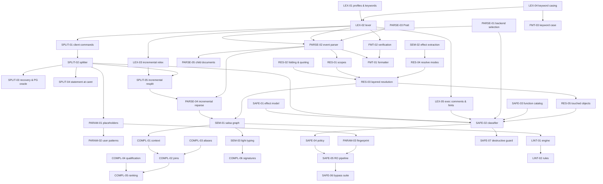

# 10 — SQL Lexing, Statement Splitting and Parameters (canonical algorithm catalog)

> Status: canonical, implementation-ready. Date: 2026-11-11. Part of `docs/research/algorithms/`.
> This file is the **entry point of the SQL language engine catalog** (files 10–13). §0 holds the global spec index, dependency map, crate layout and phased build order for all four files.
> For implementation purposes it **supersedes** the source specs listed under "Sources merged" in each section: ALG-SQL-LEX-01/02, ALG-SQL-SPLIT-01/02, ALG-SQL-PARAM-01 (`clients/sql-tooling-02`), ALG-SQL-LAND-01 step 6 (`clients/sql-tooling-01`), ALG-DBV-SQL-01/02/03/07/08/09 (`clients/dbeaver-03`), ALG-SQL-01/02/10 (`datagrip/06`), ALG-EXEC-01/02/03/09 (`datagrip/07`), and the keyword half of ALG-I18N-05 (`i18n/02`). Those documents remain the evidence base; this file is the decision.
> Verification reports override everything they contradict: `verification/01-db-behavior-tests.md` (Docker) and `verification/02-external-fact-check.md`.
> Sibling SQL catalogs: `11-sql-parsing-and-semantics.md` (SQL-PARSE-*, SQL-SEM-*), `12-sql-completion-and-resolution.md` (SQL-RES-*, SQL-COMPL-*), `13-sql-safety-lint-format.md` (SQL-SAFE-*, SQL-LINT-*, SQL-FMT-*). Other catalogs referenced: `01-connectivity-and-sessions.md` (HV-SESS-*), `02-introspection-and-metadata.md` (HV-INTRO-*, incl. HV-INTRO-14 identifier folding), `03-ddl-and-schema-compare.md` (HV-DDL-*).
> Clean-room: all pseudocode is ours. DataGrip (proprietary) behaviour is described, never copied; MySQL `sql/lex.h` (GPL-2.0) is never used as data; DBeaver (Apache-2.0), pgls (MIT), pgcli/mycli (BSD-3), sqruff (Apache-2.0), sqlglot (MIT), sqlparser-rs (Apache-2.0), libpg_query (BSD-3 + PostgreSQL License) are referenced by file and line for evidence; code-level reuse of permissive sources requires attribution in `THIRD_PARTY_NOTICES`.

---

## 0. Global overview of the SQL language engine

### 0.1 Evidence vocabulary used in "Verification status"

- **Docker-verified** — reproduced on a real server in `verification/01-db-behavior-tests.md`; the anchor is cited (e.g. `#mysql-comments`).
- **Observed** — read in source code or official artefact at a pinned commit (file:line given in the source research doc).
- **Inferred** — vendor documentation or reasoning; listed in the conformance backlog (§5) to be turned into Docker tests before GA.

### 0.2 Canonical spec index, priority and phase (all four files)

Priority: **v1** = required for the first public release of Hacivat + Karagöz; **v1.x** = first follow-up releases; **later** = after v1.x. Phase = build phase in §0.5.

| ID | Name | File | Priority | Phase |
|---|---|---|---|---|
| SQL-LEX-01 | Dialect lexical profiles, session lexical modes, keyword tables | 10 | v1 | P0 |
| SQL-LEX-02 | Total, lossless, dialect-table-driven lexer | 10 | v1 | P0 |
| SQL-LEX-03 | Incremental relexing | 10 | v1 | P0 |
| SQL-LEX-04 | Keyword recognition and locale-invariant keyword casing | 10 | v1 | P0 |
| SQL-LEX-05 | Executable comments and optimizer hints | 10 | v1 | P0 (lex) / P1 (safety expansion) |
| SQL-LEX-06 | Dialect auto-detection for unassigned files | 10 | v1.x | P3 |
| SQL-SPLIT-01 | Client-command pre-pass (psql, mysql, sqlcmd/SSMS, SQL*Plus, sqlite3) | 10 | v1 | P0 |
| SQL-SPLIT-02 | Token-level statement splitter with block stack (editor / execution modes) | 10 | v1 | P0 |
| SQL-SPLIT-03 | Missing-semicolon / blank-line recovery and PG parser oracle | 10 | v1 | P0 (heuristic) / P1 (PG oracle) |
| SQL-SPLIT-04 | Statement at caret and execution-range policies | 10 | v1 | P0 (statement) / P2 (subquery policies) |
| SQL-SPLIT-05 | Incremental resplit and content-addressed statement identity | 10 | v1 | P0 |
| SQL-PARAM-01 | Native placeholder detection and driver rewrite | 10 | v1 | P0 |
| SQL-PARAM-02 | User parameter patterns and template variables | 10 | v1 (`:name`, `${name}`) / v1.x (editable pattern table) | P2 |
| SQL-PARAM-03 | Literal normalisation and statement fingerprint (audit) | 10 | v1 | P1 |
| SQL-PARSE-01 | Parser backend selection per (dialect, purpose) | 11 | v1 | P1 |
| SQL-PARSE-02 | Lossless event-based parser with error recovery; tolerant and strict modes | 11 | v1 (PG P1; MySQL/MariaDB, SQLite, T-SQL P3) / later (ClickHouse, Oracle P4) | P1/P3/P4 |
| SQL-PARSE-03 | Dialect-parameterised Pratt expression parser (precedence tables) | 11 | v1 | P1 |
| SQL-PARSE-04 | Incremental per-statement reparse | 11 | v1 (statement level) / v1.x (node level) | P1/P3 |
| SQL-PARSE-05 | Embedded languages as child documents | 11 | v1.x | P4 |
| SQL-SEM-01 | salsa query graph (inputs, tracked queries, durability, cancellation) | 11 | v1 | P2 |
| SQL-SEM-02 | Statement effect extraction (catalog delta, session delta) | 11 | v1 | P2 |
| SQL-SEM-03 | Light typing and expected type | 11 | v1.x (literals, columns, casts) / later (overloads) | P4 |
| SQL-RES-01 | Scope builder | 12 | v1 | P2 |
| SQL-RES-02 | Identifier folding, quoting and match keys (locale-invariant) | 12 | v1 | P0 (functions) / P2 |
| SQL-RES-03 | Layered catalog and tri-state name resolution | 12 | v1 | P2 |
| SQL-RES-04 | Resolve modes (Script / Playground) and session simulation | 12 | v1 | P2 |
| SQL-RES-05 | Touched-object extraction for authorization and masking | 12 | v1 | P1 (PG via pg_query) / P2 (own tree) |
| SQL-COMPL-01 | Completion context detection | 12 | v1 | P2 |
| SQL-COMPL-02 | JOIN and ON-condition inference | 12 | v1 | P2 |
| SQL-COMPL-03 | Alias generation | 12 | v1 | P2 |
| SQL-COMPL-04 | Qualification and insertion policy | 12 | v1 | P2 |
| SQL-COMPL-05 | Candidate ranking | 12 | v1 | P2 |
| SQL-COMPL-06 | Signature help and function catalog | 12 | v1.x | P3 |
| SQL-SAFE-01 | Effect model and coarse-class lattice | 13 | v1 | P1 |
| SQL-SAFE-02 | Statement safety classifier | 13 | v1 | P1 |
| SQL-SAFE-03 | Function, operator and cast side-effect catalog | 13 | v1 | P1 |
| SQL-SAFE-04 | Policy profiles and decision | 13 | v1 | P1 |
| SQL-SAFE-05 | Per-DBMS read-only execution pipeline (Karagöz, MCP, Hacivat direct) | 13 | v1 | P1 |
| SQL-SAFE-06 | Bypass catalogue and differential conformance suite | 13 | v1 | P1 |
| SQL-SAFE-07 | Destructive-statement guard (confirmations) | 13 | v1 | P1/P2 |
| SQL-LINT-01 | Lint engine with suppressions and fixes | 13 | v1 | P3 |
| SQL-LINT-02 | v1 rule-set selection | 13 | v1 (20 rules) / v1.x (more) | P3 |
| SQL-FMT-01 | Formatter pipeline (Doc IR, alignment, printer) | 13 | v1 (PG, MySQL) / v1.x (others) | P3 |
| SQL-FMT-02 | Formatter safety verification and idempotency | 13 | v1 | P3 |
| SQL-FMT-03 | Token-level keyword-case normaliser (dialects without a parser) | 13 | v1 | P0/P3 |

Total: **45 canonical specs** (LEX 6, SPLIT 5, PARAM 3, PARSE 5, SEM 3, RES 5, COMPL 6, SAFE 7, LINT 2, FMT 3).

### 0.3 Dependency map



### 0.4 Crate layout and Rust placement (binding for files 10–13)

All crates live under `crates/sql/` in the Hacivat workspace and are Apache-2.0/MIT dual-licensed (same as `hacivat-ui`). A facade crate **`hacivat-sql`** re-exports them under stable module names; other catalogs reference the facade (e.g. `hacivat-sql::ident` = SQL-RES-02, used by HV-INTRO-14 and HV-DDL-*).

| Crate | Owns specs | Depends on | Linked by |
|---|---|---|---|
| `sql-text` | `TextSize`/`TextRange`, `LineIndex` (UTF-8 ↔ char ↔ UTF-16), `TextEdit` | `text-size` | all |
| `sql-dialect` | `DialectId`, `ServerVersion`, `LexModes`, `LexDialect`, `ParserDialect` tables, keyword tables (build-time generated) — data of SQL-LEX-01 | `sql-text`, `phf` | all |
| `sql-lexer` | SQL-LEX-02/03/04/05/06 | `sql-dialect`, `memchr` | Hacivat, Karagöz |
| `sql-split` | SQL-SPLIT-01..05, SQL-PARAM-01..03 | `sql-lexer`, `xxhash-rust` | Hacivat, Karagöz |
| `sql-syntax` | `SyntaxKind` superset, rowan `Language`, typed AST (codegen) | `rowan`, `sql-dialect` | Hacivat, Karagöz |
| `sql-parser` | SQL-PARSE-02/03/04, strict mode; modules `core`, `pg`, `mysql`, `sqlite`, `mssql`, `clickhouse`, `oracle` behind cargo features of the same names | `sql-syntax`, `sql-lexer` | Hacivat, Karagöz |
| `sql-oracle-pg` (feature `pg-oracle`) | SQL-PARSE-01 PG oracle: parse check, scan, split, fingerprint, normalize, summary | `pg_query` | Karagöz (always), Hacivat desktop (default on), WASM (off) |
| `sql-catalog` | catalog model, `CatalogView` trait, `CatalogDelta`; introspection query sets live in `hacivat-meta` (file 02) | `sql-dialect`, `rpds` | Hacivat, Karagöz |
| `sql-resolve` | SQL-RES-01/02/03/05 as **pure functions** (no salsa) | `sql-syntax`, `sql-catalog` | Hacivat, Karagöz |
| `sql-sema` | SQL-SEM-01/02/03, SQL-RES-04 (salsa wrappers around `sql-resolve`) | `salsa`, `sql-resolve`, `sql-parser` | Hacivat only |
| `sql-ide` | SQL-COMPL-01..06, hover, diagnostics aggregation, folding, semantic tokens, code actions; **LSP-shaped** API (byte offsets in, byte offsets out; no `lsp-types`) | `sql-sema` | Hacivat (editor + MCP `complete`-like tools) |
| `sql-lint` | SQL-LINT-01/02 | `sql-sema` | Hacivat |
| `sql-fmt` | SQL-FMT-01/02/03 | `sql-parser`, `sql-lexer`, `unicode-width` | Hacivat |
| `sql-safety` | SQL-SAFE-01..04/07; `ExecutionGuard` trait of SQL-SAFE-05 (dialect guards implemented in `karagoz-exec` and `hacivat-core::session`) | `sql-split`, `sql-parser` (strict), `sql-resolve`, `sql-oracle-pg`, optional `sqlparser` | Karagöz (authoritative), Hacivat (advisory, MCP broker). This is the crate called `hacivat-sql-classify` in `mcp/02` §3.15 |
| `sql-testkit` | corpora, differential harnesses (SQL-SAFE-06), conformance runners | all + Docker | CI only |

Rules: (1) `sql-safety`, `sql-resolve`, `sql-parser` never depend on `salsa`, `sql-sema` or UI crates (Karagöz must stay small; ADR 0001 §4 "core stays UI-agnostic"). (2) No crate formats user-facing English: diagnostics are `(code, args)` rendered by Fluent in the app. (3) Positions are `TextSize` byte offsets; UTF-16 conversion happens only in an optional LSP/VS Code adapter — the GPUI editor (ADR 0001) consumes byte offsets and its own rope directly, so `datagrip/06` §5.6 (Tauri + CodeMirror + LSP transport) is **superseded**.

Third-party crates to reuse (versions observed at research time; re-check at implementation and pin):

| Crate | Version to check | Use | Evidence |
|---|---|---|---|
| `rowan` | git tree `0.18.0-alpha.2` @`d601b195d7bc`; crates.io stable 0.16.x [Inferred] — pin one, wrap behind `sql-syntax` | green/red lossless trees | Observed (`sql-tooling-01` §1) |
| `salsa` | 0.28.5 | incremental queries | Confirmed (`02-external-fact-check` S33) |
| `pg_query` | 18.1.0 (libpg_query PG 18.6) | PG oracle/authority | Confirmed (P36) |
| `sqlparser` | 0.64.0 (16 dialects, ~220 hooks) | second opinion / interim classifier for non-PG dialects; test corpora | Confirmed (P37, S33) |
| `text-size` 1.1.x, `memchr` 2.x, `phf` 0.11+, `rpds` (or `im`), `bitflags` 2.x, `smallvec`, `xxhash-rust` (xxh3), `unicode-width` 0.2, `regex` 1.x | — | infrastructure | Inferred (version numbers to check) |

Not used in core: tree-sitter / tree-sitter-sql (C runtime, permissive grammar), sqruff as a library (port rule semantics with attribution instead), ANTLR runtimes, any GPL/AGPL code, Zed GPL crates (ADR 0001).

### 0.5 Phased build order (consistent with `sql-tooling-03` §5.3)

| Phase | Duration (estimate from source) | Scope (spec IDs) | Exit criteria |
|---|---|---|---|
| **P0** | 2–3 wks | `sql-text`, `sql-dialect`, `sql-lexer`, `sql-split`: LEX-01..05, SPLIT-01/02/03 (heuristic)/04 (statement level)/05, PARAM-01, RES-02 folding functions, FMT-03. Hacivat: highlighting, bracket matching, run statement at caret. | Lexer fuzzed (no panic, lossless property `concat(tokens) == input`); per-dialect lexical conformance corpus green; PG splitter agrees with libpg_query parser split on the PG regression corpus ≥ 99.9 %. |
| **P1** | 4–6 wks | `sql-syntax`, `sql-parser` (PG core: SELECT/INSERT/UPDATE/DELETE/MERGE/WITH, common DDL, utility statements as `UNKNOWN_STMT`), strict mode: PARSE-01/02/03/04 (statement level), SPLIT-03 PG oracle, PARAM-03; **`sql-safety` v1** SAFE-01..07 for **all v1 dialects** — PG via libpg_query; MySQL/MariaDB, SQL Server, SQLite, ClickHouse via the **interim** path (own lexer pre-scan + sqlparser-rs strict parse, fail closed; decision D-12); Karagöz enforcement pipeline SAFE-05; RES-05 for PG via pg_query. | Differential accept/reject vs libpg_query ≥ 98 % for supported PG statement kinds; SAFE-06 bypass corpus green with classifier **on** (all denied) and **off** (server layers block every persistent-write row marked "server-blocked"). |
| **P2** | 4 wks | `sql-catalog` (PG/MySQL/SQLite), `sql-resolve`, `sql-sema`: SEM-01/02, RES-01..05, COMPL-01..05, SPLIT-04 subquery policies, PARAM-02, SAFE-07 semantic parts; hover. | Completion p95 < 20 ms on a 1 MB file (ADR 0001 B3: popup ≤ 50 ms end-to-end); completion scenario suite (pgcli/pgls/DBeaver/DataGrip-corpus scenarios rewritten) green. |
| **P3** | 6 wks | MySQL/MariaDB + SQLite parsers, T-SQL batch-level parser (PARSE-02), node-level reparse (PARSE-04), diagnostics, LINT-01/02 (first 20 rules), FMT-01/02 for PG/MySQL, LEX-06, COMPL-06. Non-PG classifier switches from interim to own strict parser + sqlparser-rs second opinion. | Formatter idempotency + token-equivalence on corpora; lint golden tests. |
| **P4** | open | ClickHouse and Oracle-basic parsers, PARSE-05 child documents (PL/pgSQL bodies), SEM-03 light typing, rename/refactors, more lint rules, FMT for remaining dialects. | Per-dialect conformance suites vs Docker servers. |

Deviation from `sql-tooling-03` §5.3 (decision D-12): that plan put "safety for all dialects" in P4; Karagöz v1 must enforce on every v1 DBMS, so P1 ships an interim non-PG classifier (sqlparser-rs + our lexer pre-scan, exactly the approach of `mcp/02` ALG-MCP-11) that is replaced by our strict parser (with sqlparser-rs as second opinion) when each dialect's parser lands in P3/P4. The server-side layers of SAFE-05 are identical in both regimes.

### 0.6 Global decision ledger (SQL engine)

| # | Decision | Rejected alternatives (reason) | Sources |
|---|---|---|---|
| D-01 | **One** lossless, dialect-table-driven lexer for highlighter, splitter, parser, formatter, classifier, Karagöz | DBeaver's three disagreeing tokenizers (formatter has no `$$`, ANTLR lexer has own params) | dbeaver-03 §5.1; sql-tooling-02 §2.1 |
| D-02 | Own hand-written recursive-descent + Pratt parser emitting events into rowan; libpg_query = PG validity/safety authority; sqlparser-rs = second opinion | tree-sitter (C, permissive), ANTLR (immature in Rust), sqruff library (backtracking, API churn), sqlparser-rs as editor CST (not lossless, aborts on first error) | sql-tooling-01 §2, §6; datagrip/06 §5.1; dbeaver-03 §7.9 |
| D-03 | Statement-granularity incrementality is primary; token/node-level reparse is an optimisation | Tree-sitter-style whole-file incremental grammar | sql-tooling-01 §3.1.2 (pgls) |
| D-04 | Dollar-quoted bodies are always one string token; bodies are parsed as child documents | DBeaver per-connection "`$$` is a block toggle" switch | dbeaver-03 ALG-DBV-SQL-09; sql-tooling-02 |
| D-05 | Blank lines are **not** delimiters by default; editor splitting is parser-aware ("smart") | DBeaver default `BLANK_LINE_AND_SEPARATOR` (surprises multi-paragraph queries) | dbeaver-03 §7.3, ALG-DBV-SQL-07 |
| D-06 | Editor splitting is never used for execution; execution splitting is exact or returns `Ambiguous` | Single heuristic splitter for both | sql-tooling-02 §3.9 |
| D-07 | Placeholders are **bound natively**; textual substitution only for explicit template variables, previewed, never for MCP/AI | DBeaver textual substitution default (injection, quoting bugs) | dbeaver-03 ALG-DBV-SQL-03 |
| D-08 | `?` is not a placeholder in PostgreSQL by default (jsonb operators) | JDBC-style `?` always on | sql-tooling-02 §7; datagrip/07 ALG-EXEC-03 |
| D-09 | Oracle SQL*Plus `/` terminator is first-class from day one | DBeaver CE (absent) | dbeaver-03 §2.6 |
| D-10 | Splitter in its own crate; resolver as pure crate `sql-resolve` so Karagöz gets object extraction without salsa | Resolver only inside the salsa crate (`sql-tooling-03` §5.1) | sql-tooling-03 §5.1; sql-tooling-04 §5.3 |
| D-11 | No LSP transport inside Hacivat (GPUI in-process); API stays LSP-shaped for a future VS Code adapter | Tauri + CodeMirror + LSP (`datagrip/06` §5.6) | ADR 0001 |
| D-12 | Interim non-PG classifier in P1 (sqlparser-rs + lexer pre-scan, fail closed) until own parsers land | Waiting until P4 for non-PG safety | §0.5; mcp/02 ALG-MCP-11 |
| D-13 | All SQL-side casing is ASCII-only/locale-invariant; identifier folding follows the server (RES-02); never `to_lowercase()`/ICU on SQL text | Locale-aware casing (Turkish `İ/ı` bug class, DBeaver #40901) | i18n/02 ALG-I18N-05; verification #pg-turkish |

### 0.7 Shared types (Rust-like pseudocode, `sql-text` / `sql-dialect`)

```rust
pub use text_size::{TextSize, TextRange};          // u32 byte offsets everywhere

#[derive(Copy, Clone, Eq, PartialEq, Hash, Debug)]
pub enum DialectId {
    Postgres, MySql, MariaDb, SqlServer, Sqlite, ClickHouse, Oracle, Generic,
    PgWire(PgWireFlavor),        // Cockroach, Redshift, Yugabyte: lexed/parsed as PG, libpg_query only heuristic
}
#[derive(Copy, Clone, Eq, PartialEq, Ord, PartialOrd, Hash, Debug)]
pub struct ServerVersion { pub major: u16, pub minor: u16, pub patch: u16 }

#[derive(Copy, Clone, Eq, PartialEq, Hash, Debug, Default)]
pub struct LexModes {                              // session lexical modes (SQL-LEX-01)
    pub standard_conforming_strings: bool,         // PG, default true
    pub ansi_quotes: bool,                         // MySQL/MariaDB sql_mode
    pub no_backslash_escapes: bool,                // MySQL/MariaDB sql_mode
    pub pipes_as_concat: bool,                     // MySQL/MariaDB sql_mode (parser-level)
    pub high_not_precedence: bool,                 // MySQL/MariaDB sql_mode (parser-level)
    pub quoted_identifier: bool,                   // T-SQL SET QUOTED_IDENTIFIER, default true
    pub mariadb_oracle_mode: bool,                 // MariaDB sql_mode=ORACLE (parser switches grammar)
}
pub struct DialectCtx { pub id: DialectId, pub version: Option<ServerVersion>, pub modes: LexModes }

pub struct Diag { pub code: DiagCode, pub range: TextRange, pub args: SmallVec<[DiagArg; 2]> } // rendered via Fluent
```

---

## 1. Lexing

### SQL-LEX-01: Dialect lexical profiles, session lexical modes and keyword tables

- **Sources merged:** `clients/sql-tooling-02` §3.1–3.8, §5.1, §5.3 (lexical matrix, keyword sources, session modes); `datagrip/06` ALG-SQL-02 (dialect lexer flags); `clients/dbeaver-03` §2.2, §3.1, §5.3 (dialect = data + small trait; runtime overlay never mutates the static profile); `clients/sql-tooling-01` §3.10 (sqlglot tokenizer tables).
- **Problem:** Every consumer must lex exactly as the target server does for its version and *current session modes*; the per-dialect differences must be data, versioned, testable, and shared byte-for-byte by Hacivat and Karagöz.
- **Inputs / outputs:** `(DialectId, Option<ServerVersion>, LexModes, Option<RuntimeKeywordOverlay>)` → `&'static LexDialect` + `KeywordTable` view; `ProfileVersion` string recorded in Karagöz audit events (e.g. `lex:pg-18@2026.11.1`).
- **Algorithm:**
  1. Select the static `LexDialect` for `DialectId` (MySQL and MariaDB are separate ids; PG-wire flavours reuse PG lexing).
  2. Apply version gates (e.g. PG ≥ 16: `0x/0o/0b` and `_` digit separators; PG ≥ 15: trailing-junk errors after numbers/params; SQLite ≥ 3.46: `_` separators [Inferred]; MySQL: executable-comment gate compares with server version).
  3. Apply `LexModes` (MySQL `"` = string unless `ansi_quotes`; backslash escapes unless `no_backslash_escapes`; PG plain-string backslashes only if `!standard_conforming_strings`; T-SQL `"` = identifier unless `!quoted_identifier`).
  4. Keyword table = build-time table for (dialect, version-range) ⊕ optional runtime overlay read from the live server (MySQL ≥ 8.0 `INFORMATION_SCHEMA.KEYWORDS(WORD, RESERVED)`; SQLite `sqlite3_keyword_count/_name` of the linked library; Oracle `V$RESERVED_WORDS`). The overlay is **per connection** and never mutates the static table. Karagöz uses only build-time tables (determinism, D-12).
  5. **Mode tracking.** Hacivat reads modes at connect (`SHOW standard_conforming_strings`; `SELECT @@sql_mode`; T-SQL `SELECT SESSIONPROPERTY('QUOTED_IDENTIFIER')`) and updates them after it *successfully executes* a statement that changes them (`SET sql_mode=…`, `SET standard_conforming_strings…`, `SET QUOTED_IDENTIFIER …`). Karagöz **pins** modes at session start and the classifier denies statements that change them (SQL-SAFE-02 effect `SessionState` + flag `LexModeChange`).
  6. A mode change inside a script invalidates lexing from the next statement (SQL-LEX-03 edge case; the document's `LexModes` input becomes per-statement in Script mode, SQL-RES-04).
- **Data structures (`sql-dialect`):**
  ```rust
  pub struct LexDialect {
      pub ident_start: fn(char) -> bool, pub ident_continue: fn(char) -> bool,
      pub ident_quotes: &'static [QuoteRule], pub string_quotes: &'static [QuoteRule],
      pub string_prefixes: &'static [(&'static str /*ASCII, case-insensitive*/, StringPrefix)],
      pub dollar_quotes: bool, pub q_quotes: bool /*Oracle q'[..]'*/,
      pub line_comments: &'static [LineCommentRule],   // Dash{needs_ws_after: bool}, Hash, HashBang, DashPlusHint
      pub block_comment_nesting: bool, pub unterminated_block_comment_ok: bool /*SQLite*/,
      pub executable_comments: Option<ExecVendor>, pub hint_comments: HintRule,
      pub numeric: NumericRule /*prefixes, case_sensitive, separators, suffixes, junk_is_error*/,
      pub operator_chars: AsciiSet, pub operator_rule: OperatorRule /*Maximal | PgRule*/,
      pub params: ParamSigils, pub vars: VarSigils, pub money_prefix: bool,
      pub inline_data: InlineDataRule /*PgCopyStdin | ClickHouseFormat | None*/,
      pub keywords: &'static KeywordTable,
  }
  pub struct QuoteRule { pub open: char, pub close: char, pub escape: EscapeRule }
  pub enum EscapeRule { Doubled, Backslash, DoubledOrBackslash, BackslashNewlineContinuation, None }
  pub struct KeywordTable { map: phf::Map<&'static str /*UPPER ASCII*/, KwEntry> }
  pub struct KwEntry { pub id: KeywordId, pub cat: KwCategory, pub bare_label: bool /*PG*/ }
  pub enum KwCategory { Reserved, ReservedTypeOrFunction, ReservedColumnName, NonReserved }
  ```
  Keyword data sources (licences): PG `kwlist.h` via libpg_query (permissive; 495 entries at PG 18.6: 78 RESERVED, 23 TYPE_FUNC_NAME, 63 COL_NAME, 330 UNRESERVED — Observed); MySQL/MariaDB from the public reference-manual tables + runtime `I_S.KEYWORDS` (never GPL `lex.h`); sqruff `*_keywords.rs` (Apache-2.0, attribution) as a starting point; T-SQL from the "Reserved keywords" doc table; SQLite from `sqlite3_keyword_*`; ClickHouse: no fixed reserved list (contextual) — completion hints only; Oracle `V$RESERVED_WORDS`.
- **Decision:** dialect = static data table + per-connection overlay + pinned/observed modes. Rejected: DBeaver's ≈80-method mutable dialect object filled from JDBC metadata at connect (hidden global state, Turkish-locale casing bugs); sqlparser-rs' one global keyword list with context lists (no per-dialect reserved semantics).
- **Verification status:** PG keyword categories Observed (`kwlist.h`); MySQL executable-comment gate and `/*M!` ignored by MySQL **Docker-verified** (#mysql-comments); `SET_VAR(sql_mode=…)` hint does not change lexing of the same statement **Docker-verified** (#mysql-comments) — so hints never feed `LexModes`; all other per-dialect rules Inferred (vendor docs + sqlglot/sqlparser-rs tables Observed) → conformance backlog §5.
- **Rust placement:** `sql-dialect::{lex, keywords, modes}`; keyword tables generated by `build.rs` from `data/keywords/<dialect>/<version-range>.toml` (each row carries a `source_url`).
- **Per-dialect matrix:**

| Feature | PostgreSQL | MySQL / MariaDB | SQL Server | SQLite | ClickHouse | Oracle (basic) |
|---|---|---|---|---|---|---|
| Identifier quotes | `"` (`""`), `U&"…"` | `` ` `` (``` `` ```); `"` only with ANSI_QUOTES | `[…]` (`]]`); `"` if QUOTED_IDENTIFIER | `"`, `[…]`, `` ` `` | `"`, `` ` `` (backslash + doubled) | `"` (no escape) |
| Extra identifier chars | `$` (not first), bytes ≥ 0x80 | `$`, ≥ U+0080, may start with digit | `@ # $ _`; `#`/`##` temp prefixes | `$`, ≥ 0x80 | — | `$ #` |
| String quotes | `'` | `'`, `"` (unless ANSI_QUOTES) | `'`; `"` if !QUOTED_IDENTIFIER | `'` | `'` | `'`, `q'…'`, `nq'…'` |
| Backslash escapes | `E''` only (or scs=off) | yes unless NO_BACKSLASH_ESCAPES | `\`+newline continuation only | no | yes | no |
| Prefixed strings | `E N U& B X` | `N`, `_charset`, `X`, `B` | `N` | `X` | — | `N`, `Q`, `NQ` |
| Adjacent literal concat | only across a newline | yes, any whitespace | no | no | no [Unknown] | no |
| Dollar/heredoc | `$tag$` | — | — | — | `$tag$` | — |
| Line comments | `--` | `#`, `-- ` (2nd dash + whitespace/control/EOF) | `--` | `--` | `--`, `#`, `#!` | `--` (`--+` hint) |
| Nested block comments | yes | no (`/*!`, `/*M!` executable; `/*+` hints) | yes | no; unterminated OK to EOF | yes [verify] | no (`/*+` hints) |
| Hex/bin numbers | `0x 0o 0b` (≥16) | `0x`, `0b` lower-case only | `0x` (binary) | `0x` | `0x`, `0b` | — |
| Digit separators | `_` (≥16) | no | no | `_` (≥3.46, verify) | [Unknown] | no |
| Bind params | `$n` | `?` | `@p` (TDS RPC), `?` (ODBC) | `? ?N :a @a $a` | `{a:T}` | `:a`, `:1` |
| Session vars | `current_setting()` | `@u`, `@@s` | `@v`, `@@fn` | — | — | — |
| Client commands | psql `\…`, `:v` | `DELIMITER`, `\G`, `\g` | `GO [n]`, `:setvar`, `$(v)` | `.cmd` | (client) | `/`, `&v`, `@f`, `SET`… |
| Keyword source | `kwlist.h` | `I_S.KEYWORDS` + docs | docs table | `sqlite3_keyword_*` | none (contextual) | `V$RESERVED_WORDS` |
| Session lexical modes | `standard_conforming_strings` | `sql_mode` (ANSI_QUOTES, NO_BACKSLASH_ESCAPES, PIPES_AS_CONCAT, HIGH_NOT_PRECEDENCE, ORACLE) | `QUOTED_IDENTIFIER` | — | — | — |

- **i18n notes:** keyword table keys are upper-case ASCII; lookups never use locale casing (SQL-LEX-04). Identifier-character predicates accept all Unicode letters where the server does (Turkish `ç ğ ı İ ö ş ü` are valid unquoted identifier characters in all six dialects; PG accepts any byte ≥ 0x80 including emoji, T-SQL only Unicode letters). Profiles contain no user-facing text.
- **Edge cases:** unknown dialect → `Generic` profile (ANSI quotes, `--` and non-nested `/* */`, no backslash escapes); server version unknown → newest profile for lexing, but Karagöz denies when version is unknown (SQL-PARSE-01); MariaDB `sql_mode=ORACLE` → parser switch, lexer adds `q''`? [Unknown → conformance]; MySQL `lower_case_table_names` is *not* a lexical mode (resolution only, SQL-RES-02); PG `backslash_quote` matters only with scs=off; T-SQL `SET QUOTED_IDENTIFIER OFF` inside a procedure body is captured at CREATE time — lexer uses the current mode, resolver records it [Inferred]; runtime overlay lists a word our table lacks → treated as NonReserved keyword for highlighting only.
- **Test cases:** profile(MySql 8.4, ansi_quotes=false) lexes `"a"` as `String`; with ansi_quotes=true → `QuotedIdent` (DataGrip ALG-SQL-02 test); profile(Postgres 15) lexes `1_000` as `Number(1)` + `Word(_000)` + junk error, profile(Postgres 16) as one `Number{has_separators}`; T-SQL quoted_identifier=false → `"x"` is `String`; overlay from `I_S.KEYWORDS` containing `QUALIFY` (hypothetical) does not alter Karagöz tables (assert Karagöz profile hash unchanged); `ProfileVersion` string stable across runs (snapshot test).
- **Used by:** Hacivat | Karagöz.

### SQL-LEX-02: Total, lossless, dialect-table-driven lexer

- **Sources merged:** `clients/sql-tooling-02` ALG-SQL-LEX-01 (algorithm, token model §3.1, edge cases, tests 1–17); `datagrip/06` ALG-SQL-02 (flags, tests); `clients/dbeaver-03` ALG-DBV-SQL-09 (dollar-quote rules: tags case-sensitive, inner different tag is content, `$1` not a tag); `clients/sql-tooling-01` §3.1.3 (pgls tokenizer: nested comments, `U&`, named params, CRLF counting).
- **Problem:** Turn text into tokens such that every byte belongs to exactly one token, malformed input never panics or drops text, and the result is fast enough for every keystroke and identical in Hacivat and Karagöz.
- **Inputs / outputs:** `(text: &str, profile: &LexDialect, modes: LexModes, start: LexState)` → `Lexed { kinds: Vec<TokenKind>, lens: Vec<u32>, flags: Vec<TokenFlags>, kw: Vec<Option<KeywordId>>, errors: Vec<(TextRange, LexErrorCode)>, end_state: LexState }` (struct-of-arrays). Invariant: `Σ lens == text.len()` and concatenated slices reproduce `text` byte-for-byte.
- **Algorithm (per token at byte `p`; first matching rule wins):**
  1. **State rules.** `InCopyData` → consume whole lines until a line equal to `\.` (inclusive) → `InlineData`, state `Initial`. `InInlineData{format}` (ClickHouse `INSERT … FORMAT X`) → consume to end of the statement text (rule: to EOF of the segment handed over by SQL-SPLIT-01 [Unknown: exact `--multiquery` end rule → conformance]) → `InlineData`.
  2. **Whitespace / newlines.** Run of spaces/tabs/FF/VT → `Whitespace`; run of line breaks → `Newline{count}` (CRLF = 1, lone CR = 1, LF = 1). BOM at offset 0 → `Whitespace` flagged `bom`.
  3. **Comments (before operators).** `--`: MySQL/MariaDB require the next byte to be whitespace/control/EOF, else fall through to operators (`1--1` = `1 - -1`); Oracle `--+` → `HintComment`; consume to before `\r`/`\n` or EOF → `LineComment{Dash}`. `#` when enabled (MySQL, MariaDB, ClickHouse; `#!` ClickHouse) → `LineComment{Hash}` — but T-SQL `#name` is an identifier (rule 9) and PG `#` is an operator. `/*`: if executable comments enabled and next is `!` (MySQL) or `M!` (MariaDB) → SQL-LEX-05; if hints enabled and next is `+` → `HintComment`; else block comment with a `u32` depth counter when nesting is enabled (PG, T-SQL, ClickHouse), non-nesting otherwise; EOF before close → `terminated=false` + `UnterminatedComment` error unless `unterminated_block_comment_ok` (SQLite: no error).
  4. **Prefixed strings** (ASCII case-insensitive, no space between prefix and quote): longest of `U&'`, `E'`, `B'`, `X'`, `N'`, `NQ'`, `Q'`, MySQL introducer `_charset` (only if the word is a known charset name **and** immediately followed by `'`, `X'`, `B'`). For `Q'`: delimiter = next char (not whitespace); closing = matching bracket for `[ { ( <`, else the same char; ends at `close'`. If no quote follows the prefix letters → identifier (rule 9).
  5. **Quoted identifiers / strings** by quote char, honouring `LexModes`: scan with the `EscapeRule`; `Doubled` treats `''`/`""`/``` `` ```/`]]` as one char; `Backslash` skips the next char (MySQL unless `no_backslash_escapes`; PG `E''`; PG plain strings only when `!standard_conforming_strings`; ClickHouse); T-SQL `\`+newline continuation. EOF → `terminated=false` + error. PG adjacent-literal continuation is **not** merged here (two `String` tokens + trivia; the parser joins and validates the newline, SQL-PARSE-02).
  6. **`$`**: if `dollar_quotes` and `$` + optional tag (`ident_start` then `ident_continue` minus `$`; cannot start with a digit) + `$` is well-formed → scan for the identical closing delimiter (byte compare, case-sensitive; an inner different tag is content) → `DollarString{tag_len, terminated}`. `$` immediately after an identifier character never starts a quote (it is part of the word, handled by rule 9 since the word consumed it). Else `$` + digits → `PositionalParam` (PG ≥ 15: identifier chars right after → `junk` error). Else `$name` → `NamedParam{Dollar}` (SQLite: allow `::` segments and a trailing `(…)`). T-SQL money prefix + digits → `Money`.
  7. **Numbers:** digit, or `.` + digit. Dialect prefixes `0x/0o/0b` (MySQL lower-case only: `0X12` is not hex); `_` separators only between digits when enabled; fraction/exponent; Oracle `f|d` suffix; PG `1..2` lexes `1` `..` `2` (integer followed by `..`). Identifier char right after: PG ≥ 15 → `junk` error flag; MySQL → re-lex from `p` as `Word` if digit-leading identifiers are allowed and the run is not all digits (`1e5x`, `1ex`); others → separate tokens.
  8. **Params/variables by sigil** (before operators): `?NNN` (SQLite) / `?` → `QuestionParam` except in PG, where `?` is an operator char (emit `Op`; SQL-PARAM-01 decides); `:` + identifier (not `::`, not `:=`) → `NamedParam{Colon}` / `ClientVar` (psql `:v`, `:'v'`, `:"v"`, `:{?v}`); `@@` + ident → `SystemVar`; `@` + ident/quote → `UserVar` (MySQL/MariaDB) or `NamedParam{At}` (T-SQL, SQLite); ClickHouse `{ident:Type}` (only this exact shape; `{'a':1}` map literals are punctuation) → `NamedParam{Brace}`.
  9. **Words:** `ident_start` (+ T-SQL `#`/`##` prefixes) then `ident_continue` → `Word{kw: keyword_lookup(text)}` (SQL-LEX-04).
  10. **Operators:** maximal munch over `operator_chars`. PG rule: an embedded `--` or `/*` ends the operator; a multi-char operator may not end in `+`/`-` unless it contains one of `~ ! @ # % ^ & | \` ?` (`=-` → `=`,`-`; `@-` stays); then map known spellings to dedicated kinds (`::`, `:=`, `=>`, `->`, `->>`, `<=>`, `||`, `<>`/`!=`, `<=`, `>=`, `==`, `..`). PG operators longer than 63 chars → error.
  11. **Punctuation:** `( ) [ ] { } , ; .`.
  12. **Anything else** → `Unknown` (one UTF-8 scalar) + error (NUL included; full-width `；（＇` included — the editor offers a "replace full-width punctuation" quick fix).
- **Data structures:** `TokenKind` (u8) groups — Trivia: `Whitespace, Newline, LineComment, BlockComment, HintComment`; `ExecutableComment` (**not trivia**, SQL-LEX-05); Words: `Word, QuotedIdent{quote}, UnicodeQuotedIdent`; Literals: `String{prefix,quote}, DollarString, Number{kind}, BitString, HexString, Money, InlineData`; Params: `PositionalParam, QuestionParam, NamedParam{sigil}, UserVar, SystemVar, ClientVar`; Punct/Op kinds; `ClientCommand` (only produced by SQL-SPLIT-01); `Unknown`. `TokenFlags: bitflags { TERMINATED_FALSE, JUNK, HAS_SEPARATORS, BOM, ERROR }`.
- **Complexity / performance:** single pass O(n), no regex, `memchr` for terminators, keyword lookup via perfect hash on a ≤ 32-byte stack buffer (no allocation). Target ≥ 200 MB/s; a 1 MB file ≤ 5 ms cold.
- **Decision:** hand-written cursor lexer (rustc_lexer/pgls style) parameterised by `LexDialect`. Rejected: regex/`logos`-only DFA (cannot express PG operator rule, nested comments, dollar tags, MySQL `--` rule without hand code — DataGrip's notes suggest a hybrid; we keep one hand-written engine); sqruff ordered regex matchers (slower, backtracking); keywords as token kinds (330 of 495 PG keywords are unreserved; contextual keywords are a parser decision).
- **Verification status:** PG rules Observed (libpg_query `scan.l` C output lines 8730–10040); dollar-quote rules Observed (pgls, DBeaver, tree-sitter scanner); MySQL executable comments Docker-verified (#mysql-comments); SQLite identifier/`LIKE` ASCII-only behaviour Docker-verified (#sqlite-case, relevant to SQL-RES-02 not lexing); all other dialect rules Inferred.
- **Rust placement:** `sql-lexer::lex(text, &LexDialect, LexModes, LexState) -> Lexed`; `sql-lexer::Cursor`; per-rule submodules `comments`, `strings`, `dollar`, `numbers`, `params`, `ops`. Fuzz target `fuzz_lex_lossless` (cargo-fuzz) asserting losslessness and no panic for every profile × mode combination.
- **Per-dialect matrix:** see SQL-LEX-01 matrix (the lexer implements it); extra notes: PG `U&'…' UESCAPE '!'` (error if scs=off); T-SQL `N'…'`, `[a]]b]`; SQLite DQS misfeature handled in resolution (lexer emits `QuotedIdent{Double}`); ClickHouse identifiers/functions case-sensitive (resolution); Oracle `"…"` may not contain `"`.
- **i18n notes:** identifier predicates are Unicode-aware per dialect (never Unicode word segmentation); keyword lookup ASCII-only; invalid UTF-8 is impossible at this layer (`&str`); file loading replaces invalid sequences with U+FFFD and records a diagnostic; error codes like `lex.unterminated-string`, `lex.mysql-dash-comment-needs-space` are rendered via Fluent (en, tr).
- **Edge cases (exhaustive):** empty input; BOM only; NUL; lone `\r`; `--` at EOF; `/*/`; `/**/`; `/* /* */` (PG unterminated, MySQL closed); `*/` without opener; `'it''s'`; `''`; `E'\''`; `E'\\'`; `'\'` scs=on (complete) vs off (unterminated); `U&'\0041' UESCAPE '!'`; `$$`; `$$$$`; `$a$ $b$ $a$`; `$A$…$a$` (unterminated); `x$$y`; `$1`, `$12a`, `$`, `$ 1`; `1.`, `.1`, `1..2`; `1e`, `1e+`, `0x`, `0xG`, `1_`, `1__0`, `0b2`; `123abc`; MySQL `1e5x`, `0X12`, `0x12`; T-SQL `$`, `$12`, `0x`; `@@`, `@`, `@1`; `#temp` (T-SQL ident) vs `#` comment (MySQL) vs `#` operator (PG); `->>`; `=-1`; `@-`; `*/` inside an operator; operator > 63 chars; 10 MB single-line string (linear); depth-10⁶ nested comments (counter, no recursion); MySQL executable comment with nested `/*`; `/*!` unterminated; `/*!12345SELECT*/`; `/*M!100100 … */`; `q'X…X'` with X = space (invalid); `nq'[…]'`; ClickHouse `{x:UInt8}` vs `{'a':1}`; psql `:'x'` inside a string (not a var); `::text` vs `:text`; full-width punctuation; U+00A0 between tokens (`Unknown` in all dialects — the server rejects too [Inferred]).
- **Test cases (input → token kinds, `·` = whitespace):**
  1. PG `SELECT $$a;b$$;` → `Word(SELECT) · DollarString Semicolon`.
  2. PG `x$$y$$` → `Word("x$$y$$")`.
  3. PG `/* a /* b */ c */ SELECT` → `BlockComment · Word`.
  4. MySQL `/* a /* b */ c */` → `BlockComment("/* a /* b */") · Word(c) · Op(*) Op(/)`.
  5. MySQL `SELECT 1--1` → `Word · Number Op(-) Op(-) Number`; MySQL `SELECT 1 -- c` → `… Number · LineComment`.
  6. MySQL `'a\'b'` → one terminated `String`; with `no_backslash_escapes` → `String('a\')` `BitString(b', unterminated)` (rule 4: `b'` is a bit-string prefix; erratum below). `'a\'c'` → `String('a\')` `Word(c)` `String(unterminated)`.
  7. PG (scs=on) `'a\'b'` → `String('a\')` `BitString(b', unterminated)` (PostgreSQL's `xbstart`; erratum below); `'a\'c'` → `String('a\')` `Word(c)` `String(unterminated)`; PG `E'a\'b'` → `String{E}`.
  8. PG `=-1` → `Op(=) Op(-) Number`; `@-1` → `Op(@-) Number`; `+/*c*/1` → `Op(+) BlockComment Number`.
  9. T-SQL `[a]]b]` → `QuotedIdent{Bracket}`; T-SQL (QUOTED_IDENTIFIER OFF) `"x"` → `String`.
  10. SQLite `/* open` → `BlockComment{terminated:false}`, **no** error.
  11. ClickHouse `SELECT {id:UInt32}` → `Word · NamedParam{Brace}`.
  12. Oracle `q'[it's]'` → `String{Q}`.
  13. MySQL `/*!50110 KEY_BLOCK_SIZE=1024 */` → `ExecutableComment{MySql, 50110}`.
  14. PG16 `1_000` → `Number{HAS_SEPARATORS}`; PG15 → `Number(1)` + `Word(_000)` + junk error.
  15. PG `$a$ x $b$ y $a$` → one `DollarString`; `$A$ x $a$` → `DollarString{terminated:false}` to EOF (DBeaver: tags case-sensitive).
  16. PG `x ?| array['a']` → `Op(?|)` (DataGrip ALG-SQL-02); T-SQL `#tmp` → `Word`; MySQL `"a"` → `String`; PG `"a"` → `QuotedIdent`.
  17. FX-SPLIT-PG-04 (`datagrip/13`): `/* outer /* inner ; */ still comment ; */` is one `BlockComment`; `E'it\'s; fine'` is one `String{E}`.
  18. Property: for 10⁶ random byte-strings (valid UTF-8) × every profile, `concat == input`, no panic, ≤ 1 token per byte.
- **Errata (M3a; found by Task 4, recorded by Task 8):** tests 6 and 7 used to expect `String('a\')` `Word(b)` `String(unterminated)` for `'a\'b'` with standard strings. By rule 4 of this algorithm, `b` directly before `'` is a bit-string prefix, and both servers read it so (PostgreSQL `xbstart`, MySQL `b'…'` literals): the tail is `BitString(unterminated)`. The `Word` reading holds for a letter that is no prefix (`'a\'c'`). The lexer corpus pins both (`sql-testkit/corpus/lex`: LEX02-06b, -06c, -07a, -07c).
- **Used by:** Hacivat | Karagöz.

### SQL-LEX-03: Incremental relexing

- **Sources merged:** `clients/sql-tooling-02` ALG-SQL-LEX-02; `datagrip/06` ALG-SQL-09 step 1; `clients/sql-tooling-03` §3.3.7 (RA single-token relex with "next char would merge" check).
- **Problem:** Update the token arrays on each keystroke without relexing the whole document, while staying exactly equal to a full relex.
- **Inputs / outputs:** old `Lexed` + edit `(old_range, new_text)` → new `Lexed` + `changed_tokens: Range<usize>` (indices in the new arrays) + `delta: i64`.
- **Algorithm:**
  1. Find the first token `i` whose end ≥ `edit.start`; step back one token (`i-1`) because the edit may merge with the previous token (`-`+`-` → comment, `$a`+`$` → dollar quote, word+word, `/`+`*`).
  2. Relex from `start = tokens[i-1].start` over the new text with the `LexState` recorded at that boundary (normally `Initial`; data-block states are recorded per token boundary only where they change).
  3. After each produced token ending at or after `edit.start + new_text.len()`, map its end to old coordinates (`old_pos = new_end − delta`). Stop when `old_pos` is an old token boundary `j`, the lex state there equals the old state, and the new token's kind equals the old kind at `j-1`. Splice `old[i-1..j]` with the new tokens.
  4. Reaching EOF → replace the tail.
  5. **Debug assertion / property test:** the result equals `lex(new_text)`.
  6. If the edit touches a line that SQL-SPLIT-01 classifies as a client command that changes lexing (`DELIMITER`, MySQL `SET sql_mode` executed in Script mode) or a statement that changes `LexModes`, re-run the pre-pass from that line and relex everything after it.
- **Data structures:** SoA token arrays; prefix-sum offsets recomputed from the changed index (≤ 100k tokens: plain recompute; above: Fenwick tree); per-boundary `LexState` stored sparsely (`Vec<(token_index, LexState)>`).
- **Complexity:** O(changed region + resync distance); worst case O(n) when an edit opens a string/comment/dollar quote (inherent; must stay cancellable and < 10 ms for 1 MB).
- **Decision:** token-boundary resync with state equality (RA/DataGrip shape). Rejected: whole-file relex per keystroke (fine below ~100 KB but violates ADR 0001 B3 at 50k lines), line-based relex (multi-line tokens break it).
- **Verification status:** Observed (RA `reparsing.rs:44-90`); behaviour is internal → property tests, no DB facts.
- **Rust placement:** `sql-lexer::incremental::relex(&Lexed, &str /*new text*/, TextEdit, &LexDialect, LexModes) -> RelexResult`.
- **Per-dialect matrix:** identical algorithm; state set differs: PG (`InCopyData`), ClickHouse (`InInlineData`), others none.
- **i18n notes:** edits are byte ranges at char boundaries (editor guarantees); Turkish IME composition commits whole characters, so a composition session never leaves a split UTF-8 sequence.
- **Edge cases:** edit inside a multi-MB string; opening `'` then closing it next keystroke (two full relexes); `DELIMITER` line edited; `SET standard_conforming_strings` statement edited (full relex after it); CRLF split by an edit (`\r` | `\n`); edit at offset 0; deletion of the whole document; paste of 1 MB (fallback: full relex if changed bytes > 50 % of the file).
- **Test cases:** typing `-` before `- comment` turns `Op(-)` into a `LineComment`; deleting the closing `$$` makes the tail one `DollarString{terminated:false}`; inserting `x` inside `SELECT` changes one token and resyncs immediately; inserting `'` at the start of a 1 MB file relexes once to EOF; random edit sequences (10⁵) → always equal to full lex.
- **Used by:** Hacivat.

### SQL-LEX-04: Keyword recognition and locale-invariant keyword casing

- **Sources merged:** `i18n/02` ALG-I18N-05 steps 1–2 and edge cases 1, 7–9, tests 1–3, 15–17; `clients/sql-tooling-02` §3.1 design notes; `clients/sql-tooling-03` §3.8.1 (contextual keywords, PG `ColId`/`ColLabel`/`BARE_LABEL`); `clients/dbeaver-03` §6 (Turkish-locale casing defects); `datagrip/06` §6.
- **Problem:** Decide whether a word token is a given keyword and re-case keywords (formatter, completion insertion) identically under every process locale, and expose keyword categories so the parser can accept keywords as identifiers where the server does.
- **Inputs / outputs:** `Word` text → `Option<KwEntry>`; `(KwEntry, position kind)` → `allowed_as_identifier: bool`; keyword text + `KeywordCase{Upper, Lower, Preserve}` → new text.
- **Algorithm:**
  1. `keyword_lookup(text)`: if `text.len() > 32` or any byte ≥ 0x80 → `None` (non-ASCII words are never keywords). Else upper-case ASCII into a stack buffer (`to_ascii_uppercase`) and probe the perfect hash.
  2. Equality checks elsewhere use `str::eq_ignore_ascii_case`.
  3. Re-casing applies `to_ascii_uppercase`/`to_ascii_lowercase` **only** to tokens the parser classified as keywords (not to identifiers spelled like keywords, e.g. a column `name`, `type`, `value`).
  4. Contextual acceptance table (PG semantics, mapped per dialect): `ColId` = IDENT ∪ UNRESERVED ∪ COL_NAME; `type_function_name` = IDENT ∪ UNRESERVED ∪ TYPE_FUNC_NAME; `ColLabel` = any keyword; bare column alias (no `AS`) only `BARE_LABEL` keywords. Other dialects map their reserved/non-reserved lists into the same lattice; ClickHouse treats all keywords as contextual (alias may require `AS`).
- **Data structures:** `KeywordTable` (SQL-LEX-01); `PositionKind { ColId, TypeFuncName, ColLabel, BareLabel, TableAlias, ColumnAlias }`; `fn keyword_allowed(dialect, KwEntry, PositionKind) -> bool`.
- **Decision:** ASCII-only lookup and re-casing (PG `kwlookup.c` does the same — Observed). Rejected: `to_uppercase()` (Unicode full mapping; harmless for ASCII but invites misuse), ICU/locale casing (`"limit".toUpperCase()` → `LİMİT` under a Turkish JVM, DBeaver #40901 — Observed), Unicode NFKC folding (full-width `ＳＥＬＥＣＴ` would become a keyword; servers reject it).
- **Verification status:** Observed (PG `kwlookup.c`, DBeaver #40901 confirmed in `02-external-fact-check` P30 with corrected PR status); PG ASCII-only identifier folding Docker-verified (#pg-turkish) — the keyword rule is the same mechanism.
- **Rust placement:** `sql-lexer::keywords::{keyword_lookup, recase}`; `sql-dialect::keywords::keyword_allowed`. Clippy lint (`disallowed-methods`) bans `str::to_lowercase`/`to_uppercase` in all `sql-*` crates except `sql-resolve::ident` (which needs Unicode simple folding for MySQL/SQL Server keys, SQL-RES-02).
- **Per-dialect matrix:** PG `BARE_LABEL`/`AS_LABEL` flags; MySQL/MariaDB reserved vs non-reserved from `I_S.KEYWORDS`; SQL Server reserved list + ODBC reserved + future keywords; SQLite keywords usable as identifiers via `%fallback ID` (mostly non-reserved); ClickHouse contextual; Oracle reserved vs keyword from `V$RESERVED_WORDS.RESERVED`.
- **i18n notes:** this is the canonical "never localize SQL" rule: keywords are never translated, never locale-cased; tests run under `LANG=tr_TR.UTF-8` and `C` and must be byte-identical.
- **Edge cases:** `lİmİt`/`lımıt` → not keywords (server agrees: syntax error); Cyrillic look-alike `SЕLECT` → not keyword; full-width → not keyword; 33-byte ASCII word → not a keyword (no keyword is that long); keyword used as column name (`SELECT name, type, value FROM settings`) → identifier where allowed; reserved keyword as identifier (`SELECT select FROM t`) → parser error, tolerant tree remaps to IDENT.
- **Test cases:** `LIMIT`/`limit`/`Limit` → `KW_LIMIT`; `lımıt` (process `LANG=tr_TR.UTF-8`) → None; `lİmİt` → None; recase(`select`, Upper) → `SELECT` (bytes `53 45 4C 45 43 54`, no U+0130); auto-limit detector (`hacivat-core`, HV-SESS-*) on `select 1 limit 10` leaves the query unchanged, on `select 1 LİMİT 10` does not rewrite (unparsable); `keyword_allowed(Pg, KW_NAME(unreserved), ColId)` = true; `keyword_allowed(Pg, KW_SELECT(reserved), ColId)` = false; FMT-10 of `datagrip/13` (`select id from customers` under Turkish JVM-equivalent locale → ASCII `SELECT`).
- **Used by:** Hacivat | Karagöz | Perde (policy rules matching statement kinds by keyword use the same function).

### SQL-LEX-05: Executable comments and optimizer hints

- **Sources merged:** `clients/sql-tooling-02` §3.3 (executable comments are code), §3.10 item 4; `clients/sql-tooling-05` M1, M16, ALG-SQL-SAFE-01 step 4; `mcp/02` ALG-MCP-11 step 2 (executable comment → UNKNOWN); `access/05` ALG-AUTHZ-03 edge case 9; `verification/01` #mysql-comments.
- **Problem:** MySQL/MariaDB execute the body of `/*! … */` (version-gated `/*!NNNNN … */`, MariaDB `/*M! … */`) and honour `/*+ … */` hints; treating them as comments creates a parser differential (classic WAF bypass). The editor also wants highlighting/completion inside them.
- **Inputs / outputs:** `ExecutableComment` tokens + `(dialect, server_version)` → (a) **editor view**: nested token stream for the body, gate status `Active | Inactive | Unknown`; (b) **classifier view**: two token streams — `expanded_all` (every executable body inlined regardless of gate) and `as_comments` (all treated as comments); (c) hint list `Hint{keyword_anchor, items: Vec<HintItem>}`.
- **Algorithm:**
  1. Lexing (SQL-LEX-02 rule 3): after `/*!` read 5–6 optional digits as `version` (MySQL: `/*!NNNNN`; MariaDB `/*M!NNNNNN`), then find the first `*/` (non-nesting) → `ExecutableComment{vendor: MySql|MariaDb, version: Option<u32>, body_range}`. Unterminated → `terminated=false` + error.
  2. Gate evaluation for the editor: MySQL server → `/*!` active iff `version.map_or(true, |v| server ≥ v)`; `/*M!` inactive on MySQL; MariaDB server → `/*!` and `/*M!` active by the same version rule [Inferred]; unknown server → `Unknown` (rendered as code with a dotted underline).
  3. Editor: re-lex `body_range` with the same profile and splice tokens as children of the comment token (highlighting, completion, bracket matching inside). The splitter (SQL-SPLIT-02) does **not** split inside an executable comment; a `;` inside the body yields diagnostic `split.semicolon-in-executable-comment` and execution mode returns `Ambiguous`.
  4. Classifier (SQL-SAFE-02 step 4): produce `expanded_all` and `as_comments`; classify both; union effects; always add flag `ExecutableComment`. The read-only and AI profiles deny that flag by default (SQL-SAFE-04 decision S-05).
  5. Hints: MySQL `/*+ … */` directly after `SELECT|INSERT|REPLACE|UPDATE|DELETE`, Oracle `/*+ … */` and `--+` after the statement keyword → `HintComment` (trivia for the parser). The classifier parses MySQL hint items it understands (`MAX_EXECUTION_TIME(n)`, `SET_VAR(name=value)`, `RESOURCE_GROUP(...)`) and emits flags (`HintSetVar`, `HintExecTime{n}`); unknown hint items are ignored for safety (they cannot execute SQL) but kept for the formatter.
- **Data structures:** `ExecutableComment{vendor, version: Option<u32>, body: TextRange}`; `GateStatus`; `HintItem{name: KeywordId|Unknown, args_range}`.
- **Decision:** expand-and-union for effects (catches `SELECT 1 /*!99999 , SLEEP(100) */` even though a current server would skip it — the classifier does not trust its version knowledge) **plus** a deny-by-default flag for read-only/AI profiles. Rejected: treat as comment (bypass, Docker-verified that bodies execute); classify only the gate-active variant (relies on exact version knowledge and MariaDB/MySQL forks); always UNKNOWN without expansion (`mcp/02` ALG-MCP-11 — safe but gives worse reasons and breaks Hacivat advisory badges for mysqldump scripts).
- **Verification status:** **Docker-verified** on MySQL 8.0.46 and 8.4.13 (#mysql-comments): `/*!50000 , 2 */` and `/*!80000 … */` execute, `/*!99999 , SLEEP(5) */` is skipped, a whole `/*!50000 DROP TABLE IF EXISTS … */;` statement executes, `/*M! … */` is ignored by MySQL, `MAX_EXECUTION_TIME(500)` interrupts `SLEEP(2)`, `SET_VAR(sql_mode='NO_BACKSLASH_ESCAPES')` does not change lexing of the same statement, `SET_VAR(transaction_read_only=0)` does not lift a RO transaction. MariaDB behaviour Inferred (not tested).
- **Rust placement:** `sql-lexer::exec_comment::{expand_all, as_comments, gate}`; `sql-lexer::hints::parse_mysql_hints`.
- **Per-dialect matrix:** MySQL: `/*!`, `/*!NNNNN`, hints `/*+`; MariaDB: `/*!`, `/*M!`, `/*M!NNNNNN`, hints; Oracle: hints `/*+`, `--+` (no executable comments); PG, SQL Server, SQLite, ClickHouse: none (plain comments; `/*+` is an ordinary comment — PG `pg_hint_plan` hints are comments to the core server).
- **i18n notes:** none beyond LEX-02 (bodies are SQL; never translated).
- **Edge cases:** version immediately followed by code (`/*!12345SELECT*/`); 6-digit MariaDB versions; nested `/*` inside an executable body (non-nesting: first `*/` closes); executable comment containing a `--` line comment (body re-lex sees it); `/*!` inside a string (lexer never sees it as comment); executable comment at statement start (`/*!40101 SET NAMES utf8 */;` from mysqldump → statement is `SET` → SessionState); hint not directly after the keyword (MySQL treats as plain comment [Inferred] → still `HintComment`? no: classify as `BlockComment` unless adjacent); `/*+` in PG (plain comment).
- **Test cases:** MySQL `SELECT 1 /*!50000 , 2 */` → editor: Active, body tokens `, 2`; classifier: effects ReadData + flag ExecutableComment; MySQL `SELECT 1 /*!99999 , SLEEP(100) */` → editor Inactive (8.4) but classifier `expanded_all` sees `SLEEP` → `ResourceHeavy` → Deny under read_only; `/*!50000 DROP TABLE t */;` → expanded statement is `DROP` → Ddl → Deny; MySQL `SELECT 1 /*M! , 'x' */` on MySQL → Inactive, classifier still expands; `SELECT /*+ MAX_EXECUTION_TIME(0) */ 1` → flag `HintExecTime{0}` → policy denies exceeding the ceiling (SQL-SAFE-04); FX-SPLIT-MY-04 (`datagrip/13`): `/*!80000 SELECT 'versioned;' */;` is one statement with a `;` inside the body → editor diagnostic, execution `Ambiguous`.
- **Used by:** Hacivat | Karagöz.

### SQL-LEX-06: Dialect auto-detection for unassigned files

- **Sources merged:** `datagrip/06` ALG-SQL-10.
- **Problem:** A `.sql` file with no connection/dialect mapping should get a suggested dialect without blocking editing.
- **Inputs / outputs:** first ≤ 64 KB of text, optional project prior (configured connection families) → ranked `Vec<(DialectId, score)>` + banner decision.
- **Algorithm:**
  1. Cheap signal scoring with the Generic lexer: backticks, `#` comments, `DELIMITER`, `AUTO_INCREMENT`, `ENGINE=` → MySQL; `$$`, `::`, `SERIAL`, `ILIKE`, `RETURNING`, `plpgsql`, `\copy` → PG; `GO` lines, `[ident]`, `@var`, `IDENTITY(`, `NVARCHAR`, `TOP n` → T-SQL; `VARCHAR2`, `NUMBER(`, `DUAL`, `/` lines, `q'[` → Oracle; `AUTOINCREMENT`, `PRAGMA` → SQLite; `ENGINE = MergeTree`, `FORMAT` → ClickHouse; dump headers (`-- PostgreSQL database dump`, `-- MySQL dump`) → strong prior.
  2. Lex+split+parse the first 20 statements with the top-3 candidates' tolerant parsers; score = error-free statements − 0.1 × errors.
  3. Combine with the project prior; if the margin is small, suggest top-2.
  4. Non-blocking banner "Use <dialect>" / "Change dialect…"; remember per path.
- **Decision:** signals + parse scoring (DataGrip shape). Rejected: content-only ML (no training data, opaque).
- **Verification status:** Inferred (DataGrip inspection description Observed; scoring ours).
- **Rust placement:** `sql-lexer::detect::detect_dialect` (signals); parse scoring in `sql-ide::dialect_detect` (needs parsers).
- **Per-dialect matrix:** signal table above; MariaDB vs MySQL indistinguishable by text in most files → suggest MySQL family + connection choice.
- **i18n notes:** banner text via Fluent; dialect names are proper nouns (not translated).
- **Edge cases:** empty file; comments only; mixed scripts; generated dumps; very large files (cap at 64 KB).
- **Test cases:** mysqldump output → MySQL; pg_dump plain output → PG; SSMS-generated script with `GO` → T-SQL; file with only `SELECT 1;` → no banner (ambiguous, Generic).
- **Used by:** Hacivat.

---

## 2. Statement splitting

### SQL-SPLIT-01: Client-command pre-pass

- **Sources merged:** `clients/sql-tooling-02` ALG-SQL-SPLIT-02; `datagrip/06` ALG-SQL-01 step 3 (MySQL/T-SQL/Oracle client-layer rules, SQL*Plus `-` continuation); `clients/dbeaver-03` ALG-DBV-SQL-01 edge cases 15–21 and GO test cases, §5.12 (script commands); `clients/sql-tooling-05` P29, S11 (agent rejects client commands).
- **Problem:** Scripts pasted from CLI tools contain non-SQL directives (delimiter changes, batch separators with repeat counts, meta-commands, substitution variables, inline data). They must be recognised before dialect lexing/splitting, executed client-side or rejected, and never forwarded to a server or an AI agent unexpanded.
- **Inputs / outputs:** `(text, client_flavor: Psql | MySqlCli | Sqlcmd | SqlPlus | Sqlite3 | None, dialect)` → `Vec<Segment{range, kind}>` with `kind ∈ Sql{delimiter} | Command{name, args_range} | Data{for_stmt} | BatchEnd{repeat: u32}` + diagnostics. Default `client_flavor` per dialect: PG→Psql, MySQL/MariaDB→MySqlCli, SQL Server→Sqlcmd, Oracle→SqlPlus, SQLite→Sqlite3, ClickHouse→None (user can override per file).
- **Algorithm:**
  1. Scan line by line carrying a quote/comment context computed by SQL-LEX-02 restricted to strings, quoted identifiers, comments and dollar quotes, so that directives inside them are ignored. For MySQL the scan is character-based because the active delimiter is matched as raw text outside quotes/comments even when it would be part of a word token (`END$$` = `END` + delimiter `$$`).
  2. **psql:** a line whose first non-blank char outside quotes is `\` → `Command` to EOL (or to the next `\\`); `\;` inside SQL → literal `;` that does not terminate; after a statement matching `COPY … FROM STDIN` terminates, subsequent lines up to and including `\.` → `Data`; `:var` forms are left for SQL-PARAM-02.
  3. **mysql CLI:** at statement start (only whitespace before on the line), `DELIMITER` (ASCII case-insensitive) + whitespace + the next whitespace-free run sets the delimiter (`DELIMITER ;` restores; `DELIMITER $$;` → delimiter `$$;`? MySQL takes the whole run [Inferred] — DBeaver maps `DELIMITER $$;` to `$$` (Observed in its tests); decision: take the whole whitespace-free run, emit diagnostic `delimiter-ends-with-semicolon` when it ends in `;`) → `Command`; `\G`, `\g` also terminate statements; `\c` clears the buffer; `source file` → `Command`. `DELIMITER` with no argument → `Command` + error.
  4. **sqlcmd/SSMS:** a line matching `^\s*GO(\s+N)?\s*(--.*)?$` (ASCII case-insensitive, outside block comments/strings), with `N` a positive integer → `BatchEnd{repeat: N or 1}`. Not separators: `GO 0`, `GO 2 text`, `GO /* c */`, `GOTO label`, `select GO value`, `'GO'`, `-- GO`, `GO` inside `/* … */` (DBeaver tests, Observed). `GO;` → not a separator + diagnostic `go-with-semicolon` [Unknown: sqlcmd behaviour → conformance]. `:setvar NAME value`, `:r file`, `:on error …`, `:connect`, `!!cmd` → `Command`; `$(NAME)` occurrences recorded for SQL-PARAM-02.
  5. **SQL*Plus:** a line equal to `/` (whitespace allowed) → terminator for the current buffer/PL/SQL unit; at statement start, lines beginning with `SET`, `SPOOL`, `REM[ARK]`, `PROMPT`, `@`, `@@`, `DEFINE`, `UNDEFINE`, `COLUMN`, `TTITLE`, `BTITLE`, `WHENEVER`, `EXEC[UTE]`, `VAR[IABLE]`, `PRINT`, `SHOW`, `CONN[ECT]` → `Command` ending at EOL; a trailing ` -` continues a command line; `&var`/`&&var` recorded (substituted only if `define` emulation is enabled; v1: detect and warn). Note `SET TRANSACTION …` and `SET ROLE …` are SQL in Oracle: a `SET` line is a SQL*Plus command only if its second word is a known SQL*Plus setting [Inferred → conformance].
  6. **sqlite3:** lines beginning with `.` at statement start → `Command`.
  7. **Hacivat script commands** (later): `@set`, `@include` style commands are *not* in v1; if added they use a distinct visible syntax and are expanded client-side only (DBeaver lesson).
  8. Emit `Sql` segments with their effective delimiter for SQL-SPLIT-02.
- **Data structures:** `Segment`; `ClientFlavor`; per-flavor `CommandTable` (name, arity, effect: ChangesDelimiter | EndsBatch | ClientOnly | IncludesFile | Substitution).
- **Complexity:** O(n).
- **Decision:** a separate pre-pass with explicit segments (DataGrip models `DELIMITER`/`GO` as syntax nodes; DBeaver mutates the lexer during evaluation). Rejected: hidden lexer state (non-reproducible splits in Karagöz); emulating SQL*Plus substitution inside strings (dangerous, low value).
- **Verification status:** GO rules Observed (DBeaver tests); MySQL `DELIMITER` behaviour Observed (DBeaver/DataGrip) + Inferred (mysql client docs); psql/SQL*Plus/sqlcmd rules Inferred → conformance (§5).
- **Rust placement:** `sql-split::client::{prepass, ClientFlavor, Segment}`.
- **Per-dialect matrix:** PG/psql: `\cmd`, `\;`, `COPY … FROM STDIN` data, `:v`; MySQL/MariaDB CLI: `DELIMITER`, `\G`, `\g`, `\c`, `source`; SQL Server sqlcmd/SSMS: `GO [n]`, `:setvar`, `$(v)`, `:r`, `!!`; SQLite: `.cmd`; ClickHouse: none (client `--multiquery` splitting is SQL-level; `FORMAT` data handled by the lexer); Oracle SQL*Plus: `/`, `SET …`, `@file`, `&v`, `-` continuation.
- **Karagöz / MCP rule:** any `Command` or `Data` segment in a request → **Deny(ClientCommand)** (SQL-SAFE-02 step 2). Hacivat executes client commands locally (delimiter changes, batch repeats) or shows "client command, not sent".
- **i18n notes:** command names are ASCII and case-insensitive by ASCII rules only; diagnostics via Fluent.
- **Edge cases:** `DELIMITER` inside a string/comment; delimiter containing quotes or `\`; delimiter `;;`; `GO` lowercase, preceded by spaces, at EOF without newline; `go` as a column name on a line with other text; psql `\` inside a `$$` body; `\.` with trailing spaces (psql requires exact `\.` [Inferred]); `/` with trailing spaces (terminator); `/` after a statement that already ended with `;` (SQL*Plus re-executes the buffer — Hacivat ignores the duplicate); `-` continuation at EOF; client flavor None with a `GO` line (treated as SQL; T-SQL server will error).
- **Test cases:** MySQL `DELIMITER //\nCREATE PROCEDURE p() BEGIN SELECT 1; END//\nDELIMITER ;\nCALL p();` → [Command, Sql(CREATE…END), Command, Sql(CALL p())]; FX-SPLIT-MY-01 (`datagrip/13`) with `DELIMITER $$` and `END$$` → `END` + delimiter; T-SQL `SELECT 1\nGO 3\nSELECT 2` → [Sql, BatchEnd{3}, Sql]; DBeaver `select 1\nGO 0\nselect 2;\nGO 2 text\nselect 3;\nGO /* comment */` → no batch separators; DBeaver `GO\n go \nselect 1;\nGO\nGO` → 4 `BatchEnd` + 1 Sql; DBeaver `select GO value;\nselect 'GO';\n-- GO\n/*\nGO\n*/\nselect 1 -- GO` → none; FX-SPLIT-PG-05 → [Sql(COPY…), Data(2 lines + `\.`), Sql(SELECT)]; FX-SPLIT-PG-07 → [Command(\set), Sql, Command(\echo), Sql]; Oracle `BEGIN NULL; END;\n/` → one unit; FX-SPLIT-ORA-03 → [Command(SET), Command(PROMPT), Sql, Sql + `/`].
- **Used by:** Hacivat | Karagöz (reject) | MCP broker (reject).

### SQL-SPLIT-02: Token-level statement splitter with block stack (editor / execution modes)

- **Sources merged:** `clients/sql-tooling-02` ALG-SQL-SPLIT-01 (modes, block stack, statement-start tables, stability rule, tests 1–12) and §3.9–3.10 (contracts, pitfall checklist); `clients/dbeaver-03` ALG-DBV-SQL-01/02 (single forward token loop, block frames, `BEGIN;` is a transaction, `END X` pops once, CASE expression vs block, header words, tests); `datagrip/06` ALG-SQL-01 (strict/smart ranges, per-dialect block rules, MySQL block tracking without DELIMITER, tests); `clients/sql-tooling-01` §3.1.3 (pgls exception lists), §3.4 (libpg_query scanner split lacks `BEGIN ATOMIC`).
- **Problem:** Partition a segment's tokens into statement items. *Editor mode* must be total, fast, stable under typing and tolerant of garbage. *Execution mode* must be exact or refuse (`Ambiguous`), because a wrong split changes semantics — and in Karagöz, safety.
- **Inputs / outputs:** `(tokens of one Sql segment, dialect profile, mode: Editor | Execution, delimiter)` → `Vec<Item>` where `Item = Statement{strict: TextRange, smart: TextRange, terminator: Option<TextRange>, confidence: Exact | Heuristic, head: StmtHead} | Empty{range}` + diagnostics (`MissingSemicolonSuspected`, `UnterminatedBlock`, `AmbiguousBoundary`, `UnbalancedClose`). `strict` = first to last significant token; `smart` = strict + attached leading comments (no blank line between) + terminator + same-line trailing comment.
- **Algorithm:**
  1. Skip trivia; begin a statement at the first significant token `s`. Read the **head** (first 1–6 significant tokens) to choose a body mode:
     - PG: `CREATE [OR REPLACE] FUNCTION|PROCEDURE … BEGIN ATOMIC` → `BeginAtomic` block opens at `BEGIN ATOMIC`; `CREATE RULE … DO [ALSO|INSTEAD] (…)` → parentheses carry the `;`s.
     - MySQL/MariaDB: `CREATE [DEFINER = u] [AGGREGATE] PROCEDURE|FUNCTION|TRIGGER|EVENT` → stored-program mode (compound statements tracked even without `DELIMITER`).
     - SQLite: `CREATE [TEMP|TEMPORARY] TRIGGER` → trigger mode (`BEGIN … END`).
     - T-SQL: always block-aware (`BEGIN … END`, `BEGIN TRY/CATCH`).
     - Oracle: `DECLARE`, `BEGIN`, `CREATE [OR REPLACE] [EDITIONABLE|NONEDITIONABLE] PROCEDURE|FUNCTION|PACKAGE [BODY]|TRIGGER|TYPE [BODY]|LIBRARY|JAVA` → PL/SQL-unit mode: terminator is `/` alone on a line (from SQL-SPLIT-01) or EOF; `;` never ends the unit.
  2. Walk tokens maintaining a block stack (`Paren | BeginAtomic | BeginEnd | IfEnd | CaseEnd | LoopEnd | WhileEnd | RepeatEnd | TryCatch | RuleParens | PlSqlUnit`):
     - `(`/`[` push `Paren`; `)`/`]` pop only if the top is `Paren` (else `UnbalancedClose`, no pop).
     - Mode-gated openers: `BEGIN` opens `BeginEnd` unless followed by `TRANSACTION|TRAN|WORK|ISOLATION|READ|DEFERRABLE|DISTRIBUTED|DIALOG|CONVERSATION|;`/EOF (then it is a transaction statement); a top-level MySQL/MariaDB `BEGIN NOT ATOMIC` opens a block (erratum (c)); a top-level SQLite `BEGIN [DEFERRED|IMMEDIATE|EXCLUSIVE] [TRANSACTION]` is always a transaction (erratum (d)); MySQL statement-position `IF` (previous significant token ∈ {`;`, `BEGIN`, `THEN`, `ELSE`, `DO`, `LOOP`, `REPEAT`, label `:`, body start}) pushes `IfEnd`, while `IF(` in expression position, `IF EXISTS`, `IF NOT EXISTS` never push; `CASE` pushes `CaseEnd` (expression and statement alike); `LOOP`/`WHILE`/`REPEAT` push **only in statement position, like `IF`** (erratum (b): `REPEAT('a', 3)` is a function; `END LOOP` etc. are closers); MariaDB also opens `IF`/`CASE`/`LOOP`/`REPEAT`/`WHILE`/`FOR` blocks at the start of a top-level statement or after a top-level label (erratum (f)); a stored-program `BEGIN` opens a block only as the routine's body, in statement position, or as a handler's action (`DECLARE … HANDLER FOR … BEGIN`), and `BEGIN`/`END`/`CASE` right after a name position (`.`, `,`, `AS`, `SET`, `SELECT`, `RETURN`, `WHERE`, `AND`, `OR`, `NOT`, `ON`, `BY`, `FROM`, `JOIN`, `INTO`, `IN`, `IS`, `LIKE`, `WHEN`, an operator; `CASE` only after `.` and `AS`) are names (erratum (e)); T-SQL `BEGIN TRY`/`BEGIN CATCH` push `TryCatch`.
     - `END` pops the top non-`Paren` block **only where the grammar can end it** (erratum (e)): a `CASE` expression's `END` anywhere after an expression (not after `THEN`/`ELSE`); a `REPEAT`'s after its `UNTIL`; every other block's only in statement position, right after the block's last `;` or its opener for an empty body (`BEGIN`, `ATOMIC`, `THEN`, `ELSE`, `DO`, `LOOP`, `REPEAT`). An `END` after a name position is a name (`SELECT 1 AS end`, `t.end`, `SET end = 1`); any other `END` that can close nothing records `UnknownBlock` (execution refuses) and pops nothing. It consumes an optional following `IF|CASE|LOOP|WHILE|REPEAT|TRY|CATCH|label` (one pop only); `END [TRANSACTION|WORK]` at **statement start** with an empty stack is the PostgreSQL/SQLite `COMMIT` synonym, a statement of its own (erratum (a)); any other `END` with an empty stack → no pop, and a diagnostic only inside a block-tracked statement (a stored program or trigger), since outside one it closes a `CASE` expression.
  3. Termination when the block stack is empty: the active delimiter token (`;` or the client delimiter) → close (terminator = that token); Oracle PL/SQL unit → the `/` line from SQL-SPLIT-01; EOF → close without terminator. **Editor mode only:** a statement-start keyword at a position allowed by the dialect `StatementStartTable` → close the previous statement heuristically (`confidence = Heuristic`, `MissingSemicolonSuspected`) — rules in SQL-SPLIT-03. **T-SQL:** for execution, the unit is the `GO` batch (no splitting inside); for editor features, statement-start keywords at depth 0 split heuristically.
  4. Close: `strict`, `smart` ranges as defined above. Empty statements (`;` directly) → `Empty` items (skipped by execution, kept for ranges).
  5. Non-empty stack at EOF → `UnterminatedBlock`; close at EOF.
  6. **Execution-mode post-check:** any `Heuristic` boundary, `UnterminatedBlock`, or `;` inside an executable comment → mark affected items `Ambiguous`; Hacivat asks the user (or for PG consults SQL-SPLIT-03's parser split); Karagöz requires exactly one `Exact` item.
  7. **Oracle send rule:** plain SQL statements are sent without the trailing `;` (OCI/JDBC raise ORA-00911 [Inferred]); PL/SQL units are sent with their final `END;`.
  8. **Stability rule (editor):** if the edit that produced this stream introduced an unterminated string/comment/dollar quote at `e`, keep the previous boundaries for items entirely after `e` as provisional (`Heuristic`) instead of merging the rest of the document into one statement (SQL-SPLIT-05).
- **Data structures:** `Vec<Block>` stack (≤ nesting depth); per-dialect `BlockProfile { openers: &[OpenerRule{head_pattern, block}], closers, begin_txn_followers: &[KeywordId], header_words: &[KeywordId] /*Oracle DECLARE/AS/IS*/ }` and `StatementStartTable { keyword, prev_token_exceptions, next_token_exceptions }` (pgls-style: `GRANT SELECT`, `UNION SELECT`, `INSERT … SELECT`, `CREATE VIEW … AS SELECT`, `FOR UPDATE`, `ON CONFLICT DO UPDATE`, `ON UPDATE CASCADE`, `BEFORE UPDATE`, `WHEN MATCHED THEN UPDATE`, `TIMESTAMP WITH TIME ZONE`, `WITH ORDINALITY`, `WITH CHECK OPTION`, `WITH GRANT OPTION`, `WITH (fillfactor…)`, hstore `delete(…)`). All tables are data files with one fixture per row.
- **Complexity:** O(tokens) with constant look-behind/ahead; stack depth ≤ nesting.
- **Decision:** DBeaver's *shape* (one forward loop + explicit block stack + mutable delimiter) with tables as data, no hidden state, `GO`/`/` first-class, and MySQL block tracking without `DELIMITER` (DataGrip behaviour; the server receives the whole `CREATE PROCEDURE` as one statement over the protocol). Rejected: libpg_query scanner split for PG (does not track `BEGIN ATOMIC`), naive `;` splitting (Generic `Separator` mode only, opt-in), DBeaver default "blank line is a delimiter" (D-05), parser-only splitting (fails on broken code; T-SQL needs grammar anyway → editor refinement after PARSE-02).
- **Verification status:** PG block behaviour Observed (pgls `common.rs:205-230`, libpg_query split); DBeaver/DataGrip edge cases Observed (tests, class names); per-dialect server semantics Inferred → conformance (DataGrip corpus SPLIT family `datagrip/13` §3.5 provides fixtures; Hacivat expectations below are decisions, not DataGrip observations).
- **Rust placement:** `sql-split::splitter::{split, Mode, Item, StmtHead}`; profiles in `sql-dialect::split_profile`.
- **Per-dialect matrix:**

| Construct | PG | MySQL/MariaDB | SQL Server | SQLite | ClickHouse | Oracle |
|---|---|---|---|---|---|---|
| Bodies with `;` | `$…$` token; `BEGIN ATOMIC … END`; `CREATE RULE … (…;…)` | stored programs `BEGIN…END`, `IF…END IF`, `CASE…END CASE`, loops, labels | `BEGIN…END`, `TRY/CATCH` | `CREATE TRIGGER … BEGIN…END` | none | PL/SQL units to `/` |
| `BEGIN` alone | transaction | transaction (`BEGIN`/`BEGIN WORK`) at top level | block (bare), transaction with `TRAN[SACTION]` | transaction | — | block |
| Execution unit | statement | statement | `GO` batch | statement (engine tail check) | statement | statement / unit |
| Terminator sent | yes (harmless) | no (protocol) | n/a (batch) | n/a | no | stripped for SQL, kept for PL/SQL |
| Editor heuristic split | yes | yes | yes (no terminators needed) | yes | yes | yes (not inside units) |

- **i18n notes:** keywords matched ASCII-only (SQL-LEX-04); identifiers in labels (`şube: LOOP`) handled by `ident_continue`.
- **Edge cases (exhaustive):** every item of `sql-tooling-02` §3.10 (1–25); `END` without block; MySQL `IF (cond) THEN` (statement by position); `IF(cond,a,b)` in SELECT; `CREATE TABLE IF NOT EXISTS`; labels `outer: LOOP … END LOOP outer;`; PG `BEGIN ATOMIC` with nested `CASE … END`; empty `BEGIN ATOMIC END`; `CREATE FUNCTION … AS $$ … $$ LANGUAGE sql;`; `CREATE RULE … DO INSTEAD NOTHING;`; T-SQL `BEGIN TRANSACTION; … COMMIT;`; T-SQL `WAITFOR`/`RAISERROR` without `;`; Oracle `CREATE TYPE t AS OBJECT (…);` (unit-like, needs `/` in SQL*Plus [Inferred]); `/` line inside a PL/SQL comment; DBeaver #40779 (`CASE … END` in an Oracle view: keep no `;`); Oracle `DECLARE … PROCEDURE … IS BEGIN … END; BEGIN … END;` (header popped at `BEGIN` unless preceded by `AS`/`IS`); unbalanced `)` at depth 0; 1 MB single statement; `;;;`; comment-only statement (PG accepts comment-only queries; execution skips them); trailing statement without `;`.
- **Test cases (Hacivat expectations):**
  1. PG `select 1; select 2` → 2 Exact. PG `select ';'; select $$;$$;` → 2.
  2. PG `create function f() returns int language sql begin atomic select 1; select 2; end; select 3;` → 2 (FX-SPLIT-PG-03 → 2).
  3. PG `begin; select 1; commit;` → 3; FX-SPLIT-PG-06 → 3.
  4. PG `grant select on t to r; with x as (select 1) select * from x;` → 2.
  5. FX-SPLIT-PG-01, -02, -04 → 2, 2, 3; `SELECT 'a' -- ; c` + newline `, 'b';` → 1; `CREATE RULE r AS ON INSERT TO audit_log DO ALSO (SELECT 1; SELECT 2);` → 1; `SELECT 1;;;SELECT 2;` → 2 statements + 2 Empty; `SELECT "a;b" FROM (SELECT 1 AS "a;b") t;` → 1; `SELECT 1 /* ; */ ; SELECT 2` → 2 (DataGrip corpus SPLIT-PG-08/09/12/13/17/18).
  6. MySQL `CREATE PROCEDURE p() BEGIN IF x THEN SELECT 1; END IF; SELECT 2; END; CALL p();` → 2; FX-SPLIT-MY-03 → 2; `SELECT 1 #;` + newline `;` → 1; `SELECT 'it\'s;'; SELECT 2;` → 2; `SELECT "a;b";` → 1.
  7. SQLite `CREATE TRIGGER t AFTER INSERT ON a BEGIN UPDATE b SET c = CASE WHEN 1 THEN 2 END; END; SELECT 1;` → 2; FX-SPLIT-SQLITE-01 → 2.
  8. T-SQL FX-SPLIT-MS-02 editor → BEGIN TRAN, UPDATE, COMMIT, IF-block, TRY/CATCH (5); execution → 1 batch. FX-SPLIT-MS-04 → `SELECT 2` belongs to the procedure (T-SQL semantics: body runs to batch end). FX-SPLIT-MS-03 editor → 4 Heuristic; execution → 1 batch.
  9. Oracle `BEGIN NULL; END;\n/\nSELECT 1 FROM dual;` → unit (text includes `END;`) + SQL (`;` stripped for sending); FX-SPLIT-ORA-02 → 2 units; `SELECT 10` + newline `/ 2 FROM dual;` → 1 (the `/` is not alone on its line).
  10. DBeaver `parsePostgresDoubleDollar`: two `CREATE FUNCTION … AS $$ …; …; $$ LANGUAGE plpgsql;` separated by a blank line → 2. DBeaver `parseBeginTransaction`: `begin transaction;\nselect 1 from dual;` → 2. DBeaver `parseOracleProcedureFunctionAs` (Issue 37925) → 1 ending `END;`. `DROP TABLE\r\nIF\nEXISTS dim_appt;` → 1 (DBeaver Snowflake test generalised).
  11. Execution mode: PG `select * from t\n\nselect 1` → `Ambiguous` (editor: 2 Heuristic).
  12. Unterminated `select 'abc` typed above 50 statements → later boundaries retained provisionally (stability rule).
  13. Errata rows (R-M3-5): PG `BEGIN; SELECT 1; END; SELECT 2` → 4 (`END` is `COMMIT`); SQLite `BEGIN; SELECT 1; END TRANSACTION; SELECT 2;` → 4; MySQL `SELECT REPEAT('a', 3); SELECT 2` → 2; MariaDB `BEGIN NOT ATOMIC SELECT 1; SELECT 2; END; SELECT 3` → 2; SQLite `BEGIN IMMEDIATE; SELECT 1` → 2, and `BEGIN DEFERRED TRANSACTION; …; END;`, `BEGIN EXCLUSIVE; …; ROLLBACK;` likewise.
  14. Errata rows (e) and (f): PG `CREATE FUNCTION … BEGIN ATOMIC SELECT 1 AS end; DELETE FROM t; END;` → 1 (libpg_query agrees); SQLite `CREATE TRIGGER … BEGIN UPDATE p SET end = 1; DELETE FROM p; END;` → 1 (`rusqlite::Batch` agrees); MySQL `CREATE PROCEDURE p() SELECT begin FROM t; DELETE FROM x; SELECT end FROM t;` → 3; MariaDB `IF 1 THEN SELECT 1; DELETE FROM t; END IF;` → 1.
- **Errata (M3a, R-M3-5; (e) and (f) from the Task 8 review):** six corrections to this section, made in the text above and pinned by `sql-testkit/corpus/split` (`ERRATUM-a-*`, `-b*`, `-c`, `-d`) and `sql-split/tests/split.rs`:
  - (a) `END [TRANSACTION|WORK]` at statement start with an empty stack is the PostgreSQL/SQLite `COMMIT` synonym, a statement of its own. Step 2 used to give every `END` with an empty stack an "END without block" diagnostic.
  - (b) MySQL/MariaDB `REPEAT`, `WHILE` and `LOOP` open blocks only in statement position, like `IF`: `REPEAT('a', 3)` and `SELECT REPEAT(…)` are function calls. Step 2 used to push them wherever they stood.
  - (c) MariaDB `BEGIN NOT ATOMIC` at top level opens a block (MySQL rejects it, so tracking it there only keeps a broken script in one piece). Step 2's list of transaction followers used to include `NOT`.
  - (d) SQLite's top-level `BEGIN DEFERRED|IMMEDIATE|EXCLUSIVE [TRANSACTION]` is a transaction, never a trigger body; the section had no test rows for it (row 13 above).
  - (e) **Block words by position** (T8 review round 1). Step 2 made `BEGIN` and `END` block words wherever they stood, but each is a name somewhere: PostgreSQL `SELECT 1 AS end`, `t.end`; SQLite's fallback identifiers (`UPDATE p SET end = 1`); MySQL/MariaDB's non-reserved `begin`/`end`. Inside `BEGIN ATOMIC`, a trigger or a stored program such a word popped the block early or pushed a spurious one, giving `Exact` units the engines' own parsers never see (an early standalone `DELETE`; or one unit holding several server statements, which MySQL's multi-statement protocol would run). Now `END` closes a non-`CASE` block only in statement position, `BEGIN` opens one only as a body, in statement position or as a handler's action, and both are names after a name position; an `END` that can close nothing is an `UnknownBlock`. On MySQL/MariaDB a statement that starts with `END` means an opener went unseen: every statement back to the last block-tracked one is refused. Pinned by `R1-*` and the `name:*`/`endpos:*` fixtures, and by generated differentials against libpg_query and `rusqlite::Batch`.
  - (f) **MariaDB compound statements outside stored programs** (T8 review round 1): MariaDB runs `IF`, `CASE`, `LOOP`, `REPEAT`, `WHILE` and `FOR` at top level, not only `BEGIN NOT ATOMIC`; at the start of a top-level statement or after a top-level label they open blocks (MySQL rejects them, so tracking them there only keeps a broken script in one piece). `IF 1 THEN SELECT 1; DELETE FROM t; END IF;` is one unit, never a standalone `DELETE`.
- **Used by:** Hacivat (editor, execution, MCP `execute_script`) | Karagöz (execution mode; exactly one `Exact` item per request).

### SQL-SPLIT-03: Missing-semicolon / blank-line recovery and PG parser oracle

- **Sources merged:** `clients/dbeaver-03` ALG-DBV-SQL-07 (smart-mode continuation merge, tests from Issues 34731, 34815, 26843); `clients/sql-tooling-02` ALG-SQL-SPLIT-01 step 9 and §3.10 item 21; `clients/sql-tooling-01` §3.1.3 (pgls two-pass blank-line recovery with libpg_query); `datagrip/06` ALG-SQL-01 step 5 (`ParseOrSeparator` fallback).
- **Problem:** Users forget `;` between statements and format one statement across blank lines. Editor features must separate the former and keep the latter whole, without ever letting this heuristic reach execution.
- **Inputs / outputs:** items from SQL-SPLIT-02 (editor mode) + token stream → refined items with `confidence`; for PG an async refinement result from the oracle.
- **Algorithm:**
  1. **Start-keyword rule (sync, all dialects):** inside a statement at block depth 0, a significant token `k` that is a statement-start keyword per `StatementStartTable` (honouring prev/next exceptions) and is the first significant token on its line → candidate boundary.
  2. **Blank-line rule:** a run of trivia containing ≥ 2 line breaks (a line comment followed by a blank line counts) between two significant tokens → candidate boundary only if the next fragment starts with a statement-start keyword; fragments starting with continuation tokens (`AND`, `OR`, `WHERE`, `JOIN`, `ON`, `)`, `,`, `FROM`, `ORDER`, `GROUP`, `UNION`…) are merged (DBeaver smart mode, default on in Hacivat).
  3. Accepted candidates split the item with `confidence = Heuristic` and diagnostic `MissingSemicolonSuspected` at the boundary.
  4. **PG oracle (async, P1):** for each item that contains a blank line or a heuristic boundary, normalise client/named params to `$n` (libpg_query reads `$name` as an unterminated dollar quote) and run libpg_query `split_with_parser` on the fragment; keep the heuristic split only if the whole fragment fails to parse **or** every piece parses alone ("what a missing `;` looks like"); otherwise merge back. Results arrive asynchronously and replace the provisional split if the document revision is unchanged.
  5. **Other dialects (P3+):** after their tolerant parsers exist, apply the same "whole fails, pieces parse" test with our parser in strict mode.
  6. Execution mode never uses steps 1–5: heuristic items are `Ambiguous` (SQL-SPLIT-02 step 6).
- **Decision:** start-keyword + smart blank-line merge + oracle verification. Rejected: blank line as delimiter (DBeaver default), no recovery at all (one huge "statement" breaks completion and run-at-caret), parser-only (needs parser per dialect first).
- **Verification status:** Observed (pgls `pgls_statement_splitter/src/lib.rs:17-140`; DBeaver `SQLScriptParser.java` L996–1288 + tests).
- **Rust placement:** `sql-split::recover::{heuristic_boundaries, smart_merge}`; oracle in `sql-oracle-pg::split_check` invoked by `sql-ide` (async job).
- **Per-dialect matrix:** PG: heuristics + libpg_query oracle; MySQL/MariaDB, SQLite, ClickHouse, Oracle: heuristics (parser test from P3/P4); SQL Server: heuristics are the *only* editor statement boundaries inside a batch until the T-SQL parser lands.
- **i18n notes:** none.
- **Edge cases:** `SELECT` after a blank line inside a parenthesised subquery (depth > 0 → no split); `WITH` CTE header after a blank line before its `SELECT`; `UNION`/`INTERSECT` after a blank line (continuation); comment-only fragment between statements; T-SQL statements with no separators; a statement-start word used as an identifier (`SELECT update FROM t` — `UPDATE` not first on its line → no split).
- **Test cases:** DBeaver Issue 34731: `select *\nfrom (values(random())\n   \n) as s(v)\nwhere s.v is not null\n` → 1 statement; Issue 34815: `select *\nfrom film_actor\n\nshow search_path;` → 2; Issue 26843: `SELECT *\nFROM foo\nWHERE 1=1;\n\nAND bar=1` → caret in first part yields `SELECT *\nFROM foo\nWHERE 1=1`; PG `select * from t\n\nselect 1` → 2 Heuristic (oracle confirms: whole fails, pieces parse); PG `select a,\n\n b from t` → 1 (oracle: whole parses); DataGrip corpus SPLIT-PG-10 (`SELECT 1` newline `SELECT 2`) → editor 2 Heuristic, execution Ambiguous.
- **Used by:** Hacivat.

### SQL-SPLIT-04: Statement at caret and execution-range policies

- **Sources merged:** `clients/dbeaver-03` ALG-DBV-SQL-08 (statement-at-cursor rules, Issue 26416 test); `datagrip/07` ALG-EXEC-01 (policies, selection modes, multiple carets) and ALG-EXEC-02 (chooser); `datagrip/13` CARET/SEL/CHOOSE families (CARET-02/03 corrected after verification: "Smallest statement" = smallest enclosing *statement*, "Smallest subquery or statement" = innermost subquery).
- **Problem:** Map caret(s) or selection plus a user policy to the exact list of units to send, deterministically and visibly.
- **Inputs / outputs:** items (SQL-SPLIT-02), CST (when available), `carets: Vec<TextSize>` or selection, `ExecPolicy { inside: SmallestSubqueryOrStatement | SmallestStatement | LargestStatement | LargestStatementOrBatch | WholeScript | EverythingFromCaret | Ask, outside: Nothing | WholeScript | BelowCaret, selection: AsOne | AsSeparate | SmartExpand }` → `Vec<ExecUnit{text, range, batch_id, repeat}>` | `AskUser(Vec<Candidate>)` | `Nothing{hint}`.
- **Algorithm:**
  1. **Selection non-empty:** `AsOne` → one unit = selection verbatim (strip one trailing delimiter only if the driver rejects it); `AsSeparate` → run SQL-SPLIT-01/02 (execution mode) on the selection with the lexer/delimiter/batch state carried in from the document start; `SmartExpand` → if a statement boundary lies strictly inside the selection, expand to the containing statements and split; else selection verbatim.
  2. **Caret:** find the item whose **smart range** contains the caret (interval index). DBeaver rules: caret in a same-line trailing `--` comment → that line's statement; caret inside `/* … */` between statements → move forward out of it; caret right after `;` with only spaces after on the line → the statement before; caret on a blank line → outside.
  3. Outside → per `outside` policy (`Nothing` → `[]` + hint "Nothing to run").
  4. Inside:
     - `SmallestSubqueryOrStatement` (needs CST, P2): walk up from the leaf to the first query-expression node that is a derived table, scalar/`IN`/`EXISTS` subquery, CTE body or parenthesised set-operation operand **and is independently executable** (no outer references per SQL-RES-01; CTE body only if it references no sibling CTE — else include the needed `WITH` items; recursive CTE bodies never) → unit = node text without enclosing parentheses; else fall through.
     - `SmallestStatement` → innermost *statement* node the driver can run alone (T-SQL statements inside `BEGIN…END`: yes; PL/pgSQL inside `$$`: no; PL/SQL inner statements: no) → else the top-level item.
     - `LargestStatement` → top-level item; `LargestStatementOrBatch` → T-SQL: the caret's `GO` batch as one unit; `WholeScript`; `EverythingFromCaret`.
     - `Ask` → chooser (step 6).
  5. Expand `GO n` repeats; drop client-only commands after applying their effects.
  6. **Chooser candidates:** innermost executable subquery → smallest statement (if a different range) → largest statement / batch (if different) → everything from caret (if it adds statements) → whole script. Deduplicate identical ranges, keep the most specific label; label = range text with whitespace collapsed, leading comments included, truncated with "…"; preselect the statement candidate; number keys 1–9 quick-pick; remember the last choice per file.
  7. **Multiple carets:** compute per caret, union by range, document order, dedupe.
  8. Read-only / unsafe checks (SQL-SAFE-02, SQL-SAFE-07) run per produced unit **before** sending.
- **Decision:** defaults `inside = SmallestStatement`, `outside = Nothing`, `selection = SmartExpand`, with the execution range highlighted before running. Rejected: DBeaver blank-line delimiting for caret extraction; executing correlated subqueries alone (fails server-side). Product decision pending on defaults (see §6).
- **Verification status:** DataGrip semantics Observed (help screenshots, YouTrack DBE-6418; corrected after verification in `datagrip/13` CARET-02/03); DBeaver rules Observed (tests); Hacivat defaults are decisions.
- **Rust placement:** `sql-split::exec_range::{units_for_caret, units_for_selection, chooser_candidates}`; subquery executability check in `sql-resolve::scope::is_self_contained` (P2).
- **Per-dialect matrix:** T-SQL adds `LargestStatementOrBatch` and `GO n`; Oracle units are atomic (no inner-statement execution); PG `$$` bodies atomic; MySQL stored-program bodies atomic (inner statements reference local variables).
- **i18n notes:** chooser labels show SQL verbatim (never translated), wrapped in bidi isolation; control characters replaced by spaces; candidate kinds ("Subquery", "Statement", "Whole script") via Fluent.
- **Edge cases:** caret exactly at statement start / end / after `;` / trailing whitespace / next line; caret in attached leading comment (inside) vs comment separated by a blank line (outside); caret in `;;`; unterminated last statement (runs it); caret in string literal or quoted identifier (inside); caret in dollar body (statement = `CREATE FUNCTION`); `UNION` branch without parentheses (statement); `EXPLAIN SELECT` (whole EXPLAIN); `CREATE VIEW … AS SELECT` (whole CREATE); selection spanning half a string literal (AsOne sends as-is → server error); selection across `GO` with AsOne (warn: T-SQL rejects `GO`); `DELIMITER //` active for AsSeparate.
- **Test cases:** FX-CARET-01 caret in `(SELECT id FROM recent r …)`: SmallestSubqueryOrStatement → whole statement (the subquery references outer `c.id` and CTE `recent` → not self-contained; falls back), SmallestStatement → whole WITH statement, EverythingFromCaret → statements 1 and 2, chooser → [statement, whole script] after dedupe; caret inside CTE body `SELECT id, customer_id FROM orders …` with SmallestSubqueryOrStatement → CTE body alone (self-contained) (CARET-05); FX-CARET-02 caret on `SELECT 4`: LargestStatementOrBatch → `SELECT 3; SELECT 4;` as one batch, LargestStatement → `SELECT 4` (CARET-19/20); caret on a blank line with `outside=Nothing` → `[]` + hint (CARET-07); DBeaver Issue 26416: `select 10 ; -- Comments\nselect 10 ; /* Comments */` → caret in the second → `-- Comments\nselect 10` (smart range includes the attached line comment); selection `«1; SELECT 2»` with SmartExpand → both full statements (SEL-03); selection `«SELECT 1»` inside `SELECT 1 + 2;` → verbatim (SEL-04).
- **Used by:** Hacivat (editor, MCP `execute_at_cursor`).

### SQL-SPLIT-05: Incremental resplit and content-addressed statement identity

- **Sources merged:** `clients/sql-tooling-03` ALG-SQL-PARSE-02 steps 2 and 4 (local resplit, content ids); `clients/sql-tooling-01` §3.1.2 (pgls `StatementId` = statement text; moved statements keep caches); `datagrip/06` ALG-SQL-01 complexity note and ALG-SQL-09 step 2; `clients/dbeaver-03` §5.7 (offset-keyed statement tree shifting on edits; visible-range background parse, 250 ms debounce, immediate after `.`).
- **Problem:** After each edit, recompute statement items with minimal work and keep a stable identity per statement so parse/semantic caches survive moves and unrelated edits.
- **Inputs / outputs:** old items + relex result (SQL-LEX-03) → new items + `changed: Vec<StmtKey>` (content changed) + `moved: Vec<StmtKey>` (offset only) + `removed`.
- **Algorithm:**
  1. Find the first old item intersecting or touching the changed token window, and the one before it (an edit may delete a `;`).
  2. Re-run SQL-SPLIT-02 (editor mode) from that item's start until a produced boundary coincides with an old boundary shifted by `delta` **and** the splitter state (block stack empty, same delimiter, same client-flavor state) matches → affected items.
  3. Items before are unchanged; items after are moved by `delta` (stored as relative offsets in an interval structure, so a move is O(log n)).
  4. Identity: `StmtKey = hash(dialect, lex_modes, delimiter, statement_text)` (xxh3-128) interned to a `u32`; unchanged text ⇒ same key regardless of position; duplicates of the same text share analysis, positions are tracked per occurrence.
  5. Apply the stability rule (SQL-SPLIT-02 step 8) when the edit opened an unterminated construct.
  6. Emit `changed`/`moved`/`removed` to SQL-PARSE-04 and SQL-SEM-01.
- **Data structures:** `StatementIndex` = balanced interval tree / B-tree keyed by start offset with lazy delta propagation (DBeaver `OffsetKeyedTreeMap` idea); `StmtKey(u32)` interner with refcounts.
- **Complexity:** O(edit + resync) splitting; typically one statement.
- **Decision:** content-addressed identity (pgls). Rejected: positional identity (every insertion above invalidates everything below), DBeaver's restart-from-statement-start per execute (fine for execution, too slow per keystroke on 10 MB files).
- **Verification status:** Observed (pgls, DBeaver code); behaviour internal → property tests.
- **Rust placement:** `sql-split::incremental::{resplit, StatementIndex, StmtKey}`.
- **Per-dialect matrix:** identical; MySQL `DELIMITER` edits force resplit from that command to EOF; T-SQL `GO` edits resplit the two adjacent batches.
- **i18n notes:** none.
- **Edge cases:** deleting a `;` (two items merge, both keys gone, one new); inserting `;` (split); edit inside a dollar body (one item changed); edit that changes newline count before a statement (smart range changes, key unchanged); paste of a large block (fallback: full resplit when > 50 % of items affected); undo/redo bursts (coalesced by the editor; salsa cancellation handles stale work); two identical statements (shared key, two positions).
- **Test cases:** typing `x` into `SELECT a FROM t` among 1,000 statements → exactly 1 changed key, 0 moved before, 999 moved after (no reparse); deleting the `;` between statements 10 and 11 → 2 removed, 1 changed; inserting a line above statement 1 → all moved, 0 changed; property: incremental result equals full split for 10⁵ random edits.
- **Used by:** Hacivat.

---

## 3. Parameters and fingerprints

### SQL-PARAM-01: Native placeholder detection and driver rewrite

- **Sources merged:** `clients/sql-tooling-02` ALG-SQL-PARAM-01; `clients/dbeaver-03` ALG-DBV-SQL-03 (prefix guard rule, DDL skip, `CALL`/`EXEC` ignore `?`, `$$` bodies ignored, tests `parseNamedParameters`, `parseAnonymousParametersOnlyWhenEnabled`, `skipParametersInDDL`); `datagrip/07` ALG-EXEC-03 steps 1–2 and 5 (native placeholders are bound, never `@var`).
- **Problem:** Find bind placeholders in a statement to prompt for values and bind them natively through the driver, without false positives (casts, slices, jsonb operators, assignments, local variables).
- **Inputs / outputs:** `(tokens of one statement, dialect, StmtHead, settings{pg_question_marks: bool (default false), colon_params: bool (default true), in_ddl: bool (default false)})` → `Vec<Placeholder{range, kind: Positional(n) | Question(idx) | Named(name) | ClickHouse(name, type), bindable: bool}>` + `rewritten_sql` + `BindPlan` (name → driver positions).
- **Algorithm:**
  1. Consider only code tokens (strings, comments, dollar bodies, executable-comment bodies excluded by construction; executable-comment bodies: excluded for binding, flagged).
  2. Statement-level gates: DDL/utility statements (head ∈ CREATE, ALTER, DROP, GRANT, COMMENT, … — PG utility statements cannot take bind parameters [Inferred]) → no placeholders unless `in_ddl`; `CALL`/`EXEC` heads → ignore `?` (ODBC escape semantics) but keep named params.
  3. Per dialect:
     - **PG:** `PositionalParam` → `Positional(n)`; `?` only if `pg_question_marks` and the token is in operand position (previous significant token is an operator, `(`, `,`, `=`, or a keyword expecting an expression: `WHERE AND OR VALUES LIMIT OFFSET SET … =`), never between two operands, never `?|`/`?&`; `:name` → Named unless preceded by `:` (`::`), followed by `=` (`:=`), or inside `[ … ]` at bracket depth (slice). DBeaver prefix guard: the char before the prefix is not an identifier char, not the prefix itself, not `?`, `\`, `/`, `[`.
     - **MySQL/MariaDB:** `?` → Question; `@name`/`@@name` → session variables, never placeholders.
     - **SQL Server:** `@name` → placeholder unless declared in the batch (`DECLARE @name`), a parameter of a `CREATE PROCEDURE/FUNCTION` header, or assigned via `SELECT @name =`/`SET @name =` before use; `@@name` → system function.
     - **SQLite:** `?`, `?NNN`, `:a`, `@a`, `$a` → placeholders; same name → same index.
     - **ClickHouse:** `{name:Type}` → ClickHouse(name, Type) — server-side substitution via query parameters.
     - **Oracle:** `:name`/`:1` → Named, except `:new`/`:old` in triggers and `:=`.
  4. **Rewrite for the driver:** PG → `$1..$n` by first occurrence of each distinct name; MySQL → `?` per occurrence (values duplicated); SQL Server → `@p1..` RPC parameters (names kept when they are `@name`); SQLite → native named binding; ClickHouse → query parameters (`param_<name>`); Oracle → native named binds.
  5. Values: typed by the resolved column type when SQL-RES-03 can resolve the comparison target, else text; empty value vs explicit NULL are distinct (UI toggle).
- **Data structures:** `Placeholder`; `BindPlan { order: Vec<NameId>, positions: Vec<Vec<usize>> }`.
- **Complexity:** O(tokens).
- **Decision:** native binding only (D-07); PG `?` off by default (D-08); placeholders ignored in DDL by default (DBeaver). Rejected: DBeaver textual substitution; regex-on-text detection (false positives in strings/comments).
- **Verification status:** Observed (pgls `params.rs`, DBeaver tests); protocol facts (PG utility statements, ODBC `?` in CALL) Inferred → conformance.
- **Rust placement:** `sql-split::params::{detect, rewrite, BindPlan}`; binding executed by drivers in `hacivat-core::session` (HV-SESS-*).
- **Per-dialect matrix:** see step 3; summary — PG `$n`, `:name` (client-side rewrite), `?` opt-in; MySQL `?`; SQL Server `@p`; SQLite five forms; ClickHouse `{n:T}`; Oracle `:n`.
- **i18n notes:** placeholder names may contain Unicode letters (`:müşteri`); names are compared exactly (no case folding — `:Id` ≠ `:id`), so Turkish `İ/ı` never collapse.
- **Edge cases:** `$1` inside `$1$…$1$` (invalid tag → `$1` param then `$`); `:x::int`; `a[:2]`, `a[1:]`, `a[:]`; `jsonb ? 'k'` vs `id = ?`; `@>` vs `@a`; `DECLARE @x INT = @y` (`@y` is a placeholder); `EXEC sp @p = @v`; `SELECT @x := 1`; SQLite `$a::b(c)`; ClickHouse `{'a':1}`; `CREATE TABLE t (id INT DEFAULT :value)` (none); `SELECT '?', ? -- ?` (only the middle `?` when enabled); `:"quoted name"` (DBeaver: name keeps quotes); `:1` numeric names (allowed); `:&6^34` (rejected).
- **Test cases:** PG `select * from t where a = :a and b::int = :b and c ? 'k'` → [`:a`, `:b`]; PG with `pg_question_marks` `where a = ? and j ? 'k'` → [first `?`]; T-SQL `DECLARE @x int = 1; SELECT * FROM t WHERE id = @x AND y = @y` → [`@y`]; SQLite `select ?2, :a, @a, $a` → 4 placeholders; ClickHouse `select {n:UInt8}` → ClickHouse(n, UInt8); PG `select arr[1:2]` → none; DBeaver `select :1, :"SYs_B_1", :"MyVar8", :AbC, :"#d2", :&6^34, :%#2, :"""" from dual` (Oracle) → `["1", "\"SYs_B_1\"", "\"MyVar8\"", "AbC", "\"#d2\""]`; `SELECT '?', ? -- ?` → disabled: none, enabled: 1; DDL → none; DataGrip corpus PARAM-12/13/14/15/19/20 → no prompt; PARAM-03 `$1` → prompt.
- **Used by:** Hacivat (execution) | Karagöz (receives final SQL + binds; never substitutes; audits text and binds separately).

### SQL-PARAM-02: User parameter patterns and template variables

- **Sources merged:** `datagrip/07` ALG-EXEC-09 (ordered pattern table, regions, first match wins, name extraction, linear-time regex) and ALG-EXEC-03 steps 3–6 (dialog, remembered values, masking secrets); `clients/dbeaver-03` ALG-DBV-SQL-03 steps 5–6 and recommendations (`${var}`, `{{var}}` incl. inside strings/comments; previewed substitution; MCP never textual); `clients/sql-tooling-02` §7 open question (SQL*Plus/sqlcmd variables: detect + warn in v1).
- **Problem:** Support user-level template variables (`${name}`, `{{name}}`, sqlcmd `$(name)`, SQL*Plus `&name`) that are substituted **textually** before execution, safely and visibly, distinct from native placeholders.
- **Inputs / outputs:** text regions (code / string interior / comment) of a unit, `PatternTable` (ordered `[{regex, in_code, in_strings, in_comments, dialects}]`), switches, remembered values `(connection_id, name) → value` → `Vec<TemplateVar{range, name, pattern_idx}>`, substituted text, preview diff.
- **Algorithm:**
  1. Built-in patterns (v1, fixed): `\$\{([^}]*)\}` (code + strings + comments), `\{\{([^}]*)\}\}` (same), sqlcmd `\$\(([A-Za-z_][A-Za-z0-9_]*)\)` (T-SQL only, detect + warn), SQL*Plus `&&?([A-Za-z_][A-Za-z0-9_$#]*)` (Oracle with `client_flavor=SqlPlus`, detect + warn; substitution only if `define` emulation is enabled). v1.x: user-editable table (DataGrip-like) with per-pattern scopes.
  2. For each region, scan left to right; at each position try patterns in table order; first match wins; advance past it (no overlaps). Reject matches that start inside a native construct (dollar-quote tag, `::` cast, JSON operator) using lexer token kinds. Regex engine: Rust `regex` (linear time); patterns needing look-behind are compiled to an explicit boundary check, never `fancy-regex` without a time budget.
  3. Name = capture group 1 if it participated; else the match minus a leading sigil. Names compared exactly.
  4. Collect values: dialog listing native placeholders (SQL-PARAM-01) and template variables, prefilled from remembered values; secret-looking names (`password`, `token`, `secret`, `key`) masked in history/log.
  5. Substitute template variables textually; show a diff preview when any variable sits inside a string or when Review is on; per-variable "as literal" toggle quotes/escapes the value with the dialect's string rules.
  6. **MCP / AI tool calls:** template substitution is disabled; any template variable in model-supplied SQL → `INVALID_ARGUMENTS` (`mcp/02` ALG-MCP-10 step 3).
  7. Karagöz receives only the final text + native binds.
- **Decision:** small fixed pattern set in v1, editable table later; textual substitution only for these explicit forms with preview. Rejected: DataGrip-style broad default patterns (`%\w+`, `#field#`) in v1 (false positives in PG operators and Oracle `V$` names), substitution without preview.
- **Verification status:** Observed (DataGrip help pattern list, DBeaver tests `parseVariables`, `parseDoubleCurlyVariables`, `parseVariablesInStrings`, `parseVariablesInComment`); Hacivat pattern set is a decision.
- **Rust placement:** `sql-split::templates::{PatternTable, find_template_vars, substitute}`; dialog in the app crate.
- **Per-dialect matrix:** `${}`/`{{}}` all dialects; `$(v)` T-SQL; `&v` Oracle; psql `:v` handled as a native-or-client parameter (SQL-PARAM-01), not a template.
- **i18n notes:** names may be Unicode; dialog labels via Fluent; values never localized (raw text; numbers typed by the user are not re-parsed with Turkish decimal rules unless the user picks a numeric type, then ALG-I18N-07 machine-first parsing applies).
- **Edge cases:** `${}` (empty name → "(unnamed)"); pattern matching empty strings (rejected at settings time); `$x$` (PG dollar quote wins: token-kind check); `V$SESSION` (no match: `$` not followed by `{`); same name across units (one value); values containing quotes in textual mode (as-literal toggle); template inside a dollar body (only if "parameters in embedded code" enabled).
- **Test cases:** `SELECT ${col} FROM t WHERE id='${id}'` → strings switch off: {col}, on: {col, id}; DBeaver `select ${aBc}, ${PrE#%&@T}, ${a@c=} from dual` → `["aBc","PrE#%&@T","a@c="]`; `-- ${aBc}, ${PrET}, ${ac}` → 3 names (comments enabled); `{{x}}` → x; Oracle `SELECT * FROM V$SESSION WHERE ROWNUM < 2` → none (PARAM-10); MCP call containing `${x}` → `INVALID_ARGUMENTS`.
- **Used by:** Hacivat.

### SQL-PARAM-03: Literal normalisation and statement fingerprint (audit)

- **Sources merged:** `clients/sql-tooling-01` ALG-SQL-LAND-01 step 6 and §6.5 (record parser versions); `clients/sql-tooling-02` ALG-SQL-PARAM-01 step 4; `clients/sql-tooling-05` §5.3 (audit stores fingerprint + normalised SQL); `access/05` §2.14 (audit logs normalised fingerprint, literal-redacted text for `pii` tables), ALG-AUTHZ-03 `ClassifiedStatement.fingerprint`.
- **Problem:** Produce a stable, literal-free normalised text and a fingerprint per statement so Karagöz audit records can be grouped, searched and redacted without storing literals, identically for Hacivat history and Karagöz.
- **Inputs / outputs:** statement tokens (+ PG parse tree) → `Fingerprint { algo: PgQuery | HvNorm1, hash: u64 (PG: libpg_query fingerprint; others: xxh3-64), normalized_text: String, normalizer_version: &'static str }`.
- **Algorithm:**
  1. **PG (authoritative):** libpg_query `normalize` (constants → `$n`) and `fingerprint` (structure hash ignoring constants and whitespace). Record `pg_query 18.1.0 / PG 18.6`.
  2. **Others (`HvNorm1`)**: walk significant tokens; drop comments and whitespace (keep executable-comment bodies as code, hints as `/*+…*/` placeholders); literals (strings, numbers, bit/hex, money, dollar strings) and placeholders → `?`; collapse lists of `?` separated by commas inside one parenthesis level to `?…` (so `IN (1,2,3)` and `IN (4)` share a fingerprint); keywords → upper ASCII; unquoted identifiers → the dialect's folded form (SQL-RES-02, ASCII rules); quoted identifiers kept with quotes; single space between tokens. `hash = xxh3_64(normalized_text)`.
  3. Literal-redacted display text for audit = normalised text with original identifiers (same as step 2).
- **Decision:** libpg_query for PG (exact, community-standard fingerprints), own token normaliser elsewhere. Rejected: hashing raw text (literal values leak and group badly); sqlparser-rs AST normalisation (aborts on parse errors; spans incomplete).
- **Verification status:** Observed (pg_query API `normalize`, `fingerprint` in `pg_query.rs/src/query.rs:36-433`); HvNorm1 is a decision.
- **Rust placement:** `sql-split::fingerprint::{hv_norm1, Fingerprint}`; PG path in `sql-oracle-pg::fingerprint`.
- **Per-dialect matrix:** PG → PgQuery; MySQL/MariaDB, SQL Server, SQLite, ClickHouse, Oracle → HvNorm1 (MySQL: executable bodies normalised as code; T-SQL: whole batch fingerprinted, plus per-statement when the parser is available).
- **i18n notes:** ASCII keyword casing only; Unicode identifiers kept byte-exact (no NFC normalisation — servers compare bytes).
- **Edge cases:** statement with parse errors (PG falls back to HvNorm1 with `algo` recorded); `IN` lists of mixed literals and columns (only pure `?` lists collapse); negative numbers (`-1` → `- ?`, consistent); MySQL `_utf8mb4'x'` introducer (→ `?`); T-SQL `N'x'` (→ `?`); identical statements differing only in comments → same hash.
- **Test cases:** MySQL `SELECT * FROM t WHERE id IN (1,2,3) AND name='x'` and `select * from t where id in (9) and name = 'y' -- c` → identical `SELECT * FROM t WHERE id IN (?…) AND name = ?` and hash; PG `SELECT 1` vs `SELECT 2` → same libpg_query fingerprint; normaliser version string present in every audit record; Turkish identifier `müşteri` kept byte-exact.
- **Used by:** Karagöz (audit) | Hacivat (history grouping) | Perde (stores/indexes fingerprints computed by Karagöz; never parses SQL).

---

## 4. Cross-cutting test assets for this file

- **Fixtures reused verbatim (our own SQL, `datagrip/13` §3.3):** FX-SPLIT-PG-01..07, FX-SPLIT-MY-01..05, FX-SPLIT-MS-01..04, FX-SPLIT-ORA-01..03, FX-SPLIT-SQLITE-01, FX-CARET-01/02. Hacivat expectations are stated in SQL-SPLIT-01/02/04 test cases; DataGrip "Observed" columns are optional parity data.
- **DBeaver test names** (Apache-2.0) are cited as scenario descriptions only; inputs re-typed, not copied as code.
- **Property tests:** lossless lexing, incremental = full relex, incremental = full resplit, keyword lookup locale-independence (run under `LANG=tr_TR.UTF-8` and `C`).
- **Differential:** PG splitter vs libpg_query `split_with_parser` on the PG regression corpus (`pgls_postgres_regress` approach); sqlparser-rs tokenizer comparison for MySQL/SQLite/MSSQL as smoke tests (not authority).

## 5. Conformance backlog (Inferred facts to turn into Docker tests before GA)

| # | Fact | Dialect | Test idea |
|---|---|---|---|
| C-01 | `-- ` boundary set (control chars, EOF) | MySQL/MariaDB | `SELECT 1--\t1`, `SELECT 1--` at EOF |
| C-02 | Nested block comments | ClickHouse | `SELECT 1 /* a /* b */ c */` |
| C-03 | `INSERT … FORMAT X` data termination with `--multiquery` | ClickHouse | two statements after inline CSV |
| C-04 | `_` digit separators | SQLite 3.46+, ClickHouse | `SELECT 1_000` |
| C-05 | `GO;`, `GO -- c` | SQL Server sqlcmd | sqlcmd input files |
| C-06 | Plain SQL with trailing `;` via OCI/JDBC (ORA-00911) | Oracle Free 23ai | driver call |
| C-07 | Vertical tab as whitespace | PG 16+ | `SELECT\v1` |
| C-08 | `/*!`/`/*M!` gate semantics | MariaDB 10.6/11.x | same scripts as #mysql-comments |
| C-09 | `DELIMITER $$;` interpretation | mysql client 8.4 | client script |
| C-10 | SQL*Plus `SET` vs SQL `SET TRANSACTION/ROLE` | Oracle | SQL*Plus script |
| C-11 | PG utility statements reject bind parameters | PG 16–18 | `Parse` of `CREATE TABLE t(a int DEFAULT $1)` |
| C-12 | psql `\.` with trailing spaces | psql 16–18 | COPY script |

## 6. Open questions needing a product decision (this file)

1. Execution-range defaults (`inside = SmallestStatement`, `outside = Nothing`, `selection = SmartExpand`) vs DataGrip-like "Ask" default.
2. Whether Hacivat implements SQL*Plus `&var` / sqlcmd `$(var)` substitution (v1: detect + warn) and its own `@set`-style script commands (v1: none).
3. Whether PG `?` placeholders should be enabled automatically for connections imported from JDBC-based tools.
