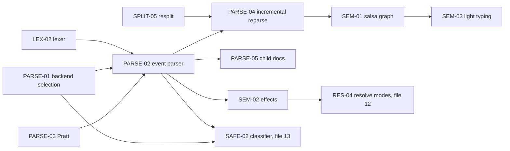

# 11 — SQL Parsing and Semantics: Lossless Trees, Error Recovery, Incremental Reparse, salsa Query Graph, Precedence (canonical algorithm catalog)

> Status: canonical, implementation-ready. Date: 2026-11-11. Part of `docs/research/algorithms/`.
> Global spec index, dependency map, crate layout (§0.4) and phased build order (§0.5) are in `10-sql-lexing-splitting-params.md` §0. This file owns SQL-PARSE-01..05 and SQL-SEM-01..03.
> For implementation purposes it **supersedes**: ALG-SQL-LAND-01 (`clients/sql-tooling-01`); ALG-SQL-PARSE-01..04 and §3.8–3.9, §5 (`clients/sql-tooling-03`); ALG-SQL-09 and ALG-SQL-12 (`datagrip/06`); the parsing parts of ALG-MCP-11 steps 2–3 (`mcp/02`) and ALG-AUTHZ-03 step 2 (`access/05`); background-parsing notes of `clients/dbeaver-03` §2.15/§5.7. Those remain the evidence base.
> Verification reports override: `verification/01-db-behavior-tests.md`, `verification/02-external-fact-check.md` (relevant here: P35 pgls typecheck uses protocol-level Parse, not EXPLAIN; P36 libpg_query = PG 18.6 / pg_query 18.1.0; P37 sqlparser-rs has 16 dialects and ~220 hooks; S33 salsa 0.28.5, sqlparser-rs 0.64.0, 193 `Span::empty()`).
> Clean-room: pseudocode is ours. rust-analyzer, rowan, salsa, biome (MIT/Apache-2.0), pgls (MIT), sqlparser-rs (Apache-2.0) are cited by file:line in the source docs; PostgreSQL grammar facts come from libpg_query (BSD-3 + PostgreSQL License) and public docs.

## 0. This file at a glance

| ID | Name | Priority | Phase | Depends on |
|---|---|---|---|---|
| SQL-PARSE-01 | Parser backend selection per (dialect, purpose) | v1 | P1 | SQL-LEX-01, `sql-oracle-pg`, `sqlparser` |
| SQL-PARSE-02 | Lossless event-based parser with error recovery; tolerant and strict modes | v1 (PG P1; MySQL/MariaDB, SQLite, T-SQL P3) / later (ClickHouse, Oracle P4) | P1/P3/P4 | SQL-LEX-02, SQL-LEX-04, SQL-PARSE-03 |
| SQL-PARSE-03 | Dialect-parameterised Pratt expression parser and precedence tables | v1 | P1 | SQL-PARSE-02 |
| SQL-PARSE-04 | Incremental per-statement reparse | v1 (statement level) / v1.x (token and node level) | P1/P3 | SQL-LEX-03, SQL-SPLIT-05, SQL-PARSE-02 |
| SQL-PARSE-05 | Embedded languages as child documents | v1.x | P4 | SQL-PARSE-02, SQL-PARSE-04 |
| SQL-SEM-01 | salsa query graph: inputs, tracked queries, durability, cancellation | v1 | P2 | SQL-PARSE-04, SQL-RES-01/03 |
| SQL-SEM-02 | Statement effect extraction (catalog delta, session delta) | v1 | P2 | SQL-PARSE-02, SQL-RES-02 |
| SQL-SEM-03 | Light typing, expected type, INSERT column↔value mapping | v1.x / later (overloads) | P4 | SQL-SEM-01, SQL-RES-03, SQL-COMPL-06 |



### 0.1 Decisions in this file

| # | Decision | Rejected alternatives (reason) |
|---|---|---|
| P-01 | Plain rowan green/red trees + codegen'd typed accessors (rust-analyzer `ungrammar` style) for v1 | biome slot model now (more codegen, per-kind factories; revisit after prototyping `SelectStmt` accessors with missing clauses); ruff-style non-lossless AST + side tables (audit/format need exact text) |
| P-02 | One `sql-parser` crate: shared ANSI core + per-dialect modules behind cargo features; `SyntaxKind` is a superset; typed nodes shared where shapes match (`SelectStmt`, `JoinExpr`), dialect-specific otherwise (`PgCopyStmt`, `MySqlLoadData`, `TsqlExecuteStmt`) | One crate per dialect with separate kinds (DataGrip has ~30 parsers but one PSI vocabulary — we copy the shared vocabulary idea, not the parser count) |
| P-03 | Same parser, two modes: Tolerant (editor) and Strict (classifier) via a post-parse validation pass | Two grammars (drift); strict-only parser (useless for editing) |
| P-04 | libpg_query is authoritative for PostgreSQL validity and safety; our PG grammar is authoritative for IDE structure; differential CI keeps them aligned | Own grammar as PG authority (parser differential = bypass risk) |
| P-05 | salsa for semantics, not for the editor's immediate syntax path (highlight/fold read the host-held green tree) | Everything through salsa (adds latency to highlighting) |
| P-06 | Statement-level reparse first; token/node-level reparse as v1.x optimisation for very large statements | Token-level only (complex, unnecessary for typical < 10 KB statements; pgls proves statement level suffices) |
| P-07 | Typing depth: v1.x light typing + opt-in server `Parse` probe; full PG overload resolution later | Port pgls' full PG typing now (large, PG-only) |

---

## 1. Parsing

### SQL-PARSE-01: Parser backend selection per (dialect, purpose)

- **Sources merged:** `clients/sql-tooling-01` ALG-SQL-LAND-01 and §4.1; `clients/sql-tooling-03` §3.9, §5.2; `mcp/02` ALG-MCP-11 step 2 (PG via libpg_query, others via sqlparser-rs + lexer pre-scan; PG-wire flavours); `access/05` ALG-AUTHZ-03 step 2; `datagrip/06` §5.1 (sqlparser-rs as cross-check oracle in tests and Karagöz; pg_query for PG validation).
- **Problem:** Several parsers with different guarantees exist; every consumer needs a deterministic, documented choice and a combination rule — especially the safety classifier, where a parser differential is a bypass.
- **Inputs / outputs:** `(DialectId, Option<ServerVersion>, Purpose, BuildFeatures, phase)` → `Plan { backends: SmallVec<[Backend; 3]>, combine: Combine }` with `Combine ∈ { First, AuthoritativeThenCrossCheck, MostDangerousOfAll { deny_if_any_fails: bool } }`.
- **Algorithm:**
  1. `Highlight | BracketMatch | Fold | SemanticTokensSyntaxOnly` → `[OwnLexer]` only (never block on parsing).
  2. `SplitForEditor` → `[OwnSplitter]`; PG adds async `[LibPgQueryParseCheck]` for ambiguous fragments (SQL-SPLIT-03).
  3. `Completion | Hover | Rename | Format | Lint` → `[OwnCst(Tolerant)]` + catalog; dialects without an own parser yet → `[OwnLexer]` token heuristics only (SQL-COMPL-01 fallback; SQL-FMT-03 for formatting).
  4. `Diagnostics` → `OwnCst` syntax errors ∪ PG `LibPgQuery` first error (authoritative: supersedes our syntax errors in the same statement) ∪ optional `ServerParseProbe` (opt-in per connection, never on production-tagged connections without consent, never with a superuser credential; uses protocol-level Parse/prepare, which does not execute — `verification/02` P35).
  5. `SafetyClassify` (Karagöz authoritative; Hacivat advisory; MCP broker):
     - PG (and PG-wire flavours): `[LibPgQuery]` mandatory, parse error ⇒ `Deny(ParseError)`; `[OwnCst(Strict)]` as cross-check from P1 (disagreement on statement *kind* ⇒ Deny + audit `parser_disagreement`). PG-wire flavours (CockroachDB, Redshift, YugabyteDB): libpg_query parse, failure ⇒ Deny; reports marked `Conservative` because the server grammar differs.
     - MySQL/MariaDB, SQL Server, SQLite, ClickHouse: **P1–P2 interim** = `[OwnLexerPreScan, SqlparserRs(dialect)]` (`MostDangerousOfAll{deny_if_any_fails: true}`); **from P3/P4** (per dialect, when its own parser lands) = `[OwnCst(Strict), SqlparserRs]` with the same combine rule. Oracle: `[OwnCst(Strict)]` once available; before that, Deny for every request except an allowlisted `SELECT … FROM` subset recognised by the pre-scan [decision; Oracle is "later" product-wide].
     - Unknown dialect ⇒ Deny.
  6. `AuditFingerprint` → PG `LibPgQuery` fingerprint/normalize; others `HvNorm1` (SQL-PARAM-03).
  7. Version guard: if the server major version is newer than the libpg_query grammar (PG 19 vs PG 18.6), parsing still runs; a parse error is reported as `Deny(SyntaxNewerThanAgent)` ("upgrade agent").
- **Data structures:** `enum Backend { OwnLexer, OwnLexerPreScan, OwnSplitter, OwnCst(Mode), LibPgQuery, LibPgQueryParseCheck, SqlparserRs, ServerParseProbe, Catalog }`; static table `PLANS: [(DialectId, Purpose) → Plan]` with a `phase` column so the interim regime is explicit and testable; every Karagöz decision records the backends and their versions (`pg_query 18.1.0 / PG 18.6`, `sqlparser 0.64.0`, `sql-parser <git sha>`).
- **Complexity:** table lookup O(1); cost dominated by the parsers (libpg_query µs–ms per statement).
- **Decision:** libpg_query is the PG authority (server's own grammar); for other dialects "both must parse, take the most dangerous result" (a permissive parser accepting what the server parses differently is safe only when *both* agree and we union effects). Rejected: sqlparser-rs alone as authority (permissive in places, rejects in others; `parse_statements` aborts on first error; not lossless); own parser alone for PG (differential risk); tree-sitter anywhere in this table.
- **Verification status:** libpg_query version and API Confirmed (P36, Observed `pg_query.rs/src/query.rs:36-433`); sqlparser-rs properties Observed + corrected (P37: 16 dialects, ~220 hooks; recursion limit 50; first-error abort); server-side Parse does not execute — Inferred from protocol docs and pgls usage (P35 Observed that pgls calls `conn.prepare`). No Docker test needed for the table itself; SAFE-06 exercises it.
- **Rust placement:** `sql-safety::backends::plan_for`, `sql-ide::backends::plan_for` (shared table in `sql-dialect::purpose`); `sql-oracle-pg` (feature `pg-oracle`), optional dependency `sqlparser = "0.64"` behind feature `sqlparser-second-opinion` (Karagöz: on).
- **Per-dialect matrix (SafetyClassify):**

| Dialect | P1–P2 | P3+ | Deny if |
|---|---|---|---|
| PostgreSQL | libpg_query (authority) + own strict (cross-check) | same | libpg_query fails; kinds disagree |
| PG-wire (Cockroach, Redshift, Yugabyte) | libpg_query (Conservative) | + own PG strict | either fails |
| MySQL / MariaDB | own pre-scan + sqlparser-rs (`MySqlDialect`) | own strict + sqlparser-rs | either fails; pre-scan finds construct sqlparser does not model (executable comment is expanded by us, SQL-LEX-05) |
| SQL Server | pre-scan + sqlparser-rs (`MsSqlDialect`), whole batch | own T-SQL strict + sqlparser-rs | either fails |
| SQLite | pre-scan + sqlparser-rs (`SQLiteDialect`) + engine check `sqlite3_prepare_v2` tail empty and `sqlite3_stmt_readonly` (SQL-SAFE-05) | own strict + sqlparser-rs + engine | either fails |
| ClickHouse | pre-scan + sqlparser-rs (`ClickHouseDialect`) | own strict (P4) + sqlparser-rs | either fails |
| Oracle | allowlisted read subset only | own strict (P4) | otherwise |

- **i18n notes:** parser errors are `(code, args)`; libpg_query and server error texts are English (or server-locale!) — wrapped as `{code: "pg-syntax-error", detail: <raw>}` and shown as untranslated detail; never pattern-match server message text, use SQLSTATE (`i18n/02` ALG-I18N-08).
- **Edge cases:** libpg_query compiled out (WASM) ⇒ PG uses "other dialects" path; MySQL `sql_mode` affects parsing (`ANSI_QUOTES`, `PIPES_AS_CONCAT`, `HIGH_NOT_PRECEDENCE`) ⇒ modes are part of the backend input; MariaDB vs MySQL separate ids; sqlparser-rs accepting syntax our pre-scan flags (executable comments, `DELIMITER`) ⇒ pre-scan wins (deny or expand); new server syntax ⇒ Deny with upgrade hint.
- **Test cases:** `(Postgres, SafetyClassify, "SELECT 1")` → plan `[LibPgQuery, OwnCst]` → Read; `(Postgres, "SELEC 1")` → Deny(ParseError); `(MySql, "SELECT 1 /*!50000 , (SELECT 1) */")` → both backends see the expanded code → Read + flag ExecutableComment; `(Cockroach, "SELECT 1")` → libpg_query, Conservative → Read; `(Unknown, …)` → Deny; `(Postgres 19 server, PG19-only statement)` → Deny(SyntaxNewerThanAgent).
- **Used by:** Hacivat | Karagöz | MCP broker.

### SQL-PARSE-02: Lossless event-based parser with error recovery; tolerant and strict modes

- **Sources merged:** `clients/sql-tooling-03` ALG-SQL-PARSE-01, §3.1 (requirements R1–R9), §3.3–3.4 (RA events/markers/recovery/step limit/trivia; biome slots/bogus), §3.8 (SQL-specific concerns), §3.9 (strict vs tolerant); `datagrip/06` §2.1, §5.1 (one node vocabulary for all dialects, recovery sets); `clients/dbeaver-03` §7.9 (prefer hand-written over ANTLR); `mcp/02` ALG-MCP-11 edge case 23 (deep nesting → UNKNOWN, no stack overflow).
- **Problem:** Build a lossless rowan tree for each statement from lexer tokens with a hand-written recursive-descent grammar, such that a tree is always produced (editor), errors are precise, adversarial input cannot hang or crash the process, and the same parse can be validated strictly for the classifier.
- **Inputs / outputs:** `(lexed: &Lexed, stmt_range, dialect: &ParserDialect, modes: LexModes, mode: Tolerant | Strict | Probe{marker_index}, limits: Limits{max_depth, max_steps, max_tokens})` → `Parse { green: GreenNode, errors: Vec<SyntaxError{range, code, args}>, limits_hit: Option<LimitKind>, expected_at_marker: Option<ExpectedSet> }`; strict: `validate_strict(&Parse) -> Result<(), StrictParseError>`.
- **Algorithm:**
  1. **Input:** significant tokens only (`kinds`, `kw`, `joint` bitset for adjacency, mapping to raw token indices). Joint flags let the parser compose `::`, `->>`, `!=` when the lexer emitted pieces, and reject `a: :int` (not joint → error).
  2. **Parse phase** (`Parser` emits `Event`s): `source_file`/`statement_list`: loop until EOF; at `;` → `SEMICOLON` (consecutive → `EMPTY_STMT`); else `statement()`; then `eat(;)` or, if not at EOF and not at a statement-start token, `err_recover("expected ;", STMT_START_SET)`.
     - `statement()`: dispatch on `(first keyword, second keyword)` via `dialect.stmt_table`; unknown or not-yet-supported head → `UNKNOWN_STMT` consuming tokens until `;` or a statement-start keyword at line start at paren depth 0 (lossless, highlighted, never swallows the next statement).
     - Clauses check FIRST sets; missing required element → `error(code)` without consuming if the current token ∈ the context's recovery set; else wrap the offending token in `ERROR` (`err_recover`).
     - Lists via `delimited(item, sep, closer, recovery)`: trailing separator before the closer → `TrailingComma` (unless dialect allows); missing comma between items when the next token starts an item → `MissingComma` (only after an alias was already consumed, to keep `SELECT a b` = alias).
     - Expressions via SQL-PARSE-03.
     - Contextual keywords: identifier position + `Word` with keyword `k` → accept if `keyword_allowed(dialect, k, position)` (SQL-LEX-04), emit `Token{remap: IDENT}`; reserved keyword in identifier position → error, Tolerant mode still remaps to IDENT.
     - **Guards:** every lookahead increments `steps` (reset on bump); `steps > max_steps` → `Error{ParserStuck}`, wrap the remaining tokens of the statement in one `ERROR`, set `limits_hit` (never `panic!` in release builds). `depth` increments on prefix recursion (parens, subqueries, CASE, function args), never on loop iterations; `depth > max_depth` → `Error{TooDeep}` + `ERROR` node up to the matching closer. Long left-assoc chains and `UNION` chains are iterative. Parsing runs on a worker with a fixed large stack (8 MB) as belt-and-braces.
     - **Probe mode** (completion, SQL-COMPL-01): every `at()/at_kw()` check whose position equals `marker_index` inserts the tested kind into `expected_at_marker`.
  3. **Build phase** (events → green): resolve `forward_parent` chains; skip tombstones; trivia attachment: line/block comments directly above a *statement* (no blank line) attach inside the statement node; trailing same-line comment after the terminator attaches to the statement; inside statements trivia stays between children (formatter attaches comments separately, SQL-FMT-01); trailing trivia → root. `Token{n_raw>1}` merges raw tokens into one green token. Lexer error tokens pushed as-is; their errors copied. One shared `NodeCache` per document.
  4. **Strict validation** (`Strict`): reject on any `ERROR*`/`UNKNOWN_STMT` kind, any lexer error flag, any missing *required* child (codegen'd grammar metadata), any `limits_hit`, any dialect feature marked `classifier_unsupported`.
  5. **Limits:** editor `max_depth = 1000`, `max_steps = 15_000_000`; Karagöz/MCP strict `max_depth = 256`, `max_steps = 2_000_000`, `max_tokens = 200_000`, input ≤ 1 MiB (SQL-SAFE-02 pre-checks).
- **Data structures (Rust-like):**
  ```rust
  pub enum Event { Start { kind: SyntaxKind, forward_parent: Option<u32> }, Finish,
                   Token { remap: Option<SyntaxKind>, n_raw: u8 }, Error { code: ParseErrorCode } }
  pub struct Marker { pos: u32 /* + drop-bomb in debug */ }
  pub struct CompletedMarker { pos: u32, kind: SyntaxKind }      // .precede(&mut p) for left recursion
  pub struct TokenSet([u64; 4]);                                   // over SyntaxKind (≤ 256 token kinds)
  pub struct KwSet(BitVec);                                        // over KeywordId
  pub struct ParserDialect {
      pub id: DialectId, pub features: FeatureSet,                 // e.g. RETURNING, MERGE, LATERAL, QUALIFY, TOP, APPLY, CONNECT_BY
      pub stmt_table: &'static [StmtEntry],                        // (kw1, kw2?) -> fn(&mut Parser)
      pub prec: &'static PrecTable,                                // SQL-PARSE-03
      pub special_forms: &'static [SpecialForm],                   // EXTRACT(x FROM y), SUBSTRING(a FROM 1 FOR 2), TRIM(BOTH…), POSITION(a IN b), CAST(x AS t), OVERLAY(…)
      pub recovery: RecoverySets, pub reserved_alias: &'static KwSet,
  }
  pub struct Parse { pub green: rowan::GreenNode, pub errors: Vec<SyntaxError>,
                     pub limits_hit: Option<LimitKind>, pub expected_at_marker: Option<ExpectedSet> }
  ```
  Recovery sets: statement level = statement-start keywords ∪ `;` ∪ EOF; SELECT clause level = `FROM WHERE GROUP HAVING WINDOW QUALIFY ORDER LIMIT OFFSET FETCH FOR UNION INTERSECT EXCEPT ) ;`; expression level = `, ) ] THEN ELSE END WHEN AS` ∪ clause set; list level = separator ∪ closer; DDL column-def = `, )` ∪ `CONSTRAINT PRIMARY UNIQUE CHECK FOREIGN REFERENCES`.
  Typed AST: generated from `grammar/sql.ungram` (+ dialect fragments) into `sql-syntax::ast` (`SelectStmt::from_clause() -> Option<FromClause>`, etc.).
- **Complexity / performance:** O(n) with bounded lookahead (≤ 4 tokens; bounded speculation windows for `(`-classification); target 50–100 MB/s, a 5 KB statement in ~50 µs.
- **Decision:** RA-style event parser + recovery sets + strict post-validation (P-01..P-03). Rejected: sqruff combinator matching (backtracking, latency), ANTLR ATN (DBeaver; runtime immature in Rust), tree-sitter (permissive, C).
- **Verification status:** Observed (RA `crates/parser/src/{event.rs,parser.rs:39-72,279-310,shortcuts.rs:150-280}`; biome `parse_recovery.rs:53-70`; sqlparser-rs depth guard `parser/mod.rs:57-63,196`); grammar facts per dialect Inferred (vendor docs) with PG validated differentially against libpg_query (P1 exit criterion).
- **Rust placement:** `sql-parser::{Parser, parse_statement, parse_document, validate_strict}`; grammar modules `sql-parser::grammar::{core, pg, mysql, sqlite, mssql, clickhouse, oracle}`; kinds/AST in `sql-syntax`.
- **Per-dialect matrix (grammar scope and notable constructs):**

| Area | PG (P1) | MySQL/MariaDB (P3) | SQL Server (P3, batch-level first) | SQLite (P3) | ClickHouse (P4) | Oracle basic (P4) |
|---|---|---|---|---|---|---|
| DQL | full SELECT incl. LATERAL, WINDOW, FETCH, FOR UPDATE variants, TABLESAMPLE, VALUES, TABLE | SELECT incl. `STRAIGHT_JOIN`, `INTO @v/OUTFILE`, `LOCK IN SHARE MODE`, hints | SELECT incl. TOP, APPLY, table hints `WITH (…)`, `OPTION(…)`, `INTO #t` | SELECT incl. window, `INDEXED BY` | SELECT incl. `PREWHERE`, `FINAL`, `SAMPLE`, `ARRAY JOIN`, `SETTINGS`, `FORMAT` | SELECT incl. `CONNECT BY`, `ROWNUM`, `@dblink`, `(+)` |
| DML | INSERT/UPDATE/DELETE/MERGE, ON CONFLICT, RETURNING (PG18 OLD/NEW) | INSERT/REPLACE/UPDATE/DELETE multi-table, ON DUPLICATE KEY | INSERT/UPDATE/DELETE/MERGE, OUTPUT | INSERT/UPSERT/UPDATE/DELETE, RETURNING | INSERT … VALUES/SELECT/FORMAT, `ALTER … DELETE/UPDATE` mutations | INSERT/UPDATE/DELETE/MERGE |
| DDL (v1) | common CREATE/ALTER/DROP; others `UNKNOWN_STMT` | common | common; procedure bodies to batch end | common; triggers | common | common; PL/SQL units as opaque blocks first |
| Statement terminators | `;` | `;`/delimiter | optional | `;` | `;` | `;` and `/` |
| Unknown statement handling | `UNKNOWN_STMT` (Strict ⇒ libpg_query decides) | `UNKNOWN_STMT` (Strict ⇒ Deny) | same | same | same | same |

- **i18n notes:** error codes + typed args (`sql-parse-expected-expression = Expected an expression`, Turkish bundle); expected-token lists use SQL keyword spellings (untranslated) inside translated templates; node-kind names shown in breadcrumbs ("SELECT statement › FROM clause") need message IDs.
- **Edge cases (exhaustive):** empty statement list; only comments; statement at EOF without `;`; `;` inside unbalanced parens (statement-level recovery treats `;` as a hard stop closing all open parens with errors); unclosed `CASE` (`MissingEnd` at `;`/statement start); stray `)` at statement level; keyword as identifier where allowed (`SELECT name, type, value FROM settings`); reserved keyword as identifier (`SELECT select FROM t`); trailing comma before `FROM`; `SELECT FROM t` (PG allows empty target list); `SELECT * FROM` (missing table → empty slot + error; completion relies on it); `WHERE` at end; `JOIN` without `ON` (PG error, MySQL allowed for INNER); `GROUP BY` trailing comma; very long `IN (…)` (iterative); 10k-deep parentheses (TooDeep, no stack overflow); 1 MB string token; dialect-mismatched features (feature off → error, not panic); `a: :int`; PG `OPERATOR(pg_catalog.+)`; `$1` in DDL positions; unsupported utility statements (`UNKNOWN_STMT`, Strict rejects; libpg_query decides for PG); dollar bodies not parsed in the outer pass (SQL-PARSE-05); PG string continuation `'a'\n'b'` (one literal node, two tokens; same-line continuation → error `StringContinuationNeedsNewline`); T-SQL statements without terminators (each statement rule stops at the first token that cannot continue it; `WITH` needs a preceding `;`).
- **Test cases:**
  1. `SELECT a, FROM t;` → `SELECT_STMT{targets[a, <missing>], FROM_CLAUSE{t}}`, error `ExpectedExpression` at `FROM`; `text()` round-trips.
  2. `SELECT a FROM t WHERE ;` → `WHERE_CLAUSE{<missing>}` + error; next statement unaffected.
  3. `SELEC a FROM t; SELECT 1;` → `UNKNOWN_STMT` + valid `SELECT_STMT`.
  4. `SELECT (1 + ;` → `ExpectedExpression`, `MissingRParen`; closed at `;`.
  5. `SELECT -- c\n a /* d */ FROM t` → comments preserved at exact offsets.
  6. `/* header */\nSELECT 1;` → comment inside `SELECT_STMT`; with a blank line between → outside.
  7. 100,000 × `a +` chain → parses, no stack overflow; 10,000 nested `(` → `TooDeep` (editor), Strict → `Err`.
  8. Strict `SELECT 1 FROM t WHERE` → `Err(StrictParseError)`; Tolerant → tree + 1 error.
  9. PG `SELECT 'a'\n'b'` → one `LITERAL` with two string tokens, no error; `SELECT 'a' 'b'` → error.
  10. Differential: PG regression corpus, our accept/reject equals libpg_query for supported statement kinds ≥ 98 % (P1 exit), 100 % for the SAFE-06 corpus.
  11. Fuzz: random token sequences never panic; `concat(green) == input`.
- **Used by:** Hacivat (Tolerant, Probe) | Karagöz and MCP broker (Strict).

### SQL-PARSE-03: Dialect-parameterised Pratt expression parser and precedence tables

- **Sources merged:** `clients/sql-tooling-03` ALG-SQL-PARSE-04 and §3.8.2–3.8.3 (precedence lists, ambiguities, special forms, type names); sqlparser-rs `get_next_precedence`/`parse_infix` hooks (Observed `src/dialect/mod.rs:949-1124`) as structural reference only.
- **Problem:** Parse expressions with each dialect's precedence/associativity (and session modes), iteratively, with recovery, producing nodes the formatter, linter, typer and classifier share.
- **Inputs / outputs:** parser state, `min_bp`, `dialect.prec: &PrecTable`, `LexModes` → events for one expression; returns `Option<CompletedMarker>` (`None` = missing expression, caller reports).
- **Algorithm:**
  1. `lhs = prefix()`: prefix operator in the table → bump, `rhs = expr_bp(r_bp)`, wrap `PREFIX_EXPR`; else primary: literal (incl. typed literal `DATE '…'`, PG `int4 '1'`), param, name path, `(` (subquery if next is `SELECT|WITH|VALUES|TABLE|(`-chain leading to those; else row/paren expr), `CASE`, `CAST`, special forms, `EXISTS(`, `ARRAY[`/`ARRAY(`, `ROW(`, `INTERVAL`, function call with `FILTER`/`OVER`/`WITHIN GROUP`/`RESPECT|IGNORE NULLS`. Nothing matches and token ∈ recovery set → `None`.
  2. Loop: read the next operator key (multi-token keys via lookahead: `IS NOT`, `NOT LIKE`, `NOT IN`, `NOT BETWEEN`, `SIMILAR TO`, `AT TIME ZONE`, `IS DISTINCT FROM`, `MEMBER OF`, `SOUNDS LIKE`); postfix with `l_bp ≥ min_bp` → wrap; infix with `l_bp ≥ min_bp` → special handling: `BETWEEN low AND high` (the `AND` belongs to BETWEEN; operands parsed above logical AND), `IN (list | subquery)`, `LIKE/ILIKE/SIMILAR TO [ESCAPE e]`, `IS [NOT] (NULL|TRUE|FALSE|UNKNOWN|DISTINCT FROM x|DOCUMENT|NORMALIZED|JSON …)`, `::` parses a **type name** (not an expression), `[` subscript/slice, `.` field/`*`, `COLLATE name`; otherwise `rhs = expr_bp(r_bp)` and wrap `BIN_EXPR`. Non-associative operators: same-precedence chain → error `NonAssocChain` (PG `a < b < c`), continue.
  3. Iterative for left-assoc chains; recursion only for right-assoc/prefix (depth counted).
- **Data structures:** `PrecTable { infix: Map<OpKey, (l_bp, r_bp, NodeKind)>, prefix: Map<OpKey, (r_bp, NodeKind)>, postfix: Map<OpKey, (l_bp, NodeKind)>, nonassoc: Set<OpKey>, mode_overrides: &[(ModeFlag, OpKey, Entry)] }`; `OpKey = TokenKind | KeywordId | KeywordPair`.
- **Precedence tables (highest first; Inferred from vendor docs; data files with one test per row):**

| Level | PostgreSQL | MySQL / MariaDB | SQL Server | SQLite | ClickHouse [verify] | Oracle (basic) |
|---|---|---|---|---|---|---|
| 1 | `.` | `INTERVAL` | `~` | unary `~ + -` | `.`, `[]`, `::`(cast) | unary `+ -`, `PRIOR`, `CONNECT_BY_ROOT` |
| 2 | `::` | `BINARY`, `COLLATE` | `* / %` | `COLLATE` | unary `-` | `* /` |
| 3 | `[ ]` | `!` | `+ -` (incl. string `+`), `& ^ \|` | `\|\| -> ->>` | `* / %` | `+ - \|\|` |
| 4 | unary `+ -` | unary `- ~` | comparisons `= > < >= <= <> != !< !>` | `* / %` | `+ -` | comparisons |
| 5 | `COLLATE` | `^` (XOR) | `NOT` | `+ -` | `\|\|` | `IS [NOT] NULL`, `LIKE`, `BETWEEN`, `IN` |
| 6 | `AT` (TIME ZONE) | `* / DIV % MOD` | `AND` | `& \| << >>` | comparisons, `LIKE`, `IN`, `BETWEEN`, `IS NULL` | `NOT` |
| 7 | `^` | `- +` | `ALL ANY BETWEEN IN LIKE OR SOME` | `ESCAPE` | `NOT` | `AND` |
| 8 | `* / %` | `<< >>` | `=` (assignment) | `< <= > >=` | `AND` | `OR` |
| 9 | `+ -` | `&` | | `= == != <> IS IS NOT IS DISTINCT FROM IN LIKE GLOB MATCH REGEXP BETWEEN` | `OR` | |
| 10 | any other operator (`\|\|`, `->`, `@>`, custom) | `\|` | | `NOT` | ternary `?:`, lambda `->` | |
| 11 | `BETWEEN IN LIKE ILIKE SIMILAR` | comparisons `= <=> >= > <= < <> != IS LIKE REGEXP IN MEMBER OF` | | `AND` | | |
| 12 | `< > = <= >= <>` | `BETWEEN CASE WHEN THEN ELSE` | | `OR` | | |
| 13 | `IS ISNULL NOTNULL` | `NOT` (`!` rank if HIGH_NOT_PRECEDENCE) | | | | |
| 14 | `NOT` | `AND &&` | | | | |
| 15 | `AND` | `XOR` | | | | |
| 16 | `OR` | `OR` (`\|\|` = OR unless PIPES_AS_CONCAT, then concat at level 3) | | | | |
| 17 | | `= :=` (assignment, right-assoc) | | | | |

- **Decision:** data-driven Pratt tables per dialect with mode overrides (MySQL `PIPES_AS_CONCAT`, `HIGH_NOT_PRECEDENCE`). Rejected: sqlparser-rs per-dialect `get_next_precedence` code hooks (logic in code, harder to test row by row).
- **Verification status:** Inferred (vendor operator-precedence pages); PG table cross-checked against libpg_query behaviour via differential tests (P1); MySQL/SQL Server/SQLite/ClickHouse/Oracle rows each need one conformance query (`SELECT expr` comparing results) — conformance backlog item C-P1.
- **Rust placement:** `sql-parser::expr::{expr_bp, PrecTable}`; tables in `sql-dialect::prec::{pg, mysql, mssql, sqlite, clickhouse, oracle}`.
- **i18n notes:** none (operators are ASCII).
- **Edge cases:** unary vs binary minus (`a - -b`); PG custom operators (any `Op` → "other operator" level; prefix `@`/`~`/`!!`); `OPERATOR(schema.op)`; PG `NOT a = b` → `NOT (a = b)`; MySQL `!a = b` → `(!a) = b`; `a NOT BETWEEN b AND c AND d`; `x IS NOT DISTINCT FROM y`; `a = ANY(ARRAY[…])`, `= ALL (subquery)`; `ESCAPE` missing operand; `AT TIME ZONE` vs alias `at`; `COLLATE "C"`; `a.b.c[1].d` (PG requires parentheses for field selection after subscript of a composite: `(a.b)[1].d` — parse generically, resolver decides); `CASE` inside operators; JSON operators `-> ->> #> @> ?| ?&`; MySQL `:=` inside SELECT; T-SQL `+` concatenation (same token as addition; typed later); ClickHouse lambdas `x -> x + 1` and ternary.
- **Test cases:** PG `1 + 2 * 3 ^ 2` → `+(1, *(2, ^(3, 2)))`; PG `-2 ^ 2` → `^(-2, 2)` (unary minus binds tighter); PG `NOT a = b AND c` → `AND(NOT(=(a,b)), c)`; PG `a < b < c` → `NonAssocChain`; MySQL (PIPES_AS_CONCAT off) `a || b && c` → `OR(a, AND(b, c))`; MySQL (on) → `AND(CONCAT(a, b), c)`; `a BETWEEN 1 AND 2 AND b` → `AND(BETWEEN(a,1,2), b)`; `x::int + 1` → `+(CAST(x,int), 1)`; SQLite `a || b * c` → `*(||(a,b), c)` (`||` binds tighter than `*` in SQLite); T-SQL `NOT a = 1 AND b = 2` → `AND(NOT(=(a,1)), =(b,2))`.
- **Used by:** Hacivat | Karagöz.

### SQL-PARSE-04: Incremental per-statement reparse

- **Sources merged:** `clients/sql-tooling-03` ALG-SQL-PARSE-02 (token-level, node-level, statement-level reparse; identity; error merge); `datagrip/06` ALG-SQL-09 steps 3–4 (reuse green nodes of untouched statements; lazy routine bodies); `clients/dbeaver-03` §2.15 (visible-range background parsing, 250 ms debounce, immediate after `.`; > 2 MB disables rule-based features); `clients/sql-tooling-01` §3.1.2 (pgls never uses tree-sitter incremental edits).
- **Problem:** Keep syntax trees fresh on every keystroke for large scripts (ADR 0001 B3: 50k-line file, typing latency ≤ 16 ms p95, completion ≤ 50 ms) while preserving cache identity.
- **Inputs / outputs:** `DocSyntax { text, lexed, items: Vec<StmtItem{key: StmtKey, range, green: Option<GreenNode>, errors}> }` + `ResplitResult` (SQL-SPLIT-05) → updated `DocSyntax` + `changed`, `moved`.
- **Algorithm:**
  1. Items reported `moved` keep their green node (positions are relative; red nodes are rebuilt lazily with the new offset).
  2. For each `changed` item:
     a. **Cache hit:** a green node for the same `StmtKey` exists (identical text elsewhere or before an undo) → reuse.
     b. **Token-level (v1.x):** exactly one old item maps to it, the edit lies within one token whose kind is unchanged and in `{Whitespace (no newline-count change), Comment, Word (same keyword id), String, Number, DollarString (same tag)}` → replace that green token via `replace_with`.
     c. **Node-level (v1.x):** smallest ancestor of a reparsable kind (`PAREN_SUBQUERY`, `BEGIN_END_BLOCK`, balanced `CASE_EXPR`, `ARG_LIST`, `COLUMN_DEF_LIST`) whose new text keeps its delimiters balanced → reparse with `dialect.reparser_for(kind)`; splice.
     d. **Statement-level (v1):** reparse the whole statement.
  3. Merge errors: drop old errors inside reparsed ranges, keep others (relative offsets), add new ones.
  4. **Scheduling:** parse statements intersecting the viewport first, then the rest in background; debounce 50 ms for typing bursts (immediate after `.`, `(`, space after a keyword — completion triggers); everything cancellable (salsa cancellation in SQL-SEM-01).
  5. **Large-file mode:** > 5 MB or > 50k statements → lexing + splitting + viewport-only parsing; semantics only for the statement at the caret; a status-bar badge explains reduced features.
- **Data structures:** `DocSyntax` held by the editor host (outside salsa for latency, P-05); per-document `NodeCache`; `GreenCache: LruCache<StmtKey, (GreenNode, Vec<SyntaxError>)>` (capacity 2,048).
- **Complexity:** typical keystroke = one statement (< 10 KB) ≈ 50–200 µs.
- **Decision:** statement-level first (P-06). Rejected: tree-sitter `Tree::edit` style whole-file incremental grammar; DBeaver's visible-range-only parsing as the *only* mode (semantic features need all DDL above the caret in Script mode — handled by parsing everything in background).
- **Verification status:** Observed (RA `reparsing.rs:1-140`; pgls `document.rs:44-66`; DBeaver `SQLBackgroundParsingJob.java` L577–800). Performance targets are ADR 0001 benchmarks (to be measured in the GPUI spike).
- **Rust placement:** `sql-parser::incremental::{reparse_document, DocSyntax, GreenCache}`; scheduling in `sql-ide::doc_host`.
- **Per-dialect matrix:** reparsable node kinds per dialect (T-SQL `BEGIN…END` and `TRY/CATCH`; MySQL compound statements; PG `BEGIN ATOMIC`; Oracle PL/SQL blocks P4); otherwise identical.
- **i18n notes:** none.
- **Edge cases:** edit deletes `;` (merge), inserts `;` (split); edit inside a dollar body (outer token-level; child document reparsed separately, SQL-PARSE-05); identifier → keyword (`selec` → `select`): not token-level; newline-count change before a statement (trivia attachment ⇒ statement reparse); `*/` typed in a comment; paste of 1 MB; undo bursts; identical statements twice in a file (shared green, two positions).
- **Test cases:** typing `x` into `SELECT a FROM t` → token-level (v1.x) or statement-level (v1), 1 changed statement; typing `;` after `t` in `SELECT a FROM t SELECT b` → split into 2; deleting `;` between two statements → merge; editing inside `( SELECT … )` of a 50 KB statement → node-level reparse of the subquery only (v1.x); inserting a line above → others moved only; 50k-line file keystroke p95 ≤ 16 ms (GPUI spike B3).
- **Used by:** Hacivat.

### SQL-PARSE-05: Embedded languages as child documents

- **Sources merged:** `clients/sql-tooling-03` §2.15, §3.8.6 (child parse keyed by parent id + token range, offset map); `clients/sql-tooling-01` §3.1.2 (pgls `StatementId::Child`); `clients/dbeaver-03` ALG-DBV-SQL-09 recommendation (inject PL/pgSQL/SQL sub-parse when `LANGUAGE` is known); `datagrip/06` §2.15 (37 injection rules: type-driven JSON/XML, regex operands, `dblink` SQL, ClickHouse `INSERT … FORMAT JSON`; routine bodies by language); `clients/sql-tooling-04` ALG-SQL-COMP-01 step 1 (completion recurses into function bodies).
- **Problem:** Code lives inside string tokens (PG function bodies, `DO` blocks, `EXECUTE 'sql'`, `dblink('…','sql')`, JSON literals) and must get highlighting, completion and diagnostics without being parsed as part of the outer statement.
- **Inputs / outputs:** outer `Parse` + catalog hints → `Vec<ChildDoc{parent: StmtKey, host_token: TextRange, language: EmbeddedLang, text: Arc<str> (unescaped), offset_map: OffsetMap}>`.
- **Algorithm:**
  1. Detection rules (data, `injections.toml`): PG `CREATE FUNCTION|PROCEDURE … AS <DollarString|String> … LANGUAGE sql|plpgsql` (language may appear before or after the body), `DO [LANGUAGE l] <body>` (default plpgsql); `EXECUTE <string literal>` in PL/pgSQL (SQL); `dblink(…, '<sql>')`, `dblink_exec` (SQL, same dialect); string literal compared/cast to `json/jsonb` (JSON), `xml` (XML); regex operator right operand (`~`, `~*`, `SIMILAR TO`, `REGEXP`) (Regex); ClickHouse `INSERT … FORMAT JSONEachRow` inline data (JSON lines).
  2. Unescape the host token (dollar string: verbatim; `'…'`: un-double quotes; `E'…'`: escapes) building an `OffsetMap` (child byte → host byte).
  3. Parse with the language's parser (PL/pgSQL grammar P4; until then PL/pgSQL bodies get SQL-statement-level highlighting via the SQL lexer on each `;`-split piece, no PL structure).
  4. Child document identity = `(parent StmtKey, host token index, text hash)`; edits inside the body reparse only the child.
  5. Diagnostics map back through `OffsetMap`; completion inside the body uses the child context plus function parameters (SQL-RES-01 statement context).
  6. **Never** used by the classifier: `CREATE FUNCTION`/`DO`/`EXECUTE` are already `Ddl`/`ProceduralCode`/`DynamicSql` (SQL-SAFE-02).
- **Data structures:** `ChildDoc`, `OffsetMap` (sorted `(child_off, host_off)` runs), `EmbeddedLang { Sql(DialectId), PlPgSql, Json, Xml, Regex }`.
- **Decision:** child documents (pgls/DataGrip) with data-driven detection. Rejected: DBeaver "`$$` as block toggle" (makes the splitter dialect-config-dependent and breaks server semantics, D-04).
- **Verification status:** Observed (pgls, DataGrip injection rule inventory); detection rules are decisions.
- **Rust placement:** `sql-parser::embed::{detect_children, OffsetMap}`; PL/pgSQL grammar `sql-parser::grammar::plpgsql` (P4); child-doc queries in `sql-sema` (SQL-SEM-01 `child_docs(stmt)`).
- **Per-dialect matrix:** PG: function/DO bodies, EXECUTE strings, dblink; MySQL/MariaDB, SQL Server: procedure bodies are inline (parsed in the main tree, no child docs) but `EXEC('…')`/`sp_executesql N'…'`/`PREPARE s FROM '…'` strings are SQL children; SQLite: none (triggers inline); ClickHouse: `FORMAT` data (JSON); Oracle: `EXECUTE IMMEDIATE '…'` (SQL child), PL/SQL inline.
- **i18n notes:** offset maps are byte-based; non-ASCII in bodies preserved exactly.
- **Edge cases:** language clause after the body; unknown language (`plpython3u`) → no child parse, plain string highlighting; nested dollar tags inside a body (`$$x;y$$` inside `$body$`, FX-SPLIT-PG-02); body edited into an unterminated state; `E'…'` escapes changing offsets; string concatenation building SQL (`'SELECT ' || col`) → not injected.
- **Test cases:** FX-SPLIT-PG-02 → child PL/pgSQL document with a nested `$$x;y$$` string; caret after `RETURN s ||` inside the body → completion of variable `s`; `DO $$BEGIN PERFORM 1; END$$` → child with 1 PL statement; `SELECT '{"a":1}'::jsonb` → JSON child (bracket matching inside); `EXEC('SELECT 1')` (T-SQL) → SQL child.
- **Used by:** Hacivat.

---

## 2. Semantics infrastructure

### SQL-SEM-01: salsa query graph — inputs, tracked queries, durability, cancellation

- **Sources merged:** `clients/sql-tooling-03` ALG-SQL-PARSE-03, §3.7 (salsa essentials: inputs/tracked/interned, red-green with backdating, durability, cancellation, cycles); `datagrip/06` ALG-SQL-09 step 5 (context of statement *i* depends on context of *i−1* + DDL effects, early cutoff); `clients/sql-tooling-04` §5.1 (`scopes(stmt, view)`, `resolve(stmt, view)` as queries).
- **Problem:** Organise per-statement analysis (parse, effects, effective catalog, scopes, resolution, typing, diagnostics, lint, completion data) so edits and catalog refreshes recompute only what is needed, readers can be cancelled, and context-dependent results never mix contexts.
- **Inputs / outputs:** salsa database `SqlDb`; the host writes inputs; IDE features read memoised outputs on snapshots.
- **Algorithm (query graph):**
  ```rust
  #[salsa::input] struct SourceFile { uri: Uri, #[returns(ref)] text: Arc<str>, dialect: DialectId,
                                      lex_modes: LexModes, client_flavor: ClientFlavor }          // Durability::LOW
  #[salsa::input] struct CatalogSnapshot { connection: ConnId, version: u64, #[returns(ref)] data: Arc<Catalog> } // HIGH
  #[salsa::input] struct SessionState { connection: ConnId, search_path: Arc<[Ident]>, current_db: Option<Ident>,
                                        temp_objects: Arc<CatalogDelta>, settings: Arc<Settings> }  // MEDIUM
  #[salsa::input] struct FileSettings { uri: Uri, connection: Option<ConnId>, resolve_mode: ResolveMode,
                                        lint: Arc<LintConfig> }                                     // MEDIUM
  #[salsa::interned] struct StmtText { dialect: DialectId, lex_modes: LexModes, #[returns(ref)] text: Arc<str> }

  #[salsa::tracked] fn split(db, f: SourceFile) -> Arc<[StmtItem]>;                  // SQL-SPLIT-02 editor mode
  #[salsa::tracked] fn split_shape(db, f: SourceFile) -> Arc<[StmtText]>;            // ranges stripped → backdates on pure moves
  #[salsa::tracked(lru = 512)] fn parse(db, s: StmtText) -> Arc<Parse>;               // SQL-PARSE-02 Tolerant
  #[salsa::tracked] fn ast_shape(db, s: StmtText) -> Arc<AstShape>;                   // trivia-free projection → backdates on comment/whitespace edits
  #[salsa::tracked] fn stmt_effects(db, s: StmtText) -> Arc<StmtEffects>;            // SQL-SEM-02 (catalog + session delta)
  #[salsa::tracked] fn context_before(db, f: SourceFile, idx: u32) -> Arc<StmtContext>;   // RES-04: Script folds effects of 0..idx; Playground = default
  #[salsa::tracked] fn scopes(db, s: StmtText, ctx: Arc<StmtContext>) -> Arc<ScopeTree>;  // SQL-RES-01
  #[salsa::tracked(lru = 512)] fn resolve(db, s: StmtText, ctx: Arc<StmtContext>) -> Arc<Resolution>; // SQL-RES-03
  #[salsa::tracked] fn types(db, s: StmtText, ctx: Arc<StmtContext>) -> Arc<TypeMap>;     // SQL-SEM-03
  #[salsa::tracked] fn diagnostics(db, f: SourceFile, idx: u32) -> Arc<[Diag]>;
  #[salsa::tracked] fn lint(db, f: SourceFile, idx: u32) -> Arc<[Diag]>;                 // SQL-LINT-01
  #[salsa::tracked] fn safety(db, s: StmtText) -> Arc<SafetyReport>;                      // advisory badge, SQL-SAFE-02 (syntax-only variant)
  #[salsa::tracked] fn child_docs(db, s: StmtText) -> Arc<[ChildDoc]>;                    // SQL-PARSE-05
  ```
  1. On edit, the host updates its own `DocSyntax` (SQL-PARSE-04) for immediate highlight/fold, then sets `SourceFile.text` (new revision).
  2. `split` re-executes (cheap); unchanged statement texts re-intern to the same `StmtText` → `parse` memo reused. `split_shape` backdates when only positions changed.
  3. `context_before(f, i)` depends on `stmt_effects` of statements `< i` and on `SessionState`/`CatalogSnapshot`; a non-DDL, non-session edit leaves `stmt_effects` equal → **backdated** → `scopes`/`resolve` of later statements are not recomputed.
  4. `resolve` depends on `ast_shape`, not on `parse`, so comment/whitespace edits do not recompute resolution.
  5. Catalog refresh writes `CatalogSnapshot.data` with `Durability::HIGH`; text edits never re-validate HIGH-only queries.
  6. Readers (completion, hover, diagnostics) run on snapshots in worker threads; a new write raises `Cancelled` at their next query boundary; the scheduler retries; diagnostics are published per statement as they complete (progressive).
  7. Memory: LRU on `parse`/`resolve`; files dropped on close; interned statements GC'd by salsa's interned revision policy.
  8. Thresholds: above 5 MB or 50k statements, `diagnostics`/`lint` are computed only for viewport statements (SQL-PARSE-04 large-file mode).
- **Data structures:** `StmtContext { catalog_view: CatalogView /* persistent overlay */, search_path, current_db, resolve_mode, dialect_ctx, unknown_namespaces: Arc<BitSet> }` — passed **explicitly** to every context-dependent query (content-interned statements shared across files must never mix contexts); `CatalogView` = persistent maps (`rpds`) chained snapshot ⊕ session delta ⊕ file deltas.
- **Complexity:** per keystroke O(split) + O(changed statements × analysis); splitting 1 MB < 2 ms. If `split` becomes a bottleneck, move it outside salsa and feed per-statement `#[salsa::input] StatementSlot`s (documented fallback).
- **Decision:** salsa with explicit context arguments, durability tiers and trivia-free projections for early cutoff (P-05). Rejected: pgls-style hand-rolled `Mutex<HashMap>` caches (no dependency tracking across DDL statements); DBeaver per-request re-analysis (no memoisation).
- **Verification status:** salsa API Observed (`salsa/src/{durability.rs,cancelled.rs}`, book) and version Confirmed (0.28.5, S33); RA usage Observed (`base-db/src/lib.rs:203-230`, `editioned_file_id.rs:13-31`). salsa is 0.x: pin and wrap behind `sql-sema`'s own API.
- **Rust placement:** `sql-sema::db::{SqlDb, queries}`; Karagöz does not link this crate (D-10).
- **Per-dialect matrix:** dialect-independent; `stmt_effects` rules are per dialect (SQL-SEM-02).
- **i18n notes:** diagnostics stored as codes + args; rendering per UI locale happens outside salsa (changing UI language never invalidates queries).
- **Edge cases:** same statement text in two files with different connections/dialects (key includes dialect + modes; catalog-dependent queries take the context argument); DDL statement edited (invalidates later statements of that file — expected); `SET search_path` in the file (session delta); cyclic views / recursive CTEs (local fixpoint inside `resolve`, salsa cycle fallback for view-of-view expansion); catalog refresh during typing (HIGH write cancels readers; acceptable); file switched from Script to Playground (FileSettings change re-runs `context_before`).
- **Test cases (assert via salsa event log):** edit inside statement 50 of 100 → only `parse`/`ast_shape`/`resolve` of statement 50 rerun; add a column in `CREATE TABLE` at statement 1 (Script mode) → `resolve` of all later statements that reference the table rerun, others backdate; comment-only edit in statement 3 → `parse(stmt3)` reruns, `ast_shape` equal → `resolve(stmt3)` not rerun; catalog refresh with no change in referenced tables → `resolve` backdates; keystroke during a running diagnostics pass → reader cancelled within one query boundary.
- **Used by:** Hacivat.

### SQL-SEM-02: Statement effect extraction (catalog delta, session delta)

- **Sources merged:** `datagrip/06` ALG-SQL-04 step 1 (Script mode: `USE`, `SET search_path`, `ALTER SESSION SET CURRENT_SCHEMA`, `\c`, DDL overlay: create → add, drop → tombstone, alter → patch, rename → move) and §7 open question (DML effects); `clients/sql-tooling-04` §3.5 layers 3–4 (unmodelled statements make namespaces `Unknown`; ROLLBACK invalidates deltas since the matching BEGIN); `clients/sql-tooling-03` ALG-SQL-PARSE-03 (`file_ddl_effects`, catalog-as-of-statement); `clients/sql-tooling-01` §3.1.5 (pgls catalog overlay).
- **Problem:** For Script-mode resolution (and Karagöz session tracking), determine how each statement changes the catalog and session context as seen by later statements, conservatively.
- **Inputs / outputs:** typed AST of one statement + dialect → `StmtEffects { catalog: CatalogDelta, session: SessionDelta, unknown: UnknownScope }` where `CatalogDelta = Vec<CatOp>` and `CatOp ∈ { Create(ObjDef), Drop{obj, if_exists}, Rename{obj, new_name}, AlterAddColumn{rel, col}, AlterDropColumn{rel, col}, AlterColumnType{…}, Replace(ObjDef) /*CREATE OR REPLACE*/, Comment{…} }`, `SessionDelta ∈ { SetSearchPath(Vec<Ident>), Use(db), SetCurrentSchema(s), SetRole(r), Attach{schema, file}, Detach, TxnBegin, TxnCommit, TxnRollback, Savepoint/RollbackTo }`, `UnknownScope ∈ { None, Schema(Ident), Database, All }`.
- **Algorithm:**
  1. DDL: `CREATE TABLE [IF NOT EXISTS] s.t (cols…)` → `Create` with columns/types/constraints as written; `CREATE TABLE … AS query` / `SELECT … INTO new` / `CREATE VIEW v AS query` / `CREATE MATERIALIZED VIEW` → `Create` with columns = output names of the query (types `Unknown` unless SEM-03 infers them); `DROP … [IF EXISTS] [CASCADE]` → `Drop` (CASCADE → dependent objects `Unknown` in that schema); `ALTER TABLE` sub-commands → specific ops; `ALTER … RENAME TO` → `Rename`; `CREATE OR REPLACE` → `Replace`; temp objects (`CREATE TEMP TABLE`, T-SQL `#t`, MySQL `TEMPORARY`) → `Create` in the session temp namespace.
  2. Session: PG `SET [SESSION|LOCAL] search_path …` (LOCAL scoped to the transaction), `RESET search_path`; MySQL/MariaDB/SQL Server `USE db`; Oracle `ALTER SESSION SET CURRENT_SCHEMA`; SQLite `ATTACH/DETACH`; psql `\c db` (client command from SQL-SPLIT-01); `SET ROLE` (affects privilege-filtered completion only); transaction control recorded to scope deltas.
  3. **Unmodelled statements** → `UnknownScope`: PG `DO`, `CREATE EXTENSION`, `CALL` of unknown procedures, `EXECUTE`/dynamic SQL, `IMPORT FOREIGN SCHEMA`, MySQL `CALL`, `PREPARE/EXECUTE`, SQL Server `EXEC`/`sp_executesql`, `ALTER … ` forms not modelled → `Schema(target)` when the target schema is known, else `All`.
  4. **Transactions in the file:** a `ROLLBACK` (or `ROLLBACK TO SAVEPOINT`) invalidates deltas since the matching `BEGIN`/savepoint → those namespaces become `Unknown` (the file simulation cannot know what failed); `COMMIT` keeps them. MySQL implicit commit: DDL ends any open transaction (Docker-verified #mysql-ro) → DDL deltas are never rolled back on MySQL.
  5. DML (INSERT/UPDATE/DELETE) produces no catalog delta (Hacivat decision; DataGrip behaviour unknown), except `SELECT … INTO new_table`/`CREATE TABLE AS` (DDL) and T-SQL `SELECT … INTO #t`.
- **Data structures:** `CatOp`, `SessionDelta`, `UnknownScope`; deltas applied by SQL-RES-04 into persistent `CatalogView`s.
- **Decision:** model common DDL/session statements exactly and everything else as `Unknown` (silences false "unknown object" diagnostics). Rejected: executing DDL in a shadow database (heavy, needs a server); ignoring file DDL (DataGrip Playground behaviour only, not Script).
- **Verification status:** MySQL DDL implicit commit Docker-verified (#mysql-ro); PG transactional DDL Inferred (well known; conformance item); other modelling Observed in pgls overlay / DataGrip help.
- **Rust placement:** `sql-resolve::effects::stmt_effects(&ast::Stmt, &DialectCtx) -> StmtEffects` (pure, also used by Karagöz session tracking); salsa wrapper `sql-sema::stmt_effects`.
- **Per-dialect matrix:** PG: transactional DDL (ROLLBACK undoes), `search_path`, temp schema `pg_temp`; MySQL/MariaDB: DDL implicit commit, `USE`, `TEMPORARY` tables; SQL Server: `USE`, `#temp`/`##temp`, transactional DDL; SQLite: transactional DDL, `ATTACH`/`DETACH`, `temp` schema; ClickHouse: `USE`, non-transactional DDL; Oracle: DDL implicit commit, `ALTER SESSION SET CURRENT_SCHEMA`.
- **i18n notes:** identifiers in deltas stored with their exact spelling + folded key (SQL-RES-02).
- **Edge cases:** `DROP TABLE IF EXISTS` of a non-existing table (no-op); `ALTER TABLE ADD COLUMN IF NOT EXISTS`; rename then create with the old name; `CREATE OR REPLACE VIEW` changing columns; CASCADE drops; `SET LOCAL` inside a transaction then `COMMIT` (reverts at txn end); nested savepoints; `CREATE SCHEMA … AUTHORIZATION` with embedded elements (PG schema elements: model as creates); MySQL `CREATE TABLE … LIKE other` (copy columns); T-SQL `SELECT … INTO #t` (temp create).
- **Test cases:** Script mode: `CREATE TABLE tmp_x(a int); SELECT a FROM tmp_x;` → `a` resolves (DataGrip corpus COMPL-49); Playground → `tmp_x` unknown unless in catalog (COMPL-50); `DROP TABLE app.users; SELECT * FROM users;` with `search_path = app, public` → resolves to `public.users`; `DO $$…$$; SELECT * FROM x;` → `x` lookup `Unknown`, no diagnostic; PG `BEGIN; CREATE TABLE t(a int); ROLLBACK; SELECT * FROM t;` → `t` Unknown; MySQL `START TRANSACTION; CREATE TABLE t(a int); ROLLBACK; SELECT * FROM t;` → `t` Found (implicit commit).
- **Used by:** Hacivat (Script mode, completion, diagnostics) | Karagöz (session-state tracking for audit attribution, e.g. effective `search_path`).

### SQL-SEM-03: Light typing, expected type, INSERT column↔value mapping

- **Sources merged:** `clients/sql-tooling-03` §2 (types-lite in `sql-sema`), `clients/sql-tooling-04` §7 open question (light typing vs server probes) and ALG-SQL-COMP-03 step 3 (type-compatibility ranking); `datagrip/06` ALG-SQL-03 step 6 (expected type for type-matching completion) and ALG-SQL-12 (INSERT column↔value mapping: inlays, cardinality, NULL into NOT NULL, generated columns); `clients/sql-tooling-01` §3.1.5–3.1.6 (pgls PG typing port; typecheck via `conn.prepare` — Confirmed P35).
- **Problem:** Provide enough type information for ranking, signature help, inlay hints and a few correctness diagnostics, without porting a full server type system; offer precise checks via an opt-in server Parse probe.
- **Inputs / outputs:** `(stmt AST, Resolution, CatalogView, function catalog)` → `TypeMap { expr → TypeRef | Unknown }`, `ExpectedType at position`, `InsertMapping { rows: Vec<Vec<(value_expr, target_col)>>, issues }`.
- **Algorithm:**
  1. Bottom-up: literals (int/numeric/string/bool/null → dialect literal types; PG untyped string literal = `unknown`), columns (catalog type), casts (`::t`, `CAST(x AS t)`), parameters (from comparison target), a curated set of builtin functions with fixed return types (count → bigint, now() → timestamptz, …) from the function catalog (SQL-COMPL-06), arithmetic with simple promotion tables per dialect, comparisons/boolean ops → boolean, `CASE` → first non-null branch type. Anything else → `Unknown` (never an error).
  2. Expected type at a position: right side of a comparison with a typed left side; `SET col = |`; function argument with a known signature; `VALUES` position mapped to a target column; `INSERT … SELECT` select-list position.
  3. INSERT mapping: target columns = explicit list, else all non-generated columns in table order; map the *i*-th value/select item to the *i*-th column; issues: cardinality mismatch, `NULL` into `NOT NULL` (literal NULL only), value into a `GENERATED ALWAYS` column (unless `OVERRIDING SYSTEM VALUE`), `DEFAULT` keyword accepted.
  4. Overload resolution (later): PG function candidates by argument count, then exact type match, then implicit-cast-compatible (port of PG's candidate selection as pgls does, MIT, attribution) — only when all argument types are known.
  5. Server probe (opt-in, per connection): PG protocol-level Parse of the statement (`verification/02` P35: pgls uses `conn.prepare`, not EXPLAIN) on a fresh connection with the session's `search_path`, closed after use; results cached by `(StmtKey, catalog version)`; never with superuser credentials, never on production-tagged connections without consent; MySQL `PREPARE` and SQL Server `SET FMTONLY`-like probes are later.
- **Data structures:** `TypeRef { dialect_type_id | name, array_dims, nullable: Tri }`; promotion tables per dialect (data).
- **Decision:** light typing + opt-in probe (P-07). Rejected: full PG type system port in v1 (large, PG-only); EXPLAIN-based checks (pgls docs now call them legacy — P35 note).
- **Verification status:** Observed (pgls typecheck code; DataGrip inlay/inspection inventory); typing rules Inferred.
- **Rust placement:** `sql-resolve::types` (pure), salsa wrapper `sql-sema::types`; inlays and inspections in `sql-ide`/`sql-lint`.
- **Per-dialect matrix:** literal and promotion rules per dialect (PG `unknown` literal type and implicit casts; MySQL loose comparisons; SQL Server data-type precedence; SQLite type affinity — almost everything `Unknown`-tolerant; ClickHouse strict types; Oracle `NUMBER`/`VARCHAR2`).
- **i18n notes:** type names are SQL (never translated); inlay text is SQL; diagnostics via Fluent.
- **Edge cases:** `NULL` literal compared to anything (no hint); untyped string literals in PG; polymorphic functions (`anyelement` → Unknown); `INSERT INTO t VALUES (…)` with a table not introspected (no mapping); multi-row VALUES with differing lengths; MySQL `INSERT … SET`; `ON CONFLICT`/`ON DUPLICATE KEY` sections excluded from mapping; SQLite affinity (never warn on mismatches).
- **Test cases:** `UPDATE customers SET name = |` → expected type `text`; `SELECT * FROM t WHERE id = '|'` → no type error (PG unknown literal); `INSERT INTO warehouses VALUES ('A')` with 2 non-generated columns → cardinality issue (DataGrip corpus INSP-03); `INSERT INTO customers(email, full_name) VALUES (NULL, 'x')` with `email NOT NULL` → NULL-into-NOT-NULL (INSP-13); inserting into a generated column → issue (INSP-12); inlay `/*email*/` before each value.
- **Used by:** Hacivat.

---

## 3. Conformance backlog (this file)

| # | Fact | Dialects | Test idea |
|---|---|---|---|
| C-P1 | Each precedence-table row | MySQL, SQL Server, SQLite, ClickHouse, Oracle | `SELECT <expr>` pairs whose result differs by grouping |
| C-P2 | PG transactional DDL rollback visible to later statements | PG 16–18 | script with ROLLBACK |
| C-P3 | Utility statements reject protocol-level parameters | PG | Parse of DDL with `$1` |
| C-P4 | sqlparser-rs acceptance gaps vs server for the SAFE-06 corpus | MySQL, SQL Server, SQLite, ClickHouse | run corpus through both; list disagreements |

## 4. Open questions needing a product decision (this file)

1. Should the opt-in server Parse probe (SQL-SEM-03 step 5) be offered in v1.x for PG only, and with which consent UX on production-tagged connections?
2. Oracle classification before the P4 parser: deny everything except an allowlisted read subset (current decision) vs. no Oracle support in Karagöz until P4.
