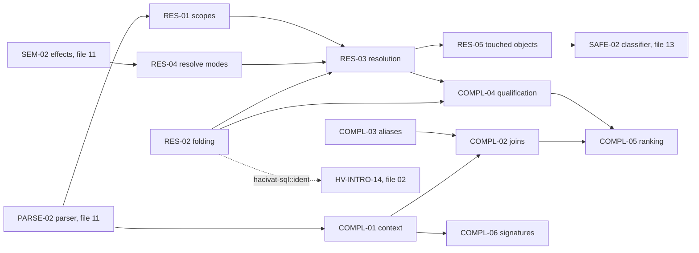

# 12 — SQL Completion, Scopes and Name Resolution (canonical algorithm catalog)

> Status: canonical, implementation-ready. Date: 2026-11-11. Part of `docs/research/algorithms/`.
> Global spec index, dependency map, crate layout (§0.4) and phased build order (§0.5) are in `10-sql-lexing-splitting-params.md` §0. This file owns SQL-RES-01..05 and SQL-COMPL-01..06.
> For implementation purposes it **supersedes**: ALG-SQL-COMP-01/02/03 and ALG-SQL-SEMA-01/02 (`clients/sql-tooling-04`); ALG-SQL-03/04/05/06/07/11 (`datagrip/06`); ALG-DBV-SQL-04/05 (`clients/dbeaver-03`); ALG-I18N-05 steps 3–6 (identifier folding, quoting, match keys; `i18n/02`); the object/column-reference parts of ALG-MCP-11 step 5 (`mcp/02`) and ALG-AUTHZ-03 step 3 (`access/05`). Those remain the evidence base.
> Verification overrides: `verification/01-db-behavior-tests.md` anchors #pg-turkish, #mysql-turkish, #sqlite-case, #mssql-turkish are binding for SQL-RES-02.
> Sibling catalogs: `02-introspection-and-metadata.md` — HV-INTRO-14 (identifier case folding for catalog keys) calls `hacivat-sql::ident` = SQL-RES-02; HV-MODEL-* provide the catalog snapshot consumed here.
> Clean-room: pseudocode ours. pgls (MIT), pgcli/mycli (BSD-3), sqls (MIT), lang-sql (MIT), rust-analyzer (MIT/Apache-2.0), DBeaver (Apache-2.0) cited by file:line in source docs; DataGrip (proprietary) behaviour described only; DataGrip `functions.xml` and minicat data are never copied.

## 0. This file at a glance

| ID | Name | Priority | Phase | Depends on |
|---|---|---|---|---|
| SQL-RES-01 | Scope builder | v1 | P2 | SQL-PARSE-02, SQL-RES-03 (relation lookups) |
| SQL-RES-02 | Identifier folding, quoting and match keys (locale-invariant, server-faithful) | v1 | P0 (functions) / P2 | SQL-LEX-04, connection context (HV-SESS-*) |
| SQL-RES-03 | Layered catalog and tri-state name resolution | v1 | P2 | SQL-RES-01, SQL-RES-02, SQL-RES-04 |
| SQL-RES-04 | Resolve modes (Script / Playground) and session simulation | v1 | P2 | SQL-SEM-02 |
| SQL-RES-05 | Touched-object extraction for authorization, audit and masking | v1 | P1 (PG via pg_query) / P2 (own tree) | SQL-RES-03, SQL-PARSE-01 |
| SQL-COMPL-01 | Completion context detection | v1 | P2 | SQL-PARSE-02 (Probe mode), SQL-SPLIT-02 |
| SQL-COMPL-02 | JOIN and ON-condition inference | v1 | P2 | SQL-COMPL-01, SQL-COMPL-03, SQL-RES-03 |
| SQL-COMPL-03 | Alias generation | v1 | P2 | SQL-RES-02, SQL-LEX-04 |
| SQL-COMPL-04 | Qualification and insertion policy | v1 | P2 | SQL-RES-02, SQL-RES-03 |
| SQL-COMPL-05 | Candidate ranking | v1 | P2 | SQL-COMPL-01..04 |
| SQL-COMPL-06 | Signature help and function catalog | v1.x | P3 | SQL-COMPL-01, SQL-SEM-03 |



### 0.1 Decisions in this file

| # | Decision | Rejected alternatives (reason) |
|---|---|---|
| R-01 | Context detection = marker identifier + tolerant reparse of the current statement + parser-recorded expected set; last-keyword heuristics only as fallback | DBeaver ATN simulation (needs ANTLR); pgcli/sqls last-token dispatch as primary (no scopes); tree-sitter lookahead + speculative validation (pgls; second grammar) |
| R-02 | Resolution is layered and tri-state (`Found / Missing / Unknown`); only `Missing` produces "unknown X" diagnostics | Binary found/not-found (false diagnostics after `DO`, dynamic SQL, missing snapshot) |
| R-03 | Identifier keys mirror the **server** (PG ASCII-only folding, MySQL simple lowercase for case-insensitive kinds, SQL Server collation incl. Turkic folding for `Turkish_*_CI_*`, SQLite ASCII, Oracle ASCII upper, ClickHouse exact) | Locale-aware or full Unicode folding (`İ` → `i̇`); NFC normalisation (servers compare bytes) |
| R-04 | Scope builder and resolver are pure functions in `sql-resolve` (Karagöz uses them without salsa) | Resolver only as salsa queries (D-10) |
| R-05 | JOIN suggestion tiers: real FK (incl. composite) > stored virtual FK > rule-based virtual FK > name heuristics; default operand order `existing.col = new.col` | DBeaver new engine single-column FKs only; DBeaver legacy by-name without `AND`; pgcli new-table-first order (DataGrip default and DBeaver recommendation both put the existing table first) |
| R-06 | Ranking = hard filters, then additive integer scores, then deterministic tiebreak; ML later on local data only | ML from day one (no training data, opaque) |
| R-07 | Function catalog is our own data, generated from server catalogs at runtime where possible plus a small curated core per dialect | Copying DataGrip `functions.xml` (proprietary) |

---

## 1. Name resolution

### SQL-RES-01: Scope builder

- **Sources merged:** `clients/sql-tooling-04` ALG-SQL-SEMA-01 and §3.4 (scope semantics checklist with dialect deltas); `datagrip/06` ALG-SQL-04 step 2–3 (scope tree, unqualified/qualified column search order, routine scopes, variable-vs-column precedence per dialect); `clients/dbeaver-03` ALG-DBV-SQL-04 (new engine: subqueries, CTEs, joins, LATERAL, USING, correlated scopes; parenthesised joins hide later sources); pgls `resolve/scope.rs:10-271` (Observed, links to PG `transformFromClauseItem`/`ExpandAllTables`).
- **Problem:** For a statement tree, build the lexical scope structure that says which names (relations, columns, CTEs, aliases, pseudo-rows, parameters, variables) are visible at each expression position, faithfully per dialect.
- **Inputs / outputs:** `(stmt: ast::Stmt, dialect: &DialectCtx, lookup: &dyn RelationLookup /* RES-03 */)` → `ScopeTree { levels: Arena<QueryLevel>, ctes: Arena<Cte>, expr_scope: fn(SyntaxNodePtr) -> (LevelId, ClauseKind), statement_ctx: StatementCtx }`.
- **Algorithm:**
  1. `build_query(node, parent_level)`:
     a. `WITH`: create CTE entries in order; body visible-CTE list = earlier CTEs (+ itself if `RECURSIVE` and the body is a set operation whose non-first branch references it — only inside the recursive term); build the body as a child level; columns = explicit column list, else body output names (first branch of set operations); data-modifying CTE → its `RETURNING` list.
     b. New `QueryLevel L { parent, ctes_visible = outer ∪ this WITH (inner shadows outer by name) }`.
     c. FROM clause **left to right** into a join tree: each item → `FromItem` (base relation via `lookup` — CTE names first, then catalog); derived tables / table functions become child levels whose parent is `L` **only if** `LATERAL` (or dialect-implicit lateral: PG function calls in FROM, T-SQL `CROSS/OUTER APPLY`) and then they see only items with `position < self.position`; otherwise their parent is `L.parent`.
     d. JOIN nodes: ON expressions get a join-local scope containing only the join's subtree items; `USING (cols)` adds `MergedColumn{name, from: [l, r], type: common}`; `NATURAL` merges the intersection of known column names (any side unknown → `flags.unknown_natural`); a parenthesised join with an alias (`(a JOIN b USING (x)) AS j`) hides `a`/`b` behind `j` (PG).
     e. Attach SELECT list, WHERE, GROUP BY, HAVING, WINDOW, QUALIFY, ORDER BY to `L` with per-clause visibility of output names (dialect table below); ORDER BY of a set operation: output names/positions of the first branch only.
     f. `output_names`: `expr AS alias` → alias; bare column → column name; function call → function name (PG) / expression text (MySQL) / no name (SQL Server); else `?column?` (PG); `*`/`t.*` expansion recorded lazily (merged columns first, then left, then right; system columns excluded).
     g. Expression subqueries (scalar, `EXISTS`, `IN`, `ANY/ALL`) → child levels with `parent = L` (correlation).
     h. Set operations: each branch its own level with the same parent.
  2. DML: `INSERT INTO t [AS a] (cols) source [ON CONFLICT … DO UPDATE SET … WHERE …] [RETURNING …]` — target `t`; source query built with `parent = None` (cannot see `t`); ON CONFLICT scope = `t` + name-only `excluded` (PG/SQLite) or MySQL `VALUES(col)`/row alias `AS new`; RETURNING scope = `t` + PG18 `old`/`new` name-only items (only when server ≥ 18). `UPDATE t [AS a] SET … FROM items WHERE … RETURNING …` — SET targets resolve only against `t`'s columns. `DELETE FROM t USING items …`. MySQL multi-table `UPDATE a JOIN b SET a.x=…`, `DELETE a FROM a JOIN b`; T-SQL `UPDATE alias SET … FROM t alias JOIN …`, `OUTPUT inserted.*, deleted.*`. `MERGE INTO t USING s ON …`: each `WHEN` branch gets a view — `MATCHED`: t+s; `NOT MATCHED [BY TARGET]`: s only; `NOT MATCHED BY SOURCE`: t only.
  3. DDL contexts: `CREATE TABLE … CHECK (expr)` → the table being defined; `CREATE INDEX ON t (expr)` → `t`; `CREATE POLICY … USING (expr)` → policy table; triggers/rules → `NEW`/`OLD` (MySQL `NEW.`/`OLD.`, SQL Server `inserted`/`deleted`, Oracle `:NEW`/`:OLD`); `CREATE VIEW v AS query` → normal query; `ALTER TABLE t ALTER COLUMN c TYPE x USING expr` → `t`.
  4. `StatementCtx`: routine parameters (by name and `$n`, function-qualified `f.p`), PL variables (PL/pgSQL, T-SQL `@vars`, MySQL locals), labels, cursors — consulted after query levels per the dialect precedence rule (step 5 of SQL-RES-03).
  5. `is_self_contained(level) -> bool` (for SQL-SPLIT-04): true iff no column/relation reference inside the level resolves to an outer level or a sibling CTE (CTE dependencies reported so the caller can include needed `WITH` items).
- **Data structures (Rust-like):**
  ```rust
  pub struct QueryLevel { parent: Option<LevelId>, ctes_visible: SmallVec<[CteId; 4]>, items: SmallVec<[FromItem; 4]>,
      merged: Vec<MergedColumn>, output_names: Vec<OutputCol>, output_visible_in: ClauseSet,
      name_only: SmallVec<[FromItem; 2]> /* excluded, old/new, inserted/deleted, NEW/OLD */,
      flags: LevelFlags /* unmodelled_items, unknown_natural */ }
  pub struct FromItem { alias: Option<Ident>, source: FromSource, columns: LazyCols /* Option<Arc<[ColumnInfo]>> */,
      schema_qualifier: Option<Ident>, lateral: bool, position: u32, join_node: JoinNodeId }
  pub enum FromSource { Table(RelId), Cte(CteId), Derived(LevelId), Function(FnRef), Values, Unknown }
  ```
- **Complexity:** O(statement size + Σ materialised columns); column lists loaded lazily (only for lookups and `*` expansion).
- **Decision:** PG semantics as baseline with table-driven dialect deltas; scope builder shared by completion, diagnostics, lint, SPLIT-04 and Karagöz (R-04). Rejected: lang-sql's "aliases after FROM until EndFrom" scan (no nesting, no clause awareness).
- **Verification status:** PG rules Observed (pgls scope model + PG source links); other dialects Inferred (vendor docs) → per-dialect table-driven tests against Docker servers (conformance C-R1).
- **Rust placement:** `sql-resolve::scope::{build_scopes, ScopeTree, is_self_contained}`; salsa wrapper `sql-sema::scopes`.
- **Per-dialect matrix (visibility deltas):**

| Rule | PostgreSQL | MySQL/MariaDB | SQL Server | SQLite | ClickHouse | Oracle |
|---|---|---|---|---|---|---|
| Select alias in ORDER BY | yes (bare name only, not inside expressions) | yes | yes | yes | yes | yes |
| Select alias in GROUP BY | yes (input column wins on conflict) | yes | no | yes | yes | no |
| Select alias in HAVING | no | yes | no | yes | yes | no |
| Select alias in WHERE | no | no | no | **yes** | yes [Inferred] | no |
| `USING`/`NATURAL` | yes | yes | no | yes | `USING` only | yes |
| Lateral | `LATERAL`, implicit for functions | `LATERAL` (8.0.14+) | `CROSS/OUTER APPLY` | no | `ARRAY JOIN` (special) | `LATERAL`, `CROSS APPLY` (12c+) |
| Derived table alias | optional ≥ 16 | required | required | optional | optional | optional |
| Comma join vs JOIN precedence | standard | comma lower than JOIN (`a, b JOIN c ON a.x` fails) | standard | standard | standard | standard |
| Upsert pseudo-row | `excluded` | `VALUES(c)` / `AS new` (8.0.19+) | MERGE only | `excluded` | — | MERGE only |
| RETURNING | yes (+`old`/`new` ≥ 18) | MariaDB `RETURNING` (DELETE/INSERT) | `OUTPUT inserted/deleted` | yes (≥ 3.35) | — | `RETURNING INTO` (PL/SQL) |
| System columns | `ctid xmin xmax cmin cmax tableoid` | — | — | `rowid oid _rowid_` unless shadowed | `_part`, virtual columns | `ROWID`, `ROWNUM` |
| Variable vs column conflict | PL/pgSQL error (`variable_conflict`) | locals shadow columns [Inferred] | `@` vars lexically distinct | — | — | column wins (misleading-reference warning) |

- **i18n notes:** names stored exact + folded key (SQL-RES-02); no locale casing.
- **Edge cases (exhaustive):** CTE named like a real table (CTE wins); CTE referenced before definition (error, still resolvable as table); recursive CTE self-reference in the non-recursive term (error); nested WITH in subqueries; CTE column list shorter/longer than body outputs (error, list used); derived table without alias; duplicate aliases at one level (`DuplicateAlias`; resolution ambiguous); alias shadowing a table name (`FROM users AS orders` → `users.` no longer valid in PG); same table twice without alias; parenthesised joins with alias; `NATURAL JOIN` without common columns (cross join); `USING` column missing on one side; LATERAL referencing a right-side item (error); `SELECT` without FROM; top-level `VALUES`; `TABLE t`; `SELECT … INTO`; window `PARTITION BY` using an output alias (PG: not allowed); `GROUP BY 1`; alias inside an ORDER BY expression (PG: not allowed); correlated reference where an outer alias equals an inner column name (inner wins); set-returning functions in SELECT list; unknown function in FROM (columns Unknown); whole-row reference (`SELECT t FROM t`).
- **Test cases:** `SELECT a.x FROM t a JOIN u b USING (id) WHERE id = 1` → `id` = merged column; `SELECT * FROM t, LATERAL (SELECT t.x) s` → resolves; without LATERAL → `MissingFromEntry` (certain); `WITH RECURSIVE r(n) AS (SELECT 1 UNION ALL SELECT n+1 FROM r) SELECT n FROM r` → resolves; `SELECT x AS y FROM t ORDER BY y` → ok; `… WHERE y > 0` → error in PG, ok in SQLite; `MERGE … WHEN NOT MATCHED THEN INSERT VALUES (t.id)` → `t` hidden → error; `INSERT INTO t SELECT t.x FROM u` → error; `UPDATE t SET x = u.y FROM u WHERE t.id = u.id` → resolves; `SELECT (SELECT t.x FROM u) FROM t` → outer; DBeaver `select * from (x left join y on (x1 = y1)) left join x xx(xx1, xx2) on (…)` → inside the first ON only `x1, x2, y1, y2` visible, not `xx.xx1`; `is_self_contained` false for FX-CARET-01 innermost subquery (refs `c.id` and CTE `recent`), true for the CTE body.
- **Used by:** Hacivat | Karagöz (via RES-05).

### SQL-RES-02: Identifier folding, quoting and match keys (locale-invariant, server-faithful)

- **Sources merged:** `i18n/02` ALG-I18N-05 steps 3–6, edge cases 2–6, 10–20, tests 4–14, 17–18; `clients/sql-tooling-04` §3.5 identifier matching rules and §6; `clients/sql-tooling-02` §6 (Turkish casing); `datagrip/06` ALG-SQL-04 step 6 and §6; `mcp/02` ALG-MCP-11 step 5 (engine-exact folding of function names; `PG_READ_FİLE` is not `pg_read_file`).
- **Problem:** Compute, for any identifier, (a) the name the server stores/looks up for an unquoted spelling, (b) a cache/lookup key that compares exactly as the server compares, (c) whether generated SQL must quote it, and (d) the quoted form — all independent of the process locale and UI language, but faithful to server collations (including Turkish ones).
- **Inputs / outputs:** `IdentCtx { dialect, encoding_single_byte (PG), lower_case_table_names: 0|1|2 (MySQL), db_collation, instance_collation (SQL Server), max_bytes, reserved: &KeywordTable }`, `(text, quoted: bool, kind: ObjKind)` → `fold_unquoted(text) -> Folded::Exact(String) | Folded::ServerDependent`; `match_key(text, quoted, kind) -> IdentKey`; `needs_quoting(name, position) -> bool`; `quote(name) -> String`.
- **Algorithm:**
  1. **fold_unquoted:** PG — bytes `A–Z` → `a–z`; bytes ≥ 0x80 kept in multibyte encodings (UTF-8), `ServerDependent` in single-byte encodings (server `tolower()` under its `LC_CTYPE`); truncate to 63 bytes at a character boundary (+ notice `Truncated`). Oracle — ASCII `a–z` → `A–Z`; non-ASCII `ServerDependent` [Unknown]. MySQL, MariaDB, SQL Server, SQLite, ClickHouse — no folding on creation (`Exact`).
  2. **match_key:** PG — quoted → exact; unquoted user input → `fold_unquoted` (`ServerDependent` → ask the server once via `SELECT $1::regclass`/`quote_ident` round trip, cache); catalog names are already folded → key = name. SQLite — ASCII-lowercase only (non-ASCII compared exactly). MySQL/MariaDB — tables/databases: `lower_case_table_names = 0` → exact; `1|2` → per-character **Unicode simple lowercase** (UnicodeData simple mapping: `İ`→`i`, `ı`→`ı`, `I`→`i`; never Rust `char::to_lowercase`, which maps `İ` to two code points); columns, routines, indexes, aliases → same simple lowercase. SQL Server — from the effective collation (database collation for objects; **instance** collation for variables and `#temp`/tempdb objects): `*_CS_*`/`*_BIN*` → exact; `Turkish_*_CI_*`/`Azeri_*_CI_*` → Turkic simple fold (`I`→`ı`, `İ`→`i`, via ICU4X `fold_turkic`); other `*_CI_*` → Unicode simple lowercase; `_AI` → additionally strip diacritics (NFD, drop Mn). Oracle — quoted exact, unquoted ASCII upper. ClickHouse — exact. Collation unknown → exact (never wrong matches; may cost extra lookups).
  3. **needs_quoting:** PG — quote if empty, `fold_unquoted(name) != Exact(name)`, `ServerDependent`, first char not `[a-z_]`∪non-ASCII letter, any char outside `[a-z0-9_$]`∪non-ASCII letters, reserved/type-function keyword for the position (SQL-LEX-04 categories; e.g. `user` reserved), or bidi/invisible characters (always quote + warn). SQL Server — `[]` if not a regular identifier (`[A-Za-z_@#][A-Za-z0-9_@#$]*` + Unicode letters) or reserved; always emit the exact catalog case. MySQL/MariaDB — backticks if not `[A-Za-z0-9_$]`+non-ASCII letters, all digits, or reserved. SQLite — if not `[A-Za-z_][A-Za-z0-9_]*` or keyword. Oracle — if `fold_unquoted(name) != name` or invalid nonquoted. ClickHouse — if not `[A-Za-z_][A-Za-z0-9_]*`.
  4. **quote:** double the quote character inside (`"`→`""`, `]`→`]]`, `` ` ``→``` `` ```); never change case. Empty names and NUL-containing names are rejected before SQL generation (PG `""` is a zero-length delimited identifier error).
  5. **Server-side SQL hygiene (binding for introspection and completion queries, HV-INTRO-*):** never apply `lower()`/`upper()`/`ILIKE` to identifiers in SQL sent to the server; filter case-insensitively on the client with this module, or compare under `COLLATE "C"` (PG). SQL Server catalog queries use the canonical case of system objects (`INFORMATION_SCHEMA.TABLES`, `sys.objects`).
- **Data structures:** `IdentKey(Box<str>)` newtype (constructible only via `match_key`); `IdentCtx` captured at connect (PG `server_encoding`; MySQL `@@lower_case_table_names`; SQL Server `DATABASEPROPERTYEX(DB_NAME(),'Collation')` per database switch + `SERVERPROPERTY('Collation')`).
- **Complexity:** O(n) per identifier; no allocation for ASCII keys ≤ 64 bytes (inline buffer); keys for catalog names computed once per metadata load.
- **Decision:** server-faithful keys (R-03). Rejected: locale-aware casing (DBeaver #40901: `items` cached under `İTEMS` on a Turkish JVM); full Unicode case folding (MySQL keeps `İ`≠`I` under simple *folding* but matches under simple *lowercase*, Docker-verified); NFC normalisation.
- **Verification status:** **Docker-verified**: PG ICU `tr-TR` database folds unquoted identifiers ASCII-only (`ITEMS`→`items`, `MÜŞTERİ`→`mÜŞterİ`), `lower(relname) = lower('ITEMS')` returns 0 rows and `'ITEMS' ILIKE 'items'` is **false** there (#pg-turkish); MySQL `utf8mb4_tr_0900_ai_ci`: `FROM items` fails against table `Items` with lctn=0, columns `İD` matches `ID`, `MÜŞTERİ` matches `Müşteri`, `ıd` and `MUSTERI` do not, `LOWER/UPPER` are not Turkish-tailored, `I_S.TABLES.TABLE_NAME` is `utf8mb3_bin` (case-sensitive) (#mysql-turkish); SQLite identifiers, `LIKE`, `upper`, `lower` ASCII-only (#sqlite-case); SQL Server `Turkish_CI_AS`: `information_schema.tables` fails, `ID`≠`id`, `İTEMS` matches `items`, `@ID`/`#temp` follow the **instance** collation (#mssql-turkish). Oracle non-ASCII folding Unknown.
- **Rust placement:** `sql-resolve::ident::{IdentCtx, fold_unquoted, match_key, needs_quoting, quote}`, re-exported as `hacivat-sql::ident` (used by HV-INTRO-14, HV-DDL-*, SQL-COMPL-03/04, SQL-SAFE-03 name matching, MCP masking normaliser). Simple-lowercase table generated from UnicodeData at build time (no runtime ICU dependency except `icu_casemap` for `fold_turkic`).
- **Per-dialect matrix:**

| Dialect | Unquoted folding | Key for comparisons | Quote char |
|---|---|---|---|
| PostgreSQL | ASCII lower (UTF-8); single-byte encodings server-dependent; 63-byte truncation | quoted exact / unquoted folded | `"` |
| MySQL/MariaDB | none | tables & DBs per `lower_case_table_names`; columns/routines/indexes simple lowercase | `` ` `` |
| SQL Server | none | collation: CS/BIN exact; Turkish/Azeri CI Turkic fold; other CI simple lowercase; AI strip diacritics; variables/temp use instance collation | `[ ]` (or `"`) |
| SQLite | none | ASCII lowercase | `"` |
| ClickHouse | none | exact | `` ` `` or `"` |
| Oracle | ASCII upper | quoted exact / unquoted upper | `"` |

- **i18n notes:** this spec *is* the SQL-side i18n rule: process locale `tr_TR.UTF-8` and `C` must give identical results (property test under both); bidi/invisible characters in identifiers are always quoted and flagged (Trojan Source class, `i18n/02` §2.17); non-NFC identifiers kept byte-exact with a "not NFC" badge in the UI.
- **Edge cases (exhaustive):** `İ`/`ı` in unquoted PG identifiers (UTF-8 → preserved); same in `LATIN5` (→ ServerDependent); 63-byte boundary with a 2-byte char (64 bytes → whole char dropped); `"Users"` vs `users` (PG distinct); SQL Server CS vs CI; Turkish SQL Server `ITEMS` vs `items` (distinct) and `İTEMS` vs `items` (same); keyword look-alikes; `select` needs quoting; `""` rejected; `a"b` → `"a""b"`; NUL rejected; non-NFC from server; MySQL lctn=2 (macOS); MySQL `Ünvan` vs `ünvan` (same column key); SQLite `ÄBC` vs `äbc` (different); Oracle `"items"` vs `items` (different); `Turkish_CI_AI` (`ş`~`s`); unknown collation (exact).
- **Test cases:**

| # | Function / dialect / ctx | Input | Expected |
|---|---|---|---|
| 1 | fold_unquoted PG UTF-8 | `ITEMS` | `items` |
| 2 | fold_unquoted PG UTF-8 | `MÜŞTERİ` | `mÜŞterİ` |
| 3 | fold_unquoted PG UTF-8 | `İd` | `İd` |
| 4 | fold_unquoted PG LATIN5 | `İd` | ServerDependent |
| 5 | needs_quoting PG | `items` / `Items` / `müşteri` / `user` / `select` / `2fa` | false / true / false / true / true / true |
| 6 | quote PG | `a"b` | `"a""b"` |
| 7 | match_key MySQL column | `İD` vs `ID`; `ıd` vs `ID`; `MÜŞTERİ` vs `Müşteri`; `MUSTERI` vs `Müşteri` | equal; different; equal; different (Docker #mysql-turkish) |
| 8 | match_key MySQL table lctn=0 | `items` vs `Items` | different |
| 9 | match_key SQLite | `ÄBC` vs `äbc`; `ITEMS` vs `items` | different; equal |
| 10 | match_key SQL Server `Turkish_CI_AS` | `ITEMS` vs `items`; `İTEMS` vs `items` | different; equal |
| 11 | match_key SQL Server `Latin1_General_CI_AS` / `_CS_AS` | `ITEMS` vs `items` | equal / different |
| 12 | match_key SQL Server variable, instance `Turkish_CI_AS` | `@ID` vs `@id` | different (Docker) |
| 13 | anti-test Rust `to_lowercase` | `İd` | `i̇d` (3 chars) — forbidden in this module |
| 14 | truncation PG | 62×`a` + `ş` (64 bytes) | 62×`a` + notice |
| 15 | introspection hygiene (lint over our SQL files) | any `lower(relname)` / `ILIKE` on identifiers in `hacivat-meta` query sets | CI failure |

- **Used by:** Hacivat | Karagöz (classifier name matching, object policies) | Perde (policy rules matching object names use the same key rules, evaluated at Karagöz).

### SQL-RES-03: Layered catalog and tri-state name resolution

- **Sources merged:** `clients/sql-tooling-04` ALG-SQL-SEMA-02 and §3.5 (layers, identifier rules), §2.11 (catalog snapshot model), §7 (stale snapshots, privilege filtering); `datagrip/06` ALG-SQL-04 steps 3–7 and §2.6 (live model → shipped system catalogs → in-file DDL → DDL data sources; overload matching); pgls `lookup.rs:13-23` (tri-state), `catalog/overlay.rs`, `snapshot/search_path.rs` (Observed).
- **Problem:** Resolve a `NameRef` path (1–4 parts) of an expected kind at a scope position to a definition with a certainty level, honouring dialect folding, search paths, overloads and layered catalogs.
- **Inputs / outputs:** `(path: [NamePart{text, quoted}], kind: Relation | Column | Function{arg_types?} | Type | Schema | Sequence | Index | Role | Setting | Database, pos, &ScopeTree, &StmtContext{catalog_view, search_path, …}, &IdentCtx)` → `Lookup<Resolved> = Found(Def{id, kind, layer, ambiguity: Vec<Def>}) | Missing(reason) | Unknown(reason)`.
- **Layers (consulted in order; first `Found` wins; an `Unknown` on the path turns a later miss into `Unknown`):**
  1. Local query scope (FROM items, CTEs, outer levels) — SQL-RES-01.
  2. Statement context (trigger `NEW/OLD`, routine parameters, PL variables).
  3. Session state (temp objects, `search_path`, current database, attached SQLite schemas, Oracle current schema) — real session (Hacivat-tracked) or simulated (Script mode, SQL-RES-04).
  4. File DDL before the statement (`CatalogDelta`s from SQL-SEM-02; drop = tombstone, unmodelled = `Unknown` namespace).
  5. Live snapshot (introspected, per connection; HV-INTRO-*).
  6. Built-ins (versioned data: PG `pg_catalog` objects, MySQL/T-SQL system functions, SQLite built-ins; generated from server catalogs where possible — never DataGrip minicat).
- **Algorithm:**
  1. Keys: `match_key` per part (SQL-RES-02).
  2. **Columns** (`[c]`, `[q, c]`, `[s, t, c]`, `[db, s, t, c]`): walk levels innermost → outermost. Qualified: items whose alias = `q` (or, unaliased, base name = `q` with optional schema `s`); none → continue outward; found with known columns → `Found`/`Missing`; columns unknown → `Unknown`. Unqualified: merged columns first; then items with known columns containing `c`; 1 match → `Found`; > 1 → `Found` + ambiguity (`AmbiguousColumn`); 0 and any item at this level has unknown columns or `unknown_natural` → `Unknown` (stop: the unknown item might define it); 0 otherwise → continue outward. Clause-specific output names per SQL-RES-01 table in the dialect's preference order (PG ORDER BY: output name first; GROUP BY: input column first). Name-only items (`excluded`, `old`, `new`, `NEW`, `OLD`, `inserted`, `deleted`) only when qualified. Whole-row (PG): unqualified name equal to an item alias with no such column → `Found(WholeRow)`. Exhausted → statement context (precedence per dialect, SQL-RES-01 matrix) → finally `Missing` unless any `Unknown` was met.
  3. **Relations** (`[t]`, `[s, t]`, `[db, s, t]`): unqualified → visible CTEs (innermost first); then the dialect search order — PG: `pg_temp` (relations/types only) → `search_path` entries (`$user` expanded, nonexistent schemas skipped) with `pg_catalog` implicitly first unless listed; MySQL/MariaDB: current database; SQL Server: user's default schema → `dbo`; SQLite: `temp` → `main` → attached in order; Oracle: current schema → private synonyms → public synonyms (loop guard); ClickHouse: current database. Per schema consult file delta then snapshot (delta create/drop/rename override; `Unknown` marker → `Unknown`). Qualified → only that schema/db; unknown schema → `Missing` unless the schema list itself is `Unknown`. 4-part SQL Server / Oracle `@dblink` → `Unknown` (remote).
  4. **Functions:** collect candidates by name across the search path (PG: overloads across schemas compete by search-path order then best match); with known argument types (SQL-SEM-03) apply dialect overload rules (later); else `Found` with all candidates (completion shows overloads, signature help ranks them).
  5. Types, sequences, indexes, roles, schemas, settings: namespace lookups with the same layer rules.
  6. Privilege filter (Karagöz-backed connections): objects the effective principal cannot access are absent from the snapshot Karagöz serves (recommended default; product decision RQ-1).
- **Data structures:** `trait CatalogView { fn relation(&self, schema: &IdentKey, name: &IdentKey) -> Lookup<RelRef>; fn columns(&self, rel: RelRef) -> Lookup<Arc<[ColumnInfo]>>; fn functions(&self, schema: &IdentKey, name: &IdentKey) -> Lookup<Arc<[FnSig]>>; fn schemas(&self) -> Lookup<…>; … }`; implementation = persistent overlay chain (`rpds` maps) `builtins ⊕ snapshot ⊕ session_delta ⊕ file_deltas[0..i]`, name indices per namespace keyed by `IdentKey`. Catalog snapshot model (from HV-MODEL-*): schemas; relations (table/view/matview/foreign/partitioned/temp) with columns (type, nullability, default, generated/identity, PK/FK membership, comment); functions (signature, return type, kind normal/aggregate/window/procedure, volatility, language, set-returning, security definer); types/domains/enums (+ labels); sequences; indexes; constraints (FK column pairs); roles; settings; extensions; search_path.
- **Complexity:** column lookup O(levels × items) with per-level hash indices; relations O(|search_path|).
- **Decision:** layered tri-state resolver with persistent overlays (R-02). Rejected: re-querying the server per reference (latency, privileges, offline mode); DataGrip-style shipped proprietary system catalogs (we generate our own built-ins from server catalogs/docs).
- **Verification status:** Observed (pgls lookup, overlay, search_path; DataGrip resolve modes and layers in help); PG `search_path`/`pg_temp`/`pg_catalog` semantics Inferred (docs) → conformance C-R2.
- **Rust placement:** `sql-resolve::resolve::{resolve_name, Lookup}`, `sql-catalog::{CatalogView, OverlayView, Catalog}`; salsa wrapper `sql-sema::resolve`.
- **Per-dialect matrix:** search order (step 3); 3/4-part names: PG `db.schema.table.column` (db must equal current), SQL Server `server.db.schema.obj` (server part → Unknown/egress), MySQL `db.table.column`, ClickHouse `db.table`, Oracle `schema.obj@link`; overloads: PG yes, SQL Server no (procedures by name), MySQL no, Oracle packages yes (later).
- **i18n notes:** keys per SQL-RES-02; hover shows the layer a resolution came from ("from file DDL above", "from session", "from live schema", localized).
- **Edge cases (exhaustive):** quoted vs unquoted same text; PG > 63-byte identifiers; Oracle quoted lowercase; MySQL lctn=1 with mixed-case DDL in the file; SQL Server CS collation; ClickHouse case; schema named like an alias in scope (`s.t`: column context → alias `s` column `t`; relation context → schema `s`); 3/4-part refs; `search_path` with nonexistent schemas; `$user`; `pg_temp_N`; objects created in a file transaction later rolled back (SQL-SEM-02 → Unknown); `DROP … IF EXISTS`; `ALTER … RENAME`; `CREATE OR REPLACE VIEW` changing columns; `ADD COLUMN IF NOT EXISTS`; inheritance/partitions (children have parent's columns); invalid views (columns from snapshot); `SETOF record` without column list (Unknown); polymorphic functions; `SET LOCAL search_path` in a file transaction; synonym chains; DB links (Unknown); MySQL cross-database `db.table`; SQLite DB attached in the file but not in the session (Unknown).
- **Test cases:** PG `search_path = app, public`, tables `public.users`, `app.users` → `users` = `app.users`; file has `DROP TABLE app.users;` before → `public.users`; `"Users"` with only `users` → Missing; Oracle `select * from users` with `USERS` → Found; MySQL lctn=0 table `Users`, query `users` → Missing (Docker #mysql-turkish shows the server rejects too); after `DO $$…$$;` → unknown relations Unknown (no diagnostic); `SELECT id FROM a, b` both with `id` → AmbiguousColumn (DataGrip corpus INSP-02); `SELECT x FROM f()` where `f` returns `record` → Unknown; `SELECT nope FROM customers` → Missing → diagnostic (INSP-01); DataGrip corpus Playground/Script examples (SQL-RES-04 tests).
- **Used by:** Hacivat | Karagöz.

### SQL-RES-04: Resolve modes (Script / Playground) and session simulation

- **Sources merged:** `datagrip/06` §2.5 and ALG-SQL-04 step 1 (Playground default for consoles, Script default for files; Script applies `USE`, `SET search_path`, DDL earlier in the file); `clients/sql-tooling-04` §3.5 layer 3 and §7 open question (show resolution source in hover); `clients/sql-tooling-03` ALG-SQL-PARSE-03 (`effective_catalog(file, index)`).
- **Problem:** Decide whether earlier statements in the same document affect resolution of later ones, and with which session context, in a way users can predict.
- **Inputs / outputs:** `(FileSettings.resolve_mode, SessionState of the attached connection, stmt_effects of statements 0..i)` → `StmtContext` for statement `i`.
- **Algorithm:**
  1. **Playground:** every statement uses the attached connection's real session context (search_path/current db as tracked by Hacivat after executions) and the live snapshot; file DDL is ignored.
  2. **Script:** start from the connection's session context (or the file's configured default context when detached); fold `stmt_effects` of statements `0..i` in order: catalog deltas into the overlay; session deltas (`SET search_path`, `USE`, `ALTER SESSION SET CURRENT_SCHEMA`, psql `\c`, `ATTACH`) into the simulated session; transaction scoping per SQL-SEM-02 step 4.
  3. Every resolution records its source layer; hover shows it.
  4. Executing a statement in Hacivat updates the *real* session state (temp objects, search_path, current db) and triggers a targeted catalog refresh after successful DDL (HV-INTRO-*), regardless of mode.
- **Data structures:** `ResolveMode { Playground, Script }`; `StmtContext` (SQL-SEM-01).
- **Decision:** defaults Playground for consoles, Script for files (DataGrip defaults), switchable per file/console. Product decision RQ-2 confirms defaults.
- **Verification status:** Observed (DataGrip help `query-consoles`); semantics of session statements Inferred.
- **Rust placement:** `sql-resolve::context::fold_effects`; salsa query `sql-sema::context_before`.
- **Per-dialect matrix:** session statements per dialect as listed in SQL-SEM-02.
- **i18n notes:** mode names and hover source labels via Fluent.
- **Edge cases:** detached file (no connection) in Script mode (syntax + file DDL only); switching connection (contexts recomputed); script with `\c otherdb` (psql) mid-file (context switches database; snapshot of that database used if available, else Unknown); `SET search_path` inside a function body (child document, not folded).
- **Test cases:** Playground: `SET search_path TO information_schema; SELECT * FROM actor;` → `actor` resolves to `public` (default context); Script: same → `actor` unresolved (`information_schema.actor` missing) — DataGrip ALG-SQL-04 test; Script: `CREATE TABLE t(a int); SELECT a FROM t;` → resolves against overlay even if the DB lacks `t`; corpus COMPL-49 (Script) offers `a`, COMPL-50 (Playground) does not.
- **Used by:** Hacivat.

### SQL-RES-05: Touched-object extraction for authorization, audit and masking

- **Sources merged:** `clients/sql-tooling-04` §2.12, §5.3 (`touched_objects`, conservative unknown, views as objects); `mcp/02` ALG-MCP-11 step 5 (object references with roles, CTE scoping, column references with position kinds, write data-flow) and ALG-MCP-10 step 8 (object rules); `access/05` ALG-AUTHZ-03 step 3 (fully qualified objects resolved with `search_path`/default DB) and §2.18 (masking lineage, fail closed); `clients/sql-tooling-05` ALG-SQL-SAFE-01 step 7 (reads/writes/calls sets).
- **Problem:** For a statement, compute the set of database objects it reads, writes and calls, and the columns it references with their syntactic role, conservatively, as input to object-level authorization (Karagöz), AI tool policy (MCP), audit, and result masking.
- **Inputs / outputs:** `(parsed statement (own strict tree, or libpg_query tree for PG in P1), DialectCtx, pinned session context {search_path, current_db}, optional CatalogView)` → `TouchedObjects { reads: Set<ObjRef>, writes: Set<ObjRef>, calls: Set<FnRef>, columns: Vec<ColRef{obj: Option<ObjRef>, name, role: ProjectionDirect | ProjectionExpression | Predicate | Join | GroupOrder | AggregateCount | NullTest | WriteTarget}>, unresolved: Vec<NameRef>, unknown: bool, reads_other_tables_in_write: bool }`.
- **Algorithm:**
  1. Walk **every** node (generated exhaustive visitor; a unit test asserts the visitor reaches every node kind present in the corpus — CVE-2026-85620 lesson: Postgres MCP Pro's walker descended only one level into lists and missed a FROM-clause function, `02-external-fact-check` P4/P5).
  2. Relation references: CTE names are scoped (not catalog objects); others resolved with SQL-RES-03 using the **pinned** session context (never the user-controllable one). Roles: write targets (INSERT/UPDATE/DELETE/MERGE/TRUNCATE targets, COPY FROM target, SELECT INTO/CREATE AS target, `INSERT INTO FUNCTION`) → `writes`; everything else → `reads`.
  3. Unresolved relation (no catalog, or `Unknown`) → recorded in `unresolved` with its textual qualified name; `unknown = true` when resolution is `Unknown` (dynamic SQL, unmodelled statements, remote/4-part names, functions returning unknown rowtypes).
  4. Function calls anywhere (target list, FROM/LATERAL, WHERE, ON, GROUP/HAVING/ORDER, window, VALUES, defaults, CHECK, index expressions, RETURNING) → `calls` with schema resolved by engine-exact folding (SQL-RES-02); implicit calls (operators/casts implemented by user functions) added when the catalog resolves them (SQL-SAFE-03).
  5. Columns with role kinds (for strict masking, ALG-MCP-16 / ALG-MASK-01): `*` expanded via the catalog when available (else `ProjectionDirect` on all columns of the item, marked unknown list).
  6. Views are objects in their own right (matches DB privilege model); optional view expansion for function assessment only (SQL-SAFE-03).
  7. `reads_other_tables_in_write` = a DML/DDL statement reads relations other than its target (INSERT … SELECT, UPDATE … FROM/subquery, CREATE TABLE AS).
- **Data structures:** `ObjRef { db: Option<IdentKey>, schema: Option<IdentKey>, name: IdentKey, kind_hint, display: String /*exact spelling*/ }`; `FnRef { schema, name, arity }`.
- **Decision:** conservative extraction; anything unknown ⇒ policy assumes "may touch anything" (deny for object-scoped grants). Rejected: textual regex extraction (bypassable); trusting client-sent object lists (Karagöz re-derives everything).
- **Verification status:** CVE/visitor lesson Confirmed (`02-external-fact-check` P4/P5); Docker-verified relevant facts: `postgres_fdw` foreign tables reach a remote server (#pg-ro-escapes) → foreign-table objects carry `kind_hint = Foreign` and imply `ExternalNetwork` in SQL-SAFE-02; MongoDB cross-database `$out` with mixed roles (#mongo-read) is the NoSQL analogue handled in HV-NOSQL-*.
- **Rust placement:** `sql-resolve::touched::{touched_objects, TouchedObjects}`; PG P1 path `sql-oracle-pg::touched` (from libpg_query `RangeVar` contexts + `FuncCall`), cross-checked against the own-tree path from P2.
- **Per-dialect matrix:** write-target constructs: PG (INSERT/UPDATE/DELETE/MERGE/COPY FROM/SELECT INTO/CREATE TABLE AS/TRUNCATE), MySQL/MariaDB (+REPLACE, multi-table UPDATE/DELETE, LOAD DATA, `INTO OUTFILE` = file), SQL Server (+`SELECT INTO #t`, OUTPUT INTO, BULK INSERT), SQLite (+UPSERT, `INSERT OR REPLACE`), ClickHouse (`INSERT INTO`, `INSERT INTO FUNCTION`, `ALTER … DELETE/UPDATE`), Oracle (+MERGE, `@link` targets).
- **i18n notes:** object names kept byte-exact; display uses exact spelling, keys use SQL-RES-02.
- **Edge cases:** CTE shadowing a table name; data-modifying CTE targets; `EXPLAIN` (inner statement's objects recorded, marked `explain_only` unless ANALYZE); `COPY (query) TO STDOUT`; set-returning functions as tables; `TABLE t`; views referencing denied tables (dependency resolution optional; residual risk documented in MCP ALG-16); synonyms; temp tables; `search_path` changed inside the same request (impossible: single statement + pinned path); four-part names (unknown + egress).
- **Test cases:** `SELECT * FROM auth.users` → reads {auth.users} (MCP test: deny rule `auth.*` → PERMISSION_DENIED); `WITH d AS (DELETE FROM t RETURNING *) SELECT * FROM d` → writes {t}; `INSERT INTO a SELECT * FROM b` → writes {a}, reads {b}, `reads_other_tables_in_write`; `SELECT x FROM t, LATERAL pg_catalog.pg_ls_dir('.') d` → calls {pg_catalog.pg_ls_dir}; `SELECT * FROM unknown_t` without catalog → unresolved {unknown_t}; `SELECT * FROM [srv].[db].[dbo].[t]` → unknown + remote; `TABLE secrets;` → reads {secrets}.
- **Used by:** Karagöz (authoritative object policy, audit, masking) | Hacivat MCP broker | Hacivat (badges, approval cards) | Perde (renders recorded objects; never computes them).

---

## 2. Completion

### SQL-COMPL-01: Completion context detection

- **Sources merged:** `clients/sql-tooling-04` ALG-SQL-COMP-01 and §3.1–3.3 (technique comparison, pgls sanitisation/filtering, pgcli taxonomy); `datagrip/06` ALG-SQL-03 (dummy identifier, expected tokens, expected type, edge cases); `clients/dbeaver-03` ALG-DBV-SQL-04 (legacy previous-keyword table as fallback; new engine expected-slot booleans; tests).
- **Problem:** Given a document and a caret offset, determine the syntactic role(s) of what is being typed, the replace range, the qualifier path, the expected keyword set, and the scope anchor — robustly on incomplete SQL.
- **Inputs / outputs:** `(file, offset, trigger: Option<char>)` → `CompletionContext { stmt: StmtKey, replace_range, typed_prefix, quote: Option<QuoteKind>, qualifier: SmallVec<[NamePart; 3]>, roles: SmallVec<[Role; 4]>, expected_keywords: KwSet, clause: ClauseKind, in_invocation: Option<FnCallInfo{name, arg_index, named_arg}>, scope_anchor: SyntaxNodePtr }`, `Role ∈ { RelationRef{allowed_kinds}, ColumnRef, QualifiedColumnRef, FunctionName{allowed: Scalar|Aggregate|Window|SetReturning|Procedure}, TypeName, SchemaName, DatabaseName, RoleName, SettingName, IndexName, ConstraintName, SequenceName, NewName, AliasDef, EnumLiteral{type}, Keyword, ParamName, FileOrPath }`.
- **Algorithm:**
  1. Find the statement item containing `offset` (or the preceding one if `offset` is in trailing trivia on the same line). Inside a comment → none (unless executable comment: complete as SQL on its nested tokens, SQL-LEX-05). Inside a string literal → only `EnumLiteral` (string compared/assigned to an enum/`SET`-typed column; mycli does this for MySQL ENUM) or `FileOrPath` (COPY/`\i`), else none. Inside a dollar body → recurse into the child document (SQL-PARSE-05).
  2. **Identifier part at caret** using the dialect `ident_continue` predicate; an unclosed opening quote of the dialect before it → `quote = Some(kind)`; replace range = part start (including the opening quote) to the end of the identifier part right of the caret.
  3. **Qualifier path:** walk left over `.` and preceding name parts (quoted or not; whitespace around dots allowed) → `[db?, schema?, table?]`.
  4. **Marker parse:** `text' = stmt[..part_start] + MARKER + stmt[part_end..]` with `MARKER = "hacivat_c0mpl3t10n_mark"` (valid unquoted identifier in every dialect, never a keyword), or `MARKER + closing_quote` when a quote is open. Parse with SQL-PARSE-02 in `Probe{marker_index}` mode → tree + `expected_at_marker`.
  5. **Roles from the marker's ancestors:** `NAME_REF` under FROM item / JOIN / UPDATE target / INSERT INTO / DELETE FROM / TRUNCATE / LOCK / ALTER TABLE / DROP TABLE → `RelationRef` (+ `SchemaName` if unqualified; + `FunctionName{SetReturning}` in FROM); `COLUMN_REF` in an expression → `ColumnRef` + `FunctionName{per clause}` + `Keyword` + `ParamName`; qualified → `QualifiedColumnRef`; `TYPE_NAME` (after `::`, `CAST(… AS`, column definitions) → `TypeName` + `SchemaName`; alias/new-name positions (after `AS`, `CREATE TABLE <name>`, column-definition names) → `AliasDef`/`NewName` (no item completion; keywords only if a prefix was typed); `INSERT INTO t (` → `ColumnRef` restricted to `t` minus already listed columns; `USING (` → columns common to both sides; `SET <name>`/`RESET`/`SHOW` (PG) → `SettingName`; `SET ROLE`/`GRANT … TO` → `RoleName`; `USE` → `DatabaseName`; inside a call's argument list → `in_invocation` (name + arg index by counting top-level commas; named args `=>`).
  6. **Clause kind:** nearest ancestor clause (`SELECT_LIST`, `FROM`, `JOIN_ON`, `WHERE`, `GROUP_BY`, `HAVING`, `ORDER_BY`, `SET_CLAUSE`, `VALUES`, `RETURNING`, `MERGE_WHEN{branch}`, `DDL_COLUMN_DEF`, …).
  7. **Keywords:** `expected_at_marker` ∩ dialect keywords; drop statement-start keywords unless at statement start; drop noisy keywords (`AND OR AS LIKE IN IS NOT`) unless a prefix is typed.
  8. **Fallback** (marker inside `ERROR`/`UNKNOWN_STMT`, empty expected set, or no parser for the dialect yet): previous significant keyword(s) before the part: `FROM|JOIN|INTO|UPDATE|TABLE|TRUNCATE|DESCRIBE|COPY` → RelationRef; `SELECT|WHERE|AND|OR|ON|HAVING|BY|SET`(non-first)`|,|=|(|WHEN|THEN|ELSE` → ColumnRef + FunctionName; `::`/`TYPE` (DDL) → TypeName; `AS` → none; `USE|DATABASE` → DatabaseName; `SCHEMA` → SchemaName; first token → statement keywords (DBeaver legacy table refinements: `INTO` + `(`/`,` → insert columns; `JOIN` + no word → join items; entity keyword + word + no delimiter → typing an alias → none).
  9. **Scope:** built from the **original** statement tree when it parses the scope-relevant parts at least as well; otherwise from the marker tree (RA pattern). The whole statement is used, not only text before the caret (`SELECT u.| FROM users u`).
  10. Restart on newer keystrokes (cancellation via SQL-SEM-01).
- **Data structures:** `MARKER` constant; `ExpectedSet`; per-dialect ancestry→role table (data).
- **Complexity:** one statement reparse (or node-level reparse) per request; O(statement).
- **Decision:** R-01. Rejected alternatives in R-01.
- **Verification status:** Observed (pgls `sanitization.rs`, `context/mod.rs`, `filtering.rs:116-640`; RA `ide-completion/src/context.rs:790-830`; pgcli `sqlcompletion.py:270-480`; DBeaver `SQLCompletionAnalyzer.java` L118–466, `LSMInspections.java` L192–545).
- **Rust placement:** `sql-ide::completion::context::{detect, CompletionContext}`; Probe mode in `sql-parser`.
- **Per-dialect matrix:** role table extensions — PG (`SET`/`SHOW` settings, `::` types, RETURNING old/new ≥ 18, psql `\d` relations); MySQL/MariaDB (`USE`, `SHOW`, `@@` system variables, charsets/collations after `CHARACTER SET`/`COLLATE`, ENUM values in strings); SQL Server (`TOP (`, `EXEC` procedures, `@` variables declared in the batch, bracket quotes); SQLite (`PRAGMA` names, attached schemas); ClickHouse (`SETTINGS` names, table functions, engines after `ENGINE =`); Oracle (`@dblink`, sequences `.NEXTVAL`, packages `pkg.`).
- **i18n notes:** prefix extraction uses `ident_continue` (Unicode letters per dialect), never Unicode word segmentation; Turkish IME composition: completion runs on committed text only.
- **Edge cases (exhaustive):** caret at document start; whitespace after `FROM ` (empty prefix); right after `.`; after `"` (`"My|`); inside closed quotes (`"My|Table"` → replace the whole quoted ident); after `*` (no completions except keywords after a space); between two identifiers without separator (`SELECT a b|` → alias def); after `;` (new statement → statement keywords); `;|;`; comments/strings; `$$` body; MySQL executable comment body; psql `\d |`; T-SQL `[My|`; trailing backslash; middle of a keyword (`SEL|ECT`); prefix equal to a full keyword (`FROM|`); alias declared after the caret; multiple statements on one line; huge statement (node-level reparse); file dialect ≠ connection dialect (file dialect for syntax, connection catalog for names); no connection (keywords + file DDL + CTEs/aliases).
- **Test cases:**
  1. `SELECT | FROM users` → ColumnRef + FunctionName; columns of `users` first.
  2. `SELECT * FROM |` → RelationRef + SchemaName (+ set-returning functions).
  3. `SELECT * FROM public.|` → relations in `public` only.
  4. `SELECT u.| FROM users u JOIN posts p ON …` → QualifiedColumnRef(u) → `users` columns only.
  5. `SELECT * FROM users u JOIN posts p ON |` → join conditions + aliases + columns.
  6. `INSERT INTO users (|` → columns of `users` excluding `GENERATED ALWAYS` identity; `INSERT INTO orders (customer_id, |` → `customer_id` excluded (corpus COMPL-08/09).
  7. `UPDATE users SET |` → columns; `SELECT x::|` → TypeName; `SELECT CAST(1 AS |)` → TypeName.
  8. `WITH a AS (SELECT 1 AS id) SELECT | FROM a` → `id`.
  9. `SELECT "Us|` → relations/columns with the quote kept; replace range starts at `"`.
  10. PG `SET |` → settings; `SET search_path TO |` → schemas (COMPL-30).
  11. `MERGE INTO t USING s ON t.id = s.id WHEN NOT MATCHED THEN INSERT VALUES (s.|` → `s` columns only; `t.` → none.
  12. `SELECT * FROM t WHERE status = '|'` (enum) → enum labels.
  13. `SELECT 1 |` → expected keywords (`FROM`, `AS`, `UNION`, `ORDER`, `LIMIT`, `INTO`, …) with `FROM` first.
  14. DBeaver legacy scenarios: `SEL|` → `SELECT`; `SELECT * |` → `FROM`; `SELECT * FROM T |` → `WHERE` among keywords; `SELECT t2.| FROM Table1 t, Table2 t2` → Col4…Col6; `select t1.| from test t1 join test t2 on true` → `id, value`; `select * from tab1 as t group by |` → columns, none with ` AS `.
  15. `SELECT * FROM customers c WHERE EXISTS (SELECT 1 FROM orders o WHERE o.customer_id = |)` → outer `c.id` present and marked outer (COMPL-15).
- **Used by:** Hacivat (editor; MCP "suggest"-style tools if offered).

### SQL-COMPL-02: JOIN and ON-condition inference

- **Sources merged:** `clients/sql-tooling-04` ALG-SQL-COMP-02 (FK both directions, name heuristics, distance ranking, alias rules, qualification); `datagrip/06` ALG-SQL-05 (FK → stored virtual FK → rule-based virtual FK → fuzzy names; operand order setting; postfix `.join` single-suggestion rule) and ALG-SQL-11 (JOIN cardinality hint); `clients/dbeaver-03` ALG-DBV-SQL-05 (legacy: FK either direction, then best unique key by name; new engine: single-column FK pairs; fixes needed: composite FKs and `AND`); pgcli `get_join_matches`/`get_join_condition_matches` (Observed `pgcompleter.py:575-663`).
- **Problem:** After `JOIN`, suggest complete join clauses; after `ON`, suggest complete conditions — from real FKs, user/virtual relations and naming heuristics, ranked by usefulness.
- **Inputs / outputs:** `(ctx: RelationRef in JOIN | JoinCondition after ON, in-scope items left of the caret with resolved relations, FK graph, VirtualFk store, VfkRules, settings{use_aliases, operand_order: ExistingFirst|NewFirst, qualify: COMPL-04})` → `Vec<Candidate{text, kind: Join|JoinCondition, tier, priority, synonyms}>`.
- **Algorithm:**
  1. **After `JOIN`:** `L` = in-scope items before the caret ordered by distance (nearest = most recently added first).
     a. For each `l ∈ L` with a base relation and each FK where `R_l` is child or parent → the other relation `R_o` is a candidate; composite FKs → all column pairs `AND`-joined in FK column order (tier 1).
     b. Stored virtual FKs (per connection, shareable via Perde org settings) → same (tier 2).
     c. Rule-based virtual FKs: for each rule `(column_regex, target_template)` and each column `c` of `R_l`, if the regex matches, substitute captures into the template → `table.column` pattern → match candidate relations (tier 3).
     d. Name heuristics (setting "non-strict FK by name", default on): `<x>_id`/`<x>Id`/`id_<x>` columns ↔ table named `x`, `xs`, `xes`, `x→ies` (English-only plural rules; user rule table for Turkish schemas, e.g. `musteri_id` ↔ `musteriler`) with PK `id` or `<x>_id`; equal column names that are PK/unique on one side (tier 4).
     e. Alias for `R_o` via SQL-COMPL-03 when `use_aliases` or when `R_o` is already in scope (self/second join requires an alias); qualification via SQL-COMPL-04.
     f. Text: `R_o alias ON <l_ref>.<pk> = alias.<fk> [AND …]` with `operand_order = ExistingFirst` (default), or new-first when inverted.
     g. Also emit plain relation candidates (normal RelationRef completion); join candidates rank above them.
  2. **After `ON`:** `r` = the item just joined; `L` = items left of it in the same join tree (not later ones). FK conditions `r`↔`l` (both directions, composite with `AND`) → tier 1; virtual/rule → tiers 2/3; same-name compatible-type columns and key-like patterns (`r.<l>_id = l.id`, `r.id = l.<r>_id`) → tier 4; type-compatible PK/unique pairs → tier 5. A typed qualifier (`ON u.`) restricts to conditions whose left side is `u` (rendered without repeating it). Exclude conditions already present. For `USING (` offer common column names.
  3. Rank within tier by distance of `l` (nearest first), FK uniqueness between the pair, then lexical; multiple FKs between the same pair → separate items labelled by column (`created_by`, `updated_by`).
  4. Postfix template `.join` (v1.x): applies only when exactly one tier-1 suggestion exists.
  5. **Cardinality inlay (v1.x):** right side covers a PK/unique key → `1`, referencing side `n`; nullable referencing columns → lower bound `0`; join type adjusts optionality (LEFT → right `0..1`/`0..n`; RIGHT symmetric; FULL both) → `1..n<->1`, `1..n<->0..1`, `0..n<->1`, `0..n<->0..1`.
- **Data structures:** FK graph `HashMap<RelId, Vec<FkEdge{child: (rel, cols), parent: (rel, cols), name}>>` (both directions); column-name index per relation; compiled `VfkRule` regexes (Rust `regex`, linear time).
- **Complexity:** O(|L| × FKs + |cols_r| × |L|).
- **Decision:** R-05 (tiers, composite FKs with `AND`, existing-first default). Rejected: DBeaver new-engine single-column only; by-name without `AND`; FK-only (useless for MyISAM/views/CTEs).
- **Verification status:** Observed (pgcli, DBeaver code/tests, DataGrip settings/help); operand-order default is a decision (DataGrip "FROM table first" when the invert checkbox is cleared — Observed help; corpus JOIN-01/02 can confirm parity).
- **Rust placement:** `sql-ide::completion::joins::{join_candidates, on_candidates, cardinality}`; virtual FK store in `hacivat-meta` (per connection) with Perde sync (later).
- **Per-dialect matrix:** FK sources — PG `pg_constraint`; MySQL/MariaDB `information_schema.KEY_COLUMN_USAGE` (InnoDB only; MyISAM → heuristics); SQL Server `sys.foreign_key_columns`; SQLite `PRAGMA foreign_key_list` (unnamed FKs); ClickHouse none (heuristics/virtual only); Oracle `ALL_CONSTRAINTS`. `NATURAL`/`CROSS JOIN` → no ON suggestions; `JOIN LATERAL`/`APPLY` → relation/function suggestions only.
- **i18n notes:** plural heuristics are English-only and documented; Turkish schemas rely on virtual-FK rules (UI offers a rule template `(.*)_id → $1ler.id`/`$1lar.id`); generated aliases follow SQL-COMPL-03 i18n rules.
- **Edge cases:** self-referencing FK (`employees.manager_id → employees.id`; distinct alias `e2`/`m`); multiple FKs to the same table; composite FK columns in a different order than the PK; FK to a unique (non-PK) key; cross-schema FKs (qualify); FK to a table outside the search path; views (no FKs); partitioned tables (FK on parent); CTEs/derived tables (heuristics on output names); quoted mixed-case names; alias colliding with keywords (`or`, `as`, `is`); alias colliding with existing aliases; `LEFT JOIN`; parenthesised joins (inner ON sees only its subtree; DBeaver test `testJoinConditionBeforeAnotherJoin`).
- **Test cases:** `users(id PK)`, `posts(id, user_id FK→users.id)`: `SELECT * FROM users u JOIN |` → first `posts p ON u.id = p.user_id`; `SELECT * FROM posts p JOIN |` → `users u ON p.user_id = u.id`; `… JOIN posts p ON |` → `u.id = p.user_id` first, name-join `u.id = p.id` lower; self-join `employees e JOIN |` → `employees m ON e.manager_id = m.id`; composite FK `(order_id, line_no)` → `s.order_id = oi.order_id AND s.line_no = oi.line_no` (corpus JOIN-07); DBeaver `select * from Artist art join Album al on |` (FK `Album.ArtistId → Artist.ArtistId`) → contains `art.ArtistId = al.ArtistId`; with a second join, the first ON only offers its own pair; no FK, `visits.customer_id`, name heuristics on → `customers c ON v.customer_id = c.id` (corpus JOIN-09), off → none (JOIN-08); cardinality inner child→parent NOT NULL FK → `1..n<->1`, LEFT → `1..n<->0..1` (JOIN-15/16).
- **Used by:** Hacivat (completion, postfix templates, diagrams, related-rows navigation in the grid).

### SQL-COMPL-03: Alias generation

- **Sources merged:** `datagrip/06` ALG-SQL-06; `clients/dbeaver-03` ALG-DBV-SQL-05 alias part (`generateEntityAlias`: initials of words, camel boundaries, fallback `t`, numbered `alias2…alias499`, never a keyword, no alias when equal to the name; modes NONE/PLAIN/EXTENDED); pgcli `generate_alias` (Observed `pgcompleter.py:63-78`); `clients/sql-tooling-04` §6 (non-ASCII names → valid unquoted identifiers else `t1`, `t2`).
- **Problem:** Produce short, unique, readable, valid table aliases deterministically.
- **Inputs / outputs:** `(relation name (unqualified, exact spelling), names in scope (aliases, relation names, CTE names), custom alias table, dialect, mode: None | Plain | WithAs)` → `Option<String>` (+ up to 3 suggestions for "suggest alias names").
- **Algorithm:**
  1. Custom alias table hit (schema-qualified, then bare name) → candidate.
  2. Split into words: `snake_case`/`kebab-case`, `camelCase`/`PascalCase` (lower→upper transitions), spaces in quoted names (`"Order Details"`), digits as separate words; strip common prefixes `tbl_`, `t_` when more words remain.
  3. Candidate = first letter of each word (single word → first letter); lowercase with per-character Unicode simple lowercase (`İ` → `i`, `Ş` → `ş`) — never Turkish tailoring, never full mapping.
  4. Validate as an unquoted identifier for the dialect (`ident_start`/`ident_continue`; ClickHouse and other ASCII-only dialects reject `ş`) → if invalid, fall back to `t`.
  5. If the candidate is a keyword of the dialect (any category: `as on or in is by do to if of at`) or collides (case-insensitive by SQL-RES-02 keys) with an alias, relation or CTE name in scope → append `2`, `3`, … (≤ 499, then give up → no alias).
  6. If the alias equals the relation name (key comparison) → no alias.
  7. Render per mode: `tbl a` (Plain, default) or `tbl AS a`; only where the dialect supports aliases in that statement position (e.g. Oracle: no `AS` for table aliases; DML aliases only where allowed).
- **Decision:** initials + numeric suffix (DBeaver/DataGrip shape) with dialect validity check. Rejected: transliteration to ASCII by default (changes meaning for users; offered as an option).
- **Verification status:** Observed (DBeaver code, pgcli code, DataGrip settings); DataGrip numbering (`a1` vs `a2`) unobserved — Hacivat uses `2` first (DBeaver).
- **Rust placement:** `sql-ide::completion::alias::generate_alias`.
- **Per-dialect matrix:** Oracle forbids `AS` before table aliases; SQL Server allows `AS`; ClickHouse ASCII-only unquoted identifiers (fallback `t`); MySQL/MariaDB, PG, SQLite, SQL Server accept Unicode letters.
- **i18n notes:** Turkish names keep Turkish initials where valid (`şube_kayıtları` → `şk`; `müşteriler` → `m`); `İşlem` → `i`; keyword check is ASCII-only, so `ı` never collides with `I`-keywords spuriously.
- **Edge cases:** names with only digits or underscores (`_1` → `t`); schema-qualified input; very long names; same table twice (`c`, `c2`); alias equal to a column name (allowed; lint may warn); case-sensitive DBs (alias case irrelevant); keyword collisions (`in_stock` → `is` is a keyword → `is2`; DataGrip suggests `ins` — we choose numeric suffix for determinism).
- **Test cases:** `film_actor` → `fa`; `actor` → `a`; second `actor` → `a2`; `order` → `o`; `in_stock` → `is2`; `OrderItems` → `oi`; `"Order Details"` → `od`; `customers` with custom `customers → cu` → `cu`; `şube_kayıtları` (PG) → `şk`, (ClickHouse) → `t`; `t` table named `t` → no alias.
- **Used by:** Hacivat.

### SQL-COMPL-04: Qualification and insertion policy

- **Sources merged:** `datagrip/06` ALG-SQL-07 (qualification per level Always/OnCollisions/Never per context; verify by re-resolving; escalate) and ALG-SQL-03 edge cases; `clients/sql-tooling-04` §2.10 (insertion details: replace range, keyword case, alias qualification when ambiguous, `()` snippet, `*` expansion as a code action); `datagrip/13` COMPL-26/27 (window functions insert `OVER ()`), QUAL-01..06.
- **Problem:** Decide the exact text inserted for a completion item: qualification level, quoting, casing, snippets.
- **Inputs / outputs:** `(item, CompletionContext, resolve context, settings{db, schema, table_or_alias: Always|OnCollisions|Never, keyword_case: Upper|Lower|AsTyped, apply_in: Set<ContextKind>})` → `TextEdit{replace_range, new_text, snippet_cursor: Option<TextSize>}`.
- **Algorithm:**
  1. Columns: alias policy if the item has an alias, else table policy. `Always` → prefix; `Never` → none; `OnCollisions` (default) → prefix only if another visible item (this level or outer) has a same-key column.
  2. Relations/routines: schema policy `OnCollisions` → prefix if the name is not resolvable through the current search path, resolves to a different object, or exists in more than one schema of the suggestion scope; database policy likewise against the current database; built-ins in `pg_catalog`/`sys` never qualified.
  3. Quote each part per SQL-RES-02 `needs_quoting` for its position; emit the exact catalog spelling.
  4. **Verify:** re-run SQL-RES-03 on a scratch copy with the inserted text; if it does not resolve to the intended target, escalate one qualification level and retry (max 3).
  5. Keywords: insert in the configured case, or match the case of the typed prefix (`AsTyped`, default); ASCII-only recasing (SQL-LEX-04).
  6. Functions: `name(|)` snippet with the caret inside; zero-arg functions `name()` with the caret after; window-only functions add `OVER ()` with the caret inside the parentheses; aggregates plain `name(|)`.
  7. `*` expansion is a code action (not a completion), producing the explicit column list (one per line when > 3 columns) with qualification per step 1.
  8. Replace range from SQL-COMPL-01 (whole identifier incl. an opened quote; closing quote added if missing).
- **Decision:** DataGrip-style policy with `OnCollisions` default and verification by re-resolution. Rejected: always-qualify (noisy), never-qualify (ambiguity errors).
- **Verification status:** Observed (DataGrip settings/help; corpus QUAL family describes parity cases).
- **Rust placement:** `sql-ide::completion::insert::{render_insertion, qualify}`.
- **Per-dialect matrix:** default schema notions (PG search_path, SQL Server `dbo`/default schema, MySQL current database, SQLite `main`, ClickHouse current database, Oracle current schema); T-SQL bracket quoting; MySQL backticks.
- **i18n notes:** inserted names are byte-exact catalog spellings; keyword case ASCII-only; Turkish identifiers never re-cased.
- **Edge cases:** search_path duplicates; object in `pg_catalog`; temp schema; synonyms; inserting into a statement different from the one parsed (stale tree → recompute); quoted prefix typed with wrong case (`"cust` → `"Customers"` exact case); keyword equal to an object name (`user` table → `"user"` in PG).
- **Test cases:** two tables with `id`, OnCollisions → `u.id`; single table → `id`; `public.users` with search_path `public` → `users`; `audit.users` also exists and suggestion scope = all schemas → `public.users` (QUAL-01); Schema=Always → `public.customers` (QUAL-02); `CREATE TABLE "MixedCase"(id int)` then `SELECT * FROM mixed|` → `"MixedCase"` (COMPL-25); `SELECT row_num|` → `row_number() OVER (|)` (COMPL-27); `SELECT count(|` → `*` first (COMPL-05 bonus).
- **Used by:** Hacivat.

### SQL-COMPL-05: Candidate ranking

- **Sources merged:** `clients/sql-tooling-04` ALG-SQL-COMP-03 and §3.6 (signals and weights); pgls `relevance/scoring.rs:1-488` and `builder.rs:91` (preselect), pgcli `pgcompleter.py:327-494` and `prioritization.py` (priority tuples, PrevalenceCounter) (Observed); `datagrip/06` §2.9, §5.5 (ML features later; transparent hand-tuned weigher first; abbreviation matching), §6 (diacritic-insensitive matching as a secondary score); `clients/dbeaver-03` §5.5 (kind order table); `i18n/02` ALG-I18N-06 (Turkish-tolerant search key).
- **Problem:** Order candidates from several providers into one deterministic list that puts the intended item first as often as possible.
- **Inputs / outputs:** `(CompletionContext, Vec<Candidate{label, kind, detail, schema, relation, flags}>, UsageStats, settings)` → sorted `Vec<CompletionItem{label, insert (COMPL-04), replace_range, kind, detail, sort_key, preselect}>` (≤ 200 after sorting).
- **Algorithm:**
  1. **Hard filters:** kind ∉ `roles` → drop; qualifier present → keep only members of the resolved item(s) (unresolvable qualifier → keep only keywords); MERGE-hidden items; system objects when `hide_system` and the prefix does not start with `pg_`/`sys`; no completions right after `*` or between two identifiers without separator.
  2. **Match tiers** on case-folded labels (ASCII lowercase + Unicode simple lowercase for non-ASCII; also against synonyms `alias.label`, `relation.label`): `Exact` > `Prefix` > `WordPrefix` (initials across `_`/camel: `ui` → `user_id`, `oi` → `order_items`) > `Substring` > `Fuzzy(score)` > `Folded` (Turkish-tolerant, accent-insensitive key from ALG-I18N-06: `mus` ~ `müş`, `I/ı/İ/i` one class) ; no match → drop; empty prefix → all `Prefix`.
  3. **Score** (integers, additive):
     - tier base: Exact 1000, Prefix 800, WordPrefix 600, Substring 400, Fuzzy 200 + fuzzy/4, Folded 150;
     - role fit: primary role +100; keyword −20 unless a prefix is typed;
     - scope: column of an item in the current level +60, outer level +30; relation already mentioned in the statement +20 (in JOIN position a not-yet-mentioned relation +10); CTE names +40 in relation positions;
     - schema: first search-path schema +15, later +10 − index, `public` +2, system schemas (`pg_catalog`, `information_schema`, `pg_toast`, `sys`, `mysql`, `performance_schema`) −40;
     - join tiers (COMPL-02): tier1 +150, tier2 +120, tier3 +100, tier4 +90, tier5 +30; −10 × distance rank;
     - PK/FK column in ON +20; NOT NULL/indexed column in WHERE +5;
     - usage: + min(30, 10·log2(1 + recent_count)), exponential decay (half-life 14 days), per connection profile, local only, capped per name;
     - noise: names containing `migration`, `_old`, `backup`, partition children when the parent exists −15;
     - type compatibility (expected type from SQL-SEM-03): compatible +25, incompatible −25;
     - special: `*` inside `count(` +50; not-yet-mentioned column in SELECT list +5.
  4. **Sort** by `(score desc, label.len() asc, folded label asc, label asc (code-point), kind order)` — deterministic, never locale collation.
  5. **Presentation:** preselect the first item only if its tier ≥ Prefix and its lead over the second ≥ 50; detail shows kind/schema/row estimate (`table · public · ~12k rows`) via Fluent; truncate to 200; large catalogs (> 10k candidates): providers prefilter by first character/prefix index and cap unscoped columns.
  6. **ML (later):** the same feature names are logged locally (opt-in) so a local model can be trained later; never uploaded.
- **Data structures:** candidate arena; matcher with precomputed folded labels and word-boundary indices; `UsageStats` persisted per connection profile in the local store (encrypted at rest with the profile key; no data values).
- **Complexity:** O(C · L) matching; prefix indices for C > 10k.
- **Decision:** R-06. Rejected: pgcli lexicographic tuples alone (hard to blend joins/type fit), DataGrip-style ML from day one.
- **Verification status:** Observed (pgls weights, pgcli tuples, DataGrip ML feature inventory); weights are an initial calibration to be tuned on the completion scenario suite.
- **Rust placement:** `sql-ide::completion::rank::{matcher, score, sort}`; `UsageStats` in `hacivat-core::history`.
- **Per-dialect matrix:** system schema lists per dialect; usage counters per connection; otherwise identical.
- **i18n notes:** matching never uses Turkish-specific folding for tiers 1–5 (Turkish users typing `i` must match `ID`/`id` by ASCII rules); the `Folded` tier provides Turkish/US-keyboard tolerance; ordering uses code points on folded labels (documented); detail strings via Fluent; object comments shown as-is.
- **Edge cases:** empty prefix in huge schemas; prefix with a quote; prefix containing `.`; Unicode labels; duplicate labels from different schemas (detail shows schema; insertion qualifies); keyword equal to an object name (`user` table vs `USER` keyword — object preferred in identifier roles, inserted quoted if reserved); identical scores; usage poisoning by generated names (cap).
- **Test cases:** prefix `us` in FROM with `users`, `user_settings`, `auth.users`, `pg_catalog.pg_user` → `users`, `user_settings`, `auth.users`, …, `pg_user` last; prefix `ui` over `users(user_id, uid_legacy, email)` → `uid_legacy` (Prefix) before `user_id` (WordPrefix), `email` dropped; empty prefix after `WHERE` with `FROM orders o` → `orders` columns, then functions, then keywords; `SELECT count(|` → `*` first; prefix `oi` in FROM → `order_items` (WordPrefix, corpus COMPL-28); prefix `id` with process locale `tr_TR` → `ID` column matches (Prefix tier); prefix `mus` → `müşteri` only in `Folded` tier; prefix `şeh` → `şehir` (Prefix, corpus COMPL-32).
- **Used by:** Hacivat.

### SQL-COMPL-06: Signature help and function catalog

- **Sources merged:** `datagrip/06` §2.16 (function signature data model: prototypes, optional args, flags aggregate/analytic, `parens` required/optional/prohibited, method-style calls; counts per dialect — DataGrip data **not** copied) and §5.2, §7 (build our own catalogs from DB catalogs/docs); `clients/sql-tooling-04` ALG-SQL-COMP-01 `in_invocation`; `clients/sql-tooling-05` ALG-SQL-SAFE-03 (function metadata shared: volatility, language, security definer); `mcp/02` (deny tables reference the same names).
- **Problem:** Show parameter info while typing calls and power function completion/typing with a function catalog Hacivat owns.
- **Inputs / outputs:** `in_invocation{name path, arg_index, named_arg}` + `CatalogView` + `FunctionCatalog` → `SignatureHelp { signatures: Vec<Sig{label, params: Vec<ParamLabel{range_in_label}>, doc_id}>, active_signature, active_param }`.
- **Algorithm:**
  1. Function catalog = **runtime introspection** where available (PG `pg_proc` + `pg_get_function_arguments`; ClickHouse `system.functions`; SQLite `pragma_function_list`; SQL Server `sys.objects`/`sys.parameters` for user functions; Oracle `ALL_ARGUMENTS`) ⊕ a **curated core** per dialect for built-ins whose arguments are not introspectable (MySQL built-ins, T-SQL system functions, special forms like `EXTRACT(field FROM source)`), written by us from vendor documentation (`data/functions/<dialect>.toml`: `name`, `aliases`, overloads `[{params: [{name, type, optional, variadic}], returns, kind: scalar|aggregate|window|setof|procedure, parens: required|optional|prohibited, method_style}]`, `doc_url`).
  2. Resolve candidates by name (SQL-RES-03 step 4); filter by arity compatibility with the arguments typed so far (variadic/optional aware); rank exact-type matches first when argument types are known (SQL-SEM-03).
  3. Active parameter = `arg_index`, or the parameter named by `name =>`/`name :=` (PG named notation); show all overloads with the best first.
  4. Special forms render as keyword grammar (`SUBSTRING(string FROM start FOR count)`), not positional params.
- **Data structures:** `FunctionCatalog { by_key: HashMap<(SchemaKey, NameKey), Arc<[FnSig]>> }` merged from runtime + curated layers; `FnSig { params, returns, kind, volatility: Option<Volatility>, language, security_definer: bool }` (also consumed by SQL-SAFE-03).
- **Decision:** R-07. Rejected: shipping DataGrip-derived function lists.
- **Verification status:** introspection sources Inferred (vendor docs; HV-INTRO-* will verify); data model Observed (DataGrip structure, described not copied).
- **Rust placement:** `sql-catalog::functions::{FunctionCatalog, FnSig}`; `sql-ide::signature::signature_help`.
- **Per-dialect matrix:** PG: overloads, named notation `=>`, variadic; MySQL/MariaDB: no overloads, curated built-ins; SQL Server: system functions curated, user functions introspected, no named notation for functions; SQLite: `pragma_function_list` (names + arity only) + curated types; ClickHouse: `system.functions` (names, aliases, case-insensitivity flag) + curated params; Oracle: packages `pkg.fn`, named notation `=>`.
- **i18n notes:** parameter names/types are SQL (not translated); function documentation snippets link to vendor docs; Hacivat-written descriptions are message IDs.
- **Edge cases:** functions with the same name in multiple schemas; aggregates with `ORDER BY` inside the call; `FILTER (WHERE …)`; window functions; nested calls (innermost call wins); unclosed parentheses; method-style calls (`col.method()` in ClickHouse/Oracle objects).
- **Test cases:** `SELECT coalesce(|` → signature `coalesce(value, …)` active param 0 (corpus COMPL-17); `SELECT substring('abc' FROM |` → special form with `start` active; PG `SELECT make_interval(days => |` → `days` active; overloaded `round(|` → `round(numeric)`, `round(numeric, int)`, `round(double precision)`.
- **Used by:** Hacivat.

---

## 3. Conformance backlog (this file)

| # | Fact | Dialects | Test idea |
|---|---|---|---|
| C-R1 | Select-alias visibility per clause (matrix in SQL-RES-01) | all six | `SELECT x AS y FROM t WHERE/GROUP BY/HAVING/ORDER BY y` |
| C-R2 | PG `search_path` with `pg_temp`, `pg_catalog` implicit placement | PG 16–18 | create shadowing objects, check resolution |
| C-R3 | Oracle non-ASCII unquoted identifier folding | Oracle Free 23ai | `CREATE TABLE müşteri…` then query variants |
| C-R4 | MariaDB column/table name comparison rules (simple lowercase?) | MariaDB 10.6/11.x | repeat #mysql-turkish |
| C-R5 | ClickHouse identifier/function case sensitivity | ClickHouse 24.8 | `SELECT COUNT()` vs `count()`, table case |

## 4. Open questions needing a product decision (this file)

- **RQ-1:** Completion through Karagöz shows only objects the effective principal can access (recommended) vs. all introspected objects.
- **RQ-2:** Resolve-mode defaults (Playground for consoles, Script for files) and whether the mode is shown in the editor status bar.
- **RQ-3:** JOIN operand order default `existing.col = new.col` (chosen) — confirm with UX; alias numbering `c2` vs DataGrip-like `c1`.
- **RQ-4:** Whether stored virtual FKs and VFK rules sync through Perde (org-level, open-core split) or stay local in v1.
