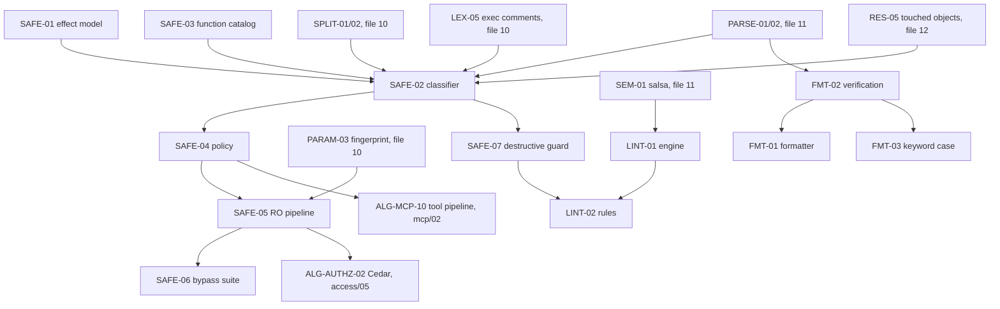

# 13 — SQL Statement Safety (Effect Model, Classifier, Read-Only Enforcement), Linting and Formatting (canonical algorithm catalog)

> Status: canonical, implementation-ready. Date: 2026-11-11. Part of `docs/research/algorithms/`.
> Global spec index, dependency map, crate layout (§0.4) and phased build order (§0.5) are in `10-sql-lexing-splitting-params.md` §0. This file owns SQL-SAFE-01..07, SQL-LINT-01/02 and SQL-FMT-01..03.
> For implementation purposes it **supersedes**: ALG-SQL-SAFE-01/02/03, ALG-SQL-LINT-01, ALG-SQL-FMT-01 and §3.1–3.12 (`clients/sql-tooling-05`); ALG-MCP-11 and the classifier-dependent steps 8 and 11 of ALG-MCP-10 (`mcp/02`); ALG-AUTHZ-03 and §3.8 (`access/05`); ALG-EXEC-05/06 (`datagrip/07`); ALG-SQL-08 and §5.3 (`datagrip/06`); ALG-DBV-SQL-06 (`clients/dbeaver-03`). Those remain the evidence base.
> **Verification reports override everything they contradict.** `verification/01-db-behavior-tests.md` anchors cited as `#anchor`; `verification/02-external-fact-check.md` items cited as P#/S#.
> Clean-room: pseudocode ours; pgls (MIT), sqruff (Apache-2.0, SQLFluff MIT upstream), libpg_query/pg_query.rs (BSD-3/MIT), DBHub/Postgres MCP Pro (MIT, studied for their failure modes), DBeaver (Apache-2.0) cited by file:line in the source docs; DataGrip inspection/formatter behaviour described only.

## 0. This file at a glance

| ID | Name | Priority | Phase | Depends on |
|---|---|---|---|---|
| SQL-SAFE-01 | Effect model and coarse-class lattice | v1 | P1 | — |
| SQL-SAFE-02 | Statement safety classifier | v1 | P1 | SQL-SPLIT-01/02, SQL-LEX-05, SQL-PARSE-01/02, SQL-SAFE-01/03, SQL-RES-05 |
| SQL-SAFE-03 | Function, operator and cast side-effect catalog | v1 | P1 | SQL-RES-02, SQL-COMPL-06 (`FnSig`), catalog (HV-INTRO-*) |
| SQL-SAFE-04 | Policy profiles and decision | v1 | P1 | SQL-SAFE-01/02 |
| SQL-SAFE-05 | Per-DBMS read-only execution pipeline | v1 | P1 | SQL-SAFE-02/04, SQL-PARAM-03, HV-SESS-* |
| SQL-SAFE-06 | Bypass catalogue and differential conformance suite | v1 | P1 | SQL-SAFE-02/05 |
| SQL-SAFE-07 | Destructive-statement guard (confirmations, AI guardrails) | v1 | P1 (syntax) / P2 (semantic) | SQL-SAFE-02 |
| SQL-LINT-01 | Lint engine with suppressions and fixes | v1 | P3 | SQL-SEM-01, SQL-FMT-02 |
| SQL-LINT-02 | v1 rule-set selection | v1 (20 rules) / v1.x (backlog) | P3 | SQL-LINT-01 |
| SQL-FMT-01 | Formatter pipeline (Doc IR, comments, alignment, printer) | v1 (PG, MySQL) / v1.x (others) | P3 | SQL-PARSE-02, SQL-FMT-02 |
| SQL-FMT-02 | Formatter safety verification and idempotency | v1 | P3 | SQL-LEX-02, SQL-PARSE-01 |
| SQL-FMT-03 | Token-level keyword-case normaliser (dialects without a parser) | v1 | P0/P3 | SQL-LEX-04, SQL-FMT-02 |



### 0.1 The layered defence (binding principle for every SQL-SAFE spec)

**The classifier is advisory; server-side enforcement is mandatory.** A parser can never be the only read-only guarantee (parser differentials, side-effecting functions, views/rules/operators, dynamic SQL, version skew). Every read-only request executed by Karagöz (and by Hacivat's MCP broker or its "read-only connection" toggle on direct connections) passes **all** of these layers; each must block the bypass rows marked for it in SQL-SAFE-06 even with the others disabled:

| Layer | What it is | Authority |
|---|---|---|
| L0 Input limits | size, NUL, invalid UTF-8, token/depth limits | Karagöz |
| L1 Client-command and single-statement gate | SQL-SPLIT-01/02 execution mode; exactly one `Exact` statement (SQL Server: one batch); no `Command`/`Data` | Karagöz |
| L2 Classifier + policy | SQL-SAFE-02/03/04: effects, objects, reasons → Allow / Confirm / Deny | Karagöz authoritative; Hacivat and MCP broker advisory (UX, early denial, approval cards) |
| L3 Protocol | PG extended protocol (one statement per `Parse`); MySQL without `CLIENT_MULTI_STATEMENTS`, `LOCAL INFILE` disabled; SQLite `prepare_v2` tail must be empty | server |
| L4 Transaction / session mode | PG `BEGIN READ ONLY` + snapshot pin + `ROLLBACK`; MySQL session `READ ONLY` + `START TRANSACTION READ ONLY` + `ROLLBACK`; SQLite read-only open + authorizer + `query_only`; ClickHouse `readonly=1` profile; Oracle `SET TRANSACTION READ ONLY` | server |
| L5 Least-privilege principal | dedicated per-access-level DB principal without dangerous memberships/privileges (access/04 templates, corrected by #pg-ephemeral, #mysql-ephemeral) | server — **the only robust layer** for side effects L4 does not stop |
| L6 Post-execution checks and reset | PG canary, command-tag check, "transaction ended by user" detection, `DISCARD ALL`/`COM_RESET_CONNECTION`/`sp_reset_connection`, quarantine on anomaly | Karagöz |
| L7 Audit | every request and decision, incl. denials, with fingerprint, effects, reasons, parser versions | Karagöz → Perde |

### 0.2 Decisions in this file (safety ledger)

| # | Decision | Rejected alternatives (reason) | Evidence |
|---|---|---|---|
| S-01 | Effect **set** per statement (SQL-SAFE-01) + one coarse lattice `Read < Session < Write < Ddl < Admin < Unknown` used by UI, MCP and Cedar actions | Single label per statement (loses reasons); three vocabularies (`sql-tooling-05` effects, `mcp/02` READ<DML<DDL<ADMIN<UNKNOWN, `access/05` read<write<ddl<admin) kept separately | reconciled mapping in SQL-SAFE-01 |
| S-02 | Read-only requests always end with **ROLLBACK**, never COMMIT | `access/05` ALG-AUTHZ-03 step 6 (`BEGIN READ ONLY; …; COMMIT`) | Docker: `NOTIFY` is delivered only on COMMIT; `postgres_fdw` remote writes persist on COMMIT and are undone on ROLLBACK (#pg-ro-escapes) |
| S-03 | Transaction control from the user is denied; Karagöz owns transactions (one request = one RO transaction) | `access/05` §3.8 "BEGIN/COMMIT allowed, BEGIN rewritten to READ ONLY" (multi-request client transactions) | P7 (#pg-ro-escapes: after the user's COMMIT the session is plain read-write); product question SQ-1 |
| S-04 | VOLATILE user-defined functions ⇒ `Unknown` ⇒ Deny under built-in read profiles | `mcp/02` ALG-MCP-11: allow unless egress-capable extensions are installed | L4 blocks local writes but not egress/locks/admin calls inside functions (#pg-ro-escapes); product option SQ-2 |
| S-05 | Non-volatile (STABLE/IMMUTABLE) SQL/PL user functions ⇒ `Conservative` read **only if** no egress-capable extension is installed in the database; otherwise `Unknown` | `sql-tooling-05` SAFE-03: STABLE/IMMUTABLE sql/plpgsql always Conservative read | Docker: an IMMUTABLE plpgsql function calling `dblink_exec` committed a remote write, even under plain `EXPLAIN` (#pg-ro-escapes P21); an IMMUTABLE function doing a local INSERT is rejected (#pg-ro-blocked) |
| S-06 | MySQL/MariaDB executable comments: effects from expanding **all** bodies (union with comment-only view) + flag `ExecutableComment` denied by default in read-only and AI profiles | Treat as comments (bypass); always UNKNOWN without expansion (`mcp/02`; loses reasons) | #mysql-comments |
| S-07 | `LISTEN`, `DECLARE … WITH HOLD`, `PREPARE` = SessionState ⇒ denied in read-only | `access/05` "LISTEN allowed read-ish" | Docker: LISTEN and WITH HOLD cursors are accepted inside RO txns and persist in pooled sessions (#pg-ro-temp); `DISCARD ALL` clears them (#pg-discard) |
| S-08 | `EXPLAIN` without ANALYZE: inner statement's functions are assessed (plan-time evaluation); EXPLAIN of any non-read inner statement denied under read-only | Treat plain EXPLAIN as pure metadata (`mcp/02` table) | Docker P21 (#pg-ro-escapes) |
| S-09 | `txid_current()`, `pg_current_xact_id()` ⇒ effect `XidConsume` (Write class), denied in read-only | Treat as harmless reads | Docker: both succeed in RO txns and assign an XID, tripping the canary (#pg-canary) |
| S-10 | The PG canary `txid_current_if_assigned() IS NULL` is a **tripwire**, not a proof | Canary as a write-proof (`sql-tooling-05` original) | Docker: misses `dblink_exec` and `COPY … TO PROGRAM`; false alarms on `LOCK … ACCESS EXCLUSIVE`, temp DML, `txid_current()` (#pg-canary) |
| S-11 | MySQL defence = least privilege first; `SET SESSION TRANSACTION READ ONLY` **and** per-request `START TRANSACTION READ ONLY`; never rely on the RO transaction to stop DDL | RO transaction as the DDL guard | Docker: DDL and `LOCK TABLES` inside `START TRANSACTION READ ONLY` execute via implicit commit; session-level READ ONLY blocks DDL (#mysql-ro) |
| S-12 | `COPY … TO STDOUT` / exports only through Karagöz's dedicated export API (streamed, capped, audited as `export`); in query tools it is denied | Allow COPY TO STDOUT as a read in any tool | `mcp/02` (UNKNOWN for read tools) vs `sql-tooling-05` (allow if policy allows) — reconciled |
| S-13 | MySQL user-variable assignment inside a single read statement (`SELECT @v := …`) = SessionState(StatementLocal), allowed in read-only with a flag (connection reset follows) | Deny all user-variable writes | `mcp/02` ALG-MCP-11 (allowed, flagged); reset per S-11 |
| S-14 | Interim non-PG classifier in P1 (own lexer pre-scan + sqlparser-rs strict, fail closed) | Wait for own parsers (P4) | D-12 in file 10 |
| S-15 | Hacivat UI, MCP broker and Karagöz link the **same** `sql-safety` crate and data files; Karagöz re-classifies everything it receives | Client-sent classifications | README (enforcement at Karagöz), `mcp/02` §3.15 (`hacivat-sql-classify` = `sql-safety`) |

---

## 1. Safety

### SQL-SAFE-01: Effect model and coarse-class lattice

- **Sources merged:** `clients/sql-tooling-05` §3.2 (effect taxonomy, defaults under read-only, coarse class ordering); `mcp/02` ALG-MCP-11 (classes READ < DML < DDL < ADMIN < UNKNOWN, flags, flag-implied classes); `access/05` ALG-AUTHZ-03 step 4 and §3.8 (categories read < write < ddl < admin, unknown treated as admin; role switch always denied); `datagrip/07` ALG-EXEC-06 (classes and user-facing message map).
- **Problem:** One vocabulary for "what can this statement do", rich enough for reasons and policies, with a total order for UI badges, MCP tool gates and Cedar actions.
- **Inputs / outputs:** produced by SQL-SAFE-02/03; consumed by SQL-SAFE-04, UI, MCP, audit.
- **Data structures:**
  ```rust
  bitflags! { pub struct EffectSet: u32 {
      const READ_DATA; const READ_METADATA; const INFO_DISCLOSURE;          // Read
      const RESOURCE_HEAVY;                                                // Read (+ limits)
      const TXN_CONTROL; const SESSION_STATE; const NOTIFY;               // Session
      const LOCK_ROWS; const LOCK_TABLES; const ADVISORY_LOCK;            // Write
      const WRITE_DATA; const WRITE_TEMP; const SEQUENCE_ADVANCE; const XID_CONSUME; // Write
      const DDL;                                                           // Ddl
      const DCL; const PRIVILEGE_CHANGE; const ADMIN_CONTROL;             // Admin
      const EXTERNAL_FILE_READ; const EXTERNAL_FILE_WRITE; const EXTERNAL_NETWORK; const PROCESS_EXEC; // Admin
      const PROCEDURAL_CODE; const DYNAMIC_SQL; const UNKNOWN;            // Unknown
  } }
  bitflags! { pub struct RiskFlags: u32 {
      const EXECUTABLE_COMMENT; const LEX_MODE_CHANGE; const EXPLAIN; const EXPLAIN_ANALYZE;
      const DATA_MODIFYING_CTE; const LOCKING_CLAUSE; const HINT_SET_VAR; const HINT_EXEC_TIME;
      const PRIVILEGE_AMPLIFICATION /*SECURITY DEFINER*/; const DESTRUCTIVE; const READS_OTHER_TABLES_IN_WRITE;
      const USER_VAR_ASSIGN; const CONSERVATIVE; const MULTI_STATEMENT; const REMOTE_OBJECT;
  } }
  #[derive(Ord, PartialOrd, Eq, PartialEq, Copy, Clone)]
  pub enum CoarseClass { Read, Session, Write, Ddl, Admin, Unknown }
  pub struct StmtReport { effects: EffectSet, flags: RiskFlags, class: CoarseClass,
                          touched: TouchedObjects /*SQL-RES-05*/, reasons: Vec<ReasonCode>, confidence: Confidence /*Exact|Conservative*/ }
  ```
- **Algorithm:** `class(effects) = max over set bits` with the mapping in the table; `Unknown` dominates; a request's class = max over its statements (SQL Server batch: all statements).

| Effect | Coarse class | `mcp/02` class | `access/05` category / Cedar action | Default under `read_only` |
|---|---|---|---|---|
| READ_DATA, READ_METADATA | Read | READ | read | Allow (object policy applies) |
| INFO_DISCLOSURE | Read (+flag) | READ (+flag) / ADMIN for files | read | Allow metadata; Deny others' activity, server files |
| RESOURCE_HEAVY | Read (+flag) | READ + `delay` | read | Allow with limits; `pg_sleep`/`SLEEP`/`BENCHMARK`/`WAITFOR` denied |
| TXN_CONTROL | Session | UNKNOWN (`transaction_control`) | txn | Deny (S-03) |
| SESSION_STATE | Session | UNKNOWN (`session_control`) | session | Deny (allowlist later; S-13 exception) |
| NOTIFY | Session | UNKNOWN (`notify`) | write | Deny |
| LOCK_ROWS, LOCK_TABLES, ADVISORY_LOCK | Write | READ+`locking_clause` / `advisory_lock` | write-lock | Deny |
| WRITE_DATA, WRITE_TEMP, SEQUENCE_ADVANCE, XID_CONSUME | Write | DML | write | Deny |
| DDL | Ddl | DDL | ddl | Deny |
| DCL, PRIVILEGE_CHANGE, ADMIN_CONTROL | Admin | ADMIN | admin; role switch always denied | Deny |
| EXTERNAL_FILE_*, EXTERNAL_NETWORK, PROCESS_EXEC | Admin | ADMIN + `file_access`/`egress` | admin | Deny |
| PROCEDURAL_CODE, DYNAMIC_SQL, UNKNOWN | Unknown | UNKNOWN (`dynamic_or_procedural`) | admin (for decisions) | Deny |

  User-facing class messages (Fluent IDs; DataGrip ALG-EXEC-06 wording is replaced by ours): `safety-class-read`, `-session`, `-write` ("modifies data"), `-ddl` ("changes the schema"), `-admin` ("administrative or external side effects"), `-unknown` ("effects cannot be determined").
- **Decision:** S-01.
- **Verification status:** taxonomy is a design; each effect's server behaviour is verified or not per row in SQL-SAFE-06.
- **Rust placement:** `sql-safety::effects::{EffectSet, RiskFlags, CoarseClass, StmtReport}`; mapping tables `sql-safety::effects::to_mcp_class`, `to_cedar_action`.
- **Per-dialect matrix:** dialect-independent vocabulary; per-dialect statement tables map into it (SQL-SAFE-02).
- **i18n notes:** effects and reasons are codes with typed args (`fn.denylisted { name }`), rendered in English/Turkish by Fluent; SQL fragments inside messages are code spans, never translated; audit stores codes + args (Perde renders in the viewer's locale).
- **Edge cases:** empty effect set (comment-only, `;`) → no statement → request denied as `NoStatement`; `READ_DATA | UNKNOWN` → Unknown; `RESOURCE_HEAVY` alone → Read.
- **Test cases:** `class(READ_DATA|LOCK_ROWS) = Write`; `class(SESSION_STATE) = Session`; `class(READ_DATA|PROCEDURAL_CODE) = Unknown`; `to_mcp_class(Session) = UNKNOWN`; `to_cedar_action(Admin) = "admin"`.
- **Used by:** Hacivat | Karagöz | MCP broker | Perde (renders recorded classes).

### SQL-SAFE-02: Statement safety classifier

- **Sources merged:** `clients/sql-tooling-05` ALG-SQL-SAFE-01 (pipeline, deep walk, edge cases, tests 1–21), §3.3 (PG statement catalogue), §3.5 (bypasses), §3.12 cross-cutting; `mcp/02` ALG-MCP-11 (exhaustive generated visitor, engine-exact folding, deny categories, destructive reasons, test table) and ALG-MCP-10 step 8 (tool gates); `access/05` ALG-AUTHZ-03 (normalise → parse → split → categorise → policy; edge cases 1–25; tests); `datagrip/07` ALG-EXEC-06; `clients/sql-tooling-01` §2.16, ALG-SQL-LAND-01 step 5.
- **Problem:** Determine, conservatively and identically in Hacivat (advisory) and Karagöz (authoritative), the effects, touched objects and reasons of a SQL request for a dialect, failing closed on anything not understood.
- **Inputs / outputs:** `(sql: &[u8], dialect: DialectCtx /* pinned modes, server version */, catalog: Option<&dyn CatalogView> /* functions, operators, casts, extensions, views */, pinned_session: {search_path, current_db}, limits)` → `SafetyReport { items: Vec<StmtReport>, request_class: CoarseClass, request_effects: EffectSet, flags: RiskFlags, fingerprint: Fingerprint, backends: Vec<BackendVersion>, pre_decision: Option<Deny{reasons}> }`.
- **Algorithm:**
  1. **Pre-checks (L0):** `len > max_bytes` (1 MiB default), NUL byte, invalid UTF-8, any lexer error token (unterminated literal/comment, `Unknown` char, PG trailing-junk) → `Deny(LexError)`. Classification works on exactly the bytes that will be executed (never on a normalised copy).
  2. **Client-command pre-pass (L1):** SQL-SPLIT-01 with the dialect's flavor; any `Command`/`Data` segment → `Deny(ClientCommand)`; any template variable (SQL-PARAM-02) → `Deny(TemplateVariable)`.
  3. **Split (L1):** SQL-SPLIT-02 execution mode; require exactly one `Exact` statement (SQL Server: one batch); zero → `Deny(NoStatement)`; more or `Ambiguous` → `Deny(MultiStatement|AmbiguousBoundary)`.
  4. **Executable comments (S-06):** MySQL/MariaDB → build `expanded_all` and `as_comments` token streams (SQL-LEX-05); classify both; union; set `EXECUTABLE_COMMENT`; if the expansion does not parse → `Deny(ParseError)`.
  5. **Parse strictly** per SQL-PARSE-01 plan (PG: libpg_query authoritative + own strict cross-check; others: interim or own strict + sqlparser-rs); any backend failure → `Deny(ParseError)`; kind disagreement between backends → `Deny(ParserDisagreement)`; limits hit → `Deny(TooComplex)`; syntax newer than the agent → `Deny(SyntaxNewerThanAgent)`.
  6. **Top-level dispatch** by statement kind via the dialect statement table (below) → base effects + flags.
  7. **Deep walk** of every node with a **generated exhaustive visitor** (coverage test: the visitor reaches every node kind seen in the corpus; CVE-2026-85620 lesson):
     - relation references → SQL-RES-05 (reads/writes); foreign tables, DB links, 4-part names, SQLite `ATTACH`ed remote, ClickHouse `remote()`/`cluster()` → `EXTERNAL_NETWORK` + `REMOTE_OBJECT` unless allowlisted;
     - data-modifying CTEs → `WRITE_DATA` + `DATA_MODIFYING_CTE`;
     - locking clauses (`FOR UPDATE/NO KEY UPDATE/SHARE/KEY SHARE`, `LOCK IN SHARE MODE`, T-SQL table hints `UPDLOCK/XLOCK/HOLDLOCK/TABLOCKX`) → `LOCK_ROWS`/`LOCK_TABLES` + `LOCKING_CLAUSE`;
     - function calls in any position (incl. FROM/LATERAL, defaults, CHECK, index expressions, RETURNING, window clauses) → SQL-SAFE-03; operators and casts: builtin → none; else resolve via catalog (`pg_operator.oprcode`, `pg_cast.castfunc`) → SQL-SAFE-03; unresolvable → `UNKNOWN`;
     - string literals passed to SQL-executing functions/procedures (`query_to_xml`, `dblink*`, `sp_executesql`, `EXEC('…')`, `PREPARE … FROM`, `EXECUTE IMMEDIATE`) → `DYNAMIC_SQL`;
     - `EXPLAIN`: any truthy ANALYZE option (`ANALYZE`, `ANALYSE`, `ANALYZE true|on|1|yes`, inside an option list) → effects of the inner statement + `EXPLAIN_ANALYZE`; otherwise `READ_METADATA` + `EXPLAIN` + function assessment of the inner statement (S-08); under read-only profiles an EXPLAIN whose inner statement's class > Read is denied regardless of ANALYZE;
     - `COPY` per the PG table; `SET`/`RESET`/`SET TRANSACTION`/`set_config(literal_name, …)` → per-variable flags (non-literal names → `UNKNOWN`); variables that change lexing (`standard_conforming_strings`, `client_encoding`, `sql_mode`, `NAMES`, `QUOTED_IDENTIFIER`) → `LEX_MODE_CHANGE`; `role`, `session_authorization`, `EXECUTE AS`, `SETUSER` → `PRIVILEGE_CHANGE`;
     - procedural statements → `PROCEDURAL_CODE` (+ `UNKNOWN` for opaque targets);
     - destructive reasons for SQL-SAFE-07 (DROP, TRUNCATE, DELETE/UPDATE without WHERE or with constant-true WHERE, ALTER … DROP COLUMN/CONSTRAINT, ALTER … TYPE, CASCADE, MERGE … THEN DELETE).
  8. **Combine:** union effects and flags across nodes (and across the two executable-comment views); `class` per SQL-SAFE-01; reasons sorted and deduplicated; `confidence = Conservative` if any catalog-dependent assumption was used.
  9. **Fingerprint** (SQL-PARAM-03) and backend versions recorded.
  10. Hand the report to SQL-SAFE-04.
- **Statement tables (base effects; deep walk adds more):**

  **PostgreSQL (libpg_query node → effects):**

  | Node(s) | Base effects | Deep checks |
  |---|---|---|
  | `SelectStmt` | READ_DATA | `intoClause` ⇒ DDL+WRITE_DATA; `lockingClause` ⇒ LOCK_ROWS; CTE with Insert/Update/Delete/Merge ⇒ WRITE_DATA; functions/operators/`RangeFunction` ⇒ SAFE-03; sublinks |
  | `InsertStmt`, `UpdateStmt`, `DeleteStmt`, `MergeStmt` | WRITE_DATA | ON CONFLICT, RETURNING functions |
  | `TruncateStmt` | WRITE_DATA + DDL | — |
  | `CopyStmt` | `is_from` ⇒ WRITE_DATA; `filename` ⇒ EXTERNAL_FILE_READ/WRITE; `is_program` ⇒ PROCESS_EXEC; `TO STDOUT` ⇒ READ_DATA (export API only, S-12); `query` ⇒ inner effects | `COPY (DELETE … RETURNING *) TO STDOUT` ⇒ WRITE_DATA |
  | `ExplainStmt` | READ_METADATA | S-08 |
  | `CreateTableAsStmt` (incl. matview, `SELECT INTO` form) | DDL + WRITE_DATA | inner query |
  | `ViewStmt`, `RuleStmt`, `CreateTrigStmt`, `CreateFunctionStmt`, all `Create*/Alter*/Drop*/Rename*`, `CommentStmt`, `SecLabelStmt`, `RefreshMatViewStmt`, `ReindexStmt`, `ClusterStmt`, `VacuumStmt`, `CreateExtensionStmt`, `ImportForeignSchemaStmt`, `Create/AlterSubscription/Publication`, `AlterDatabaseSetStmt`, `AlterRoleSetStmt`, `CreatedbStmt`, `DropdbStmt` | DDL | — |
  | `GrantStmt`, `GrantRoleStmt`, `Create/Alter/DropRoleStmt`, `ReassignOwnedStmt`, `DropOwnedStmt`, `AlterDefaultPrivilegesStmt`, `AlterOwnerStmt` | DCL | — |
  | `TransactionStmt` | TXN_CONTROL | `COMMIT/ROLLBACK PREPARED` ⇒ + WRITE_DATA + ADMIN_CONTROL |
  | `VariableSetStmt` | SESSION_STATE | per-variable flags (step 7); `RESET ALL` |
  | `VariableShowStmt` | READ_METADATA | `SHOW ALL` ⇒ INFO_DISCLOSURE |
  | `DiscardStmt`, `PrepareStmt` (+ inner effects), `DeallocateStmt`, `ListenStmt`, `UnlistenStmt`, `DeclareCursorStmt` (inner; WITH HOLD ⇒ SESSION_STATE), `FetchStmt`, `ClosePortalStmt`, `ConstraintsSetStmt` | SESSION_STATE / TXN_CONTROL | S-07 |
  | `NotifyStmt` | NOTIFY | — |
  | `DoStmt` | PROCEDURAL_CODE + DYNAMIC_SQL | — |
  | `CallStmt` | PROCEDURAL_CODE | — |
  | `ExecuteStmt` | PROCEDURAL_CODE + UNKNOWN | — |
  | `LockStmt` | LOCK_TABLES (any mode) | — |
  | `LoadStmt` | ADMIN_CONTROL + PROCESS_EXEC | — |
  | `CheckPointStmt`, `AlterSystemStmt` | ADMIN_CONTROL | — |
  | anything else / new node kinds | UNKNOWN | — |

  **MySQL / MariaDB:** `SELECT` READ_DATA (`INTO OUTFILE/DUMPFILE` ⇒ EXTERNAL_FILE_WRITE; `INTO @v` ⇒ SESSION_STATE+USER_VAR_ASSIGN; `FOR UPDATE`/`LOCK IN SHARE MODE` ⇒ LOCK_ROWS); `INSERT/REPLACE/UPDATE/DELETE` (incl. multi-table, `INSERT IGNORE`, `ON DUPLICATE KEY UPDATE`) WRITE_DATA; `LOAD DATA [LOCAL] INFILE` WRITE_DATA+EXTERNAL_FILE_READ; DDL incl. `TRUNCATE`, `RENAME`, `OPTIMIZE`, `ANALYZE TABLE`, `REPAIR` DDL; `GRANT/REVOKE/CREATE USER/ROLE`, `SET ROLE`, `SET PASSWORD` DCL/PRIVILEGE_CHANGE; `START TRANSACTION/BEGIN/COMMIT/ROLLBACK/SAVEPOINT/XA *` TXN_CONTROL; `SET` (session/`@`/`@@`/`NAMES`/`CHARACTER SET`) SESSION_STATE (+LEX_MODE_CHANGE for `sql_mode`, `NAMES`); `SET GLOBAL/PERSIST` ADMIN_CONTROL; `USE` SESSION_STATE; `SHOW`/`DESCRIBE`/`EXPLAIN` READ_METADATA (`SHOW PROCESSLIST` INFO_DISCLOSURE; `EXPLAIN ANALYZE` executes); `PREPARE/EXECUTE/DEALLOCATE` DYNAMIC_SQL; `CALL` PROCEDURAL_CODE; `DO expr` evaluates functions (SAFE-03); `HANDLER` SESSION_STATE; `LOCK TABLES` LOCK_TABLES (+ implicit commit); `KILL`, `SHUTDOWN`, `RESTART`, `FLUSH`, `RESET`, `PURGE BINARY LOGS`, `INSTALL/UNINSTALL PLUGIN/COMPONENT`, `CLONE`, `CHANGE REPLICATION SOURCE/MASTER`, `START/STOP REPLICA` ADMIN_CONTROL; `CREATE FUNCTION … SONAME` DDL+PROCESS_EXEC; hints per SQL-LEX-05.

  **SQL Server (whole batch):** `SELECT` READ_DATA (`INTO #t` ⇒ WRITE_TEMP+DDL; `INTO t` ⇒ DDL+WRITE_DATA; table hints ⇒ locks); DML incl. `MERGE`, `OUTPUT INTO`, `BULK INSERT` (EXTERNAL_FILE_READ); DDL; `GRANT/DENY/REVOKE`, `CREATE LOGIN/USER/ROLE`, `ALTER ROLE … ADD MEMBER` DCL; `EXECUTE AS`, `SETUSER`, `REVERT` PRIVILEGE_CHANGE; `BEGIN TRAN/COMMIT/ROLLBACK/SAVE TRAN` TXN_CONTROL; `SET` options SESSION_STATE (`QUOTED_IDENTIFIER` ⇒ LEX_MODE_CHANGE; `CONTEXT_INFO`, `sp_set_session_context` ⇒ SESSION_STATE affecting RLS); `DECLARE @v`/`SET @v`/`SELECT @v =` ⇒ none (batch-local); `IF/WHILE/TRY/CATCH/BEGIN…END` ⇒ walk bodies; `EXEC proc` PROCEDURAL_CODE; `EXEC('…')`/`sp_executesql` DYNAMIC_SQL; `xp_cmdshell`, `sp_OACreate`, CLR, `OPENROWSET`, `OPENDATASOURCE`, `OPENQUERY`, `EXEC … AT srv`, 4-part names EXTERNAL_* / PROCESS_EXEC; `BACKUP/RESTORE` EXTERNAL_FILE_WRITE+ADMIN_CONTROL; `KILL`, `SHUTDOWN`, `RECONFIGURE`, `sp_configure`, `DBCC`, `CHECKPOINT`, `ALTER SERVER CONFIGURATION` ADMIN_CONTROL; `WAITFOR` RESOURCE_HEAVY; `NEXT VALUE FOR` SEQUENCE_ADVANCE.

  **SQLite:** `SELECT`/`VALUES`/`WITH` READ_DATA; DML incl. UPSERT, `INSERT OR REPLACE`, `RETURNING` WRITE_DATA; DDL; `ATTACH`/`DETACH` EXTERNAL_FILE_WRITE (new files are created and writable — Docker) + SESSION_STATE; `VACUUM` DDL, `VACUUM INTO 'f'` EXTERNAL_FILE_WRITE; `PRAGMA name` / `PRAGMA name(arg)` READ_METADATA only for an allowlist (`table_info`, `table_xinfo`, `index_list`, `index_info`, `foreign_key_list`, `database_list`, `collation_list`, `function_list`, …); `PRAGMA x = v` and others ⇒ ADMIN_CONTROL (`query_only`, `writable_schema`, `journal_mode`, `user_version` …); `BEGIN/COMMIT/ROLLBACK/SAVEPOINT/RELEASE` TXN_CONTROL; `REINDEX`, `ANALYZE` DDL; `load_extension()` PROCESS_EXEC.

  **ClickHouse:** `SELECT` READ_DATA (`SETTINGS k=v` ⇒ SESSION_STATE unless allowlisted below ceilings; `FORMAT` fine); `INSERT INTO` (+`FUNCTION`) WRITE_DATA (+EXTERNAL_*); `ALTER … DELETE/UPDATE` (mutations) WRITE_DATA; DDL incl. `OPTIMIZE`, `RENAME`, `EXCHANGE`, `ATTACH/DETACH TABLE`; `SET`/`USE` SESSION_STATE; `GRANT/REVOKE/CREATE USER/ROLE/QUOTA/SETTINGS PROFILE` DCL; `SYSTEM …`, `KILL QUERY/MUTATION` ADMIN_CONTROL; `SHOW`/`DESCRIBE`/`EXISTS`/`EXPLAIN` READ_METADATA (`EXPLAIN` does not execute [Inferred]); table functions per SAFE-03.

  **Oracle (basic):** `SELECT` READ_DATA (`FOR UPDATE` LOCK_ROWS; `@link` EXTERNAL_NETWORK); DML incl. `MERGE`; DDL (implicit commit); `GRANT/REVOKE/CREATE USER/ROLE` DCL; `SET ROLE`, `ALTER SESSION` SESSION_STATE/PRIVILEGE_CHANGE; `SET TRANSACTION`, `COMMIT`, `ROLLBACK`, `SAVEPOINT` TXN_CONTROL; anonymous blocks `DECLARE/BEGIN`, `CALL`, `EXEC` PROCEDURAL_CODE (+`EXECUTE IMMEDIATE` DYNAMIC_SQL); `LOCK TABLE` LOCK_TABLES; `ALTER SYSTEM` ADMIN_CONTROL.
- **Decision:** classify on the server's own grammar where available (libpg_query), otherwise "both parsers must agree, union effects, fail closed"; generated exhaustive visitor; effects union across ambiguous views (executable comments). Rejected: prefix heuristics (pgcli/mycli `query_starts_with`, trivially bypassed by `WITH d AS (DELETE …) SELECT …`, `EXPLAIN ANALYZE DELETE`, leading comments, `/*!*/`); regex classifiers; allow-on-parse-failure.
- **Verification status:** **Docker-verified** server behaviours referenced per bypass row in SQL-SAFE-06 (PG 16.15/17.11/18.6, MySQL 8.0.46/8.4.13, SQLite 3.54.1); classifier logic is ours; CVE-2026-85620 traversal-gap lesson Confirmed (P4/P5); Datadog multi-statement case Confirmed (P6); SQL Server, ClickHouse `readonly`, Oracle, MariaDB behaviours Inferred.
- **Rust placement:** `sql-safety::classify::{classify, SafetyReport}`; visitors generated into `sql-safety::visit::{pg_query_visitor, own_tree_visitor}` from the protobuf schema of libpg_query and from `sql.ungram`; statement tables as data `sql-safety/data/<dialect>/statements.toml`; MCP broker and Karagöz call `classify` with identical inputs (S-15).
- **Per-dialect matrix:** the statement tables above; plus engine assists used by SQL-SAFE-05 (SQLite `sqlite3_stmt_readonly`, authorizer; PG libpg_query fingerprint).
- **i18n notes:** keyword/function/variable matching ASCII-only and engine-exact (SQL-LEX-04, SQL-RES-02): `PG_READ_FİLE` (U+0130) is **not** `pg_read_file` (the server would not resolve it either; with a catalog it is `Missing` → no effect; without a catalog → `UNKNOWN` → Deny); reasons are message IDs.
- **Edge cases (exhaustive):** empty input; comment-only input; trailing `;` + trailing comment; `SELECT INTO` inside UNION branches; `INSERT … SELECT` from a writing CTE; `WITH RECURSIVE` + data-modifying CTE; `EXPLAIN (FORMAT JSON, ANALYZE)` vs `EXPLAIN (ANALYZE false)` (still denied if inner is non-read); `EXPLAIN EXECUTE s`; `EXPLAIN CREATE TABLE AS`; `COPY (SELECT …) TO STDOUT`; `COPY t FROM STDIN`; `\copy` (pre-pass); schema-qualified/quoted/case-variant denylisted functions (`pg_catalog.pg_sleep`, `"pg_sleep"`, `PG_SLEEP`); user function shadowing a denylisted name (`public.pg_sleep` → deny by name); functions inside VALUES defaults; `TABLESAMPLE`; `FOR UPDATE SKIP LOCKED`; `FOR KEY SHARE`; `LOCK TABLE … ACCESS SHARE`; `SET LOCAL statement_timeout = 0`; `SHOW ALL`; `VALUES (1)`; `TABLE t`; `PREPARE` of a SELECT; `DECLARE c CURSOR` (no HOLD); `FETCH ALL`; `CHECKPOINT`; MySQL `SELECT … INTO @v`, `INTO OUTFILE`, `REPLACE`, `INSERT IGNORE`, `ON DUPLICATE KEY UPDATE`, `CALL`, `DO expr`, `SHOW PROCESSLIST`; T-SQL batch with variables and `IF` blocks, `SELECT … INTO #t`, `WAITFOR DELAY`, `EXEC sp_who`; SQLite `PRAGMA table_info(t)` vs `PRAGMA journal_mode=WAL`; ClickHouse `SETTINGS max_threads=1`, `numbers(1e12)`, `url()`; Oracle `dual@link`; quoted identifiers equal to keywords (`"DELETE"` column → not DML); Unicode identifiers; Unicode whitespace U+00A0 between tokens (lexer `Unknown` → Deny); comments containing fake statements (`/* ; DROP TABLE x */` → ignored); parser limit hit (Deny); `SELECT 1--1;DROP TABLE t` in MySQL (two statements → Deny MultiStatement).
- **Test cases (→ request class; decision under `read_only`, SQL-SAFE-04):**

| # | Dialect | Input | Class / effects | Decision |
|---|---|---|---|---|
| 1 | PG | `SELECT * FROM t` | Read; reads {t} | Allow |
| 2 | PG | `WITH d AS (DELETE FROM t RETURNING *) SELECT * FROM d` | Write; DATA_MODIFYING_CTE | Deny |
| 3 | PG | `SELECT * INTO x FROM t` | Ddl | Deny |
| 4 | PG | `EXPLAIN SELECT 1` / `EXPLAIN ANALYZE DELETE FROM t` / `EXPLAIN (ANALYZE off) DELETE FROM t` | Read / Write / Write (S-08) | Allow / Deny / Deny |
| 5 | PG | `SELECT pg_terminate_backend(123)` | Admin | Deny |
| 6 | PG | `SELECT nextval('s')` | Write (SEQUENCE_ADVANCE) | Deny |
| 7 | PG | `SELECT * FROM t FOR UPDATE` | Write (LOCK_ROWS) | Deny |
| 8 | PG | `SET TRANSACTION READ WRITE`; `SELECT set_config('transaction_read_only','off',true)` | Session; Admin (session mutation) | Deny |
| 9 | PG | `COMMIT`; `SELECT 1; DELETE FROM t`; `COMMIT; DROP SCHEMA public CASCADE;` | Session; MultiStatement | Deny |
| 10 | PG | `COPY t TO STDOUT` (query tool) / `COPY t TO PROGRAM 'x'` | Read (export API only) / Admin | Deny in query tools (S-12) / Deny |
| 11 | PG | `SELECT dblink_exec('…','DROP TABLE t')` | Admin (EXTERNAL_NETWORK + DYNAMIC_SQL) | Deny |
| 12 | PG | `SELECT query_to_xml('select 1', true, true, '')` | Unknown (DYNAMIC_SQL) | Deny |
| 13 | PG | `DO $$BEGIN END$$`; `CALL p()` | Unknown | Deny |
| 14 | PG | `SELECT 1 ### 2` (user operator) | Unknown without catalog; per `oprcode` with catalog | Deny / per SAFE-03 |
| 15 | PG | `SELECT my_stable_sql_fn(x) FROM t` (STABLE, sql, no egress extensions installed) | Read, CONSERVATIVE | Allow |
| 16 | PG | same function, `dblink` extension installed | Unknown (S-05) | Deny |
| 17 | PG | `SELECT * FROM pg_read_file('/etc/passwd')`; `SELECT x FROM t, LATERAL pg_catalog.pg_ls_dir('.') d` | Admin (file) | Deny |
| 18 | PG | `SELECT txid_current()` | Write (XID_CONSUME, S-09) | Deny |
| 19 | PG | `LISTEN ch`; `DECLARE c CURSOR WITH HOLD FOR SELECT 1` | Session (S-07) | Deny |
| 20 | PG | `SELEC 1` | parse error | Deny |
| 21 | PG | `SELECT PG_READ_FİLE('/x')` (U+0130) | with catalog: function Missing → Read; without: Unknown | Allow (server errors) / Deny |
| 22 | MySQL | `SELECT 1 /*!99999 , SLEEP(100) */` | Read + RESOURCE_HEAVY + EXECUTABLE_COMMENT | Deny |
| 23 | MySQL | `/*!50000 DROP TABLE t */` | Ddl + EXECUTABLE_COMMENT | Deny |
| 24 | MySQL | `SELECT * FROM t INTO OUTFILE '/tmp/x'`; `SELECT LOAD_FILE('/etc/passwd')` | Admin (file) | Deny |
| 25 | MySQL | `SELECT 1--1;DROP TABLE t` | MultiStatement | Deny |
| 26 | MySQL | `SELECT GET_LOCK('a', 1)` | Write (ADVISORY_LOCK) | Deny |
| 27 | MySQL | `SELECT @v := 1` | Session (USER_VAR_ASSIGN, S-13) | Allow (flagged) |
| 28 | SQL Server | `SELECT 1 EXEC('DROP TABLE t')` (one batch) | Unknown (DYNAMIC_SQL) | Deny |
| 29 | SQL Server | `EXEC xp_cmdshell 'dir'`; `SELECT * FROM OPENQUERY(srv,'…')`; `SELECT * FROM [srv].[db].[dbo].[t]` | Admin | Deny |
| 30 | SQL Server | `SELECT * INTO #t FROM a` | Write (WRITE_TEMP) + Ddl | Deny |
| 31 | SQLite | `PRAGMA query_only=0`; `ATTACH 'x.db' AS x`; `VACUUM INTO 'y.db'`; `PRAGMA table_info(t)` | Admin; Admin; Admin; Read | Deny; Deny; Deny; Allow |
| 32 | ClickHouse | `SELECT * FROM url('http://…', CSV)`; `INSERT INTO FUNCTION url(…)`; `SELECT 1 SETTINGS readonly=0` | Admin; Write+Admin; Session | Deny |
| 33 | PG | `SELECT "DELETE" FROM t` | Read | Allow |
| 34 | any | `SELECT 1;;` | 1 statement (+ Empty) | Allow |
| 35 | Oracle | `SELECT * FROM t@link` | Admin (EXTERNAL_NETWORK) | Deny |

- **Used by:** Karagöz (authoritative) | Hacivat (advisory badges, read-only connection toggle, confirmations) | MCP broker (ALG-MCP-10 step 8 gates `run_read_query`, `explain_query`, `sample_rows`, `propose_write`).

### SQL-SAFE-03: Function, operator and cast side-effect catalog

- **Sources merged:** `clients/sql-tooling-05` ALG-SQL-SAFE-03 and §3.4 (PG function catalogue with RO-txn behaviour); `mcp/02` ALG-MCP-11 step 5 deny categories (`file_access`, `egress`, `advisory_lock`, `session_mutation`, `sequence_mutation`, `delay`, volatile UDF heuristic) for PG, MySQL, SQL Server, SQLite, ClickHouse, DuckDB; `access/05` §3.8 (allowlist pure functions instead of blocklisting; volatile UDF → write-risk).
- **Problem:** Decide the effects of a call — direct, or implicit through an operator, cast, domain check, view or default — from builtin knowledge and catalog metadata.
- **Inputs / outputs:** `(fn: {schema?, name, arity, arg_types?, named_args}, dialect, server_version, catalog: Option<&FnCatalog>, installed_extensions: Option<&[ExtName]>, pinned_search_path)` → `(EffectSet, Confidence, ReasonCode)`.
- **Algorithm:**
  1. Resolve the name exactly as the server would (pinned search path, PG `pg_catalog` first; engine-exact folding SQL-RES-02). Schema-qualified calls use their schema.
  2. **Denylist (by bare name, any schema, case-folded per engine):** match → listed effects (conservative: a user function named like a denylisted builtin is denied too).
  3. **Allowlist (curated pure builtins per dialect/version, by name + arity):** match → `∅`, `Exact`.
  4. Catalog metadata (user-defined or extension function):
     - **PG:** `prokind = 'p'` ⇒ PROCEDURAL_CODE; extension membership (`pg_depend` → extension) in the egress/admin extension list (`dblink`, `postgres_fdw`, `http`, `pg_net`, `adminpack`, `file_fdw`, `plpython3u`, `plperlu`, `plsh`, `pg_cron`, `lo`…) ⇒ that extension's effects; `prolang` ∈ {C non-builtin, `internal` non-builtin, untrusted PLs} ⇒ UNKNOWN; `provolatile = 'v'` ⇒ UNKNOWN (S-04); `provolatile ∈ {'i','s'}` with `prolang ∈ {sql, plpgsql}` ⇒ `∅` with `CONSERVATIVE` **only if** no egress-capable extension is installed in the database, else UNKNOWN (S-05); `prosecdef` ⇒ flag `PRIVILEGE_AMPLIFICATION`.
     - **MySQL/MariaDB:** `ROUTINES.SQL_DATA_ACCESS` `NO SQL`/`READS SQL DATA` ⇒ Conservative read; `MODIFIES SQL DATA`/`CONTAINS SQL` ⇒ UNKNOWN; `SECURITY_TYPE = DEFINER` ⇒ PRIVILEGE_AMPLIFICATION; loadable UDFs (`mysql.func`) ⇒ UNKNOWN.
     - **SQL Server:** scalar/table UDFs cannot modify persistent tables but can call extended procedures ⇒ Conservative read unless definition text references `xp_`/`OPENQUERY`/`OPENROWSET` (requires `VIEW DEFINITION`) else UNKNOWN; CLR functions ⇒ UNKNOWN.
     - **Oracle:** any user function ⇒ UNKNOWN unless allowlisted (autonomous transactions, definer rights).
     - **ClickHouse:** SQL UDFs (lambdas) ⇒ expand body; executable UDFs ⇒ UNKNOWN; table functions per allow/deny lists.
     - **SQLite:** only functions registered by the host; Karagöz registers none (L5).
  5. No metadata ⇒ UNKNOWN.
  6. **Implicit calls:** operators (`pg_operator.oprcode`), casts (`pg_cast.castfunc`), domain CHECKs, type I/O functions, column defaults (write paths only), RLS policies, views calling functions: assessed when the catalog exposes them (PG); otherwise documented residual risk covered by L4/L5.
- **PostgreSQL deny catalogue (with RO-transaction behaviour, Docker-verified where marked):**

| Category → effects | Functions | Blocked by RO txn? |
|---|---|---|
| Session/backend control → ADMIN_CONTROL | `pg_terminate_backend`, `pg_cancel_backend`, `pg_reload_conf`, `pg_rotate_logfile`, `pg_log_backend_memory_contexts`, `pg_promote`, `pg_wal_replay_pause/resume`, `pg_switch_wal`, `pg_create_restore_point`, `pg_backup_start/stop`, `pg_stat_reset*`, `pg_stat_statements_reset` | **No** — Docker: `pg_terminate_backend`, `pg_stat_reset`, `pg_switch_wal`, `CHECKPOINT` succeed (#pg-ro-escapes) |
| Configuration → SESSION_STATE (+ADMIN if `is_local=false`) | `set_config` | **No** — but `transaction_read_only` cannot be flipped after the snapshot pin (#pg-ro-pin) |
| Locks → ADVISORY_LOCK | `pg_advisory_lock*`, `pg_advisory_xact_lock*`, `pg_try_advisory_*` | **No** — Docker: session-level advisory lock survives ROLLBACK (#pg-ro-escapes) |
| Sequences → SEQUENCE_ADVANCE | `nextval`, `setval` (`currval`/`lastval` are reads) | Yes for non-temp sequences (#pg-ro-blocked); `nextval` on a temp sequence created before the txn is allowed (#pg-ro-temp) |
| XID → XID_CONSUME | `txid_current`, `pg_current_xact_id` | **No** — Docker: succeed and assign an XID (#pg-canary) |
| Large objects → WRITE_DATA / EXTERNAL_FILE_* | `lo_import`, `lo_export`, `lo_create`, `lo_unlink`, `lo_put`, `lo_from_bytea`, `lo_truncate`, `lo_open(…, INV_WRITE)` | Local LO writes yes (`lo_from_bytea` blocked, #pg-ro-blocked); **`lo_export` writes a server file inside a RO txn** (#pg-ro-escapes) |
| Server files → EXTERNAL_FILE_READ | `pg_read_file`, `pg_read_binary_file`, `pg_ls_dir`, `pg_ls_*dir`, `pg_stat_file` | **No** — Docker: `pg_read_file` works (#pg-ro-escapes); privilege-gated (`pg_read_server_files`) |
| Notifications → NOTIFY | `pg_notify` | Accepted; delivered only on COMMIT (#pg-ro-escapes) — S-02 ROLLBACK neutralises delivery |
| Replication → ADMIN_CONTROL | `pg_create_physical/logical_replication_slot`, `pg_drop_replication_slot`, `pg_copy_*_slot`, `pg_logical_slot_get_changes`/`_binary_changes`, `pg_replication_slot_advance`, `pg_logical_emit_message`, `pg_replication_origin_*` | **No** for tested ones — Docker: physical slot creation succeeds and the slot **survives ROLLBACK**; `pg_logical_emit_message` succeeds (#pg-ro-escapes); logical-slot functions not testable (`wal_level=replica`) |
| Dynamic SQL → DYNAMIC_SQL | `query_to_xml`, `query_to_xmlschema`, `query_to_xml_and_xmlschema`, `cursor_to_xml*`, `ts_stat(text)`, `ts_rewrite(tsquery, text)`, `database_to_xml*`, `schema_to_xml*` | Inner writes blocked (Docker: `query_to_xml('DELETE…')` fails "not allowed in a non-volatile function", #pg-ro-blocked); still denied |
| Cross-connection → EXTERNAL_NETWORK | `dblink`, `dblink_exec`, `dblink_send_query`, `dblink_open`, `dblink_connect*`; `postgres_fdw` foreign tables | **No** — Docker: `dblink_exec` creates a table that persists (full bypass); `postgres_fdw` remote transaction is not read-only (remote view calling a writing function executed) but follows local COMMIT/ROLLBACK; direct INSERT into a foreign table blocked locally (#pg-ro-escapes) |
| Network/OS extensions → EXTERNAL_NETWORK / PROCESS_EXEC | `http_*` (pgsql-http), `net.http_*` (pg_net), untrusted PL functions | Not blocked [Inferred; not tested] |
| Delay/DoS → RESOURCE_HEAVY | `pg_sleep`, `pg_sleep_for`, `pg_sleep_until`; huge `generate_series`, `repeat`, `string_agg` over cross joins | No |
| Info disclosure → INFO_DISCLOSURE | `pg_stat_activity`/`pg_stat_get_activity` (others' query text), `pg_settings`/`current_setting` of sensitive GUCs, `pg_hba_file_rules`, `pg_file_settings`, `inet_server_addr`, `version()` | No |

  **Other dialects (deny by category):** MySQL/MariaDB — `LOAD_FILE` (file), `GET_LOCK`/`RELEASE_LOCK`/`RELEASE_ALL_LOCKS`/`IS_USED_LOCK` (lock; Docker: `GET_LOCK` succeeds in a RO txn and survives ROLLBACK, #mysql-ro), `SLEEP`/`BENCHMARK` (delay), `MASTER_POS_WAIT`/`SOURCE_POS_WAIT` (delay/admin), `LAST_INSERT_ID(expr)` (session), `sys_exec`-style UDFs (process). SQL Server — `xp_cmdshell`, `sp_OACreate`, `sp_send_dbmail`, `xp_dirtree`, `xp_fileexist`, `OPENROWSET`, `OPENDATASOURCE`, `OPENQUERY`, `sp_getapplock`, `NEXT VALUE FOR`, `NEWSEQUENTIALID` (DEFAULT only), `WAITFOR`, `sp_set_session_context`. SQLite — `load_extension`, `readfile`, `writefile`, `edit`, `randomblob(huge)` (resource). ClickHouse table functions — deny `url`, `s3`, `s3Cluster`, `hdfs`, `azureBlobStorage`, `file`, `remote`, `remoteSecure`, `cluster`, `mysql`, `postgresql`, `mongodb`, `jdbc`, `odbc`, `executable`, `input`; allow `numbers` (ResourceHeavy if bound non-constant or > 10⁹), `zeros`, `system.*` reads per policy. Oracle — `DBMS_*` (except allowlisted read helpers), `UTL_FILE`, `UTL_HTTP`, `UTL_TCP`, `UTL_SMTP`, `DBMS_SCHEDULER`, `DBMS_SQL`, `DBMS_JAVA`, `DBMS_LOCK`.
  **Allowlists (curated per dialect/version):** math, string, date/time, JSON/array accessors, aggregates, window functions, catalog info functions (`pg_get_*`, `format_type`, `has_*_privilege`, `current_user`, `current_schema`, `now()`), type casts of builtin types.
- **Data structures:** `sql-safety/data/<dialect>/{allow.toml, deny.toml, extensions.toml}` (name, arity, effects, reason, `since`/`until` versions, source URL); `FnCatalog` from SQL-COMPL-06 (`FnSig` carries volatility, language, security definer, extension).
- **Decision:** allowlist for builtins + denylist by name + catalog metadata for user code; S-04/S-05 for volatility. Rejected: denylist-only (new builtins slip through); volatility-only (IMMUTABLE mislabelling is possible and egress inside non-volatile functions is not blocked — Docker P21).
- **Verification status:** per row above (Docker-verified vs Inferred); MySQL/SQL Server/SQLite/ClickHouse/Oracle lists Inferred (vendor docs, DBHub/genai-toolbox lists Observed in `mcp/01`).
- **Rust placement:** `sql-safety::functions::{assess_call, assess_operator, assess_cast}`; data loaded at build time (`include_str!` + `phf`), versioned; Karagöz may hot-update data files only through signed agent updates (no runtime download).
- **Per-dialect matrix:** catalog sources — PG `pg_proc`/`pg_extension`/`pg_depend`/`pg_operator`/`pg_cast`; MySQL `INFORMATION_SCHEMA.ROUTINES`, `mysql.func`; SQL Server `sys.objects`, `sys.sql_modules`, `sys.assembly_modules`; SQLite host registry; ClickHouse `system.functions`, `system.user_defined_functions`; Oracle `ALL_PROCEDURES`, `ALL_SOURCE`.
- **i18n notes:** name matching ASCII/engine-exact; reasons as message IDs.
- **Edge cases:** variadic calls; named-argument calls (`f(a => 1)`); table functions (`FROM generate_series(…)` allowed, ResourceHeavy for huge or non-constant bounds); aggregates with FILTER; window functions; procedures via `CALL`; overloaded builtins with side-effecting variants (`lo_open` write mode); functions taking SQL text (always DYNAMIC_SQL); shadowing builtins in user schemas; `pg_catalog`-qualified calls; extension functions moved to a different schema; TOCTOU (function redefined between classification and execution — read-only principals must have no CREATE anywhere; L4/L5 remain the backstop).
- **Test cases:** PG `lower('A')` → ∅; `pg_sleep(1)` → RESOURCE_HEAVY (deny by default); `public.pg_sleep(1)` (user function) → deny by name; `my_fn()` STABLE plpgsql without egress extensions → Conservative read; same with `dblink` installed → UNKNOWN; `my_fn()` VOLATILE → UNKNOWN; `my_c_fn()` (C) → UNKNOWN; `f_imm_dblink()` (IMMUTABLE, calls `dblink_exec`, Docker fixture) → UNKNOWN because `dblink` is installed; MySQL `GET_LOCK('a', 1)` → ADVISORY_LOCK; MySQL routine `READS SQL DATA` → Conservative read; ClickHouse `numbers(10)` → ∅, `numbers(1e12)` → RESOURCE_HEAVY, `url(…)` → EXTERNAL_NETWORK.
- **Used by:** Karagöz | Hacivat | MCP broker.

### SQL-SAFE-04: Policy profiles and decision

- **Sources merged:** `clients/sql-tooling-05` ALG-SQL-SAFE-01 steps 9–10 and §5.4 (profiles `read_only`, `read_only_plus_explain`, `read_write_dml`, `ddl`, `admin`); `mcp/02` ALG-MCP-10 steps 5–8 (effective level OFF < ASK < METADATA < READ < READ_PROPOSE, tool gates); `access/05` ALG-AUTHZ-02/03 (Cedar action from category, object policies, guardrails, AI-actor rules); `datagrip/07` ALG-EXEC-05 (confirmation UX).
- **Problem:** Turn a `SafetyReport` into Allow / Confirm / Deny for a given access level, actor and object grants, with precise reasons, identically in Hacivat and Karagöz (Karagöz decides).
- **Inputs / outputs:** `(SafetyReport, Profile, actor: Human | AiAgent{client} | Automation, object_grants, ceilings{statement_timeout, max_exec_time_hint, max_rows})` → `Decision { verdict: Allow | Confirm{reasons} | Deny{reasons}, cedar_action, required_approval: Option<ApprovalKind> }`.
- **Algorithm:**
  1. If `pre_decision` is Deny → Deny.
  2. For each effect bit: look up `profile.effect_rule(effect) ∈ {Allow, Confirm, Deny}`; any Deny ⇒ Deny; else any Confirm ⇒ Confirm; `UNKNOWN` ⇒ Deny under every built-in profile except `admin` (audit flag).
  3. Flags: `EXECUTABLE_COMMENT` ⇒ Deny in `read_only*` and for `AiAgent` (S-06); `LEX_MODE_CHANGE` ⇒ Deny in all profiles at Karagöz (lexical modes are pinned); `HINT_EXEC_TIME{n}` with `n = 0` or above the ceiling ⇒ Deny; `HINT_SET_VAR` ⇒ Deny unless the variable is allowlisted; `PRIVILEGE_CHANGE` ⇒ Deny unless profile `admin` and policy `session.role_switch`.
  4. Object policy: `reads`/`writes`/`calls` checked against grants (schema/table patterns with SQL-RES-02 keys); unresolved or `unknown` touched objects ⇒ treated as not granted when the grant is object-scoped.
  5. Actor rules: `AiAgent` — `DELETE/UPDATE` without WHERE ⇒ Deny (humans: Confirm); writes only through `propose_write` (MCP approval flow); `ProceduralCode` never auto-approved.
  6. Map to Cedar action (`access/05`): `read`, `session`, `write`, `ddl`, `admin` by coarse class; Karagöz evaluates Cedar with the action + resources (objects) + context (actor, profile); classifier verdict ∧ Cedar verdict ∧ server enforcement (L3–L5).
  7. Confirm in Hacivat → dialog (SQL-SAFE-07); Confirm at Karagöz → approval workflow (ALG-REQ-01) or deny per org policy.
- **Built-in profiles (effects → rule):**

| Effect group | `read_only` | `read_only_plus_explain` | `read_write_dml` | `ddl` | `admin` |
|---|---|---|---|---|---|
| Read, ReadMetadata | Allow | Allow | Allow | Allow | Allow |
| InfoDisclosure (others' activity, server files) | Deny | Deny | Deny | Deny | Allow |
| ResourceHeavy | Allow (limits) | Allow (limits) | Allow (limits) | Allow | Allow |
| EXPLAIN ANALYZE of a read | Deny | Allow | Allow | Allow | Allow |
| Session (txn, session state, notify) | Deny | Deny | Deny (txn owned by Hacivat/Karagöz) | Deny | Confirm |
| Locks | Deny | Deny | Allow | Allow | Allow |
| WriteData, Sequence, Xid | Deny | Deny | Allow; unbounded UPDATE/DELETE → Confirm | Allow | Allow |
| WriteTemp | Deny (v1) | Deny | Allow | Allow | Allow |
| Ddl | Deny | Deny | Deny | Allow; DROP/TRUNCATE → Confirm | Allow |
| Admin (DCL, external, process, admin control) | Deny | Deny | Deny | Deny | Confirm |
| Unknown | Deny | Deny | Deny | Deny | Confirm (audit flag) |

  MCP mapping: `METADATA` → catalog tools only (no SQL); `READ` → `read_only` (`explain_query analyze=true` needs `read_only_plus_explain`); `READ_PROPOSE` → `read_only` for direct tools + proposals evaluated against `read_write_dml`/`ddl` per org policy with mandatory human approval.
- **Decision:** profiles as data; Unknown denied everywhere except admin. Rejected: per-statement-kind allowlists without effects (cannot express EXPLAIN/CTE/function nuances).
- **Verification status:** design; L4 server behaviour per SQL-SAFE-06.
- **Rust placement:** `sql-safety::policy::{Profile, decide}`; profiles in `sql-safety/data/profiles.toml`; Cedar glue in `karagoz-authz` (access/05).
- **Per-dialect matrix:** profiles are dialect-independent; dialect-specific allowlists (e.g. harmless `SET`s, ClickHouse `SETTINGS` below ceilings, SQLite read PRAGMAs) are data per dialect.
- **i18n notes:** denial reasons via Fluent with SQL fragments as code spans; AI-facing messages come from the model-facing English module (`mcp/02` §6: no Fluent in MCP output).
- **Edge cases:** report with both Allow and Confirm effects (Confirm wins); Confirm for an AI actor (→ proposal flow, never a dialog); stale org policy (MCP: managed connections degrade to METADATA); profile unknown (Deny); empty object grant list (deny all objects when object-scoped).
- **Test cases:** `SELECT 1` under `read_only` → Allow; `EXPLAIN ANALYZE SELECT * FROM t` under `read_only` → Deny, under `read_only_plus_explain` → Allow; `DELETE FROM t` under `read_write_dml` human → Confirm, AI → Deny; `DROP TABLE t` under `ddl` → Confirm; `SELECT * FROM auth.users` with grant `public.*` → Deny; `SELECT /*+ MAX_EXECUTION_TIME(0) */ 1` (MySQL) → Deny; `SET ROLE admin` under `admin` without `session.role_switch` → Deny.
- **Used by:** Karagöz (authoritative) | Hacivat | MCP broker.

### SQL-SAFE-05: Per-DBMS read-only execution pipeline (Karagöz, MCP broker, Hacivat direct)

- **Sources merged:** `clients/sql-tooling-05` ALG-SQL-SAFE-02 and §3.6 (server-side mechanisms per dialect); `access/05` ALG-AUTHZ-03 steps 6–10 (mode wrapper, guardrails, reconcile DB errors, `classifier_miss`, `enforcement_gap`); `mcp/02` ALG-MCP-10 steps 9–11 (execution plan, managed connections re-checked at Karagöz); `verification/01` (#pg-ro-pin, #pg-ro-blocked, #pg-ro-escapes, #pg-ro-temp, #pg-canary, #pg-discard, #mysql-ro, #mysql-super-ro, #sqlite-ro, #pg-ephemeral, #mysql-ephemeral, #set-role, #local-auth).
- **Problem:** Execute an authorised request so that, even if SQL-SAFE-02 misses something, server-side mechanisms prevent persistent or external effects for read-only access, anomalies are detected, and every request is audited.
- **Inputs / outputs:** `(request{sql, binds, connection_id, access_level, request_id, actor, client_meta}, policy)` → capped result stream or denial; audit events `requested`, `decided`, `executed | denied | failed | anomaly`.
- **Algorithm (common):**
  1. Authenticate the caller (grant verified offline, ALG-AUTHZ-01) and authorise `access_level` for `connection_id`.
  2. Input limits (bytes, tokens, binds count/size).
  3. SQL-SAFE-02 with **agent-pinned** lexical modes and server version; SQL-SAFE-04 decision; Deny → audit + reasons (message IDs).
  4. Check out a connection from a pool dedicated to `(connection_id, access_level)`, authenticated as the **least-privilege principal** for that level (never the admin/discovery credential; refuse to operate a read level with a principal that is superuser or member of write-capable roles — checked at onboarding and periodically).
  5. Dialect guard (below).
  6. Stream results with row/byte caps and cancellation (server-side cancel on cap or disconnect).
  7. Post-checks; reconcile errors: PG `42501`/`25006`, MySQL `1142`/`1792`/`1290`, SQL Server `229`/`3906`, ClickHouse `READONLY (164)`/`ACCESS_DENIED (497)`, SQLite `SQLITE_READONLY`/`SQLITE_AUTH` → `denied_by_db`; classifier said Allow but DB denied a write-like action → audit `classifier_miss`; classifier said Read but a write **succeeded** (rows affected > 0, command tag `INSERT/UPDATE/DELETE/…`, canary non-NULL, "no transaction in progress" on ROLLBACK) → **`enforcement_gap`** (high severity): terminate the session, quarantine the pool, security event to Perde.
  8. Reset the session (dialect-specific) or discard the connection; audit outcome with fingerprint, effects, reasons, parser/data versions, row counts, timings.
- **PostgreSQL guard:**
  1. Session init once per connection: `SET search_path = pg_catalog, <allowed schemas>`, `client_encoding = UTF8`, `standard_conforming_strings = on`, `statement_timeout`, `lock_timeout`, `idle_in_transaction_session_timeout`, `default_transaction_read_only = on` (also set on the role: `ALTER ROLE … SET default_transaction_read_only = on`).
  2. Per request: `BEGIN ISOLATION LEVEL REPEATABLE READ READ ONLY` → `SELECT 1` (**snapshot pinned: read-only is now irreversible** — `SET TRANSACTION READ WRITE`, `SET transaction_read_only = off`, `set_config(...)` fail with "transaction read-write mode must be set before any query"; `RESET transaction_read_only` fails; Docker #pg-ro-pin) → user statement via the **extended protocol** (unnamed `Parse` = one statement / `Bind` / `Describe` / `Execute` with row limit and portal suspension) → `SELECT txid_current_if_assigned()` (expect NULL; non-NULL → anomaly, but note false alarms on `LOCK … ACCESS EXCLUSIVE`, temp DML and `txid_current()` — these are denied by the classifier, so a non-NULL canary with classifier on is a real anomaly; S-10) → **`ROLLBACK`** (S-02; if the server answers "there is no transaction in progress", the user statement ended the transaction → `enforcement_gap`) → `DISCARD ALL` **after** the ROLLBACK (it cannot run inside a transaction block — #pg-discard) or discard the connection. `pg_advisory_unlock_all()` is implied by `DISCARD ALL` (Docker: DISCARD ALL resets advisory locks, prepared statements, LISTEN, temp tables, SET ROLE, GUCs).
  3. Principal (access/04 templates as corrected by verification): `GRANT SELECT` on allowed objects or `pg_read_all_data`; no membership in powerful roles (membership enables `SET ROLE` regardless of `NOINHERIT`; PG16+: grant tier roles `WITH INHERIT TRUE, SET FALSE` — Docker #pg-ephemeral: `SET ROLE hacivat_read` then fails); no `pg_read_server_files`, `pg_write_server_files`, `pg_execute_server_program`, `pg_signal_backend`; `REVOKE EXECUTE` on dangerous functions from PUBLIC where feasible; **`REVOKE TEMP ON DATABASE … FROM PUBLIC`** (Docker #pg-ephemeral: the read tier can create temp tables outside a RO transaction via PUBLIC's TEMP privilege); no `USAGE` on `dblink`/`postgres_fdw` servers (Docker: dblink is a full bypass, #pg-ro-escapes); prefer not installing `dblink`/`pg_net`/`http`. Expiry: `VALID UNTIL` is **not** enforced under `trust` authentication (Docker #local-auth) and does not end open sessions (Docker #pg-ephemeral) → Karagöz connects over a password/SCRAM hba line and terminates sessions on revocation (`NOLOGIN` + `pg_terminate_backend`).
  4. Hot standby: already read-only; pipeline unchanged. PgBouncer transaction pooling: session `SET`s not preserved → use `SET LOCAL` inside the transaction; `DISCARD ALL` may be disallowed → prefer direct connections.
- **MySQL / MariaDB guard (S-11):**
  1. Connection: no `CLIENT_MULTI_STATEMENTS`; `LOCAL INFILE` disabled; session init `SET SESSION sql_mode = <pinned>`, `SET NAMES utf8mb4`, `max_execution_time` (SELECT only), `lock_wait_timeout`, `innodb_lock_wait_timeout`, **`SET SESSION TRANSACTION READ ONLY`** (Docker: blocks DDL, ERROR 1792 — #mysql-ro (k)).
  2. Per request: `START TRANSACTION READ ONLY` → statement via `COM_STMT_PREPARE/EXECUTE` (or `COM_QUERY` if not preparable) → `ROLLBACK` → `COM_RESET_CONNECTION` (clears user variables, temp tables, prepared statements, session state; user-level `GET_LOCK` locks released [Inferred → conformance C-S2]). Docker facts this design relies on: `START TRANSACTION READ ONLY` blocks DML (1792) and `SELECT … FOR UPDATE`; `SET TRANSACTION READ WRITE` inside it fails (1568); but **DDL, `TRUNCATE`, `DROP` and `LOCK TABLES` inside it execute** (implicit commit ends the RO txn and later DML commits) and `SET SESSION TRANSACTION READ WRITE` / `SET @@transaction_read_only = 0` re-enable writes for later statements (#mysql-ro) — hence single statement per request + classifier + session RO + reset + privileges.
  3. Principal: `SELECT` (and `SHOW VIEW`) only; no `FILE`, `PROCESS`, `SUPER`, `SYSTEM_VARIABLES_ADMIN`, `EXECUTE`, `LOCK TABLES`, `CREATE TEMPORARY TABLES`, `CREATE ROUTINE`; via a role with `SET DEFAULT ROLE` (Docker #mysql-ephemeral: privileges only via the role; `ACCOUNT LOCK` blocks new logins). **Template bug (Docker #mysql-ephemeral):** the `hacivat_ddl` role must be created before granting to it (ERROR 1410 otherwise) — fix in access/04 templates.
  4. Replicas with `super_read_only=ON` block writes server-wide but not temp tables or `GET_LOCK`, and an admin can switch it off while `read_only` stays on (#mysql-super-ro) → useful as an extra layer, not a substitute.
- **SQL Server guard (Inferred; conformance C-S3):** principal with `db_datareader` + `DENY INSERT, UPDATE, DELETE, EXECUTE, ALTER, CONTROL, IMPERSONATE`, no server roles; `ApplicationIntent=ReadOnly` when an AG readable secondary exists; per request `SET XACT_ABORT ON; SET LOCK_TIMEOUT n; SET QUOTED_IDENTIFIER ON; BEGIN TRAN` → batch (classified as a whole) → `IF @@TRANCOUNT > 0 ROLLBACK` (if 0 → user ended the transaction → `enforcement_gap`) → `sp_reset_connection` (driver pool reset). Use exact canonical case for system objects (Docker #mssql-turkish: `information_schema.tables` fails in `Turkish_CI_AS` databases). Snapshot isolation recommendation to avoid blocking writers.
- **SQLite guard:** open the file with `SQLITE_OPEN_READONLY | SQLITE_OPEN_NOMUTEX` (by file descriptor where possible); `SQLITE_DBCONFIG_DEFENSIVE`; `PRAGMA query_only = 1`; **authorizer** denying `SQLITE_ATTACH`, `SQLITE_DETACH`, all write action codes (incl. temp: `SQLITE_CREATE_TEMP_*`, `SQLITE_INSERT/UPDATE/DELETE` on `temp`), `SQLITE_PRAGMA` except the read allowlist (so `query_only` cannot be reset), `SQLITE_FUNCTION` for `load_extension`/`readfile`/`writefile`; `sqlite3_limit` (LENGTH, SQL_LENGTH, VARIABLE_NUMBER); progress-handler timeout; `sqlite3_prepare_v2` must consume the full text (tail empty or trivia) and `sqlite3_stmt_readonly` must be true (necessary, not sufficient: it is also true for BEGIN/COMMIT/ATTACH — [Inferred]). Docker facts (#sqlite-ro): on `mode=ro`, INSERT and PRAGMA writes (`user_version`, `journal_mode`) fail, but **`ATTACH` of a new file creates a writable database** and **`VACUUM INTO` writes a full copy**; `PRAGMA query_only=1` blocks both (leaving a 0-byte file) yet can be reset by the session; temp tables are writable on `mode=ro`; `writable_schema=1` is accepted but still cannot write.
- **ClickHouse guard (Inferred; not Docker-tested — conformance C-S4):** user with a server-side settings profile `readonly = 1` (cannot be changed by the session) + settings constraints; source grants revoked (`URL`, `S3`, `REMOTE`, `FILE`, `MYSQL`, `POSTGRES`, `JDBC`, `ODBC`, `HDFS`, …); per-query `max_execution_time`, `max_result_rows`, `result_overflow_mode = 'break'` sent only when lower than the profile ceilings; quotas. Discovery note (Docker #ch-default): the default user without password is restricted to loopback (and the container's own address); with `CLICKHOUSE_PASSWORD` it is opened to `::/0` — never use the default user as a read principal.
- **Oracle guard (Inferred; conformance C-S5):** principal with `READ` object privileges (12c+; forbids `FOR UPDATE`/`LOCK TABLE`) instead of `SELECT`; no `EXECUTE` on `DBMS_*`/`UTL_*` (revoke from PUBLIC where feasible); per request `SET TRANSACTION READ ONLY` → statement → `ROLLBACK`; `ALTER SESSION` pinned; deny `@link` references unless allowlisted.
- **Data structures:** per `(connection, level)` pools with init scripts; `trait ExecutionGuard { fn prepare_session(&mut Conn); fn execute(&mut Conn, &Request, &SafetyReport) -> Stream<Event>; fn post_check(&mut Conn) -> PostCheck; fn reset(&mut Conn) -> ResetOutcome }` implemented per dialect; audit event schema (access/05 ALG-AUDIT-01).
- **Complexity:** PG adds 2 round trips per request (`BEGIN…SELECT 1`, canary + ROLLBACK pipelined); MySQL 2; others ~1.
- **Decision:** defence in depth with ROLLBACK, snapshot pinning, single-statement protocols, least privilege first for MySQL/SQL Server/Oracle, engine checks for SQLite, server profiles for ClickHouse. Rejected: classifier-only (every MCP server incident in `mcp/01`); COMMIT-ending wrappers (S-02); relying on `default_transaction_read_only` alone (user can `SET` it off — denied by classifier, but pinning per transaction is irreversible); MySQL RO transaction as DDL guard (S-11).
- **Verification status:** PG and MySQL mechanisms **Docker-verified** as cited; SQLite Docker-verified; SQL Server, ClickHouse `readonly`, Oracle, MariaDB, PG 13–15, logical slots, PgBouncer Inferred → conformance backlog.
- **Rust placement:** `sql-safety::guard::ExecutionGuard` (trait + shared post-check logic); implementations in `karagoz-exec::{pg, mysql, mssql, sqlite, clickhouse, oracle}` and reused by `hacivat-core::session` for direct connections' "read-only connection" toggle and the MCP broker's AI read pool.
- **Per-dialect matrix (summary):**

| DBMS | Transaction layer | Session layer | Principal layer | Engine checks / reset |
|---|---|---|---|---|
| PostgreSQL | `BEGIN … READ ONLY` + `SELECT 1` pin + `ROLLBACK` | pinned GUCs, `default_transaction_read_only`, timeouts | SELECT / `pg_read_all_data`; no dangerous roles; `REVOKE TEMP`; no dblink/fdw usage | canary (tripwire), command tag, `DISCARD ALL` |
| MySQL / MariaDB | `START TRANSACTION READ ONLY` + `ROLLBACK` (does **not** stop DDL) | `SET SESSION TRANSACTION READ ONLY` (stops DDL), pinned `sql_mode`/charset, timeouts | SELECT/SHOW VIEW via role; no FILE/PROCESS/SUPER/EXECUTE/LOCK TABLES/CREATE TEMPORARY TABLES | `COM_RESET_CONNECTION`; optional `super_read_only` replica |
| SQL Server | `BEGIN TRAN` + `@@TRANCOUNT` + `ROLLBACK` (weak) | `XACT_ABORT`, `LOCK_TIMEOUT`, `QUOTED_IDENTIFIER ON` | `db_datareader` + DENY list; no server roles | `ApplicationIntent=ReadOnly`; `sp_reset_connection` |
| SQLite | — | `query_only=1` (resettable → authorizer) | read-only open | authorizer, DEFENSIVE, limits, `stmt_readonly`, full-tail prepare |
| ClickHouse | — | profile `readonly=1` + constraints | SELECT grants; sources revoked | quotas, limits |
| Oracle | `SET TRANSACTION READ ONLY` + `ROLLBACK` | `ALTER SESSION` pinned | `READ` privileges; no `DBMS_*`/`UTL_*` | resource profiles |

- **i18n notes:** server error messages may be localized (`lc_messages`) — reconcile by SQLSTATE/error number only, never by message text; user-facing denial texts via Fluent; audit stores codes.
- **Edge cases:** statements that cannot run in a transaction block (`VACUUM`, `CREATE DATABASE`) fail — fine (denied anyway); long-running cursor streaming beyond `idle_in_transaction_session_timeout` with slow clients (buffer or cap); `statement_timeout` vs streaming; replica lag (inform user); MySQL `max_execution_time` only for SELECT; driver auto-retry (disable); SQLite file replaced underneath (open by fd); connection loss mid-request (audit `failed`, no retry for non-idempotent paths).
- **Test cases:** run SQL-SAFE-06 with classifier **disabled** — every row marked "server-blocked" must be blocked by L3–L5 alone; with classifier **enabled** — every row denied before execution; canary test: SECURITY DEFINER function that writes fails under RO (#pg-ro-blocked); smuggled `COMMIT` with classifier disabled → ROLLBACK reports "no transaction in progress" → `enforcement_gap`, connection discarded; MySQL `CREATE TABLE` with classifier disabled → blocked by session READ ONLY (1792) and by privileges (1142); SQLite `ATTACH 'new.db'` with classifier disabled → authorizer denies.
- **Used by:** Karagöz (authoritative) | Hacivat (direct read-only connections, MCP broker AI read pool).

### SQL-SAFE-06: Bypass catalogue and differential conformance suite

- **Sources merged:** `clients/sql-tooling-05` §3.5 (P1–P30, M1–M16, S1–S12, L1–L7, C1–C5, O1–O7) and §5.6 (bypass corpus in CI); `verification/01` (all PG/MySQL/SQLite rows, new findings); `mcp/02` §3.15 (differential classifier fuzzing) and ALG-MCP-11 tests; `access/05` ALG-AUTHZ-03 tests; `02-external-fact-check` P4–P6 (incidents).
- **Problem:** Maintain the exhaustive, executable list of known read-only bypasses per DBMS with the classifier verdict, the server layer that blocks each, and its verification status; run it in CI against real servers.
- **Inputs / outputs:** `sql-testkit/bypass/<dialect>/*.sql` (one case per file with header metadata: id, expected classifier decision, expected server outcome with classifier off, verification anchor) → CI report.
- **Algorithm:**
  1. For each DBMS image in the matrix (PG 13–18, MySQL 8.0/8.4/9.x, MariaDB 10.6/11.x, SQL Server 2019/2022, SQLite 3.4x/3.5x, ClickHouse LTS, Oracle Free 23ai), provision the read principal with the access/04 templates.
  2. **Run A (classifier on):** every case must be denied before execution with the expected reason.
  3. **Run B (classifier off, server layers only):** every case marked "server-blocked" must fail with the expected SQLSTATE/error and leave no persistent effect (checked by a side channel: admin connection inspects tables, files, slots, locks, sessions); cases marked "classifier/privilege only" must be stopped by the principal's privileges or documented as residual.
  4. **Differential fuzzing (PG first):** generate statements (sqlsmith-like grammar fuzzing + mutation of the corpus); assert: whenever the classifier says Read, execution under the RO plan never raises a read-only violation and the side channel sees no change; whenever the server rejects as a write, the classifier did not say Read.
  5. Every new incident (CVE, advisory, verification finding) adds a row before the fix lands.
- **Bypass catalogue — PostgreSQL** (server layers: RO = `BEGIN READ ONLY` + pin; PRIV = principal; L6 = reset/canary):

| # | Bypass | Example | Classifier | Server layer (classifier off) | Verification |
|---|---|---|---|---|---|
| P1 | Write hidden in CTE | `WITH d AS (DELETE FROM t RETURNING *) SELECT * FROM d` | Deny (WRITE_DATA) | RO blocks ("cannot execute SELECT in a read-only transaction") | Docker #pg-ro-blocked |
| P2 | `SELECT INTO` creates a table | `SELECT * INTO x FROM t` | Deny (DDL) | RO blocks | Docker #pg-ro-blocked |
| P3 | `EXPLAIN ANALYZE` executes | `EXPLAIN (ANALYZE) DELETE FROM t` | Deny | RO blocks | Docker #pg-ro-blocked |
| P4 | Multi-statement escape | `COMMIT; DROP SCHEMA public CASCADE;` | Deny (MultiStatement) | Extended protocol: one statement per Parse | Confirmed incident (P6, Datadog 2025-08-21); protocol rule Inferred |
| P5 | Flip the transaction to RW | `SET TRANSACTION READ WRITE`; `SET transaction_read_only = off`; `set_config('transaction_read_only','off',true)`; `RESET transaction_read_only` | Deny | Fails after snapshot pin | Docker #pg-ro-pin |
| P6 | Session defaults | `SET SESSION CHARACTERISTICS AS TRANSACTION READ WRITE`; `SET default_transaction_read_only = off`; `RESET ALL` | Deny | Affects later transactions only; `DISCARD ALL` after request | Docker #pg-ro-pin, #pg-discard |
| P7 | End the transaction | `COMMIT`, `ROLLBACK`, `COMMIT AND CHAIN` | Deny | Single statement ⇒ nothing else runs; ROLLBACK reports "no transaction" ⇒ anomaly | Docker #pg-ro-escapes (after COMMIT the session is read-write) |
| P8 | Procedure with internal COMMIT | `CALL p()` | Deny | "invalid transaction termination" inside a txn block | Docker #pg-ro-blocked |
| P9 | Anonymous code | `DO $$ … $$` | Deny | Local writes blocked; egress inside not | Inferred (mechanism of P11–P13) |
| P10 | Prepared-statement indirection | `PREPARE s AS DELETE …` / `EXECUTE s` | Deny | `DISCARD ALL` clears prepared statements | Docker #pg-discard (reset); rest Inferred |
| P11 | Side-effect builtins | `SELECT pg_terminate_backend(pid) FROM pg_stat_activity` | Deny | **Not blocked by RO**; PRIV (no `pg_signal_backend`) | Docker #pg-ro-escapes |
| P12 | Cross-connection writes | `SELECT dblink_exec('dbname=x', 'DROP TABLE t')` | Deny | **Full bypass of RO** (write persists); PRIV (no dblink usage), extension absent | Docker #pg-ro-escapes |
| P13 | Server process execution | `COPY t TO PROGRAM 'curl …'` | Deny | **Not blocked by RO**; PRIV (no `pg_execute_server_program`) | Docker #pg-ro-escapes |
| P14 | Server file read/write | `SELECT pg_read_file('/etc/passwd')`; `COPY t TO '/tmp/x'`; `COPY t FROM '/file'` | Deny | read and `COPY TO file` **not blocked**; `COPY FROM` blocked; PRIV (`pg_read/write_server_files`) | Docker #pg-ro-escapes, #pg-ro-blocked |
| P15 | Locks / DoS | `LOCK TABLE t IN ACCESS EXCLUSIVE MODE`; `SELECT pg_advisory_lock(1)`; `SELECT … FOR UPDATE` | Deny | LOCK **allowed** in RO; session advisory lock **survives ROLLBACK**; `FOR UPDATE` blocked in RO [Inferred]; `lock_timeout`; `DISCARD ALL` | Docker #pg-ro-escapes |
| P16 | Privilege switch | `SET ROLE admin`; `SET SESSION AUTHORIZATION` | Deny | **Allowed in RO**; PRIV: no membership (PG16 `SET FALSE`) | Docker #pg-ro-escapes, #set-role, #pg-ephemeral |
| P17 | `search_path` hijack | `SET search_path = evil, pg_catalog` | Deny | `SET` allowed in RO; pinned per session + `DISCARD ALL` | Docker #pg-ro-escapes |
| P18 | Shadowed functions | user `public.lower()` earlier in the path | name-exact resolution with pinned path | pinned `search_path` with `pg_catalog` first | Inferred |
| P19 | Custom operator/cast calling a function | `SELECT 1 ### 2` | Unknown ⇒ Deny (or per `oprcode`) | RO blocks local writes only | Inferred |
| P20 | View / RLS / FDW calling side-effecting code | `SELECT * FROM v`; `SELECT * FROM ft_side` | reads {v}; function assessment if expanded | local writes blocked; FDW remote write executed but rolled back with the local ROLLBACK | Docker #pg-ro-escapes (postgres_fdw) |
| P21 | Mislabelled IMMUTABLE function evaluated at plan time | `EXPLAIN SELECT evil_immutable()` | Deny (S-05/S-08) | **Plain EXPLAIN executed a dblink write that committed** | Docker #pg-ro-escapes |
| P22 | Two-phase commit manipulation | `COMMIT PREPARED 'gid'` | Deny | PRIV (ownership) | Inferred |
| P23 | Lexical-mode differential | `SET standard_conforming_strings = off` then `'\';DROP …'` | Deny (LEX_MODE_CHANGE) | pinned `scs=on`; libpg_query lexes with the same value | Inferred |
| P24 | Encoding tricks | `SET client_encoding = 'SJIS'` | Deny | pinned `client_encoding=UTF8` | Inferred |
| P25 | Notifications | `NOTIFY ch, 'x'`; `pg_notify(...)` | Deny | Accepted, **delivered only on COMMIT** ⇒ ROLLBACK neutralises (S-02) | Docker #pg-ro-escapes |
| P26 | Session objects persisting in pools | `CREATE TEMP TABLE`; `DECLARE … WITH HOLD`; `LISTEN` | Deny | `CREATE TEMP TABLE/SEQUENCE` blocked in RO; WITH HOLD and LISTEN **accepted**; pre-existing temp objects writable; `DISCARD ALL` resets all | Docker #pg-ro-temp, #pg-discard |
| P27 | Long reads holding back vacuum | huge REPEATABLE READ read | Allow (limits) | `statement_timeout`, `idle_in_transaction_session_timeout`, row caps | Inferred |
| P28 | Logical slot consumption | `pg_logical_slot_get_changes('s', …)` | Deny | PRIV (no REPLICATION) | Not testable (`wal_level=replica`) |
| P29 | psql meta-commands | `\! rm -rf /`, `\gexec` | Deny (ClientCommand) | never reaches the server | design |
| P30 | Syntax newer than the agent | PG 19 statement | Deny (SyntaxNewerThanAgent) | — | design |
| P31 | Physical replication slot | `SELECT pg_create_physical_replication_slot('rs1')` | Deny | **Not blocked; slot survives ROLLBACK**; PRIV | Docker #pg-ro-escapes |
| P32 | WAL control | `pg_logical_emit_message(...)`, `pg_switch_wal()` | Deny | **Not blocked**; PRIV | Docker #pg-ro-escapes |
| P33 | Large-object export | `SELECT lo_export(oid, '/tmp/x')` | Deny | **Not blocked — server file written**; PRIV | Docker #pg-ro-escapes |
| P34 | Admin maintenance | `CHECKPOINT`; `SELECT pg_stat_reset()` | Deny | **Not blocked**; PRIV | Docker #pg-ro-escapes |
| P35 | XID consumption | `SELECT txid_current()`, `pg_current_xact_id()` | Deny (S-09) | **Allowed**, assigns an XID (canary trips) | Docker #pg-canary |
| P36 | Canary blind spots | `dblink_exec(…)`, `COPY … TO PROGRAM` | Deny | canary stays NULL — L6 cannot detect them; PRIV only | Docker #pg-canary |
| P37 | Sequence advance | `SELECT nextval('s')`, `setval` | Deny | blocked for non-temp sequences; temp sequence `nextval` allowed | Docker #pg-ro-blocked, #pg-ro-temp |
| P38 | SECURITY DEFINER / dynamic SQL writes | `SELECT f_write_sd()`; `query_to_xml('DELETE …')`; `lo_from_bytea(...)` | Deny | RO blocks | Docker #pg-ro-blocked |
| P39 | Expired principal still usable | role with `VALID UNTIL` in the past | n/a | `trust` hba ignores `VALID UNTIL`; open sessions survive expiry ⇒ connect via SCRAM; terminate on revoke | Docker #local-auth, #pg-ephemeral |

- **Bypass catalogue — MySQL / MariaDB:**

| # | Bypass | Example | Classifier | Server layer (classifier off) | Verification |
|---|---|---|---|---|---|
| M1 | Executable comments | `SELECT 1 /*!50000 , (SELECT GET_LOCK('x',10)) */`; `/*!50000 DROP TABLE t */`; `/*M! … */` | expand all + flag ⇒ Deny | bodies execute (≥ version gate); `/*!99999` skipped; MySQL ignores `/*M!` | Docker #mysql-comments (MySQL); MariaDB Inferred |
| M2 | Multi-statement | `SELECT 1; DROP TABLE t` | Deny | no `CLIENT_MULTI_STATEMENTS` ⇒ syntax error | Inferred (protocol) |
| M3 | `sql_mode`/charset differential | `SET sql_mode='NO_BACKSLASH_ESCAPES'`; `SET NAMES gbk` | Deny (LEX_MODE_CHANGE) | pinned modes; `SET_VAR(sql_mode=…)` hint does not change lexing of the same statement | Docker #mysql-comments (hint); rest Inferred |
| M4 | File write/read | `SELECT … INTO OUTFILE`; `LOAD DATA [LOCAL] INFILE`; `LOAD_FILE()` | Deny | PRIV (no FILE); LOCAL INFILE disabled | Inferred |
| M5 | Locks / DoS | `SELECT … FOR UPDATE`; `LOCK TABLES t WRITE`; `GET_LOCK()`; `SLEEP()`; `BENCHMARK()` | Deny | `FOR UPDATE` blocked in RO txn (1792); **`GET_LOCK` allowed and survives ROLLBACK**; **`LOCK TABLES` implicitly commits and ends the RO txn**; reset connection; PRIV (no LOCK TABLES) | Docker #mysql-ro |
| M6 | Dynamic SQL | `PREPARE s FROM @q; EXECUTE s` | Deny | single statement per request; reset | Inferred |
| M7 | Definer-rights routines | `SELECT definer_fn()` | Unknown ⇒ Deny | RO txn blocks table changes inside [Inferred]; PRIV (no EXECUTE) | Inferred |
| M8 | DDL inside a RO transaction | `START TRANSACTION READ ONLY; CREATE TABLE …` | Deny | **DDL/TRUNCATE/DROP execute via implicit commit** (later DML commits); session `READ ONLY` blocks DDL (1792); PRIV | Docker #mysql-ro |
| M9 | Session RO reset | `SET SESSION TRANSACTION READ WRITE`; `SET @@transaction_read_only = 0` | Deny | trivially re-enables writes for later statements; inside an active RO txn `SET TRANSACTION READ WRITE` fails (1568); single statement + reset | Docker #mysql-ro |
| M10 | Admin | `KILL`, `SHUTDOWN`, `FLUSH`, `RESET`, `PURGE BINARY LOGS`, `INSTALL PLUGIN`, `CLONE`, `SET GLOBAL/PERSIST` | Deny | PRIV | Inferred |
| M11 | UDFs | `CREATE FUNCTION … SONAME 'lib.so'`; `sys_exec()` | Deny | PRIV (no INSERT on `mysql.func`, no CREATE ROUTINE) | Inferred |
| M12 | `HANDLER` statements | `HANDLER t OPEN` | Deny | reset connection | Inferred |
| M13 | XA transactions | `XA START 'x'` | Deny | PRIV; reset | Inferred |
| M14 | User variables across requests | `SET @x := …` | Deny (`SET`); in-statement assignment allowed+flag (S-13) | `COM_RESET_CONNECTION` clears | Inferred |
| M15 | `--` comment differential | `SELECT 1--1` vs `-- ` | lexer implements the MySQL rule | — | Inferred (DBHub Observed `readonly-transaction.ts:22-26`) |
| M16 | Optimizer hints | `/*+ MAX_EXECUTION_TIME(0) */`, `/*+ SET_VAR(…) */` | Deny above ceilings / non-allowlisted vars | `MAX_EXECUTION_TIME(500)` interrupts `SLEEP(2)`; `SET_VAR(transaction_read_only=0)` does **not** lift a RO txn | Docker #mysql-comments |
| M17 | Temporary tables | `CREATE TEMPORARY TABLE t(a int)` | Deny (WRITE_TEMP) | **blocked** in `START TRANSACTION READ ONLY` (1792), DML on an existing temp table **allowed**; allowed under `super_read_only`; PRIV (no CREATE TEMPORARY TABLES) | Docker #mysql-ro, #mysql-super-ro |
| M18 | `super_read_only` toggled by an admin | `SET GLOBAL super_read_only = OFF` | Deny | blocks writes server-wide, but temp tables and `GET_LOCK` still work and an admin can switch it off (`read_only` stays on) | Docker #mysql-super-ro |
| M19 | Ephemeral-user template gaps | `GRANT … TO 'hacivat_ddl'` before creating the role | n/a | ERROR 1410 — template bug, fix in access/04 | Docker #mysql-ephemeral |

- **Bypass catalogue — SQL Server** (all Inferred; conformance C-S3):

| # | Bypass | Example | Classifier | Server layer |
|---|---|---|---|---|
| S1 | No session read-only mode | any DML in a batch | Deny | PRIV (`db_datareader` + DENY); readable secondary; database snapshot |
| S2 | Batch without terminators | `SELECT 1 DELETE t` | classify whole batch incl. IF/WHILE/TRY bodies | PRIV |
| S3 | Transaction escape | `COMMIT` in batch; `@@TRANCOUNT` games | Deny | wrapper checks `@@TRANCOUNT` ⇒ anomaly |
| S4 | Dynamic SQL | `EXEC('DROP …')`, `sp_executesql`, `EXEC (@s)` | Deny | PRIV |
| S5 | OS / external | `xp_cmdshell`, `sp_OACreate`, `sp_send_dbmail`, CLR, `OPENROWSET(BULK …)`, `OPENDATASOURCE`, `EXEC … AT srv`, `OPENQUERY` with DML, `BULK INSERT`, `BACKUP … TO DISK` | Deny | PRIV; `Ad Hoc Distributed Queries` off |
| S6 | Impersonation | `EXECUTE AS LOGIN='sa'`, `SETUSER`, `REVERT` | Deny | PRIV (no IMPERSONATE) |
| S7 | Non-transactional side effects | `NEXT VALUE FOR seq`, identity increments, `WAITFOR`, `sp_set_session_context`, `SET CONTEXT_INFO` | Deny | ROLLBACK does not undo them; reset |
| S8 | Admin | `KILL`, `SHUTDOWN`, `RECONFIGURE`, `sp_configure`, `DBCC`, `CHECKPOINT` | Deny | PRIV |
| S9 | Temp objects | `SELECT … INTO #t`, `CREATE TABLE #t` | Deny (v1) | tempdb open to everyone; reset |
| S10 | Lexical mode | `SET QUOTED_IDENTIFIER OFF` | Deny | pinned |
| S11 | `GO` repeat | `GO 100000` | Deny (ClientCommand) | never sent |
| S12 | Locking hints | `WITH (TABLOCKX, HOLDLOCK)`, `UPDLOCK` | Deny | `LOCK_TIMEOUT` |
| S13 | Collation-dependent name resolution | `information_schema.tables` in `Turkish_CI_AS` | names matched per collation (SQL-RES-02) | — | Docker #mssql-turkish (resolution fact) |

- **Bypass catalogue — SQLite:**

| # | Bypass | Example | Classifier | Server layer (classifier off) | Verification |
|---|---|---|---|---|---|
| L1 | Turn off `query_only` | `PRAGMA query_only = 0` | Deny | resettable by the session on a RW-opened file; on `mode=ro` writes still fail; authorizer denies PRAGMA | Docker #sqlite-ro |
| L2 | New writable files | `ATTACH 'new.db' AS x` + writes; `VACUUM INTO '/tmp/copy.db'` | Deny | **both work on `mode=ro`/`-readonly`**; `query_only=1` blocks them (0-byte file left); authorizer denies ATTACH/VACUUM | Docker #sqlite-ro |
| L3 | Extensions / file functions | `load_extension()`, `readfile()`, `writefile()` | Deny | load_extension disabled; functions never registered | Inferred |
| L4 | Schema corruption | `PRAGMA writable_schema = 1` | Deny | accepted on `mode=ro` but cannot write; DEFENSIVE | Docker #sqlite-ro |
| L5 | Host functions with side effects | functions registered by the host | n/a | agent registers none | design |
| L6 | `stmt_readonly` gap | `BEGIN`, `ATTACH` report read-only | classifier + authorizer | not sufficient alone | Inferred |
| L7 | DoS | recursive CTE without bound; `randomblob(1e9)` | ResourceHeavy limits | progress handler; `sqlite3_limit` | Inferred |
| L8 | Temp tables on read-only connections | `CREATE TEMP TABLE tt(a); INSERT …` | Deny | **writable on `mode=ro`**; authorizer denies temp writes | Docker #sqlite-ro |
| L9 | PRAGMA writes | `PRAGMA user_version = 7`; `PRAGMA journal_mode = WAL` | Deny | blocked on `mode=ro` | Docker #sqlite-ro |

- **Bypass catalogue — ClickHouse** (Inferred; `readonly` profiles not Docker-tested — C-S4):

| # | Bypass | Example | Classifier | Server layer |
|---|---|---|---|---|
| C1 | Session settings | `SET readonly = 0`; `SETTINGS max_execution_time = 0` | Deny | profile `readonly=1` + constraints |
| C2 | SSRF / external reads | `url('http://169.254.169.254/…')`, `s3()`, `remote()`, `mysql()`, `postgresql()`, `file()`, `jdbc()`, `odbc()`, `hdfs()`, external dictionaries | Deny | revoke source grants |
| C3 | Writes through table functions | `INSERT INTO FUNCTION s3(…)` | Deny | readonly blocks INSERT |
| C4 | Admin / mutations | `SYSTEM …`, `KILL QUERY`, `OPTIMIZE`, `ALTER … DELETE` | Deny | readonly + grants |
| C5 | DoS | huge scans | ResourceHeavy | profile limits, quotas |
| C6 | Default user exposure | default user opened to `::/0` when `CLICKHOUSE_PASSWORD` is set | n/a | never use `default` as read principal | Docker #ch-default |

- **Bypass catalogue — Oracle (basic)** (Inferred — C-S5): O1 autonomous-transaction functions (`SELECT f() FROM dual` committing DML) → Deny unknown functions, no EXECUTE grants; O2 definer-rights packages (`DBMS_*`, `UTL_FILE`, `UTL_HTTP`, `UTL_TCP`, `DBMS_SCHEDULER`, `DBMS_SQL`, `DBMS_JAVA`) → revoke from PUBLIC/agent, Deny; O3 locks via SELECT privilege (`FOR UPDATE`, `LOCK TABLE`) → grant `READ` instead of `SELECT`; O4 session changes (`ALTER SESSION SET CURRENT_SCHEMA`, `SET ROLE`) → Deny; O5 dynamic SQL in anonymous blocks (`EXECUTE IMMEDIATE`) → Deny anonymous PL/SQL; O6 DB links (`t@link`) → Deny unless allowlisted; O7 RO transaction ended by DDL/COMMIT → Deny DDL/TxnControl + PRIV.
- **Cross-cutting rows:** X1 parser differential (any token lexed differently from the server: comments, quotes, escapes, charsets, `--`, `#`, executable comments) → libpg_query for PG, lexer conformance tests elsewhere, deny on lexer errors; X2 Unicode homoglyph keywords → not keywords (server rejects too); X3 NUL bytes / overlong statements truncated by drivers → reject before sending; X4 classifier DoS (size, tokens, nesting) → limits ⇒ Deny; X5 traversal gaps (CVE-2026-85620) → generated exhaustive visitor + coverage test; X6 NoSQL analogues (Redis `+@read -@write` still allows `KEYS`/`SORT_RO`; `+@scripting` after `-@write` re-grants `FUNCTION FLUSH/LOAD/DELETE/RESTORE`; MongoDB `readWrite` on another database enables `$out`/`$merge` exfiltration from a read-only DB) → handled in HV-NOSQL-* with the same effect vocabulary (Docker #redis-acl, #mongo-read).
- **Decision:** executable corpus with two runs (classifier on/off) + differential fuzzing; every verification finding becomes a row.
- **Verification status:** rows tagged individually above.
- **Rust placement:** `sql-testkit::bypass::{run_corpus, Run::{ClassifierOn, ClassifierOff}}`, side-channel inspectors per DBMS; CI job `bypass-matrix` (nightly + on changes to `sql-safety`, `sql-lexer`, `sql-split`, `sql-parser`, guards).
- **Per-dialect matrix:** the catalogue tables above.
- **i18n notes:** run the corpus with process locale `tr_TR.UTF-8` and `C`; include a Turkish-collation PG (ICU `tr-TR`), MySQL (`utf8mb4_tr_0900_ai_ci`) and SQL Server (`Turkish_CI_AS` instance) variant for name-matching rows.
- **Edge cases:** rows whose server behaviour differs by version (PG 13–15 untested; record per-version expectations); flaky timing rows (`SLEEP`, `pg_sleep`) use generous bounds; side-channel checks must run as admin on a separate connection.
- **Test cases:** the catalogue rows are the test cases; acceptance: Run A 100 % denied with expected reasons; Run B all "server-blocked" rows blocked and no persistent change; zero `enforcement_gap` events except rows documented as "PRIV only" when the principal is intentionally over-privileged in a negative test.
- **Used by:** Karagöz, Hacivat (CI).

### SQL-SAFE-07: Destructive-statement guard (confirmations, AI guardrails)

- **Sources merged:** `datagrip/07` ALG-EXEC-05 (unsafe-query validator: no WHERE, constant-true WHERE, JOIN without ON, optional DROP/TRUNCATE, dialog actions; Karagöz org policy independent of client settings); `mcp/02` ALG-MCP-11 destructive reasons and ALG-MCP-13 (proposal review warnings); `access/05` ALG-AUTHZ-03 step 7 (UPDATE/DELETE without WHERE → confirmation or deny for AI; DROP/TRUNCATE → approval); `clients/sql-tooling-05` §3.10 (execution-guard lint tier); `clients/dbeaver-03` §2.17 (confirmation on "confirm" connection types).
- **Problem:** Warn (or block) before statements that are syntactically fine and authorised but likely destructive, offline and fast, consistently between Hacivat UX, AI proposals and Karagöz org policy.
- **Inputs / outputs:** `StmtReport` + AST + optional catalog + `ConnectionTag{production|staging|dev}` + actor → `Vec<DestructiveReason{kind, range, args}>` + `GuardAction ∈ {None, Confirm, RequireApproval, Deny}`.
- **Algorithm:**
  1. **UPDATE/DELETE** (incl. MySQL multi-table, T-SQL `DELETE … FROM … JOIN`, PG `USING`, CTE-wrapped DML): no WHERE → `NoWhere`; WHERE constant-true after literal folding (`1=1`, `TRUE`, `'a'='a'`, `NULL IS NULL`, `NOT FALSE`, `x = x` on a NOT NULL column [catalog], top-level `OR 1=1`) → `AlwaysTrue`; `WHERE CURRENT OF` → ok; WHERE referencing only parameters (`:p = :p`) evaluated after binding.
  2. DELETE/UPDATE with JOIN whose ON/WHERE never references the target → `JoinWithoutOn`.
  3. `DROP` (any; `CASCADE` flagged), `TRUNCATE`, `ALTER … DROP COLUMN/CONSTRAINT`, `ALTER … TYPE` (rewrite), `MERGE … WHEN MATCHED THEN DELETE`, MySQL `UPDATE … LIMIT` without ORDER BY → reasons.
  4. Temp tables exempt when configured.
  5. Action: Hacivat human on a `production`-tagged connection or any `NoWhere/AlwaysTrue/JoinWithoutOn` → Confirm dialog per unit with **[Execute] [Execute all] [Execute and don't ask again for this session] [Skip] [Skip all] [Cancel]**; AI actor → Deny for `NoWhere/AlwaysTrue/JoinWithoutOn` in direct tools, warnings shown on proposal cards (`mcp/02` ALG-MCP-13); Karagöz org policy (pushed from Perde) may require approval (ALG-REQ-01) or deny regardless of client settings.
  6. Statements inside routine bodies at CREATE time → no warning (they are not executed now).
- **Decision:** syntax-first guard with optional catalog refinement; same reason codes as lint rules `destructive.*` (SQL-LINT-02). Rejected: prefix heuristics (pgcli/mycli `query_starts_with`).
- **Verification status:** design; DataGrip behaviour Observed (help, corpus UNSAFE family as parity cases).
- **Rust placement:** `sql-safety::destructive::{detect, GuardAction}`; dialog in the app; Karagöz org policy evaluation in `karagoz-authz`.
- **Per-dialect matrix:** DELETE/UPDATE join forms per dialect (PG `USING`/`FROM`; MySQL multi-table; SQL Server `FROM … JOIN`; SQLite `UPDATE … FROM` (≥ 3.33); ClickHouse `ALTER TABLE … DELETE WHERE` (WHERE mandatory by syntax) and `TRUNCATE`; Oracle standard).
- **i18n notes:** dialog texts via Fluent (Turkish plural-free counts per `datagrip/07` ALG-EXEC-10 note); SQL shown verbatim with bidi isolation.
- **Edge cases:** CTE-wrapped DML (`WITH x AS (SELECT 1) DELETE FROM t`); `WHERE id IN (SELECT …)` (ok); MERGE; grid-generated DML (has WHERE by construction); `UPDATE t SET a=a WHERE …` (ok); parameters in WHERE; `DELETE FROM t WHERE NULL IS NULL` (AlwaysTrue); TRUNCATE of temp tables.
- **Test cases (corpus UNSAFE family, Hacivat expectations):** `DELETE FROM audit_log;` → NoWhere → Confirm (UNSAFE-01); `UPDATE customers SET city='x' WHERE 1=1;` → AlwaysTrue (UNSAFE-02); `… WHERE true;` → AlwaysTrue (UNSAFE-03; Hacivat warns, DataGrip may not); MySQL `DELETE o FROM orders o JOIN customers c;` → JoinWithoutOn (UNSAFE-04); `WITH x AS (SELECT 1) DELETE FROM audit_log;` → NoWhere (UNSAFE-05); `DELETE FROM audit_log WHERE NULL IS NULL;` → AlwaysTrue (UNSAFE-06); `TRUNCATE audit_log;` → reason Truncate → Confirm on production, info elsewhere (UNSAFE-07); temp-table delete with exemption on → none (UNSAFE-08); `UPDATE customers SET city = NULL WHERE id = 1;` → none (UNSAFE-09); DELETE inside a function body → none (UNSAFE-10); AI `run_read_query`-adjacent `propose_write("DELETE FROM t")` → proposal card shows NoWhere, direct execution denied.
- **Used by:** Hacivat | MCP broker | Karagöz (org policy).

---

## 2. Linting

### SQL-LINT-01: Lint engine with suppressions and fixes

- **Sources merged:** `clients/sql-tooling-05` ALG-SQL-LINT-01 and §3.7 (pgls registry/suppressions; sqruff fix loop and reflow); `datagrip/06` §2.10, §5.3, §6 (66 inspections; severities; localized long descriptions per lint as Markdown); pgls `pgls_suppressions/src/{lib.rs:250-370,parser.rs:60-95}` and sqruff `core/linter/core.rs:684-740` (Observed).
- **Problem:** Run configurable rules over statements at the right analysis level, report diagnostics with optional fixes, honour suppression comments, and apply fixes safely and incrementally.
- **Inputs / outputs:** `(file syntax + per-statement semantic results (SQL-SEM-01), LintConfig, RuleRegistry)` → `Vec<Diag{rule, severity, range, message_id, args, fixes: Vec<Fix{edits, safety: Safe|Unsafe}>}>`; `apply_fixes(file, selection) -> Result<String, FixError>`.
- **Algorithm:**
  1. **Active rule set:** built-in defaults < user settings < project `.hacivat/sql.toml` < file-level `-- hacivat-ignore-all <rule|group>` before the first statement; filter by dialect and available analysis level (`Syntax`, `Semantic`, `Catalog` — disabled without a snapshot, `LiveDb` — only on explicit request).
  2. **Suppressions:** `-- hacivat-ignore <rule>[, <rule>] [: reason]` applies to the next statement (or the same line if trailing); `-- hacivat-ignore-start <rule>` … `-- hacivat-ignore-end <rule>` ranges; each records a `used` flag. (Syntax mirrors pgls `-- pgls-ignore`.)
  3. **Run:** per statement whose tree is clean enough (rules declare `accepts_error_nodes`; most don't), dispatch node-kind subscriptions to rules (visitor); semantic rules query `sql-sema` (`resolve`, `scopes`, `types`); catalog rules use the effective catalog; certainty: only `Missing` lookups produce "unknown X". Per-rule time budget (5 ms per statement); salsa query `lint(file, idx)` makes it incremental.
  4. Filter by suppressions; emit `meta.unused-suppression` (warning) and `meta.unknown-rule` for suppressions naming unknown rules.
  5. **Fixes:** collect `Safe` fixes (or user-selected); sort by range; drop overlapping edits (keep higher-priority rule); apply; re-lex/re-parse; abort the round if new parse errors appear (revert); repeat until no fixes or `max_rounds = 10`; rules claiming semantic preservation are verified with SQL-FMT-02 token equivalence (modulo their declared token change).
- **Data structures:** `trait Rule { const ID: RuleId; const LEVEL: AnalysisLevel; const DIALECTS: DialectSet; fn subscribe(&self) -> &[SyntaxKind]; fn check(&self, node, ctx, sink) }`; `RuleMeta { id, group: Correctness|Destructive|Suspicious|Migration|Style, default_severity, fix: None|Safe|Unsafe, doc: DocId }`; config TOML.
- **Decision:** pgls-style categories + suppressions, sqruff-style bounded fix loop, layout rules delegated to the formatter. Rejected: sqruff LT reflow rules as the formatting engine (iterative, less canonical); DataGrip-style 66 inspections in v1 (scope).
- **Verification status:** Observed (pgls, sqruff code; DataGrip inventory).
- **Rust placement:** `sql-lint::{engine, rules::*, config, suppress}`.
- **Per-dialect matrix:** rules declare dialect sets; suppression comment syntax works in every dialect (uses `--`; for MySQL the `-- ` space rule is satisfied by the syntax).
- **i18n notes:** rule names and messages via Fluent (`lint-<rule-id>`); long descriptions as localized Markdown `locales/<lang>/docs/lints/<rule-id>.md`; SQL examples untranslated; rule IDs are ASCII and never localized.
- **Edge cases:** suppression for an unknown rule; suppression inside a string (lexer ignores); rules on statements with errors (skip unless opted in); conflicting fixes; semantics-changing fixes (must be `Unsafe`, never auto-applied); generated code regions (`-- hacivat-ignore-start all`); huge files (budgets, viewport-only in large-file mode).
- **Test cases:** `DELETE FROM t;` → `destructive.delete-without-where`; with `-- hacivat-ignore destructive.delete-without-where` above → suppressed; unused suppression → warning; `SELECT a FROM t WHERE b = NULL` → `correctness.null-comparison` with Safe fix `IS NULL`; fix loop on a file with 3 fixable issues converges in ≤ 2 rounds and passes SQL-FMT-02.
- **Used by:** Hacivat.

### SQL-LINT-02: v1 rule-set selection

- **Sources merged:** `clients/sql-tooling-05` §3.8–3.10 (sqruff ≈78 rules, pgls ≈80 rules, proposed initial set); `datagrip/06` §5.3 (v1 inspection set: unresolved reference, ambiguous column, VALUES cardinality, DELETE/UPDATE without WHERE, DELETE JOIN without ON, side effects in read-only, missing GROUP BY column, derived table alias, constant condition, unused CTE, identifier should be quoted, function signature, dialect detection); `datagrip/13` INSP family (parity cases).
- **Problem:** Choose a small, high-value, low-noise v1 rule set (20 rules) that reuses the classifier, resolver and typing, with defaults that never produce uncertain errors.
- **v1 rules:**

| # | Rule ID | What | Level | Dialects | Default severity | Fix | Parity case |
|---|---|---|---|---|---|---|---|
| 1 | `correctness.unknown-relation` | relation `Missing` (certain only) | Catalog | all | Error | — | INSP-01 |
| 2 | `correctness.unknown-column` | column `Missing` (certain only) | Catalog | all | Error | — | INSP-01 |
| 3 | `correctness.ambiguous-column` | > 1 candidate | Semantic | all | Error | qualify (Safe) | INSP-02 |
| 4 | `correctness.null-comparison` | `= NULL` / `<> NULL` | Syntax | all | Warning | `IS [NOT] NULL` (Safe) | INSP-07 |
| 5 | `correctness.insert-values-count` | VALUES/select arity ≠ target columns | Catalog | all | Error | — | INSP-03 |
| 6 | `correctness.null-into-not-null` | literal NULL into NOT NULL column | Catalog | all | Warning | — | INSP-13 |
| 7 | `correctness.insert-into-generated` | value into GENERATED ALWAYS column | Catalog | PG, MySQL, SQL Server, SQLite | Warning | — | INSP-12 |
| 8 | `correctness.missing-group-by` | non-aggregated column with aggregates, no GROUP BY (MySQL: only with `ONLY_FULL_GROUP_BY`) | Semantic | all | Warning | — | INSP-05 |
| 9 | `correctness.derived-table-alias` | derived table without alias where required | Syntax | MySQL, SQL Server, PG < 16 | Error | add alias (Safe) | INSP-06 |
| 10 | `correctness.set-op-column-count` | UNION/INTERSECT/EXCEPT branches differ in arity | Semantic | all | Error | — | — |
| 11 | `correctness.alias-in-where` | select alias used in WHERE (dialect-aware: allowed in SQLite) | Semantic | PG, MySQL, SQL Server, Oracle | Error | — | — |
| 12 | `correctness.identifier-too-long` | PG identifier > 63 bytes (silently truncated) | Syntax | PG | Warning | — | — |
| 13 | `destructive.delete-without-where` | SQL-SAFE-07 NoWhere | Syntax | all | Warning (Confirm at run) | — | INSP-04 |
| 14 | `destructive.update-without-where` | SQL-SAFE-07 NoWhere | Syntax | all | Warning | — | — |
| 15 | `destructive.always-true-where` | SQL-SAFE-07 AlwaysTrue | Syntax | all | Warning | — | UNSAFE-02 |
| 16 | `destructive.join-without-on` | SQL-SAFE-07 JoinWithoutOn | Syntax | MySQL, SQL Server, PG | Warning | — | UNSAFE-04 |
| 17 | `suspicious.read-only-side-effect` | statement class > Read on a read-only connection (SQL-SAFE-02) | Syntax(+Catalog) | all | Error | — | INSP-26 |
| 18 | `suspicious.unused-cte` | CTE never referenced | Semantic | all | Warning | remove (Unsafe) | INSP-08 |
| 19 | `suspicious.implicit-cross-join` | comma join without connecting predicate | Semantic | all | Weak warning | — | — |
| 20 | `style.identifier-needs-quoting` | keyword or invalid identifier used unquoted where the server would misread it (SQL-RES-02) | Syntax | all | Warning | quote (Safe) | INSP-14 |

- **v1.x backlog (in priority order):** PG migration-safety rules ported from pgls/Squawk ideas (`migration.pg-create-index-concurrently`, `migration.pg-constraint-not-valid`, `migration.pg-volatile-default`, `migration.pg-lock-timeout-required`, `migration.pg-not-null-on-existing`), `suspicious.limit-without-order-by`, `suspicious.not-in-nullable-subquery`, `correctness.function-signature` (needs SQL-COMPL-06), `style.keyword-as-identifier` (RF04), `style.prefer-coalesce` (CV02), `style.cast-style` (CV11), `correctness.redundant-else-null` (ST01), T-SQL `ORDER BY` in derived table without TOP (INSP-19), T-SQL Unicode literal without `N` (INSP-20), MySQL whitespace after function name (INSP-17).
- **Decision:** 20 rules biased to certainty and to reusing the classifier/resolver; capitalisation/layout belongs to the formatter. Rejected: porting sqruff LT/CP rules as lints (formatter does it), uncertain unresolved-reference errors (only `Missing`).
- **Verification status:** design; semantics of each rule's dialect conditions Inferred (vendor docs) and covered by golden tests.
- **Rust placement:** `sql-lint::rules::{correctness, destructive, suspicious, style}`; rule docs in `locales/*/docs/lints/`.
- **Per-dialect matrix:** "Dialects" column above.
- **i18n notes:** Fluent IDs `lint-correctness-unknown-relation = Unknown table { $name }` (Turkish bundle provided in v1); names rendered as code spans.
- **Edge cases:** stale snapshots (unknown-relation errors tied to snapshot age; refresh after Hacivat-executed DDL); Script vs Playground mode changes results (SQL-RES-04); rules on `UNKNOWN_STMT` skipped.
- **Test cases:** each rule has positive/negative golden files per dialect; DataGrip corpus INSP-01..30 used as parity inputs where listed.
- **Used by:** Hacivat.

---

## 3. Formatting

### SQL-FMT-01: Formatter pipeline (Doc IR, comment attachment, alignment, printer)

- **Sources merged:** `clients/sql-tooling-05` ALG-SQL-FMT-01, §3.11–3.12 (approaches, whitespace-sensitive hazards); `datagrip/06` ALG-SQL-08 (guard, case pass, quotation pass, normalisation pass, layout with clause patterns, comment attachment, minimal diffs, INSERT VALUES matrix alignment capped at 1,000 rows, `@formatter:off` regions); `clients/dbeaver-03` ALG-DBV-SQL-06 (flat token formatter — rejected as main engine; keyword rules reused as a "compact" preset and golden tests; external formatter command with 2 s timeout); pgls `pgls_pretty_print/src/{lib.rs:200-330,renderer.rs,emitter.rs}` (Observed).
- **Problem:** Produce consistently formatted SQL from the lossless CST, preserving comments and semantics, with alignment options, deterministic and idempotent, as minimal edits.
- **Inputs / outputs:** `(file or range, dialect, FormatOptions)` → `Vec<TextEdit>` (whitespace + keyword-case edits only) or per-statement `Err(reason)` (statement left verbatim).
  `FormatOptions { line_width: 100, indent: Spaces(2) | Spaces(4) | Tab, keyword_case: Upper | Lower | Preserve, type_case, function_case, identifier_case: Preserve (only option in v1), comma: Trailing | Leading, logical_operator: Before | After, align_aliases, align_column_defs, align_assignments, values_matrix (≤ 1,000 rows), blank_lines_between_statements: 1..=2, semicolon_newline, preset: Default | Compact | Aligned }`.
- **Algorithm:**
  1. **Select statements:** for a range, statements intersecting it; skip statements with `ERROR`/`UNKNOWN_STMT` nodes, client commands, `-- hacivat-format: off` … `on` regions → verbatim (+ `format.skipped-has-errors` diagnostic).
  2. **Comment attachment:** each comment becomes `Leading(node)` (own-line comment before a node), `Trailing(node)` (same-line comment after a node's last token), or `Dangling(node)` (inside an otherwise empty construct), choosing the deepest enclosing node whose boundaries are adjacent; blank lines before a leading comment preserved (max 1). Unplaceable comment → `Err(CommentUnplaceable)` (pgls refuses rather than drops).
  3. **Build Doc** from the typed AST with per-node builders. Primitives: `Text`, `Space`, `Line` (space | newline), `SoftLine` (empty | newline), `HardLine`, `Group(id, docs)`, `Indent`, `Align(n)`, `IfBreak(break, flat, group)`, `Fill`, `LineSuffix` (trailing comments), `BreakParent`, `AlignGroup(id)` + `AlignCell(group, col, doc)`. Builders: statement = `Group(clause₁ Line clause₂ …)`, clause = `Group(keyword Indent(SoftLine body))`; select list = `Indent(SoftLine join(items, "," Line))`; boolean chains flattened into one group with breaks before/after `AND`/`OR` per option; parenthesised subqueries `( Indent(SoftLine query) SoftLine )`; JOIN as its own clause line with ON indented; CASE with WHEN lines; `IN (…)` lists as `Fill`; function args as a group with soft breaks; CREATE TABLE column list one per line when broken; set operators on their own line.
  4. **Token emission:** keyword tokens (as classified by the parser) re-cased ASCII-only (SQL-LEX-04); identifiers, literals, operators, quoted identifiers, dollar bodies, executable comments, hints emitted verbatim; a `needs_space(prev, next, dialect)` table prevents merges (`- -` → `--`, `/ *`, `< =`, `: :`, `= >`, word + `$1`/`$$`/`#`, MySQL `1 - -1`); `needs_newline(prev, next)` forces a newline after line comments and between PG adjacent string literals.
  5. **Alignment pre-pass:** for each `AlignGroup` render cells flat to measure Unicode display width (East Asian wide = 2; combining marks 0); rows that don't fit or contain hard breaks are excluded; per-column max width capped (`max_align_width = 40`); pad; disable the group if < 2 rows remain; VALUES matrix disabled above 1,000 rows.
  6. **Print** with the Wadler/Leijen algorithm (`fits` lookahead bounded by remaining width; `LineSuffix` flushed before newlines; `BreakParent` propagated in a pre-pass); trim trailing whitespace; final newline per options.
  7. **Assemble:** inter-statement trivia normalised (blank lines clamped); verbatim statements untouched; semicolons placed per options but never added where they change meaning (T-SQL before `GO`, Oracle PL/SQL units ending in `/`); preserve the file's dominant EOL (CRLF/LF).
  8. **Verify** with SQL-FMT-02; on failure keep the original statement and report.
  9. Emit minimal edits (diff of whitespace runs and keyword tokens) so undo and carets are stable.
- **Data structures:** Doc arena (`Vec<DocNode>` + indices); measured-width cache; printer command stack.
- **Complexity:** O(n) doc building; O(n · w) worst-case printing; alignment O(rows × cols).
- **Decision:** own Doc IR + Wadler printer over the CST (needs `AlignGroup`, which generic crates such as `pretty` lack). Rejected: DBeaver flat token rewriter (cannot respect structure, mangles `$$` bodies — its keyword rules survive only as the `Compact` preset and golden tests); sqruff reflow (iterative); external formatter commands in v1 (later: sandboxed, timeout 2 s, kill).
- **Verification status:** Observed (pgls printer, DataGrip options inventory, DBeaver tests); Wadler algorithm Inferred (literature).
- **Rust placement:** `sql-fmt::{doc, build::<dialect>, align, print, format_range}`.
- **Per-dialect matrix:** v1 builders for PG and MySQL/MariaDB (P3); SQLite and SQL Server v1.x; ClickHouse/Oracle later; dialects without builders use SQL-FMT-03 only. Dialect-specific hazards: PG string continuation, `::` without spaces, dollar bodies verbatim (embedded formatting later); MySQL hints adjacent to their keyword, executable comments verbatim, `-- ` rule; T-SQL `GO` lines and statements without terminators; Oracle `/` lines, PL/SQL units verbatim in v1.
- **i18n notes:** keyword casing ASCII-only (`select` → `SELECT` via `to_ascii_uppercase`; never `İ`); identifier case never changed in v1; alignment uses display width (test Turkish `ğ ş ı İ ç ö ü` and combining marks); formatter option labels via Fluent.
- **Edge cases (exhaustive):** statements with errors (verbatim); comments between every token (`SELECT/*a*/1/*b*/FROM/*c*/t`); line comment right before `;` (never comment out the `;`); `--` inside a select item; comments inside CASE before END; very long identifiers/literals (overflow allowed); deeply nested subqueries; dollar bodies; executable comments; MySQL hints; T-SQL `GO` batches; psql meta-commands; `;;`; trailing whitespace inside strings; CRLF files; tabs vs spaces; keywords used as identifiers (`name`, `type` — only parser-classified keywords re-cased); quoted identifier case; `NULL`/`TRUE` literal case option; unary minus spacing; `->>` spacing; huge `IN` lists (Fill); 10k-row INSERT VALUES (alignment off, linear time).
- **Test cases:** `select a,b from t where x=1 and y=2` (width 100) → `SELECT a, b FROM t WHERE x = 1 AND y = 2`; width 20 → clause-per-line with `a,`/`b` and `AND` on its own line; `SELECT 1 - -1` stays; PG `SELECT 'a'\n'b'` keeps the newline; `SELECT a -- c\nFROM t` keeps the comment at the end of the `a` line; `CREATE TABLE t (id int primary key, name text not null)` with `align_column_defs` → aligned columns; FX-FMT-01 (`datagrip/13`) → golden output per preset; statement with a syntax error + good statement → only the good one formatted (FMT-12); `select ıd from customers` with keywords upper → `SELECT ıd FROM customers` (identifier untouched, FMT-09); DBeaver Compact-preset scenarios (`select * from mytable;` → `SELECT\n\t*\nFROM\n\tmytable;` with tab indent) as golden files.
- **Used by:** Hacivat.

### SQL-FMT-02: Formatter safety verification and idempotency

- **Sources merged:** `clients/sql-tooling-05` ALG-SQL-FMT-01 steps 7–8 and §3.12; `datagrip/06` ALG-SQL-08 step 8; pgls `pgls_pretty_print/src/lib.rs:213-275` (AST re-parse comparison; up to 6 passes for comment idempotency; refuse when a comment cannot be placed).
- **Problem:** Guarantee that formatting (and Safe lint fixes) never changes semantics or loses comments, and is idempotent.
- **Inputs / outputs:** `(original statement text, formatted text, dialect, modes, allowed_token_changes: KeywordCaseOnly | Declared(Vec<TokenChange>))` → `Ok | Err(NotTokenEquivalent{at} | CommentLost | FingerprintChanged | NotIdempotent)`.
- **Algorithm:**
  1. Re-lex the output with the same profile/modes (SQL-LEX-02).
  2. Compare non-trivia token sequences: kinds equal; texts equal except keyword tokens compared ASCII-case-insensitively (or the declared changes of a lint fix); any lexer error in the output → fail.
  3. Comments: multiset of comment texts equal (whitespace inside comments normalised only for block comments' trailing spaces); executable comments and hints compared as code.
  4. Whitespace-sensitive checks: line comments followed by a newline; PG adjacent string literals separated by a newline; client-command lines intact.
  5. PG: libpg_query fingerprint equal (and optionally normalised AST equality) — catches anything the token check cannot (e.g. continuation newline loss).
  6. Idempotency: `format(format(x)) == format(x)` (always in tests; at runtime optional, default on for range formatting ≤ 100 KB); up to 6 passes allowed for comment layouts before failing.
- **Decision:** token equivalence + comment multiset + PG fingerprint. Rejected: AST equality only (needs full AST for all dialects; misses comment loss).
- **Verification status:** Observed (pgls); design otherwise.
- **Rust placement:** `sql-fmt::verify::{token_equivalent, comments_equal, idempotent}`; reused by `sql-lint` fix application.
- **Per-dialect matrix:** fingerprint check PG only; token/comment checks all dialects.
- **i18n notes:** none (byte-level comparisons).
- **Edge cases:** formatter turning `- -1` into `--1` (caught by step 2: kinds differ); `a $1` → `a$1` (lexes as one word); lost newline after `--` comment (step 4); `1 . 5`? (number tokens stable); MySQL `1 - -1` → `1--1` (step 2).
- **Test cases:** mutate formatter output by joining a line comment with the next line → `Err(NotTokenEquivalent)`; drop a block comment → `Err(CommentLost)`; join PG `'a'\n'b'` → `Err(FingerprintChanged)` (and parse error); FX-FMT-01 twice → identical.
- **Used by:** Hacivat.

### SQL-FMT-03: Token-level keyword-case normaliser (dialects without a parser)

- **Sources merged:** `datagrip/06` ALG-SQL-08 step 2 (case pass; invariant ASCII mapping; identifiers only when meaning is preserved); `clients/dbeaver-03` ALG-DBV-SQL-06 steps 2, 4 (case transform, comment-adjacent spacing) and §6 (Turkish-locale casing defects); `i18n/02` ALG-I18N-05 step 2.
- **Problem:** Offer safe keyword-case normalisation and trailing-whitespace cleanup for dialects or statements where no tree formatter exists yet (P0 for all dialects; permanently for unparsable statements).
- **Inputs / outputs:** tokens of a statement + dialect + `KeywordCase` → edits.
- **Algorithm:**
  1. Candidate tokens: unquoted `Word`s whose keyword entry has category `Reserved` in the dialect table (contextual/non-reserved words may be identifiers and are never touched at token level).
  2. Exclude words directly after `AS` or `.`, directly before `.` or `(` when the dialect allows reserved words as function names, and inside executable comments/hints (verbatim).
  3. Re-case ASCII-only; trim trailing whitespace on lines; nothing else.
  4. Verify with SQL-FMT-02 (keyword-case-only changes).
  5. ClickHouse (contextual keywords, case-sensitive identifiers): only trailing-whitespace cleanup.
- **Decision:** conservative reserved-word-only recasing. Rejected: DBeaver's recasing of every keyword-looking token (changes identifiers' case in case-sensitive dialects and output column names).
- **Verification status:** design.
- **Rust placement:** `sql-fmt::token_case::normalize_keywords`.
- **Per-dialect matrix:** enabled for PG, MySQL/MariaDB, SQL Server, SQLite, Oracle; whitespace-only for ClickHouse.
- **i18n notes:** ASCII-only recasing; process locale irrelevant (tested under `tr_TR.UTF-8`).
- **Edge cases:** reserved words used as quoted identifiers (untouched); `SELECT 1 AS select` (PG, after `AS` → untouched); T-SQL `[select]`; keywords inside strings/comments (not tokens).
- **Test cases:** PG `select name, type from t` → `SELECT name, type FROM t` (`name`, `type` non-reserved → untouched); `select 1 as select` → `SELECT 1 AS select`; ClickHouse `select 1` → unchanged except whitespace; FMT-10 scenario (Turkish locale) → ASCII `SELECT`.
- **Used by:** Hacivat.

---

## 4. Conformance backlog (this file)

| # | Fact | DBMS | Test idea |
|---|---|---|---|
| C-S1 | PG 13–15 behaviour of every SQL-SAFE-06 PG row; logical-slot functions under RO | PG 13–15; PG with `wal_level=logical` | rerun #pg-ro-* scripts |
| C-S2 | `COM_RESET_CONNECTION` releases `GET_LOCK` locks, clears user vars/temp tables | MySQL 8.0/8.4, MariaDB | lock, reset, `IS_USED_LOCK` from another session |
| C-S3 | SQL Server rows S1–S12 with the DENY principal | SQL Server 2022 | bypass corpus run B |
| C-S4 | ClickHouse `readonly=1` profile vs query `SETTINGS`, table functions, `INSERT INTO FUNCTION` | ClickHouse 24.8 LTS | profile + grants |
| C-S5 | Oracle `READ` privilege forbids `FOR UPDATE`/`LOCK TABLE`; `SET TRANSACTION READ ONLY` semantics | Oracle Free 23ai | rows O1–O7 |
| C-S6 | PG `SELECT … FOR UPDATE` inside RO transaction | PG 16–18 | expect error |
| C-S7 | MariaDB executable comments `/*M!` and RO transaction/DDL interplay | MariaDB 10.6/11.x | repeat #mysql-comments, #mysql-ro |
| C-S8 | SQLite authorizer coverage of `VACUUM INTO`, temp writes, `PRAGMA query_only` | SQLite 3.5x via rusqlite | authorizer test harness |

## 5. Unresolved conflicts / open questions needing a product decision (this file)

- **SQ-1 (S-03):** Client-held read-only transactions spanning several requests (consistent snapshot across queries, as `access/05` allowed) vs. one request = one transaction (current decision).
- **SQ-2 (S-04):** VOLATILE user functions in read-only mode: deny (current) vs. allow when no egress-capable extension is installed (`mcp/02` stance).
- **SQ-3 (S-06):** Executable comments in read-only/AI profiles: deny flag by default (current) vs. allow when the expanded effects are pure reads (affects mysqldump-style scripts only).
- **SQ-4:** Allowlist of harmless `SET`s (e.g. `SET TIME ZONE`, lowering `statement_timeout`) for read profiles — none in v1.
- **SQ-5 (S-12):** Export path for `COPY … TO STDOUT` / large result exports via a dedicated Karagöz API vs. through the query tool.
- **SQ-6:** `WriteTemp` allowance for analysts (temp tables in read-only sessions) — denied in v1.
- **SQ-7:** Formatter defaults (keyword case, comma style, indent, width) and presets naming; format-on-save off by default.
- **SQ-8:** Whether destructive confirmations default on for non-production connections.
