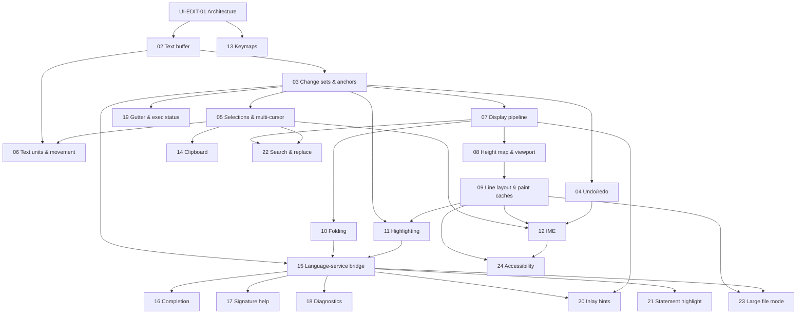

# 25 — SQL Editor Component (`hacivat-ui` on GPUI): Algorithm Catalog

> Status: canonical, implementation-ready. Date: 2026-11-11. IDs: `UI-EDIT-01 … UI-EDIT-24`.
> Governs: the SQL code editor inside our own published component library `hacivat-ui` (Apache-2.0) on GPUI, per `docs/decisions/0001-native-ui-on-gpui.md` (ADR 0001).
> Conventions, evidence tags and the ALG template: `docs/research/README.md`. Each spec adds **Sources merged**, **Decision**, **Verification status**, **Rust placement**, **i18n notes**, and performance budgets where relevant.
> Precedence: the verification reports (`verification/01-db-behavior-tests.md`, `verification/02-external-fact-check.md`) override any contradicted claim in the source documents. ADR 0001 supersedes the Tauri + CodeMirror recommendation in `clients/ui-01` §6 and `clients/ui-02` §5; CodeMirror 6 is kept only as an MIT **design reference**.

---

## 0. Scope, sources, licenses, clean-room rules

### 0.1 What this catalog covers

The editor is a GPUI view that edits SQL text and talks to the SQL language service (`sql-ide` in `hacivat-core`, `clients/sql-tooling-03` §5.1) through an LSP-shaped, in-process API. It covers: text buffer, transactions and undo, selections and multi-cursor, display pipeline (tabs, inlays, folds, soft wrap), virtualized line rendering and layout caches, syntax highlighting from our lossless tree, IME, keymaps, clipboard, the language-service bridge, completion, signature help, diagnostics, gutter and per-statement execution status, inlay hints, statement highlight and execution-range preview, search and replace, large-file mode and accessibility.

Out of scope (specified elsewhere): lexing, splitting, parsing, salsa semantics (`clients/sql-tooling-02/03`), completion context and ranking (`clients/sql-tooling-04` ALG-SQL-COMP-01/03), caret → execution range (`datagrip/07` ALG-EXEC-01/02), safety classification (`clients/sql-tooling-05`), data grid (`clients/ui-02` ALG-GRID-01..04), message catalogs (`algorithms/26-i18n.md`), MCP (`algorithms/27-mcp-server.md`).

### 0.2 Sources merged

| Source | What it contributes | License of studied project |
|---|---|---|
| `clients/ui-01-stack-decision.md` §3.2 | GPUI facts: `EntityInputHandler`, text system, AccessKit, `uniform_list`/`list`, `Pixels(f32)` | gpui Apache-2.0 |
| `clients/ui-02-code-editor-and-data-grid-components.md` §3.1, §3.4, ALG-GRID-01/04 | CodeMirror 6 architecture (state/view, transactions, decorations, height map, completion defaults, phrases), native editor options table, index-anchored scrolling, clipboard rules | CodeMirror MIT; gpui-component Apache-2.0; floem MIT; lapce Apache-2.0; ropey MIT |
| `clients/sql-tooling-03-parsing-architecture-rowan-salsa.md` | Lossless rowan tree, ALG-SQL-PARSE-02 incremental reparse, ALG-SQL-PARSE-03 salsa pipeline, crate layout (`sql-ide` LSP-shaped, offsets in bytes) | rowan/salsa/rust-analyzer MIT OR Apache-2.0 |
| `clients/sql-tooling-04-completion-and-resolution.md` | ALG-SQL-COMP-01 context, ALG-SQL-COMP-03 ranking, insertion rules, matching i18n rules | pgls MIT; pgcli BSD-3 |
| `datagrip/06-sql-language-and-editor.md` | Inlay hints (column names, JOIN cardinality: ALG-SQL-11/12), editing aids, parameter info, incremental reparse unit | Proprietary — behavior only |
| `datagrip/07-query-execution-ux.md` | Execute policies, statement chooser highlight, gutter cancel marker, large-file thresholds, ALG-EXEC-16/17 | Proprietary — behavior only |
| `i18n/02-turkish-and-db-specific-pitfalls.md` §3.11 | Turkish Q/F shortcut rules, AltGr collision rule, `ı/İ/I/i` normalization | — |
| `datagrip/12-localization.md` | Access-key rules, TR-Q/TR-F testing requirement | Proprietary — behavior only |
| Targeted code reading (this document) | See 0.3 | Apache-2.0 / MIT only |

### 0.3 Targeted research performed for this catalog (permissive sources only)

| Repository @ commit | Files read | License | Used for |
|---|---|---|---|
| `zed` @ `912159c` (2026-11-11), **crate `gpui` only** | `crates/gpui/src/input.rs:1-200`, `platform.rs:2348-2470, 2570-2600, 3125-3210, 3556-3561, 655-661`, `platform/keystroke.rs:18-33`, `platform/keyboard.rs:6-24`, `text_system/line_layout.rs:62-110, 496-560`, `elements/uniform_list.rs:22-40`, `elements/list.rs:24-40, 314-320`, `element.rs:107-137`, `window/a11y.rs:1-80`, `_accessibility.rs:1-200`; workspace `Cargo.toml:534-537` (AccessKit 0.24 / adapters) | Apache-2.0 (`crates/gpui/Cargo.toml:9`) | IME protocol, keystroke model, keyboard layout hooks, clipboard item model, line layout cache, a11y hooks |
| `gpui-component` @ `3c5320b` (2026-11-11) | `crates/base/src/input/editor/display_map/README.md`, file inventory of `input/base` and `input/editor`, `base/undo_manager.rs:1-64, 386-420` (doc comments), `base/a11y_text.rs:1-60, 135-190` (doc comments), `base/inline_tokens.rs` (doc comments), `editor/lsp/completions.rs` (signatures), workspace `Cargo.toml:90-100` | Apache-2.0 | Layered display map precedent, undo transaction bracketing, AccessKit text runs, ropey 2.0 beta usage |
| `codemirror-state` @ `9c80127` | `src/change.ts:6-20` (`MapMode`), `src/transaction.ts:240-290` (user events, `addToHistory`), `src/selection.ts:25-191` | MIT | Change mapping modes, user-event taxonomy, normalized multi-range selection with main index, goal column, assoc |
| `floem` @ `1351ffb` | `src/views/editor/phantom_text.rs:31-60` | MIT | Per-line phantom text (IME pre-edit, inlay hints, diagnostics) column translation |
| crates.io registry (2026-11-11) | metadata only | — | Versions: ropey 1.6.1 (2.0.0-beta.1 pre-release), accesskit 0.25.2, arboard 3.7.0, unicode-segmentation 1.13.3, unicode-width 0.2.3, icu_segmenter 2.4.0, regex-automata 0.4.18, regex-cursor 0.1.5 (MIT OR Apache-2.0), rowan 0.17.0, salsa 0.28.5, nucleo-matcher 0.3.1 (**MPL-2.0**), lsp-types 0.97.0 |

**Clean-room statement.** Zed's GPL-3.0-or-later crates (`editor`, `ui`, `workspace`, `rope`, `text`, `picker`, `multi_buffer`, `language`) were not opened. The display pipeline below is designed from CodeMirror 6's documented decoration/height-map model, gpui-component's public README, Floem's phantom-text concept and first principles. No code is copied; all pseudocode is ours. Permissive sources are cited with file paths so an implementer can decide on reuse with attribution.

### 0.4 Corrections applied from verification reports and the ADR

| Claim in sources | Status | Effect here |
|---|---|---|
| ui-01/ui-02: "Editor: CodeMirror 6 in a Tauri webview" | Superseded by ADR 0001 | Native GPUI editor; CM6 is a design reference only |
| ui-02 §3.4: gpui-component Editor "multi-cursor and inlay hints: [Unknown]" | Still unknown (no inlay symbol found in `input/editor`; `inline_tokens.rs` is atomic inline objects, not hints) | We build inlays ourselves (UI-EDIT-07, UI-EDIT-20) |
| ui-02 §6: "use `KeyboardEvent.code` for physical shortcuts" | Contradicted by i18n/02 §3.11.2 rule 1 (logical character first; physical only for non-character keys / AltGr chords) | i18n/02 wins (UI-EDIT-13) |
| verification/02 P33: Zed `rope`/`text`/`editor` GPL; `gpui`/`sum_tree` Apache-2.0 | Confirmed | `sum_tree` may be used (Apache-2.0) but is not published on crates.io; we do not depend on it (UI-EDIT-08 Decision) |

### 0.5 Cross-references to sibling canonical catalogs

Source-document ALG IDs cited below map to the canonical specs written in parallel in this folder; implementers should follow the canonical ID where both exist.

| Cited here (source ID) | Canonical spec |
|---|---|
| sql-tooling-02 ALG-SQL-LEX-02 (incremental relex) | `10-sql-lexing-splitting-params.md` SQL-LEX-03 |
| datagrip/06 ALG-SQL-01 / sql-tooling-03 resplit | `10` SQL-SPLIT-02, SQL-SPLIT-05 |
| sql-tooling-02 executable comments | `10` SQL-LEX-05 |
| datagrip/07 ALG-EXEC-01 (caret → units) | `10` SQL-SPLIT-04 and `20-query-execution.md` HV-EXEC-01 |
| datagrip/07 ALG-EXEC-02 (chooser) | `20` HV-EXEC-02 |
| datagrip/07 ALG-EXEC-09 (user parameters) | `10` SQL-PARAM-02, `20` HV-EXEC-03 |
| datagrip/07 ALG-EXEC-10/11 (output messages, cancel escalation) | `20` HV-EXEC-11, HV-EXEC-09 |
| datagrip/07 ALG-EXEC-16/17 (large-file runner, in-editor results) | `20` HV-EXEC-15, HV-EXEC-16 |
| sql-tooling-03 ALG-SQL-PARSE-02/03 | `11-sql-parsing-and-semantics.md` SQL-PARSE-04, SQL-SEM-01 |
| datagrip/06 ALG-SQL-12 (INSERT column↔value mapping) | `11` SQL-SEM-03 |
| sql-tooling-04 ALG-SQL-COMP-01/03 | `12-sql-completion-and-resolution.md` SQL-COMPL-01, SQL-COMPL-05 |
| datagrip/06 ALG-SQL-11 (JOIN cardinality) | `12` SQL-COMPL-02 step 5 |
| Signature data (datagrip/06 §3.15) | `12` SQL-COMPL-06 |
| sql-tooling-04 §3.5 identifier folding/quoting | `12` SQL-RES-02 and `26-i18n.md` I18N-08 |

---

## 1. Executive summary

1. **State/view split** (CodeMirror-style): an immutable, cheaply cloned `EditorSnapshot` (rope + selections + decorations + version) and a GPUI view entity that owns layout caches. All edits go through `Transaction`s (UI-EDIT-01, -03).
2. **Buffer = `ropey` 1.6.1 behind our own `TextBuffer` facade**, bytes as the canonical offset unit (matches rowan/`sql-text`), with O(log n) conversions to chars, lines and UTF-16. Line breaks are exactly LF, CR, CRLF; **original line endings are preserved byte-for-byte** so multi-line string literals are never silently changed (UI-EDIT-02).
3. **Change sets with explicit mapping modes** (simple/track-delete/track-before/track-after) drive anchors for diagnostics, execution status, inlays, folds and search hits (UI-EDIT-03).
4. **Undo groups by user-event kind + 500 ms idle + selection continuity**, brackets for IME and multi-cursor, selection-only undo, 1,000-group cap and a byte budget (UI-EDIT-04).
5. **Multi-cursor** = normalized sorted set of ranges with a main index; add-next-occurrence, column selection, per-cursor goal column (UI-EDIT-05); grapheme- and SQL-word-aware movement (UI-EDIT-06).
6. **Display pipeline** = decorations (mark, replace/fold, widget/inlay, line) composed per buffer line into visual fragments with tab expansion and soft wrap at layout time (UI-EDIT-07); vertical geometry in a **height map** with estimated heights for unlaid lines and index-anchored scrolling (UI-EDIT-08).
7. **Only visible lines are shaped**; a content-keyed LRU on top of GPUI's two-frame `LineLayoutCache` keeps scroll-back cheap; long lines render a horizontal window (UI-EDIT-09).
8. **Folding** from the lossless tree (statements, parenthesized subqueries, `CASE`, `BEGIN…END`, comment blocks, dollar-quoted bodies) with stable fold state across edits (UI-EDIT-10).
9. **Highlighting in three layers**: lexical (synchronous), syntactic (synchronous after incremental reparse), semantic tokens (async, mapped through edits until replaced) (UI-EDIT-11).
10. **IME** implements GPUI's `EntityInputHandler` exactly (UTF-16 document ranges, marked text, `bounds_for_range` for the candidate window, `notify_text_input_changed` after programmatic edits), handles both dead-key delivery paths, mirrors composition across cursors, and groups each composition into one undo step (UI-EDIT-12).
11. **Keymaps are data** (TOML per platform + layout overlays). Matching is by logical character with `ı/İ/I → i` normalization; physical fallback only for non-character keys. A CI test rejects any default chord that collides with AltGr characters on TR-Q, TR-F, DE, FR, PL. A DataGrip-like preset ships, with collision-safe substitutes (UI-EDIT-13).
12. **Clipboard**: whole-line copy without selection, multi-cursor round-trip via clipboard metadata, Linux primary selection, paste normalization and size guards (UI-EDIT-14).
13. **Language-service bridge**: versioned, cancellable, in-process requests (`completion`, `signatureHelp`, `inlayHints`, `semanticTokens`, `diagnostics`, `foldingRanges`, `statements`, `statementAtCursor`); stale results are mapped through intervening edits or dropped (UI-EDIT-15).
14. **Completion popup**: auto-activates on identifier chars and trigger chars after 100 ms, refilters locally while the prefix stays valid, renders ≤100 rows, and meets the ADR B3 budget of ≤ 50 ms to popup (UI-EDIT-16). Signature help is v1.x (UI-EDIT-17).
15. **Diagnostics** merge parser (immediate), semantic (debounced) and server-execution errors (anchored to the executed statement) into squiggles, gutter markers and a problems list (UI-EDIT-18).
16. **Gutter** shows line numbers, folds, run markers and **per-statement execution status** (queued/running/succeeded/failed/cancelling/cancelled/stale) anchored to statement ranges (UI-EDIT-19).
17. **Inlay hints**: INSERT column names and JOIN cardinality (DataGrip ALG-SQL-11/12), viewport-scoped and budgeted (UI-EDIT-20). **Statement highlight** shows the execution range the current policy would run before the user presses Execute (UI-EDIT-21).
18. **Search/replace**: literal, whole-word, regex (via `regex-cursor` over the rope), Turkish-tolerant case folding in literal mode, select-all-matches into multi-cursor (UI-EDIT-22).
19. **Large files** use three tiers: full features ≤ 4 MB; reduced (lexical highlighting, no semantics, no soft wrap) ≤ 20 MB; above that a read-only 2.5 MB preview plus "Run as script" (UI-EDIT-23, consistent with ALG-EXEC-16).
20. **Accessibility**: AccessKit `MultilineTextInput` with per-line `TextRun` children over a cursor-centered window, live-region announcements for completion, diagnostics and execution status (UI-EDIT-24).

---

## 2. Dependency map and priorities



External dependencies: `sql-text` (LineIndex), `sql-lexer`, `sql-split`, `sql-syntax`/`sql-parser` (rowan tree, ALG-SQL-PARSE-02), `sql-sema` (salsa), `sql-ide` (completion, inlays, folding, semantic tokens), `db-exec` (execution events), `hacivat-i18n` (Fluent bundles; `26-i18n.md`).

| ID | Name | Priority | Notes |
|---|---|---|---|
| UI-EDIT-01 | Component architecture (state/view split, extension points) | **v1** | Foundation |
| UI-EDIT-02 | Text buffer (rope facade) | **v1** | |
| UI-EDIT-03 | Change sets, transactions, position mapping, anchors | **v1** | |
| UI-EDIT-04 | Undo/redo with grouping | **v1** | |
| UI-EDIT-05 | Selections and multi-cursor | **v1** | Column selection v1; "select all occurrences" v1 |
| UI-EDIT-06 | Text units and cursor movement | **v1** | Bidi-correct visual movement is v1.x |
| UI-EDIT-07 | Display pipeline (decorations, tabs, inlays, folds, soft wrap) | **v1** | Soft wrap off by default |
| UI-EDIT-08 | Height map, viewport and scroll anchoring | **v1** | |
| UI-EDIT-09 | Virtualized line layout, paint layers, caches | **v1** | |
| UI-EDIT-10 | Folding | **v1** (statement + paren + block folds) / v1.x (persisted folds, region comments) | |
| UI-EDIT-11 | Syntax highlighting (lexical/syntactic/semantic) | **v1** lexical+syntactic / v1.x semantic | |
| UI-EDIT-12 | IME integration | **v1** (ADR validation gate) | |
| UI-EDIT-13 | Keymaps, dispatch, Turkish Q/F, DataGrip-like defaults | **v1** | Custom keymap editor UI v1.x |
| UI-EDIT-14 | Clipboard | **v1** | Rich (HTML) copy of SQL v1.x |
| UI-EDIT-15 | Language-service bridge | **v1** | |
| UI-EDIT-16 | Completion popup lifecycle and filtering | **v1** | |
| UI-EDIT-17 | Signature help | v1.x | |
| UI-EDIT-18 | Diagnostics and problem gutter | **v1** | |
| UI-EDIT-19 | Gutter and per-statement execution status | **v1** | |
| UI-EDIT-20 | Inlay hints (INSERT column names, JOIN cardinality) | v1.x | INSERT names first |
| UI-EDIT-21 | Statement highlight and execution-range preview | **v1** | |
| UI-EDIT-22 | Search and replace | **v1** | Search across open editors v1.x |
| UI-EDIT-23 | Large file mode | **v1** | |
| UI-EDIT-24 | Accessibility via AccessKit | **v1** (release blocker) | Braille-specific tuning later |

### 2.1 Global performance budgets (from ADR 0001 B3, refined)

| Path | Budget (p95, 50k-line / ~2 MB SQL file, release build, reference laptop) |
|---|---|
| Keystroke → next frame presented (typing latency) | ≤ 16 ms (ADR B3). Allocation: buffer edit ≤ 0.5 ms; relex + resplit + statement reparse ≤ 2 ms; decorations/anchors map ≤ 1 ms; display + height map update ≤ 1 ms; layout of dirty visible lines ≤ 4 ms; paint ≤ 4 ms; slack ≥ 3.5 ms |
| Keystroke → completion popup visible | ≤ 50 ms (ADR B3), of which activation delay 0 ms for trigger chars and the 100 ms typing delay is *not* counted (B3 measures explicit invoke and trigger chars) |
| Scroll frame (fling) | ≤ 8 ms CPU per frame at 120 Hz; no blank frame > 100 ms (B1 analogue) |
| Open 2 MB file → first paint | ≤ 150 ms (lexical highlight of the viewport only) |
| Open 2 MB file → full syntax tree + folds | ≤ 600 ms in background |
| Memory for a 2 MB file (rope + trees + caches) | ≤ 64 MB |

---

## 3. Crate placement overview

```
hacivat-ui (workspace, Apache-2.0, published)
  crates/hacivat-text        # UI-agnostic: TextBuffer (ropey facade), ChangeSet, Anchor, SelectionSet,
                             #   History, text units (graphemes/words), search engine. No GPUI dependency.
  crates/hacivat-ui-core     # thin GPUI adapter (ADR 0001 §3), theme tokens, i18n hooks, a11y helpers
  crates/hacivat-ui-editor   # GPUI view + element: display pipeline, height map, layout caches, IME,
                             #   keymap dispatch, clipboard, gutter, popups, AccessKit; language-agnostic.
                             #   Defines trait LanguageService (LSP-shaped) and DecorationSource.
hacivat (application, separate repo/workspace)
  crates/hacivat-sql-editor  # SQL adapter: implements LanguageService on top of hacivat-core sql-ide/sql-sema,
                             #   execution-status source from db-exec, statement-range source from sql-split.
hacivat-core
  sql-text, sql-lexer, sql-split, sql-syntax, sql-parser, sql-sema, sql-ide, ...   (sql-tooling-03 §5.1)
```

`hacivat-ui-editor` never depends on `hacivat-core` (ADR 0001 §4: core stays UI-agnostic; the published UI library stays language-agnostic). SQL knowledge enters only through the `LanguageService` trait (UI-EDIT-15) and `DecorationSource`s.

---

## 4. Algorithm specifications

### UI-EDIT-01: Component architecture — state/view split and extension points

- **Problem:** Structure the editor so that (a) every mutation is an explicit, inspectable transaction (undo, collaboration-readiness, MCP edits from the app), (b) background services (parser, salsa, completion) can read consistent snapshots without locking the UI, (c) features (gutter, inlays, completion, search) are pluggable without editing the core, and (d) GPUI churn is contained (ADR 0001 §3).
- **Inputs / outputs:** Inputs: user input events (keystrokes, IME calls, mouse, clipboard), programmatic transactions (app commands, formatter, MCP-originated edits applied by the app), language-service results. Outputs: rendered frames, `EditorEvent`s (`Changed{version, changes}`, `SelectionChanged`, `Focus`, `ExecuteRequested{policy}`), snapshots for readers.
- **Algorithm:**
  1. `EditorState` is an immutable value: `{ buffer: TextBuffer (persistent rope, O(1) clone), selection: SelectionSet, version: u64, decorations: DecorationSets, fields: TypeMap<StateField> }`. Cloning is O(1) (Arc-shared).
  2. Every change is a `Transaction { changes: ChangeSet, selection: Option<SelectionSet>, effects: Vec<Effect>, annotations: Annotations{ user_event, add_to_history, time, origin } }` (CodeMirror's model **[Observed: codemirror-state/src/transaction.ts:240-290]**).
  3. `dispatch(tr)`: (a) run *transaction filters* (e.g. read-only regions, max-size guard; a filter may veto or rewrite); (b) `new_state = old_state.apply(tr)`: buffer ← apply changes; selection ← `tr.selection` or `old.selection.map(changes)`; each `StateField.update(value, tr)` (history, folds, diagnostics anchors, exec-status anchors, search hits); version += 1; (c) run *transaction observers* (language-service bridge notifies `didChange`; IME `notify_text_input_changed` when origin ≠ IME); (d) mark view dirty with the changed line ranges.
  4. The view entity (`EditorView`) holds non-persistent caches only (layout cache, height map measurements, scroll anchor, popup state). On `render`, it derives a `DisplaySnapshot` (UI-EDIT-07) from the latest state and paints visible lines (UI-EDIT-09).
  5. Extension points (all registered at construction, order-stable):
     - `StateField<T>`: `init(&EditorState) -> T`, `update(&T, &Transaction) -> T`.
     - `DecorationSource`: `fn decorations(&self, snapshot, visible_buffer_range) -> DecorationSet` (highlighting, search hits, diagnostics, inlays, statement highlight).
     - `GutterColumn`: `fn width(&self, &DisplaySnapshot) -> Pixels`, `fn render_row(&self, row) -> Option<AnyElement>`.
     - `TransactionFilter`, `TransactionObserver`.
     - `Command`: named, keymap-bindable action `fn run(&mut EditorView, &mut Window, &mut Context) -> CommandResult`.
     - `PopupProvider` (completion, signature help, hover, statement chooser).
  6. Background readers receive `EditorSnapshot { state: EditorState, display_hint }` by value (Send + Sync); they never touch the view.
- **Data structures:** `EditorState` (Arc-based persistent), `Transaction`, `Annotations`, `TypeMap` keyed by `StateFieldId`, `EditorView` (GPUI entity), `DisplaySnapshot`.
- **Complexity / performance notes:** State clone O(1). `apply` is O(changes · log n) for the rope plus O(Σ field update). Fields must map anchors in O(k log n) for k anchors, never O(document).
- **Edge cases (exhaustive list):** transaction with empty change set but selection change (no version bump of buffer content, still `SelectionChanged`); transaction vetoed by a filter (no state change, optional beep/announcement); nested dispatch from an observer (queued and applied after the current dispatch, never re-entrant); dispatch while IME composition active from a non-IME origin (UI-EDIT-12 step 9: cancel composition first); dispatch on a disposed view (dropped with debug log); read-only editor (filter rejects all buffer changes; selections still allowed); programmatic transaction targeting a stale version (rejected unless rebased via `ChangeSet::map`); very large transactions (format whole file) — single dispatch, single undo step; observer panics (caught at the boundary in debug, propagated in tests).
- **Test cases (input → expected):**
  1. Type `a` at offset 0 of empty doc → version 1, buffer `a`, selection cursor at 1, history depth 1.
  2. Filter "read-only range [0,10)" + attempt to delete [5,6) → state unchanged, `Vetoed` event.
  3. Observer dispatches a transaction during `dispatch` → second transaction applied after first; final version = initial + 2.
  4. Snapshot taken before an edit is read on another thread after the edit → snapshot text unchanged.
  5. Selection-only transaction → buffer version unchanged, `SelectionChanged` emitted once.
- **Prior art and evidence:** CodeMirror `EditorState`/`Transaction`/`StateField`/facets **[Observed: codemirror-state/src/state.ts; transaction.ts:240-290; ui-02 §3.1.1]**; gpui-component editor separates `state.rs` and element **[Observed: crates/base/src/input/base/{state.rs,element.rs} inventory]**.
- **Used by:** Hacivat (all editors: SQL console, file editor, cell editor in grid for long text, DDL preview); Perde: no (web).
- **Sources merged:** ui-02 §3.1.1; ADR 0001; sql-tooling-03 §5.1.
- **Decision:** Immutable state + transactions (chosen). Rejected: mutable editor object with ad-hoc callbacks (gpui-component style mutable `InputState`) — harder to snapshot for background analysis and to test; full Elm-style re-creation per frame — too much allocation.
- **Verification status:** Design. To verify in the ADR spike: O(1) snapshot clone cost and dispatch overhead < 0.2 ms with 10 fields.
- **Rust placement:** `hacivat-text::state` (`EditorState`, `Transaction`, `StateField`), `hacivat-ui-editor::view` (`EditorView`).
  ```rust
  pub struct EditorState { buffer: TextBuffer, selection: SelectionSet, version: u64,
                           fields: Arc<FieldMap>, config: Arc<EditorConfig> }
  pub struct Transaction { pub changes: ChangeSet, pub selection: Option<SelectionSet>,
                           pub effects: SmallVec<[Effect; 2]>, pub ann: Annotations }
  pub struct Annotations { pub user_event: Option<UserEvent>, pub add_to_history: bool,
                           pub time: Instant, pub origin: Origin /* User|Ime|Program|LanguageService|Remote */ }
  pub trait StateField: Send + Sync + 'static { type Value: Clone + Send + Sync;
      fn init(s: &EditorState) -> Self::Value;
      fn update(v: &Self::Value, tr: &Transaction, new_buffer: &TextBuffer) -> Self::Value; }
  pub trait TransactionFilter { fn filter(&self, s: &EditorState, tr: Transaction) -> FilterResult; }
  ```
  Crates: `smallvec` 1.x, `im`-style persistence not needed (Arc + copy-on-write maps).
- **i18n notes:** Veto reasons and announcements are Fluent message IDs (`editor-readonly-region`); no English strings in the core.

### UI-EDIT-02: Text buffer — rope facade, line index, encodings

- **Problem:** Store and edit SQL text of up to 20 MB (UI-EDIT-23) with O(log n) edits and position conversions between the four coordinate systems the editor needs: **bytes** (rowan/`sql-text`, regex, language service), **chars** (ropey's native index), **UTF-16 code units** (GPUI `InputHandler`, AccessKit, LSP adapters), and **(line, column)**; and preserve the file's bytes exactly.
- **Inputs / outputs:** Inputs: initial bytes (with encoding detection result), edits `(byte_range, &str)`. Outputs: text slices, chunk iterators, conversions, `LineEnding` info, content hash.
- **Algorithm:**
  1. **Decode on load:** accept UTF-8 (with or without BOM); detect UTF-16LE/BE by BOM; anything else → ask the user for an encoding (via `encoding_rs`) or open as lossy read-only. Remember `bom: bool` and `encoding` for save. The BOM is **not** part of the buffer text.
  2. **Line breaks:** a line break is exactly `\n`, `\r\n`, or a lone `\r` (ropey built with `default-features = false, features = ["cr_lines", "simd"]`, so U+2028/U+0085 are *not* line breaks — consistent with SQL lexers and `sql-text::LineIndex`). `\r\n` is one break and must never be split by an edit boundary in line-based commands.
  3. **Preserve bytes:** do not normalize line endings on load. Compute `LineEndingStats { lf, crlf, cr }`; `dominant` = max (ties → LF). Newlines *typed* or inserted by commands use `dominant`. Pasted text is converted to `dominant` (UI-EDIT-14 step 6). If two or more kinds occur, show a non-blocking status-bar indicator "Mixed line endings" with an action "Normalize to …" (explicit transaction, single undo step).
  4. **Edits:** `replace(byte_range, text)`: assert `byte_range` lies on char boundaries (debug) or snap outward to boundaries (release, logged); convert to char indices with `byte_to_char` (O(log n)); `rope.remove(c0..c1)`; `rope.insert(c0, text)`.
  5. **Conversions** (all O(log n)): byte↔char (`byte_to_char`, `char_to_byte`), char↔UTF-16 (`char_to_utf16_cu`, `utf16_cu_to_char`), byte↔line (`byte_to_line`, `line_to_byte`). `(line, col)` columns are offered in three flavours: byte column (internal), UTF-16 column (LSP adapters), and display column (UI-EDIT-07, tab- and width-aware).
  6. **Snapshots:** the rope is persistent (clone shares nodes); snapshots for background threads are clones.
  7. **Content hash:** compute `xxh3` of the full text lazily and cache it per version (used for autosave dirty checks and session restore). Statement-level content addressing is the language service's job (sql-tooling-03 ALG-SQL-PARSE-02), so no per-chunk rolling hash is kept.
  8. **Invalid UTF-8 never enters the rope** (decoded on load); NUL characters are allowed and rendered as control-picture glyphs (UI-EDIT-09).
- **Data structures:** `TextBuffer { rope: ropey::Rope, meta: Arc<BufferMeta{ encoding, bom, line_endings: LineEndingStats }> }`.
- **Complexity / performance notes:** Edits O(log n + |text|); conversions O(log n); chunk iteration O(1) per chunk. Ropey chunks are ~1 KB, which suits `regex-cursor` (UI-EDIT-22) and the lexer's chunked input.
- **Edge cases (exhaustive list):** empty document (one empty line; line count 1); document ending with a line break (last line empty and addressable); lone `\r` at end followed later by insertion of `\n` right after it (forms CRLF — line count decreases by one; anchors must map correctly); insertion between `\r` and `\n` (splits CRLF into CR + LF — two breaks; only allowed by explicit byte edits, never by line commands); BOM present (excluded from text, restored on save); UTF-16 surrogate pairs (astral chars count 2 UTF-16 units); combining sequences (`İ` as `I`+U+0307 decomposed — kept as typed, NFC normalization is never applied silently); NUL bytes; very long single line (10 MB minified SQL) — rope handles; ropey's `Rope::from_str` on 20 MB in < 50 ms; byte range not on char boundary from a buggy client (snap + log); mixed line endings; file changed on disk while open (reload offers diff/keep; outside this spec); invalid UTF-8 on load (refuse editing, offer encoding choice).
- **Test cases (input → expected):**
  1. Load `"SELECT 1;\r\nSELECT 2;\n"` → lines 3, `line_to_byte(1) = 11`, stats `{crlf:1, lf:1}`, dominant LF (tie→LF).
  2. Load bytes with UTF-8 BOM → text excludes BOM, save writes BOM back.
  3. Insert `\n` at byte 2 of `"a\rb"` (between `\r` and `b`) → `"a\r\nb"`; line count stays 2 (the lone CR became a CRLF); an anchor at byte 2 with bias After maps to 3.
  4. `utf16` length of `"😀a"` = 3; `char_to_utf16_cu(1) = 2`.
  5. `byte_to_line` on 20 MB file at last byte < 5 µs.
  6. `"x\u{2028}y"` → 1 line (U+2028 is not a break).
  7. Typing Enter in a CRLF-dominant document inserts `\r\n`.
- **Prior art and evidence:** ropey (MIT) chosen by gpui-component **[Observed: gpui-component/Cargo.toml:97-100 `ropey = "=2.0.0-beta.1"` with `metric_chars`, `metric_lines_lf`, `metric_utf16`]**; CodeMirror normalizes to `\n` with a `lineSeparator` facet **[Inferred: CM docs; ui-02 §3.1]**; ui-02 §3.4 native buffer table.
- **Used by:** Hacivat (all editors); Karagöz: no (statement text only).
- **Sources merged:** ui-02 §3.4, sql-tooling-03 §6 (offsets are bytes; UTF-16 only at adapters), ADR 0001 (no Zed rope).
- **Decision:** **ropey 1.6.1 (stable, MIT) behind `TextBuffer`**, bytes canonical. Rejected: Zed `rope` (GPL-3.0-or-later; ADR forbids); ropey 2.0.0-beta.1 (byte-native and attractive, but pre-release; revisit when 2.0 is stable — the facade makes the swap local; note gpui-component pins the beta, so temporarily depending on gpui-component would pull both); lapce `xi-rope` fork (Apache-2.0, viable but smaller community, no UTF-16 metric); own rope (cost without benefit); piece table (Monaco-like; needs a separate line index, worse for persistent snapshots); normalizing line endings like CodeMirror (silently changes multi-line string literals sent to the database).
- **Verification status:** ropey API features `cr_lines`/`unicode_lines` and the listed conversion functions: [Inferred: ropey 1.x documentation; verify against the 1.6.1 docs before implementation]. Versions: Observed (crates.io 2026-11-11).
- **Rust placement:** `hacivat-text::buffer`.
  ```rust
  pub struct TextBuffer { rope: ropey::Rope, meta: Arc<BufferMeta> }
  pub struct BufferMeta { pub encoding: &'static encoding_rs::Encoding, pub bom: bool,
                          pub line_endings: LineEndingStats }
  pub enum LineEnding { Lf, CrLf, Cr }
  impl TextBuffer {
      pub fn len_bytes(&self) -> usize; pub fn len_utf16(&self) -> usize; pub fn len_lines(&self) -> usize;
      pub fn slice(&self, r: Range<usize>) -> RopeSlice<'_>;
      pub fn chunks_in(&self, r: Range<usize>) -> impl Iterator<Item = &str>;
      pub fn byte_to_utf16(&self, b: usize) -> usize; pub fn utf16_to_byte(&self, u: usize) -> usize;
      pub fn byte_to_line(&self, b: usize) -> usize; pub fn line_to_byte(&self, l: usize) -> usize;
      pub fn line_range(&self, l: usize, with_break: bool) -> Range<usize>;
      pub fn dominant_line_ending(&self) -> LineEnding;
      fn replace(&mut self, r: Range<usize>, text: &str); // crate-private: only via ChangeSet::apply
  }
  ```
  Crates (versions to check): `ropey` 1.6.1 (`default-features = false, features = ["cr_lines","simd"]`), `encoding_rs` 0.8.x, `xxhash-rust` (xxh3) 0.8.x.
- **i18n notes:** Encoding names and the "Mixed line endings" indicator are Fluent messages; no locale affects buffer semantics. Never apply case mapping or normalization to buffer text.

### UI-EDIT-03: Change sets, transactions, position mapping and anchors

- **Problem:** Represent edits so they can be applied, inverted (undo), composed (grouping, IME), and used to **map positions** of everything attached to the text (selections, diagnostics, execution-status ranges, inlays, folds, search matches, pending language-service results) with well-defined behavior when the surrounding text is deleted.
- **Inputs / outputs:** Inputs: list of `(byte_range_in_old_doc, inserted_text)` with non-overlapping ranges (sorted), or two change sets to compose. Outputs: `ChangeSet`, mapped positions/ranges or `None` (deleted), inverted change set.
- **Algorithm:**
  1. **Representation:** a `ChangeSet` is a sequence of sections over the *old* document: `Retain(len)` and `Replace{ del: len, ins: Text }`, covering the old length exactly (CodeMirror's sections model). `ChangeDesc` is the same without inserted text (cheap mapping-only form).
  2. **Construction:** sort input edits by start; reject overlaps (error) except identical empty insert points, which are concatenated in input order (multi-cursor inserting at the same point is prevented earlier by selection normalization).
  3. **Apply:** walk sections from the end of the document to the start so earlier offsets stay valid; each `Replace` → `buffer.replace`.
  4. **Invert(old_doc):** each `Replace{del, ins}` at old pos p becomes `Replace{del: |ins|, ins: old_doc[p..p+del]}` at new pos.
  5. **Compose(a, b)** (b applies to a's output): standard two-pointer merge over a's output space and b's input space producing sections over a's input space. Used by undo grouping and IME commit.
  6. **Map position** `map_pos(pos, assoc: Bias, mode: MapMode) -> Option<usize>`:
     - Walk sections accumulating `old` and `new` offsets.
     - Position strictly before a replaced range → shift by the accumulated delta.
     - Position inside a deleted range: `Simple` → map to the start (bias Before) or end of the insertion (bias After); `TrackDel` → `None` if deletion spans the position (not just touches it); `TrackBefore` → `None` if the char before is deleted; `TrackAfter` → `None` if the char after is deleted (CodeMirror semantics **[Observed: codemirror-state/src/change.ts:6-16]**).
     - Position exactly at an insertion point: bias Before → stays before the inserted text; bias After → moves after it.
  7. **Map range** `(from, to)` with per-end biases (`from` After, `to` Before for "content" ranges like diagnostics so insertions at the edges do not grow them; `from` Before, `to` After for "container" ranges like folds and execution ranges so typing at the end extends them). Empty result after mapping → `None` for content ranges.
  8. **Anchors:** `Anchor { offset: usize, bias: Bias, version: u64 }` stored in `AnchorSet`s inside state fields; each transaction maps all anchors of a set in one sorted pass O(k + sections). Large sets (search hits ≤ 100k, inlays) use the same pass.
  9. **Rebase a stale range from version v to current:** compose the change descs recorded since v (kept in a ring of the last 256 transactions' `ChangeDesc`); if v is older than the ring, the result is discarded (caller must recompute).
- **Data structures:** `ChangeSet { sections: SmallVec<[Section; 4]>, len_old, len_new }`; `ChangeDesc` (lengths only); `AnchorSet` (sorted `Vec<Anchor>` + payload ids); `ChangeLog` ring buffer `VecDeque<(u64, ChangeDesc)>` capacity 256.
- **Complexity / performance notes:** Mapping k sorted anchors through s sections O(k + s). Compose O(s_a + s_b). Ring rebase O(versions × sections).
- **Edge cases (exhaustive list):** edit at offset 0; edit at document end; deletion of the whole document (all anchors collapse to 0 or become None per mode); insertion exactly at an anchor with each bias; replacement that deletes and re-inserts identical text (still a change for history; anchors in TrackDel mode become None — diagnostics vanish until recomputed, by design); adjacent edits from multi-cursor (two sections touching); composing a change with its inverse (yields identity; history may drop the group — see UI-EDIT-04); edits splitting a CRLF; huge single insert (20 MB paste rejected earlier by UI-EDIT-14 guard); mapping through 256+ versions (discard); anchors exactly at the boundary between two adjacent replacements.
- **Test cases (input → expected):**
  1. Doc `SELECT a FROM t`, change `insert(7,"x")` → `map_pos(7, Before)=7`, `map_pos(7, After)=8`, `map_pos(9, any)=10`.
  2. Delete [5,10); anchor 7 → Simple/Before = 5; TrackDel = None; anchor 5 TrackDel → 5 (touching is not spanning).
  3. Diagnostic content range [7,8) and the user types at 8 → range stays [7,8); a fold container [0,15) and the user types at 15 → [0,16).
  4. `compose(insert(0,"a"), insert(1,"b"))` = `insert(0,"ab")`.
  5. `invert` of replace [0,6)→"select" on `SELECT 1` → replace [0,6)→"SELECT".
  6. Completion result computed at v10, current v13 with an edit far after the replace range → rebased replace range unchanged; edit inside the range → None (UI-EDIT-16 drops the item list).
- **Prior art and evidence:** CodeMirror `ChangeSet`/`ChangeDesc`/`MapMode` **[Observed: codemirror-state/src/change.ts:6-20]**; selection mapping with `assoc` **[Observed: selection.ts:45-84]**; rowan `replace_with` splicing for trees (sql-tooling-03 ALG-SQL-PARSE-02).
- **Used by:** Hacivat.
- **Sources merged:** ui-02 §3.1.1; sql-tooling-03 ALG-SQL-PARSE-02 (edit input shape `TextEdit{range, insert}`); datagrip/07 ALG-EXEC-17 (anchoring result blocks).
- **Decision:** Section-based change sets with four mapping modes (CodeMirror model, re-implemented). Rejected: per-anchor rope markers updated inside the rope (couples rope to features; O(k) per edit anyway); operational transform library (unneeded without collaboration).
- **Verification status:** Design; property tests required: `apply(invert(c)) ∘ apply(c) = id`, `compose` associativity, mapping monotonicity.
- **Rust placement:** `hacivat-text::change`.
  ```rust
  pub enum Section { Retain(usize), Replace { del: usize, ins: Arc<str> } }
  pub struct ChangeSet { sections: SmallVec<[Section; 4]>, len_old: usize, len_new: usize }
  #[derive(Clone, Copy)] pub enum Bias { Before, After }
  #[derive(Clone, Copy)] pub enum MapMode { Simple, TrackDel, TrackBefore, TrackAfter }
  impl ChangeSet {
      pub fn from_edits(len_old: usize, edits: impl IntoIterator<Item=(Range<usize>, Arc<str>)>) -> Result<Self, OverlapError>;
      pub fn apply(&self, b: &mut TextBuffer); pub fn invert(&self, old: &TextBuffer) -> ChangeSet;
      pub fn compose(&self, next: &ChangeSet) -> ChangeSet; pub fn desc(&self) -> ChangeDesc;
      pub fn map_pos(&self, pos: usize, bias: Bias, mode: MapMode) -> Option<usize>; }
  pub struct AnchorSet<T> { anchors: Vec<(usize, Bias, MapMode, T)> }
  ```
  Crates: `smallvec` 1.x; property tests with `proptest` 1.x.
- **i18n notes:** None (offsets only).

### UI-EDIT-04: Undo/redo history with grouping

- **Problem:** Undo should revert user-meaningful steps: a typed word, a paste, a completion, an IME composition, a multi-cursor edit, a format — not single keystrokes, and not merge unrelated actions. Selections must be restored. Memory must be bounded.
- **Inputs / outputs:** Inputs: transactions with annotations (`user_event`, `time`, `add_to_history`, `origin`), explicit boundaries (`History::seal()`), bracket begin/commit. Outputs: undo/redo transactions (changes + selection to restore).
- **Algorithm:**
  1. History state: `done: Vec<Group>`, `undone: Vec<Group>`; `Group { changes: ChangeSet (inverse to apply), sel_before: SelectionSet, sel_after: SelectionSet, kind: UserEvent, t_first, t_last, bytes }`.
  2. On a transaction with `add_to_history = false` (e.g. language-service formatting preview, remote) → map all groups' stored selections through its changes and rebase the stored inverse change sets (`map` through `tr.changes`) so undo still applies; do not record.
  3. On a selection-only transaction with `user_event = select.*` → record into a separate *selection history* (max 100 entries) for "Undo selection" (Ctrl/Cmd+U); do not touch `done`.
  4. Otherwise compute `inv = tr.changes.invert(old_buffer)`. **Join** with the top group `g` iff all hold:
     a. no seal since `g` (seals: focus change, execution of a statement, save, explicit `seal()`, a command flagged `history_boundary`, cursor moved by the user to a non-adjacent position);
     b. `kind` compatibility: same family among `input.type` (typing), `delete.backward`, `delete.forward`; never join `input.paste`, `input.complete`, `input.drop`, `format`, `undo/redo`, `input.type.compose` commits are joined only into the open composition bracket;
     c. `tr.time − g.t_last ≤ 500 ms` (new-group delay) [Inferred: CodeMirror `history({newGroupDelay: 500})` default; @codemirror/commands not cloned];
     d. **adjacency**: every change in `tr` continues the region the previous change in `g` produced (same cursor count, each cursor's edit starts where the group's corresponding edit ended) — gpui-component encodes the same "continues the change at the same position" rule **[Observed: gpui-component base/undo_manager.rs:414-420]**;
     e. word boundary rule for typing: if the inserted char is whitespace or `;` and the previous inserted char was not, close the group *after* this char (so undo removes one word plus its trailing space).
     When joined: `g.changes = inv.compose(g.changes)`; `g.sel_after = tr.selection`; `g.t_last = tr.time`.
     Else push a new group. Clear `undone`.
  5. **Brackets:** `begin(kind)` / `commit()` nest (counter). While open, all transactions join one group regardless of 4b–4e (IME composition, multi-cursor commands, snippet expansion, "complete statement", formatter) **[Observed: gpui-component undo_manager.rs:57-64 brackets nest]**.
  6. **No-op elimination:** if a group's composed change set is the identity (e.g. typed then deleted the same char within the group), drop the group (gpui-component's chain-identity check **[Observed: undo_manager.rs:386-390]**).
  7. **Undo:** pop `g` from `done`; dispatch `Transaction{ changes: g.changes, selection: g.sel_before, user_event: undo, add_to_history: false }`; push the inverse (relative to the current doc) to `undone` with swapped selections. Redo symmetric.
  8. **Bounds:** max 1,000 groups (gpui-component uses 1000 transactions **[Observed: undo_manager.rs:6]**) and max 64 MB of stored inserted/deleted text; evict oldest groups first. Groups holding > 16 MB (e.g. a huge replace-all) are kept but evict everything older.
  9. **Persistence:** history is per editor instance and in memory only; on file reload from disk, history is cleared (v1).
- **Data structures:** `History { done: VecDeque<Group>, undone: Vec<Group>, open_brackets: u32, bracket_group: Option<Group>, sel_history: VecDeque<SelectionSet> }`.
- **Complexity / performance notes:** Join O(s) for compose; undo O(changes · log n). Rebase on non-history transactions is O(groups × sections) — bounded by mapping only the top 64 groups eagerly and the rest lazily on access.
- **Edge cases (exhaustive list):** typing across 500 ms pause (two groups); typing then arrow-key move then typing (seal by non-adjacent cursor move); typing at two cursors (one group per gesture; cursor count change seals); backspace sequence then typing (different families → two groups); paste immediately after typing (separate); completion accept (own group: undo removes the completion only, restoring the typed prefix); IME composition with candidate changes (one group, final text only); IME cancelled (no group); format document (one group); replace-all of 10k matches (one group); execution of a statement (seal so "undo" does not cross runs); undo when the target text was changed by a non-history transaction (rebased); undo after a vetoed transaction (unchanged); redo stack cleared by a new edit; history overflow eviction; identity group dropped; undo restores selection including multi-cursor and main index; undo on read-only editor (disabled); undo while completion popup open (closes popup first, then undoes).
- **Test cases (input → expected):**
  1. Type `SELECT` (6 keystrokes within 500 ms) then undo → empty doc, cursor at 0.
  2. Type `SELECT 1` quickly → rule 4e closes the group after the space: groups `["SELECT "], ["1"]`; undo removes `1`; a second undo removes `SELECT `.
  3. Type `abc`, wait 600 ms, type `d` → two groups.
  4. Three cursors type `x` → one group; undo removes all three, restores three cursors.
  5. IME: compose `か` → `かな` → commit `仮名` → one group containing insertion of `仮名`.
  6. Type `a`, Backspace within 100 ms → group dropped as identity; undo stack empty.
  7. Run statement (Ctrl+Enter) between two typing bursts within 500 ms → two groups.
  8. Insert 1,001 separate groups → oldest evicted, 1,000 remain.
- **Prior art and evidence:** CodeMirror history semantics via user events **[Observed: transaction.ts:255-281]**; gpui-component undo manager brackets, coalescing and identity-chain rules **[Observed: base/undo_manager.rs:6-7, 57-64, 386-420]**; DataGrip/IntelliJ "undo groups per command" [Inferred].
- **Used by:** Hacivat.
- **Sources merged:** ui-02 §3.1; gpui-component reading; datagrip/07 (execution as user-visible boundary).
- **Decision:** Group by event family + time + adjacency + word rule, with brackets (chosen). Rejected: per-keystroke undo (noisy); pure time-based grouping (merges unrelated actions); persistent on-disk undo (v1.x candidate).
- **Verification status:** Design; 500 ms constant [Inferred]; to tune with user testing.
- **Rust placement:** `hacivat-text::history` as a `StateField`.
  ```rust
  pub struct History { done: VecDeque<Group>, undone: Vec<Group>, brackets: u32, open: Option<Group>,
                       sel_history: VecDeque<SelectionSet>, cfg: HistoryConfig }
  pub struct HistoryConfig { pub new_group_delay: Duration /*500ms*/, pub max_groups: usize /*1000*/,
                             pub max_bytes: usize /*64 MiB*/ }
  pub enum UserEvent { InputType, InputTypeCompose, InputPaste, InputDrop, InputComplete, DeleteBackward,
                       DeleteForward, DeleteSelection, DeleteCut, Move, Select, SelectPointer, Format, Undo, Redo, Command(&'static str) }
  ```
- **i18n notes:** Menu labels "Undo Typing"/"Undo Paste" are Fluent messages keyed by `UserEvent` (`editor-undo-typing`), never concatenated English.

### UI-EDIT-05: Selections and multi-cursor

- **Problem:** Support one or many cursors/ranges with predictable merging, keyboard and mouse creation (add caret above/below, Alt/Option-click, add next occurrence, select all occurrences, column/box selection), goal-column preservation on vertical moves, and correct behavior with folds, inlays and soft wrap.
- **Inputs / outputs:** Inputs: commands and pointer gestures, transactions (mapping). Outputs: `SelectionSet` (normalized), main index.
- **Algorithm:**
  1. `SelectionRange { anchor: usize, head: usize, goal_x: Option<f32 /* display x in px */>, assoc: Bias }` (byte offsets); `SelectionSet { ranges: SmallVec<[SelectionRange; 1]>, main: usize }`.
  2. **Normalize** after every change: sort by `from = min(anchor, head)`; merge two ranges if they overlap, or if both are non-empty and touch, or if a cursor lies inside a non-empty range; when merging, the merged range keeps the direction of the range that contained `main`, and `main` follows the merged range (CodeMirror normalization **[Observed: selection.ts:184-191]**). Cursors at the same position collapse to one.
  3. **Mapping:** each range maps both ends through the change set with `assoc` (cursor) or `(After, Before)` for non-empty ranges, mode `Simple`.
  4. **Add caret above/below** (DataGrip: Ctrl double-press + arrows / Alt+Shift+click; our binding UI-EDIT-13): for the main cursor (or all, if `add_for_all`), compute the display position one visual row up/down at `goal_x`; skip rows that are inside a fold (move to the fold's visual row) and rows shorter than `goal_x` (place at line end but keep `goal_x`). Duplicates collapse.
  5. **Add next occurrence** (DataGrip Alt+J, VS Code Ctrl+D): if main is empty, expand it to the word at the cursor (SQL word rules UI-EDIT-06) and mark the search as *whole-word, case-sensitive*; else search forward (wrapping) from the last added range for the next exact match of the main range text (case-sensitive by default; setting to follow find options); add it as the new main and scroll it into view. "Unselect last occurrence" removes it (DataGrip Shift+Alt+J).
  6. **Select all occurrences:** same matcher over the whole document; cap at 10,000 ranges (above: select the first 10,000 and announce truncation).
  7. **Column (box) selection** (Alt+Shift+drag or middle-drag; Alt+Shift+arrows): rectangle in *display columns* `[c0, c1)` over display rows `r0..=r1`; for each visual row produce a range from the buffer offset at display column c0 to c1, clamped to the line; rows shorter than c0 produce a cursor at line end only if `virtual_space` is off → v1: rows shorter than c0 are skipped except when all rows are shorter (then cursors at line ends). Tabs: columns inside a tab snap to the tab's start/end.
  8. **Escape** collapses multi-cursor to the main cursor; a second Escape collapses the main selection to its head.
  9. **Pointer:** click = single cursor; Shift+click = extend main; Alt/Option+click = add cursor (DataGrip Alt+Shift+click; both accepted on Windows/Linux, Option+Shift+click on macOS); double-click = word, triple-click = line (including its break); drag extends by the unit of the initial click.
  10. **Goal column:** set `goal_x` on the first vertical move from the current head's display x; preserve across successive vertical moves; reset on any horizontal move or edit.
- **Data structures:** `SelectionSet`, `OccurrenceState { query: String, whole_word: bool, case_sensitive: bool, last: usize }` as a state field.
- **Complexity / performance notes:** Normalize O(k log k); mapping O(k + s); add-next O(n) worst case per search (rope chunks; incremental from last position).
- **Edge cases (exhaustive list):** zero ranges (never; at least one cursor always); 10k+ cursors (cap; typing into 10k cursors must stay < 50 ms); cursor inside a fold after mapping (unfold that fold or move cursor to fold start — choice: unfold on edit, move on navigation); cursor inside an inlay (impossible: inlays are not buffer text — cursors sit before/after per side); selection ending between `\r` and `\n` (snap to after `\n`); selection inside a grapheme cluster (snap to cluster boundary); add-next with a selection spanning lines; add-next when no further match (beep + announce); occurrence search with regex metacharacters (literal); box selection across lines with tabs and wide (CJK) chars; box selection crossing a fold (folded rows count as one row); main cursor deleted by merge; Escape when completion popup visible (closes popup first); IME composition active (multi-cursor creation commands disabled until composition ends).
- **Test cases (input → expected):**
  1. Ranges [5,8) and [7,10) → normalized to [5,10).
  2. Cursors at 3 and 3 → one cursor.
  3. `SELECT id FROM t WHERE id = 1` cursor in first `id`, add-next twice → ranges at both `id`s (whole-word: does not match `id` inside `idx`).
  4. Add caret below from line 1 col 20 onto a 5-col line 2 then to a 30-col line 3 → line 2 cursor at col 5, line 3 cursor at col 20 (goal preserved).
  5. Box select display cols [4,8) over `a\tb` (tab width 4) and `abcdefgh` → line 1 range snaps to tab end..b, line 2 `efgh`.
  6. 3 cursors, Escape → main cursor only.
- **Prior art and evidence:** CodeMirror `EditorSelection` with `mainIndex`, normalization and goal column **[Observed: codemirror-state/src/selection.ts:25-191]**; Floem editor-core `selection.rs`, `cursor.rs` (MIT) [Observed: file inventory]; DataGrip multi-caret shortcuts [Inferred: IntelliJ default keymap knowledge — verify with the shipped keymap reference]; CodeMirror `rectangular-selection.ts` **[Observed: ui-02 §3.1.3 file list]**.
- **Used by:** Hacivat.
- **Sources merged:** ui-02 §3.1.3; datagrip/06 §3.13 (editing aids); i18n/02 §3.11 (bindings).
- **Decision:** Byte-offset ranges with display-x goal (chosen). Rejected: virtual space (cursor beyond line end) in v1 — rarely needed in SQL, complicates box selection.
- **Verification status:** Design. Multi-caret binding defaults: [Inferred] pending keymap verification (UI-EDIT-13).
- **Rust placement:** `hacivat-text::selection` (model, normalization, mapping); `hacivat-ui-editor::commands::selection` (display-aware commands).
  ```rust
  pub struct SelectionRange { pub anchor: usize, pub head: usize, pub goal_x: Option<f32>, pub assoc: Bias }
  pub struct SelectionSet { ranges: SmallVec<[SelectionRange; 1]>, main: usize }
  impl SelectionSet { pub fn normalized(ranges: impl IntoIterator<Item=SelectionRange>, main: usize) -> Self;
                      pub fn map(&self, c: &ChangeDesc) -> Self; pub fn main(&self) -> &SelectionRange; }
  ```
- **i18n notes:** Announcements ("3 cursors", "No more occurrences") via Fluent with plural selectors; whole-word detection uses SQL identifier rules, not locale word breaking.

### UI-EDIT-06: Text units and cursor movement

- **Problem:** Define characters, words and lines for movement, deletion and double-click in a SQL editor: grapheme-correct for Turkish, emoji and CJK; SQL-aware words (identifiers with `_`, `$`, `#`, quoted identifiers, numbers, operators like `::`, `->>`, `<=`); sub-word (camelCase/snake_case) movement as an option.
- **Inputs / outputs:** Inputs: buffer, offset, direction, unit, optional syntax tokens. Output: target offset.
- **Algorithm:**
  1. **Character** = extended grapheme cluster (UAX #29) computed with `unicode-segmentation` on the line's text (lines are short; for lines > 64 KB compute on a ±4 KB window). Backspace deletes the whole cluster, except for clusters of Hangul jamo or Indic conjunct sequences, where it deletes the last code point (platform convention); Delete always deletes the whole cluster.
  2. **CRLF** is a single unit for movement and deletion.
  3. **Word (SQL):** classify each char: `Ident` (Unicode `XID_Continue` ∪ dialect extras `$` `#` `@`), `Space`, `Punct` (operators and punctuation), `LineBreak`. When syntax tokens for the line are available (lexer output cached for highlighting, UI-EDIT-11), words are token-based: a quoted identifier `"Order Lines"`, a string literal, a number `1.5e-3`, an operator token `->>` are each one word; dollar-quote tags and parameter markers (`:name`, `$1`, `@p`) are one word. Fallback to char classes when tokens are unavailable (reduced mode).
  4. **Word movement** (Ctrl/Alt+Left/Right): skip `Space` run, then one word (token or class run). Stop at line breaks (a line break is its own stop).
  5. **Sub-word** (setting, default off; DataGrip "CamelHumps"): within an `Ident` word split at `_` and lower→upper transitions; ASCII-only case detection for transitions (no locale casing).
  6. **Line start (Home):** smart home — first press to first non-whitespace char of the visual row (wrapped) or buffer line; second press to column 0. **End:** end of visual row, then end of buffer line.
  7. **Vertical:** move by visual rows (soft wrap aware) using `goal_x` (UI-EDIT-05); PageUp/Down by viewport height minus one row; cursors keep relative viewport position.
  8. **Bidi:** v1 moves logically (by offset) for both arrows; mixed-direction lines show the caret at the logical position's visual x (GPUI shaping). Visual-order movement is v1.x (GPUI RTL is incomplete **[Observed: ui-01 §3.2.4, line_layout.rs:253]**).
  9. **Double-click word** uses rule 3; on a quoted identifier selects including quotes; on a string literal selects the literal *content* first, a second double-click selects with quotes.
- **Data structures:** per-line `CharClassCache` (LRU, 512 lines); token spans from the highlight cache.
- **Complexity / performance notes:** O(line length) worst case per movement; cached segmentation makes repeated moves O(1) amortized.
- **Edge cases (exhaustive list):** `İ` decomposed (I + U+0307) is one cluster; `ı` and `i` are distinct letters but both `Ident`; emoji ZWJ sequence one cluster; regional-indicator flags; tab character (one unit); NUL and control chars (one unit each); a word movement across a 1 MB line (bounded window); identifiers with `$` in PG (`a$b` one word) vs MySQL; T-SQL `[My Table]` bracket identifier (one word); MySQL backtick identifiers; PG `E'..'` and dollar-quoted strings; comments (`--` comment words are natural-language words: within comments use UAX #29 word boundaries via `unicode-segmentation` `split_word_bounds`); a cursor between `\r` and `\n` (snap); sub-word on `ID`/`userID`/`HTTPServer` (ASCII transitions only: `HTTP|Server`); Turkish identifiers `müşteriAdı` sub-word split at `A` (ASCII uppercase transition) but not at `ü`.
- **Test cases (input → expected):**
  1. `SELECT a.b::int` Ctrl+Right from 0 → 6 (after `SELECT`), → 8 (`a`), → 9 (`.`), → 10 (`b`), → 12 (`::`), → 15 (`int`).
  2. `"Order Lines"` double-click inside → selects `"Order Lines"` (with quotes).
  3. `👩‍💻x` Right from 0 → after the ZWJ sequence (byte 11).
  4. `I\u{307}` Backspace at end → deletes both code points.
  5. Home on `    SELECT` at col 8 → col 4, Home again → col 0.
  6. Sub-word on `customer_order_id` Ctrl+Right (camel on) → stops at `customer|_`, `order|_`, `id|`.
- **Prior art and evidence:** Floem editor-core `word.rs`, `movement.rs` (MIT) [Observed: inventory]; gpui-component `base/movement.rs` (Apache-2.0) [Observed: inventory]; CodeMirror `charcategory.ts` **[Observed: codemirror-state/src/charcategory.ts present]**; i18n/02 Turkish letter table.
- **Used by:** Hacivat.
- **Sources merged:** ui-02 §3.1.2 (bidi), sql-tooling-04 §3.5 (identifier rules), i18n/02 §3.1.
- **Decision:** Token-based SQL words with char-class fallback; grapheme clusters via `unicode-segmentation` (chosen). Rejected: ICU4X segmenter for code (heavier; dictionary-based word breaking is wrong for code) — `icu_segmenter` 2.4.0 remains the choice for UI prose truncation in `26-i18n.md`.
- **Verification status:** Design.
- **Rust placement:** `hacivat-text::units`.
  ```rust
  pub enum Unit { Grapheme, Word, SubWord, VisualRow, Line, Page, Document }
  pub trait TokenOracle { fn tokens_on_line(&self, line: usize) -> Option<&[TokenSpan]>; }
  pub fn move_offset(buf: &TextBuffer, at: usize, dir: Dir, unit: Unit, tok: &dyn TokenOracle) -> usize;
  ```
  Crates: `unicode-segmentation` 1.13.x, `unicode-ident` 1.x (XID).
- **i18n notes:** No locale-dependent word breaking for SQL code; comments use UAX #29 (language-neutral). Case transitions for sub-words are ASCII-only (no Turkish casing).

### UI-EDIT-07: Display pipeline — decorations, tab expansion, inlays, folds, soft wrap

- **Problem:** Turn buffer lines plus attached decorations into *visual rows*: hide folded ranges, insert inlay hints and IME pre-edit as non-buffer text, expand tabs, wrap long lines, and keep exact two-way mapping between buffer offsets and display positions (for hit testing, caret drawing, IME bounds, AccessKit geometry) — without computing anything for lines outside the viewport.
- **Inputs / outputs:** Inputs: `EditorState`, `DecorationSet`s from sources (UI-EDIT-01 step 5), `DisplayConfig { tab_size, soft_wrap: Off|Viewport|Column(n), font metrics, show_whitespace }`, viewport buffer-line range. Outputs: `DisplaySnapshot` with `visual_lines(range)`, `buffer_to_display(offset, bias) -> DisplayPoint`, `display_to_buffer(DisplayPoint, bias) -> usize`.
- **Algorithm:**
  1. **Decoration kinds** (CodeMirror's four **[Observed: ui-02 §3.1.3; codemirror-view/src/decoration.ts]**):
     - `Mark { range, style }` — styling (syntax, search hits, diagnostics underline, statement highlight background).
     - `Replace { range, widget: Option<Widget>, block: bool }` — hides `range`, optionally showing a placeholder widget (fold `…` chip). Multi-line replace merges buffer lines into one visual line.
     - `Widget { pos, side: i8, widget, block: bool }` — inline (inlay hint, IME pre-edit is *not* a widget, see 4) or block (in-editor result panel, ALG-EXEC-17; error lens line) at `pos`; `side < 0` sticks before the position, `> 0` after.
     - `Line { line_start, attrs }` — whole-line background or gutter class (execution range, current line).
  2. **Composition per buffer line L** (only for lines in viewport ± overscan): collect decorations intersecting `[line_start, line_end]` from all sources (each source exposes a `RangeSet` with O(log n + k) range queries). Resolve `Replace` first: if a replace starts in L and ends in a later line M, the visual line is the concatenation `L[..r.start] + placeholder + M[r.end..]`; lines strictly inside are skipped; continue with M's remainder (it may contain further replaces).
  3. Build **fragments** in buffer order: `Text { buffer_range, style_runs }`, `Inlay { text, style, side }`, `Placeholder { fold_id }`, `Tab { buffer_offset, width_cols }`, `Control { offset, glyph }` (NUL, other C0/C1 controls, U+FEFF inside text, bidi controls → visible markers when `show_invisibles`; always visible: NUL and U+FEFF).
  4. **IME pre-edit** is ordinary buffer text in our model (GPUI marked text replaces buffer content, UI-EDIT-12), styled by a `Mark` with underline. (Floem renders pre-edit as phantom text **[Observed: floem phantom_text.rs:31-41]**; we do not, so offsets reported to the OS stay buffer-true.)
  5. **Tab expansion:** a tab at display column c occupies `tab_size − (c mod tab_size)` columns; columns count East-Asian-wide chars as 2 (`unicode-width`), zero-width marks as 0, inlays as their own column width (inlays occupy display columns but no buffer columns).
  6. **Soft wrap** (default **Off** for SQL): if on, after shaping the visual line (UI-EDIT-09) break at the last allowed break opportunity ≤ wrap width: allowed after whitespace, after `,`, before/after operators, never inside a token shorter than the width, never inside a grapheme cluster, never inside an inlay; tokens longer than the width break at grapheme boundaries. Continuation rows are indented by the line's leading indentation + 1 indent unit (hanging indent), capped at 40% of width.
  7. **Coordinates:** `DisplayPoint { row: VisualRowId, x: Pixels }` where `VisualRowId = (anchor_buffer_line, wrap_index)` — rows are identified by their first buffer line, not by a global row number, because rows of unlaid lines are only estimated (UI-EDIT-08). Column-based APIs (box selection) use `display_col` from step 5.
  8. **buffer_to_display(offset, bias):** locate the visual line containing offset (if offset is inside a `Replace`, map to the placeholder with bias), find the fragment, and compute x from the shaped line (`ShapedLine::x_for_index` **[Observed: gpui text_system/line_layout.rs:109]**). For inlays anchored exactly at the offset the rule is deterministic: bias `Before` → caret x before all inlays at that offset; bias `After` → after them. Cursor movement sets the bias from the direction of travel (moving right arrives with `After`, moving left with `Before`), so the caret never appears inside an inlay.
  9. **display_to_buffer(point, bias):** shape (or reuse) the row, `closest_index_for_x` **[Observed: line_layout.rs:79]**, map index → fragment → buffer offset; hits inside an inlay snap to the inlay's anchor position; hits inside a placeholder → fold start (click on the chip unfolds, UI-EDIT-10).
  10. **Incremental update:** on a transaction, mark visual lines intersecting the changed ranges (mapped) as dirty; decoration sources report their own dirty ranges (e.g. semantic tokens arrived for statement k); only dirty visible lines are recomposed.
- **Data structures:** `DecorationSet` = immutable interval tree / sorted chunked `RangeSet<Decoration>` (CodeMirror `RangeSet` analogue) mapped through change sets; `VisualLine { first_buffer_line, last_buffer_line, fragments: SmallVec<[Fragment; 8]>, wraps: SmallVec<[WrapBreak; 2]> }`; `DisplaySnapshot { state, visual_line_cache: LruCache<(line, version_of_line), Arc<VisualLine>> }`.
- **Complexity / performance notes:** Per visible line O(fragments + decorations on the line); total O(visible lines) per frame; decoration range queries O(log D + k). No work proportional to document size except for fold/inlay *counts* in the height map (UI-EDIT-08).
- **Edge cases (exhaustive list):** fold whose range starts mid-line and ends mid-line in another line; nested folds (outer wins; inner state preserved); fold containing the cursor after an edit (UI-EDIT-10 rule); inlay at a fold boundary (hidden if inside the replaced range, shown if at the edges by side); two inlays at the same position (stable order by source priority then insertion order); inlay inside an IME composition range (hidden while composing); tab after an inlay (tab width computed with inlay columns); wide CJK char straddling wrap width (moves to next row); zero-width joiners; line consisting only of a fold placeholder; soft wrap with width smaller than one character (force one grapheme per row, min width 1 column); width change (re-wrap visible lines only; height map re-estimates others); `show_invisibles` for spaces/tabs; bidi controls U+202A–U+202E/U+2066–U+2069 (always shown as markers to prevent "Trojan Source" confusion in reviewed SQL); very long line (UI-EDIT-09 step 6 horizontal window); block widget at document start/end; CRLF never shown as two glyphs.
- **Test cases (input → expected):**
  1. Line `\tSELECT` tab_size 4 → `S` at display col 4; with an inlay `/*id*/` (6 cols) before `\t` at col 0 the tab spans cols 6–8 (2 cols) and `S` is at col 8.
  2. Fold [10, 40) across lines 1–3 → one visual line: `line1[..10] + "…" + line3[40-line3_start..]`; `buffer_to_display(25)` → placeholder x; `display_to_buffer(click on chip)` → 10.
  3. Inlay `col:` (side −1) at offset 20; caret at 20 with bias After → x after the inlay.
  4. Soft wrap 20 cols on `SELECT customer_id, order_id FROM t` → breaks after `customer_id,` (col 19) and before `FROM`.
  5. U+202E in a string literal → rendered as a visible marker; buffer unchanged.
  6. NUL byte → control-picture glyph `␀`, one display column.
- **Prior art and evidence:** CodeMirror decorations and `RangeSet` **[Observed: ui-02 §3.1.3]**; gpui-component layered `WrapMap` → `FoldMap` → `DisplayMap` with `BufferPos/WrapPos/DisplayPos` **[Observed: gpui-component display_map/README.md]**; Floem phantom text per line with `col_at` translation **[Observed: floem phantom_text.rs:43-60]**.
- **Used by:** Hacivat.
- **Sources merged:** ui-02 §3.1.2–3.1.3; datagrip/06 §3.11 (inlays); datagrip/07 ALG-EXEC-17 (block widgets for in-editor results).
- **Decision:** CodeMirror-style decoration composition per visible line, with wrapping at layout time (chosen). Rejected: a global layered map (wrap/fold maps covering the whole document, gpui-component style) — whole-document rewrap on width change is O(n) and needs per-line shaping or monospace assumptions that break with CJK/emoji fallback fonts; Zed-style layered maps (GPL, not studied).
- **Verification status:** Design; GPUI `ShapedLine` index/x APIs Observed at `912159c`.
- **Rust placement:** `hacivat-ui-editor::display`.
  ```rust
  pub enum Decoration { Mark { style: StyleId }, Replace { widget: Option<WidgetId>, block: bool },
                        Widget { widget: WidgetId, side: i8, block: bool }, Line { class: LineClass } }
  pub trait DecorationSource: 'static { fn id(&self) -> SourceId; fn priority(&self) -> i16;
      fn decorations(&self, snap: &EditorSnapshot, range: Range<usize>) -> Arc<RangeSet<Decoration>>;
      fn dirty_since(&self, version: u64) -> Option<Vec<Range<usize>>>; }
  pub struct DisplayPoint { pub row: VisualRowId, pub x: Pixels }
  pub struct VisualRowId { pub first_line: u32, pub wrap_index: u16 }
  ```
  Crates: `unicode-width` 0.2.x.
- **i18n notes:** Placeholder chip text (`…`) is locale-independent; fold tooltips ("12 lines folded") are Fluent messages with plurals. Inlay hint text is data (column names) — never translated.

### UI-EDIT-08: Height map, viewport and scroll anchoring

- **Problem:** Know the vertical position of any visual line without laying out the whole document (folds, wrapped lines, block widgets have different heights), keep scrolling stable when heights become known or change above the viewport, and avoid `f32` precision loss for large documents (GPUI `Pixels(f32)` **[Observed: ui-01 §3.2.1, geometry.rs:2736]**).
- **Inputs / outputs:** Inputs: line count, fold set, block widgets, measured heights from layout, viewport height, scroll input. Outputs: `visible_line_range`, y of each visible row relative to the viewport, scrollbar thumb, `scroll_to(offset, strategy)`.
- **Algorithm:**
  1. **Height map** = balanced tree (or chunked Fenwick array) over *buffer lines* with per-node `(lines, height_px: f64, has_measured)`. Leaves cover runs of lines. Each line's height = `line_height × wrap_rows + block_widgets_above_below`; folded lines inside a fold contribute 0 (the first line of the fold carries the merged visual line's height).
  2. **Estimation** for unlaid lines (CodeMirror `HeightOracle` idea **[Observed: ui-02 §3.1.2; heightmap.ts]**): soft wrap off → exactly `line_height` (no estimation error); soft wrap on → `ceil(display_cols(line) / cols_per_row) × line_height` where `display_cols` is computed cheaply from char widths (`unicode-width`) without shaping — exact for monospace ASCII, approximate for fallback fonts. Measured heights replace estimates when lines are laid out.
  3. **Scroll state is anchored**, not absolute: `ScrollAnchor { line: u32, wrap_index: u16, offset_in_row: f32 }` plus horizontal `scroll_x: f64`. Absolute y = `height_map.y_of(line) + rows_before(wrap_index) + offset` is computed in **f64** only for the scrollbar.
  4. **Wheel/trackpad delta Δ:** move the anchor by Δ pixels walking rows forward/backward through the height map (O(log n) to find the target line; within the line by row heights). Clamp at document top and at `max_anchor` (last row aligned to bottom, plus "scroll past end" of `viewport_h − line_height` by default).
  5. **Visible range:** from the anchor, walk rows until `viewport_h + overscan (= 1 viewport)` is filled; laid-out rows report measured heights; if a measured height differs from its estimate for a row **above** the anchor, do not move content: the anchor is row-based, so only the scrollbar thumb changes (scroll anchoring for free).
  6. **Programmatic scroll** (`scroll_to(offset, strategy: Nearest|Center|Top)`): compute the row containing offset; Nearest → no scroll if fully visible, else minimal; Center for jumps (search hit, diagnostic navigation); keep 2 rows of margin (`scroll_margin`).
  7. **Scrollbar:** thumb fraction = `y_anchor / (total_height − viewport_h)` in f64; dragging maps a fraction back to `y` and then to an anchor via the height map. Diagnostics, search hits, execution status and the current statement are drawn as **scrollbar markers** (bucketed per pixel row to avoid overdraw).
  8. **Large documents:** with 1M lines × 20 px = 2·10⁷ px (> f32 exact range 2^24 ≈ 1.67·10⁷), GPUI coordinates are only ever *viewport-relative* (rows painted at `y = Σ heights from anchor`), so precision is preserved (same principle as ALG-GRID-01 row-index anchoring).
- **Data structures:** `HeightMap` (chunked: leaves of up to 256 lines storing `Vec<f32>` heights; inner nodes store `(lines, f64 height, measured_lines)`), `ScrollAnchor`, `ScrollbarMarkers` (sorted `(y_fraction, kind)`).
- **Complexity / performance notes:** `y_of(line)` and `line_at(y)` O(log n); edit updates O(log n + changed lines); fold toggle O(log n + lines in fold) for zeroing (lazy: store fold ranges as nodes with height override).
- **Edge cases (exhaustive list):** empty document; document shorter than the viewport (no scrolling except scroll-past-end disabled); edit above the viewport that inserts 1,000 lines (anchor line index shifts via change mapping — content stays still); deleting the anchor line (anchor maps to the nearest surviving line, offset 0); fold/unfold above the viewport (content stays still); font-size zoom (keep anchor; recompute heights lazily); viewport resize (keep anchor, recompute visible); soft-wrap toggle (anchor's wrap_index reset to the row containing the cursor if visible, else 0); block widget (in-editor results) growing above the viewport; measured height of a line with a fallback emoji font taller than `line_height` (row height = max(line_height, glyph bounds) — v1: clamp glyph overflow, keep uniform rows when soft wrap off); smooth vs line scrolling; trackpad momentum (coalesce per frame); scrollbar drag to bottom (exact `max_anchor`); 1M-line file at bottom (row positions exact).
- **Test cases (input → expected):**
  1. 50,000 lines, wrap off, line height 20 → total height 1,000,000 px; `line_at(y=999,990)` = 49,999.
  2. Anchor at line 1,000; insert 500 lines at line 10 → anchor line 1,500, visible text unchanged.
  3. Wrap on, line 400 estimated 1 row, measured 3 rows while the viewport is at line 800 → visible content unchanged; thumb moves.
  4. 1,000,000 lines, scrollbar to 100% → last line at viewport bottom; painted y values all < viewport height.
  5. `scroll_to(offset in line 30,000, Center)` → line 30,000 vertically centered ± 1 row.
- **Prior art and evidence:** CodeMirror height map, `HeightOracle`, viewport margin `VP.Margin = 1000`, `BigScaler` for > 7e6 px **[Observed: ui-02 §3.1.2; viewstate.ts:52-60, 695-720]**; GPUI `list` keeps a `SumTree` of item heights with a scroll anchor **[Observed: elements/list.rs:314-320]**; ALG-GRID-01 index-anchored scroll (ui-02).
- **Used by:** Hacivat.
- **Sources merged:** ui-02 §3.1.2 and ALG-GRID-01; ui-01 §3.2.3 (GPUI lists).
- **Decision:** Own chunked height map + row anchor (chosen). Rejected: GPUI `uniform_list` (fixed-height items only; breaks with folds/block widgets/wrap) — fine for the gutter-less "large file preview" (UI-EDIT-23); GPUI `list` with one item per line (per-item element overhead for 50k–1M lines, no control over shaping caches); Zed's `sum_tree` crate (Apache-2.0 but not published on crates.io; vendoring possible later if our tree proves slow).
- **Verification status:** Design. Spike B3 must confirm ≤ 8 ms scroll frames.
- **Rust placement:** `hacivat-ui-editor::display::height_map`.
  ```rust
  pub struct HeightMap { chunks: Vec<Chunk>, index: FenwickTree<f64> /* per-chunk heights */ }
  pub struct ScrollAnchor { pub line: u32, pub wrap_index: u16, pub offset_in_row: f32 }
  impl HeightMap { pub fn y_of(&self, line: u32) -> f64; pub fn line_at(&self, y: f64) -> (u32, f64);
                   pub fn set_measured(&mut self, line: u32, h: f32); pub fn apply(&mut self, c: &ChangeDesc, buf: &TextBuffer); }
  ```
- **i18n notes:** None (geometry). Scrollbar marker tooltips are Fluent messages.

### UI-EDIT-09: Virtualized line layout, paint layers and caches

- **Problem:** Shape and paint only what is visible, reuse shaping across frames and scroll-back, keep long lines cheap, and paint selection, carets, decorations and gutter in a fixed layer order within the 16 ms budget.
- **Inputs / outputs:** Inputs: visible visual lines (UI-EDIT-07), height map anchor (UI-EDIT-08), theme, focus/blink state. Output: GPUI paint calls for one frame; updated measured heights; cached `ShapedLine`s.
- **Algorithm:**
  1. **Element structure:** one custom GPUI `Element` (`EditorElement`) for the text area and one for the gutter, both inside a flex container; no per-line GPUI elements (avoids element overhead for hundreds of rows). Popups (completion, signature help, chooser) are separate overlay elements anchored to caret bounds.
  2. **Prepaint:** compute visible rows from the anchor; for each visual line, build the **style runs** (merge `Mark` decorations by priority into non-overlapping runs: syntax < semantic < search hit < statement highlight bg < selection-text color; underline styles are separate runs merged into decoration layers, not text runs).
  3. **Shaping cache key:** `(hash(visual line text including inlays), hash(style runs that affect shaping: font family/weight/style per run), font_size, wrap_width or None)`. Colors are **not** in the key (repaint without reshaping on theme or highlight color changes; colors applied at paint by run). Lookup order: GPUI's frame cache (it reuses lines laid out in the previous frame **[Observed: text_system/line_layout.rs:496-560]**) → our `LruCache` (capacity 4,096 visual lines or 32 MB) → `window.text_system().shape_line(...)` / `layout_line`.
  4. **Measured heights** feed back into the height map (UI-EDIT-08 step 5).
  5. **Paint layers** (back to front): (1) editor background; (2) line-class backgrounds (current line, execution range, statement highlight); (3) search-hit and occurrence backgrounds; (4) selection rectangles (merged per row; rounded corners optional); (5) text runs; (6) inlay hint chips (background + text, dimmed); (7) underlines/squiggles (diagnostics) and IME composition underline; (8) carets (main caret thicker or same; secondary carets same width), drop-cursor for drag; (9) block widgets (in-editor results); (10) overlays (popups) via GPUI deferred draw.
  6. **Long lines** (> 10,000 display columns or > 64 KB): shape only a horizontal **window** of the line around the visible x range ± 1 viewport width (CodeMirror line gaps, `LG.Margin = 2000` **[Observed: ui-02 §3.1.2; viewstate.ts:106-110]**). The window start is snapped to a grapheme boundary; x positions outside the window are estimated from average advance and corrected when scrolled into view. Soft wrap is disabled for such lines.
  7. **Caret blink:** 530 ms half-period (platform setting where available), stop blinking after 10 s idle (power), no blink while typing; caret repaint uses a dirty-rect-only frame.
  8. **Dirty tracking:** a frame repaints if any of: state version changed, decorations dirty in visible range, scroll changed, focus/blink toggled, popup changed. Text shaping happens only for lines whose cache key changed.
  9. **Hidden/occluded windows:** no frames; caches kept.
- **Data structures:** `LayoutCache = LruCache<ShapeKey, Arc<ShapedVisualLine>>`; `ShapedVisualLine { rows: SmallVec<[ShapedLine-or-WrappedLine; 1]>, fragment_x_map, height }`; `PaintPlan` (vectors of rects/quads per layer).
- **Complexity / performance notes:** Per frame O(visible rows × runs). Cache hit rate target ≥ 95% during scroll-back. Budget per frame (60 rows visible): style-run build ≤ 1 ms, shaping of ≤ 5 new rows ≤ 2 ms, paint ≤ 3 ms.
- **Edge cases (exhaustive list):** font fallback mid-line (CJK, emoji) changing row height; ligatures in programming fonts (`->`, `!=`) — ligatures are disabled by default (setting `font_ligatures = false`) because caret positions inside a ligature are ambiguous; when enabled, a caret inside a ligature is drawn at the x that `x_for_index` returns; theme switch (no reshape); zoom (reshape all visible; cache keyed by font size); DPI change across monitors (GPUI handles raster; cache stays valid as layout is in logical pixels); a visible line with 1,000 style runs (pathological highlighting; cap runs per line at 512 by merging adjacent same-style runs); 100 secondary carets on screen; selection spanning folded region (paint selection over the placeholder chip); extremely tall block widget (clip to viewport); window minimized; rendering while IME candidate window open (bounds must match painted caret, UI-EDIT-12).
- **Test cases (input → expected):**
  1. Scroll down 1,000 lines and back → second pass ≥ 95% cache hits (counter).
  2. Change theme → 0 shaping calls, full repaint.
  3. 1 MB single-line minified SQL → frame time ≤ 16 ms; shaping limited to the window; caret at end positioned within ±2 px after scrolling there.
  4. Typing a character in a visible line → exactly 1 line reshaped.
  5. 60 visible rows with semantic tokens → style-run build ≤ 1 ms (bench).
- **Prior art and evidence:** GPUI `LineLayoutCache` two-frame reuse and `shape_line`/`layout_line` **[Observed: text_system.rs:672-716, 852; line_layout.rs:496-560]**; CodeMirror viewport + line gaps **[Observed: ui-02 §3.1.2]**; gpui-component `base/element.rs`, `display_map/text_wrapper.rs` [Observed: inventory].
- **Used by:** Hacivat.
- **Sources merged:** ui-01 §3.2.2–3.2.4; ui-02 §3.1.2.
- **Decision:** Single custom element per area + content-keyed LRU above GPUI's frame cache (chosen). Rejected: one GPUI element per line (overhead, no shaping control); relying only on GPUI's two-frame cache (scroll-back reshapes everything).
- **Verification status:** GPUI APIs Observed; budgets to verify in ADR spike B3.
- **Rust placement:** `hacivat-ui-editor::element` (`EditorElement`, `GutterElement`), `hacivat-ui-editor::layout_cache`.
  ```rust
  #[derive(Hash, Eq, PartialEq)] pub struct ShapeKey { text_hash: u64, font_runs_hash: u64, font_size_bits: u32, wrap_width_bits: Option<u32> }
  pub struct LayoutCache { lru: lru::LruCache<ShapeKey, Arc<ShapedVisualLine>>, bytes: usize, max_bytes: usize }
  ```
  Crates: `lru` 0.12.x (MIT), `xxhash-rust` 0.8.x.
- **i18n notes:** Font fallback lists come from theme data and must cover Turkish Latin Extended-A (`ğ ı İ ş`) in the bundled monospace font (i18n/02 §3.12); CI renders a Turkish/CJK/emoji sample and asserts no `.notdef` glyphs.

### UI-EDIT-10: Folding

- **Problem:** Let users collapse statements, subqueries, `CASE` expressions, `BEGIN … END` blocks, dollar-quoted bodies and comment blocks, derived from the lossless tree, with fold state that survives edits and reparse.
- **Inputs / outputs:** Inputs: fold candidates from the language service (`foldingRanges(snapshot) -> Vec<FoldCandidate{range, kind, collapsed_text}>`), user toggles, edits. Outputs: `Replace` decorations (UI-EDIT-07), gutter fold markers (UI-EDIT-19), height-map overrides.
- **Algorithm:**
  1. **Candidates** (computed per statement by `sql-ide`, cached by statement content id): statement spanning ≥ 2 lines (fold from end of first line to the statement's end, placeholder `…;`); parenthesized subquery/derived table/CTE body (from after `(` to before `)`); `CASE … END` (after `CASE` line end to before `END`); `BEGIN … END`, `LOOP … END LOOP`, `IF … END IF` (PL/pgSQL, T-SQL, MySQL compound); dollar-quoted body; consecutive `--` comment lines (≥ 2) and `/* */` comments spanning ≥ 2 lines; `INSERT … VALUES` with ≥ 3 rows (fold the rows); optional region markers `-- region <name>` / `-- endregion` (v1.x).
  2. Candidate must start and end on different lines; the fold range begins at the end of its first line so the header stays visible.
  3. **Fold state** is a `StateField`: `folded: AnchorSet<FoldId>` storing the folded ranges as container anchors (`from` Before, `to` After). On edits, ranges map through changes (UI-EDIT-03); a fold whose range collapses or becomes single-line is dropped.
  4. **Reconciliation after reparse:** for each folded range, find a new candidate with the same kind whose range overlaps ≥ 80% (or identical start line and kind); snap the fold to it; if none, keep the mapped range until the next edit inside it, then drop.
  5. **Edits inside a fold:** if a transaction changes text inside a folded range (e.g. replace-all, programmatic), keep folded; if the user's *cursor* lands inside a folded range (navigation, search hit, go-to-line, diagnostic jump), unfold the innermost containing fold.
  6. **Commands:** toggle fold at cursor (innermost candidate containing the cursor line), fold all statements, unfold all, fold all comments, fold to level N.
  7. **Persistence (v1.x):** per file path, store folded ranges as `(start_line, kind, content_hash_of_first_line)` and restore when the hash matches.
- **Data structures:** `FoldState { folded: AnchorSet<FoldId>, candidates_version: u64 }`; `FoldCandidate { range, kind: FoldKind, placeholder: Option<String> }`.
- **Complexity / performance notes:** Candidate extraction per statement O(statement nodes); reconciliation O(folds log candidates).
- **Edge cases (exhaustive list):** nested folds (outer hides inner; unfolding the outer restores inner state); fold whose end line is the last line without trailing newline; deleting the line containing a fold header (fold dropped); typing `)` that changes paren structure (reconcile); fold over a statement that has an execution-status gutter marker (marker stays on the header line); search hit inside a fold (unfold on navigation, not on highlight); select-all + copy with folds (copies hidden text too); fold candidates while in reduced large-file mode (comment and paren folds from lexer only); fold placeholder showing row count; in-editor result block attached inside a folded statement (hidden with it).
- **Test cases (input → expected):**
  1. 3-line `SELECT … FROM … WHERE …;` fold → one visual line `SELECT …;` placeholder; gutter shows unfold marker.
  2. Fold subquery then type in the outer statement above it → fold remains.
  3. Go-to-line into a folded region → that fold opens.
  4. Fold then delete the opening `(` → candidate disappears; fold dropped on next edit inside.
  5. Two consecutive `--` lines → foldable; one line → not.
- **Prior art and evidence:** gpui-component `FoldMap` stores hidden-row runs with binary search and region-scoped candidate extraction after edits **[Observed: display_map/README.md]**; DataGrip structure/breadcrumbs (datagrip/06 §3.13); sql-tooling-03 reparsable node kinds (paren subquery, BEGIN/END, dollar body).
- **Used by:** Hacivat.
- **Sources merged:** sql-tooling-03 ALG-SQL-PARSE-02 (reparsable node kinds), gpui-component reading, datagrip/06 §3.13.
- **Decision:** Tree-derived candidates + anchored fold state with overlap reconciliation (chosen). Rejected: indentation-based folding (SQL formatting varies); folding only via user-selected ranges.
- **Verification status:** Design.
- **Rust placement:** `hacivat-ui-editor::folds` (state field + commands); candidates from `LanguageService::folding_ranges` (UI-EDIT-15) implemented in `hacivat-sql-editor` via `sql-ide`.
- **i18n notes:** Fold tooltips "{ $count } lines folded" with plural rules; placeholder glyph `…` locale-independent.

### UI-EDIT-11: Syntax highlighting from the lossless tree, incrementally

- **Problem:** Highlight SQL immediately on every keystroke, correctly across dialects, without waiting for semantic analysis; upgrade colors with semantic information (table vs column vs alias vs function vs unknown) when available; never block the UI thread on a large file.
- **Inputs / outputs:** Inputs: snapshot, dialect, lexer tokens and rowan tree from `sql-syntax` (incremental per ALG-SQL-PARSE-02), semantic tokens from `sql-sema`. Outputs: `Mark` decorations (style ids) for the visible range.
- **Algorithm:**
  1. **Layer L1 — lexical (synchronous):** after each transaction the language service runs incremental relex (ALG-SQL-LEX-02, resync to old token stream) on the UI thread for edits < 64 KB; token kinds map to style classes: keyword, identifier, quoted identifier, string, number, comment, operator, punctuation, parameter (`$1`, `:name`, `?`, `@p`), dollar-quote tag, executable comment (`/*! */`, highlighted distinctly because it executes on MySQL — verification/01 #16), optimizer hint (`/*+ */`), psql meta-command, error token.
  2. **Layer L2 — syntactic (synchronous if ≤ 2 ms, else next frame):** the incrementally reparsed statement tree refines token roles: keywords used as identifiers (`SELECT "user"`, PG non-reserved `name`, `type`), function-call names, type names after `::`/`CAST … AS`, alias definitions, CTE names, labels; ERROR nodes get a subtle error-token style (squiggles are diagnostics, UI-EDIT-18).
  3. **Layer L3 — semantic (async, v1.x):** `semanticTokens(snapshot, range=visible statements)` via the bridge (UI-EDIT-15), debounced 150 ms after the last edit; token types: table, view, materialized view, column, alias, CTE, function, aggregate, procedure, type, schema, parameter, variable, unknown-reference (dimmed or underlined dotted); modifiers: primary-key, foreign-key, deprecated, system-object.
  4. **Merge:** per token, L3 overrides L2 overrides L1; while a newer L3 result is pending, the previous L3 tokens are mapped through the intervening change sets (TrackDel mode: tokens touched by edits drop to L2 until refreshed).
  5. **Caching:** highlight spans are cached **per statement content id** (sql-tooling-03 content-addressed statements) as relative offsets, so moving a statement (insert above it) costs no recomputation; the visible range is assembled by shifting cached spans.
  6. **Embedded languages:** dollar-quoted PL/pgSQL bodies and T-SQL procedure bodies are highlighted from their child documents (sql-tooling-03 §2 item 15); JSON literals cast to `json/jsonb` (datagrip/06 §3.14 injections) — v1.x.
  7. **Theme mapping:** style classes → theme tokens (`syntax.keyword`, …) in `hacivat-ui` themes; keyword *case* is never changed by highlighting.
  8. **Large files:** in reduced mode (UI-EDIT-23) only L1, computed lazily for the viewport ± 1,000 lines with a resync from the nearest cached lexer checkpoint (every 1,000 lines a checkpoint stores lexer state).
- **Data structures:** `HighlightCache: HashMap<StmtContentId, Arc<[Span{rel_range, class}]>>` (LRU 2,048 statements); `LexCheckpoints: Vec<(byte_offset, LexState)>`; semantic token store keyed by version.
- **Complexity / performance notes:** L1 O(changed tokens); L2 O(reparsed node); assembly O(visible tokens). Budget: L1+L2 ≤ 2 ms per keystroke on statements < 10 KB; ≤ 5 ms on a 50 KB statement (node-level reparse).
- **Edge cases (exhaustive list):** typing `/*` opens a comment that swallows the rest of the file (relex continues to EOF but is cancellable after the visible range; beyond-visible re-highlight finishes in background); unterminated string/dollar quote; changing the editor's dialect (full re-highlight); MySQL `DELIMITER //` lines; T-SQL `GO` lines; executable comments with version gates (`/*!80000 … */` highlighted as code inside); PG `E'\''` escapes; `standard_conforming_strings=off` (lex mode from connection settings); keywords that are identifiers in one dialect only; psql `\` meta-commands; Unicode identifiers (`müşteri`); semantic results arriving for an older version (mapped or dropped); theme lacking a token color (fallback chain: semantic → syntactic → lexical → foreground).
- **Test cases (input → expected):**
  1. `SELECT "select" FROM t` → first `SELECT` keyword, `"select"` quoted identifier.
  2. PG `SELECT name, type FROM t` → `name`, `type` identifier (L2), not keyword.
  3. MySQL `SELECT 1 /*!80000 , 2 */` → `, 2` highlighted as code with an executable-comment background.
  4. Type `/*` at line 1 of a 50k-line file → visible area recolored within the frame; full-file relex completes in background ≤ 300 ms, cancellable.
  5. Insert a line above statement 40 → statement 40 spans shifted, no recomputation (counter).
- **Prior art and evidence:** sql-tooling-03 (lossless tree, incremental reparse, content-addressed statements) **[Observed: rust-analyzer reparsing.rs; pgls document.rs]**; LSP semantic tokens model (gpui-component LSP glue `lsp/semantic_tokens.rs` **[Observed: inventory]**); CodeMirror Lezer incremental highlighting [Inferred: ui-02 §3.1.5].
- **Used by:** Hacivat.
- **Sources merged:** sql-tooling-02/03 (lexer, reparse), sql-tooling-04 (resolution for semantic tokens), datagrip/06 §3.14 (injections), verification/01 #16 (executable comments execute).
- **Decision:** Our lexer/parser drive highlighting (chosen). Rejected: tree-sitter grammars (second grammar to keep consistent; sql-tooling-03 §5.2 "do not use in core"); regex highlighting (gpui-component fallback) — wrong for dollar quotes and dialect lexing.
- **Verification status:** Design; budgets to verify in B3.
- **Rust placement:** `hacivat-sql-editor::highlight` implements `DecorationSource`; style classes enum in `hacivat-ui-editor::theme`.
  ```rust
  pub enum HighlightClass { Keyword, Ident, QuotedIdent, String, Number, Comment, Operator, Punct, Param,
      DollarTag, ExecComment, Hint, MetaCommand, ErrorToken, Function, Type, Alias, Cte, Table, View, Column,
      Schema, Variable, Unknown }
  ```
- **i18n notes:** Highlighting is language-neutral; identifier classification never uses locale case mapping (ASCII keyword tables; i18n/02).

### UI-EDIT-12: IME integration with GPUI (marked text, UTF-16 ranges, candidate window, dead keys)

- **Problem:** Make composition-based input (Japanese, Chinese, Korean IMEs; macOS dead keys; Linux IBus/Fcitx preedit; Windows TSF) and dead-key layouts (Turkish Q/F, US-International, German) work exactly like native text fields: correct marked text, caret, candidate window placement, undo, and interaction with multi-cursor, completion and keybindings. This is an ADR 0001 validation gate ("IME" row).
- **Inputs / outputs:** Inputs: GPUI `InputHandler` calls (all ranges in **UTF-16 code units over the whole document** **[Observed: gpui platform.rs:2361-2364]**), key events. Outputs: buffer transactions, marked range state, geometry answers.
- **Algorithm:** implement `EntityInputHandler` on `EditorView` **[Observed: gpui input.rs:27-150]**:
  1. **State:** `ime: Option<Composition { marked: Range<usize> /* bytes, primary cursor */, mirrors: Vec<Range<usize>> /* other cursors */, bracket_open: bool }>`.
  2. `selected_text_range(ignore_disabled)` → main selection converted bytes→UTF-16, with `reversed = head < anchor` (`UTF16Selection` **[Observed: platform.rs:2351-2358]**). Return `None` if the editor is read-only and `ignore_disabled` is false.
  3. `marked_text_range()` → `ime.marked` in UTF-16, else `None`.
  4. `text_for_range(range_utf16, adjusted)` → clamp to document length, snap both ends outward to char boundaries (never split a surrogate pair); if snapped, set `*adjusted = Some(snapped_utf16)`; return the text.
  5. `replace_and_mark_text_in_range(range, text, new_sel)` (composition update):
     a. If no composition: open history bracket `begin(InputTypeCompose)` (UI-EDIT-04), cancel completion auto-activation timers, hide signature help (keep completion popup closed while composing).
     b. Target range = `range` (UTF-16 → bytes) if given, else current marked range, else the main selection.
     c. Dispatch a transaction replacing the target with `text` with `origin = Ime`, `add_to_history = true` (joined in the bracket). Mirror: apply the same replacement relative to each other cursor (the delta of the primary target relative to the primary cursor is applied to each mirror; mirrors that would cross a neighbour are dropped from the composition).
     d. `ime.marked = target.start .. target.start + text.len()` (or `None` if `text` is empty → composition ended without commit).
     e. Selection inside the marked text = `new_sel` (UTF-16, **relative to the start of the marked text**, per AppKit `setMarkedText:selectedRange:` semantics); clamp.
     f. Do **not** call `notify_text_input_changed` for IME-originated changes (the platform already knows).
  6. `replace_text_in_range(range, text)` (commit or plain insertion): target = `range` if given, else marked range if composing, else each selection (multi-cursor typing). Dispatch with `user_event = InputType` (or `InputTypeCompose` if composing); clear `ime`; close the history bracket; then run post-insert hooks (auto-close brackets/quotes, completion trigger check UI-EDIT-16, signature help trigger).
  7. `unmark_text()` → keep text, clear `ime`, close bracket (commit-as-is).
  8. `bounds_for_range(range_utf16, element_bounds)` (candidate window placement **[Observed: platform.rs:2440-2450 "used for positioning the IME candidate window"]**): convert to bytes; take `range.start` (or the marked range start); compute its display point (UI-EDIT-07) using the **current frame's** layout; return a rect `{x, y: row_top, w: max(1, glyph_advance), h: line_height}` in window coordinates (`element_bounds.origin + viewport offset`). If the position is scrolled out of view, scroll it into view first (`Nearest`) — composition must stay visible; if the layout for that row is stale (just edited, not yet laid out), return the estimated rect from the height map and request a frame. For a range start inside a fold, unfold first.
  9. **Programmatic edits during composition** (formatter, completion acceptance, undo, external change): first commit the composition as-is (`unmark_text` semantics), then apply the edit, then call `window.notify_text_input_changed(focus)` **[Observed: window.rs:5663; input.rs:17-20]** so the OS IME resets.
  10. `character_index_for_point(point)` → `display_to_buffer` → UTF-16.
  11. `selection_bounds_for_range` → selection rectangles per visual row (merged runs) for native selection geometry; `text_length_utf16` → `buffer.len_utf16()`; `text_input_configuration` → `autocorrect: false, autocapitalize: None, suggestions: false` (SQL is code) **[Observed: TextInputConfiguration platform.rs:2573-2585]**.
  12. **Keybindings vs composition:** while `ime.is_some()`, keystrokes go to the platform IME first; editor bindings for Enter, Escape, Tab, arrows, Backspace, Space and Ctrl/Cmd+letter are **suppressed** unless the platform delivers them as non-composition key events; Escape cancels composition (platform) and only a *second* Escape reaches editor commands.
  13. **Dead keys, path A (marked-text delivery: macOS, IBus/Fcitx preedit, TSF):** the dead key arrives as `replace_and_mark_text_in_range("´" or "^" …)` → shown underlined; the next key arrives as `replace_text_in_range(None, "â")` replacing the marked text → one insertion, one undo group. If the next key cannot combine (e.g. `^` then `;`), the platform commits `"^;"` or `"^"` + `";"` — both handled by steps 5–6.
  14. **Dead keys, path B (direct delivery, e.g. Windows WM_DEADCHAR without TSF composition):** the dead keystroke arrives as a key event with no character (`key_char = None` **[Observed: gpui Keystroke.key_char semantics, keystroke.rs:28-32]**); the editor must **not** treat it as a binding trigger or insert anything; the following character event carries the combined char. Show nothing pending (platform convention) — optional status hint "dead key pending" is v1.x.
  15. **Turkish specifics:** Turkish Q `^` (Shift+3) and AltGr dead keys (`~`, `` ` ``, `´`) are dead on Windows [Inferred: KBDTUQ layout; verify]; typing PG operators `~`, `^`, `~*`, `!~` requires dead key + Space. Tests in the IME matrix ensure exactly one `~`/`^` is inserted, no marked text remains, and completion does not open on the dead key. `ı/İ` are plain keys (no composition).
  16. **Completion interplay:** composition never triggers completion; after commit, the trigger check runs on the committed text (e.g. committed `ü` is an identifier char → may auto-activate after the delay).
- **Data structures:** `Composition` (above); UTF-16↔byte conversions via `TextBuffer` (O(log n)).
- **Complexity / performance notes:** Each IME call O(log n) conversions + one transaction; `bounds_for_range` must answer in < 1 ms using cached layout (IMEs call it repeatedly while candidates are shown).
- **Edge cases (exhaustive list):** composition at document start/end; composition replacing a non-empty selection; composition with multi-cursor (mirrors; mirror dropped when it would overlap another); composition when the main cursor is inside a fold (unfold first); composition inside an inlay position (inlays at the composition point are hidden while composing); IME reconversion (`text_for_range` + `replace_and_mark_text_in_range` with an explicit range over existing text — e.g. macOS Japanese reconversion); IME sending ranges past document end (clamp); surrogate-splitting ranges (snap + `adjusted_range`); empty marked text update (composition cancelled); focus loss during composition (platform commits or cancels; we follow `unmark_text`/`replace_text_in_range`); window moved/resized during composition (bounds recomputed next call); scroll during composition (candidate window follows on next `bounds_for_range`; we call `notify_text_selection_changed` if available); undo during composition (commit first, then undo the commit group); read-only editor (reject replacements; `accepts_text_input` → false); Korean IME commit on space/arrow; Chinese pinyin with numeric candidate selection (digits must not trigger editor bindings); emoji picker insertion (plain `replace_text_in_range` of an astral char); dictation (macOS) inserting long text with marked ranges; Linux Wayland `text-input-v3` surrounding-text limits (GPUI concern; test).
- **Test cases (input → expected):** (IME matrix run on macOS, Windows, Linux X11, Linux Wayland — ADR IME gate)
  1. macOS Japanese: type `kana` → marked `かな` underlined at the caret, candidate window directly below the composition start (±2 px); Space → `仮名`; Enter → committed; buffer contains `仮名`; one undo group removes it.
  2. Doc `😀|` (UTF-16 len 2): `selected_text_range` → `2..2`; `text_for_range(1..2)` → snaps to `0..2`, `adjusted = Some(0..2)`.
  3. Turkish Q (Windows): AltGr+`ü` (dead `~`) then Space in `WHERE name |` → inserts exactly one `~`; no marked text; no completion popup.
  4. macOS US layout Option+e then e → `é` inserted, one undo group, no binding fired for Option+e.
  5. Three cursors, Japanese composition → each cursor shows the same marked text; commit inserts at all three; undo removes all three.
  6. Completion popup open, start composition → popup closes; after commit of `ü` popup may reopen after 100 ms.
  7. Formatter runs (programmatic) during composition → composition committed as-is, `notify_text_input_changed` called once, formatted text applied.
  8. Caret at line 49,000 in a 50k-line file: `bounds_for_range` answers in < 1 ms (bench).
- **Prior art and evidence:** GPUI `EntityInputHandler` / `InputHandler` contract and AppKit correspondences **[Observed: input.rs:1-150; platform.rs:2348-2470]**; gpui-component wires IME in `base/native.rs` and brackets IME in undo **[Observed: inventory; undo_manager.rs:57-64]**; CodeMirror `input.type.compose` user event **[Observed: transaction.ts:258-260]**; Floem pre-edit as phantom text **[Observed: phantom_text.rs:32-33]**; ui-01 §3.2.4 ("right shape for robust IME … Turkish dead keys").
- **Used by:** Hacivat (all text inputs share the core; the grid cell editor reuses the handler).
- **Sources merged:** ui-01 §3.2.4, ADR 0001 (IME gate), i18n/02 §3.11, gpui reading.
- **Decision:** Marked text lives in the buffer (chosen; offsets reported to the OS are buffer-true). Rejected: pre-edit as phantom text (Floem) — complicates UTF-16 range reporting and reconversion. Multi-cursor composition mirroring (chosen, VS Code-like [Inferred]) vs primary-only (simpler) — flagged as a product decision (§5).
- **Verification status:** GPUI API Observed at `912159c`; behavior per platform **unverified** — the IME matrix above is the acceptance test of the ADR spike. Turkish dead-key behavior [Inferred; verify against KBDTUQ/KBDTUF and macOS Turkish layouts].
- **Rust placement:** `hacivat-ui-editor::ime` (impl `EntityInputHandler for EditorView`).
  ```rust
  struct Composition { marked: Range<usize>, mirrors: SmallVec<[Range<usize>; 2]>, bracket: HistoryBracket }
  impl EntityInputHandler for EditorView {
      fn text_for_range(&mut self, r: Range<usize>, adj: &mut Option<Range<usize>>, w: &mut Window, cx: &mut Context<Self>) -> Option<String>;
      fn selected_text_range(&mut self, ignore_disabled: bool, w: &mut Window, cx: &mut Context<Self>) -> Option<UTF16Selection>;
      fn marked_text_range(&self, w: &mut Window, cx: &mut Context<Self>) -> Option<Range<usize>>;
      fn unmark_text(&mut self, w: &mut Window, cx: &mut Context<Self>);
      fn replace_text_in_range(&mut self, r: Option<Range<usize>>, t: &str, w: &mut Window, cx: &mut Context<Self>);
      fn replace_and_mark_text_in_range(&mut self, r: Option<Range<usize>>, t: &str, sel: Option<Range<usize>>, w: &mut Window, cx: &mut Context<Self>);
      fn bounds_for_range(&mut self, r: Range<usize>, eb: Bounds<Pixels>, w: &mut Window, cx: &mut Context<Self>) -> Option<Bounds<Pixels>>;
      fn character_index_for_point(&mut self, p: Point<Pixels>, w: &mut Window, cx: &mut Context<Self>) -> Option<usize>;
      /* + selection_bounds_for_range, text_length_utf16, text_input_configuration */ }
  ```
  Register with `window.handle_input(&focus, ElementInputHandler::new(bounds, view), cx)` in paint **[Observed: window.rs:5643]**.
- **i18n notes:** IME support is the core of non-Latin input; the IME test matrix includes Turkish Q, Turkish F, Japanese, Chinese (Pinyin), Korean. No translated strings involved except optional status hints.

### UI-EDIT-13: Keymaps, keystroke dispatch, Turkish Q/F layouts and DataGrip-like defaults

- **Problem:** Bind commands to keys so that (a) defaults feel like DataGrip for its users, (b) every default works on Turkish Q and Turkish F layouts (and DE/FR/PL) without stealing characters needed to type SQL (AltGr = Ctrl+Alt on Windows), (c) users can rebind without code changes, and (d) shortcut *display* shows what the user must press on their layout.
- **Inputs / outputs:** Inputs: GPUI `Keystroke { modifiers, key, key_char }` **[Observed: platform/keystroke.rs:18-33]**, current keyboard layout (`Platform::keyboard_layout()`, `keyboard_mapper()`, `on_keyboard_layout_change` **[Observed: platform.rs:659-661; platform/keyboard.rs:6-24]**), context stack (`Editor`, `Editor && completion_visible`, `Editor && ime_composing`, `Editor && read_only`, `Grid`, …), keymap files. Outputs: dispatched `Command` or pass-through to text input; display strings.
- **Algorithm:**
  1. **Keymap data** (no code to add a binding): `keymaps/default-{macos,windows,linux}.toml`, presets `keymaps/presets/{hacivat,datagrip}.toml`, layout overlays `keymaps/layouts/{tr-q,tr-f,de,fr,pl}.toml` (alternative chords for symbol shortcuts), user file `~/.config/hacivat/keymap.toml` (highest precedence). Entry: `{ chord = "ctrl-/", command = "editor.toggle_line_comment", context = "Editor", when_layout = "tr-q"? }`.
  2. **Normalization of a keystroke for matching:** if `key_char` is `None` and the key is not a named key (dead key, path B in UI-EDIT-12) → **never matches** a binding. Else derive `logical = key` (the character printed on the key, per GPUI) → NFC → map `ı`, `İ`, `I` → `i` → ASCII-lowercase (i18n/02 §3.11.2 rule 2). Named keys (`enter`, `escape`, `tab`, `f1`…`f24`, arrows, `home`, `end`, `pageup`, `pagedown`, `backspace`, `delete`, `insert`, `space`) match by name (physical semantics).
  3. **Symbol chords:** a binding on a symbol (`ctrl-/`) matches if (a) the normalized logical key equals `/` with the binding's modifiers, or (b) the layout overlay provides an alternative chord for the current layout id (`ctrl-shift-7` on TR-Q), or (c) on macOS, the platform key-equivalent map yields `/` (`get_key_equivalents` is macOS-only **[Observed: keyboard.rs:21-23]**). Shift is ignored for symbol matching when the symbol itself requires Shift on the active layout (the user cannot type `/` without Shift on TR-Q).
  4. **Dispatch order:** if `ime_composing` → only bindings explicitly flagged `during_composition = true` (none by default) run; else walk the context stack from innermost (popup) to outermost (workspace); first matching binding wins; multi-keystroke chords keep a pending state for 1,000 ms (status bar shows the pending prefix); unmatched printable keystrokes fall through to text input (UI-EDIT-12 `replace_text_in_range`).
  5. **Reserved-combination rule (CI-enforced):** for every default chord on Windows and Linux with `ctrl+alt` (with or without `shift`) and a printable key, look up the key in the AltGr tables of TR-Q, TR-F, DE, FR (AZERTY), PL (Programmer) and fail if it produces a character. macOS: no default may use Option or Option+Shift **without** Cmd or Ctrl on a printable key (Option produces characters/dead keys on all layouts). Tables live in `keymaps/tests/altgr/*.toml` (data).
  6. **Display:** render a binding with the user's layout: for a symbol chord show the chord the user must press on the active layout (`Ctrl+Shift+7` on TR-Q) with a tooltip showing the canonical form (`Ctrl+/`); modifier names stay English on Windows/Linux (printed on Turkish keyboards; i18n/02 §3.11.2 rule 5), glyphs `⌘⌥⇧⌃` on macOS. Re-render menus/tooltips on `on_keyboard_layout_change`.
  7. **Conflict detection:** on load, report duplicate chords in the same context and shadowed bindings; user overrides that collide with AltGr characters get a warning (not an error).
- **Default keymap (preset "hacivat" = DataGrip-like, collision-safe).** Origin column: **[O]** Observed in datagrip/06–07; **[I]** Inferred from IntelliJ default keymap knowledge — verify against the official DataGrip keymap reference before freezing.

  | Command | Windows / Linux | macOS | Origin / note |
  |---|---|---|---|
  | Execute (policy 1) | Ctrl+Enter | Cmd+Enter | [O] 07 §3.1 |
  | Execute (2), Execute (3) | unbound | unbound | [O] 07 §3.1 |
  | Run whole console | Ctrl+Shift+F10 | Ctrl+Shift+R | [O] 07 (Win); mac [I] |
  | Cancel running statements | Ctrl+F2 | Cmd+F2 | [O] 07 §3.12; mac [I] |
  | Submit and commit (grid) | Ctrl+Alt+Shift+Enter | Cmd+Option+Shift+Enter | [O] 07 §3.13 (Enter is non-printable → safe) |
  | Basic completion | Ctrl+Space | Ctrl+Space (alt: Ctrl+Option+Space) | [I]; macOS uses Ctrl+Space for input-source switching → alternative |
  | Smart (type-matching) completion | Ctrl+Shift+Space | Ctrl+Shift+Space | [O] 06 §3.6 |
  | Parameter info (signature help) | Ctrl+P | Cmd+P | [I] |
  | Quick documentation | Ctrl+Q | F1 | [I] |
  | Show intentions / quick fixes | Alt+Enter | Option+Enter | [I] (Enter non-printable) |
  | Complete current statement | Ctrl+Shift+Enter | Cmd+Shift+Enter | [O] 06 §3.6 |
  | Toggle line comment | Ctrl+/ (TR-Q overlay: Ctrl+Shift+7) | Cmd+/ | [I]; i18n/02 §3.11.1 |
  | Toggle block comment | Ctrl+Shift+/ (TR-Q overlay: Ctrl+Shift+K, because `/` already needs Shift on TR-Q) | Cmd+Option+/ | [I]; overlay is a letter chord |
  | Duplicate line/selection | Ctrl+D | Cmd+D | [I] |
  | Delete line | Ctrl+Y | Cmd+Backspace | [I]; conflicts with Windows "redo" habit → §5 |
  | Undo / Redo | Ctrl+Z / Ctrl+Shift+Z | Cmd+Z / Cmd+Shift+Z | [I] |
  | Undo selection | Ctrl+U | Cmd+U | Hacivat choice (not a DataGrip default) |
  | Move statement up/down | Ctrl+Shift+Up/Down | Cmd+Shift+Up/Down | [O] feature 06 §3.13; keys [I] |
  | Move line up/down | Alt+Shift+Up/Down | Option+Shift+Up/Down | [I] (arrows non-printable) |
  | Extend / shrink selection (syntax) | Ctrl+W / Ctrl+Shift+W | Option+Up / Option+Down | [I] |
  | Add next occurrence / unselect | Alt+J / Alt+Shift+J | Ctrl+G / Ctrl+Shift+G | [I]; Alt alone is not AltGr |
  | Select all occurrences | Ctrl+Alt+Shift+J | Ctrl+Cmd+G | [I]; passes AltGr+Shift test only if no table maps it — CI decides |
  | Add caret above/below | Ctrl+Alt+Up/Down | Cmd+Option+Up/Down | Hacivat choice (arrows are non-printable, so AltGr-safe; some Windows graphics drivers bind Ctrl+Alt+arrows to screen rotation — documented) |
  | Add caret at click | Alt+Shift+Click | Option+Shift+Click | [I] |
  | Find / Replace | Ctrl+F / Ctrl+R | Cmd+F / Cmd+R | [I] |
  | Find next / previous | F3 / Shift+F3 | Cmd+G / Cmd+Shift+G | [I] |
  | Go to line | Ctrl+G | Cmd+L | [I] |
  | Reformat | **Shift+Alt+F** (DataGrip: Ctrl+Alt+L collides with Polish AltGr+L = ł) | Cmd+Option+L | [I]; collision substitute |
  | Fold / unfold at caret | Ctrl+Minus / Ctrl+Equals (and NumPad −/+) | Cmd+Minus / Cmd+Equals | [I] |
  | Fold all / unfold all | Ctrl+Shift+Minus / Ctrl+Shift+Equals | Cmd+Shift+Minus / Cmd+Shift+Equals | [I] |
  | Next / previous problem | F2 / Shift+F2 | F2 / Shift+F2 | [I] |
  | Rename | Shift+F6 | Shift+F6 | [O] 06 §3.13 |
  | Introduce variable | Ctrl+Alt+V | Cmd+Option+V | [O] 06 §3.13; AltGr test decides on Windows |
  | Extract routine | unbound in "hacivat" (DataGrip Ctrl+Alt+M collides with German AltGr+M = µ) | Cmd+Option+M | [O] 06 §3.13; collision substitute |
  | Live templates list | Ctrl+J | Cmd+J | [O] 06 §3.12 |
  | Generate | Alt+Insert | Cmd+N | [O] 06 §3.13 (Win); mac [I] |

  Preset "datagrip" keeps DataGrip's exact chords (including `Ctrl+Alt+L`, `Ctrl+Alt+M`) and shows a one-time warning on layouts where they collide.
- **Data structures:** `Keymap { bindings: Vec<Binding>, by_context: HashMap<ContextId, Vec<usize>>, layout_overlays: HashMap<LayoutId, Vec<Binding>> }`; `Binding { chord: SmallVec<[KeyPress; 2]>, command: CommandId, context: ContextPredicate, during_composition: bool, source: Default|Preset|Layout|User }`; `PendingChord { presses, since }`.
- **Complexity / performance notes:** O(#bindings in context) per keystroke with a hash on `(modifiers, normalized key)`; < 10 µs.
- **Edge cases (exhaustive list):** TR-Q key labeled `I` produces `ı` (binding `ctrl-i` must match); Shift+`ı` produces `I` (matches `ctrl-shift-i`); TR-F letters at different physical positions (bindings follow characters, so `Ctrl+F` is where `F` is printed); AltGr on Linux (ISO_Level3_Shift, usually not Ctrl+Alt; still test); Windows "Ctrl+Alt" generated by AltGr for a character → must reach text input, never a binding; dead keys (no binding); Caps Lock on (letters normalized); NumLock/NumPad keys (NumPad −/+ distinct names); keyboard layout switched while app runs (re-read mapper; re-render shortcut labels); layouts without ASCII letters (GPUI reports ASCII-equivalent `key` for e.g. Thai **[Observed: keystroke.rs:24-28]**; bindings still work); macOS Ctrl+Space consumed by input-source switching (alternative chord shown in completion hint); chord timeout; binding conflicts between user and default; context predicates during popups (Enter accepts completion only when an item is selected); IME composing (UI-EDIT-12 step 12); accessibility tools with own shortcuts (screen readers: NVDA uses Insert/CapsLock modifiers — avoid Insert+letter defaults).
- **Test cases (input → expected):**
  1. TR-Q, Windows: press Ctrl + key at `KeyI` (produces `ı`) → command bound to `ctrl-i` runs.
  2. TR-Q: Ctrl+Shift+7 → `editor.toggle_line_comment`; menu shows "Ctrl+Shift+7" with tooltip "Ctrl+/".
  3. TR-Q, Windows: AltGr+Q (`@`) in the editor → `@` inserted; no command fires (CI also proves no default uses `ctrl-alt-q`).
  4. CI collision test over the default Windows keymap → passes; adding `ctrl-alt-l` to the "hacivat" preset → fails naming PL `ł`.
  5. Windows US-International: `'` dead key then `e` → `é`; the dead keystroke matched no binding.
  6. Layout switch EN→TR-Q at runtime → completion hint text updates from "Ctrl+/" to "Ctrl+Shift+7" within one frame.
- **Prior art and evidence:** GPUI keystroke model, key equivalents and layout change hook **[Observed: keystroke.rs:18-33; keyboard.rs:6-24; platform.rs:659-661]**; i18n/02 §3.11 rules and layout table **[Inferred there; verify against KBDTUQ/KBDTUF]**; VS Code keybinding issues wiki (layout at launch, scan codes on Linux) **[Observed: i18n/02 §3.11.1]**; DataGrip shortcuts in 06/07.
- **Used by:** Hacivat (editor, grid, workspace share one dispatcher).
- **Sources merged:** i18n/02 §3.11, datagrip/06–07, datagrip/12 (TR-Q/TR-F testing, ASCII access keys), ui-02 §6 (superseded on physical codes).
- **Decision:** Logical-character matching with layout overlays and a CI AltGr collision gate; DataGrip-like defaults with substitutes (chosen). Rejected: physical scan-code bindings for letters (break TR-F mnemonics); exact DataGrip defaults as the default preset (collides on PL/DE).
- **Verification status:** Layout tables [Inferred] — must be verified against Microsoft KBDTUQ/KBDTUF and macOS Turkish layouts (i18n/02 open question 1) before the CI tables are frozen. DataGrip default chords marked [I] need verification against the official keymap reference.
- **Rust placement:** `hacivat-ui-core::keymap` (shared by all components) + data in `hacivat-ui/keymaps/`.
  ```rust
  pub struct KeyPress { pub mods: Modifiers, pub key: NormKey }
  pub enum NormKey { Named(NamedKey), Char(char) /* normalized */ }
  pub fn normalize(k: &gpui::Keystroke) -> Option<KeyPress>;   // None for dead keys
  pub struct Keymap { /* … */ } impl Keymap { pub fn resolve(&self, ctx: &ContextStack, press: &KeyPress, layout: &LayoutId) -> Resolution; }
  pub enum Resolution { Command(CommandId), Pending, PassThrough }
  ```
  Crates: `toml` 0.8.x, `serde` 1.x.
- **i18n notes:** Command display names are Fluent messages (`cmd-editor-toggle-line-comment`); command IDs never translated (i18n/02 table). Shortcut labels are generated, not translated. Access keys come from catalogs (datagrip/12 ALG-L10N access-key rules).

### UI-EDIT-14: Clipboard

- **Problem:** Copy/cut/paste that behaves like IDEs (whole-line copy without selection, multi-cursor round-trip), integrates with OS clipboards (Linux primary selection), never corrupts SQL (line endings, BOM, NUL), and guards against huge pastes.
- **Inputs / outputs:** Inputs: selections, clipboard reads/writes via GPUI (`read_from_clipboard`, `write_to_clipboard`, `read_from_primary` **[Observed: platform.rs:615-630]**; `ClipboardItem { entries: Vec<ClipboardEntry> }`, `ClipboardString { text, metadata: Option<String> }` **[Observed: platform.rs:3128-3133, 3171-3178, 3556-3561]**). Outputs: transactions; clipboard items.
- **Algorithm:**
  1. **Copy:** if every selection is empty and `copy_line_without_selection` (default on) → copy each cursor's full line including its line break (`line_wise = true`); else copy each non-empty selection's text (empty ones contribute nothing). Text = pieces joined with the document's dominant line ending. Metadata JSON `{"v":1,"src":"hacivat-editor","pieces":[{"len":<bytes>,"line_wise":bool}]}` in `ClipboardString.metadata`.
  2. **Cut:** copy, then delete the copied ranges (line-wise deletes whole lines) in one transaction (`delete.cut`, own undo group).
  3. **Paste:** read item; ignore `Image` entries; `ExternalPaths` → open files (workspace action), not text insertion. For the string: (a) strip one leading U+FEFF; (b) normalize line endings to the dominant ending (UI-EDIT-02 step 3) unless the setting "preserve pasted line endings" is on; (c) NUL characters → keep but show a one-time warning "Pasted text contains NUL characters" (some drivers reject them).
  4. **Distribution:** if metadata is present and `pieces.len() == cursors.len()` → insert piece i at cursor i; line-wise pieces are inserted at the start of the cursor's line (above it), keeping the cursor column. Else if `cursors.len() > 1` and the text has exactly `cursors.len()` lines (ignoring a trailing break) and `multi_cursor_paste = spread` (default) → one line per cursor. Else insert the whole text at every cursor.
  5. **Size guards:** paste > 4 MB → progress-free but transaction allowed; > 20 MB → confirm ("The editor switches to reduced mode", UI-EDIT-23); > 100 MB → refuse with action "Open as file / Run as script".
  6. **Linux primary selection:** on every selection change with a non-empty main selection (debounced 100 ms), write the main selection text to primary (GPUI platform support required; if absent, v1.x); middle-click pastes primary at the click position without moving existing selections.
  7. **Copy with formatting (v1.x):** HTML/RTF with syntax colors needs an HTML clipboard entry, which GPUI's `ClipboardItem` lacks today → via `arboard` 3.7 `set_html` behind the GPUI adapter; text/plain always present.
  8. **Undo grouping:** paste is its own group (`input.paste`).
  9. **Post-paste:** no auto-reindent in v1 (SQL indentation is stylistic); v1.x "paste and format" command.
- **Data structures:** `ClipboardMeta { v: u8, src: String, pieces: Vec<Piece{ len: usize, line_wise: bool }> }` (serde JSON).
- **Complexity / performance notes:** O(total text). Copy of a 20 MB selection must not block the frame > 100 ms (string building on the UI thread is fine up to ~20 MB; beyond, background + notification).
- **Edge cases (exhaustive list):** empty selection on the last line without trailing break (line-wise copy appends a break so pasting line-wise yields a full line); copying folded regions (includes hidden text); inlays excluded from copied text; IME composing (copy/paste disabled until composition ends, or commit first — commit first); paste into read-only editor (blocked with announcement); metadata from another Hacivat version (`v` mismatch → ignore metadata); metadata `len` sum ≠ text length (ignore metadata); clipboard denied/unavailable (GPUI `ClipboardReadError::{Unavailable, Denied, UnsupportedContent}` **[Observed: platform.rs:3138-3150]** → localized error toast); paste of `\r\n` text into a CRLF document (unchanged); paste of mixed endings; paste containing U+2028 (kept, not a line break); paste of bidi control characters (kept; rendered visibly per UI-EDIT-07); paste with leading BOM in the middle (only the leading one stripped); multi-cursor paste with more lines than cursors (whole text at each); grid-copied TSV pasted into the editor (plain text; v1.x action "Paste as VALUES/IN list"); drag-and-drop text (same normalization; `input.drop` group).
- **Test cases (input → expected):**
  1. Cursor on line 2 (no selection), Copy, move to line 5, Paste → line 2 inserted above line 5; cursor column preserved.
  2. Three selections `a`, `b`, `c` copied, paste with three cursors → `a`, `b`, `c` respectively.
  3. Clipboard from another app `x\ny\nz`, three cursors → spread one line each.
  4. Paste `"\u{FEFF}SELECT 1"` → `SELECT 1`.
  5. Paste `"a\r\nb"` into an LF document → `"a\nb"`.
  6. Paste 150 MB → refused with "Open as file" action; buffer unchanged.
- **Prior art and evidence:** GPUI clipboard model with string metadata **[Observed: platform.rs:3128-3210, 3556-3561]**; ALG-GRID-04 normalization rules (BOM, CRLF, NULL vs empty) **[Observed: ui-02]**; IDE line-wise copy conventions [Inferred].
- **Used by:** Hacivat.
- **Sources merged:** ui-02 ALG-GRID-04 (clipboard hygiene), ui-01 §3.8 item 5 (multi-format clipboard), gpui reading.
- **Decision:** GPUI clipboard with JSON metadata (chosen). Rejected: an in-app shadow clipboard keyed by text hash (needed only for typed grid data, ALG-GRID-04) — the GPUI metadata slot suffices for the editor.
- **Verification status:** Whether `metadata` survives on Windows/Linux clipboards: [Unknown] — test in spike; fallback: hash-keyed in-app clipboard.
- **Rust placement:** `hacivat-ui-editor::clipboard`.
- **i18n notes:** Error/confirmation texts are Fluent messages with byte sizes formatted via ICU4X (`26-i18n.md` I18N-05).

### UI-EDIT-15: Language-service bridge (LSP-shaped, in-process, versioned, cancellable)

- **Problem:** Connect the language-agnostic editor to the SQL language service (`sql-ide`/`sql-sema` on salsa) with requests that never block the UI, are cancelled when stale, and whose results are applied only if they still match the text (or can be mapped to it).
- **Inputs / outputs:** Inputs: editor lifecycle and changes; feature requests. Outputs: results delivered to the UI thread; push streams (diagnostics, refresh notifications).
- **Algorithm:**
  1. **Trait** (offsets are **bytes**; UTF-16 conversion only in an optional external-LSP adapter, sql-tooling-03 §6):
     ```rust
     pub trait LanguageService: Send + Sync + 'static {
         fn open(&self, doc: DocId, snap: EditorSnapshot, ctx: DocContext);
         fn change(&self, doc: DocId, version: u64, changes: ChangeDesc, snap: EditorSnapshot);
         fn set_context(&self, doc: DocId, ctx: DocContext);           // connection, dialect, resolve mode, catalog
         fn close(&self, doc: DocId);
         fn completion(&self, req: CompletionRequest, cancel: CancelToken) -> BoxFuture<Result<CompletionList>>;
         fn resolve_completion(&self, item: CompletionItemId, cancel: CancelToken) -> BoxFuture<Result<CompletionDoc>>;
         fn signature_help(&self, doc: DocId, version: u64, offset: usize, cancel: CancelToken) -> BoxFuture<Result<Option<SignatureHelp>>>;
         fn semantic_tokens(&self, doc: DocId, version: u64, range: Range<usize>, cancel: CancelToken) -> BoxFuture<Result<Vec<SemToken>>>;
         fn inlay_hints(&self, doc: DocId, version: u64, range: Range<usize>, cancel: CancelToken) -> BoxFuture<Result<Vec<InlayHint>>>;
         fn folding_ranges(&self, doc: DocId, version: u64, cancel: CancelToken) -> BoxFuture<Result<Vec<FoldCandidate>>>;
         fn statements(&self, doc: DocId, version: u64) -> Result<Arc<[StatementInfo]>>;               // sync, cheap (split)
         fn execution_units(&self, doc: DocId, version: u64, at: ExecAt, policy: ExecPolicy) -> Result<ExecPlan>; // ALG-EXEC-01
         fn subscribe(&self, doc: DocId) -> Receiver<ServiceEvent>;   // Diagnostics{version, source, items}, Refresh{kinds}
     }
     pub struct DocContext { pub connection: Option<ConnectionId>, pub dialect: DialectId,
                             pub resolve_mode: ResolveMode /* Script | Playground (datagrip/06 §2 item 5) */ }
     ```
  2. **Threading:** `change` is called synchronously on the UI thread (it only records the new input revision and runs the cheap incremental relex/resplit needed for L1/L2 highlighting, UI-EDIT-11); all `BoxFuture`s run on GPUI's background executor; salsa snapshots give consistent reads; a new revision cancels in-flight salsa queries (`Cancelled`), which the bridge maps to `Err(Cancelled)` silently (sql-tooling-03 §2 item 11).
  3. **Per-kind scheduling:** `completion` (immediate, highest priority), `signature_help` (immediate), `semantic_tokens` (debounce 150 ms, visible statements only), diagnostics push (parse: immediate per statement; semantic: 150 ms), `inlay_hints` (100 ms after idle, visible range), `folding_ranges` (300 ms). A newer request of the same kind and document cancels the older one.
  4. **Result acceptance:** every result carries the `version` it was computed for. On arrival: equal to current → apply. Older → if the result is position-based (diagnostics, semantic tokens, inlay hints, folding) and the editor's `ChangeLog` still holds the versions in between (UI-EDIT-03 step 9), map positions through the composed changes with `TrackDel` and apply; else drop and re-request. Completion results follow UI-EDIT-16 step 6.
  5. **Context changes** (connection switched, dialect changed, catalog refreshed — `CatalogSnapshot` written with HIGH durability, sql-tooling-03 ALG-SQL-PARSE-03 step 4) → service emits `Refresh{semantic, diagnostics, inlays, completion_cache}`; the editor re-requests visible-range data.
  6. **Timeouts:** completion 2 s (then "No suggestions (timed out)"), others 5 s (silently dropped, retried on next idle).
  7. **Failure isolation:** a panicking request is caught in the service (`catch_unwind` at the bridge), logged, and reported as an empty result; the editor keeps working with L1 highlighting.
- **Data structures:** `CancelToken` (Arc<AtomicBool> + waker), `ChangeLog` (UI-EDIT-03), per-kind `InFlight { version, token, started }`.
- **Complexity / performance notes:** Bridge overhead < 50 µs per request; at most one in-flight request per kind per document.
- **Edge cases (exhaustive list):** document closed with requests in flight (cancel all); version wrap (u64; no wrap in practice); results for a document that changed connection (drop: context id mismatch); out-of-order arrivals (keep newest version only); service slow on huge statements (time out; reduced mode); burst of edits (debounces coalesce); catalog refresh during typing (cancels; recompute); no connection (syntax-only results, sql-tooling-04 edge case "no connection"); dialect mismatch between file and connection (file dialect for syntax, connection catalog for names); multiple editors on the same file (one `DocId` per editor view; shared buffer is v1.x).
- **Test cases (input → expected):**
  1. Request semantic tokens at v5, type 3 chars (v8) far below, result arrives → mapped and applied; tokens shifted correctly.
  2. Same but the edit is inside a token → that token dropped, others applied, re-request scheduled.
  3. Completion requested at v5, user types a non-identifier char at v6 → request cancelled; no popup.
  4. Switch connection → `Refresh` event → visible semantic tokens re-requested within 200 ms.
  5. Service panics on `inlay_hints` → no hints, editor responsive, error logged once.
- **Prior art and evidence:** LSP request/cancel/versioned document model [Inferred: LSP spec]; gpui-component LSP glue (`CompletionProvider` trait, trigger and debounce) **[Observed: editor/lsp/completions.rs:146-208]**; sql-tooling-03 ALG-SQL-PARSE-03 (salsa snapshots, cancellation, durability); datagrip/06 §5 item 6 (LSP-shaped messages plus `sql/statements`, `sql/statementAtCursor`).
- **Used by:** Hacivat; a future VS Code extension can wrap the same service with an LSP adapter (datagrip/06 §5 item 6).
- **Sources merged:** sql-tooling-03 §5.1/§6, sql-tooling-04 §5, datagrip/06 §5, datagrip/07 ALG-EXEC-01.
- **Decision:** In-process trait with byte offsets and explicit versions (chosen). Rejected: running a real LSP server over stdio inside the app (serialization + UTF-16 conversions on every request for no benefit); `lsp-types` in the editor API (UTF-16 positions leak into the core).
- **Verification status:** Design.
- **Rust placement:** trait in `hacivat-ui-editor::service` (generic, published); SQL implementation `hacivat-sql-editor::service` over `sql-ide`.
- **i18n notes:** Service results carry message IDs + args for user-visible texts (completion details, diagnostics), rendered by the UI with the active Fluent bundle (sql-tooling-03 §6); database-originated texts (comments, server errors) pass through verbatim.

### UI-EDIT-16: Completion popup lifecycle and filtering

- **Problem:** Show relevant SQL completions fast (ADR B3: ≤ 50 ms to popup), refine them locally as the user types, never steal Enter from normal typing when the match is weak, and insert correctly (quoting, qualification, snippets) — with Turkish-friendly matching that respects SQL identifier semantics.
- **Inputs / outputs:** Inputs: keystrokes, caret, `CompletionList` from the service (ALG-SQL-COMP-01 context + ALG-SQL-COMP-03 ranking). Outputs: popup UI, an `input.complete` transaction.
- **Algorithm:**
  1. **States:** `Idle → Armed{timer} → Requested{version, token} → Open{list, replace_range, valid_for, selected} → Idle`.
  2. **Activation:** (a) explicit command (Ctrl+Space) → request immediately, even with an empty prefix; (b) typed identifier char (`XID_Continue` or `"`/`` ` ``/`[` opening a quoted identifier) when `auto_popup` (default on) → arm a 100 ms timer (CodeMirror `activateOnTypingDelay: 100` **[Observed: codemirror-autocomplete/src/config.ts:98-114]**); (c) trigger chars: `.` after an identifier or quoted identifier → immediate; (d) space after relation-introducing keywords (`FROM`, `JOIN`, `INTO`, `UPDATE`, `TABLE`) → arm 100 ms (setting, default on). Never activate: inside comments/strings (except enum-literal contexts that the service reports), during IME composition (UI-EDIT-12 step 16), with > 1 cursor when cursors have different prefixes, in read-only editors.
  3. **Request:** `CompletionRequest { doc, version, offset (main cursor), trigger: Invoked|Typed(char)|TriggerChar(char) }`; show nothing until results arrive; if no result within 200 ms after an *explicit* invoke, show a "Loading…" row (localized).
  4. **Open:** if the list is empty → for explicit invoke show "No suggestions" for 1.5 s; for auto → stay closed. Else render the popup (step 7). **Preselection:** select the first item only if the service marks it `preselect` (tier ≥ Prefix and score gap ≥ threshold, ALG-SQL-COMP-03 step 5); otherwise open with **no selection** — Enter then inserts a newline and Tab moves focus/indents as usual; ↓ selects the first item.
  5. **Local refilter while open:** on each keystroke, if the caret is still inside `replace_range` extended by the typed text and the typed prefix matches `valid_for` (identifier chars / open quoted identifier) → refilter the cached items locally with the tiered matcher: Exact > Prefix > WordPrefix (initials across `_`/camelCase) > Substring > Fuzzy (sql-tooling-04 ALG-SQL-COMP-03 step 2), combined with the service score as a secondary key. Matching folds ASCII case and Unicode **simple** case folding, never Turkic folding (sql-tooling-04 §6); a **secondary, lower tier** "tolerant" match treats `ı İ I i` as one class and ignores diacritics (`ş→s`, `ü→u`) so `musteri` finds `müşteri_id` and `ıd` finds `id` below exact-script matches (datagrip/06 §6; i18n/02 §2 item 6). If the service list was truncated (`is_incomplete`), also re-request (debounced 30 ms) and merge when it arrives.
  6. **Stale results:** a result for version v is applied if all edits since v lie inside the current replace range and only extend the prefix (pure typing of `valid_for` chars); else discarded and re-requested once.
  7. **Popup rendering:** anchored below the caret row at the x of `replace_range.start` (flip above when < 6 rows of space below; clamp to the window); width 300–600 px; up to 12 visible rows; list virtualized with GPUI `uniform_list` **[Observed: elements/uniform_list.rs:22-40]**, total capped at 200 items (ALG-SQL-COMP-03); render at most 100 rows' worth of row elements at once (CM `maxRenderedOptions: 100` **[Observed]**). Row = kind icon, label with matched ranges highlighted, detail (schema · type · "~12k rows") dimmed right; a documentation side panel is resolved lazily after the selection rests 75 ms (CM `interactionDelay: 75` value **[Observed]**; usage as resolve delay is ours). Accept keys are ignored for 75 ms after the list content changes under the pointer/keyboard (prevents accepting an item that just moved).
  8. **Accept:** Enter (insert, replacing `replace_range`), Tab (replace the whole identifier including text right of the caret), mouse click. Insertion transaction `user_event = input.complete` (own undo group, UI-EDIT-04) applying the item's edit: minimal quoting and alias qualification decided by the service (sql-tooling-04 §2 item 10); function items insert `name()` with the caret inside unless `parens = prohibited` (datagrip/06 §3.6); window functions add `OVER ()` (datagrip/06 §2 item 7); keyword case follows the user setting or the typed prefix case (ASCII mapping only). With multiple cursors sharing the same prefix → apply the same edit at each.
  9. **After accept:** if the inserted text ends with `.` (schema/alias) → re-trigger immediately; if it inserted `name(` → open signature help (UI-EDIT-17, v1.x).
  10. **Dismiss:** Escape; caret leaves the replace range; focus loss; typing a char outside `valid_for` (other than `.` which re-triggers); any non-user transaction; IME composition start; window deactivation.
- **Data structures:** `CompletionState`, `CompletionList { items: Arc<[Item]>, replace_range, valid_for: ValidFor, is_incomplete }`, matcher precomputation per item (lowercased label, word-start indices, tolerant key).
- **Complexity / performance notes:** Local refilter O(items × label length) ≤ 200 × 64 → < 0.5 ms. Budgets: explicit invoke → visible popup ≤ 50 ms p95 (ADR B3) with service p95 < 20 ms (sql-tooling-03 P2 exit); refilter keystroke → frame ≤ 16 ms.
- **Edge cases (exhaustive list):** prefix with an opened quote (`"Us|`) — replace range starts at the quote and the inserted item closes it; caret in the middle of a word (Enter inserts before, Tab replaces the rest); identical labels from different schemas (detail shows schema; qualified insertion if ambiguous); keyword equal to an object name (`user`); empty prefix after `FROM ` in a 100k-table catalog (service pre-limits; scoped items first); typing fast past the 100 ms timer (each keystroke re-arms; no request until idle 100 ms or trigger char); service error (closed silently, logged); popup at the bottom edge of the window; very long labels (ellipsis in the middle, full label in tooltip); RTL/Unicode labels; Turkish identifiers `İşlem`, `ılık` (exact-script tier first); user types `ID` (ASCII fold matches `id`); user types `ı` expecting `id` (tolerant tier, lower rank); completion inside a dollar-quoted PL/pgSQL body (child document); completion in reduced large-file mode (disabled; explicit invoke shows keywords from the lexer only); Escape when popup closed (falls through to selection collapse).
- **Test cases (input → expected):**
  1. `SELECT * FROM us|` (catalog `users`, `user_settings`) after 100 ms → popup with `users` preselected (Prefix tier, clear gap); Enter → `SELECT * FROM users`.
  2. `SELECT u.| FROM users u` → immediate popup on `.` with columns of `users` only.
  3. Weak match (`SELECT x|` with only fuzzy matches) → popup opens without selection; Enter inserts a newline.
  4. Type `us` then `e` while open → refiltered locally without a new request (request counter unchanged).
  5. Catalog has `müşteri_id`; type `musteri` → item shown in the tolerant tier; type `müş` → exact tier.
  6. Explicit invoke on a 50k-line file → popup visible ≤ 50 ms p95 (bench, ADR B3).
  7. Start Japanese composition while popup open → popup closes; no request during composition.
- **Prior art and evidence:** CodeMirror autocomplete config defaults and fuzzy matcher penalties **[Observed: config.ts:9-114; filter.ts:5-160]**; pgls preselect rule **[Observed: sql-tooling-04, builder.rs:91]**; gpui-component completion trigger latching and debounced inline completion **[Observed: lsp/completions.rs:14-15, 228-300]**; DataGrip insertion rules (parens flags, `OVER()`) **[Observed: datagrip/06 §3.6]**.
- **Used by:** Hacivat (editor; grid text cells v1.x per DataGrip "immediate completion in grid text cells").
- **Sources merged:** ui-02 §3.1.4, sql-tooling-04 ALG-SQL-COMP-01/03 and §6, datagrip/06 §3.6 and §6, i18n/02 §2 item 6.
- **Decision:** Server-ranked list + local tiered refilter + conditional preselection (chosen). Rejected: `nucleo-matcher` (MPL-2.0 file-level copyleft; and fuzzy-first ranking is wrong for SQL identifiers); always-preselect (steals Enter while typing SQL); auto-popup on every space (noisy).
- **Verification status:** Defaults Observed in CodeMirror; latency targets from ADR B3; tolerant-tier ranking to tune with users.
- **Rust placement:** `hacivat-ui-editor::completion` (popup, lifecycle, local matcher — generic); SQL items from `hacivat-sql-editor`.
  ```rust
  pub struct CompletionItem { pub label: SharedString, pub kind: ItemKind, pub detail: Option<Message>,
      pub edit: ItemEdit /* text + caret placement */, pub sort_score: i32, pub preselect: bool, pub filter_key: FilterKey }
  pub enum ValidFor { Identifier, QuotedIdentifier(char), None }
  ```
- **i18n notes:** Kind labels and details ("table · public · ~12k rows") are Fluent messages with ICU4X-formatted numbers; "Loading…", "No suggestions" localized; labels (identifiers/keywords) never translated or case-mapped with locale rules.

### UI-EDIT-17: Signature help (parameter info)

- **Problem:** While typing function arguments, show the function's signature(s) with the active parameter highlighted, including SQL's keyword-separated argument grammars (`CAST(x AS t)`, `EXTRACT(field FROM x)`, `SUBSTRING(s FROM a FOR b)`, `TRIM(LEADING c FROM s)`), named arguments (PG `=>`), variadics and overloads.
- **Inputs / outputs:** Inputs: caret inside a call's argument list (`in_invocation` from ALG-SQL-COMP-01), function catalog (`sql-functions` own data, datagrip/06 §5 item 2) and live catalog (`pg_proc` etc.). Output: `SignatureHelp { signatures: Vec<Sig{label, params: Vec<ParamLabel{range_in_label, doc}>, doc}>, active_signature, active_parameter }`.
- **Algorithm:**
  1. **Triggers:** typing `(` after a function name, `,` inside an argument list, or a keyword separator token of the active grammar (`AS`, `FROM`, `FOR`, `IN`, `USING`); explicit Ctrl+P. **Retrigger** on caret movement within the same call; **close** when the caret leaves the outermost call parentheses, on Escape, or when completion opens (they never overlap; completion wins, signature help returns after accept).
  2. **Active parameter:** from the tree: count top-level separators in the `ARG_LIST` before the caret (ignoring nested parens, strings, comments, `CASE … END`); for keyword grammars the separators are the grammar's keywords; for named arguments `name => value` pick the parameter by name.
  3. **Overload choice:** filter signatures by arity ≥ current argument count (variadic matches any); rank by already-typed argument types when known (light typing, sql-tooling-04 §7) then by catalog order; `active_signature` = best; users cycle with ↑/↓ (Ctrl+P again on macOS-style).
  4. **Rendering:** a popup above the caret line (below if no room), label with the active parameter bold; documentation (function comment from the catalog — user content, verbatim) collapsed to 3 lines.
  5. Requests go through the bridge (UI-EDIT-15) with immediate priority; results for older versions are dropped (cheap to recompute).
- **Data structures:** `SignatureHelp`; function catalog entries `{ name, args: [{name, type, default, mode, variadic}], returns, kind: scalar|aggregate|window|setof|procedure, grammar: Commas|Keywords(&[KeywordSep]), parens: Required|Optional|Prohibited }`.
- **Complexity / performance notes:** O(argument list) per request; service p95 < 5 ms.
- **Edge cases (exhaustive list):** nested calls (`round(avg(x), |)` → `round`'s 2nd param); caret inside a string argument (still the same param); unbalanced parens while typing (tree recovery; fall back to token scan); `COUNT(*)`, `COUNT(DISTINCT x)`; aggregate `ORDER BY` inside args (`string_agg(x, ',' ORDER BY y)`); window `OVER (` (not a function; no help); `FILTER (WHERE …)`; table functions in FROM; procedures `CALL p(|)`; user-defined functions with zero catalog info (no help); 30+ overloads (`pg_catalog` operators functions) — show count "1 of 34"; T-SQL functions without parens (`CURRENT_TIMESTAMP`); MySQL `CONVERT(x USING utf8mb4)`.
- **Test cases (input → expected):**
  1. `SELECT substring(name FROM 2 FOR |` → signature `substring(string FROM start FOR count)`, active = `count`.
  2. `SELECT round(1.234, |)` → overload `round(numeric, int)` active param 2.
  3. `SELECT make_interval(days => |)` → active param `days`.
  4. `SELECT coalesce(a, b, c, |)` → variadic, active = 4th (variadic param).
- **Prior art and evidence:** DataGrip parameter info and `functions.xml` mini-language (optional args, keyword macros, parens flags) **[Observed: datagrip/06 §2 item 16, §3.6, §3.15 — not copied]**; LSP `signatureHelp` shape [Inferred].
- **Used by:** Hacivat.
- **Sources merged:** datagrip/06 §3.6, §3.15, §5 item 2; sql-tooling-04 ALG-SQL-COMP-01 step 5 (`in_invocation`).
- **Decision:** Tree-based active-parameter computation with grammar-aware separators (chosen). Rejected: comma counting on raw text (fails on keyword grammars and nesting).
- **Verification status:** Design; function data must be our own (datagrip/06 §7 licensing).
- **Rust placement:** popup in `hacivat-ui-editor::signature`; computation in `sql-ide::signature_help`.
- **i18n notes:** Function names/params are SQL, not translated; our own curated function docs can carry localized descriptions (`locales/<lang>/sql-functions/*.ftl`), database comments verbatim.

### UI-EDIT-18: Diagnostics and problem gutter

- **Problem:** Show parse errors, semantic problems (unknown table/column), safety warnings and **server execution errors** in the text, gutter, scrollbar and a problems list, without flicker while the user is mid-typing, and keep server errors attached to the right text after edits.
- **Inputs / outputs:** Inputs: `ServiceEvent::Diagnostics{version, source, items}` (UI-EDIT-15), execution errors from `db-exec`. Output: `Mark` decorations (squiggles), gutter icons, scrollbar markers, problems panel model, hover tooltips.
- **Algorithm:**
  1. **Sources:** `Parse` (ERROR nodes, missing tokens), `Semantic` (only tri-state `Missing` lookups produce errors; `Unknown` is silent — sql-tooling-04 §2 item 5), `Safety` (e.g. `DELETE`/`UPDATE` without `WHERE`, side effects in read-only connections — sql-tooling-05 / datagrip/06 §5 item 3 inspection set), `Lint` (v1.x), `Execution` (server errors).
  2. **Typing debounce:** parse diagnostics inside the statement that contains the main cursor are **deferred** until the cursor leaves that statement or 1,000 ms of idle; elsewhere immediate. Semantic diagnostics debounce 150 ms (service side).
  3. **Storage:** `DiagnosticsField` keyed by source; each item `{range as content anchors (TrackDel), severity, code, message: Message, related: Vec<…>, fixes: Vec<FixId>}`; a new push for a source **replaces** that source's items for the covered statements.
  4. **Execution errors:** when a unit fails, map the server position to the editor: PostgreSQL `ErrorResponse` field `P` is a 1-based **character** position in the *sent* query string [Inferred: PG protocol docs, "measured in characters not bytes"]; convert via the unit's `SentText → editor` offset map (identity unless parameters were substituted textually, ALG-EXEC-09 — then map through the substitution edits); MySQL gives no position (search the quoted fragment from "near '…'" inside the unit; if found uniquely, underline it, else mark the whole statement); SQL Server reports a line number within the batch (`Line N`) → underline that line within the unit; others → whole unit range. Create the diagnostic with the unit's anchors; mark it `stale` (dimmed, tooltip "edited since execution") as soon as any edit touches the unit's range; remove it when the unit is re-executed or deleted.
  5. **Presentation:** error = wavy red, warning = wavy amber, info = dotted blue, hint = faded text (e.g. unused CTE). Gutter: highest-severity icon per visual row in its own narrow column left of the line numbers (UI-EDIT-19). Scrollbar markers per severity. Hover (or keyboard "Show problem" Ctrl+F1) shows message, code (SQLSTATE for server errors), source, quick fixes (v1.x).
  6. **Navigation:** F2/Shift+F2 → next/previous problem in document order (errors first option); unfolds and scrolls (Center).
  7. **Limits:** render at most 1,000 diagnostics per document (problems panel shows "N more"); per line at most 20 squiggle runs.
- **Data structures:** `DiagnosticsField { by_source: EnumMap<Source, AnchorSet<DiagId>>, items: SlotMap<DiagId, Diagnostic> }`.
- **Complexity / performance notes:** Mapping O(k + s) per transaction; visible-range query O(log k + m).
- **Edge cases (exhaustive list):** zero-length error at EOF (render a 1-char-wide squiggle after the last char or a marker at EOL); error inside a folded region (fold header shows an error badge); overlapping diagnostics (highest severity on top, all listed in hover); diagnostics older than the catalog snapshot (semantic items cleared on catalog refresh); server error for a statement that was edited during execution (stale immediately); PG position beyond the sent text (clamp to unit end); position inside a textual parameter substitution (map to the parameter placeholder); multi-statement unit sent as one (`Exactly as one statement` policy) → PG position relative to the whole sent text; non-UTF-8 server messages (lossy decode, show raw bytes in details); localized server messages (`lc_messages=tr_TR`) — shown verbatim with SQLSTATE (see `26-i18n.md` I18N-14); diagnostics on a line with inlays (squiggle spans buffer text only).
- **Test cases (input → expected):**
  1. Type `SELECT * FRM t` → no squiggle while the cursor is in the statement; move to the next line → error on `FRM` within 1 frame.
  2. Execute `SELECT * FROM t WHERE x = 'a` + 1` on PG; error `P = 30` → squiggle at the 30th character of the unit (character-based mapping with a preceding `ü` in the text verifies char vs byte).
  3. Edit the failed statement → squiggle dims (stale); re-execute successfully → removed.
  4. MySQL error `near 'FRM t' at line 1` → `FRM t` underlined if unique in the unit.
  5. 5,000 lint warnings → 1,000 rendered, panel shows "4,000 more".
- **Prior art and evidence:** pgls tri-state lookups **[Observed: sql-tooling-04, lookup.rs:13-23]**; DataGrip error navigation to offending offset (`ErrorNavigator`) and verbatim server text **[Observed: datagrip/07 §3.11]**; i18n/02 §3 (PG `C` SQLSTATE always present, non-localizable) **[Observed: PG protocol error fields]**; CodeMirror lint panel/gutter **[Inferred: ui-02 §3.1.5]**.
- **Used by:** Hacivat.
- **Sources merged:** sql-tooling-04/05, datagrip/06 §5 item 3, datagrip/07 §3.11 and ALG-EXEC-09, i18n/02 server-error section.
- **Decision:** Deferred in-statement parse errors + anchored execution errors with stale state (chosen). Rejected: immediate parse errors everywhere (red flicker on every incomplete statement); clearing execution errors on any edit (loses context).
- **Verification status:** PG `P` semantics [Inferred: PostgreSQL protocol documentation] — add a Docker test (pattern of verification/01) before implementation; MySQL/SQL Server heuristics [Inferred].
- **Rust placement:** `hacivat-ui-editor::diagnostics` (generic field + rendering); position mapping in `hacivat-sql-editor::exec_diagnostics`.
- **i18n notes:** Our diagnostic messages are Fluent IDs with args (`sql-parse-expected-expression`); SQL fragments inside messages are untranslated; server messages verbatim with a translated wrapper ("Server error { $sqlstate }: { $message }").

### UI-EDIT-19: Gutter and per-statement execution status

- **Problem:** Show, next to each statement, whether it is queued, running (with elapsed time), succeeded (rows/time), failed, being cancelled or cancelled — and keep that status attached to the statement while the user edits, marking it stale when the statement changes. Also host line numbers, fold markers, diagnostic icons and run markers in a compact, keyboard-accessible gutter.
- **Inputs / outputs:** Inputs: `StatementInfo` list (UI-EDIT-15 `statements`), execution events from `db-exec` (`ExecEvent { unit_id, doc, state, timing, rows, error }`), fold candidates, diagnostics, settings. Outputs: gutter rendering per visual row; click/keyboard actions (run statement, cancel, open result, toggle fold).
- **Algorithm:**
  1. **Columns** (left → right; each can be hidden): diagnostics icon (UI-EDIT-18), line numbers (absolute; relative option), execution status, fold markers. Width = Σ column widths; line-number width from the digit count of `len_lines` (re-measured when it crosses a power of ten), padded to avoid jitter.
  2. **Submission:** when the user executes, ALG-EXEC-01 yields units; for each unit the editor creates an `ExecMark { unit_id, range: container anchors over the unit's editor range (from Before, to After), header_line_anchor: start of the first non-comment token, state: Queued, submitted_version, submitted_text_hash }` in the `ExecStatusField`; all units of a script run appear as Queued immediately.
  3. **Events:** `Running{started_at}` → spinner + elapsed time (updated by a 1 Hz timer, not per frame); `Succeeded{rows_fetched | rows_affected, duration, result_tab}` → check icon, tooltip "N rows retrieved in T" (ALG-EXEC-10 messages); `Failed{sqlstate, message}` → error icon (and a diagnostic, UI-EDIT-18 step 4); `Cancelling` → red square marker (DataGrip shows a red square in the gutter while cancelling **[Observed: datagrip/07 §3.12]**); after 10 s of cancelling the marker gets a warning badge and the status tooltip offers "Deactivate / Keep waiting" (07 §3.12 escalation); `Cancelled`; `Skipped` (script stopped earlier).
  4. **Staleness:** on any transaction that touches `range`, set `stale = true` (icon dimmed, tooltip "Edited since execution"); if `range` maps to empty → delete the mark; if the user executes the same range again → replace the mark (keep the last 3 outcomes in tooltip history).
  5. **Placement:** the icon is drawn on the visual row of `header_line_anchor`; if that row is folded inside another fold, it is drawn on the fold header row with a count badge; multiple marks on one row (two statements on one line) → stacked icon with a popover listing both.
  6. **Run markers:** on hover over a statement's header row, show a ▶ affordance (and in the gutter for the statement under the caret always, setting); click → execute that statement with policy `LargestStatement` (bypasses Ask); Alt/Option+click → Ask chooser.
  7. **Interactions:** click status → focus its result tab or error; right-click → menu (Re-run, Cancel, Copy error, Show in history); keyboard: "Go to next/previous execution result" commands; screen readers get each icon as an AccessKit button with a label (UI-EDIT-24).
  8. **In-editor results (ALG-EXEC-17, optional setting):** block widget decoration anchored at `range.end` showing a compact grid; marked stale with the same rule; removed when the mark is removed.
- **Data structures:** `ExecStatusField { marks: SlotMap<MarkId, ExecMark>, by_unit: HashMap<UnitId, MarkId>, anchors: AnchorSet<MarkId> }`; `ExecState` enum.
- **Complexity / performance notes:** Mapping O(marks + sections) per transaction; per frame O(visible rows). 1 Hz timer only while any mark is Running/Cancelling and the window is visible.
- **Edge cases (exhaustive list):** statement edited while running (stale immediately; result still arrives and is attached); statement deleted while running (mark removed; result tab still opens; cancel still possible from the toolbar); undo restores a deleted statement within the undo window (restore its mark if the mark was deleted by that change — marks are kept in a tombstone list for the last 64 transactions); script run with 10,000 statements (marks for all; gutter renders only visible; memory ~100 B per mark); unit created by `Exactly as one statement` spanning several statements (one mark on the first header row, range spans all); T-SQL `GO n` repeats (one mark, tooltip "executed n times"); execution started from another editor on the same file (marks belong to the editor that submitted); file closed with running units (marks dropped; execution continues per db-exec policy); time-zone/clock change during running (elapsed uses monotonic clock); very fast statements (< 50 ms) → no spinner flash, go straight to final icon; line-number column with 1,000,000 lines (7 digits); relative line numbers with folds (count visual rows).
- **Test cases (input → expected):**
  1. Execute statement on lines 3–5 → Queued then Running icon on line 3 within 1 frame of the event; success → check with tooltip "12 rows retrieved in 34 ms" (localized).
  2. Type inside the statement after success → icon dimmed with "Edited since execution".
  3. Insert 10 lines above → icon moves with the statement.
  4. Cancel a long query → red square; after 10 s warning badge with Deactivate/Keep waiting actions.
  5. Run a 3-statement script where #2 fails and policy is Stop → #1 success, #2 error, #3 Skipped.
- **Prior art and evidence:** DataGrip cancel marker and escalation **[Observed: datagrip/07 §3.12]**; output messages **[Observed: 07 §2 item 14]**; in-editor result anchoring ALG-EXEC-17 **[Observed: datagrip/07 (Hacivat spec)]**.
- **Used by:** Hacivat.
- **Sources merged:** datagrip/07 §3.11–3.14, ALG-EXEC-01/10/11/17.
- **Decision:** Anchored per-unit marks created at submission (chosen). Rejected: recomputing status by matching statement text after edits (ambiguous with duplicate statements).
- **Verification status:** Design.
- **Rust placement:** `hacivat-ui-editor::gutter` (generic gutter columns, marks API); `hacivat-sql-editor::exec_status` (binds `db-exec` events).
  ```rust
  pub enum ExecState { Queued, Running { started: Instant }, Succeeded { rows: RowCount, took: Duration },
                       Failed { sqlstate: Option<String>, message: Arc<str> }, Cancelling { since: Instant }, Cancelled, Skipped }
  pub struct ExecMark { pub unit: UnitId, pub state: ExecState, pub stale: bool, pub history: ArrayVec<ExecState, 3> }
  ```
- **i18n notes:** Tooltips use Fluent messages with plural row counts and ICU4X durations (`26-i18n.md` I18N-05); never ChoiceFormat-style concatenation (datagrip/07 §6).

### UI-EDIT-20: Inlay hints (INSERT column names, JOIN cardinality)

- **Problem:** Show non-editable annotations that make SQL easier to read: target column names before each value in `INSERT … VALUES` (and optionally in `INSERT … SELECT`, `CREATE VIEW v(a,b) AS SELECT`, `*` expansions and set-operation branches), and JOIN cardinality (`1..n<->1`) — without jittering text while the user types and within the frame budget.
- **Inputs / outputs:** Inputs: `inlay_hints(range)` results (`InlayHint { offset, side, label, kind, tooltip, target: Option<NavTarget> }`), settings per kind. Outputs: `Widget` decorations (UI-EDIT-07).
- **Algorithm:**
  1. **Providers (service side):** INSERT names per DataGrip ALG-SQL-12: resolve the target column list (explicit list, or all non-generated columns in table order); for each VALUES row map the i-th expression to the i-th column; hint `col:`-style label before each value (`side = −1`, attaches to the value). JOIN cardinality per ALG-SQL-11: determine whether each side's join columns cover a PK/unique key, nullability of referencing columns, and join type → label like `1..n<->0..1` placed after the joined table reference (`side = +1`).
  2. **Scope:** request only for statements intersecting the viewport ± 50 lines; at most 300 hints per request; INSERTs with > 1,000 rows → hints only for rows in the requested range.
  3. **Stability while typing:** (a) existing hints are mapped through edits (TrackDel); hints whose anchor token was edited are removed; (b) **new** hints are not inserted on the caret's line until 500 ms of idle (prevents horizontal shifts under the caret); (c) on result arrival, diff old vs new by `(offset, kind, label)` and only add/remove differences.
  4. **Rendering:** dimmed text on a subtle chip, smaller font (0.9×), padding 2 px; not selectable; excluded from copy, search, AccessKit text (exposed as a description on hover/focus instead).
  5. **Interaction:** hover → tooltip (column type, nullability, default); Ctrl/Cmd+click → navigate to the column/relation in the schema explorer.
  6. **Defaults:** INSERT VALUES names on; SELECT-in-defining-context, `*` and set-operation names off; JOIN cardinality on (DataGrip has both providers **[Observed: datagrip/06 §3.11]**; default states [Unknown] in DataGrip → ours).
- **Data structures:** `InlayField { hints: AnchorSet<HintId>, items: SlotMap<HintId, InlayHint>, frozen_line: Option<(u32, Instant)> }`.
- **Complexity / performance notes:** Service: O(statement) per INSERT, O(joins) per SELECT; UI: O(hints visible). Budget: hint request ≤ 10 ms p95 for visible statements; no frame > 16 ms from hint application.
- **Edge cases (exhaustive list):** column list omitted and table not introspected (no hints); value count ≠ column count (hints for the overlapping prefix; diagnostic from the inspection); `DEFAULT` keyword values (hint shown); MySQL `INSERT … SET a = 1` (no hints: names already present); `ON CONFLICT`/`ON DUPLICATE KEY UPDATE` parts (no hints); generated/identity columns (`OVERRIDING SYSTEM VALUE` changes the list in PG); quoted/case-sensitive column names (label shows the name as stored, quoted if it requires quotes); very long column names (truncate to 24 chars with ellipsis, full in tooltip); multi-line VALUES rows; values that are subqueries; JOIN cardinality with composite keys (all columns must be covered); self-joins; `USING (…)`/`NATURAL` joins (resolve columns); `CROSS JOIN`, `LATERAL`, joins on expressions (no hint); missing FK metadata (no hint); hints inside a fold (hidden); reduced large-file mode (disabled); IME composing (hints at the composition point hidden).
- **Test cases (input → expected):**
  1. `INSERT INTO users (id, email) VALUES (1, 'a@b')` → hints `id` before `1`, `email` before `'a@b'`.
  2. `INSERT INTO users VALUES (1, 'a@b', DEFAULT)` with columns `(id, email, created_at)` → three hints.
  3. Typing inside the VALUES row → no new hints appear on the caret line until 500 ms idle; existing ones stay unless their token was edited.
  4. `FROM orders o JOIN customers c ON o.customer_id = c.id` (FK NOT NULL, `c.id` PK) → `1..n<->1`; `LEFT JOIN` → `1..n<->0..1` (DataGrip preview data **[Observed: datagrip/06 ALG-SQL-11]**).
  5. A 5,000-row INSERT scrolled to row 4,000 → only visible rows have hints; request ≤ 300 hints.
- **Prior art and evidence:** DataGrip column-name and JOIN-cardinality inlay providers **[Observed: datagrip/06 §3.11, ALG-SQL-11/12]**; Floem `PhantomTextKind::InlayHint` **[Observed: phantom_text.rs:37-38]**; CodeMirror widget decorations with `side` **[Observed: ui-02 §3.1.3]**.
- **Used by:** Hacivat.
- **Sources merged:** datagrip/06 §3.11 and ALG-SQL-11/12; ui-02 §3.1.3.
- **Decision:** Service-computed, viewport-scoped hints with caret-line freeze (chosen). Rejected: rendering hints as real text (breaks copy/undo); computing hints for the whole document (cost on large INSERT dumps).
- **Verification status:** Design; DataGrip label formats Observed in previews, default enablement Unknown.
- **Rust placement:** rendering in `hacivat-ui-editor::inlays`; computation `sql-ide::inlay_hints`.
- **i18n notes:** Labels are data (column names) or language-neutral notation (`1..n<->1`); tooltips ("integer, not null, default now()") use Fluent with untranslated type names (i18n/02: data type names never translated).

### UI-EDIT-21: Statement highlight and execution-range preview

- **Problem:** Before pressing Execute, the user must see exactly what will run (DataGrip paints the range with the *Statement to execute* color **[Observed: datagrip/07 §3.2]**), including subquery-level policies, selections, and multi-caret unions; when the policy is Ask, the chooser must highlight each candidate on hover.
- **Inputs / outputs:** Inputs: caret(s)/selection, Execute policy 1 (or the action being hovered), `execution_units` (UI-EDIT-15 → ALG-EXEC-01). Outputs: `Line` + `Mark` decorations for the preview range(s); chooser hover highlights; status-bar hint.
- **Algorithm:**
  1. On selection change (debounced 50 ms; immediate on keyboard navigation end), call `execution_units(doc, version, at, policy1)` (sync, O(log n) statement lookup + O(depth) tree walk).
  2. Result `ExecPlan::Units(units)` → paint a 2 px accent bar in the gutter alongside each unit's rows plus a very light background over the exact unit range (only the bar in "minimal" style setting); `ExecPlan::Ask(candidates)` → preview the preselected candidate (statement granularity, ALG-EXEC-02 step 4); `ExecPlan::Nothing` → no highlight, status bar "Nothing to run here" (localized).
  3. **Subquery policies:** for `SmallestSubqueryOrStatement`, highlight the innermost *independently executable* subquery without its parentheses (correlated → statement), per ALG-EXEC-01 step 4.
  4. **Selections:** `AsOne` → the selection; `AsSeparate` → each split unit with separators between bars; `SmartExpand` → the expanded range.
  5. **Multi-caret:** union of per-caret units in document order (ALG-EXEC-01 step 6).
  6. **Chooser (Ask):** while the popup is open, hovering/arrowing a candidate replaces the preview with that candidate's range (full-width block highlight **[Observed: datagrip/07 §3.5]**) and scrolls it into view if needed (Nearest); closing restores the normal preview.
  7. **Modifier preview (optional):** while holding the Execute modifier (Ctrl/Cmd) for ≥ 300 ms the preview gets stronger contrast (discoverability); no effect on behavior.
  8. **Accessibility:** a command "Describe execution range" announces "Statement 3 of 12, lines 10 to 14" (AccessKit live region, UI-EDIT-24); the preview itself is not announced on every caret move.
- **Data structures:** `ExecPreviewField { plan: ExecPlan, version }`.
- **Complexity / performance notes:** ≤ 0.2 ms per caret move on a 50k-line file (statement index interval tree).
- **Edge cases (exhaustive list):** all ALG-EXEC-01 edge cases (caret at statement start/end, after `;`, in trailing whitespace, inside attached leading comment vs separated comment, `;;`, unterminated last statement, inside string/dollar body, correlated subqueries, CTE dependencies, recursive CTE, `EXPLAIN SELECT`, `CREATE VIEW … AS SELECT`, T-SQL `GO` batches, MySQL `DELIMITER`); caret inside a fold (preview the folded statement; bar on the header row); reduced large-file mode (statement-level only, no subquery granularity); read-only connection (preview shown; execution policy checks happen at run time); no connection attached (preview shown with muted color and hint "No connection"); IME composing (preview frozen until commit).
- **Test cases (input → expected):** FX-CARET-01 from ALG-EXEC-01 → `SmallestSubqueryOrStatement` previews `SELECT * FROM film_actor WHERE film_id > 100`; `SmallestStatement` previews whole statement 1; caret on a blank line with outside=Nothing → no preview and "Nothing to run here"; selection `SELECT 1; SEL` with SmartExpand → preview covers statement 1 and the full second statement; Ask policy → preselected statement candidate previewed; hovering the subquery item switches the preview.
- **Prior art and evidence:** DataGrip *Console//Statement to execute* color and chooser hover highlight **[Observed: datagrip/07 §3.2, §3.5]**; ALG-EXEC-01/02 (datagrip/07).
- **Used by:** Hacivat; MCP `execute_at_cursor` uses the same `execution_units` (datagrip/07 ALG-EXEC-01 "Used by"; `27-mcp-server.md`).
- **Sources merged:** datagrip/07 §3.2–3.5, ALG-EXEC-01/02.
- **Decision:** Always-on subtle preview driven by the real policy engine (chosen). Rejected: highlighting only the "current statement" by text boundaries (lies when policies select subqueries or batches).
- **Verification status:** Behavior defined by ALG-EXEC-01 (DataGrip help prose swap resolved in 07 §3.3).
- **Rust placement:** `hacivat-sql-editor::exec_preview` (`DecorationSource`).
- **i18n notes:** Status/announcement messages are Fluent with plurals and numbers (`statement-position = Statement { $index } of { $count }, lines { $from }–{ $to }`).

### UI-EDIT-22: Search and replace

- **Problem:** Find and replace in SQL text with literal, whole-word and regex modes, case sensitivity options that behave sensibly for Turkish users, incremental highlighting on 20 MB documents, selection-scoped search, capture-group replacement, and conversion of matches into multi-cursor.
- **Inputs / outputs:** Inputs: query, flags `{case_sensitive, whole_word, regex, in_selection, preserve_case (v1.x)}`, replacement, buffer snapshot. Outputs: match list (anchored), current match, replace transactions, decoration source (hits), scrollbar markers.
- **Algorithm:**
  1. **Panel:** inline search bar at the top of the editor (Find Ctrl/Cmd+F; Replace Ctrl+R/Cmd+R); query prefilled from the main selection if it is single-line and non-empty; history of the last 50 queries per session.
  2. **Matcher construction:** literal → escape and compile with `regex-automata` (meta regex) so all modes share one engine; whole word → wrap with SQL-word assertions (`(?<![\p{XID_Continue}$])…(?![\p{XID_Continue}$])` implemented as post-filter on boundaries using the UI-EDIT-06 classifier, since lookbehind is unsupported); regex → user pattern compiled with Unicode on, multi-line, `\n` matching per line-break rules (CRLF treated as one break by preprocessing `$` semantics via the `crlf` option).
  3. **Case-insensitive (default when "Match case" off):** literal and whole-word modes use **Turkish-tolerant folding**: each letter in the query is expanded to a character class of its simple case variants, and `i`, `I`, `İ`, `ı` (and `i`+U+0307) are one class — so `id` finds `ID`, `İD`, `ıd` (same rule as UI search, `26-i18n.md` I18N-09). Regex mode with `(?i)` uses Unicode simple case folding (`İ`/`ı` not folded); when the "Turkish-tolerant" option is on (default on if UI language or regional format is `tr`), literal letters `i`/`I` in the parsed pattern (regex-syntax HIR literals) are rewritten to `[iIİı]` before compilation.
  4. **Search execution:** run over the rope with `regex-cursor` (MIT OR Apache-2.0; drives `regex-automata` over non-contiguous chunks — ropey 1.x support [Inferred: crate docs; verify feature name]) on a background task: first the visible range (result in < 5 ms), then the rest in chunks of 1 MB, publishing incremental counts ("123 of 4,567+") and cancellable on query change or edit.
  5. **Match storage:** `AnchorSet` with content ranges (TrackDel); edits map matches; matches touched by an edit are re-verified by re-running the matcher on the edited line ± the max match length (or a full rerun for regex patterns that can span lines).
  6. **Navigation:** Enter/F3 next, Shift+Enter/Shift+F3 previous, wrap-around with a status hint; the current match is selected (main selection) and scrolled (Center if off-screen); folds containing the match unfold.
  7. **Replace one:** replace the current match (literal or with `$1`/`${name}` expansion in regex mode); then go to the next match; own undo group.
  8. **Replace all:** single transaction (one undo group, UI-EDIT-04), built from all matches in document order (or within the selection scope); if > 10,000 matches, confirm first; mapping avoids O(n²) by constructing one `ChangeSet` from sorted edits.
  9. **Select all matches → multi-cursor** (Alt+Enter in the search bar, or "Select all occurrences"): cap 10,000 (UI-EDIT-05 step 6).
  10. **In selection:** the scope is captured as container anchors at the moment the toggle is enabled and follows edits.
  11. **Limits:** match highlighting stops at 100,000 matches ("100,000+"); regex compile errors shown inline (localized wrapper + engine message); catastrophic patterns are impossible with `regex-automata` (finite automata, no backtracking) but very large DFA size → limit `dfa_size_limit` 10 MB and fall back to the lazy DFA/PikeVM.
- **Data structures:** `SearchState { query, flags, compiled: Arc<meta::Regex>, matches: AnchorSet<()>, current: Option<usize>, scope: Option<(Anchor, Anchor)>, progress: SearchProgress }`.
- **Complexity / performance notes:** Linear in text per full search (regex DFA); 20 MB in ≤ 200 ms background; visible-range first.
- **Edge cases (exhaustive list):** empty query (no matches, no highlighting); zero-width regex matches (`^`, `\b`) — advance by one grapheme to avoid infinite loops; matches spanning CRLF; matches inside folded regions (counted, unfold on navigation); matches spanning chunk boundaries (handled by the cursor API); replacement that creates new matches (not re-searched within the same replace-all); replacement containing `$` literal (escape `$$`); search while IME composing (marked text excluded until committed); search in read-only editors (find only); whole-word with identifiers containing `$`/`#` (dialect-aware classifier); Turkish-tolerant folding with `I` in a non-Turkish context (still tolerant; false positives such as `ılık` vs `ilik` are acceptable in find); NFD text (`I`+U+0307) found by `İ` query via the extra class member; matches inside string literals/comments (included; v1.x filter "code only"); 100k+ matches; regex with lookaround (unsupported by `regex` crate → inline error explaining the limitation); query > 64 KB (reject).
- **Test cases (input → expected):**
  1. Literal `id`, case-insensitive, text `ID, İD, ıd, idx` → 4 matches (`idx` included; with whole-word → 3).
  2. Regex `(\w+)_id` replace `$1Id` on `customer_id, order_id` → `customerId, orderId`, one undo group.
  3. 20 MB file, query `INSERT` → first visible matches highlighted within the first frame; total count finishes ≤ 200 ms.
  4. Replace all in selection after typing above the selection → only matches inside the moved selection replaced.
  5. Regex `^` (zero-width) → one match per line, no hang.
  6. Pattern `(?<=a)b` → inline error "look-around is not supported".
- **Prior art and evidence:** gpui-component editor search module **[Observed: editor/search.rs inventory]**; CodeMirror search phrases (Find, Replace, match case, regexp, by word, replace all) [Inferred: ui-02 §3.1.7]; i18n/02 ALG-I18N-06 Turkish-tolerant search key (→ I18N-09); `regex-automata` linear-time guarantees [Inferred: crate docs].
- **Used by:** Hacivat (editor; the same engine for "find in results" text cells v1.x).
- **Sources merged:** ui-02 §3.1.7, i18n/02 §2 item 6, sql-tooling-04 §6 (no Turkic folding in identifier matching — preserved by making tolerant folding a find-only behavior).
- **Decision:** One regex engine for all modes over rope chunks; Turkish-tolerant folding in find (chosen). Rejected: copying the rope into a `String` per search (20 MB copies per keystroke); backtracking regex engines (`fancy-regex`: catastrophic patterns); strict Unicode folding only (Turkish users miss `İ`/`ı` variants).
- **Verification status:** `regex-cursor` ropey integration [Inferred]; versions Observed (regex-cursor 0.1.5, regex-automata 0.4.18).
- **Rust placement:** engine in `hacivat-text::search` (UI-agnostic); panel in `hacivat-ui-editor::search_panel`.
  ```rust
  pub struct SearchQuery { pub text: String, pub case_sensitive: bool, pub whole_word: bool, pub regex: bool, pub turkish_tolerant: bool }
  pub fn compile(q: &SearchQuery, word: &dyn WordClassifier) -> Result<Matcher, SearchError>;
  pub fn find_iter<'a>(m: &'a Matcher, buf: &'a TextBuffer, range: Range<usize>) -> impl Iterator<Item = Range<usize>> + 'a;
  ```
  Crates: `regex-automata` 0.4.x, `regex-syntax` 0.8.x, `regex-cursor` 0.1.x.
- **i18n notes:** Panel labels ("Match case", "Words", "Regex", "In selection", "{ $current } of { $total }") are Fluent messages; counts via ICU4X; the Turkish-tolerant default depends on locale settings (`26-i18n.md` I18N-06).

### UI-EDIT-23: Large file mode

- **Problem:** Open and edit (or at least view and run) SQL files from KB to GB (dumps, migrations) without freezing, degrading features predictably by size.
- **Inputs / outputs:** Inputs: file size, line count estimate, longest line, settings. Output: a `Tier` that gates features; banners; the "Run as script" path (ALG-EXEC-16).
- **Algorithm:**
  1. **Tier selection at open** (thresholds configurable):
     - **T0 Full** (≤ 4 MB and ≤ 100,000 lines and longest line ≤ 64 KB): all features.
     - **T1 Reduced** (≤ 20 MB, or T0 exceeded by line length): lexical highlighting for viewport ± 1,000 lines with lexer checkpoints (UI-EDIT-11 step 8); statement splitting in background (gutter status and execution still work); folding only for comments and parentheses from the lexer; no semantic analysis, no inlays, no auto-popup completion (explicit invoke → keywords only); soft wrap disabled; search works (background); undo works (byte budget enforced).
     - **T2 Preview** (> 20 MB): open a **read-only** preview of the first 2.5 MB with a banner "File is too large to edit (N MB). [Run as script] [Open in external editor]"; execution streams from disk via ALG-EXEC-16 (64 KB rolling buffer, lexer state carried across chunks). Thresholds 20 MB / 2.5 MB mirror DataGrip/IntelliJ (`idea.max.content.load.filesize` 20,000 KB, `idea.max.intellisense.filesize` 2,500 KB **[Observed: datagrip/07 §3.21]**).
  2. **Loading:** files ≤ 4 MB load synchronously; larger load on a background task with a progress bar; first paint after the first 256 KB is decoded (viewport available immediately; rest streams into the rope via chunked `Rope` building, then swapped in atomically).
  3. **Tier transitions while editing:** growing past a threshold by paste → confirm (UI-EDIT-14 step 5) then downgrade T0→T1 with a banner; shrinking below 80% of a threshold → offer upgrade (no automatic flapping).
  4. **Language service:** the service receives the tier; in T1 it runs only split + lexer; salsa inputs are not created for statements (memory).
  5. **Memory guard:** if process RSS for the editor exceeds 512 MB (setting), drop layout caches and semantic data first, then downgrade one tier.
- **Data structures:** `Tier` enum in `EditorConfig`; `FileProbe { size, newline_count_estimate, max_line_len }` from a fast scan (memchr) of the first and last 4 MB.
- **Complexity / performance notes:** Probe O(8 MB) worst case ≤ 20 ms; T1 open of 20 MB → first paint ≤ 300 ms; T2 preview open ≤ 100 ms.
- **Edge cases (exhaustive list):** single 15 MB line (minified dump) → T1 with long-line windowing (UI-EDIT-09 step 6); file with 2M short lines but 3 MB (T1 by line count); UTF-16 file (decode doubles memory temporarily; count decoded size); gzip-compressed `.sql.gz` (not opened in the editor; offer Run as script with streaming decompression — v1.x); file growing on disk (log files) — no tail mode in v1; binary file mistaken for SQL (NUL ratio > 1% in probe → warn and open read-only); T2 preview cut inside a multi-byte char or statement (cut at the last line break before 2.5 MB); search in T2 (preview only, banner says so); user forces "Open anyway" in T2 (allowed up to 64 MB as T1 with a warning).
- **Test cases (input → expected):**
  1. 3 MB, 60k lines → T0; typing latency ≤ 16 ms p95 (B3).
  2. 12 MB → T1: no completion popup on typing; Ctrl+Space shows keywords; execution of the statement at caret works.
  3. 150 MB dump → T2 read-only preview of the first 2.5 MB; Run as script streams with constant memory (ALG-EXEC-16 test).
  4. Paste 10 MB into a 1 MB T0 file → confirm → T1 banner.
  5. 15 MB single-line file → T1, frame ≤ 16 ms when scrolling horizontally.
- **Prior art and evidence:** IntelliJ/DataGrip thresholds and run-configuration hint **[Observed: datagrip/07 §3.21]**; ALG-EXEC-16 streaming execution **[Observed: datagrip/07 (Hacivat spec)]**; CodeMirror line gaps **[Observed: ui-02 §3.1.2]**.
- **Used by:** Hacivat.
- **Sources merged:** datagrip/07 §3.21 and ALG-EXEC-16; ADR 0001 B3; sql-tooling-03 ALG-SQL-PARSE-03 edge case (disable semantics above a size threshold).
- **Decision:** Three tiers 4 MB / 20 MB with a 2.5 MB preview (chosen). Rejected: a single 20 MB cutoff with full features below (B3 cannot be guaranteed for semantic analysis on 20 MB); mmap-backed editing (complexity, Windows file locking).
- **Verification status:** Thresholds are initial; calibrate in the ADR spike with B3 measurements.
- **Rust placement:** `hacivat-ui-editor::large_file` (tiers, loader, banner); service tier handling in `hacivat-sql-editor`.
- **i18n notes:** Sizes formatted with ICU4X units (`26-i18n.md` I18N-05; units are `icu_experimental` there — fallback: Fluent message with a formatted number + "MB" abbreviation per locale).

### UI-EDIT-24: Accessibility via AccessKit

- **Problem:** Make the custom-drawn editor usable with VoiceOver, NVDA/JAWS (UIA), and Orca (AT-SPI): read text, caret and selection; announce completion items, signature help, diagnostics and execution status; operate everything by keyboard; support high contrast and font scaling. ui-02 marks accessibility as a release blocker for the grid; we apply the same bar to the editor.
- **Inputs / outputs:** Inputs: editor state and layout; AccessKit action requests (focus, set selection, scroll into view, set value disabled). Outputs: AccessKit nodes via GPUI's `a11y_role` / `write_a11y_info` / `a11y_synthetic_children` hooks **[Observed: gpui element.rs:107-137; window/a11y.rs:1-80]**; live-region announcements.
- **Algorithm:**
  1. **Node tree:** `EditorElement` has a stable element id and role `MultilineTextInput` (read-only editors: `Document` with text runs); label = Fluent "SQL editor — { $file } — { $connection }"; description includes dialect.
  2. **Text runs:** synthetic children with role `TextRun`, one per buffer line in the **a11y window** (default: the visible lines ± 100 lines, at least 200 lines around the main cursor; "Screen reader optimized" setting raises it to the whole document up to 2 MB). Each run: `value` = line text including its break, `character_lengths` (UTF-8 lengths per grapheme cluster; AccessKit stores them as `u8`, so a run holds at most 255 characters — longer lines are split into multiple runs **[Observed: gpui-component base/a11y_text.rs:49-50, 135-190]**), `character_positions`/`character_widths` from the current frame's layout when the line is laid out and unchanged (omitted otherwise, as gpui-component does **[Observed: a11y_text.rs:9-15]**), `word_lengths` from UI-EDIT-06 word rules.
  3. **Selection:** `text_selection { anchor, focus }` as `(run node id, character index)` of the main selection; secondary cursors are not exposed (announce "N cursors" when the count changes).
  4. **Updates:** rebuild only runs whose line text changed or that entered/left the window; node ids derive from `(line anchor id)` so a line keeps its id while lines above are inserted (stable ids avoid spurious announcements — GPUI warns that id changes look like remove+add **[Observed: _accessibility.rs IDs and text section]**).
  5. **Typing echo:** the platform adapters announce inserted text from value/selection changes; IME commits are announced as committed text only.
  6. **Popups:** completion = `ListBox` with `Option` children (only the rendered rows), `active_descendant` on the selected option; announce "{ $label }, { $kind }, { $index } of { $count }" on selection change; when the popup opens without preselection announce "{ $count } suggestions". Signature help = `Tooltip` linked via `described_by`; diagnostics hover = `Tooltip`.
  7. **Live regions (polite):** execution status changes for statements submitted from this editor ("Statement 2 failed: { $sqlstate }"), search counts, "Nothing to run here", fold/unfold, mode changes (reduced mode); assertive only for errors that block input (read-only veto).
  8. **Gutter:** status icons and fold markers are focusable buttons in a separate `Toolbar`-like group reachable with a command ("Focus gutter", F6 cycle), each with a label ("Line 12, statement succeeded, 34 rows").
  9. **Keyboard parity:** every mouse action has a command (add caret, column selection via Alt+Shift+arrows, open hint tooltip "Show hint details", run marker → Execute); Tab inserts indentation by default but **Ctrl+M toggles "Tab moves focus"** (VS Code convention [Inferred]) and Escape then Tab leaves the editor (ui-02 §3.1.8 requirement).
  10. **Visual accessibility:** honour OS high-contrast and reduced-motion (no caret blink, no smooth scroll); minimum contrast 4.5:1 for text and 3:1 for squiggles/selection in bundled themes; font zoom 50–400% with layout and AccessKit bounds updated.
- **Data structures:** `A11yWindow { lines: Range<u32>, run_ids: HashMap<LineAnchorId, NodeIdSuffix> }`.
- **Complexity / performance notes:** O(lines in window) per rebuild, incremental O(changed lines) per edit; budget ≤ 1 ms per frame with the default window.
- **Edge cases (exhaustive list):** lines > 255 graphemes (multiple runs, selection indices across runs); empty lines (run with only the line break); CRLF (one character in `character_lengths` covering 2 bytes); folded regions (folded lines are excluded from runs; the placeholder is announced as "{ $count } lines folded"); inlays (not part of text runs; exposed via description of the run); bidi/RTL text in runs (AccessKit handles order; caret positions from layout); cursor outside the window after a jump (window recentred before the selection update is sent); huge documents in optimized mode (cap 2 MB; beyond, window mode with announcement); screen reader active detection (AccessKit activation callback — build nodes only when active, per GPUI's activation handling **[Observed: window/a11y.rs §Architecture]**); multiple editors in split panes (unique ids by editor id); IME composition (expose composed text as part of value; marked range is not an AccessKit concept — announce on commit).
- **Test cases (input → expected):** (manual + automated with AccessKit consumer tests)
  1. VoiceOver: move caret by line in a 1,000-line file → each line read; caret position reported as line/column.
  2. NVDA: Shift+Right selects one char → "selected `S`".
  3. A 600-character line → 3 runs; selecting characters 250–260 reports a selection spanning runs 1–2.
  4. Completion opens with preselection → announced label and "1 of 12".
  5. Execution failure → polite announcement with SQLSTATE; focus not stolen.
  6. Escape, Tab from the editor → focus moves to the next control.
- **Prior art and evidence:** GPUI AccessKit integration and synthetic children **[Observed: _accessibility.rs; window/a11y.rs; element.rs:107-137]**; AccessKit text runs requirement and per-line runs for multi-line editors **[Observed: gpui-component base/a11y_text.rs:1-15]**; ui-02 §3.1.8 (Escape-then-Tab) and §3.3.6 (live regions); workspace pins `accesskit` 0.24 with platform adapters **[Observed: zed Cargo.toml:534-537]** (crates.io latest 0.25.2 — follow GPUI's pin).
- **Used by:** Hacivat.
- **Sources merged:** ui-01 §3.2.5, ui-02 §3.1.8 and §3.3.6, gpui and gpui-component reading.
- **Decision:** Windowed per-line text runs with stable ids (chosen). Rejected: exposing the whole document always (large-file cost, slow screen readers on 50k lines); exposing only the current line (screen readers cannot navigate by paragraph/line review).
- **Verification status:** GPUI hooks Observed; screen-reader behavior **unverified** — test matrix (VoiceOver, NVDA, JAWS, Orca) is a v1 release gate.
- **Rust placement:** `hacivat-ui-editor::a11y` (implements `a11y_role`, `write_a11y_info`, `a11y_synthetic_children` for `EditorElement`); shared helpers in `hacivat-ui-core::a11y`.
  Crates: `accesskit` (version pinned by GPUI; 0.24 at `912159c`).
- **i18n notes:** All labels, descriptions and announcements are Fluent messages with plural and number formatting; announcements use the UI language; SQL text is exposed verbatim with the `language` attribute left unset (code), so screen readers do not apply Turkish/English pronunciation rules to identifiers incorrectly.

---

## 5. Implications for Hacivat / Karagöz / Perde

1. **Build order (v1):** `hacivat-text` (UI-EDIT-02/03/04/05/06/22 engine) first — fully testable headless with property tests; then `hacivat-ui-editor` core (07/08/09/12/13/14/24) on GPUI; then the SQL adapter (11/15/16/18/19/21/23). The ADR spike should implement 02, 08, 09, 12 minimally to measure B3 and the IME gate.
2. **gpui-component Editor**: use only as a reference (Apache-2.0 attribution if any code is adapted); do not depend on it for the SQL editor (inlays, multi-cursor semantics, undo grouping and IME mirroring differ from our specs, and its ropey 2.0 beta pin would duplicate our ropey). Smaller gpui-component widgets may be temporary dependencies per ADR 0001 §2.
3. **Shared with the grid:** keymap dispatcher (UI-EDIT-13), clipboard normalization (UI-EDIT-14 + ALG-GRID-04), IME handler (UI-EDIT-12) for cell editors, AccessKit patterns (UI-EDIT-24 + ui-02 §3.3.6), index-anchored scrolling (UI-EDIT-08 + ALG-GRID-01).
4. **MCP:** agents never type into the editor; MCP edits to a SQL file (if ever exposed) arrive as programmatic transactions with `origin = Program` and their own undo group; `execute_at_cursor` uses `execution_units` (UI-EDIT-21, ALG-EXEC-01). Read-only enforcement is in `27-mcp-server.md`, not in the editor.
5. **Karagöz / Perde:** no editor code. Karagöz re-enforces execution policies regardless of what the editor previewed (datagrip/07 §5 item 5). Perde web uses its own web editor; message IDs and keymap *data* (command ids, default chords) can be shared so docs stay consistent.
6. **Publishing `hacivat-ui`:** the editor crates stay SQL-agnostic so the library is useful outside Hacivat; SQL lives in `hacivat-sql-editor` (application repo).

## 6. i18n considerations (cross-cutting)

- All editor chrome strings are Fluent message IDs in the `hui` domain of `hacivat-ui` (`26-i18n.md` I18N-01); SQL keywords, identifiers, type names and server messages are never translated (I18N-08, I18N-14).
- Case operations in the editor (keyword case on completion, sub-word detection, keyword tables) are ASCII-only; identifier matching uses Unicode simple folding plus the Turkish-tolerant *secondary* tier in completion and the Turkish-tolerant default in find (UI-EDIT-16, UI-EDIT-22; I18N-09).
- Numbers, durations and sizes in gutter tooltips, search counts and banners use ICU4X via the I18N-05 functions with the *regional format* setting, not the UI language (I18N-06).
- Keyboard: default chords pass the AltGr collision test for TR-Q/TR-F/DE/FR/PL; shortcut labels render for the active layout (UI-EDIT-13).
- Fonts: bundled monospace font must cover Latin Extended-A; CI glyph-coverage test (UI-EDIT-09).
- RTL: v1 text is LTR-only in UI; mixed-direction data in SQL strings renders via GPUI shaping with logical caret movement; bidi control characters are always visible (UI-EDIT-07).

## 7. Risks, open questions and unresolved conflicts

### 7.1 Unresolved conflicts needing a product decision

| # | Conflict | Options | Recommendation |
|---|---|---|---|
| P1 | "DataGrip-like defaults" vs the AltGr collision rule (i18n/02 §3.11.2 rule 4): DataGrip's `Ctrl+Alt+L` (Reformat) collides with Polish `ł`, `Ctrl+Alt+M` with German `µ`; others to be checked by CI | (a) collision-safe "hacivat" preset as default + exact "datagrip" preset opt-in; (b) DataGrip-exact default | (a) |
| P2 | `Ctrl+Y` = Delete line (IntelliJ) vs Redo (Windows convention) | (a) IntelliJ; (b) Windows | (a) in the "hacivat"/"datagrip" presets, with a first-run keymap choice (DataGrip / VS Code-like) |
| P3 | Line endings: preserve bytes (ours) vs normalize to LF (CodeMirror) | preserve protects multi-line string literals; normalize simplifies | preserve (UI-EDIT-02) |
| P4 | IME composition with multiple cursors: mirror to all cursors vs primary only | mirror (VS Code-like) / primary only (simpler, safer) | mirror, behind a setting; fall back to primary-only if the IME spike shows platform issues |
| P5 | Large-file thresholds 4 MB / 20 MB / 2.5 MB preview vs ALG-EXEC-16's single 20 MB editor limit | keep three tiers / single limit | three tiers (consistent with ALG-EXEC-16 at 20 MB) — calibrate in the spike |
| P6 | Completion auto-popup after `FROM `/`JOIN ` + space (DataGrip-like) | on / off | on (setting) |
| P7 | Soft wrap default for SQL | off / on | off |
| P8 | ropey 1.6.1 (stable) vs 2.0.0-beta.1 (byte-native; used by gpui-component) | stable / beta | 1.6.1 behind the facade; revisit at 2.0 stable |
| P9 | Screen-reader exposure: windowed runs (±100 lines) vs whole document | window / whole doc | window by default; "Screen reader optimized" mode exposes up to 2 MB |
| P10 | Undo selection shortcut `Ctrl+U` (not a DataGrip default) | keep / unbound | keep in "hacivat" preset |
| P11 | Turkish-tolerant find (I/i/İ/ı one class) default: always on vs only when UI language or regional format is `tr` | always / tr-only | tr-only default, toggle in the search panel (aligns with I18N-09 accent-insensitivity decision in `26-i18n.md` §conflicts) |

### 7.2 Open technical questions (to resolve in the ADR spike or before implementation)

- [Unknown] Whether GPUI's `ClipboardString.metadata` survives on Windows and Linux clipboards (UI-EDIT-14 verification).
- [Unknown] Exact Turkish Q/F dead keys and AltGr maps (KBDTUQ/KBDTUF, macOS Turkish) — required for UI-EDIT-12 tests and UI-EDIT-13 CI tables (i18n/02 open question 1).
- [Unknown] Linux primary-selection write support in GPUI (`read_from_primary` exists; write path to verify).
- [Unknown] Screen-reader quality of AccessKit text runs on all three OSes with a custom editor (release gate).
- [Inferred] PostgreSQL error position `P` is character-based — add a Docker check in the verification style before UI-EDIT-18 ships.
- [Inferred] DataGrip default chords marked [I] in UI-EDIT-13 — verify against the official keymap reference.
- [Inferred] ropey 1.6 `cr_lines` feature semantics and `regex-cursor` ropey support — verify in crate docs.

### 7.3 Risks

- **IME across platforms** is the most likely ADR failure point; mitigation: implement UI-EDIT-12 first in the spike with the full matrix.
- **GPUI API churn** (pre-1.0): all GPUI calls stay inside `hacivat-ui-core`'s adapter and the editor element; pin the commit.
- **Performance cliffs** from decoration sources (semantic tokens on huge statements): per-source budgets and the tier system.
- **Statement-range correctness** is safety-relevant (running the wrong range): UI-EDIT-21 always shows what will run; ALG-EXEC-01 golden tests; Karagöz re-enforcement.
