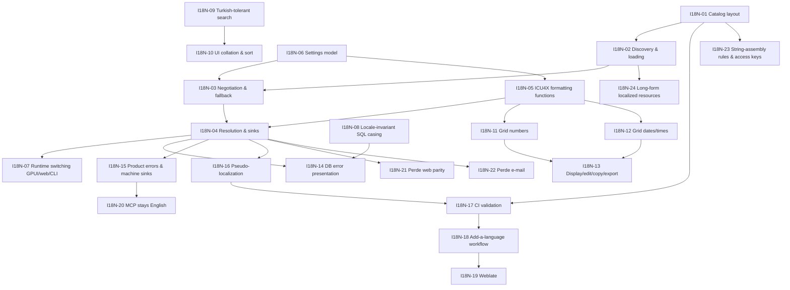

# 26 — Internationalization: Implementation-Ready Algorithm Catalog (I18N-NN)

> Status: canonical algorithm catalog (synthesis). Language: English. Date: 2026-11-11.
> Supersedes for implementation purposes: ALG-I18N-01…08 (`i18n/01`, `i18n/02`), ALG-L10N-01…11 (`datagrip/12`), ALG-DBV-I18N-01 (`clients/dbeaver-05`). Those documents stay as evidence; where this catalog differs, this catalog wins.
> Companion catalogs: `25-sql-editor-component.md` (IME, keymaps incl. Turkish Q/F, editor phrases — `UI-EDIT-NN`), `27-mcp-server.md` (`MCP-NN`; model-facing text rules are summarized here in I18N-20 and owned there).

---

## 0. Scope, sources, licenses

### 0.1 Scope

Every user-visible or machine-visible piece of text, number, date, sort order, search match and error message across the product family:

| Surface | Runtime | Catalog domain(s) |
|---|---|---|
| Hacivat desktop (GPUI, ADR 0001) | Rust: `hacivat-l10n` + `hacivat-ui::l10n` adapter | `common`, `hacivat-ui`, `hacivat-core`, `hui` (component library) |
| `hacivat-ui` component library (published separately, Apache-2.0) | Rust, provider trait | `hui` (own English defaults, overridable) |
| Karagöz CLI / agent | Rust: `hacivat-l10n` (subset) | `common`, `karagoz-cli` |
| Perde server (API errors, audit rendering) | Rust: `hacivat-l10n` concurrent bundles | `common`, `perde-server` |
| Perde web panel | TypeScript: `@fluent/bundle` + `Intl` | `common`, `perde-web` |
| Perde e-mails | Rust (server-side rendering) | `common`, `perde-email` |
| MCP server | **not localized** (I18N-20) | none (English constants) |

### 0.2 Sources merged

| Source | What it contributes | Verification override |
|---|---|---|
| `i18n/01-localization-architecture.md` (ALG-I18N-01…04) | Fluent decision, negotiation, resolution, pseudo, CI validator, Weblate, layout | fluent-rs `NUMBER` not locale-aware — **Confirmed** (`verification/02` P31); messageformat v4 Apache-2.0 and Pontoon BSD-3 — Confirmed (S36, S37); Weblate Fluent since 4.8, monolingual, plurals "No" — Confirmed (P29); Crowdin OSS clause — Confirmed (P28); MF2 stable in CLDR 47, `Intl.MessageFormat` Stage 1, ICU4X 2.4.0 on CLDR 49, no MF2 formatter, relative time / display names / units in `icu_experimental` — Confirmed (P32) |
| `i18n/02-turkish-and-db-specific-pitfalls.md` (ALG-I18N-05…08) | Turkish rule set TR-1…12, identifier folding, Turkish-tolerant search, grid number parsing, DB message presentation | `verification/01` #39–#42: PG ICU tr `'ITEMS' ILIKE 'items'` = false, unquoted folding ASCII-only, `name` columns collate `C`; MySQL `utf8mb4_tr_0900_ai_ci` LOWER/UPPER **not** Turkish-tailored, I_S `TABLE_NAME` is `utf8mb3_bin`; SQLite ASCII-only; SQL Server Turkish_CI_AS identifier resolution follows DB collation, variables/#temp follow instance collation; CLDR 49 tr numbers Confirmed (S34); ICU4X `fold_turkic` Confirmed (S35); DBeaver #40901 PR status corrected (P30) |
| `datagrip/12-localization.md` (ALG-L10N-01…11) | Language packs as data, per-key fallback, key-based settings search, debug policies, coverage metrics, Turkish DataGrip bugs (DBE-7037/9900/9986), three locale axes | none |
| `clients/dbeaver-05` §3.12, ALG-DBV-I18N-01, §6 | MessageFormat apostrophe trap, restart-required anti-pattern, `tw` tag anti-pattern, CSV Turkish presets, no `tr` in DBeaver | DBeaver PR #42805 merged 2026-11-10 — Confirmed (S28) |
| `clients/ui-01-stack-decision.md` §9 | Fluent for Rust and TS, pseudo build, CodeMirror phrases | **Superseded in part by ADR 0001**: Tauri menus, `Intl.*` formatting in a webview, `dir`/`lang` attributes and CSS rules do not apply to the desktop app (§0.4) |
| `mcp/02-hacivat-mcp-design-and-security.md` §3.14, §6 | Model-facing text English and byte-stable; human approval UI localized; U+2068/U+2069 stripping; DB errors verbatim + codes | rmcp/MCP facts Confirmed (P1, P2, P7) — not i18n-relevant beyond §3.14 |
| `decisions/0001-native-ui-on-gpui.md` | Native GPUI; own `hacivat-ui`; v1 en + tr (both LTR); RTL incomplete in GPUI | — |
| Targeted reads (this pass) | `fluent-rs/fluent-bundle/src/bundle.rs:297,331,342,352,535` (overriding resources, isolation toggle, transform, `set_formatter` takes a plain `fn` pointer, `add_function`); `fluent-bundle/src/types/mod.rs:177-235` (plural matching only for `FluentValue::Number`; formatter receives the **bundle-language** memoizer); `zed/crates/gpui/src/app.rs:1322,1332,1420,2577,2602,2902` (`keyboard_layout`, `on_keyboard_layout_change`, `refresh_windows`, `set_global`, `observe_global`, `set_menus`); `zed/crates/gpui/src/window.rs:3278` (`set_window_title`); `gpui-component/crates/component/src/lib.rs:160` (`set_locale` → `rust_i18n`); `icu4x/Cargo.toml:143-158` (components `~2.4.0`, `icu_experimental ~0.7.0`); `icu4x/components/casemap/src/casemapper.rs:223,240,408,438,580,604`; `icu4x/components/collator/src/options.rs:360` | — |

### 0.3 Licenses of studied projects

fluent-rs: Apache-2.0 OR MIT. fluent.js: Apache-2.0. ICU4X: Unicode License V3. cargo-i18n (i18n-embed): MIT. rust-i18n: MIT. GPUI (`zed/crates/gpui`, `gpui_macos`, `gpui_linux`): Apache-2.0 (Zed's GPL crates were not read). gpui-component: Apache-2.0. DBeaver CE: Apache-2.0. IntelliJ Community: Apache-2.0. DataGrip: proprietary (behavior only). Weblate server: GPL-3.0-or-later (a service we use; no code linked). Pontoon: BSD-3-Clause. Only own pseudocode appears below.

### 0.4 Deltas caused by ADR 0001 (native GPUI)

1. No webview in the desktop app: **all desktop formatting is ICU4X in Rust** (ui-01 §9.2 "use `Intl` in the UI, never format numbers in Rust" is void for Hacivat; it still applies to Perde web).
2. No `lang`/`dir` HTML attributes, CSS `text-transform`, `@fluent/react`, Tauri menu API, Tauri bundler metadata. Replacements: GPUI `Global` + `refresh_windows` (I18N-07), `cx.set_menus` rebuild (I18N-07), text-run language tagging where GPUI exposes it [Unknown: GPUI has no per-run language attribute in the studied tree; `fi` ligature/`locl` handling must be checked in the spike].
3. RTL is not shipped in v1 and GPUI's bidi support is partial (ADR 0001). Catalog/manifest keep `direction` so an RTL language stays data-only once `hacivat-ui` gains mirroring (later).
4. gpui-component localizes with `rust-i18n` YAML (`set_locale` at `gpui-component/crates/component/src/lib.rs:160`) — a format we reject (I18N-01 Decision). Any gpui-component widget used temporarily must receive its strings from our provider or be wrapped.

---

## 1. Dependency map and priorities



Text form (consumer ← provider): resolution (04) ← discovery (02) ← layout (01); 04 ← negotiation (03) ← settings (06); 04 ← formatting (05) ← settings (06); everything grid-related (11–13) ← 05; DB errors (14) ← 04 + 08; CI (17) ← 01 + 16; contributor flow (18) ← 17; Weblate (19) ← 18.

| ID | Title | Priority | Used by |
|---|---|---|---|
| I18N-01 | Catalog layout, domains and ID scheme | v1 | all |
| I18N-02 | Catalog discovery and loading (embedded + overlay) | v1 | Hacivat, Karagöz, Perde server |
| I18N-03 | Locale negotiation and fallback chain | v1 | all |
| I18N-04 | Message resolution, per-message fallback, sinks, typed IDs | v1 | all Rust |
| I18N-05 | ICU4X-backed formatting functions (NUMBER, DATETIME, LIST, …) | v1 (RELTIME, UNIT: v1.x) | all Rust |
| I18N-06 | Locale settings model (UI language / regional format / grid display / time zone / DB session) | v1 | Hacivat (all), Perde (first two + tz) |
| I18N-07 | Runtime language switching (GPUI, Karagöz, Perde) | v1 | Hacivat, Perde web |
| I18N-08 | Locale-invariant SQL casing and identifier folding | v1 | Hacivat, Karagöz, Perde policies |
| I18N-09 | Turkish-tolerant UI search key with highlight mapping | v1 | Hacivat, Perde web, Karagöz CLI |
| I18N-10 | UI list collation and sort | v1 | Hacivat, Perde web |
| I18N-11 | Grid number formatting and parsing with round-trip fidelity | v1 | Hacivat, Perde web forms |
| I18N-12 | Grid date/time/interval display, parsing and time zones | v1 | Hacivat |
| I18N-13 | Display vs edit vs copy vs export value channels | v1 (spreadsheet HTML flavor v1.x) | Hacivat |
| I18N-14 | DB server error presentation by SQLSTATE / vendor code | v1 (curated ~150 codes) | Hacivat, Karagöz, Perde |
| I18N-15 | Product error codes and machine sinks (logs, JSON, audit) | v1 | all |
| I18N-16 | Pseudo-localization (en-XA, tr-XT; ar-XB later) | v1 (ar-XB later) | Hacivat, Perde web |
| I18N-17 | CI catalog validation | v1 | all |
| I18N-18 | Contributor workflow: add a language with zero code | v1 | process |
| I18N-19 | Weblate integration | v1.x | process |
| I18N-20 | Model-facing text stays English (MCP) | v1 | Hacivat MCP, Karagöz |
| I18N-21 | Perde web runtime and Rust↔JS parity | v1 of Perde web | Perde web |
| I18N-22 | Perde e-mail localization | v1 of Perde | Perde |
| I18N-23 | String-assembly rules, Turkish grammar guard, access keys, length budgets | v1 | all |
| I18N-24 | Localized long-form resources (lint docs, tips, help) by path | later | Hacivat, Perde docs |

Global invariants (apply to every spec; violating one is a review-blocking defect):

- **INV-1** Machine text is locale-free (SQL, identifiers, codes, logs, JSON keys, MCP, settings keys, file names by default). Human text is locale-aware **with an explicit locale argument**. Data is neither: shown and stored exactly.
- **INV-2** No crate below the UI/CLI/HTTP edge may read a "current locale" global; locale-sensitive APIs take a locale parameter (TR-8). `sql-*`, `driver-*`, `karagoz-core`, `mcp-*` crates do not depend on `hacivat-l10n`.
- **INV-3** `str::to_lowercase/to_uppercase` are forbidden in `sql-*`, `driver-*`, `introspect-*`, `mcp-*`, `karagoz-*` crates (clippy `disallowed-methods`); allowed only through `sql-ident` (I18N-08) or display helpers (I18N-04 `case_for_display`).
- **INV-4** Database values never pass through `f64` or JS `number` unless the column type is a float (I18N-11).
- **INV-5** Every test suite also runs under `LANG=LC_ALL=tr_TR.UTF-8` ("Turkey test" CI job).

---

## 2. Algorithm specifications

### I18N-01: Catalog layout, domains and ID scheme

- **Sources merged**: i18n/01 §3.5.1, §3.5.4, §3.6.1; datagrip/12 §5 "Suggested layout", ALG-L10N-02; dbeaver-05 ALG-DBV-I18N-01 recommendation 1; ui-01 §9.1; ADR 0001 (component library published separately).
- **Problem**: One repository layout and one ID scheme for five surfaces and one published component library, so that one validator, one translation project and one runtime serve everything, and adding a language is a folder.
- **Inputs / outputs**: Input: product strings authored in English. Output: directory tree `locales/<tag>/<domain>.ftl` + `locales/<tag>/locale.toml`; ID → domain mapping; per-binary inclusion lists.
- **Algorithm**:
  1. Layout (monorepo root; if products split into repos, `locales/` moves to a `hacivat-l10n` repo consumed as a git submodule and an npm package):
     ```
     locales/
       en/                         # reference catalog; every ID exists here
         locale.toml
         common.ftl                # brand terms, units, generic verbs/errors, list words
         hui.ftl                   # hacivat-ui component library defaults (Copy, Find, Match case, …)
         hacivat-ui.ftl            # desktop chrome
         hacivat-core.ftl          # engine errors, DB explanations (db-*), notifications
         karagoz-cli.ftl
         perde-server.ftl
         perde-web.ftl
         perde-email.ftl
       tr/ (same names; partial allowed)
       _schema/                    # not a locale: locale.toml JSON schema, dynamic-ids.toml, db-codes.toml
     tools/l10n/                   # xtask: check | new | report | types | pseudo
     ```
  2. ID grammar: `^(cm|hui|hv|hc|kg|ps|pw|pe|db|error)-[a-z0-9]+(-[a-z0-9]+)*$`; terms `^-[a-z0-9]+(-[a-z0-9]+)*$`. Prefix ⇔ domain file is enforced (`hv-*` only in `hacivat-ui.ftl`, `db-*` and `error-*` only in `hacivat-core.ftl` or `perde-server.ftl` per registry).
  3. IDs are global across domains within a locale (no duplicates anywhere) so any bundle may load `common.ftl` + its own domain without collisions.
  4. Cross-file references only into `common.ftl` (terms like `-brand-hacivat`).
  5. Per-binary inclusion (data, not code): `tools/l10n/binaries.toml` maps binary → domain list: `hacivat` = all except `karagoz-cli`, `perde-*`; `karagoz` = `common`, `karagoz-cli`; `perde-server` = `common`, `perde-server`, `perde-email`, `hacivat-core` (for `db-*` explanations in the audit viewer API); `perde-web` = `common`, `perde-web`, `hacivat-core#db-*` subset exported at build.
  6. Component library rule: `hacivat-ui` must be usable without our catalogs. It embeds `locales/en/hui.ftl` only and exposes a provider trait; the Hacivat app installs a provider backed by `hacivat-l10n` that resolves `hui-*` IDs through the full chain (so Turkish `hui.ftl` from our repo applies). Third-party users can install their own provider.
  7. Variable documentation and context are mandatory comments (`# Variables:` block with types String|Number|DateTime|List|Enum(values); optional `# MaxLength: N`, `# Context:` and `# Screenshot:` URL) — consumed by codegen (I18N-04), CI (I18N-17) and Weblate (I18N-19).
- **Data structures**: `Domain` enum generated from `binaries.toml` is **not** used at runtime — domain names are strings; `DomainSet = &'static [&'static str]` per binary from the build script.
- **Complexity / performance**: n/a (layout). Catalog size budget: v1 ≤ ~4,000 English messages; per-domain file ≤ 1 MB (CI).
- **Edge cases**: (1) a message used by both desktop and Perde → lives in `common.ftl` with `cm-` prefix; (2) same English word with different meaning (verb "Open" vs adjective "Open") → two IDs; (3) a domain present in a locale but absent in `en` → CI error (unknown domain); (4) `hui-*` ID overridden by app in `hacivat-ui.ftl` → forbidden (duplicate ID); override by translation only; (5) brand/product names (`Karagöz`) are terms; CLI binary name `karagoz` is never a term; (6) Perde web needs a `db-*` explanation → exported subset, never duplicated; (7) emails share terms with web → via `common.ftl`; (8) file names with uppercase or spaces → CI error; (9) empty domain file in a locale → valid (0 % complete).
- **Test cases**: `hv-grid-rows-fetched` in `hacivat-ui.ftl` → ok; `hv-x` in `common.ftl` → CI error "prefix/domain mismatch"; `cm-ok` defined in `common.ftl` and `perde-web.ftl` → CI duplicate error; Karagöz binary built → embedded asset list contains exactly `*/common.ftl`, `*/karagoz-cli.ftl`, `*/locale.toml`; `hacivat-ui` example app with no provider → English `hui-find-match-case` renders "Match case".
- **Decision**: Fluent (FTL) as the only format; one tree; domain per surface; global IDs with prefixes. Rejected: rust-i18n YAML (no CLDR plurals/select/terms/isolation; also what gpui-component uses — we do not adopt it); gettext PO (source-as-key, header plural expressions, no attributes); ICU MF1 (apostrophe escaping vs Turkish `PostgreSQL'e`); MF2 now (no ICU4X formatter, `Intl.MessageFormat` Stage 1 — exit path kept by keeping English messages simple); IntelliJ-style per-plugin `.properties` packs (MessageFormat/ChoiceFormat).
- **Verification status**: Fluent/ICU4X/MF2 facts Confirmed (verification/02 P31, P32). Layout is design [Inferred].
- **Rust placement**: `crates/hacivat-l10n` (UI-agnostic, Apache-2.0) owns asset embedding; `crates/hacivat-ui/src/l10n.rs` owns the provider trait:
  ```rust
  // hacivat-ui (published library)
  pub trait UiTextProvider: Send + Sync + 'static {
      fn text(&self, id: &'static str, args: &UiArgs) -> SharedString;          // value
      fn attr(&self, id: &'static str, attr: &'static str, args: &UiArgs) -> SharedString;
      fn generation(&self) -> u64;                                             // bump on locale change
  }
  pub struct EnglishDefaults; // parses embedded hui.ftl (en) once; no ICU4X dependency required
  ```
  Crates (versions to check): `fluent-bundle` 0.16.0, `fluent-syntax` 0.12.0, `unic-langid` 0.9 (fluent dependency), `rust-embed` 8.x (or `include_dir` 0.7), `serde`/`toml`.
- **i18n notes**: Turkish has no special layout needs; future RTL languages only need `direction = "rtl"` in `locale.toml` once `hacivat-ui` supports mirroring.
- **Prior art and evidence**: [Observed: `i18n/01` §3.5.1]; DataGrip packs keep identical resource paths per language [Observed: `datagrip/12` §2 item 2]; DBeaver `.properties` + apostrophe trap [Observed: `clients/dbeaver-05` ALG-DBV-I18N-01 edge 5]; gpui-component `rust-i18n` [Observed: `gpui-component/crates/component/src/lib.rs:160`].
- **Used by**: Hacivat | Karagöz | Perde

### I18N-02: Catalog discovery and loading (embedded assets + overlay)

- **Sources merged**: i18n/01 §3.5.2; datagrip/12 ALG-L10N-10; dbeaver-05 recommendation 1.
- **Problem**: Enumerate available languages at runtime from data only (no generated enum, no code per language), load and parse catalogs once, allow an overlay directory for translators, and survive partially broken files.
- **Inputs / outputs**: Inputs: embedded asset tree (per-binary filtered), optional overlay dir (`<config_dir>/hacivat/locales/`, `HACIVAT_L10N_DIR`; Karagöz `KARAGOZ_L10N_DIR`; Perde `PERDE_L10N_OVERLAY_DIR` admin-only), build mode (dev/release). Outputs: `Vec<CatalogLocale>` and `HashMap<(Tag, Domain), Arc<FluentResource>>` + `Vec<LoadDiag>`.
- **Algorithm**:
  1. List embedded top-level folders; skip names starting with `_`. For each folder `f`:
     1. Parse `f` as BCP-47 with ICU4X; require canonical form equality (`tr`, `pt-BR`, `zh-Hant`); else diag `NonCanonicalTag` and skip (CI prevents this in-tree).
     2. Read `locale.toml` if present; else defaults: `native_name = english_name = tag`, `direction = ltr`, `status = experimental` (diag `MissingManifest`). This lets a Weblate-created folder work before a maintainer adds the manifest.
     3. Reject reserved pseudo tags (`en-XA`, `ar-XB`, `tr-XT`) if found on disk (they are generated, I18N-16).
  2. Overlay (desktop/CLI; Perde only if admin-enabled): same scan; folders that also exist embedded are merged (`overlay=true`); new folders are added with `status` forced to at most `experimental` unless the manifest says `disabled`.
  3. Parsing is lazy per (tag, domain): first access parses the embedded file into `Arc<FluentResource>`; parse errors produce Junk entries — keep the resource (valid entries still load) and record `LoadDiag::Junk{file,line}`.
  4. Overlay resources are added with `add_resource_overriding` **after** embedded ones so overlay messages replace embedded ones per ID [Observed: `fluent-bundle/src/bundle.rs:297`].
  5. File-safety limits for overlay: max 1 MB per file, UTF-8 required (invalid → whole file skipped with diag), no symlinks outside the overlay root, no files other than `*.ftl` and `locale.toml`.
  6. `en` must exist embedded in every binary; startup asserts it (release: abort with an English hard-coded message — the only allowed hard-coded UI string).
- **Data structures**:
  ```rust
  pub struct CatalogLocale { pub tag: LanguageIdentifier, pub max: LanguageIdentifier /* likely-subtags */, 
      pub native_name: String, pub english_name: String, pub direction: Direction,
      pub status: Status /* Stable|Beta|Experimental|Disabled */, pub source: Source /* Embedded|Overlay|Both */ }
  pub struct Catalogs { locales: Vec<CatalogLocale>, resources: DashMap<(Tag, &'static str), Arc<FluentResource>>, diags: Vec<LoadDiag> }
  ```
- **Complexity / performance**: Folder scan O(#locales); parsing O(bytes). Budgets: cold start parse of `en`+`tr` desktop domains ≤ 10 ms on the reference laptop; no catalog parsing on the UI thread after first frame (pre-parse the negotiated chain on a background executor while the splash/first frame renders with `en` already parsed). Memory ≤ 2 MB per fully loaded locale.
- **Edge cases**: (1) folder without manifest → experimental; (2) manifest `tag` ≠ folder → folder name wins, diag; (3) overlay file with BOM → strip BOM, diag; (4) overlay CRLF → accepted at runtime (CI rejects in-tree); (5) overlay folder for a locale whose embedded copy is `disabled` → stays disabled; (6) two overlay folders differing only by case on case-insensitive FS (`TR`, `tr`) → canonical-tag check rejects `TR`; (7) overlay directory unreadable → diag, continue; (8) file being written while read → parse what is read; the "Reload translations" action re-reads; (9) Perde production with overlay env unset → overlay disabled even if the dir exists (e-mails must not contain filesystem-controlled text); (10) catalog for a language with no CLDR data → still loadable (plural rules fall back to `und` → `other` only), diag; (11) 0-byte `.ftl` → empty resource; (12) duplicate IDs inside one overlay file → first wins (Fluent `add_resource` semantics within one resource), diag.
- **Test cases**: embedded `{en, tr}`, no overlay → 2 locales, tr `stable`; add overlay `locales/de/hacivat-ui.ftl` without manifest → `de` experimental, english_name `de`; overlay `tr/hacivat-ui.ftl` redefines `hv-a` → Turkish UI shows overlay text; overlay file with a Junk entry on line 7 → other messages work, diag lists line 7; release Karagöz with `KARAGOZ_L10N_DIR` pointing to a symlink escaping the dir → file skipped; `en` missing in a test build → startup error.
- **Decision**: Runtime enumeration of embedded assets + optional overlay; manifest optional. Rejected: build-time generated `AVAILABLE` table (i18n/01 §3.5.2) — works but makes overlay-only languages second-class; DataGrip-style build-pinned packs (`since-build = until-build`) — too brittle; downloadable signed packs — later (needs signing infra, see I18N-18 step 7).
- **Verification status**: `add_resource_overriding` Observed in fluent-bundle 0.16.0. Rust-embed include/exclude globs — [Inferred; check crate version].
- **Rust placement**: `hacivat-l10n::catalog::{Catalogs, CatalogLocale, LoadDiag}`; `hacivat-l10n::assets` wraps `rust_embed::RustEmbed` with a per-binary feature (`domains-hacivat`, `domains-karagoz`, `domains-perde`). Crates: `rust-embed` 8.x (check), `icu_locale` ~2.4 (`LocaleExpander` for `max`), `toml` 0.8+ (check), `dashmap` 6 (or `parking_lot::RwLock<HashMap>`).
- **i18n notes**: native names come from translators (`locale.toml`), not from `icu_experimental::displaynames` (experimental API churn).
- **Prior art and evidence**: [Observed: i18n/01 §3.5.2; datagrip/12 §3.3 language packs as plugins, ALG-L10N-10]; COSMIC embeds `i18n/` via rust-embed [Observed: i18n/01 §3.7].
- **Used by**: Hacivat | Karagöz | Perde

### I18N-03: Locale negotiation and fallback chain

- **Sources merged**: ALG-I18N-01 (canonical), ALG-L10N-01, ALG-DBV-I18N-01 (tag anti-patterns), dbeaver-05 §6 item 3.
- **Problem**: From preference sources compute (a) an ordered UI language chain over existing catalogs ending in `en`, and (b) a formatting locale that need not have a catalog.
- **Inputs / outputs**: Inputs: `sources: Vec<PrefSource>` in priority order (context-specific), `available: &[CatalogLocale]`, `allow_experimental`, `region_hint`. Outputs: `UiChain { tags: Vec<LanguageIdentifier>, direction }`, `format_locale: icu::locale::Locale`, `diags`.
- **Algorithm** (ALG-I18N-01 retained in full; summary of normative steps):
  1. Collect raw preferences: Desktop: `settings.ui_language` (≠ `system`) → `HACIVAT_LANG` → OS preferred languages (`sys-locale`) → Unix `LANGUAGE` (split `:`) → `LC_ALL` → `LC_MESSAGES` → `LANG`. CLI: `--lang` → `KARAGOZ_LANG` → `LANGUAGE` → `LC_ALL` → `LC_MESSAGES` → `LANG` → OS list. Perde request: profile → `perde_lang` cookie → `Accept-Language` (drop `q=0`, stable sort by q, cap 16, ignore `*`) → org default. E-mail: recipient profile → org default.
  2. Normalize each: trim; cut at `.`/`@`; `C`/`POSIX` → `en` (diag); `_`→`-`; ICU4X canonicalize (handles `iw→he`, `in→id`); parse; pseudo tags only in dev or `HACIVAT_PSEUDO=1`; dedupe.
  3. Match each request to the best catalog: exact → maximized (likely subtags) scoring: 3 same lang+script+region; 2 same lang+script; 1 regional sibling (UI text only, configurable). Never across languages (`az` ↛ `tr`) or scripts (`sr-Latn` ↛ `sr-Cyrl`). Ties: status stable > beta > experimental, then more generic tag, then lexical. Drop disabled; drop experimental unless allowed (explicit user choice implies allowed).
  4. Insert language-only parent after a regional match if that catalog exists (`pt-BR` → `pt`).
  5. Append `en` if absent; empty chain → `[en]` + diag.
  6. `direction` = `chain[0].direction`.
  7. Format locale: explicit `regional_format` setting → OS regional preference (Desktop/CLI: `icu_host_info` or `LC_ALL`→`LC_NUMERIC`/`LC_TIME`→`LANG`) → Perde: first *requested* tag → else `chain[0]` maximized. An explicit UI language never sets the format locale.
  8. Validate CLDR data availability via `LocaleFallbacker`; record resolved data locale.
- **Data structures**: `CatalogLocale.max` cached; LRU (1k) keyed by `(profile_lang, cookie, Accept-Language raw)` for Perde.
- **Complexity / performance**: O(|req|·|avail|), |avail| ≤ ~50 → < 20 µs; Perde cache hit < 1 µs.
- **Edge cases**: all 25 cases of ALG-I18N-01 apply verbatim (empty env, `LANG=C`, ISO-8859-9 codeset, `LANGUAGE` list, `LANGUAGE` with `LANG=C` (we do **not** emulate gettext's ignore quirk), `tr-CY`, `az-Latn-AZ`, `zh-HK`, `zh`, `sr-Latn`, `pt-BR`, `en-GB`, `q=0`, `*`, oversized header, malformed tags, case variants, experimental gating, overlay-only, pseudo in release, duplicates, vanished catalog, RTL chain with LTR fallback, e-mail without profile, Windows display-language vs region split). Added: (26) DBeaver-style non-standard tag `tw` in an overlay folder → rejected as non-canonical (CI suggests `zh-Hant`); (27) `tr_TR@euro` → `tr`; (28) OS returns `tr-TR-u-nu-arab` (numbering-system extension) → UI `tr`, format locale keeps `-u-nu-arab` only if the user's regional settings say so (extensions preserved in format locale, stripped for catalog matching).
- **Test cases**: the 18-row table of ALG-I18N-01 is normative (e.g. Desktop OS `[tr-TR, en-US]` → `[tr, en]`, fmt `tr-TR`; Desktop setting `en` + OS region `tr-TR` → `[en]`, fmt `tr-TR`; CLI `--lang az` → `[en]` + diag, fmt `en-US`; Perde profile `en` + header `tr-TR` → `[en]`, fmt `tr-TR`; Desktop `zh-HK` with `zh-Hans`,`zh-Hant` → `[zh-Hant, en]`). Added: `tr-TR-u-nu-arab` → chain `[tr, en]`, fmt `tr-TR-u-nu-arab`.
- **Decision**: RFC 4647-style filtering with likely-subtag scoring, per context sources, format locale independent of UI language. Rejected: DataGrip exact tag match (`ja` ≠ `ja-JP`) [Observed: datagrip/12 §2 item 5]; DBeaver "language from a launcher property, default `en`, restart" [Observed: dbeaver-05 §3.12]; plain `fluent_langneg::negotiate_languages(Filtering)` — acceptable fallback implementation but lacks our status gating and sibling policy.
- **Verification status**: CLDR/ICU4X facts Confirmed (P32). Algorithm design [Inferred]; test table is normative.
- **Rust placement**: `hacivat-l10n::negotiate::{negotiate(ctx: &NegotiationCtx, avail: &[CatalogLocale]) -> Negotiated}`; `PrefSource` enum `{Setting, Env(&'static str), OsList, AcceptLanguage(String), Cookie, Profile, OrgDefault}`. Crates: `icu_locale` ~2.4 (`LocaleExpander`, `LocaleCanonicalizer`, `LocaleFallbacker`), `sys-locale` (check), `icu_host_info` (check availability on crates.io; else per-OS shim: macOS `CFLocaleCopyCurrent`, Windows `GetUserDefaultLocaleName`, Linux `LC_*`).
- **i18n notes**: Turkish users commonly combine English UI + Turkish region; test 2 above is the primary v1 scenario.
- **Prior art and evidence**: [Observed: i18n/01 ALG-I18N-01 incl. i18n-embed Filtering `i18n-embed/src/lib.rs:186-190`; COSMIC `LC_TIME`/`LC_ALL`/`LANG` derivation]; [Observed: datagrip/12 `LocalizationUtil.findLanguageBundle` exact match].
- **Used by**: Hacivat | Karagöz | Perde

### I18N-04: Message resolution, per-message fallback, sinks and typed IDs

- **Sources merged**: ALG-I18N-02, ALG-L10N-02/03, ALG-DBV-I18N-01, mcp/02 §3.14 (stripping), fluent-bundle source reads (this pass).
- **Problem**: Render `id[.attr]` with typed arguments through the chain; fall back per message on translation-structural errors; select plurals by UI language but format values by format locale; produce isolation-free text for machine sinks; catch wrong IDs/args at compile time.
- **Inputs / outputs**: Inputs: `MsgRef<A>` (typed ID), `args: A`, `sink: Ui | Machine`, `Runtime` snapshot. Output: `Rendered { text, locale_used, fell_back, errors }` (callers usually take `text`).
- **Algorithm**:
  1. **Typed IDs (compile time)**: `hacivat-l10n/build.rs` parses `locales/en/*.ftl` with `fluent-syntax`, reads `# Variables:` docs and emits `ids.rs`:
     ```rust
     pub struct MsgRef<A> { pub id: &'static str, pub attrs: &'static [&'static str], _a: PhantomData<A> }
     pub mod hv { pub const GRID_ROWS_FETCHED: MsgRef<GridRowsFetched> = …; }
     pub struct GridRowsFetched { pub count: Count /* u64-backed Number */ }   // from "$count (Number)"
     impl IntoFluentArgs for GridRowsFetched { … }
     ```
     Undocumented variables fail the build (and CI). Dynamic families (`error-*`, `db-*`, `hv-tx-mode-*`) use `MsgRef::dynamic(id)` only inside modules allow-listed in `tools/l10n/dynamic-ids.toml`.
  2. **Snapshot**: `let rt = l10n.load()` (`ArcSwap` load; never held across `.await`).
  3. **Sink**: `Ui` → isolating bundles; `Machine` → non-isolating bundle set sharing the same `Arc<FluentResource>`s (two `FluentBundle`s per locale; `set_use_isolating(false)` on the second) [Observed: `bundle.rs:331`].
  4. **Format context**: set the thread-local `FORMAT_CTX` = `{format_locale, time_zone, grouping_policy, generation}` for the duration of the synchronous render (RAII guard). Required because `set_formatter` accepts only a plain `fn` pointer and receives the *bundle-language* memoizer [Observed: `bundle.rs:352`, `types/mod.rs:223-227`] — so the format locale cannot be captured any other way.
  5. For bundle `k` in chain: get message → pattern (value or attribute) → `format_pattern(pattern, args, &mut errs)`. Inside Fluent: numeric selectors use exact keys first, then CLDR plural category **of the bundle language** (UI language); only `FluentValue::Number` participates in plural matching [Observed: `types/mod.rs:185-213`]; string selectors exact; placeables are written via our formatter (I18N-05) using `FORMAT_CTX`.
  6. No errors → return `{text, locale_used: k.lang, fell_back: k>0}`.
  7. Classify errors: translation-structural (unknown variable not in English signature, unresolved message/term reference, cyclic, too many placeables) → Release: discard, continue to next bundle; Dev: return `⚠[text]`. Caller errors (missing arg English also needs; wrong arg type for selector) → return text, log once per (id, call-site); `debug_assert!` in tests. Function errors (bad `NUMBER` option) → keep text (default formatting), log once per (id, locale).
  8. Chain exhausted (only possible for dynamic IDs) → Release: `cm-error-unknown` with `$code`; Dev: `⟦id⟧`.
  9. Machine sink post-condition: assert no U+2068/U+2069 in output (debug); strip in release.
  10. Debug policies (dev builds, from DataGrip's `idea.l10n*` lesson): `HACIVAT_L10N_DEBUG=ids` appends `⟨id⟩`; `=english` appends the English rendering; `=marker` prefixes `🔅` to every successfully translated (non-fallback) string so untranslated chrome is visible; a test hook `on_render(id, locale_used, text)` for UI tests.
  11. Human-text casing (rare): `case_for_display(text, ui_lang)` uses ICU4X `CaseMapper::uppercase` with the UI language (Turkish `i→İ`) — only for strings that came from catalogs. Never on identifiers or data.
- **Data structures**: `Runtime { generation, ui_chain, format_ctx, dir, ui: Arc<[Bundle]>, machine: Arc<[Bundle]>, fmt: Formatters }`; `Signature` table (`vars`, `attrs`, `selector_vars`) generated alongside `ids.rs` and used for structural-error classification; `LogOnce = Mutex<HashSet<(&'static str, Tag)>>`.
- **Complexity / performance**: hash lookup + linear pattern walk. Budgets (release, reference laptop): simple message ≤ 3 µs p50; message with one formatted number ≤ 10 µs p50 (memoized `DecimalFormatter`); status-bar updates ≤ 60/s are negligible. **Never** render Fluent per grid cell.
- **Edge cases**: all 18 of ALG-I18N-02, plus: (19) render called on a Tokio worker while another thread switches locale → snapshot consistent; (20) nested render (a formatter calling `msg` for a unit name) → `FORMAT_CTX` guard is re-entrant (stack of contexts); (21) `Machine` sink used for a message whose translation contains literal U+2068 typed by a translator → CI forbids; runtime strips; (22) argument value containing U+2068/U+2069 from user data (connection name) in Machine sink → **kept** (data fidelity; MCP escapes them, I18N-20); (23) `Count` > 2^53 used as selector → plural on rounded f64 is still correct for CLDR categories of integers ≥ 2 in tr/en; formatting uses the exact integer via custom value (I18N-05); (24) typed arg struct field renamed in English → build fails until call sites update (intended).
- **Test cases**: the 15-row table of ALG-I18N-02 is normative (e.g. `[tr,en]`, tr `{ $count } satır`, count=1234.5, fmt tr-TR → `1.234,5 satır`; `[en]` fmt tr-TR count=1234 → `1.234 rows`; tr typo `$cuont` → release `2 rows`; Ui sink `Bağlantı ⁨prod⁩ kaydedildi.`; Machine sink `Bağlantı prod kaydedildi.`). Added: (16) `HACIVAT_L10N_DEBUG=marker`, tr chain, `hv-a` translated and `hv-b` missing → `🔅…` only on `hv-a`; (17) compile-fail test: `t!(hv::GRID_ROWS_FETCHED, GridRowsFetched { name: … })` → does not compile; (18) re-entrant render inside formatter → outer format locale restored after inner call.
- **Decision**: Own thin runtime over `fluent-bundle` + build-time typed ID codegen. Rejected: `i18n-embed` + `fl!` (checks existence and arg *names* only, not types; ties us to its loader's bundle construction, which conflicts with the TLS format context and dual isolation sets) — acceptable fallback if codegen cost is too high; `fluent-fallback::Localization` (returns erroneous text instead of falling back [Observed: `fluent-fallback/src/bundles.rs:157-167`], ergonomics flagged "early stages"); dynamic string IDs everywhere (no compile-time safety, DataGrip `!key!` failures).
- **Verification status**: fluent-bundle API facts Observed this pass (0.16.0). Plural-by-bundle-language behavior Observed in `types/mod.rs:200-210`.
- **Rust placement**: `hacivat-l10n::{runtime::Runtime, L10n, render::{render, Sink}, ids (generated), args::{Count, Text, When, ListArg}}`:
  ```rust
  pub struct L10n { inner: arc_swap::ArcSwap<Runtime>, events: broadcast::Sender<LocaleChanged> }
  impl L10n {
      pub fn t<A: IntoFluentArgs>(&self, m: MsgRef<A>, a: A) -> String;                 // Ui sink
      pub fn t_attr<A: IntoFluentArgs>(&self, m: MsgRef<A>, attr: &'static str, a: A) -> String;
      pub fn t_machine<A: IntoFluentArgs>(&self, m: MsgRef<A>, a: A) -> String;         // no isolation
      pub fn snapshot(&self) -> Arc<Runtime>;
  }
  ```
  Crates: `fluent-bundle` 0.16.0 (use `concurrent::FluentBundle` for Perde server), `fluent-syntax` 0.12.0 (build.rs), `intl-memoizer` 0.5.3, `arc-swap` 1.x, `unic-langid` 0.9 ↔ `icu_locale_core` conversion via string round-trip (both BCP-47).
- **i18n notes**: Turkish `[one]` variants often omit `$count` ("Tek satır") — allowed (CI warns only if the variable is absent from all variants).
- **Prior art and evidence**: [Observed: i18n/01 ALG-I18N-02; datagrip/12 §3.19 debug policies; fluent-rs sources cited above].
- **Used by**: Hacivat | Karagöz | Perde

### I18N-05: ICU4X-backed formatting functions (replacing fluent-rs builtins)

- **Sources merged**: i18n/01 §3.3.1, §3.4.3–3.4.4; verification/02 P31, P32, S34; fluent-bundle reads (formatter `fn` pointer, custom types).
- **Problem**: fluent-rs prints `1234.5` in every locale (`FluentNumber::as_string` = `to_string` + min-fraction padding) and has no `DATETIME`. We need locale-correct, parity-tested formatting with the same function names and option subset as fluent.js on Perde web.
- **Inputs / outputs**: Inputs: `FluentValue`s (Number with options, Custom `ExactDecimal`, Custom `WhenValue`, Custom `ListValue`), `FORMAT_CTX`. Outputs: formatted strings.
- **Algorithm**:
  1. **Bundle construction** (single constructor, used by every binary): `set_use_isolating(true|false)`, `set_formatter(Some(hv_format))`, `add_function("NUMBER", number_fn)`, `("DATETIME", datetime_fn)`, `("LIST", list_fn)`; v1.x: `("RELTIME", reltime_fn)`, `("UNIT", unit_fn)`. Pseudo mode: `set_transform(Some(pseudo_fn))`.
  2. **`hv_format(value, _memo)`**: read `FORMAT_CTX` (if absent: debug panic, release `en-US`). For `Number(n)`: build `fixed_decimal::Decimal` from `n.value` using shortest round-trip (`ryu`-style) text, apply options (min/max fraction digits, `useGrouping`, `style: percent` → multiply by 100 exactly on the decimal, then the CLDR percent pattern of the format locale: tr `%25`, en `25%`), format with memoized `DecimalFormatter(format_locale, grouping)`. For `Custom(ExactDecimal(s))`: parse `s` with `Decimal::try_from_str` (exact; no f64). For `Custom(WhenValue)`, `Custom(ListValue)`: delegate to their formatters. Return `None` for strings (default path).
  3. **`NUMBER($x, opts…)`**: validate option keys ⊆ {`minimumFractionDigits`, `maximumFractionDigits`, `useGrouping`, `style` ∈ {decimal, percent}, `type` ∈ {cardinal, ordinal}}; unknown/invalid → function error + ignore option; return `FluentValue::Number` with merged options (so plural selection still works, including `type: ordinal`).
  4. **`DATETIME($t, dateStyle, timeStyle)`**: `$t` must be a `WhenValue` (epoch-ms + optional IANA zone) or ISO-8601 string; styles ∈ {full, long, medium, short}; output via `icu_datetime` field sets in `FORMAT_CTX.format_locale` and `FORMAT_CTX.time_zone`; Gregorian calendar forced unless the user explicitly picked another (DataGrip DBE-23788 lesson: Thai OS locale leaked a Buddhist calendar).
  5. **`LIST($items, type: "and"|"or"|"unit")`**: `icu_list` (tr: "a, b ve c", "a veya b"); items are pre-rendered strings, each isolated in Ui sink.
  6. **`RELTIME($seconds, unit?)`** (v1.x): `icu_experimental::relativetime` behind our wrapper; if unavailable for a locale, fall back to Fluent messages `cm-reltime-*` with plural selectors.
  7. **Memoization**: `Formatters` holds `Memo<(Locale, DecimalOpts) → DecimalFormatter>`, `Memo<(Locale, DateOpts, Zone) → DateTimeFormatter>`, `Memo<(Locale, ListType) → ListFormatter>`, all rebuilt on generation change.
  8. **Arg conventions**: counts → `Count(u64)` → `FluentValue::Number`; exact data values → never Fluent args (data is not a message), except error/diagnostic args which are passed as `Text` (verbatim strings); byte sizes/durations → `cm-size-*`/`cm-duration-*` messages with `NUMBER` inside.
- **Data structures**: `FormatCtx { format_locale: Locale, time_zone: TimeZoneId, calendar: Gregorian, grouping: Auto|Never, generation }`; custom types implementing `FluentType` (`duplicate`, `as_string`, `as_string_threadsafe`) — `as_string*` also read `FORMAT_CTX` because they receive only the bundle memoizer.
- **Complexity / performance**: Decimal formatting ≤ 1 µs per number with a warm formatter; date ≤ 3 µs; first use per (locale, options) ≤ 200 µs (compiled data). Binary size: ICU4X `compiled_data` for all locales — measure; Karagöz may use a blob provider restricted to the locales present in `locales/` (generated list, still no per-language code) [Unknown: MB].
- **Edge cases**: (1) `en` UI + `tr-TR` format: "1.234 rows" (plural `other` from English, digits Turkish); (2) `tr` UI + `en-US` format: "1,234 satır"; (3) `count = 1` with `minimumFractionDigits: 1` → en `1.0 rows` (other), tr `1,0 satır` (one); (4) `NaN`/`∞` → CLDR symbols (tr `∞`, `NaN`); (5) 1e21 → plain digits via Decimal, no exponent; (6) negative zero count → `0`; (7) percent `0.255` with `maximumFractionDigits: 1` → tr `%25,5`, en `25.5%`; (8) `useGrouping: false` for ports/IDs (`5432`, never `5.432`); (9) `DATETIME` with a string that is not ISO → function error, raw string printed; (10) time zone unknown to ICU4X data → UTC with diag; (11) format locale with `-u-nu-arab` → Arabic-Indic digits in UI chrome only (never in grid raw mode); (12) list with one item → item only; with zero → empty string (caller should use a different message); (13) Perde web `Intl` CLDR version ≠ ICU4X CLDR 49 → parity tolerances (I18N-21); (14) `FORMAT_CTX` missing because code called `bundle.format_pattern` directly → forbidden by API (bundles are private to `hacivat-l10n`).
- **Test cases**: fmt `tr-TR`: `NUMBER(1234.5)` → `1.234,5`; fmt `en-US` → `1,234.5`; `NUMBER(0.25, style: "percent")` tr → `%25`, en → `25%`; `NUMBER(5432, useGrouping: false)` tr → `5432`; `DATETIME(2026-11-11T14:05:09Z, dateStyle: "long")` tr, zone Europe/Istanbul → `11 Kasım 2026`; `dateStyle: "short"` → `11.11.2026`; `LIST([a,b,c])` tr → `a, b ve c`; en → `a, b, and c`; plural parity: `[en]`, fmt tr, count 1 → `1 row`; unknown option `NUMBER($n, currency: "TRY")` → function error, default formatting.
- **Decision**: Host formatter + custom functions backed by ICU4X, format locale via scoped TLS. Rejected: fluent-rs built-in `NUMBER` (not locale-aware — Confirmed); pre-formatting all numbers into strings before Fluent (breaks plural selection on numbers); global (process-wide) format locale (breaks Perde per-request locales); `num-format`/`chrono` locale features (partial CLDR, no plural/list parity with fluent.js).
- **Verification status**: fluent-rs NUMBER limitation **Confirmed** (verification/02 P31); CLDR 49 Turkish symbols/percent pattern **Confirmed** (S34); ICU4X 2.4.0 and experimental components **Confirmed** (P32).
- **Rust placement**: `hacivat-l10n::format::{hv_format, number_fn, datetime_fn, list_fn, reltime_fn, FormatCtx, with_format_ctx}`, `hacivat-l10n::values::{ExactDecimal, WhenValue, ListValue}`. Crates (versions to check): `icu_decimal`, `icu_datetime`, `icu_time`, `icu_calendar`, `icu_list`, `icu_plurals`, `icu_locale` all ~2.4.0; `fixed_decimal` (version paired with icu 2.4); `icu_experimental` ~0.7.0 (v1.x, pinned exact); `ryu` 1.x for shortest float text.
- **i18n notes**: Turkish percent prefix and `,` decimal are the canonical regression tests; Turkish ordinals are only `other` (`1.`), never port English `st/nd/rd/th`.
- **Prior art and evidence**: [Observed: `fluent-bundle/src/builtins.rs:1-13`, `types/number.rs:148-160` via verification/02 P31; `fluent.js builtins.ts:34-92` uses `Intl.NumberFormat` (i18n/01 §3.2.1)].
- **Used by**: Hacivat | Karagöz | Perde (server + e-mail)

### I18N-06: Locale settings model

- **Sources merged**: i18n/01 §3.5.3; datagrip/12 §3.16 and §5 "three locale axes"; dbeaver-05 §6 item 18; i18n/02 §3.8.2, §3.9.2, §3.14.
- **Problem**: Keep independent concerns independent: what language the chrome speaks, how numbers/dates in chrome look, how data cells look, which time zone chrome and timestamptz use, and what locale the *database session* gets.
- **Inputs / outputs**: Settings store (desktop `settings.toml`; Perde profile; Karagöz flags/env/config) → `EffectiveLocaleSettings`.
- **Algorithm**:
  1. Schema (stable machine keys, values are BCP-47 tags or enums):
     | Key | Values | Default | Scope | Affects |
     |---|---|---|---|---|
     | `ui.language` | `system` \| tag | `system` | user | catalogs (I18N-03) |
     | `ui.regional_format` | `system` \| tag | `system` | user | chrome numbers/dates, UI collation (I18N-10), list formatting, first weekday |
     | `ui.time_zone` | `system` \| IANA | `system` | user | chrome timestamps |
     | `grid.display_mode` | `raw` \| `localized` \| `grouped_raw` | `raw` | user → connection → column override | grid cells (I18N-11/12) |
     | `grid.null_symbol` | string | `NULL` | user | grid |
     | `grid.max_fraction_display` | none \| 0..20 | none | user/column | localized mode only, with truncation indicator |
     | `connection.session_time_zone` | `system` \| IANA \| `server` | `system` | connection | timestamptz rendering & DB session `TimeZone` |
     | `connection.server_message_language` | `server_default` \| `english_if_allowed` | `server_default` (MCP sessions: `english_if_allowed`) | connection | I18N-14 step 9 |
     | `connection.date_parse_style` | fixed `ISO` | — | — | Hacivat always sets PG `DateStyle=ISO, MDY`, `IntervalStyle=postgres` on its sessions |
     | `export.csv_preset` | `rfc4180` \| `excel_regional` \| `pg_copy` \| `tsv` | `rfc4180` | user | I18N-13 |
  2. Resolution: user value → OS (`system`) → derived fallback (`regional_format` → `ui.language` maximized). The DB session locale (`lc_messages`, `NLS_LANGUAGE`, SQL Server `LANGUAGE`, `DATEFORMAT`) is **never** derived from any UI setting; drivers run with locale-invariant settings (no process-locale leakage, Karagöz never inherits host locale).
  3. Each change emits a typed event: `UiLanguageChanged`, `RegionalFormatChanged`, `TimeZoneChanged`, `GridDisplayChanged{scope}` — only the first two rebuild the l10n runtime; grid changes invalidate only cell-format caches.
- **Data structures**: `EffectiveLocaleSettings { ui_chain, format_locale, time_zone, grid: GridDisplay, csv: CsvPreset }`; per-connection overrides stored with the connection profile.
- **Complexity / performance**: n/a; resolution < 50 µs.
- **Edge cases**: (1) OS region `tr-TR`, UI `en` (common) → English chrome, Turkish digits in chrome, grid raw; (2) user sets grid `localized` but column is an ID (PK/`*_id`/sequence default) → no grouping; (3) per-connection `session_time_zone = server` → Hacivat does not send `SET TimeZone`; header tooltip says "server time zone"; (4) OS time zone changes while running (laptop travel) → `system` follows on next `TimeZoneChanged` from the OS hook; open result sets re-render chrome but cell text of `timestamptz` in raw mode only changes if the session time zone is `system` and the user re-runs the query (cells are server text) — documented; (5) Perde user without profile region → first `Accept-Language` tag; (6) Karagöz `--lang tr` affects only human CLI output; JSON unaffected; (7) settings file with invalid tag → treat as `system`, diag; (8) SQL Server connections: `SET LANGUAGE` never issued implicitly (changes date-literal semantics).
- **Test cases**: UI `en`, region `tr-TR`, grid raw, value `1234567.50` → chrome "1.234.567 rows", cell `1234567.50`; same with grid localized → cell `1.234.567,50`; PK column localized → `1234567`; MCP-originated MySQL session → `SET SESSION lc_messages='en_US'` issued; user session → not issued; change UI language → grid cell cache **not** invalidated (counter test).
- **Decision**: Five orthogonal axes (language, regional format, time zone, grid display, DB session). Rejected: single "locale" setting (DBeaver/most clients; DataGrip DBE-20272 complaints); deriving grid format from UI language; deriving DB session locale from OS locale (Oracle NLS errors in DataGrip [Observed: datagrip/12 §3.16]).
- **Verification status**: design [Inferred]; DB-side facts from verification/01 not contradicted.
- **Rust placement**: `hacivat-settings::locale::{LocaleSettings, GridDisplay, CsvPreset}` (machine schema, no l10n dependency); `hacivat-l10n::effective(settings, os) -> EffectiveLocaleSettings`; `hacivat-core::session::SessionInit` applies DB session settings (never reads l10n).
- **i18n notes**: settings UI shows native names for languages (`Türkçe`) and a live preview line ("1.234,5 · 11.11.2026 14:05") for regional format.
- **Prior art and evidence**: [Observed: i18n/01 §3.5.3; datagrip/12 §3.16 (Region ≠ language; data editor formats separate; JVM locale leaks)]; macOS/Windows separate language and region [Inferred].
- **Used by**: Hacivat | Perde | Karagöz (subset)

### I18N-07: Runtime language switching (GPUI desktop, Karagöz, Perde)

- **Sources merged**: i18n/01 §3.5.6; datagrip/12 ALG-L10N-10 step 4; dbeaver-05 (restart anti-pattern); GPUI API reads (this pass).
- **Problem**: Switch UI language or regional format without restart, consistently, without blocking the UI thread, and update the surfaces GPUI does not re-render automatically (native menus, window titles, cached strings in entity state, OS notifications).
- **Inputs / outputs**: `UiLanguageChanged`/`RegionalFormatChanged` → new `Runtime` swapped; all windows redrawn; menus rebuilt.
- **Algorithm (desktop, GPUI)**:
  1. Settings change → `cx.background_spawn(build_runtime(prefs))`: negotiate (I18N-03), parse missing resources, build two bundle sets, warm formatters for the format locale.
  2. On completion, back on the main thread: `l10n.inner.store(Arc::new(rt))`; bump `generation`; `cx.set_global(L10nGlobal { l10n, generation })` [Observed: `app.rs:2577`].
  3. `cx.refresh_windows()` [Observed: `app.rs:1420` — schedules one redraw of all windows]. Views that render strings inside `render()` from `L10n::t` pick up the new snapshot automatically.
  4. Entities that **cache** localized strings (window titles, tab titles computed once, toast queue, tooltips stored in state, `hacivat-ui` components holding `SharedString`s) subscribe via `cx.observe_global::<L10nGlobal>` [Observed: `app.rs:2602`, `window.rs:6900`] and recompute; rule: components store `MsgRef` + args, not rendered text, whenever feasible (lint for `SharedString` fields named `*label*`/`*title*` in `hacivat-ui` reviewed manually).
  5. Native menus: rebuild the `Vec<Menu>` from catalog and call `cx.set_menus(…)` [Observed: `app.rs:2902`]; dock menu via `set_dock_menu`; window titles via `window.set_window_title` [Observed: `window.rs:3278`].
  6. Open text inputs keep user-typed content; placeholders/labels re-render. The SQL editor's own chrome phrases (search panel, completion details headers) come from `hui-*`/`hv-*` IDs (see `25-sql-editor-component.md`); buffer content is untouched.
  7. Things that cannot switch live (documented, no restart prompt): OS file dialogs (follow OS language), already-posted OS notifications, macOS system-provided app-menu items (Services, Hide). macOS `CFBundleLocalizations` lists catalogs at bundle time.
  8. Failure to build (corrupt overlay) → keep the old runtime, show a non-modal diag in the language diagnostics panel.
- **Algorithm (Karagöz)**: language per invocation; daemon logs are English → no switching.
- **Algorithm (Perde server)**: no global switching; per-request negotiation (I18N-03) chooses among prebuilt `concurrent::FluentBundle`s; overlay hot-reload disabled in production.
- **Algorithm (Perde web)**: see I18N-21 (reload `@fluent/bundle` set, set `<html lang dir>`).
- **Data structures**: `struct L10nGlobal { l10n: L10n, generation: u64 } impl gpui::Global for L10nGlobal {}`; `hacivat-ui` `UiTextProvider::generation()` lets components detect staleness in debug assertions.
- **Complexity / performance**: Budget: switch-to-repaint ≤ 100 ms on reference laptop (build ≤ 50 ms off-thread, one frame to repaint, menu rebuild ≤ 5 ms). No frame > 16 ms on the main thread during the switch.
- **Edge cases**: (1) switch while a modal dialog is open → dialog re-renders; typed input preserved; (2) switch during a long query → progress text updates on next tick; (3) two rapid switches → second build supersedes the first (generation compare; stale build discarded); (4) switch to a language whose overlay has Junk → partial language, diag; (5) switch regional format only → no bundle rebuild needed beyond formatter cache + `FORMAT_CTX`; menus unchanged; (6) cached tooltips of thousands of tree nodes → tree stores IDs; nothing to rebuild; (7) GPUI `observe_global` callback ordering → callbacks only mutate own state and `notify`; (8) keyboard-layout change (`on_keyboard_layout_change` [Observed: `app.rs:1332`]) is **not** a locale change; it only re-renders shortcut display labels (owned by `25-sql-editor-component.md` keymap spec); (9) pseudo-locale toggle in dev → same path.
- **Test cases**: GPUI test context: set `ui.language=tr` → a view rendering `hv-menu-file` shows `Dosya` after one `run_until_parked`; window title updated; `set_menus` called once with Turkish labels; switching twice quickly → final language equals last request; corrupt overlay → language unchanged + diag count 1; regional switch → status bar "1.234 satır" → "1,234 satır" without bundle rebuild (counter).
- **Decision**: Hot swap via `ArcSwap` + GPUI Global + `refresh_windows`. Rejected: restart-required (DBeaver/DataGrip) [Observed: dbeaver-05 §3.12, datagrip/12 §3.4]; per-view message subscriptions for every label (overkill: GPUI re-renders on refresh).
- **Verification status**: GPUI API names Observed at the pinned clone (`gpui` 0.2.2, Apache-2.0); behavior to confirm in the ADR spike [Inferred].
- **Rust placement**: `hacivat-ui::l10n::{L10nGlobal, install(cx, l10n), on_locale_changed}`; `hacivat-app::menus::build_menus(l10n) -> Vec<Menu>`. Crates: `gpui` (pinned commit), `arc-swap` 1.x.
- **i18n notes**: Turkish labels are ~20–35 % longer; switch tests run with screenshot diffs in en/tr/en-XA/tr-XT.
- **Prior art and evidence**: [Observed: i18n/01 §3.5.6; datagrip/12 §3.4 restart flag; dbeaver-05 §3.12 restart dialog hard-coded English].
- **Used by**: Hacivat | Perde web

### I18N-08: Locale-invariant SQL casing and identifier folding (per dialect)

- **Sources merged**: ALG-I18N-05 (canonical), ALG-L10N-11, TR-1…TR-12 (i18n/02 §3.3), ALG-DBV-I18N-01 edge 16, dbeaver-05 §6 item 4, mcp/02 §6 (classifier folding); verification/01 #39–#42.
- **Problem**: Keyword detection, keyword re-casing, unquoted-identifier folding prediction, quoting decisions and case-insensitive cache keys must be independent of process locale and UI language, yet faithful to each server's semantics — including servers whose own collation is Turkish.
- **Inputs / outputs**: Inputs: `Dialect`, `ServerCtx { pg_single_byte_encoding, mysql_lower_case_table_names, mssql_db_collation, mssql_instance_collation, ident_max_bytes, keyword_set_version }`, token/name, `quoted`, `ObjectKind`. Outputs: `is_keyword`, `fold_unquoted → Exact|ServerDependent`, `needs_quoting`, `quote`, `match_key → IdentKey`.
- **Algorithm**:
  1. `is_keyword(tok, kw)`: ASCII-only case-insensitive equality (`eq_ignore_ascii_case`); non-ASCII tokens are never keywords.
  2. Keyword re-casing (formatter, completion insertion): `to_ascii_uppercase/lowercase` on tokens classified as keywords only (DataGrip DBE-7037 `exısts`, DBE-9986 `functıon` are this bug).
  3. `fold_unquoted`: PG: bytes `A–Z → a–z`; byte ≥ 0x80 in single-byte server encoding → `ServerDependent`; else keep; truncate to 63 bytes at char boundary + `Truncated` notice. Oracle: ASCII upper; non-ASCII `ServerDependent` [Unknown]. SQLite/MySQL/MariaDB/SQL Server/ClickHouse: `Exact` (stored as written).
  4. `needs_quoting`: per-dialect regular-identifier grammar + reserved keyword list (versioned) + always quote if the name contains bidi/invisible characters (and warn). SQL Server with Turkish/Azeri or CS collations: always emit exact catalog case.
  5. `quote`: double the closing delimiter; never change case.
  6. `match_key`: PG quoted → exact; unquoted user input → `fold_unquoted` (server round trip if `ServerDependent`, cached). SQLite → ASCII lowercase. MySQL tables/databases: lctn 0 → exact, 1|2 → Unicode **default** lowercase (never Turkic); columns/routines/indexes → Unicode default fold. SQL Server: from DB collation for objects/columns, from **instance** collation for variables and `#temp`: `*_CS_*`/`*_BIN*` → exact; `Turkish_*_CI_*`/`Azeri_*_CI_*` → `fold_turkic` (the one place Turkic folding is right — it mirrors the server) [Observed: `casemapper.rs:240,438`]; other `*_CI_*` → default fold; `_AI` → also strip Mn after NFD. Oracle unquoted → ASCII upper. ClickHouse → exact. Unknown collation → exact (safe).
  7. Introspection SQL rules (enforced by review + tests): canonical system-object case (`INFORMATION_SCHEMA.TABLES`, `sys.objects`, `pg_catalog`); never `lower()/upper()/ILIKE` on identifiers server-side; compare exact names or filter client-side with `match_key`; merge/diff ordering in Rust or `COLLATE "C"`.
- **Data structures**: `IdentKey(Box<str>)` newtype constructible only in `sql-ident`; per-dialect `phf` keyword tables (lowercase ASCII, versioned); `ServerCtx` captured at connect and on database switch.
- **Complexity / performance**: O(n) per identifier; keyword lookup allocation-free for ASCII; `match_key` cached per catalog load (100k identifiers ≤ 20 ms).
- **Edge cases**: the 20 cases of ALG-I18N-05 apply. Added from verification/01: (21) PG ICU `tr-TR` database: `'ITEMS' ILIKE 'items'` is **false** and `lower('ITEMS') = 'ıtems'` → any server-side case-insensitive filter on `text` would miss — rule 7 forbids it; `relname` (`name`, collation `C`) `ILIKE` stays ASCII-only; (22) MySQL `utf8mb4_tr_0900_ai_ci`: comparisons Turkish-tailored (`I=ı`, `i=İ`, `I≠i`) but `LOWER/UPPER` **not** tailored → never emulate MySQL comparison via `LOWER()`; (23) MySQL `information_schema.TABLES.TABLE_NAME` is `utf8mb3_bin` on lctn=0 → `TABLE_NAME = 'ITEMS'` does not find `Items`; exact compare only; (24) SQL Server DB `Turkish_CI_AS` on a default-collation instance: `information_schema.tables` → Msg 208, `SYS.OBJECTS` works (no `i`), `SYS.INDEXES` fails, `@ID`/`@id` same (instance collation); instance `Turkish_CI_AS`: `@ID` ≠ `@id`, `#Items` ≠ `#items`; (25) SQLite folds ASCII only: `müşteri` finds table `Müşteri` (they differ only in ASCII `M/m`), `MÜŞTERİ` does not (`Ü≠ü`, `İ≠i`) — `match_key` = ASCII lowercase reproduces exactly this; (26) MCP/Karagöz classifier: `İNSERT` is not a keyword → statement unparsable → deny by default (owned by `27-mcp-server.md`).
- **Test cases**: the 18-row table of ALG-I18N-05 is normative (e.g. `fold_unquoted PG UTF-8 MÜŞTERİ → mÜŞterİ`; `match_key MSSQL Turkish_CI_AS ITEMS vs items → ıtems ≠ items`; `İTEMS vs items → equal`; auto-limit on `select 1 limit 10` → unchanged). Added: (19) process `LANG=tr_TR.UTF-8`: completion of `ex` inserts `EXISTS`/`exists` per style, never `EXıSTS` or quoted (DBE-7037); (20) DDL generation of a function → `function` (DBE-9986); (21) ClickHouse setting name `session_id` sent byte-exact (DBE-9900); (22) MSSQL instance `Turkish_CI_AS`, variable key for `@ID` vs `@id` → different; DB-only Turkish → same; (23) introspection template lint: grep of shipped SQL templates for `lower(`/`upper(`/`ILIKE` applied to catalog name columns → zero hits.
- **Decision**: Two casing worlds (machine = ASCII/dialect rules; human = ICU4X with explicit language). Rejected: Unicode `to_lowercase` for identifiers (`İ` → `i̇`, 2 code points); ICU collation equality as identity; server-side `lower()` in catalog queries; "case-insensitive in practice" assumptions about MySQL I_S (Refuted by verification/01 #40).
- **Verification status**: **Confirmed** by verification/01 #39 (PG tr ICU), #40 (MySQL tr collation, with corrections), #41 (SQLite ASCII-only), #42 (SQL Server Turkish_CI_AS, instance vs database nuance). DataGrip bugs Observed (YouTrack). Oracle non-ASCII folding [Unknown].
- **Rust placement**: crate `sql-ident` (no l10n dependency): `pub fn is_keyword(tok:&str, kw:&KwId)->bool; pub fn fold_unquoted(d:Dialect, ctx:&ServerCtx, s:&str)->Folded; pub fn needs_quoting(..)->bool; pub fn quote(d, s)->String; pub fn match_key(d, ctx, s, quoted, kind)->IdentKey`. Crates: `icu_casemap` ~2.4 (`fold_string`, `fold_turkic_string`), `icu_normalizer` ~2.4 (NFD for `_AI`), `icu_properties` (Mn), `phf` 0.11 (check). Workspace `clippy.toml` `disallowed-methods = ["str::to_lowercase", "str::to_uppercase", "char::to_lowercase", "char::to_uppercase"]` for SQL/driver crates.
- **i18n notes**: The "Turkey test" CI job (INV-5) plus Turkish-collated fixture databases (PG ICU `tr-TR`, MySQL `utf8mb4_tr_0900_ai_ci`, SQL Server DB-level and instance-level `Turkish_CI_AS`) are mandatory for this spec.
- **Prior art and evidence**: [Observed: PostgreSQL `kwlookup.c`/`scansup.c` via i18n/02 §3.2; DBeaver #40901 (open; PR #40885 closed unmerged, #42781 open — corrected by verification/02 P30); DataGrip DBE-7037/9900/9986 (datagrip/12 §3.18); verification/01 #39–#42].
- **Used by**: Hacivat | Karagöz | Perde (policy matching on object names uses target-engine `match_key`)

### I18N-09: Turkish-tolerant UI search key with highlight mapping

- **Sources merged**: ALG-I18N-06 (canonical), ALG-L10N-07 (key-based settings search), i18n/02 §3.7.
- **Problem**: Case-insensitive filtering of UI lists (object tree, connection list, command palette, settings search, Perde tables, `karagoz list --filter`) that finds `id` when a Turkish-keyboard user types `ID` (Turkic folding would give `ıd`), finds `İSTANBUL` from `istanbul` (default folding gives `i̇`), optionally ignores diacritics, and highlights exact original ranges.
- **Inputs / outputs**: `text`, `query`, `opts { accent_insensitive=true, width_insensitive=true, mode: Contains|Prefix|WordPrefix|Fuzzy, case_sensitive=false }` → `SearchKey { folded, map }`, `Option<Match { ranges, score }>`.
- **Algorithm**: as ALG-I18N-06: (1) NFKC (width-insensitive) or NFC per grapheme cluster with source mapping; (2) `{I, i, İ, ı}` (+ following U+0307 after I/i) → `i`; else ICU4X default full fold (`ß→ss`, `fi→fi`, `ς→σ`); drop Default_Ignorable code points (bidi controls, ZW*); (3) accent-insensitive: NFD, drop `Mn`, extra table `ø→o, đ→d, ł→l, ħ→h, ŧ→t, æ→ae, œ→oe`; (4) query folded the same way, trimmed, whitespace collapsed; (5) match per mode (`memchr::memmem` for Contains; word boundaries from `_ . - space`, digit↔letter and camelCase transitions computed on the original; fuzzy subsequence with bonuses); (6) map folded ranges back and extend to grapheme boundaries (`icu_segmenter`). `case_sensitive=true` bypasses folding (exact NFC substring). Regex mode: default (non-Turkic) case-insensitive flag plus `[iıİI]` expansion for `i`/`I` in the pattern.
  Settings/command search (ALG-L10N-07): index stores message IDs; at query time resolve each through the active chain **and** English; match on both; rank exact-word > prefix > substring > English-only; display the localized label.
- **Data structures**: `SearchKey` per item cached by `(text_ptr/hash, opts_version)`; arena for 100k+ items; optional trigram index > 500k items.
- **Complexity / performance**: key build O(n) once; per keystroke Contains over 100k identifiers (≈2 MB folded) ≤ 5 ms p95 on reference laptop (budget; ALG-I18N-06 estimate < 2 ms); fuzzy only on prefiltered candidates; highlight count capped at 100 per item.
- **Edge cases**: 20 cases of ALG-I18N-06 apply (incl. `ß` partial highlight → whole grapheme; ligature `fi`; decomposed `I`+U+0307; fullwidth; final sigma; bidi controls dropped from key but included in highlight span; empty query matches all without highlight; 10k-char texts linear). Added: (21) settings search query in English while UI Turkish ("page size") → matches Turkish item via English layer; (22) query "ISIM" matches "İsim" and "isim"; (23) accent-insensitive precision loss (`sık` ~ `sik`) accepted in filter boxes, never affects SQL; (24) highlight of identifiers displayed quoted (`"Users"`) → map against displayed string.
- **Test cases**: the 15-row table of ALG-I18N-06 is normative (`user_id`/`ID` → `id`; `İSTANBUL_SUBE`/`istanbul` → `İSTANBUL`; `ILIK`/`ılık`; `müşteri`/`musteri` yes (accent-insensitive) / no (off); `Straße`/`stras` → `Straß`; `orders`/`ıd` → no; `ad⁧min`/`admin` → yes). Added: (16) tr UI, settings query `sayfa` → "Sayfa boyutunu sınırla"; query `page size` → same item; (17) shared JSON vectors file `tools/l10n/vectors/search.json` consumed by Rust and TS test suites — both pass identically.
- **Decision**: Custom "Turkish-tolerant" key collapsing all four I letters. Rejected: Turkic folding for UI search (misses ASCII identifiers typed with Turkish keyboards); default folding only (misses `İ`); ICU collator equality at secondary strength (slower, no highlight mapping, still Turkish-incorrect for `I`).
- **Verification status**: ICU4X folding APIs Confirmed (S35). Folding behaviors verified with Python in i18n/02 [Observed]. Performance numbers [Inferred] — to be measured in the B3/B1 spike harness.
- **Rust placement**: `hacivat-l10n::search::{SearchKey, SearchOpts, build_key, find}` (UI-agnostic; Karagöz uses it); TS port in `@hacivat/l10n` for Perde web. Crates: `icu_casemap`, `icu_normalizer`, `icu_properties`, `icu_segmenter` ~2.4; `memchr` 2.x.
- **i18n notes**: the key is deliberately **not** locale-dependent (same for every UI language) so results are predictable and testable.
- **Prior art and evidence**: [Observed: i18n/02 ALG-I18N-06; datagrip/12 ALG-L10N-07 (99.2 % key-token settings index); IntelliJ Turkish completion bug thread].
- **Used by**: Hacivat | Perde | Karagöz

### I18N-10: UI list collation and sort

- **Sources merged**: i18n/02 §3.6; ui-01 §9.3 (RedisInsight `localeCompare(…,'en')` anti-pattern); dbeaver-05 edge 17; verification/01 #39/#40 word-order lists.
- **Problem**: Sort human-facing lists in the user's regional alphabet (Turkish: `c<ç`, `g<ğ`, `ı<i`, `o<ö`, `s<ş`, `u<ü`) with numeric ordering, while never letting collation equality merge distinct identifiers, and never silently reordering *data* by UI rules.
- **Inputs / outputs**: list of display strings + `SortPurpose` → permutation.
- **Algorithm**:
  1. Purpose table:
     | Purpose | Comparator |
     |---|---|
     | Object tree names, connections, saved queries, Perde users/orgs | ICU4X `Collator(regional_format)`, strength tertiary, numeric ordering on; tiebreak by code points of the exact name |
     | Columns of a table | ordinal position (alphabetical optional, same collator) |
     | Completion candidates | match score, then code point (collation irrelevant) — owned by `25-sql-editor-component.md` |
     | Result grid client-side sort | if column collation maps to an ICU locale (`tr-x-icu`, ICU `tr-TR`, `tr_TR.*`, `Turkish_*`, `utf8mb4_tr_0900_*`) → that collator; else code point for text, numeric for numbers; banner "sorted locally (may differ from database order)"; default action is re-query with `ORDER BY` |
     | Schema compare / merges | code point (deterministic, locale-free) |
     | Perde audit | time |
  2. Collator cache keyed by `(locale, options)`; rebuilt on `RegionalFormatChanged`.
  3. Sort keys: for lists > 10k compute sort keys once (`Collator::write_sort_key` if available in the 2.4 API — check; else compare directly, O(n log n) comparisons).
  4. Toggle per tree: "Sort like the database (binary)".
- **Data structures**: `Collators` memo; `SortSpec { purpose, locale, numeric, tiebreak }`.
- **Complexity / performance**: 100k names ≤ 150 ms with direct compares (budget); re-sort off the UI thread for > 10k; incremental insert by binary search.
- **Edge cases**: (1) `Users` vs `users` → distinct, deterministic order; (2) `events_2026_2` < `events_2026_10`; (3) Turkish vs root difference (`ılık` before `Irmak` in tr; root puts `ılık` after `İzmir`); (4) a Turkish-region user with English UI still gets Turkish order (regional format decides); (5) identifiers with leading `_` or quotes → collator ignores punctuation at tertiary? — no: use `AlternateHandling::NonIgnorable` (default) so `_x` sorts deterministically; (6) emoji/mixed scripts → CLDR root order within locale tailoring; (7) NaN/NULL in client-side grid sort → NULLs last (configurable), NaN after numbers; (8) collation unknown for a result column → code point + banner.
- **Test cases**: the 15-word list `çay cam zil ılık istek Irmak İzmir ördek oda şeker sabun ğ gül ünlü uçak` → tr: `cam çay gül ğ ılık Irmak istek İzmir oda ördek sabun şeker uçak ünlü zil`; root (`en`): `cam çay ğ gül Irmak istek İzmir ılık oda ördek sabun şeker uçak ünlü zil`; code point: `Irmak cam gül istek oda sabun uçak zil çay ördek ünlü ğ İzmir ılık şeker` (all three **Observed** identically in PG ICU and MySQL 0900 collations, verification/01 #39/#40); `[users, Users]` with tr collator → `[users, Users]` (lowercase first at tertiary in CLDR root) and never deduplicated; `[t10, t2]` → `[t2, t10]`.
- **Decision**: Regional-format collator for chrome lists; server for data order. Rejected: UI-language collator (wrong for English-UI Turkish users); `localeCompare(…, 'en')` fixed English (RedisInsight); byte order for human lists.
- **Verification status**: Turkish/root/code-point orders **Confirmed** (verification/01 #39, #40) — use them as golden vectors for ICU4X tests.
- **Rust placement**: `hacivat-l10n::collate::{Collators, compare(purpose, a, b)}`; grid client sort in `hacivat-grid::sort` uses `collation_to_icu_locale(&ColumnCollation) -> Option<Locale>`. Crates: `icu_collator` ~2.4 (`CollatorOptions { strength, alternate_handling, max_variable }` [Observed: `options.rs:360`]; numeric ordering via collator preferences — check exact 2.4 API name).
- **i18n notes**: collation equality is never identity (TR-4).
- **Prior art and evidence**: CLDR `tr.xml` tailoring [Observed: i18n/02 §3.6.1]; COSMIC numeric ICU collator [Observed: i18n/01 §3.7].
- **Used by**: Hacivat | Perde web (TS: `Intl.Collator(regionalFormat, {numeric:true})` + code-point tiebreak)

### I18N-11: Grid number formatting and parsing with round-trip fidelity

- **Sources merged**: ALG-I18N-07 (canonical), i18n/02 §3.8, datagrip/12 §3.16 (data-editor formats), dbeaver-05 §6 item 5, mcp/02 value encoding (machine format), verification/02 S34.
- **Problem**: Show numeric cells raw (default) or localized; accept typed/pasted input in machine or regional format; never lose precision; flag ambiguity (`1.234` in Turkish) instead of guessing; emit canonical text for the database.
- **Inputs / outputs**: Parse: `text`, `NumKind { Int{bits,signed} | Decimal{precision,scale} | Float{bits} | Money }`, `FormatSymbols` (CLDR of format locale), `source { Typed | PasteInternal(raw) | PasteExternal }`, `ColumnEvidence?` → `Ok{canonical, notes} | Ambiguous{machine, regional} | Err{kind, hint}`. Format: `canonical`, kind, `GridDisplay`, `is_id_column` → `CellText { text, truncated }`.
- **Algorithm**: ALG-I18N-07 parse steps 1–12 (internal paste bypass; preprocessing of Unicode spaces, bidi/format chars, `Nd` digits, U+2212; specials NaN/±Infinity/∞ per kind and engine; machine grammar M; regional grammar R from CLDR symbols incl. space-like group separators; candidate validity per kind; decision table: none → Err, one → Ok (+`regional_interpretation` note), both equal → Ok(machine), both different → column evidence or `Ambiguous`; decimal scale → `will_round(scale)` with engine-specific rounding preview; float precision note; canonicalization rules incl. scale-preserving trailing zeros and exponent expansion cap 1000 digits), batch disambiguation per column, and format steps (raw = server text; localized = `Decimal::try_from_str` + `DecimalFormatter`, no grouping for ID columns, no silent rounding; specials `NaN`, `∞`, `-∞`). Additions:
  1. **Engine-specific rounding preview**: PostgreSQL numeric rounds half away from zero on scale reduction [Inferred — verify with a test container]; MySQL DECIMAL and SQL Server DECIMAL: [Unknown: rounding vs truncation per engine/mode] → until verified, preview shows "server will round to N digits" without a computed value for those engines.
  2. **`grouped_raw` mode**: grouping on with `.` decimal (thin space U+202F as group separator to stay unambiguous) — opt-in.
  3. **Value transport**: cells carry `CellValue::Decimal(Arc<str>)`/`Int(i128|u128)`/`Float(f64 + server text)`; formatting never constructs `f64` from Decimal/Int.
- **Data structures**: `FormatSymbols { decimal, group, minus, plus, exp, group_is_space, percent_pattern }` from ICU4X decimal symbols; hand-written scanners (no regex); `ColumnEvidence { saw_regional, saw_machine }`; per-visible-cell format cache keyed by `(row, col, generation, display_mode)`.
- **Complexity / performance**: parse O(n); 100k-cell paste ≤ 200 ms; localized format ≤ 1 µs per cell warm, only visible cells (≈2k/frame) — fits the B1 frame budget (ADR 0001).
- **Edge cases**: 30 cases of ALG-I18N-07 apply. Added: (31) MySQL `BIGINT UNSIGNED` max `18446744073709551615` valid, `-1` invalid; (32) PG `numeric` `NaN` and ±Infinity (PG ≥ 14) [Inferred]; (33) ClickHouse `Decimal256`, `UInt256` → arbitrary-precision path; (34) SQL Server `money` vs PG `money`: PG output depends on `lc_monetary` → edit/export cast via `::numeric` [Inferred]; (35) model-facing (MCP) values never localized — integers beyond ±(2^53−1) and decimals as strings (owned by `27-mcp-server.md`); (36) Turkish ordinal `3.` typed into a numeric cell → machine `3.` → canonical `3` (no ambiguity: R requires 3-digit groups after `.`).
- **Test cases**: the 24-row table of ALG-I18N-07 is normative (tr Decimal `1.234` → Ambiguous{1.234, 1234}; tr Int32 `1.234` → 1234; tr `1.234,5` → 1234.5; tr `3.14` → 3.14; en `1,234.5` → 1234.5; fr `1 234,5` → 1234.5; Int64 overflow → Err; Float `-0` → `-0`, Decimal `-0` → `0`; localized tr `1234567.50` → `1.234.567,50`; ID column → `1234567`; raw → `1234567.50`; batch `[1.234, 5,5]` → regional; `[1.234, 3.14]` → machine; `[1.234, 2.000]` → one prompt). Added: (25) `grouped_raw` `1234567.50` → `1 234 567.50` (U+202F); (26) round-trip property test (proptest): ∀ canonical x, ∀ locale ∈ {en-US, tr-TR, de-DE, fr-FR, de-CH, ar-EG}: `parse(format_localized(x))` ∈ {Ok(x) scale-preserving, Ambiguous ∋ x}; `parse(raw(x)) = Ok(x)`; (27) process `LANG=tr_TR.UTF-8` does not change any result.
- **Decision**: Raw default, localized opt-in, exact decimals, ambiguity surfaced. Rejected: f64 path (precision loss, BIGINT > 2^53); "locale-first" parsing (silently turns `3.14` into 314 in tr); DBeaver-style many knobs (rounding modes, min/max fraction digits) — only a display maximum with an indicator.
- **Verification status**: CLDR 49 tr symbols **Confirmed** (S34). PG numeric rounding mode [Inferred]; MySQL/MSSQL rounding [Unknown] — add containers to verification/01 follow-up.
- **Rust placement**: crate `hacivat-values` (UI-agnostic): `num::{parse_number, format_number, NumKind, FormatSymbols, ParseOutcome, ColumnEvidence}`; symbols supplied by `hacivat-l10n::format::symbols(locale)`. Crates: `fixed_decimal` (icu 2.4 pairing), `icu_decimal` ~2.4, `icu_properties` (Nd digits), `proptest` 1.x (dev).
- **i18n notes**: Turkish `,` decimal and `.` grouping are the primary ambiguity source; Arabic-Indic digits normalized on input, never produced in raw mode.
- **Prior art and evidence**: [Observed: i18n/02 ALG-I18N-07; DBeaver "Managing Data Formats" docs (skip ID columns, disable numeric formatting); DataGrip data-editor decimal separator default `.` (datagrip/12 §3.16)].
- **Used by**: Hacivat | Perde web forms (TS port with shared vectors)

### I18N-12: Grid date/time/interval display, parsing and time zones

- **Sources merged**: i18n/02 §3.9 (CLDR 49 tr patterns, rules 1–6), datagrip/12 §3.16 (DBE-23788 calendar leak, display time zone), mcp/02 value encoding.
- **Problem**: Display temporal cells with full server precision in raw mode (ISO-8601) or localized; parse edits without US/EU ambiguity; handle `timestamptz` session time zones, infinities and BC dates; never let the OS calendar or DB `DateStyle` leak.
- **Inputs / outputs**: Cell values as server text + type (`date`, `time`, `timetz`, `timestamp(p)`, `timestamptz(p)`, `interval`, MySQL `DATETIME(fsp)`, SQL Server `datetime2(n)`/`datetimeoffset`, ClickHouse `DateTime64(p, tz)`); `EffectiveLocaleSettings`; connection session zone → `CellText`; edit text → canonical ISO text or error.
- **Algorithm**:
  1. **Session init** (per connection, `hacivat-core`): PG `SET DateStyle='ISO, MDY'`, `IntervalStyle='postgres'`, `TimeZone=<session zone>` (unless `server`); MySQL `SET time_zone = '<offset or name>'` only if tz tables are loaded [Inferred], else leave and render server values as given; SQL Server: no `SET LANGUAGE`/`DATEFORMAT` changes; read `datetimeoffset` with offsets.
  2. **Raw display**: server text normalized to ISO-8601 with `T` replaced by a space for readability (configurable), precision as returned (`timestamp(6)` → 6 fraction digits; no trimming), offsets as `+03` / `+05:30`; specials `infinity`, `-infinity`, `0044-03-15 BC` verbatim.
  3. **Localized display**: parse ISO into `icu_time`/`jiff` civil types; Gregorian **forced**; format with CLDR short date + medium time of the format locale (tr: `11.11.2026 14:05:09`); fractional seconds appended if non-zero, preserving digits; tooltip shows raw ISO + zone; `timestamptz` shown in session zone with a header badge (`Europe/Istanbul`).
  4. **Parsing edits**: (a) ISO-8601 (date, `date time`, `dateTtime`, optional fraction up to 9 digits, optional `Z`/offset); (b) regional short pattern of the format locale, accepting both padded and unpadded day/month (tr `d.M.y`, `d.M.y H:mm[:ss[.f]]`); (c) never accept `M/d/y` unless format locale is `en-US`; (d) two-digit years rejected; (e) month names accepted only in the UI language and the format locale (tr `11 Kasım 2026`), case-insensitive with the I18N-09 key; (f) output canonical ISO text bound as a typed parameter.
  5. **Intervals**: raw = server text (`postgres` style); localized = ISO-8601 duration or human (`2 sa 3 dk`) via `cm-duration-*` messages — display only; editing accepts server syntax and ISO durations.
  6. **Chrome timestamps** (history, audit, notifications): `DATETIME` (I18N-05) in `ui.time_zone`; relative ("3 dakika önce") only in chrome (v1.x RELTIME), never in grid.
- **Data structures**: `TemporalCell { raw: Arc<str>, kind, precision, zone: Option<ZoneId> }`; parser built per format locale from CLDR patterns (cache).
- **Complexity / performance**: same budgets as I18N-11 (≤ 2 µs per visible cell localized).
- **Edge cases**: (1) `24:00:00` (PG allows) → raw verbatim, localized `24:00:00`; (2) leap second `23:59:60` → raw verbatim, localized falls back to raw + indicator; (3) DST gap/overlap when converting edits in session zone → reject nonexistent local times with hint; ambiguous overlap → prompt (earlier/later offset); (4) `timestamptz` with session zone `server` → no conversion; (5) BC dates and year > 9999 → raw only (localized falls back + indicator); (6) MySQL zero date `0000-00-00` → raw verbatim, editing requires explicit NULL or valid date; (7) SQL Server `datetime` 3.33 ms precision → raw as server text; (8) ClickHouse `DateTime64(9,'UTC')` nanoseconds preserved; (9) Thai/Persian OS default calendar → Gregorian still (DBE-23788); (10) user types `1.2.2026` in tr → `2026-02-01`; `01.02.2026` → same; in `en-US` → `1.2.2026` rejected (not the en-US pattern) with ISO hint; (11) `11/12/2026` in `en-GB` → `2026-12-11`; in `tr` → rejected; (12) time zone database update changes historical offsets → display uses bundled tzdb; documented.
- **Test cases**: raw `timestamptz(6)` `2026-11-11 14:05:09.123456+03` → identical; localized tr same value → `11.11.2026 14:05:09,123456` (decimal comma in seconds per CLDR tr) [Inferred: CLDR fractional-second separator follows decimal symbol — verify against ICU4X output]; tr input `1.2.2026` → `2026-02-01`; tr input `02/01/2026` → Err with hint; `infinity` → `infinity` in both modes; Thai OS locale + `ui.regional_format=system` → Gregorian year 2026 (not 2569); DST gap `2026-03-29 03:30` in `Europe/Berlin` → Err nonexistent.
- **Decision**: ISO raw default; localized opt-in; Hacivat-controlled session `DateStyle`. Rejected: server `to_char`-based formatting; OS calendar; parsing with US fallback.
- **Verification status**: CLDR 49 tr date patterns Observed in i18n/02 §3.9.1; fractional-second separator [Inferred]; MySQL tz-table behavior [Inferred].
- **Rust placement**: `hacivat-values::time::{parse_temporal, format_temporal, TemporalKind}`; `hacivat-core::session::init_temporal(dialect, zone)`. Crates: `icu_datetime`, `icu_time`, `icu_calendar` ~2.4; `jiff` 0.2 (check; tzdb, DST resolution) — or ICU4X `icu_time` zones alone if sufficient [Unknown].
- **i18n notes**: tr first weekday Monday (CLDR) for date pickers; `ÖÖ/ÖS` day periods practically unused (24h default).
- **Prior art and evidence**: [Observed: i18n/02 §3.9; datagrip/12 §3.16 DBE-23788].
- **Used by**: Hacivat

### I18N-13: Display vs edit vs copy vs export value channels

- **Sources merged**: i18n/02 §3.8.3–3.8.5, §3.13, §3.15; dbeaver-05 §6 items 5–6; ALG-I18N-07 round-trip property.
- **Problem**: A cell value travels through four channels with different fidelity needs. Mixing them causes the classic "copied 1.234 became 1,234" bugs and broken CSV in Turkish Excel.
- **Inputs / outputs**: `CellValue` + channel + settings → text/bytes.
- **Algorithm**:
  1. **Display** (I18N-11/12): raw or localized; NULL → styled `grid.null_symbol` (never translated; never `<boş>`); control chars `\n`→`↵`, `\t`→`→`; bidi/invisible controls shown as chips (`⟨RLO⟩`) in identifiers/SQL and subtly in data cells (option); truncation by grapheme cluster with `…`.
  2. **Edit**: editor pre-filled with the **raw canonical** value even in localized mode; parse per I18N-11/12; live preview shows the interpretation in the user's format ("= 1.234" in tr).
  3. **Copy** (default): `text/plain` TSV of raw canonical values (`\t`, `\n`, NULL per setting: empty or `NULL`), plus `text/html` table and private `application/x-hacivat-cells` (raw + types) for lossless internal paste. Alternatives: "Copy as displayed", "Copy for spreadsheet (regional)": decimal = CLDR decimal of format locale, no grouping, dates in regional short format; "Copy as SQL INSERT/VALUES" (SQL literals, locale-free); JSON/CSV/Markdown (locale-free).
  4. **Paste**: internal flavor first (no parsing); else per-cell I18N-11/12 parse with batch column evidence; summary dialog listing ambiguous/invalid cells.
  5. **Export** (CSV/TSV): presets — `rfc4180` (`,`, `.` decimal, UTF-8 no BOM, `\n`, ISO dates), `excel_regional` (delimiter = CLDR list symbol of format locale — tr `;`, decimal = CLDR decimal, UTF-8 **with BOM**, `\r\n`, regional short dates), `pg_copy` (`\N` NULL, tab), `tsv`. Headers = column names verbatim (never localized). Default file name ASCII-safe from object name + ISO date. Preset values are derived from CLDR data — no per-language code.
  6. **Machine channels** (MCP, logs, `--json`): always raw/machine format (INV-1).
- **Data structures**: `Channel { Display, Edit, CopyRaw, CopyDisplayed, CopySpreadsheet, CopySql, Export(CsvPreset), Machine }`; clipboard writer producing multiple flavors via GPUI clipboard API (owned by `25-sql-editor-component.md` clipboard spec for the editor; grid uses the same `hacivat-ui::clipboard` module).
- **Complexity / performance**: copy of 100k cells ≤ 300 ms off-thread; export streaming (no full materialization).
- **Edge cases**: (1) value contains tab/newline in TSV copy → quote per RFC 4180-style TSV quoting (configurable) or escape; (2) BIGINT > 2^53 into spreadsheet → stays text (Excel would round) — warning badge in the copy menu; (3) leading zeros (`007` in a text column) → preserved in raw; spreadsheet flavor marks as text in HTML (`mso-number-format:"\@"`) [Inferred]; (4) Excel tr parsing HTML vs text flavor [Unknown: needs a manual matrix on Windows/macOS Excel and LibreOffice]; (5) copying bidi-control-containing data raw → controls kept; "as displayed" → chips not copied; (6) NULL vs empty string distinguishable in internal flavor; in TSV per setting; (7) binary → `\x…` hex; (8) export with `excel_regional` for `en-US` format locale → delimiter `,` [Inferred: Windows en-US list separator `,` although CLDR en list symbol is `;`] — use OS list separator on Windows when available, else CLDR; (9) Turkish CSV opened in Excel without BOM → mojibake (`ÅŸ`) — hence BOM in the regional preset.
- **Test cases**: tr locale, localized display `1.234,50`, Copy → clipboard text `1234.50`; Copy for spreadsheet → `1234,50`; paste internal → canonical `1234.50` unchanged; paste external `1.234` into Decimal → Ambiguous prompt; `excel_regional` export tr → `a;b\r\n1234,5;11.11.2026\r\n` with BOM; `rfc4180` → `a,b\n1234.5,2026-11-11\n`; NULL with `pg_copy` → `\N`; header `Müşteri` exported byte-identical.
- **Decision**: raw-by-default copy with explicit regional alternatives and a private lossless flavor. Rejected: "copy as displayed" default (DataGrip/DBeaver-style surprises); regional CSV default (breaks round-trips with tools).
- **Verification status**: CLDR tr list symbol `;` **Confirmed** (S34); Excel behaviors [Inferred/Unknown] — manual test matrix required before v1.x default for the HTML flavor.
- **Rust placement**: `hacivat-grid::channels::{render_for(channel, cell, settings)}`; `hacivat-transfer::csv::{CsvPreset, CsvWriter}`; `hacivat-ui::clipboard::{ClipboardItem, flavors}`.
- **i18n notes**: Turkish Excel expects `;` + `,` + BOM — the `excel_regional` preset is the Turkish user's default suggestion when format locale is `tr-*` (suggested, not forced).
- **Prior art and evidence**: [Observed: i18n/02 §3.8.4–3.8.5; dbeaver-05 §6 item 5].
- **Used by**: Hacivat

### I18N-14: DB server error presentation by SQLSTATE / vendor code

- **Sources merged**: ALG-I18N-08 (canonical), i18n/02 §3.14, mcp/02 §3.14 (verbatim + codes for the model), ui-01 ALG-UI-02 (errors carry Fluent id + args).
- **Problem**: Servers may speak any language (a Turkish PostgreSQL with `lc_messages=tr_TR` cannot be switched by a non-superuser). Show the verbatim server text plus a localized explanation keyed only by stable codes and structured fields; never parse message text.
- **Inputs / outputs**: engine error/notice struct, `ServerLangInfo`, UI chain, statement offset map, sink → `DbErrorView` (UI) or `DbErrorMachine` (MCP/logs).
- **Algorithm**: ALG-I18N-08 steps 1–9: normalize (PG `V` non-localized severity else map `S`, `C` SQLSTATE, fields `M D H P p q W s t c d n`; MySQL errno + SQLSTATE; SQL Server number/state/class/procedure/line; SQLite extended code; Mongo `code`/`codeName`; Redis error prefix; ClickHouse code + name) → sanitize (controls escaped, bidi visible, ANSI stripped, 16 KiB cap, invalid UTF-8 → U+FFFD + raw hex in details) → explanation lookup specific `db-<engine>-<code>` → class `db-sqlstate-class-<cc>` → `db-error-generic`, args only from structured fields → `lang_hint` from server `lc_messages` (for screen-reader voice/hyphenation where `hacivat-ui` supports per-run language) → position mapping (PG `P` is a 1-based **character** index into the sent text; convert via statement offset + rewrite offset map; editor positions are UTF-8 internally and UTF-16 only at the IME/AccessKit boundary — conversion owned by `25-sql-editor-component.md`) → routing (errors: panel + squiggle; notices: messages pane, batched) → English copy text → machine sink (no explanation, no isolation marks, `detail` omitted from logs unless debug — it can contain row data) → optional English preference (PG `SET lc_messages='C'` only if `has_parameter_privilege(…,'lc_messages','SET')` (PG ≥ 15) or superuser; MySQL `SET SESSION lc_messages='en_US'`; SQL Server never automatic).
  Curated registry `locales/_schema/db-codes.toml`: v1 covers ~150 codes (top SQLSTATEs incl. classes 08, 22, 23, 25, 28, 40, 42, 53, 57, 0A, P0; MySQL 1045, 1049, 1054, 1062, 1064, 1146, 1205, 1213, 1451, 1452, 1792, 3024; SQL Server 208, 207, 2627, 2601, 547, 1205, 18456, 4060; SQLite 2067, 787, 5, 8; Mongo 11000, 13, 18; Redis WRONGTYPE, NOPERM, NOAUTH, READONLY; ClickHouse 60, 47, 62, 159, 241). CI requires an English message for each.
- **Data structures**: `DbError { engine, code: DbCode, severity_nonlocalized, message, detail, hint, position, internal_position, internal_query, where_, schema, table, column, datatype, constraint, server_localized: bool }`; `DbErrorView` as ALG-I18N-08.
- **Complexity / performance**: trivial; NOTICE floods (PL/pgSQL `RAISE NOTICE` in loops) batched, explanation rendered lazily on expand.
- **Edge cases**: 15 cases of ALG-I18N-08 apply (PG < 9.6 Turkish `S=HATA` without `V`; startup `28P01` before session settings; `SET lc_messages` denied → silent; SQL Server multi-error batches; position clamp; RTL in error text; wrong encoding; `P0001` user-raised → "raised by a function" + verbatim; Redis unknown prefix; driver/transport errors → `HCV-CONN-*` (I18N-15); UI `en` with Turkish server → English explanation + Turkish verbatim; machine sink under Turkish UI → no Turkish UI text). Added: (16) MySQL server has no Turkish message file → server text English even if `lc_messages=tr_TR` [Observed: i18n/02 §3.14 "no Turkish error-message file listed"]; (17) SQL Server `Msg 208 Invalid object name 'information_schema.tables'` caused by a Turkish collation → specific hint message `db-mssql-error-208` variant with `$turkish_collation = "true"` explaining canonical case (detected from `ServerCtx`, not text); (18) Karagöz-originated permission denials are product errors (`KRG-AUTHZ-*`), not DB errors.
- **Test cases**: the 10-row table of ALG-I18N-08 is normative (PG Turkish 23505 with `n=users_email_key` → tr title "Benzersizlik kısıtı ihlal edildi: users_email_key", chip `SQLSTATE 23505`, verbatim text `lang=tr`; en title "Unique constraint violated: users_email_key"; MySQL 1062 chip `MySQL 1062 (23000)`; SQL Server 2627; PG `P=15` squiggle; machine sink JSON with `code:"23505"`; startup `28P01`; U+202E visible). Added: (11) MSSQL 208 on a `Turkish_CI_AS` DB → explanation includes canonical-case hint; (12) PG 15 non-superuser with `english_if_allowed` → `has_parameter_privilege` false → no `SET`, no error surfaced.
- **Decision**: verbatim server text + code-keyed localized explanation. Rejected: translating server text; regex-parsing message text (language-dependent); forcing `lc_messages` in the startup packet (fails for non-superusers [Inferred; Unknown exact PG behavior — i18n/02 §7 item 4]).
- **Verification status**: PG protocol fields and `lc_messages` privilege Observed in PG 18 docs (i18n/02); SQL Server Turkish collation errors **Confirmed** (verification/01 #42); startup-packet `lc_messages` behavior [Unknown] → add to verification backlog (PG 13–18).
- **Rust placement**: `hacivat-core::errors::db::{DbError, normalize_pg, normalize_mysql, normalize_mssql, …}` (no l10n dep); `hacivat-l10n::dberror::{explain(&DbError, &Runtime) -> DbErrorView}`; machine view `hacivat-core::errors::db::to_machine()` used by MCP.
- **i18n notes**: Turkish explanation strings use fixed-noun constructions ("{ $constraint } kısıtı") to avoid suffixes on variables (I18N-23).
- **Prior art and evidence**: [Observed: i18n/02 ALG-I18N-08; mcp/02 §3.14 table; verification/01 #42].
- **Used by**: Hacivat | Karagöz (forwards structured fields) | Perde (audit viewer)

### I18N-15: Product error codes and machine sinks (logs, CLI JSON, audit, Perde API)

- **Sources merged**: i18n/01 §3.5.4, §3.5.8, §3.5.10; ui-01 ALG-UI-02 (errors carry Fluent id + args); datagrip/12 §5 "Improve on" item 8; dbeaver-05 (exceptions stay English).
- **Problem**: Errors and events produced by Hacivat, Karagöz and Perde must be localizable at the *viewer's* display time (P2P: the producer's locale is irrelevant), greppable by operators, stable for tools, and free of Fluent isolation marks.
- **Inputs / outputs**: `ProductError { code: ErrCode, message_id: &'static str, args: StructuredArgs }` → (a) UI text in viewer locale, (b) English log line, (c) JSON object, (d) audit record.
- **Algorithm**:
  1. Code registry `locales/_schema/errors.toml`: `AREA-NNNN` codes (`HCV-CONN-0003`, `KRG-DISC-0012`, `PRD-AUTH-0001`) → message ID `error-hcv-conn-0003` (lowercased ASCII of the code), retryable flag, docs anchor. CI: every registry code has an English message; every `error-*` English message has a registry entry.
  2. Constructing an error never renders text. `StructuredArgs` are typed values (`Text`, `Count`, `When`, `Ident`), never pre-rendered localized strings.
  3. Sinks:
     - UI: `L10n::t(MsgRef::dynamic(message_id), args)` + code chip + "Copy details" (English rendering via `en` Machine sink + code + args JSON).
     - Logs (`tracing`): fields `code`, `message_id`, `args` (JSON) and `msg` = English Machine-sink rendering; never localized; DB `detail` and data values redacted unless debug.
     - CLI `--json` (Karagöz, any future Hacivat CLI): `{ "code", "message" (English), "message_id", "args" }`; enum values and keys English; exit codes stable.
     - Audit (Karagöz local log → Perde): `{ event_type, code?, message_id, args, actor, target, ts (UTC ISO-8601) }` — rendered in the viewer's locale by Perde web or Hacivat audit viewer.
     - Perde HTTP API errors: `{ code, message (English), message_id, args, localized_message? }` where `localized_message` is rendered for `Accept-Language` only when the client sends `Prefer: localized-messages` [Inferred: header name is our design] (web panel renders from `message_id` + `args` itself).
  4. English Machine rendering uses a dedicated `en` non-isolating bundle regardless of UI language.
- **Data structures**: `ErrCode(&'static str)`; `StructuredArgs = SmallVec<[(&'static str, ArgValue); 4]>`; serde schema shared by Karagöz/Perde (`hacivat-proto`).
- **Complexity / performance**: n/a.
- **Edge cases**: (1) audit viewer in a newer Perde with an unknown `message_id` from an older Karagöz → fallback `cm-error-unknown` + code; (2) newer Karagöz sends an ID Perde's catalog lacks → same; (3) arg missing for viewer's translation → caller-error path (I18N-04), English fallback; (4) args containing user data with bidi controls → JSON-escaped in logs; isolated in UI; (5) log aggregation pipelines expecting one language → always English `msg`; (6) panic messages → English, not localized; (7) localized UI copy-details must not contain U+2068/U+2069 (Machine sink).
- **Test cases**: `HCV-CONN-0003{host:"db.local"}` → tr UI "Sunucuya bağlanılamadı: ⁨db.local⁩ (HCV-CONN-0003)" (illustrative wording); log line `code=HCV-CONN-0003 message_id=error-hcv-conn-0003 msg="Could not connect to server: db.local"`; Karagöz `--json` under `LANG=tr_TR.UTF-8` → identical bytes to `LANG=C`; grep logs for U+2068 → none; registry/catalog mismatch → CI error.
- **Decision**: ID + args everywhere, render at the edge. Rejected: localized log lines; producer-side rendering of audit text (wrong for P2P viewers).
- **Verification status**: design [Inferred].
- **Rust placement**: `hacivat-proto::error::{ProductError, ErrCode, StructuredArgs}` (no l10n dep); `hacivat-l10n::sinks::{render_ui, render_machine_en}`; `karagoz-cli::output::{human, json}`.
- **i18n notes**: Turkish messages place variables after a colon or before fixed nouns.
- **Prior art and evidence**: [Observed: i18n/01 §3.5.4, §3.5.8; ui-01 ALG-UI-02].
- **Used by**: Hacivat | Karagöz | Perde

### I18N-16: Pseudo-localization (en-XA, tr-XT; ar-XB later)

- **Sources merged**: ALG-I18N-03 (canonical), ALG-L10N-09, i18n/02 §3.17–3.18, ui-01 §9.4, dbeaver-05 §6 item 9.
- **Problem**: Find hard-coded strings, concatenation, truncation, missing font coverage (Latin Extended-A), human-text casing bugs, and (later) bidi bugs before translations exist — without touching placeables, markup, access keys, SQL or data.
- **Inputs / outputs**: Fluent literal text elements (via `set_transform`, which only sees text elements [Observed: `bundle.rs:342`]) + mode → transformed text; chain `[pseudo, en]`.
- **Algorithm**: ALG-I18N-03 steps 1–7: protected spans (markup tags, entities, URLs, `<code>`/backtick spans, `# PseudoSkip:` spans); skip single-grapheme literals (access keys); `accented` map + vowel elongation to the length-budget table (≤10 chars +100 %, 11–20 +80 %, 21–30 +60 %, 31–50 +40 %, 51–70 +30 %, >70 +20 %) with `·` padding; `turkish` (tr-XT) = accented + substitutions injecting `ı İ ş ğ ç ö ü`; `bidi` (ar-XB, later) = flipped letters + per-word RLO…PDF and `direction=rtl`; markers `[`…`]` applied at message level (wrapper in `render`, not in `set_transform`, so per-message brackets show truncation as a missing `]` and concatenation as `][`).
  GPUI specifics: (1) pseudo modes compiled only with feature `pseudo` (dev/nightly builds); (2) screenshot suite renders key screens at 1280×800 in en, tr, en-XA, tr-XT and diffs; a missing closing `]` within a widget's clip rect fails the test (measured via GPUI test harness text-run bounds [Inferred: harness capability to confirm]).
- **Data structures**: static maps; small scanner; `PseudoMode` enum.
- **Complexity / performance**: O(n) per literal; dev only.
- **Edge cases**: the 14 cases of ALG-I18N-03 apply (empty, whitespace-only, markup, entities, numbers, URLs, `<code>`, access keys, multiline, combining marks, bidi overrides closed per literal, identifiers from Fluent (bug revealed), plural selection unaffected, never applied to real `tr`). Added: (15) `hui-*` component strings included (library defaults go through the provider); (16) strings that bypass Fluent (hard-coded) appear without brackets — the test's purpose; (17) menu bar strings (`set_menus`) also pseudo-localized; (18) ar-XB on GPUI before mirroring support → disabled (ADR 0001: RTL incomplete).
- **Test cases**: the 9-row table of ALG-I18N-03 is normative (`Save` → `[Şåååvéé]`-like; `S` access key unchanged; tag bytes identical; URL identical; `<code>SELECT 1</code>` unchanged; tr-XT `Find in table` contains at least one of `ı İ ş ğ ç ö ü` and length ≥ 1.6×). Added: (10) a deliberately hard-coded label in a test view → screenshot/assert detects no brackets → test fails with the widget path.
- **Decision**: own transform (fluent-pseudo maps as reference) + message-level markers + tr-XT. Rejected: fluent-pseudo as-is (no Turkish stress, no bidi markers, byte-length access-key heuristic); DataGrip-style 🔅 marker only (kept as a debug policy in I18N-04, not a substitute).
- **Verification status**: fluent-pseudo structure Observed (i18n/01); GPUI screenshot harness capability [Unknown].
- **Rust placement**: `hacivat-l10n::pseudo::{PseudoMode, transform_literal, wrap_message}` behind `cfg(feature = "pseudo")`. Crates: none extra (`fluent-pseudo` 0.3.3 only as reference).
- **i18n notes**: tr-XT exercises the `İ` dot clipping in tight line heights and the `fi` ligature issue in GPUI text rendering.
- **Prior art and evidence**: [Observed: `fluent-pseudo/src/lib.rs` via i18n/01; datagrip/12 §3.19 (no pseudo in 243)].
- **Used by**: Hacivat | Perde web

### I18N-17: CI catalog validation

- **Sources merged**: ALG-I18N-04 (canonical), ALG-L10N-08 (coverage metrics, outdated tracking), dbeaver-05 recommendation 5 and PR #42805 validation set, Weblate Fluent checks.
- **Problem**: Make "add a folder, translate, open a PR" mergeable without an i18n expert, and keep code and catalogs consistent.
- **Inputs / outputs**: `locales/`, Rust/TS sources, `_schema/{dynamic-ids,errors,db-codes}.toml`, CLDR plural sets (ICU4X at tool build), `binaries.toml` → exit code, human report, `l10n-report.json`, generated `ids.rs`/`l10n-ids.d.ts` checks.
- **Algorithm**: ALG-I18N-04 steps 1–9, with these concrete rule IDs (each produces `{rule, severity, locale, file, line, id}`):
  | Rule | Check | Severity |
  |---|---|---|
  | L001 | `locale.toml` schema; tag canonical; tag = folder; native_name NFC | error (missing manifest: warning + bot fix, see I18N-18) |
  | L002 | UTF-8, no BOM, LF, NFC, ≤ 1 MB | error (auto-fixable) |
  | L003 | Fluent parse: no Junk | error |
  | L004 | ID grammar + prefix/domain match | error |
  | L005 | duplicate ID across domains in a locale | error |
  | L006 | English `# Variables:` docs complete, typed | error |
  | L007 | NUMBER/DATETIME/LIST option allow-list | error |
  | L008 | obsolete ID (not in en) | error (bot auto-removes on Weblate PRs) |
  | L009 | missing ID | warning; error for `tr` on release branches |
  | L010 | value/attribute shape vs en (extra attr/value) | error; missing attr warning |
  | L011 | variable not in en signature | error |
  | L012 | en variable absent in all variants of translation | warning |
  | L013 | plural key not in locale's CLDR cardinal set (e.g. tr `[few]`) | error (dead variant) |
  | L014 | CLDR category missing for locale (e.g. ar `[two]`) | warning |
  | L015 | reference to message/term undefined in L ∪ common(L) (terms do not resolve across bundles) | error |
  | L016 | term-parameter variant coverage | warning |
  | L017 | markup multiset parity (`<b>`, `<code>`, `<a data-l10n-name>`) | error |
  | L018 | forbidden chars: U+202A–202E, U+2066–2069, C0 except `\n`, U+FEFF, `<script`, `javascript:` | error |
  | L019 | identical-to-English, > 12 chars, not allow-listed | warning |
  | L020 | `# MaxLength` exceeded (worst-case render with long sample args, grapheme count) | warning |
  | L021 | Turkish suffix-after-placeable `\}\s*'[a-zçğıöşü]+` in `tr` | warning |
  | L022 | trailing ellipsis/colon parity with English (`…`) | warning |
  | L023 | access-key validity: char occurs in label (simple case fold, not Turkic) and unique per container group | warning |
  | L024 | code uses undefined ID (Rust codegen fails; TS typecheck fails) | error |
  | L025 | unused English ID (not referenced, not matched by dynamic patterns) | warning → error after 2 releases |
  | L026 | registry codes (`errors.toml`, `db-codes.toml`) without English messages | error |
  | L027 | render smoke test in Rust runtime (args 0, 1, 2, 5, 21, 1.5, 1000000; long strings) | error on runtime errors |
  | L028 | outdated translation: English source hash changed since translation (`l10n-lock.json`) | info → Weblate "needs editing" |
  | L029 | pseudo-locale folders committed | error |
  | L030 | model-facing crates (`mcp-*`) call `t!`/`L10n::t` | error (I18N-20) |
  Completeness report per locale×domain (`translated / en units`, attributes as units; `deprecated`/`internal` domains excluded).
- **Data structures**: `Signature` map (shared with `build.rs` codegen); `Report` (serde JSON); `l10n-lock.json { id → sha256(en source text) }` updated by the bot when English changes.
- **Complexity / performance**: linear; budget ≤ 5 s for the whole repo in CI; runs on PRs touching `locales/`, Rust/TS sources, nightly.
- **Edge cases**: the 18 cases of ALG-I18N-04 apply (new folder only manifest → 0 %; non-canonical folder; CRLF; BOM; NFD; tr `[zero]` dead; ar missing `[two]`; selector on a var English doesn't select on; exact numeric keys always allowed; comment-only change; variable rename without ID change → errors everywhere → policy: rename ⇒ new ID or bot rewrite; cross-domain duplicates; cross-file refs only into common; pseudo folders; overlay not CI-validated (app diagnostics panel uses the same library); file size; dynamic families; PR modifying English and translations). Added: (19) Weblate-created file for a new locale missing `locale.toml` → bot commit adds a stub (I18N-18); (20) translator adds `# MaxLength` → ignored (only English comments count).
- **Test cases**: the 15-row table of ALG-I18N-04 is normative (`$cuont` → L011; obsolete → L008; missing → L009 warning; tr `[few]` → L013; ar lacking `[two] [few] [many]` → 3× L014; U+202E → L018; dropped `<a>` → L017; undocumented `$name` → L006; `HV-Title` → L004; `tr_TR/` → L001 suggest `tr-TR`; `hv-missing` in code → L024; unused → L025; `}'e` → L021; NFD `ş` → L002; clean → exit 0). Added: (16) `mcp-server` crate calling `l10n.t(…)` → L030; (17) English text changed for `hv-a` → `tr` entry flagged L028.
- **Decision**: own validator (Rust xtask) reusing `fluent-syntax` + ICU4X plural data. Rejected: relying on Weblate checks alone (not run on direct PRs); Mozilla `compare-locales` (MPL-2.0, Python, Firefox-specific conventions) — reference only.
- **Verification status**: Weblate Fluent checks (syntax, parts, references, inner HTML) Observed (i18n/01 §3.6.4; P29). Validator design [Inferred].
- **Rust placement**: `tools/l10n` (xtask binary, not shipped): `cargo xtask l10n check|report|types|new|pseudo`; shares `hacivat-l10n-schema` crate (Signature extraction) with `hacivat-l10n/build.rs`. Crates: `fluent-syntax` 0.12.0, `icu_plurals` ~2.4, `syn` 2 (Rust ID scan) or simple token scan, `serde_json`, `unicode-normalization` or `icu_normalizer`.
- **i18n notes**: L021 is Turkish-specific; L013/L014 make plural correctness data-driven for every future language.
- **Prior art and evidence**: [Observed: i18n/01 ALG-I18N-04; datagrip/12 ALG-L10N-08 (measured DataGrip packs: 25,617/26,010 keys, 0 placeholder mismatches in DB bundles); dbeaver-05 PR #42805 validation set].
- **Used by**: Hacivat | Karagöz | Perde (process)

### I18N-18: Contributor workflow — add a language with zero code changes

- **Sources merged**: i18n/01 §3.6.5–3.6.7; datagrip/12 §5 "Adding a language"; dbeaver-05 recommendation 7 (AI-assisted drafts with human review, PR #42543 precedent).
- **Problem**: README hard requirement: "adding a language must be fast and require no code changes".
- **Inputs / outputs**: contributor intent → merged `locales/<tag>/` folder → language selectable (experimental → stable).
- **Algorithm**:
  1. Issue template "Add language: <native name> (<tag>)" asks for native name, English name, direction, a second reviewer.
  2. Create: `cargo xtask l10n new <tag>` writes `locales/<tag>/locale.toml` (`status = "experimental"`) and one `.ftl` per domain containing all English entries **commented out** with their comments preserved (translator sees context); or Weblate "Start new translation" (creates files; the bot adds `locale.toml`, see 5).
  3. Translate in Weblate (I18N-19) or directly in FTL. Preview without rebuild: put the folder into the overlay dir and pick the language in Settings (experimental languages are shown after enabling "Show incomplete languages"), or `HACIVAT_LANG=<tag>`; "Reload translations" command re-reads the overlay; the "Language diagnostics" panel shows chain, format locale, missing IDs on the current screen, Junk lines.
  4. Open a PR; CI (I18N-17) validates; no Rust/TS diff required — discovery (I18N-02), formats (ICU4X compiled CLDR data covers all locales), plural categories (CLDR) and native names (manifest) are all data.
  5. Bot (GitHub Action on PRs touching `locales/`): adds missing `locale.toml` stub, NFC/LF/BOM auto-fixes, removes obsolete IDs, updates `l10n-lock.json`.
  6. Promotion by editing `locale.toml`: `experimental → beta` (≥ 50 % per domain, one reviewer) → `stable` (≥ 90 % per domain for `hacivat-ui`, `hui`, `common`, `hacivat-core`; two reviewers). Release notes list completeness from `l10n-report.json`.
  7. Later (v2+): downloadable signed language packs (`pack.toml` with app version range) for languages not embedded; same validation library at install time.
  8. RTL languages: data-only once `hacivat-ui` mirroring exists (later); until then CI accepts `direction = "rtl"` with a warning and the app shows the language as experimental with an LTR layout notice.
  9. MT/AI drafts allowed as Weblate suggestions; accepted MT strings flagged "needs review" until a human approves; Turkish v1 strings all reviewed by a native speaker against the glossary (`locales/tr/GLOSSARY.md`, `STYLE.md` — documentation files, allowed).
- **Data structures**: `locale.toml` schema (`tag`, `native_name`, `english_name`, `direction`, `status`, `min_completeness`, `maintainers`, `fonts_note`); `l10n-report.json`.
- **Complexity / performance**: target: a contributor sees their first translated string in the running app within 5 minutes of starting, without a Rust toolchain (release build + overlay dir).
- **Edge cases**: (1) language needing a script our bundled fonts lack (e.g. Georgian) → `fonts_note`; GPUI platform font fallback relied upon; screenshots required in PR; (2) language with CLDR plural categories `few/many` (Polish, Russian) → L014 warnings guide translators; (3) regional variant (`pt-BR` vs `pt-PT`) → separate folders; sibling fallback (I18N-03); (4) two contributors start the same tag → Weblate single source of truth; (5) a contributor edits English → separate PR (English owned by developers); (6) translation of brand terms (`-brand-*`) → locked (Weblate read-only flag [Unknown: Fluent read-only support "not supported" per Weblate format page → enforce via CI rule: `-brand-*` value must equal English unless allow-listed]); (7) contributor without GitHub account → Weblate only.
- **Test cases**: fresh clone, `cargo xtask l10n new de` → `locales/de/*.ftl` with all entries commented, CI passes with completeness 0 %; release build + overlay `de` → German selectable under "Show incomplete languages"; uncomment one message → visible after "Reload translations"; diff of a "new language" PR touches only `locales/de/**` (CI asserts path filter for label `l10n-only`).
- **Decision**: data-only languages with experimental gating and overlay preview. Rejected: DataGrip build-pinned plugins; DBeaver PR-only `.properties` flow with restart.
- **Verification status**: design [Inferred]; ICU4X compiled data covering all CLDR locales Observed (i18n/01 §3.3.4).
- **Rust placement**: `tools/l10n` (`new`), `hacivat-l10n::diagnostics::{LanguageDiagnostics}`; desktop panel in `hacivat-app::settings::language`.
- **i18n notes**: the Turkish glossary (bağlantı, veritabanı, şema, tablo, sütun/kolon (open), satır, indeks, işlem (transaction), sorgu, salt okunur, denetim kaydı …) seeds Weblate's glossary.
- **Prior art and evidence**: [Observed: i18n/01 §3.6.5; datagrip/12 §5; dbeaver-05 §3.12 (PR #42543 AI-assisted + reviewed)].
- **Used by**: process (all products)

### I18N-19: Weblate integration

- **Sources merged**: i18n/01 §3.6.4 (platform comparison), verification/02 P28 (Crowdin clause), P29 (Weblate Libre, Fluent since 4.8, monolingual, plurals "No"), S37 (Pontoon BSD-3).
- **Problem**: Community translation with git-native flow for Fluent files, despite Weblate's Fluent support not modeling plurals (selectors edited as raw text).
- **Inputs / outputs**: repo `locales/` ↔ Weblate project → PRs.
- **Algorithm**:
  1. Project "Hacivat"; one component per domain file: file mask `locales/*/<domain>.ftl`, monolingual base `locales/en/<domain>.ftl`, file format "Fluent", new-language template: base file (Weblate creates empty translations).
  2. Flow: Weblate commits to branch `weblate/<component>` → opens PR to `main` (squash add-on) → CI (I18N-17) + bot (I18N-18 step 5) → maintainer merge. English changes on `main` flow back via Weblate's repository update hook.
  3. Context: Weblate shows `#` comments (variables, `MaxLength`, screenshot links); upload screenshots per string from the tr-XT/en screenshot suite (v1.x automation).
  4. **Plurals without Weblate plural support**: (a) English source messages use selectors only where needed; (b) translator guide with copy-paste selector templates per CLDR category set (tr: `one/other`; pl: `one/few/many/other`; ar: six); (c) CI L013/L014 catch dead/missing categories; (d) Weblate checks "Fluent syntax", "Fluent parts", "Fluent references", "Fluent inner HTML" enabled; (e) a custom Weblate check is **not** required (CI covers it).
  5. Glossary: import `locales/tr/GLOSSARY.md` table; brand terms marked "read-only" if Weblate supports it for Fluent, else CI rule (I18N-18 edge 6).
  6. MT suggestions (DeepL/LibreTranslate) enabled as suggestions only; "needs review" state for MT-accepted strings.
  7. Hosting: apply for Hosted Libre (public libre project); plan B self-hosted Docker. Fallback platform if selector editing proves painful: Pontoon (native Fluent editor, BSD-3, heavy self-hosting). Not Crowdin (OSS-license clause "no commercial products related to the open-source project" conflicts with hosted Perde — Confirmed).
- **Data structures**: Weblate component config (kept in `tools/l10n/weblate/*.json` for reproducibility).
- **Complexity / performance**: n/a.
- **Edge cases**: (1) Weblate rewrites FTL formatting (whitespace, comment placement) → CI formatter normalizes (`xtask l10n fmt`) and the bot commits; (2) translator breaks a selector → Weblate syntax check blocks save; CI blocks merge; (3) English message removed → Weblate marks obsolete; bot removes; (4) Weblate down → direct PRs still work; (5) conflicting edits PR vs Weblate → Weblate rebases on update; conflicts resolved in Weblate; (6) Libre application rejected (commercial Perde) → self-host.
- **Test cases**: dry run on a fork: create component for `hacivat-ui.ftl`, add `tr` string with `{ $count -> [one] … *[other] … }` → PR passes CI; add `[few]` in tr → Weblate save OK (no plural model) but CI L013 error; Weblate-created `locales/de/hacivat-ui.ftl` without manifest → bot adds `locale.toml`.
- **Decision**: Weblate. Rejected: Crowdin (eligibility), Tolgee (EE modules in official images), Pontoon (ops cost; kept as fallback).
- **Verification status**: **Confirmed** P28, P29, S37.
- **Rust placement**: none (process); `tools/l10n` `fmt` subcommand.
- **i18n notes**: Turkish translators work from the glossary and style guide (formal register, sentence case, no suffix on variables).
- **Prior art and evidence**: [Observed: docs.weblate.org Fluent format page via i18n/01; verification/02 P28/P29].
- **Used by**: process

### I18N-20: Model-facing text stays English (MCP)

- **Sources merged**: mcp/02 §3.14, §6; i18n/01 §3.5.4, §3.5.10; datagrip/12 ALG-L10N-10 edge "MCP"; owned in detail by `27-mcp-server.md`.
- **Problem**: LLM-facing text must be identical across UI locales (prompt caching, catalog digests, injection-corpus testing, reproducible evals), while the human decisions around AI actions must be in the user's language.
- **Inputs / outputs**: MCP tool metadata, results, errors, framing; UI approval surfaces.
- **Algorithm**:
  1. English compile-time constants in an `ai_text_en` module for: tool names, titles, descriptions, input/output schemas, enum values, error codes and messages, untrusted-data preamble and boundaries, `hacivat://guide/ai-usage`, prompt templates.
  2. Lint L030: MCP crates must not depend on `hacivat-l10n` (Cargo dependency check) or call `t!`.
  3. Hacivat-generated strings reaching MCP output: strip U+2068/U+2069; build-time assertion that constants contain none. **Data values** containing these characters are escaped (not stripped) by the framing layer.
  4. Values in machine format (no grouping, `.` decimal, ISO-8601 with offset, big integers/decimals as strings) — I18N-11/12 machine channel.
  5. DB errors: verbatim server text + SQLSTATE/vendor code (I18N-14 machine view); no localized explanation.
  6. MCP-originated DB sessions use `connection.server_message_language = english_if_allowed` (MySQL session `lc_messages`; PG only with privilege).
  7. Human-facing AI surfaces localized through Fluent: pairing prompts, consent, Approval Center, typed confirmations, notifications, settings, audit viewer, Perde co-approval e-mails/panel. AI-written rationale shown as written (any language), isolated, not translated.
  8. Typed confirmation of production connection names compares exact code points (no folding) — no `I/ı/İ/i` ambiguity.
  9. Identifier folding in classifier/masking is ASCII/locale-invariant (I18N-08); masking name normalization uses an explicit Turkish→ASCII table (`ş→s, ı→i, İ→i, ğ→g, ç→c, ö→o, ü→u`), never locale casing.
- **Data structures**: `ai_text_en` constants; golden files of the tool catalog bytes.
- **Complexity / performance**: n/a.
- **Edge cases**: (1) UI language Turkish → MCP catalog bytes identical to English (golden test); (2) connection named with U+2068 → JSON-escaped in MCP header, not stripped; (3) Fluent-rendered string accidentally passed into MCP → stripped at runtime + debug assertion; (4) approval dialog for a Turkish-collated server error → localized explanation in UI, verbatim in MCP; (5) model writes rationale in Turkish → shown verbatim, `dir` auto (when RTL support exists).
- **Test cases**: catalog digest with `ui.language=tr` == with `en`; framing output with fixed nonce byte-identical across locales; MCP crate dependency graph contains no `hacivat-l10n`; approval dialog renders Turkish strings and typed-confirmation for `Üretim-DB` requires exact `Üretim-DB` (not `ÜRETİM-DB`).
- **Decision**: English model-facing, localized human-facing. Rejected: localizing tool descriptions per user (behavior fragmentation, cache misses, untestable security text).
- **Verification status**: MCP spec revisions Confirmed (verification/02 P1, P2) — not i18n-dependent; i18n rule is design [Inferred, agreed across mcp/02 and i18n/01].
- **Rust placement**: `mcp-server::ai_text_en`; `mcp-server::framing::sanitize_hacivat_text`; CI `cargo deny`-style dependency rule or `xtask` graph check.
- **i18n notes**: Turkish UI users see Turkish approval cards around English model traffic — tested in both languages.
- **Prior art and evidence**: [Observed: mcp/02 §3.14 table, §6].
- **Used by**: Hacivat (MCP) | Karagöz (attenuated AI grants enforce the same) | Perde (co-approval UI)

### I18N-21: Perde web runtime and Rust↔JS parity

- **Sources merged**: i18n/01 §3.4 (web libraries, TS type generation, parity rules); ui-01 §9 (pre-ADR web plan, now Perde-only); i18n/02 §5.3.
- **Problem**: Perde web renders the same FTL with fluent.js and formats with `Intl`; desktop/server use fluent-rs + ICU4X. Selector semantics, function names/options and outputs must not drift.
- **Inputs / outputs**: `locales/<tag>/{common,perde-web}.ftl` + `db-*` subset → lazy per-locale chunks; typed `t()`.
- **Algorithm**:
  1. Build: Vite (or the chosen bundler) imports `locales/*/perde-web.ftl` and `common.ftl` as raw text via glob → one lazy chunk per locale (no per-language code); `locale.toml` parsed at build for the picker.
  2. Runtime: `@fluent/bundle` with `useIsolating: true`; functions `NUMBER`, `DATETIME` (fluent.js builtins via `Intl`) and our `LIST` (wrapping `Intl.ListFormat`), all restricted to the same option allow-list (L007).
  3. Format locale separate from UI language: fluent.js constructs every `Intl.NumberFormat`/`Intl.DateTimeFormat` with `this.bundle.locales` (the UI language) [Observed: `fluent.js/fluent-bundle/src/scope.ts:52-77`, `types.ts:124,236`], so without intervention an English-UI/Turkish-region user would get `1,234.5`. Fix: wrap numeric/date args in our subclasses `RegionalNumber extends FluentNumber`, `RegionalDate extends FluentDateTime` whose `toString()` formats with `regionalFormat`, and override `NUMBER`/`DATETIME` to return those subclasses while keeping the numeric value for plural selection (plural rules still use the bundle language — same split as Rust I18N-04 step 5).
  4. Types: `l10n-ids.d.ts` generated from English signatures (same generator as Rust codegen): `MessageId`, `MessageArgs[id]`, `MessageAttrs[id]`; typed `t(id, args)` wrapper; CI fails on drift.
  5. Switching: reload bundle set for the new chain; set `<html lang dir>`; re-render via the framework's context provider.
  6. Parity: `tools/l10n/vectors/parity.json` `[{locale, format_locale, id, args, expected}]` executed by a Rust test and a JS test (Node with full ICU + at least one browser engine in nightly CI); tolerated differences listed explicitly (CLDR version skew between ICU4X CLDR 49 and the browser's `Intl` data).
  7. Shared algorithms ported to TS with shared vectors: I18N-09 search key, I18N-11 number parser (for numeric form inputs), I18N-10 (`Intl.Collator(regionalFormat, {numeric:true})` + code-point tiebreak).
  8. Web-only rules: never `toLocaleUpperCase()` without explicit locale; `localeCompare`/`Intl.Collator` only via helpers; identifiers rendered with `lang="en" translate="no" dir="auto"`; no CSS `text-transform` on translated strings except under correct `lang`; web fonts include latin-ext subset (Turkish `ğ ı İ ş`).
- **Data structures**: `L10nProvider { bundles, formatLocale, dir }`; generated d.ts.
- **Complexity / performance**: locale chunk ≤ 60 KB gzip per locale for v1 [Inferred budget]; first render with `en` inline, switch ≤ 200 ms.
- **Edge cases**: (1) browser `Intl` lacks a locale → fallback to `en` formats + diag; (2) BIGINT/decimal values from the API arrive as strings — never `Number()`; (3) `Accept-Language` vs profile mismatch → profile wins (I18N-03); (4) Safari/Firefox `Intl.ListFormat` availability (modern browsers OK) [Inferred]; (5) tr percent `%25` parity with ICU4X; (6) `useIsolating` marks in `title`/`aria-label` attributes → acceptable; stripped for `document.title` [Inferred].
- **Test cases**: parity vectors: (`tr`, `tr-TR`, `cm-rows`, `{count:1234.5}`) → `1.234,5 satır` in both; (`en`, `tr-TR`, same) → `1.234,5 rows`; percent; `LIST` `a, b ve c`; typed `t('pw-x', {})` with a missing ID → TS compile error.
- **Decision**: fluent.js + `Intl` + generated types + golden parity. Rejected: i18next/FormatJS/Lingui (different formats/semantics); paraglide (no first-party Fluent plugin found [Unknown]); MF2 `messageformat` v4 (Apache-2.0, viable later via `@messageformat/fluent` converter).
- **Verification status**: fluent.js versions/licenses Observed (i18n/01); messageformat v4 Apache-2.0 **Confirmed** (S36); fluent.js formats with bundle locales — Observed this pass (`scope.ts:52-77`). Plural matching tests `selector instanceof FluentNumber` [Observed: `fluent.js/fluent-bundle/src/resolver.ts:57-82`], so `RegionalNumber` must **extend `FluentNumber`** (overriding only `toString`) to keep plural selection; `RegionalDate` extends `FluentDateTime`.
- **Rust placement**: n/a (TS package `@hacivat/l10n` in the Perde web repo); generator shared in `tools/l10n` (`types` subcommand).
- **i18n notes**: same Turkish vectors as Rust; Perde web is the only place `Intl` formats user-visible numbers.
- **Prior art and evidence**: [Observed: i18n/01 §3.4.1–3.4.3].
- **Used by**: Perde web

### I18N-22: Perde e-mail localization

- **Sources merged**: i18n/01 §3.5.4 (recipient language), §3.5.6 step 7 (enqueue-time locale), §3.5.10 (subjects without isolation); mcp/02 (co-approval e-mails); i18n/02 §5.3 (recipient formats/time zone).
- **Problem**: E-mails must be in the **recipient's** language, regional format and time zone (never the actor's), safe against template injection, and robust to profile changes between enqueue and send.
- **Inputs / outputs**: `EmailJob { template_id, recipient_id, args: StructuredArgs }` → MIME message (subject, preheader, HTML, plain text).
- **Algorithm**:
  1. On enqueue: resolve recipient chain + format locale + time zone (I18N-03 E-mail context: profile → org default → `en`) and **store them in the job** (`locale_snapshot`).
  2. Render with the Perde concurrent runtime: subject via **Machine** sink (no U+2068/U+2069; some clients show boxes), then sanitize to a single line (strip CR/LF; RFC 2047 encode); preheader, HTML body and text body via Ui sink. Each template part is one Fluent message (`pe-invite-subject`, `pe-invite-body-intro`, …); HTML structure lives in a code template (e.g. askama/minijinja) whose slots receive **already-rendered, HTML-escaped** strings; markup inside messages limited to the L017 allow-list and rendered by a tiny whitelisting converter (`<b>`, `<a data-l10n-name>` → link from code-provided URL map).
  3. Dates/times: `DATETIME` in recipient zone with UTC offset shown; numbers in recipient format locale.
  4. Overlay disabled in production (I18N-02 edge 9).
  5. Send; record `locale_used` in the delivery log.
- **Data structures**: `EmailJob { …, locale_snapshot: { ui_chain, format_locale, time_zone } }`.
- **Complexity / performance**: ≤ 5 ms render per e-mail.
- **Edge cases**: (1) recipient changes language after enqueue → snapshot used (documented); (2) recipient without profile and org default unset → `en`; (3) user-controlled args (org name, connection name) containing HTML → escaped; containing CRLF in subject → stripped; (4) bidi marks in subject → none (Machine sink); in body → isolation kept; (5) plain-text part uses Machine sink? No — Ui sink is fine for bodies; but strip isolation in plain text for legacy clients [Inferred] → Machine sink for plain text too; (6) co-approval e-mail includes AI rationale → shown verbatim inside a quoted block, labeled "written by AI" (localized label).
- **Test cases**: invite to a `tr` recipient sent by an `en` admin → Turkish subject with no U+2068; org name `<script>` → escaped in HTML; subject with `\r\nBcc:` in org name → stripped; profile switched to `en` after enqueue → still Turkish; date `2026-11-11T11:05Z` for recipient `Europe/Istanbul` → `11 Kasım 2026 14:05 (UTC+03:00)`.
- **Decision**: per-recipient snapshot + Fluent parts + code-owned HTML skeleton. Rejected: translatable full-HTML templates per locale (markup drift, injection risk); actor-language e-mails.
- **Verification status**: design [Inferred].
- **Rust placement**: `perde-mail::{EmailJob, render(job, &L10n)}`; templates in `perde-mail/templates/*.html` (not translatable).
- **i18n notes**: Turkish subjects must avoid suffix-on-variable (I18N-23); use "Davet: { $org }" style.
- **Prior art and evidence**: [Observed: i18n/01 §3.5.4, §3.5.6, §3.5.10].
- **Used by**: Perde

### I18N-23: String-assembly rules, Turkish grammar guard, access keys, length budgets

- **Sources merged**: i18n/01 §3.5.9, §3.6.1; i18n/02 §3.10, §3.11.2 item 6, §3.12, §3.18; datagrip/12 ALG-L10N-04 (mnemonics), §6; dbeaver-05 edges 5–10.
- **Problem**: Most localization bugs are authored in English source code: concatenation, suffix-dependent placeholders, code-side casing, fixed-width layouts, inline mnemonic markup.
- **Inputs / outputs**: developer-authored messages and UI code → lint results; access-key assignment per container.
- **Algorithm (rules, enforced by review + CI where mechanical)**:
  1. Whole sentences only; no `t(a) + " " + t(b)`; lint: clippy-style custom lint or `xtask` grep for `format!("{} {}", l10n.t(`-like patterns in UI crates.
  2. Lists via `LIST`, units via `cm-unit-*`/`cm-size-*` messages, counts via `NUMBER`.
  3. Turkish: no inflectional suffix directly on a placeable (CI L021); prefer "Etiket: { $x }" or fixed-noun constructions ("{ $table } tablosu"); known nouns (brand, engine names) may be terms with case variants; never compute suffixes in code (vowel harmony depends on pronunciation: `SQLite'a`, `MongoDB'ye`).
  4. No code-side case transforms of translated text; if a design needs all caps, translators supply it or `case_for_display(text, ui_lang)` (I18N-04 step 11) — Turkish `BİLGİ`, never `BILGI`.
  5. Access keys (Windows/Linux menus and dialogs): `.accesskey` attribute per message; assignment per container: (a) translator key if the char occurs in the label (simple Unicode case fold, **not** Turkic) and is unique; (b) else first unused ASCII letter of the label; (c) else (CJK etc.) suffix `(X)` from the English access key placed before a trailing ellipsis; macOS: no access keys rendered. No inline `&` markup in FTL (literal `&` is plain text).
  6. Length: no fixed-width buttons in `hacivat-ui`; truncation with `…` + tooltip; `# MaxLength:` only for genuinely fixed places (tray menu, Windows jump list); design budget +100 % for ≤ 10 chars, +30 % for long sentences; Turkish typical +20–35 %.
  7. Fonts: bundled UI and monospace fonts must cover Latin Extended-A (`ğ Ğ ı İ ş Ş`) with distinct `ı i l 1 I |`; programming ligatures off by default in grid; `İ` dot not clipped by line height (tr-XT screenshot test).
  8. Never localize: SQL keywords, identifiers, data values, `NULL` marker, booleans as stored, error codes, connection-string keys, data type names, plan node names (optional localized tooltip only), settings keys, shortcut IDs, generated SQL comments.
  9. Modifier names on shortcut labels stay as printed on keyboards (`Ctrl`, `Alt`, `Shift`) [Inferred]; keymap rules (AltGr collisions on Turkish Q/F, `ı/İ/I→i` normalization) are owned by `25-sql-editor-component.md`.
- **Data structures**: `AccessKeyAssigner { used: HashSet<char> }` per container.
- **Complexity / performance**: O(labels × label length) per container.
- **Edge cases**: (1) label without letters (`…`, `+`) → no key; (2) two widgets wanting the same translator key → second falls to rule (b) + CI L023 warning; (3) label `Kaydet ve Kapat` with `&` literal → fine (no markup); (4) Turkish label whose only free letter is `ı`/`İ` → prefer ASCII; if none, suffix rule; (5) dynamic labels with placeholders → assign after formatting; (6) RTL labels (later) → suffix at logical end; (7) screen readers → expose access key via AccessKit property, not by visible underline only (AccessKit owned by `25-…` accessibility spec).
- **Test cases**: menu `["Kaydet", "Kapat", "Kopyala"]` without translator keys → `K`, `a`, `o`; with `.accesskey = p` on "Kopyala" → `p`; ja labels without letters → `(S)`, `(C)` suffixes from English keys; CI L021 on `{ $db }'e bağlanıldı` → warning; Rust code `format!("{} {}", t(DELETE), name)` → lint finding.
- **Decision**: attribute-based access keys + auto-assignment; strict assembly rules. Rejected: IntelliJ inline `&`/`_`/`&&` mnemonic markup (translator burden: ~2,900 `(&X)` edits per language [Observed: datagrip/12 §5]); MessageFormat apostrophes.
- **Verification status**: DataGrip mnemonic statistics Observed; Turkish grammar examples [Inferred, native-speaker review required].
- **Rust placement**: `hacivat-ui::accesskey::AccessKeyAssigner`; lints in `tools/l10n` (`check-code`).
- **i18n notes**: Turkish grammar and casing are the reason for rules 3 and 4.
- **Prior art and evidence**: [Observed: i18n/02 §3.10; datagrip/12 ALG-L10N-04, §3.8].
- **Used by**: Hacivat | Karagöz | Perde

### I18N-24: Localized long-form resources (lint docs, tips, offline help) by path

- **Sources merged**: datagrip/12 ALG-L10N-06 (path convention, intention examples kept English); i18n/01 §3.6.8 (docs English in v1).
- **Problem**: Long texts (lint descriptions with SQL examples, tips, onboarding, offline help) need translation without code, with staleness tracking.
- **Inputs / outputs**: logical path (`docs/lints/sql-without-where.md`) + chain → bytes + effective locale + `outdated` flag.
- **Algorithm**: probe `locales/<L>/<path>` for each L in chain across overlay → embedded; first hit wins; translated files carry front matter `source-hash` (sha256 of the English file); mismatch → serve with "may be outdated" badge + CI L028-style warning; code blocks must be byte-identical to English (lint) unless marked `translatable-comments`; reject `..` and absolute paths.
- **Data structures**: `DocRef { path, locale_used, outdated }`.
- **Complexity / performance**: lazy load; ≤ 1 ms per lookup.
- **Edge cases**: region-only file (`tr-TR`) → used for `tr-TR` chain only; empty file → treated as missing; orphan translation (English deleted) → not served, CI error; case-insensitive FS (`Docs` vs `docs`) → paths normalized lowercase ASCII in-tree; images with text → per-locale variant or none.
- **Test cases**: tr present → tr; only en → en; tr with old hash → tr + badge; `../x` → rejected; SQL code block changed in tr → CI error.
- **Decision**: path convention + hash staleness, docs English-only in v1; later gettext-based docs pipeline (mdbook-i18n-helpers) through the same Weblate instance [Inferred].
- **Verification status**: DataGrip mechanism Observed (datagrip/12 §3.6).
- **Rust placement**: `hacivat-l10n::docs::{resolve_doc}`.
- **i18n notes**: SQL examples are never translated; comments inside them optionally.
- **Prior art and evidence**: [Observed: datagrip/12 ALG-L10N-06].
- **Used by**: Hacivat | Perde docs (later)

---

## 3. Cross-spec test matrix (minimum CI jobs)

| Job | Runs | Specs covered |
|---|---|---|
| `l10n-check` | `cargo xtask l10n check` on every PR | 01, 02, 17, 18, 20, 23 |
| `turkey-test` | full Rust + TS suites with `LANG=LC_ALL=tr_TR.UTF-8`, browser `tr-TR` | INV-5, 08, 09, 11, 12 |
| `tr-collation-dbs` | containers: PG ICU `tr-TR` DB, MySQL `utf8mb4_tr_0900_ai_ci`, SQL Server DB-level and instance-level `Turkish_CI_AS`, SQLite | 08, 10, 14 (golden vectors from verification/01 #39–#42) |
| `l10n-parity` | Rust vs Node (+ browser nightly) on `parity.json` | 05, 21 |
| `l10n-vectors` | shared JSON vectors for search, number parsing | 09, 11 |
| `pseudo-screens` | GPUI screenshots en/tr/en-XA/tr-XT; Perde web same | 07, 16, 23 |
| `mcp-locale-invariance` | catalog digest + framing bytes with `ui.language=tr` vs `en` | 20 |
| `switch` | GPUI test-context language/region switch scenarios | 07 |

## 4. Rust crate map (summary)

| Crate / module | Depends on l10n? | Contents |
|---|---|---|
| `hacivat-l10n` | — | catalog, negotiate, runtime/render, format (ICU4X), collate, search, pseudo (feature), diagnostics, docs, generated `ids` |
| `hacivat-l10n-schema` | no | signature extraction shared by `build.rs` and `tools/l10n` |
| `hacivat-ui::l10n` | yes (provider trait only; default English) | `UiTextProvider`, `L10nGlobal`, accesskeys |
| `sql-ident` | **no** | I18N-08 |
| `hacivat-values` | **no** (takes `FormatSymbols`/patterns as input) | I18N-11, I18N-12 parsing/formatting cores |
| `hacivat-core::errors::db` | **no** | `DbError` normalization, machine view |
| `hacivat-proto` | **no** | `ProductError`, `StructuredArgs`, audit schema |
| `mcp-*` | **forbidden** | `ai_text_en` |
| `karagoz-cli` | yes | human output; JSON output via Machine sink |
| `perde-server`, `perde-mail` | yes (concurrent bundles) | API errors, e-mail |
| `tools/l10n` (xtask) | yes | check, new, report, types, fmt, pseudo |

Versions to check before pinning: `fluent-bundle` 0.16.0, `fluent-syntax` 0.12.0, `intl-memoizer` 0.5.3, `fluent-langneg` (current), `unic-langid` 0.9; ICU4X `icu_*` ~2.4.0 and `icu_experimental` ~0.7.0 (pin exactly); `fixed_decimal` (paired); `sys-locale`; `icu_host_info` (publication status); `rust-embed` 8.x; `arc-swap` 1.x; `memchr` 2.x; `jiff` 0.2; `gpui` at the ADR-pinned commit (0.2.2 at the studied clone).

---

## 5. Unresolved conflicts needing a product decision

1. **Grid default display mode**: research recommends `raw` (fidelity, DataGrip habit) with localized opt-in; business-user audiences may expect localized by default. Default `raw` assumed here.
2. **Accent-insensitive UI search default ON** (`musteri` finds `müşteri`) — may surprise users searching exact Turkish words (`sık` vs `sik`). Default ON assumed, with a toggle.
3. **Turkish glossary choices**: `sütun` vs `kolon` (column), `işlem` for transaction (collides with "operation"), `commit` translated (`onayla`) or kept as keyword-like `COMMIT`, `fonksiyon` vs `işlev`, `sequence`. Needs native DB-community input before the v1 string freeze.
4. **Spreadsheet copy flavor**: whether the HTML clipboard flavor defaults to regional formatting (Excel-tr friendly) or raw; Excel/LibreOffice behavior is [Unknown] until a manual matrix is run.
5. **gpui-component strings**: gpui-component localizes via `rust-i18n` YAML (no Turkish). Options: (a) never use its user-visible widgets (wrap/replace), (b) contribute `tr` YAML upstream and bridge `set_locale` from our runtime, (c) fork. Affects how soon v1 can borrow its widgets.
6. **Bidi isolation in GPUI text**: Fluent isolation marks (U+2068/U+2069) are kept ON by design, but GPUI's bidi support is partial and whether these code points render zero-width on macOS/Windows/Linux is [Unknown]. If any platform shows glyphs, choose between stripping them in the GPUI adapter for LTR-only chains in v1 (losing isolation for RTL identifiers inside sentences) or patching the text adapter. Needs the ADR spike result.
7. **Weblate hosting**: apply for Hosted Libre (Perde is commercial — acceptance uncertain) vs self-host from day one vs Pontoon later. Also whether v1 Turkish is translated in-house (PRs) and Weblate opens only in v1.x (assumed).
8. **Experimental languages in release builds**: show behind "Show incomplete languages" (assumed) or hide entirely; promotion thresholds (50 % / 90 %) are proposals.
9. **CSV export default for Turkish regional format**: keep `rfc4180` as global default and only *suggest* `excel_regional` for `tr-*` (assumed), or default to the regional preset for regional users.
10. **MCP sessions forcing English server messages** (MySQL `SET SESSION lc_messages='en_US'` by default for AI sessions): changes a session setting the user did not set; assumed acceptable because it only affects MCP-originated sessions.
11. **Shortcut modifier labels in Turkish UI**: keep `Ctrl/Alt/Shift` (as printed on keys, assumed) vs Turkish names (`Üst Karakter`).
12. **Documentation language**: English-only in v1 (assumed); Turkish docs would require the gettext-based docs pipeline earlier.

Resolved during synthesis (no product decision needed): ui-01's "format numbers only via `Intl` in the UI" is void for the desktop after ADR 0001 (ICU4X in Rust; `Intl` only on Perde web, guarded by parity tests); rust-i18n is rejected even though gpui-component uses it; i18n-embed's `fl!` replaced by typed codegen (fallback option retained); MySQL I_S "case-insensitive in practice" claim refuted (verification/01 #40) and reflected in I18N-08.
