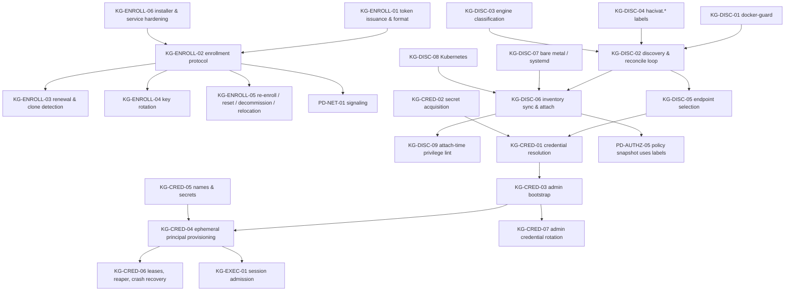

# 30 — Karagöz: Enrollment, Discovery and Credentials (canonical algorithm catalog)

> Status: **canonical, implementation-ready**. Date: 2026-11-11. Audience: implementers of Karagöz (agent) and the Perde endpoints it talks to.
> This file is a synthesis. It consolidates and decides; the evidence lives in the source documents it cites. When this file and a source document disagree, **this file wins for implementation**, except where a verification report contradicts both (verification reports always win; every such case is cited).
> Companion catalogs: `31-karagoz-execution-and-audit.md` (KG-EXEC, KG-AUDIT), `32-perde-authorization.md` (PD-AUTHZ), `33-perde-networking.md` (PD-NET), `34-perde-control-plane.md` (PD-CP).

## 0. How to read this file

### 0.1 Template

Every spec follows the README "Algorithm specification template" (Problem, Inputs/outputs, Algorithm, Data structures, Complexity, Edge cases, Test cases, Prior art and evidence, Used by) and adds: **Sources merged**, **Decision** (chosen + rejected alternatives), **Verification status**, **Rust placement**, **Threats addressed**, **Per-DBMS matrix** (where relevant), **i18n notes**. Priority tags: **phase 0** (spike/measurement), **v1** (first shippable), **v1.x** (follow-up releases), **later**.

### 0.2 Notation and conventions

- `H` = SHA-256. `‖` = concatenation of length-prefixed byte strings (u32 big-endian length ‖ bytes) unless stated. `Sign_k` / `Verify_K` = Ed25519 (RFC 8032). Domain-separation strings are ASCII and versioned (`"perde-enroll-v1"`).
- Timestamps persisted as RFC 3339 UTC with milliseconds; tokens use Unix seconds. Timers use the monotonic clock; persisted deadlines use wall clock plus a monotonic cross-check (`clock_anomaly` when they disagree by > 5 s).
- Agent state: `/var/lib/karagoz/` (`0700`, owner `karagoz`), containing `identity/agent.key` (`0600`), `enrollment.json`, `state.db` (SQLite, WAL, `synchronous=FULL` for journal tables). All state writes are atomic: write temp file → `fsync` → `rename` → `fsync(dir)`.
- **Machine codes, not sentences, cross process boundaries.** Wire/JSON carry a dotted code (`enroll.token.expired`) plus typed params. Fluent message IDs cannot contain dots, so the rendering side maps the code to the Fluent ID by replacing `.` with `-` (`enroll-token-expired`). Logs stay English and carry `code` + `message_id` + args (i18n/01 §3.5.8).
- Clean-room: Teleport (AGPL), NetBird server parts (AGPL), docker-library `mysql` and `mariadb-docker` packaging scripts (GPL-2.0) are described in prose only. No code from them appears here. All pseudocode is our own.
- Evidence tags `[Observed: …]`, `[Inferred: …]`, `[Unknown]` follow the README conventions. Verification anchors are written `V1#anchor` = `verification/01-db-behavior-tests.md#anchor`, and `V2 Pnn/Snn` = `verification/02-external-fact-check.md` row.

### 0.3 Dependency map and priorities



| Spec | Name | Priority |
|---|---|---|
| KG-ENROLL-01 | Install token issuance and format | v1 |
| KG-ENROLL-02 | Enrollment protocol (token → keypair → registration) | v1 |
| KG-ENROLL-03 | Agent credential renewal and clone detection | v1 |
| KG-ENROLL-04 | Agent key rotation | v1.x |
| KG-ENROLL-05 | Re-enrollment, identity reset, decommission, Perde relocation | v1 (re-enroll, decommission); v1.x (relocation) |
| KG-ENROLL-06 | Installer, binary verification and service hardening | v1 |
| KG-DISC-01 | docker-guard (privilege-separated Docker API proxy) | v1 |
| KG-DISC-02 | Docker discovery and reconciliation loop | v1 |
| KG-DISC-03 | Engine classification | v1 (heuristics + probes); v1.x (signed engine-spec updates) |
| KG-DISC-04 | `hacivat.*` label scheme and parsing | v1 |
| KG-DISC-05 | Endpoint and connection-path selection | v1 (network, published); v1.x (netns helper) |
| KG-DISC-06 | Inventory sync, attach and identity change | v1 |
| KG-DISC-07 | Bare-metal / systemd discovery | v1.x |
| KG-DISC-08 | Kubernetes discovery | later |
| KG-DISC-09 | Attach-time privilege lint (findings) | v1.x |
| KG-CRED-01 | Credential resolution order | v1 |
| KG-CRED-02 | Secret acquisition and handling | v1 |
| KG-CRED-03 | Karagöz admin bootstrap per DBMS | v1 (PG, MySQL); v1.x (others) |
| KG-CRED-04 | Ephemeral principal provisioning per DBMS | v1 (PG, MySQL, Redis); v1.x (MariaDB, Mongo, ClickHouse, SQL Server) |
| KG-CRED-05 | Principal naming and secret generation | v1 |
| KG-CRED-06 | Lease registry, cleanup, reaper, crash recovery | v1 |
| KG-CRED-07 | Admin credential rotation | v1.x |

### 0.4 Conflicts between sources resolved in this file

| # | Conflict | Sources | Decision |
|---|---|---|---|
| R1 | Proof of possession at enrollment: Ed25519 signature over server nonce vs `HMAC(secret, …)` | networking/05 ALG-PERDE-01 step 7 vs access/05 ALG-AGENT-01 step 4 | **Both factors**: the token secret proves authorization; an Ed25519 signature by the new key over a transcript proves key possession. HMAC alone proves nothing about the key. |
| R2 | Agent identity credential: raw Ed25519 endpoint key vs X.509 cert from an org CA (24 h, mTLS) | networking/05 §3.3.1 vs access/05 ALG-AGENT-01 | **Raw Ed25519 endpoint key** is the identity (it *is* the iroh `EndpointId`, so the key Perde authenticates is the key peers see in TLS). The 24 h renewal and generation counter from access/05 are kept as a Perde-signed **AgentCert** (COSE_Sign1, not X.509). X.509/mTLS rejected: iroh uses TLS raw public keys, and signaling uses exporter-bound signatures (PD-NET-01). |
| R3 | Server pinning: SPKI pin segment in the token vs "pinned org CA fingerprint" in the install command | networking/05 vs access/05 | Same mechanism; canonical form is the optional token pin segment (16-byte SPKI prefix). Mandatory for private-CA self-hosting, optional for WebPKI. |
| R4 | Docker label namespace `hacivat.db.*` / `hacivat.expose=false` vs `hacivat.*` / `hacivat.enable=false` | datagrip/10 ALG-TOOL-06 vs access/04 §3.4 | **`hacivat.*`** (access/04). `hacivat.db.engine` → `hacivat.engine`, `hacivat.expose=false` → `hacivat.enable=false`. `hacivat.db.password-secret` is not adopted; labels never carry secrets, only references (`credentials.password-env`, `credentials.file`). |
| R5 | Ephemeral principal granularity: per session vs per user lease | access/04 ALG-EPH-01 edge 3 vs Teleport model | **Per-user lease** for PostgreSQL, MySQL/MariaDB, SQL Server, ClickHouse (less churn); **per session** for Redis and MongoDB. Configurable per agent. |
| R6 | Reaper cadence: 5 min sweep vs hourly orphan sweep | access/04 ALG-EPH-02 vs access/03 ALG-SECENG-01 | Lease-timer driven revocation + **5 min** sweep (±10 % jitter). The hourly variant is superseded. |
| R7 | Revocation retry policy | access/03 ALG-SECENG-01 (backoff 10 s → 4 h, `IRREVOCABLE` after 12) vs access/04 ALG-EPH-02 (alert after 24 h) | access/03 backoff and state names are adopted; the alert fires at `IRREVOCABLE` (≈ 1–2 days); daily retries continue. |
| R8 | Docker env secrets: "scrubbed from the process" | access/04 earlier text | **Corrected by V1#docker-env**: only postgres and mongo scrub PID 1; `mysqld` and `clickhouse-server` keep the secret in `/proc/1/environ`; every `docker exec` process inherits `Config.Env`. The canonical source of truth is the inspect `Config.Env` (read through docker-guard), never process environments. |
| R9 | MySQL ephemeral template | access/04 §3.13.2 original | **Corrected by V1#mysql-ephemeral**: the template must create `hacivat_ddl` (`CREATE ROLE … 'hacivat_ddl'`), otherwise the DDL-tier `GRANT` fails with ERROR 1410. |

### 0.5 Shared Rust types (pseudocode, our own)

```rust
// crate karagoz (Apache-2.0). Modules referenced below: karagoz::{enroll, identity, discovery, cred, control, audit}.
pub struct AgentId(Uuid /* v7 */);
pub struct OrgId(String);
pub struct EndpointId([u8; 32]);          // == iroh::EndpointId (Ed25519 public key); wrapped so iroh types stay inside hv-net
pub struct StableKey(String);             // "compose:<project>/<service>/<n>" | "name:<hacivat.name>" | "container-name:<name>" | "unit:<systemd unit>" | "k8s:<ns>/<kind>/<name>"

/// Secrets never implement Display; Debug prints "<redacted>"; memory zeroized on drop.
pub struct Secret<T: Zeroize>(T);
impl<T: Zeroize> Secret<T> { pub fn expose(&self) -> &T; }

pub enum Engine { Postgres, MySql, MariaDb, MongoDb, Redis, Valkey, MsSql, ClickHouse, Sqlite, Pooler, Unknown }
pub enum Tier { Read, Write, Ddl, Admin }                  // lattice Read < Write < Ddl < Admin
pub enum ProvisioningMode { Ephemeral, Tier, Shared }
```

---

## 1. KG-ENROLL — enrollment, identity, rotation

### KG-ENROLL-01: Install token issuance and format

- **Priority:** v1.
- **Problem:** Give an operator a single pasteable command that lets exactly the intended number of hosts join exactly one Perde organization, survives copy/paste damage, is greppable by secret scanners, pins the Perde server when no public PKI is available, and is useless once leaked after its intended use.
- **Sources merged:** ALG-PERDE-01 steps 1–3, 11 (`networking/05-perde-network-architecture-options.md`); ALG-AGENT-01 inputs (`access/05-authorization-and-audit-primitives.md`); ALG-NB-01 setup keys (`networking/03-netbird.md`, prior art, AGPL server → prose only); Headscale pre-auth keys (`networking/02-tailscale-and-headscale.md` §3.12); kubeadm bootstrap tokens (networking/05 §1.2).
- **Inputs / outputs:**
  - In (Perde admin API `POST /v1/orgs/{org}/enrollment-tokens`): `{ttl (default 1 h, max 30 d), max_uses (default 1; null = unlimited), ephemeral: bool, requires_approval: bool, auto_labels: map, allowed_source_cidrs: [cidr], cloud_binding?: {provider, account_ids[]}, include_pin: auto|always|never}`; caller identity with permission `agents.enroll_tokens.create`.
  - Out: token string `T` (shown once), one-liner strings (Linux/macOS shell, PowerShell, container `docker run`), token row.
- **Algorithm:**
  1. Authorize the caller (PD-AUTHZ RBAC action `agents.enroll_tokens.create`). Reusable tokens (`max_uses = null` or `> 1`) **require** `requires_approval = true` **or** `ephemeral = true` unless the org setting `allow_unattended_reusable_tokens = true` (explicit, audited). NetBird's default (reusable, unlimited, 30 days) is deliberately not copied.
  2. Generate `token_id` = 10 random bytes, `secret` = 32 random bytes (OS CSPRNG).
  3. Compute `pin` when `include_pin = always`, or when `auto` and Perde's public URL presents a chain that does not validate against the WebPKI roots compiled into Karagöz: `pin = H(SPKI_DER of the leaf or of the configured private CA)[0..16]`. The admin UI computes it by probing the configured public URL, so a TLS-terminating reverse proxy is pinned correctly (networking/05 ALG-PERDE-01 edge 9).
  4. Encode `body = "prd1_" ‖ b32(token_id) ‖ "_" ‖ b32(secret) [‖ "_" ‖ b32(pin)]` with lowercase RFC 4648 base32 without padding; `T = body ‖ "_" ‖ b32(CRC-32C(body))[0..7]`. ASCII only, case-sensitive.
  5. Store `{token_id, hash = H(secret), org_id, created_by, created_at, expires_at, max_uses, uses = 0, ephemeral, requires_approval, auto_labels, allowed_source_cidrs, cloud_binding, revoked_at = null, exhausted_at = null}`. A slow KDF is unnecessary (256-bit secret); comparisons are constant-time.
  6. Return `T` once, plus one-liners that pass the token through an environment variable: `curl -fsSL https://<perde>/install.sh | KARAGOZ_TOKEN=<T> sh` (Unix), `$env:KARAGOZ_TOKEN=…; irm …/install.ps1 | iex` (Windows), `docker run … -e KARAGOZ_TOKEN=<T> -v karagoz-state:/var/lib/karagoz …` (container). The UI warns that tokens in shell history and CI logs are secrets.
  7. Emit audit `agent.enroll_token.created {token_id, max_uses, ttl, ephemeral, requires_approval}` (never the secret).
  8. Log redaction: Perde's log layer replaces any match of `prd1_[a-z2-7_]{20,}` with `prd1_<redacted>` (secret-scanner prefix; a GitHub secret-scanning partner pattern can be registered later).
- **Data structures:** `EnrollmentToken` (step 5). Index on `token_id` (PK); partial index on `(org_id) WHERE revoked_at IS NULL AND exhausted_at IS NULL`.
- **Complexity / performance notes:** O(1). Token revocation and bulk deletion of agents enrolled by a token are O(agents enrolled by `token_id`).
- **Decision:** Chosen: opaque random secret with server-side hash, optional SPKI pin, checksum, single-use default. Rejected: (a) signed self-describing tokens (JWT-like): they cannot be revoked before use without a server lookup anyway and reveal org metadata if leaked; (b) embedding the Perde URL in the token: relocation (KG-ENROLL-05) then breaks outstanding tokens and the URL is already in the one-liner; (c) reusable unlimited tokens by default (NetBird default): maximizes blast radius of a leak (threat T6).
- **Verification status:** No DB behaviour involved. Token format and kubeadm pinning are design-level; prior-art claims about NetBird's default setup key (reusable, unlimited, 30 d) and Headscale key format are confirmed in V2 P18 and S21.
- **Rust placement:** Perde (AGPL): `perde::enroll::tokens` (`issue_token`, `parse_token`, `TokenRow`). Shared parsing in `hv-proto::enroll::InstallToken` (Apache-2.0) so Karagöz can validate the checksum offline:
  ```rust
  pub struct InstallToken { pub token_id: [u8; 10], secret: Secret<[u8; 32]>, pub pin: Option<[u8; 16]> }
  impl InstallToken { pub fn parse(s: &str) -> Result<Self, TokenError /* Malformed | Checksum | NonAscii */>; }
  ```
  Crates: `data-encoding` (base32), `crc32c`, `subtle` (constant-time eq), `rand_core::OsRng`.
- **Threats addressed:** T6 (enrollment token theft: single use, 1 h TTL, hashed at rest, approval for reusable tokens, scanner prefix), T16 (TLS interception: pin), A9 adversary (leaked tokens in CI logs/screenshots) from networking/05 §3.12.
- **Edge cases (exhaustive list):**
  1. Token pasted with trailing whitespace, line wraps, zero-width characters or smart quotes → normalize (trim, remove U+200B–U+200D, U+FEFF, map typographic quotes away), then verify checksum; failure → `enroll.token.malformed` with **zero** network calls.
  2. Non-ASCII characters inside the body (e.g. Turkish `ı` from autocorrect) → `enroll.token.malformed`; never case-fold with a locale.
  3. `max_uses = null` and `requires_approval = false` without the org override → rejected at issuance (`enroll.token.unsafe_reusable`).
  4. `ttl > 30 d` → clamped to 30 d with a warning in the response.
  5. Pin requested but the public URL is unreachable from Perde itself (split-horizon DNS) → admin must upload the CA certificate; pin computed from it.
  6. Admin revokes a token → `revoked_at` set; already-enrolled agents unaffected (the token is not a credential after enrollment).
  7. Org deleted → all tokens revoked in the same transaction.
  8. Clock skew on Perde replicas → expiry evaluated in the DB (`now()` of the primary).
  9. Token used from a CIDR outside `allowed_source_cidrs` → rejected at enrollment (`enroll.source_not_allowed`), `uses` not incremented.
  10. Many tokens created by automation → per-org cap of 1 000 active tokens.
- **Test cases (input → expected):**
  1. Issue default token → `max_uses=1`, `expires_at = now+1h`, string matches `^prd1_[a-z2-7]{16}_[a-z2-7]{52}_[a-z2-7]{7}$` (no pin) → parse OK.
  2. Flip last body character → `InstallToken::parse` → `Checksum`.
  3. Token with appended `​` and a trailing newline → parses.
  4. Request `max_uses=null, requires_approval=false` → HTTP 422 `enroll.token.unsafe_reusable`.
  5. Private-CA Perde (self-signed CA) → token contains a pin equal to the first 16 bytes of `H(CA SPKI)`.
  6. Perde logs after issuance contain `prd1_<redacted>` only (grep test).
- **Prior art and evidence:** networking/05 ALG-PERDE-01 [Observed: kubeadm `--discovery-token-ca-cert-hash`]; Headscale `hskey-auth-` keys stored as SHA-256 [Observed: networking/02 §3.12]; NetBird setup keys [Observed: networking/03, `types/setupkey.go:189-191`, AGPL → prose].
- **i18n notes:** Codes `enroll.token.malformed|expired|exhausted|revoked|unsafe_reusable|source_not_allowed`. The UI copy for the one-liner is localized; the command itself never is. Token prefix and alphabet are ASCII-only and case-sensitive (Turkish `I/ı` hazard).
- **Used by:** Perde (issuer), Karagöz (parser), operator.

### KG-ENROLL-02: Enrollment protocol (token → keypair → registration)

- **Priority:** v1.
- **Problem:** Turn the one-liner into a durable, cryptographically strong Karagöz identity bound to exactly one Perde organization, without the operator typing credentials, without the private key leaving the host, without trusting the network beyond what the token pins, and idempotently under retries and races.
- **Sources merged:** ALG-PERDE-01 steps 4–10 and edge cases 1–18 (networking/05); ALG-AGENT-01 steps 2–6 and edge cases (access/05); ALG-NB-01 (networking/03, prose); Teleport bound-keypair joining (prose, AGPL); sequence diagram networking/05 §5.4.1.
- **Inputs / outputs:**
  - In (agent): `T`; optional `--perde-url` (default from the installer), `--labels k=v,…`, `--force-reenroll`; host facts `{hostname, os, arch, kernel, machine_id_hash = H("karagoz-mid-v1" ‖ /etc/machine-id), container_runtime_summary, agent_version, cloud_identity_document?}`; state directory `S`.
  - In (Perde): token table, nonce table, agent table, signing key ring, relay map, org policy.
  - Out (agent): `S/identity/agent.key` (Ed25519 seed, 0600), `S/enrollment.json` `{agent_id, org_id, perde_url, perde_instance_id, spki_pins[], key_ring: [{kid, role, public_key, not_after}], relay_map, signaling_url, enrolled_at, agent_cert, receipt}`, audit record `agent.enrolled` (first record of the first audit stream, KG-AUDIT).
  - Out (Perde): agent row (`status = active | pending_approval`), token `uses += 1`, audit event.
- **Algorithm:**
  1. **Local pre-checks (no network).** Parse `T` (KG-ENROLL-01; failure → exit 2, `enroll.token.malformed`). Ensure `S` exists, is owned by the service user and writable (else fail before any token consumption, edge 17 of ALG-PERDE-01). If `S/enrollment.json` exists: same `perde_url` and not `--force-reenroll` → print `enroll.already_enrolled` and exit 0 when the org matches (idempotent re-run by configuration management), non-zero otherwise.
  2. **Key generation.** Generate an Ed25519 key from `getrandom()` with blocking semantics (never a time-seeded fallback, early-boot entropy edge). Write `agent.key` to a temp file with mode 0600 *before* contacting Perde; promote it atomically only after step 9 succeeds (so a failed enrollment leaves no half identity). Optional: seal with `systemd-creds` or TPM 2.0 when available (later; report `key_protection = file|systemd_creds|tpm` in host facts).
  3. **TLS with pin.** Open HTTPS to `perde_url`. If `T.pin` is present: require that some certificate in the presented chain has `H(SPKI)[0..16] == pin`; in addition to WebPKI validation when the chain validates, *instead of* WebPKI only for private-CA installs. Mismatch → abort `enroll.pin_mismatch`; the secret is never sent. Clock skew is irrelevant here (server nonce, server-side expiry), but compare `server_time` with local time and warn when `|Δ| > 5 min` (`agent.clock_skew` health code) because grant validation depends on clocks (PD-AUTHZ-03).
  4. **Challenge.** `POST /v1/enroll/challenge {token_id}` → `{nonce (32 B), server_time, perde_instance_id}`. Perde stores the nonce for 120 s, single use. Unknown `token_id` receives an indistinguishable response (no enumeration oracle). Rate limits: per source IP 10/min, per `token_id` 50/s (autoscaling bursts).
  5. **Enroll request.** `POST /v1/enroll {token_id, secret, endpoint_public_key, host_facts, labels, proof}` with
     `proof = Sign_sk("perde-enroll-v1" ‖ perde_instance_id ‖ token_id ‖ nonce ‖ endpoint_public_key ‖ H(canonical_cbor(host_facts)) ‖ H(canonical_cbor(labels)))`.
  6. **Server verification in one serializable transaction** (or `SELECT … FOR UPDATE` on the token row):
     1. Token exists; `constant_time_eq(H(secret), hash)`; not revoked; `expires_at > now`; `uses < max_uses` (or unlimited).
     2. Nonce exists, unexpired, unused, issued for this `token_id`; mark used.
     3. `Verify(endpoint_public_key, proof)`.
     4. Source IP within `allowed_source_cidrs` if set.
     5. `endpoint_public_key` not registered to any agent or device. If it is registered **by this `token_id` within the last 10 min** with identical host-facts hash → idempotent replay: return the stored response (lost-response retry). Otherwise → `enroll.key_in_use`.
     6. Optional cloud binding: verify the instance identity document signature against the provider's published certificate; require the account id in `cloud_binding.account_ids` (prior art: cloud join methods, prose only).
     7. Insert agent `{agent_id = UUIDv7, org_id, endpoint_id, labels = auto_labels ∪ labels (operator labels win only for keys not in auto_labels), status, host_facts, enrolled_at, enrolled_by_token = token_id, generation = 1, key_epoch = 1}`; `uses += 1`; set `exhausted_at` when `uses == max_uses`.
     8. `status = pending_approval` if `token.requires_approval` or org policy `require_agent_approval`; else `active`.
     9. Emit audit `agent.enrolled {agent_id, token_id, source_ip, host_facts_hash, status}`.
  7. **Response.** `{agent_id, org_id, status, key_ring: [{kid, role ∈ {grant, policy, approval, cosign, relay_ticket, control}, public_key, not_after}], spki_pins[], relay_map, signaling_url, agent_cert, receipt}` where
     - `receipt = Sign_control("perde-receipt-v1" ‖ agent_id ‖ endpoint_public_key ‖ org_id ‖ enrolled_at)`;
     - `agent_cert = COSE_Sign1_control({agent_id, org_id, endpoint_id, generation: 1, key_epoch: 1, iat, exp: iat + 24 h})` (KG-ENROLL-03).
  8. **Agent verification.** Verify `receipt` and `agent_cert` with the `control` key from the returned ring (consistency check against a substituted response); verify `agent_cert.endpoint_id == own key`.
  9. **Persist atomically**: promote `agent.key`, write `enrollment.json`, create `state.db`, start audit stream 1 with record `agent.enrolled` (KG-AUDIT-02). Order: key → state.db → enrollment.json (the presence of `enrollment.json` is the commit marker).
  10. **First signaling session** (PD-NET-01 `Hello` with exporter-bound signature). If `pending_approval`: stay connected, send `AddrUpdate` and inventory **metadata only** (KG-DISC-06), refuse every data-plane stream with `agent.pending_approval` until `AgentApproved` arrives.
  11. **Secret hygiene.** Never write `T` to disk or logs; the installer removes `KARAGOZ_TOKEN` from the generated unit/env file after success; Karagöz zeroizes the parsed token.
- **Data structures:** `EnrollmentState` (= `enrollment.json`), `Agent {agent_id, org_id, endpoint_id, labels, status ∈ {pending_approval, active, disabled, conflict, locked, decommissioned}, enrolled_at, last_seen_at, version, host_facts, approved_by?, generation, key_epoch, key_rotated_at?, enrolled_by_token}`, `EnrollNonce {nonce, token_id, expires_at, used_at?}`.
- **Complexity / performance notes:** Two round trips; one Ed25519 signature at the agent, two verifications at Perde; O(1) DB work by primary key. Enrollment storms are bounded by the per-token rate limit and nonce TTL.
- **Decision:** Chosen: client-generated key, server nonce, signature PoP + token secret (R1), raw-key identity + Perde-signed AgentCert (R2), idempotent replay window. Rejected: server-generated keys shipped to the host (key leaves Perde; violates "private key never transmitted"); X.509 CSR flow (iroh uses raw public keys; adds ASN.1 surface for no gain); HMAC-only proof (R1).
- **Verification status:** Design-level; no DB behaviour. iroh 1.0 identity model (Ed25519 `EndpointId`, `Builder::secret_key`) confirmed V2 P15/P16 and networking/04 §3.4 [Observed]. Phase-0 must confirm that persisting a 32-byte seed and re-importing it with `Builder::secret_key` yields the same `EndpointId` across iroh minor upgrades.
- **Rust placement:**
  ```rust
  // karagoz::enroll
  pub async fn enroll(cfg: EnrollConfig, token: InstallToken) -> Result<EnrollmentState, EnrollError>;
  pub enum EnrollError { Malformed, PinMismatch, TokenExpired, TokenExhausted, TokenRevoked, NonceInvalid,
                         KeyInUse, SourceNotAllowed, AlreadyEnrolled{same_org: bool}, StateDirNotWritable, Network(..) }
  // karagoz::identity
  pub struct AgentIdentity { key: Secret<ed25519_dalek::SigningKey>, pub agent_id: AgentId, pub endpoint_id: EndpointId }
  impl AgentIdentity { pub fn load(dir: &Path) -> Result<Self>; pub fn sign(&self, domain: &'static str, parts: &[&[u8]]) -> Signature; }
  // perde::enroll (AGPL)
  pub async fn challenge(db: &Db, token_id: TokenId) -> ChallengeResponse;
  pub async fn enroll(db: &Db, req: EnrollRequest, src: IpAddr) -> Result<EnrollResponse, EnrollDenied>;
  ```
  Crates (versions to check at implementation): `ed25519-dalek` 2.x, `coset` (COSE), `ciborium` (deterministic CBOR via our own canonicalizer), `reqwest` + `rustls` (custom verifier for SPKI pin), `getrandom`, `zeroize`, `tokio`.
- **Threats addressed:** T6 (token theft: single use, nonce, approval), T7 (key theft: 0600, optional sealing), T2/T3 groundwork (identity = transport key), A9, T16 (pin before secret disclosure), replay to another Perde (instance id in proof).
- **Edge cases (exhaustive list):**
  1. Token expired between challenge and enroll → `enroll.token.expired`; agent prints a localized hint to create a new token.
  2. Two hosts race on a single-use token → exactly one wins (row lock); loser `enroll.token.exhausted`; loser's temp key discarded.
  3. Response lost after commit → retry within 10 min with the same key → identical response (step 6.5).
  4. Retry after 10 min with the same key → `enroll.key_in_use`; operator runs `karagoz reset-identity` + new token.
  5. Re-running the installer on an enrolled host → `already_enrolled`, exit 0 for the same org.
  6. Container with an ephemeral filesystem → new identity on each restart; documentation requires a volume for `/var/lib/karagoz`; for autoscaling use an `ephemeral` reusable token (Perde garbage-collects identities N minutes after last seen).
  7. VM image cloned **after** enrollment (golden image contains `agent.key`) → detected by KG-ENROLL-03 (two sessions, different `machine_id_hash`; generation divergence) → `conflict`.
  8. Corporate TLS interception: with a pin → `pin_mismatch` and an actionable message naming the proxy CA; without a pin (hosted WebPKI) → succeeds only if the OS trust store trusts the proxy CA; signaling channel binding later fails by design unless the org allows interception (PD-NET-01).
  9. Self-hosted Perde behind a TLS-terminating reverse proxy → pin is the proxy's SPKI (computed by the admin UI).
  10. Host clock wildly wrong → enrollment succeeds; health code `agent.clock_skew` reported; grants will be refused until NTP fixes the clock (PD-AUTHZ-03).
  11. `getrandom` blocks at early boot → wait (bounded by systemd start timeout); never fall back.
  12. Enrollment from a forbidden CIDR → `enroll.source_not_allowed`, `uses` unchanged.
  13. State directory not writable → fail before contacting Perde.
  14. Disk full while persisting → enrollment committed at Perde but local state missing → retry within 10 min reuses the same key (still in the temp file) → idempotent replay; after 10 min the operator must reset.
  15. Two agents for different orgs on one host → separate state dirs, service users and units (`karagoz@<name>.service`).
  16. Leaked reusable token used by an attacker → `requires_approval` keeps the rogue agent `pending_approval`; admin can revoke the token and bulk-delete agents by `enrolled_by_token`.
  17. Perde advertises a `key_ring` without a `control` key → agent aborts (`enroll.response_invalid`).
  18. Host facts contain non-ASCII hostname (`sunucu-ığdır`) → stored NFC; never used as an identifier.
- **Test cases (input → expected):**
  1. Valid single-use token, fresh host (Docker test image `debian:bookworm-slim` running the static musl `karagoz`) → status `active`, files `agent.key` 0600 and `S` 0700, Perde token `uses=1`, audit `agent.enrolled` present at both ends.
  2. Same token on a second container → `token_exhausted`; no agent row created.
  3. Token with altered checksum → zero HTTP requests observed by the mock Perde.
  4. Token pin ≠ server SPKI → the mock server never receives `/v1/enroll`.
  5. Replay the captured `/v1/enroll` body → `nonce_invalid`.
  6. Replay to a second Perde instance → `perde_instance_id` mismatch → signature invalid.
  7. 100 parallel enrollments with `max_uses=10` → exactly 10 agents.
  8. Drop the HTTP response after commit; retry within 10 min → identical `agent_id`.
  9. `requires_approval` → agent connected, `StreamOpen` → `agent.pending_approval`; after admin approval → streams accepted.
  10. Kill the process between key generation and response → no promoted `agent.key`; rerun enrolls cleanly with the same token if unused.
- **Prior art and evidence:** networking/05 ALG-PERDE-01 [Observed: kubeadm docs; Headscale `preauth_keys.go:86,231-240`; NetBird `setupkey.go`; Teleport `boundkeypair.go:60-210` doc comments, prose]; access/05 ALG-AGENT-01.
- **i18n notes:** Codes `enroll.*` as listed; CLI messages from `karagoz-cli.ftl` (`--lang`, `KARAGOZ_LANG`, `LANG` per ALG-I18N-01 CLI chain); `--json` output carries `code`, `message` (English), `message_id`, `args`. Hostnames and labels are data, never translated.
- **Used by:** Karagöz, Perde.

```mermaid
sequenceDiagram
    autonumber
    actor Op as Operator
    participant P as Perde API
    participant DB as Perde DB
    participant K as Karagöz (host)
    participant S as Perde signaling
    Op->>P: create token (org, ttl 1h, max_uses 1, requires_approval?)
    P->>DB: store token_id, H(secret), policy
    P-->>Op: one-liner (KARAGOZ_TOKEN=prd1_…)
    Op->>K: curl …/install.sh | KARAGOZ_TOKEN=… sh
    K->>K: verify installer + binary signature (KG-ENROLL-06)
    K->>K: parse token (checksum), check state dir, generate Ed25519 (temp file)
    K->>P: TLS (WebPKI and/or SPKI pin) POST /v1/enroll/challenge {token_id}
    P-->>K: {nonce, instance_id, server_time}
    K->>P: POST /v1/enroll {token_id, secret, pk, host_facts, labels, sig(nonce‖instance_id‖…)}
    P->>DB: BEGIN; lock token; check hash/ttl/uses; consume nonce; verify sig; insert agent; uses+=1; COMMIT
    P-->>K: {agent_id, status, key_ring, pins, relay_map, signaling_url, agent_cert, receipt}
    K->>K: verify receipt + agent_cert; promote key; persist state (atomic); audit stream 1: agent.enrolled
    K->>S: WSS /v1/signal Hello(sig over nonce‖TLS exporter)
    S-->>K: Welcome(session_id, policy_epoch, relay_map)
    K->>S: AddrUpdate; InventoryDiff (metadata only)
    alt status = pending_approval
        S-->>K: AgentApproved (after admin action)
    end
```

### KG-ENROLL-03: Agent credential renewal and clone detection

- **Priority:** v1.
- **Problem:** Detect cloned agent identities (golden images, snapshot restores, copied state directories), let Perde lock a suspicious identity quickly, and keep a fresh Perde-signed statement that binds `agent_id ↔ endpoint_id` for peers — without any secret that can be copied unnoticed.
- **Sources merged:** ALG-AGENT-01 steps 7–10 and edge cases 3–4, 6, 11–12 (access/05); ALG-PERDE-01 edge 7 (networking/05: two concurrent sessions, different machine-id hashes); ALG-NB-06 (networking/03: setup-key peers never expire — Karagöz does not expire by login, it is revocation-driven).
- **Inputs / outputs:** In: identity key, `enrollment.json` (`generation g`, `key_epoch`), Perde nonce, `machine_id_hash`. Out: new `agent_cert` (24 h), persisted `generation`, or Perde state `conflict|locked` with audit and admin alert.
- **Algorithm:**
  1. Renew when `now ≥ agent_cert.iat + 12 h` (50 % lifetime), on every signaling (re)connect when the cert has < 12 h left, and on startup.
  2. Over the authenticated signaling session: `RenewRequest {agent_id, generation g, machine_id_hash, nonce_from_welcome, sig = Sign_sk("perde-renew-v1" ‖ agent_id ‖ u64(g) ‖ nonce ‖ machine_id_hash)}`.
  3. Perde, in a transaction on the agent row:
     - `g == stored_generation` → issue `agent_cert(g+1)`, set `stored_generation = g + 1`, `pending_ack_generation = g + 1`.
     - `g == stored_generation − 1` **and** `pending_ack_generation == stored_generation` **and** the request carries `ack_proof = Sign_sk("perde-renew-ack-v1" ‖ H(last issued cert))` → crash-between-issue-and-persist recovery: reissue the same `g+1` cert once.
     - otherwise → **generation mismatch**: status `locked` (reason `generation_mismatch`), push `Revoke{agent}` to the agent's sessions and notify admins; recovery requires re-enrollment (KG-ENROLL-05).
  4. Agent persists `generation = g+1` and the new cert **before** using it (write-ahead), then acknowledges (`RenewAck`).
  5. **Concurrent-session detection (independent of renewal):** Perde keeps at most one signaling session per `endpoint_id`. A second `Hello` for the same key: if `machine_id_hash` equals the existing session's → normal reconnect race (newest wins, older gets `superseded`, PD-NET-01); if it differs → both sessions marked `conflict`, data plane refused at both (`agent.conflict`), audit `agent.conflict`, admin alert. Repeated flapping of two processes on the same key also shows up as iroh relay `SameEndpointIdConnected` evictions (networking/04 ALG-IROH-01 edge 13), which Karagöz reports as a health code.
  6. **Long downtime:** renewal with an expired cert is allowed while `now − last_seen ≤ max_offline` (default 30 d); beyond that → `agent.reenroll_required`.
  7. **Peers' use of AgentCert:** none required for connection security (grants already pin `aep`, PD-AUTHZ-02). The AgentCert is used by Perde-side checks, by the audit verifier to map checkpoint keys to `key_epoch` (KG-AUDIT-04), and is shown in `karagoz status`.
- **Data structures:** Perde agent row fields `generation`, `pending_ack_generation`, `last_cert_hash`, `last_machine_id_hash`, `status`; agent `enrollment.json.generation`.
- **Complexity:** O(1) per 12 h per agent.
- **Decision:** Chosen: generation counter + machine-id cross-check (combines access/05 and networking/05). Rejected: hardware attestation as a requirement (TPM not universally available; kept as optional later); relying only on duplicate-session detection (misses clones that are never online at the same time, e.g. snapshot restore).
- **Verification status:** Design-level. The iroh relay eviction behaviour on duplicate endpoint ids is [Observed: networking/04 ALG-IROH-03 step 4].
- **Rust placement:** `karagoz::identity::renew` (client), `perde::agents::renew` (server). Type: `struct AgentCert { agent_id, org_id, endpoint_id, generation: u64, key_epoch: u32, iat, exp }` encoded as COSE_Sign1 in `hv-proto::identity`.
- **Threats addressed:** T7 (key theft/clone), A7 (compromised host copying state elsewhere), T13 groundwork (audit streams from clones fork, KG-AUDIT-05).
- **Edge cases (exhaustive list):** crash after Perde increments but before local persist (step 3 recovery, once); VM snapshot restored to an older generation → lock (true positive; documented "I restored from a snapshot" flow = re-enroll); host renamed → facts update, no identity change; `/etc/machine-id` regenerated by an image pipeline but key kept → machine-id change on a single session is accepted and audited (`agent.machine_id_changed`), only *concurrent* differing ids mean conflict; containers without `/etc/machine-id` → use `H(hostname ‖ boot_id)` and mark `machine_id_source = weak`; clock skew (cert not yet valid) → `agent.clock_skew`; agent decommissioned in Perde → renew returns `decommissioned` → agent wipes key and exits 0 (KG-ENROLL-05); Perde control key rotated → cert verified with the chained ring (PD-AUTHZ-01).
- **Test cases:** fresh enroll → generation 1; renew ×3 → generation 4; copy `S` to a second container and run both → second renew → `locked`, both data planes refused; restore gen-2 snapshot after gen-4 → `locked`; kill agent between server issue and local persist → next renew reissues once; 10 days offline → renew OK; 40 days → `reenroll_required`; same key online from two containers simultaneously with different machine ids → `conflict` within one heartbeat.
- **Prior art and evidence:** access/05 ALG-AGENT-01 (Teleport bound-keypair join-state counters, prose); networking/05 ALG-PERDE-01 edge 7.
- **i18n notes:** Codes `agent.locked.generation_mismatch`, `agent.conflict`, `agent.reenroll_required`, `agent.clock_skew`; admin alert e-mails localized per recipient (PD-CP-07).
- **Used by:** Karagöz, Perde.

### KG-ENROLL-04: Agent key rotation

- **Priority:** v1.x.
- **Problem:** Replace the agent's Ed25519 identity key (scheduled yearly, on suspicion, or on operator request) without breaking in-flight sessions, while making the change visible to every client that pinned the old key.
- **Sources merged:** ALG-PERDE-01 edge 13 (`RotateKey`), ALG-PERDE-05 step 8 (`AgentKeyChanged`, TOFU pinning) (networking/05); ALG-AGENT-01 step 10 (CA rotation overlap) (access/05).
- **Inputs / outputs:** In: old key, new key, Perde nonce. Out: Perde agent row with new `endpoint_id`, `key_epoch + 1`, overlap window; `AgentKeyChanged` notices to clients; audit `agent.key_rotated`.
- **Algorithm:**
  1. Generate the new key (as KG-ENROLL-02 step 2), keep it in a temp file.
  2. Send `RotateKey {new_pub, nonce, sig_old = Sign_old("perde-rotate-v1" ‖ new_pub ‖ nonce), sig_new = Sign_new("perde-rotate-v1" ‖ old_pub ‖ nonce)}` on the signaling session authenticated with the old key.
  3. Perde verifies both signatures and that `new_pub` is unused; records `{old, new, key_epoch+1, overlap_until = now + 10 min}`; returns new `agent_cert` and `receipt`.
  4. Agent persists the new key and state atomically, closes its audit stream with record `stream.rotate {reason: key_rotation, next_key_epoch}` signed by the old key's checkpoint, and opens a new checkpoint key epoch (KG-AUDIT-04).
  5. Agent rebinds its iroh endpoint with the new key (new `EndpointId`); during `overlap_until` it accepts existing connections on the old endpoint (keeps the old endpoint bound until the last old connection closes or overlap ends); new grants carry `aep = new`.
  6. Perde issues `AgentKeyChanged{agent_id, old, new, reason, at, sig_control}` to all clients authorized for the agent (presence subscribers) and stores it for clients that come online later; Hacivat updates its pin and shows a one-time notice.
- **Data structures:** `AgentKeyHistory {agent_id, key_epoch, endpoint_id, valid_from, valid_to}` (Perde); needed by the audit verifier to check old checkpoints.
- **Complexity:** O(1); overlap memory = one extra iroh endpoint for ≤ 10 min.
- **Decision:** Chosen: dual-signature rotation over the authenticated channel, Perde-signed change notices. Rejected: silent rotation (clients would see `peer_identity_mismatch`); machine-key/node-key split à la Tailscale (networking/05 §3.3.1: not needed while the data-plane key is also the signaling key; revisit if device re-auth without re-key is needed).
- **Verification status:** Design-level; iroh re-binding with a new `SecretKey` requires a new `Endpoint` (builder takes the key at bind time) [Observed: networking/04 §3.4 `Builder::secret_key`].
- **Rust placement:** `karagoz::identity::rotate`, `perde::agents::rotate_key`, `hv-proto::control::{RotateKey, AgentKeyChanged}`.
- **Threats addressed:** T2 (impersonation: visible, signed key changes), T7 (limits life of a stolen key when combined with revocation).
- **Edge cases:** rotation interrupted after Perde commit → agent retries with the same new key (idempotent while `overlap_until` not passed); old key compromised (attacker rotates first) → admin sees `agent.key_rotated` from an unexpected machine id → lock + re-enroll; client offline during rotation → receives the stored notice on next signaling connect before any connect to that agent; grant issued with the old `aep` in flight → accepted until `overlap_until`.
- **Test cases:** rotate during an active `SELECT pg_sleep(30)` session → session completes on the old connection; new session uses the new key; client shows the notice once; forged `RotateKey` with valid `sig_new` but invalid `sig_old` → rejected; audit verifier validates checkpoints across the epoch boundary.
- **Prior art:** networking/05 §3.5 item 4; Tailscale node-key rotation (networking/02, prior art).
- **i18n notes:** Client notice `net.agent.identity_changed {agent_name, date}` (localized date via ICU4X).
- **Used by:** Karagöz, Perde, Hacivat.

### KG-ENROLL-05: Re-enrollment, identity reset, decommission and Perde relocation

- **Priority:** v1 (reset, re-enroll, decommission); v1.x (relocation).
- **Problem:** Provide explicit, auditable life-cycle transitions for lost keys, cloned images, removed agents and Perde URL changes, never accepting unsigned redirection.
- **Sources merged:** ALG-PERDE-01 edges 5, 6, 10, 12 (networking/05); ALG-AGENT-01 edges 7, 9, 11 (access/05).
- **Algorithm:**
  1. `karagoz reset-identity` (image pipelines, cloned VMs): stop the service, delete `agent.key`, `enrollment.json`, `state.db` **after** uploading or exporting unacknowledged audit records (refuse while unacked records exist unless `--discard-audit`, which writes a local tombstone file and is itself reported to Perde on next enroll as `audit.discarded {count}`).
  2. `karagoz enroll --force-reenroll --token …`: performs (1) then KG-ENROLL-02. Perde links the new agent row to the old one when the operator chooses "replace agent" (inventory attach decisions and labels are copied; the old row becomes `replaced`).
  3. **Lost key (disk wiped):** old row stays `offline` until deleted; clients that pinned the old endpoint id receive `AgentKeyChanged{reason: reenrolled}` when the operator links the rows, or the agent appears as a new agent otherwise.
  4. **Decommission (Perde side):** status `decommissioned` → `Revoke{agent}` → agent closes sessions, runs the principal sweep with "delete all managed" for its own principals (KG-CRED-06 step 7, unless `--keep-principals`), uploads remaining audit, wipes its key and exits 0. Data in Perde is retained per retention policy.
  5. **Perde relocation (v1.x):** Perde sends `PerdeMoved {new_url, new_spki_pins[], effective_at, sig_control}`; the agent verifies with the pinned `control` key, test-connects to the new URL with the new pins, switches, and persists. Unsigned HTTP redirects to other hosts are never followed for enrollment, signaling or audit upload.
- **Edge cases:** relocation message received while the new URL is unreachable → retry for 24 h, then alert; decommission while offline → applied on next connect, or never (operator uninstall path `karagoz uninstall --purge-principals`); re-enroll with a token of a different org → old org's agent row becomes `offline` (no automatic transfer of attach decisions across orgs).
- **Test cases:** reset with 10 unacked records and no `--discard-audit` → refused; decommission → all `hv_` principals created by this agent dropped (Docker `postgres:17`), key file removed, exit 0; forged `PerdeMoved` (signed by an unknown kid) → ignored + audit `security.unsigned_relocation`.
- **Decision / Verification / Threats:** explicit transitions only (rejected: silent re-registration on key mismatch — enables takeover). Design-level. Threats: T7, T4 (relocation could redirect agents to a rogue Perde → signature required).
- **Rust placement:** `karagoz::cli::{reset_identity, uninstall}`, `karagoz::control::perde_moved`.
- **i18n notes:** CLI confirmation prompts localized; `--yes` for automation.
- **Used by:** Karagöz, Perde.

### KG-ENROLL-06: Installer, binary verification and service hardening

- **Priority:** v1.
- **Problem:** Make the one-command install safe against tampered downloads and run the agent with the least privileges compatible with discovery and DB access.
- **Sources merged:** ALG-AGENT-01 step 1 (access/05); networking/05 §3.11 install section; access/04 §5.1 items 1–2 (process split, systemd hardening); T17 supply chain (networking/05 §3.12).
- **Algorithm:**
  1. `install.sh` (no secrets inside) detects OS/arch/init system, downloads the static musl binary and its detached signature (minisign or sigstore) for the version manifest; verifies with the release public key embedded in the script; aborts on mismatch. The script itself is served over HTTPS from Perde (pinned) or the vendor CDN.
  2. Creates users `karagoz` (unprivileged) and, if Docker discovery is enabled, runs `karagoz guard` (KG-DISC-01) as root or as a member of the `docker` group.
  3. Installs units: `karagoz.service` (`User=karagoz`, `NoNewPrivileges=yes`, `ProtectSystem=strict`, `ReadWritePaths=/var/lib/karagoz`, `CapabilityBoundingSet=` empty, `PrivateTmp=yes`, `RestrictAddressFamilies=AF_UNIX AF_INET AF_INET6 AF_NETLINK`) and `karagoz-guard.service` (socket at `/run/karagoz/guard.sock`, mode 0660, group `karagoz`). Sets `prctl(PR_SET_DUMPABLE, 0)` at startup in both.
  4. Runs `karagoz enroll` with `KARAGOZ_TOKEN`, then scrubs the variable from any env file.
  5. Container mode: image `karagoz` runs as non-root, `read_only: true`, `cap_drop: [ALL]`, `no-new-privileges`, state volume, guard socket mounted (the guard runs as a separate container or on the host); network attach to DB networks done once by the installer (`POST /networks/{id}/connect`), never at runtime.
  6. Auto-update only if enabled: same signature verification; staged rollout is a paid fleet feature (PD-CP-04), basic self-update is free.
- **Edge cases:** no systemd (OpenRC, launchd on macOS, Windows service) → equivalent hardening where available; read-only root FS → state dir must be a mount; SELinux/AppArmor denials on the guard socket → documented policy module; air-gapped installs → offline bundle with signatures.
- **Test cases:** tampered binary byte → install aborts before enrollment; `systemd-analyze security karagoz.service` exposure score ≤ 2.0; main agent cannot open `/var/run/docker.sock` (EACCES) in the reference install.
- **Decision:** separate guard process (rejected: in-process allowlist — useless if the agent process is compromised, access/04 §3.12-3).
- **Verification status:** design-level; Docker socket root-equivalence is [Inferred: Engine API semantics] in access/04 §3.12.
- **Rust placement:** `karagoz::cli::install_support`, packaging scripts in `packaging/` (Apache-2.0).
- **Threats:** T17, T3 (socket abuse), T7.
- **i18n notes:** installer messages English-only in v1 (shell script), CLI after install localized.
- **Used by:** Karagöz.

---

## 2. KG-DISC — discovery

### KG-DISC-01: docker-guard (privilege-separated Docker API proxy)

- **Priority:** v1.
- **Problem:** Discovery needs the Docker Engine API, which is root-equivalent (anyone who can `POST /containers/create` can bind-mount `/`), and even its read endpoints leak every container's secrets (`Config.Env`, arbitrary files via `archive`). Provide the agent with exactly the API surface it needs, with secret redaction, in a separate process.
- **Sources merged:** access/04 §3.2, §3.12 (docker-guard design, Tecnativa socket-proxy limits), ALG-DISC-01 inputs; verification V1#docker-env.
- **Inputs / outputs:** In: Docker-compatible socket (probe order below), guard config `/etc/karagoz/guard.toml` (root-owned), Perde-signed `AttachList` (stable keys of attached DBs, signed by the `policy` key, forwarded by the agent). Out: unix socket `/run/karagoz/guard.sock` speaking a subset of the Docker Engine API (same paths and JSON shapes, so `bollard` works unchanged against it).
- **Algorithm:**
  1. **Socket discovery** (first that answers `GET /_ping`): `$DOCKER_HOST` (only `unix://` or `npipe://` accepted by default), `/var/run/docker.sock`, `$XDG_RUNTIME_DIR/docker.sock` (rootless), `/run/podman/podman.sock`, `$XDG_RUNTIME_DIR/podman/podman.sock`, Windows `npipe:////./pipe/docker_engine`. Negotiate API version `min(client_max, server)`; refuse below 1.41 (`disc.docker.api_too_old`). Docker Engine API v1.57 at the studied moby commit [V2 P26].
  2. **Peer check:** accept connections only from UID `karagoz` (`SO_PEERCRED`).
  3. **Allowlist (default config):**
     | Method + path | Constraints | Response transformation |
     |---|---|---|
     | `GET /_ping`, `GET /version` | — | none |
     | `GET /containers/json` | force `all=true`; pass filters | none (summaries have no env) |
     | `GET /containers/{id}/json` | — | **redact** `Config.Env` values: keep names; keep values only for the non-secret allowlist (`PG_MAJOR`, `PG_VERSION`, `PGDATA`, `PGPORT`, `MYSQL_MAJOR`, `MYSQL_VERSION`, `MARIADB_VERSION`, `MONGO_VERSION`, `REDIS_VERSION`, `MSSQL_PID`, `MSSQL_TCP_PORT`, `ACCEPT_EULA`, `CLICKHOUSE_DB`, `CLICKHOUSE_DEFAULT_ACCESS_MANAGEMENT`, `POSTGRES_HOST_AUTH_METHOD`, `MYSQL_ALLOW_EMPTY_PASSWORD`, `MYSQL_RANDOM_ROOT_PASSWORD`, `MARIADB_RANDOM_ROOT_PASSWORD`, `MYSQL_ONETIME_PASSWORD` (presence only)); reveal credential-bearing values (engine `cred_spec` names, `*_FILE` paths, label-declared env names) **only** if the container's stable key is in the verified `AttachList`; redact `--requirepass <x>` / `--masterauth <x>` values in `Config.Cmd` likewise |
     | `GET /events` | force filters `type=container,network` | none |
     | `GET /containers/{id}/archive?path=p` | only if container attached and `p` equals the value of a `*_FILE` env var or `hacivat.credentials.file`, or a config file named in `Config.Cmd` (`redis-server /x/redis.conf`); response ≤ 64 KiB; single regular-file tar entry; symlinks rejected | none |
     | `GET /images/{id}/json` | optional (`allow_image_inspect`, default true) | strip `Config.Env` values as above |
     | `GET /containers/{id}/logs` | only if `allowLogHarvest = true` (default false) and container attached; tail ≤ 1 000 lines | none |
     | `POST /containers/{id}/exec`, `POST /exec/{id}/start` | only if `allowExec = true` (default false); `Cmd` must equal a bootstrap template from KG-CRED-03; `Env` must be empty (but see edge 6: `Config.Env` is inherited anyway) | none |
     | `POST /containers/create` (+ start, wait, delete for that container) | only if `allowNetnsHelper = true` (default false in v1, see KG-DISC-05); body must be exactly: `Image` = pinned helper digest, `HostConfig.NetworkMode = container:<attached id>`, no mounts, no privileges, `CapDrop: [ALL]`, `ReadonlyRootfs`, `AutoRemove` | none |
     | anything else | — | `403 {"message":"denied by karagoz-guard"}` |
  4. **AttachList verification:** signature by the `policy` key from `enrollment.json` (root-readable copy at `/etc/karagoz/trust.json` written by the installer), monotonic `epoch` (reject rollback), `agent_id` match. A compromised unprivileged agent therefore cannot unlock secrets of non-attached containers.
  5. **Audit:** the guard writes its own append-only log line per non-GET request and per secret reveal (`guard.secret_revealed {stable_key, env_name}`); the agent mirrors these into its audit stream.
- **Data structures:** `GuardPolicy {allow_image_inspect, allow_log_harvest, allow_exec, allow_netns_helper, helper_digest}`, `AttachList {agent_id, epoch, keys: Set<StableKey>, sig}`, `ContainerIndex {id → stable_key}` (computed by the guard itself from inspect + labels, using the same KG-DISC-02 step 6 function).
- **Complexity / performance notes:** one extra unix-socket hop per Docker call; JSON rewrite of inspect bodies (≤ ~50 KB each) is negligible.
- **Decision:** Chosen: separate root process, field-level redaction, signed attach list. Rejected: Tecnativa docker-socket-proxy (path-prefix granularity only, `CONTAINERS=1` grants both inspect and archive, no per-container scoping, no redaction — access/04 §3.12-2); mounting the raw socket into the agent (root-equivalent); rootless-only operation (breaks container-IP routing).
- **Verification status:** Env exposure confirmed and nuanced by **V1#docker-env** (all official images keep bootstrap passwords in `Config.Env`; PID 1 still carries them for `mysql` and `clickhouse`; every `docker exec` inherits `Config.Env`). Redaction scope follows that report.
- **Rust placement:** `karagoz::guard` (binary subcommand `karagoz guard`):
  ```rust
  pub struct Guard { upstream: DockerSocket, policy: GuardPolicy, attach: ArcSwap<AttachList>, trust: TrustAnchors }
  pub async fn serve(guard: Guard, listen: UnixListener) -> Result<()>;   // hyper 1.x server
  fn authorize(req: &Request, attach: &AttachList) -> Result<Rewrite, Deny>;
  fn redact_inspect(body: &mut serde_json::Value, revealed: &HashSet<&str>);
  ```
  Crates: `hyper` 1.x, `hyper-util`, `tokio`, `serde_json`, `nix` (`SO_PEERCRED`), `tar` (validate archive), `ed25519-dalek`.
- **Threats addressed:** access/04 T2 (credential exfiltration), T3 (socket abuse), T1 (label spoofing does not unlock secrets without Perde attach).
- **Edge cases (exhaustive list):** rootless Docker (guard runs as that user; container IPs not routable — KG-DISC-05); Podman compat event naming (`health_status` variants) → normalization lives in the agent; `DOCKER_HOST=tcp://…` → refused unless `allow_tcp_docker_host` with TLS; archive of a tmpfs-backed swarm secret → may fail [Unknown, access/04 §3.7] → reported as `cred.file_unreadable`; image retagged (inspect `Config.Image` is an ID) → `GET /images/{id}/json` for `RepoTags`; attach list stale (container recreated with new id but same stable key) → guard recomputes stable keys from labels, so reveal still works; attach list rollback attempt → rejected; huge inspect bodies (thousands of env vars) → 1 MiB cap → `413`.
- **Test cases (Docker integration, `docker:27-dind` host):**
  1. `postgres:17` with `POSTGRES_PASSWORD=s3cretPW`, not attached → agent inspect shows `POSTGRES_PASSWORD=<redacted>`, `PG_VERSION` visible.
  2. Same container attached (signed AttachList) → value revealed; `guard.secret_revealed` logged.
  3. `GET /containers/{id}/archive?path=/etc/shadow` → 403.
  4. `POST /containers/create` with `Privileged: true` → 403 even with `allowNetnsHelper = true`.
  5. Agent process tries `GET /images/{id}/get` (image export) → 403.
  6. Non-`karagoz` UID connects → connection closed.
  7. `redis:7` started with `--requirepass x`, not attached → `Config.Cmd` shows `--requirepass <redacted>`.
- **Prior art and evidence:** access/04 §3.12 [Observed: `docker-socket-proxy/haproxy.cfg:48-79`, README]; moby swagger endpoints [Observed: `swagger.yaml`].
- **i18n notes:** Guard errors are machine codes; humans see them only through Perde findings (`disc.guard.denied {endpoint}`).
- **Used by:** Karagöz.

### KG-DISC-02: Docker discovery and reconciliation loop (events + periodic resync)

- **Priority:** v1.
- **Problem:** Maintain an accurate, low-latency inventory of database containers on a host and synchronize it to Perde, tolerating dropped event streams, daemon restarts, container recreation, label drift and spoofing — never confusing "listing failed" with "everything disappeared".
- **Sources merged:** ALG-DISC-01 (access/04, canonical base); ALG-TOOL-06 (datagrip/10: running-container focus, compose metadata, verification by handshake); ALG-ACCESS-T05 (access/01: registered-vs-observed reconciliation, origin protection, list-failed ≠ list-empty); Traefik docker provider (access/04 §3.3, MIT).
- **Inputs / outputs:**
  - In: guard socket; agent config `{exposedByDefault = false, trustLabels = false, constraints: Expr?, resyncInterval = 60 s, debounce = 750 ms, goneGrace = 120 s}`; persisted inventory (`state.db`).
  - Out: `inventory: Map<StableKey, DiscoveredDb>`; diff events to Perde (`db.discovered`, `db.updated`, `db.identity_changed`, `db.gone`, `db.renamed_hint`); triggers to KG-CRED-01 and to session teardown.
- **Algorithm:**
  1. **Connect** via the guard; `GET /_ping`; `GET /version`; `engine_id` = daemon ID from `/info` if allowed, else `H(socket path ‖ Os ‖ Arch ‖ KernelVersion)`. If it differs from the persisted one → mark all persisted entries `unverified`.
  2. **Subscribe first, list second.** Open `GET /events?filters={"type":["container","network"]}` before listing; buffer events. This closes the start-between-list-and-subscribe race.
  3. **Full resync.** `GET /containers/json?all=true`. Pre-filter summaries: skip `hacivat.enable=false`; skip if the constraint expression is false; skip the agent's own container (`/proc/self/cgroup` or `HOSTNAME`); inspect (parallelism ≤ 8, 5 s timeout) only containers that carry `hacivat.*` labels or whose summary image/ports are plausible for a DB engine (KG-DISC-03 quick score); cache `not_db` per `(id, image)`.
  4. **Classify** (KG-DISC-03) → `(engine, confidence, evidence)`; drop `engine = none` unless `hacivat.enable=true` (then `unknown_engine` entry, never connectable).
  5. **Parse labels** (KG-DISC-04) → `LabelSpec` + warnings (never crash).
  6. **Stable key**: compose labels present → `compose:<project>/<service>/<container-number>`; else `hacivat.name` → `name:<value>`; else `container-name:<Name without leading slash>`. Collision → append `#<short id>` and warn. Container IDs and image digests are mutable attributes (labels are immutable after create, so any label change appears as destroy+create with a new ID).
  7. **Endpoint candidates** via KG-DISC-05 (no connection yet).
  8. **Diff** against the inventory (origin-aware, access/01 ALG-ACCESS-T05): entries whose origin is not `docker` (e.g. operator overrides, systemd) are never deleted by a Docker resync.
     - New key → `discovered`, `attach_status = pending`; if `hacivat.enable=true` **and** `trustLabels=true` → `auto_attached` (still subject to Perde org policy allowing auto-attach).
     - Changed attributes → `updated`, `generation += 1`. If **attached** and (`image_digest` changed, or engine changed, or compose project changed) → `identity_changed`: suspend new sessions, require re-confirmation in Perde; exception: same repository, same major version, and org policy `autoAcceptMinorUpgrades=true`.
     - Missing key → `gone_pending` with timestamp; emit `gone` only after `goneGrace` (absorbs compose recreate). At `gone`, terminate sessions with reason `target_disappeared`.
     - If the **list call failed** (error, timeout) → no deletions at all; mark inventory `stale` after 60 s.
  9. **Emit** a batched `InventoryDiff` to Perde (KG-DISC-06); each entry carries `(stable_key, generation)`; Perde ignores lower generations.
  10. **Event loop:** container `create|start|die|destroy|rename|update|pause|unpause|restart|health_status*|oom|kill` → `dirty(id)`; network `connect|disconnect` → `dirty(Actor.Attributes.container)`; ignore `exec_*`, `attach`, `top`, `resize`, `copy`, `archive-path` (our own archive reads must not cause reconciliation storms). Normalize action strings: ASCII-lowercase, take prefix before `:`.
  11. **Debounce:** after the first dirty mark wait `debounce` (max 5 s) then reconcile only dirty IDs (inspect; 404 → destroy); > 32 dirty IDs → full resync. Flap detector: ≥ 5 state changes in 60 s → state `restarting`, suppress per-event Perde updates.
  12. **Periodic resync** every `resyncInterval` ± 10 % jitter (catches missed events, network changes without events).
  13. **Stream failure:** exponential backoff with full jitter (500 ms → 30 s); on reconnect go to step 1. Sessions do not depend on the Docker API and continue.
  14. **Shutdown:** persist inventory and generations.
- **Data structures:**
  ```rust
  pub struct DiscoveredDb {
      stable_key: StableKey, origin: Origin /* Docker|Systemd|K8s|Override */, container_id: Option<String>, name: String,
      image_ref: String, image_digest: Option<String>, engine: Engine, engine_version: Option<String>, confidence: f32,
      evidence: Vec<Evidence>, labels: LabelSpec, compose: Option<ComposeRef>, state: RunState, health: Health,
      endpoints: Vec<EndpointCandidate>, cred_status: CredStatus, attach_status: AttachStatus /* Pending|Attached|Suspended|Ignored */,
      findings: Vec<Finding>, generation: u64, first_seen: Ts, last_seen: Ts, gone_since: Option<Ts>,
  }
  ```
  `dirty: HashSet<ContainerId>`, `by_container: HashMap<ContainerId, StableKey>`.
- **Complexity / performance notes:** full resync O(N) inspects; N = 200 at 8 parallel × ~5 ms ≈ 125 ms. Events O(dirty). Inventory cap 1 000 DB entries (warning).
- **Decision:** Chosen: subscribe-then-list, debounced dirty-set reconciliation, stable keys from compose/name, grace before `gone`, list-failure safety. Rejected: Traefik's re-list on every event without debounce (30 full relists for `compose up` of 30 containers); container-ID identity (breaks on every recreate); running-containers-only listing from ALG-TOOL-06 (Perde must show stopped DBs as unreachable rather than forget them).
- **Verification status:** Event/label semantics are [Observed: moby swagger, Traefik source] or [Inferred] (event buffer size for `since` replay is [Unknown], hence mandatory full resync). Docker API version confirmed V2 P26.
- **Rust placement:** `karagoz::discovery::docker::{Watcher, reconcile, stable_key}`; `bollard` (version to check; pointed at the guard socket via `Docker::connect_with_unix`). Trait shared with other sources:
  ```rust
  #[async_trait] pub trait DiscoverySource { fn origin(&self) -> Origin;
      async fn list(&self) -> Result<Vec<Observed>, SourceError>;            // Err => no deletions
      fn changes(&self) -> BoxStream<'static, ChangeHint>; }
  pub fn reconcile(current: &Inventory, observed: Result<Vec<Observed>, SourceError>, now: Ts, cfg: &ReconcileCfg) -> Vec<InventoryEvent>;
  ```
- **Threats addressed:** access/04 T1 (label spoofing: pending attach, identity-change suspension), T2 (only metadata leaves the host).
- **Edge cases (exhaustive list):** container created never started → `stopped`, no endpoints; compose recreate within grace → same key, new id, no `gone`; key collision → `#<short id>`; `docker rename` of non-compose container → old key gone after grace + new key + `renamed_hint` (Perde links by container id continuity); scale-out `--scale db=3` → keys `/1..3`, Perde groups by service; restart loop → `restarting`; out-of-order/duplicate events → state-based, harmless; daemon restart → full resync; Docker Desktop VM restart → same, plus no container-IP routing (KG-DISC-05); Swarm tasks (`com.docker.swarm.service.name`) → treated like replicas; host network mode → `127.0.0.1:<port>`, dedupe by port; `network_mode: container:<other>` → resolve through the other container (depth ≤ 4); invalid label value → warning only; `hacivat.enable=true` without detectable engine → `unknown_engine`; inspect 404 → destroy; inspect timeout → keep previous state; thousands of containers (CI hosts) → pre-filter + 1 000 cap; clock skew agent vs daemon → `since` uses daemon timestamps only; API < 1.41 → refuse; Podman quirks → normalized actions; agent itself in a container → excluded; locally built image without digest → image ID; persisted entries on a different `engine_id` → `unverified` until seen.
- **Test cases (Docker integration on `docker:27-dind`):**
  1. Empty host → empty inventory, heartbeat only.
  2. `docker run -d postgres:17` (no labels, `exposedByDefault=false`) → `discovered`, `pending`, confidence ≥ 0.9.
  3. Same with `--label hacivat.enable=false` → nothing.
  4. `docker compose up` with `postgres:17`, `mysql:8.4`, `redis:7` → exactly one batched diff with 3 entries after debounce.
  5. `docker compose up --force-recreate db` → no `gone`; one `updated` (new container id), generation +1.
  6. Change `postgres:16` → `postgres:17` on an attached DB → `identity_changed`, new sessions refused until confirmation.
  7. Kill the event stream while starting a container → after reconnect the container appears.
  8. 50 restarts in 60 s (`--restart always` with a crashing entrypoint) → state `restarting`, ≤ 3 Perde updates.
  9. `docker network disconnect` the DB's only network → endpoints updated to none reachable.
  10. Destroy without recreate → `gone` after 120 s; open session terminated with `target_disappeared`.
  11. Guard returns 500 on `GET /containers/json` → no entries removed; inventory marked `stale` after 60 s.
  12. `redis:7 redis-server --requirepass x` → discovered; credential source `cmd` (KG-CRED-01).
- **Prior art and evidence:** access/04 ALG-DISC-01 [Observed: Traefik `pdocker.go:75-150`, `config.go:197-235,359-425`]; access/01 ALG-ACCESS-T05 [Observed: Teleport `reconciler.go:296-470`, AGPL → prose]; datagrip/10 ALG-TOOL-06.
- **i18n notes:** Diff events and findings are codes (`disc.db.identity_changed`, `disc.finding.published_publicly {port}`); Perde renders them. Container and image names are data.
- **Used by:** Karagöz (core); Perde (inventory UI).

### KG-DISC-03: Engine classification

- **Priority:** v1 (built-in table + probes); v1.x (engine specs updatable as signed data).
- **Problem:** Decide whether a container is a database, which engine and version, with a confidence score, without authenticating.
- **Sources merged:** ALG-DISC-02 (access/04, canonical); access/04 §3.5 image table; ALG-TOOL-06 step 2 (datagrip/10: compose JDBC-comment convention, `gvenzl/oracle-free`); V2 P27 (Bitnami legacy move confirmed).
- **Inputs / outputs:** In: inspect JSON (redacted), `LabelSpec`. Out: `{engine | none, confidence ∈ [0,1], evidence[], version?, kind ∈ {db, pooler, sentinel, router, unknown}}`.
- **Algorithm:**
  1. `LabelSpec.engine` valid → `(engine, 1.0, ["label"])`; still probe (step 8) for version; mismatch → warning `label_engine_mismatch`.
  2. Normalize the image reference: strip registry host (first component containing `.` or `:` or equal to `localhost`), `@digest`, and tag; ASCII-lowercase; candidates = last component and last two components. Mirrors (`registry.example.com/library/postgres`) therefore match.
  3. Image table (access/04 §3.5, including `bitnamilegacy/*` and `bitnami/*`) → +0.6 exact repository match, +0.4 substring match on the last component.
  4. Process: `Entrypoint ++ Cmd` tokens contain an engine binary (`postgres`, `mysqld`, `mariadbd`, `mongod`, `mongos`, `redis-server`, `valkey-server`, `sqlservr`, `clickhouse-server`) → +0.25.
  5. Env signature (names only; values redacted) → +0.2; version hint from non-secret allowlisted values (`PG_VERSION`, `MYSQL_VERSION`, `MARIADB_VERSION`, `MONGO_VERSION`, `REDIS_VERSION`).
  6. Canonical port in `ExposedPorts` → +0.1.
  7. Negative patterns (`*exporter*`, `*pgadmin*`, `*adminer*`, `*backup*`, `*wal-g*`) → −0.5; poolers (`*pgbouncer*`, `*pgcat*`, `*proxysql*`, `edoburu/pgbouncer`) → `kind = pooler`; `redis-sentinel`/26379 → `sentinel`; ClickHouse Keeper → not a DB; app containers with `DATABASE_URL` → not a DB. Top score < 0.35 → `none`; MySQL vs MariaDB within 0.1 → `ambiguous`, prefer env-signature winner, probe decides.
  8. **Active unauthenticated probe** (running containers with a reachable endpoint; rate 1/min/container): PG `SSLRequest` (`S`/`N` → `pg_compatible`); MySQL/MariaDB initial handshake (server version; `-MariaDB` suffix); MongoDB `OP_MSG hello` (`maxWireVersion`, `setName`, `msg: isdbgrid` → router); Redis `PING` (`+PONG` or `-NOAUTH`) then `HELLO 3` (server/version when allowed); SQL Server TDS PRELOGIN version token; ClickHouse HTTP `GET /ping` on 8123 → `Ok.`. Success → confidence ≥ 0.95 and version filled. TLS-only port → "unknown TLS service".
  9. Optional (datagrip/10): if the compose file is readable on the host and a service carries a JDBC-URL comment, parse host port / db / user only (never a password).
- **Data structures:** `EngineSpec {id, image_patterns, negative_patterns, binaries, env_prefixes, canonical_ports, probe, cred_spec}` versioned table compiled in; v1.x: updatable from Perde as signed data (`policy` key), never code.
- **Complexity:** O(1) per container; probes rate-limited.
- **Decision:** Additive evidence scoring + unauthenticated probe (rejected: probe-only — needs reachability and is slow for stopped containers; image-only — misses custom images).
- **Verification status:** Image/env conventions [Observed: official entrypoints, access/04 §3.6]; Bitnami catalogue change confirmed V2 P27; operator/Bitnami env names for newer versions [Unknown] (access/04 §7-8) → conformance tests below must run before shipping heuristics.
- **Rust placement:** `karagoz::discovery::classify::{classify, EngineSpec, ENGINE_TABLE}`; probes in `karagoz::discovery::probe::{pg, mysql, mongo, redis, tds, clickhouse}` (raw `tokio` sockets, no auth code).
- **Threats addressed:** T1 (an attacker container pretending to be a DB still needs Perde attach; probes are unauthenticated and send no credentials).
- **Per-DBMS matrix (probe):** see step 8; SQLite and Oracle not probed in v1.
- **Edge cases:** image `FROM postgres` with custom name (env/process score); exporters (negative patterns); distroless images without env (probe); `postgis/postgis` and `timescale/timescaledb-ha` (PG); `valkey/valkey:8` → engine `valkey` (Redis-compatible); `mongo` replica-set secondary; ClickHouse native port requires credentials (skip native probe).
- **Test cases (Docker images):** `postgres:17-alpine` → postgres ≥ 0.9 version 17.x; `bitnamilegacy/postgresql:16` → postgres; `mariadb:11` → mariadb; `mysql:8.4` → mysql; `prometheuscommunity/postgres-exporter` → none; `redis/redis-stack-server` → redis; `valkey/valkey:8` → valkey; `mcr.microsoft.com/mssql/server:2022-latest` → mssql (amd64 emulation acceptable); `clickhouse/clickhouse-server:24.8` → clickhouse via `/ping`; custom `acme/db:1` with `Cmd=["postgres","-c",…]` and `PGDATA` → ~0.45 → probe → 0.95; `edoburu/pgbouncer` → pooler.
- **Prior art:** access/04 ALG-DISC-02; datagrip/10 ALG-TOOL-06.
- **i18n notes:** UI phrase "Looks like PostgreSQL {version}" from `perde-web.ftl` with confidence wording keyed by bucket (`high|medium|low`), never by raw float.
- **Used by:** Karagöz.

### KG-DISC-04: `hacivat.*` label scheme and parsing

- **Priority:** v1.
- **Problem:** Let host operators pre-consent, name, scope and annotate databases via Docker labels (and Kubernetes annotations later), with typo tolerance and strict refusal of secrets in labels.
- **Sources merged:** access/04 §3.4 (scheme) and ALG-DISC-03 (parsing, canonical); datagrip/10 ALG-TOOL-06 (superseded label names, R4); Traefik label decoder (MIT, prior art).
- **Label schema (canonical):**
  | Label | Type | Default | Meaning |
  |---|---|---|---|
  | `hacivat.enable` | bool | agent `exposedByDefault` (false) | operator pre-consent; `false` hides it even from heuristics |
  | `hacivat.engine` | enum (`postgres|mysql|mariadb|mongodb|redis|valkey|mssql|clickhouse`) | heuristic | override classification |
  | `hacivat.name` | `^[a-z0-9]([a-z0-9-]{0,61}[a-z0-9])?$` | compose service or container name | resource name in Perde |
  | `hacivat.description` | string ≤ 200, NFC | — | UI text |
  | `hacivat.port` | 1–65535 | canonical port if exposed | in-container port |
  | `hacivat.network` | Docker network name | sorted first | network for container-IP path |
  | `hacivat.connect` | `auto|network|published|netns|socket` | `auto` | force a path (KG-DISC-05) |
  | `hacivat.socket` | absolute in-container path | — | unix socket for `socket` mode |
  | `hacivat.tls` | `disable|prefer|require|verify-full` | `prefer` | client TLS mode |
  | `hacivat.credentials.source` | `auto|env|file|none|peer` | `auto` | restrict credential discovery |
  | `hacivat.credentials.user-env` / `.password-env` | env var name | engine default | which env vars hold admin creds (`<NAME>_FILE` allowed) |
  | `hacivat.credentials.file` | absolute path | — | password file read via archive API |
  | `hacivat.databases` | comma list | all non-system | logical DBs exposed |
  | `hacivat.readonly` | bool | false | host-operator floor: never writes (PD-AUTHZ-06 floor) |
  | `hacivat.provisioning` | `ephemeral|tier|shared` | `ephemeral` when possible | principal mode (KG-CRED-04) |
  | `hacivat.labels.<k>` | `k: ^[a-z0-9]([a-z0-9_.-]{0,61}[a-z0-9])?$`, value ≤ 256, ≤ 32 labels | — | promoted to Perde resource labels (RBAC selectors) |
  | `hacivat.masking.<schema>.<table>.<column>` | masking rule id | — | host-declared masking hints (KG-EXEC-08) |
- **Algorithm:**
  1. Select keys with prefix `hacivat.` (Docker) or `hacivat.io/` (Kubernetes, mapping `hacivat.io/credentials-password-env` → `credentials.password-env`, `hacivat.io/label.env` → `labels.env`).
  2. Split remainder on `.`; look up in the schema tree; unknown path → warning `unknown_label` with a suggestion when Levenshtein distance ≤ 2 (`hacivat.enabled` → `hacivat.enable`).
  3. Parse values: bool `true|false|1|0|yes|no` (ASCII case-insensitive); ports; enums exact lowercase; env names `^[A-Za-z_][A-Za-z0-9_]*$`; paths absolute, no `..`, no NUL, ≤ 4 096 bytes.
  4. Secret-looking value in any label (high entropy ≥ 20 chars, or key containing `password`/`secret`/`token` not ending in `-env`/`file`) → warning `secret_in_label`, value discarded, never logged or sent.
  5. Conflicts: `credentials.source=none` + `password-env` → warning; `connect=socket` without `socket` → field error, fall back to `auto`.
  6. Limits: stop after 256 `hacivat.*` keys; values > 1 MB total ignored.
- **Data structures:** `LabelSpec` (typed struct of the table), `Vec<LabelWarning {key, code, suggestion?}>`.
- **Complexity:** O(labels).
- **Decision:** `hacivat.*` opt-in namespace, referenced secrets only (R4). Rejected: `hacivat.db.*` (datagrip/10; longer, inconsistent with K8s mapping), secret-in-label support (labels are world-readable via inspect).
- **Verification status:** Design-level.
- **Rust placement:** `karagoz::discovery::labels::{parse_labels, LabelSpec, LabelWarning}` (pure function; fuzzed with `cargo-fuzz`).
- **Threats addressed:** T1 (labels never auto-attach unless `trustLabels`), T2 (secrets never in labels).
- **Edge cases:** case variants (`Hacivat.Enable`: Docker labels are case-sensitive → unknown with suggestion); empty value → unset; Unicode only in `name`/`description` (NFC); Turkish dotted/dotless I in keys → unknown label (ASCII-only matching, never locale folding); duplicated semantic keys between `hacivat.labels.env` and an auto label from the enrollment token → token label wins.
- **Test cases:** `{hacivat.enable: "TRUE"}` → enable; `{hacivat.port: "70000"}` → warning, unset; `{hacivat.password: "hunter2"}` → `secret_in_label`, nothing stored; `{hacivat.labels.env: "prod", hacivat.labels.Team: "x"}` → env=prod + warning; K8s `{hacivat.io/enable: "true", hacivat.io/label.env: "prod"}` → same spec; `{hacivat.enabled: "true"}` → suggestion `hacivat.enable`.
- **Prior art:** Traefik `label.Decode` [Observed: `traefik/pkg/config/label/label.go:28-32`].
- **i18n notes:** Warning codes rendered in Perde; keys never translated; ASCII-only comparisons (`to_ascii_lowercase`).
- **Used by:** Karagöz.

### KG-DISC-05: Endpoint and connection-path selection

- **Priority:** v1 (container network, published ports, host network, unix socket); v1.x (netns helper).
- **Problem:** For a discovered DB, produce an ordered list of ways Karagöz can open a connection, honouring host type (Linux, Docker Desktop, rootless) and principal requirements (loopback-only principals), and preferring paths that make server-side authentication meaningful.
- **Sources merged:** ALG-DISC-04 (access/04, canonical); access/04 §3.8 path table; ALG-TOOL-06 step 3; V1#local-auth, V1#ch-default.
- **Inputs / outputs:** In: inspect JSON, `LabelSpec`, agent environment `{os, rootless, agent_in_container, agent_networks, desktop_vm}`, `needs_loopback` (from KG-CRED-01), `purpose ∈ {bootstrap, session}`. Out: `Vec<EndpointCandidate {kind: Network|Published|HostNet|Netns|Socket, addr, port, network?, tls_server_name?, auth_semantics: Scram|Trust|Peer|Unknown}>`.
- **Algorithm:**
  1. `port_in` = label port, else canonical engine port if exposed, else lowest exposed port, else canonical port (images often omit EXPOSE). Env overrides: `PGPORT`, `MSSQL_TCP_PORT`; ClickHouse probe 9000 then 8123.
  2. `LabelSpec.connect ≠ auto` → only that kind (validated).
  3. `needs_loopback` → `[Netns]` (+ `Socket` if declared); only for `purpose = bootstrap` (KG-CRED-03). **Sessions never use loopback-trust paths** (see step 6).
  4. Otherwise build:
     a. `Network`: Linux, not rootless, not Desktop: each network in `NetworkSettings.Networks` with an IP, sorted (label-named first, user-defined before `bridge`, then name — deterministic, unlike Traefik's map order); if the agent runs in a container, only networks it shares. IPv6-only → `GlobalIPv6Address`. Skip macvlan/ipvlan (not reachable from the host itself) [Inferred].
     b. `Published`: bindings of `port_in/tcp`; loopback-bound first, then specific IPs, then `0.0.0.0`/`::` mapped to `127.0.0.1` with finding `published_publicly`.
     c. `HostNet`: `127.0.0.1:port_in`.
     d. `Netns` (v1.x) if `allowNetnsHelper` (bootstrap only).
  5. Attempt in order with 2 s connect timeout; cache the first success per DB until the next inventory generation.
  6. **Auth-semantics rule (verified):** in the official PostgreSQL image, loopback and socket connections are `trust` and **`VALID UNTIL` is ignored under trust** (V1#local-auth); only non-loopback TCP hits the `scram-sha-256` line. Ephemeral session principals (KG-CRED-04) must therefore connect via a `Network` or `Published` candidate whose `auth_semantics = Scram`; if only loopback-trust paths exist, the DB is marked `session_path_unsafe` and sessions fall back to `tier` mode with `NOLOGIN`-based deactivation (KG-CRED-06), with a Perde finding. For ClickHouse, the restricted password-less `default` user also accepts the container's **own eth0 IP** as source (V1#ch-default) — only reachable from inside the netns, so the same bootstrap-only rule applies.
- **Data structures:** `EndpointCandidate` above; `PathCache {stable_key → (generation, candidate)}`.
- **Complexity:** O(networks + bindings).
- **Decision:** Chosen order network → published → host → netns, with the auth-semantics rule. Rejected: `docker exec` CLI scraping for sessions (fragile, lossy; bootstrap-only, access/04 §3.8 path F); nsenter as default (needs root `CAP_SYS_ADMIN`).
- **Verification status:** V1#local-auth (PG trust lines and VALID UNTIL ignored under trust — Confirmed), V1#ch-default (own eth0 accepted — Confirmed). Docker Desktop and rootless routing [Inferred].
- **Rust placement:** `karagoz::discovery::endpoints::{candidates, EndpointCandidate, AuthSemantics}`.
- **Threats addressed:** ensures server-side expiry/auth applies (T5 privilege creep), exposure findings.
- **Edge cases:** container in `none` network (netns/exec only); multiple published bindings; Docker Desktop with `host.docker.internal`; Windows containers (npipe) out of scope; IP changes on restart (re-resolve every connect, cache invalidated by generation); pooler in front of the DB (prefer direct endpoint for provisioning, KG-CRED-04 edge).
- **Test cases:** Linux bridge, unpublished `postgres:17` → `[Network 172.x:5432 (Scram)]`; Desktop-like setup with `-p 127.0.0.1:15432:5432` → `[Published 127.0.0.1:15432]`; rootless and unpublished → `[]` + finding `unreachable_publish_or_enable_helper`; `clickhouse/clickhouse-server:24.8` with no env → `needs_loopback` → bootstrap `[Netns]`, sessions `tier`; `postgres:17` reachable only via host network mode on 127.0.0.1 → finding `session_path_unsafe`.
- **Prior art:** Traefik `getIPPort`/`getIPAddress`/`getPortBinding` [Observed: `config.go:327-440`].
- **i18n notes:** findings localized in Perde; addresses wrapped in Unicode isolation marks when interpolated (networking/05 §6.7).
- **Used by:** Karagöz.

### KG-DISC-06: Inventory sync, attach and identity change

- **Priority:** v1.
- **Problem:** Report discovered databases to Perde as metadata only, let an org admin attach (consent) before any user can reach them, and protect attached DBs against silent identity changes.
- **Sources merged:** ALG-DISC-01 steps 8–9 (access/04); access/04 §5.2 (attach flow, never store secrets); ALG-ACCESS-T05 (origin-aware reconcile); networking/05 §5.4.1 (`Inventory` after `Welcome`); ALG-TOOL-06 step 6.
- **Algorithm:**
  1. Agent → Perde (reliable signaling message, PD-NET-01): `InventoryDiff {agent_id, inventory_generation, entries: [{stable_key, generation, op: upsert|gone|identity_changed|renamed_hint, metadata}]}` where `metadata = {engine, version, kind, name, description, image_ref, image_digest, compose, labels (hacivat.labels.* only), state, health, endpoints_summary (kinds + exposure flags, no IPs unless org setting `show_internal_addresses`), cred_source (string, e.g. "POSTGRES_PASSWORD from container env", "peer auth as karagoz_admin"), cred_status, provisioning_mode, capabilities {can_create_users, is_superuser}, findings[]}`. Never secrets, never env values.
  2. Perde upserts `databases` rows keyed by `(agent_id, stable_key)`, ignores lower generations, and keeps `attach_status`.
  3. **Attach (Perde admin action):** review identity (image digest, compose project, host, evidence, cred source) → assign resource labels (pre-filled from `hacivat.labels.*`) and default tiers → `attach_status = attached` → Perde re-signs the agent's `AttachList` (KG-DISC-01) and bumps `policy_epoch` (PD-AUTHZ-05) → the agent forwards the list to the guard and starts KG-CRED-01.
  4. **Auto-attach** only if the agent has `trustLabels=true` **and** org policy `allow_label_auto_attach=true` for that agent's labels.
  5. **Identity change** (KG-DISC-02 step 8) → Perde sets `suspended`, notifies admins; sessions refused with `db.suspended_identity_changed` until re-confirmed.
  6. **Gone:** after agent `gone`, Perde keeps the row as `gone` for 30 days (attach decisions restored if the key reappears) then archives.
  7. Credential-source changes emit audit `db.credential_source.changed` (agent and Perde).
- **Complexity:** O(diff size). Full snapshot on reconnect when `resumed=false`.
- **Decision:** explicit attach as consent (rejected: auto-attach by heuristics; label pre-consent alone without agent-side `trustLabels`).
- **Verification status:** design-level.
- **Rust placement:** `karagoz::discovery::sync`, `perde::inventory::{apply_diff, attach}`; proto `hv-proto::inventory::InventoryDiff`.
- **Threats addressed:** T1 (label spoofing), T12 (cross-tenant leak: inventory only to org members with `databases.view`), Perde never holds DB credentials (access/04 §5.2-3).
- **Edge cases:** diff for an agent in `pending_approval` → stored, not attachable until the agent is approved; same stable key from two agents (HA pair) → two rows, Perde shows them grouped by `(engine, endpoint fingerprint)` hint; Perde DB restore → agent resends full snapshot on next connect (generation monotonic per agent; Perde accepts a lower generation only when `inventory_generation` resets with a new `stream` marker); org deletes a DB row while attached → agent receives an updated AttachList and stops provisioning.
- **Test cases:** attach a `postgres:17` → guard reveals `POSTGRES_PASSWORD` only after the signed list arrives; credential source string shown in Perde; image digest change → `suspended` and session refusal; reconnect after Perde restore → full snapshot reconciles.
- **i18n notes:** credential-source strings are built from codes + params (`cred.source.env {var}`), not English prose from the agent.
- **Used by:** Karagöz, Perde.

### KG-DISC-07: Bare-metal / systemd discovery

- **Priority:** v1.x.
- **Problem:** Find databases running directly on the host (packages, systemd units) and prefer OS-level zero-credential auth (peer/socket), where no secret exists at all.
- **Sources merged:** access/04 §3.11 (bare metal table), §5.1; ALG-CRED-01 candidate 1.3.
- **Algorithm:**
  1. Listening sockets: parse `/proc/net/tcp{,6}` + `/proc/<pid>/fd` (needs `CAP_DAC_READ_SEARCH`/`CAP_SYS_PTRACE`, provided by the guard process as a read-only `ListListeners` RPC, not the main agent) → port → PID → `/proc/<pid>/exe`/`cmdline`.
  2. Unix sockets: `/var/run/postgresql/.s.PGSQL.<port>`, `/run/mysqld/mysqld.sock`, `/var/run/redis/redis-server.sock`, `/tmp/mongodb-27017.sock`.
  3. systemd units: `postgresql@<ver>-<cluster>.service`, `mysql.service`, `mariadb.service`, `mongod.service`, `redis-server.service`, `mssql-server.service`, `clickhouse-server.service` (via D-Bus `ListUnits`, read-only).
  4. Stable key `unit:<unit name>[:<port>]`; classification via binary name + probe (KG-DISC-03).
  5. Feed the same reconcile (`DiscoverySource` trait, origin `Systemd`).
  6. Perde shows the one-time operator steps for peer/socket auth (KG-CRED-03 bare-metal rows).
- **Edge cases:** multiple PG clusters on one host (Debian `pg_lsclusters`) → one key per cluster/port; DB in a chroot/jail; non-root agent cannot read other users' fds → guard RPC; config files only root-readable (`/etc/mysql/debian.cnf`) → read by the guard only for attached DBs.
- **Test cases:** `debian:bookworm` container with `postgresql-15` package started via `pg_ctlcluster` → discovered via socket and listener; peer auth bootstrap succeeds after the operator adds the `pg_ident` mapping.
- **Decision / Verification / Rust:** same reconcile core; design-level [Inferred: standard Linux layouts]; `karagoz::discovery::systemd`, guard RPC `ListListeners`.
- **Threats:** minimizes secret exposure (peer auth has no secret).
- **i18n notes:** remediation snippets untranslated code with translated explanation.
- **Used by:** Karagöz.

### KG-DISC-08: Kubernetes discovery

- **Priority:** later.
- **Problem:** Same as KG-DISC-02 for clusters, with least-privilege RBAC.
- **Sources merged:** ALG-K8S-01 and §3.10 (access/04).
- **Algorithm:** informers (list+watch with `resourceVersion`, relist on `410 Gone`) on Services, EndpointSlices, StatefulSets/Deployments and known operator CRDs in allowed namespaces; annotations `hacivat.io/*` (KG-DISC-04 mapping); classification on Pod specs; credentials: annotation-declared Secret → operator convention Secret (CloudNativePG `<cluster>-app` keys `username,password,…`, `<cluster>-superuser` only if `enableSuperuserAccess`; Zalando `{user}.{cluster}.credentials.postgresql.acid.zalan.do`) → `secretKeyRef` in pod env → plaintext env; `Forbidden` on Secret `get` → `needs_rbac` with a generated Role patch (`get` with `resourceNames`, never `list/watch` on secrets).
- **Edge cases:** several Services selecting the same pods (prefer `-rw`/primary for provisioning); headless services; rotated secrets (re-get every 10 min); cluster-scoped vs namespaced install; Crunchy/MongoDB/Percona operator secret names [Unknown → verify before shipping].
- **Test cases:** kind cluster with CNPG `orders`, `enableSuperuserAccess:false` → app user only → `can_create_users=false` → tier/shared; with superuser → ephemeral.
- **Decision / Verification / Rust / Threats:** informer model (rejected: out-of-cluster port-forward); CNPG/Zalando [Observed: docs], others [Unknown]; `karagoz::discovery::k8s` with `kube` crate; T2 (no `list` on secrets).
- **i18n notes:** generated YAML untranslated.
- **Used by:** Karagöz (K8s mode).

### KG-DISC-09: Attach-time privilege lint (findings)

- **Priority:** v1.x.
- **Problem:** Surface cheap, high-value security findings when a DB is discovered or attached, and flag configurations that weaken Karagöz's server-side enforcement.
- **Sources merged:** access/04 §5.1-5; sql-tooling-05 §3.6 and §5 item 2 (refuse read-only level with superuser/`pg_write_all_data`); verification V1#pg-ephemeral (PUBLIC TEMP), V1#redis-noauth, V1#mongo-localhost, V1#local-auth.
- **Findings (code → condition):** `redis.no_auth` (default user `nopass +@all`, protected mode off — Confirmed V1#redis-noauth); `mongo.no_auth` (no `MONGO_INITDB_ROOT_*` — Confirmed V1#mongo-localhost); `published_publicly` (binding on 0.0.0.0/::); `pg.trust_remote` (pg_hba `host … trust` for non-loopback, via `pg_hba_file_rules` when readable); `pg.trust_loopback` (official-image default — informational; makes loopback sessions bypass passwords and VALID UNTIL, V1#local-auth); `pg.public_temp` (PUBLIC has TEMP — read tier can create temp tables, V1#pg-ephemeral); `pg.security_definer_functions` (SECURITY DEFINER functions executable by PUBLIC); `pg.dangerous_extensions` (`dblink`, `postgres_fdw`, `adminpack`, `file_fdw`, untrusted PLs installed — verified bypass vectors V1#pg-ro-escapes); `mysql.root_host_any` (`MYSQL_ROOT_HOST=%`); `mysql.local_infile_enabled`; `mssql.sa_only`; `clickhouse.no_access_management`; `shared_superuser_mode`.
- **Algorithm:** run the engine's lint queries with the admin credential after KG-CRED-01 succeeds; report findings in `InventoryDiff.metadata.findings`; re-run every 24 h and on `identity_changed`.
- **Test cases:** `redis:7` default → `redis.no_auth`; `mongo:7` without env → `mongo.no_auth`; `postgres:17` with `CREATE EXTENSION dblink` → `pg.dangerous_extensions`.
- **Decision / Rust / Threats:** findings are advisory, never auto-remediated (rejected: automatic `REVOKE TEMP FROM PUBLIC` — global change, operator decision); `karagoz::discovery::lint`; supports KG-EXEC bypass defences.
- **i18n notes:** findings rendered in Perde with remediation snippets (code untranslated).
- **Used by:** Karagöz, Perde.

---

## 3. KG-CRED — credentials and DB principals

### KG-CRED-01: Credential resolution order

- **Priority:** v1.
- **Problem:** Obtain a working administrative credential (or credential-less method) for an attached DB without user input, preferring the least privileged, most stable, least secret-exposing method, never causing account lockouts.
- **Sources merged:** ALG-CRED-01 (access/04, canonical); ALG-TOOL-06 step 4 (datagrip/10); access/04 §3.6, §3.9; V1#docker-env, V1#local-auth, V1#mongo-localhost, V1#redis-noauth, V1#ch-default.
- **Inputs / outputs:** In: `DiscoveredDb` (attached), `EngineSpec.cred_spec`, agent config `{allowLogHarvest=false, allowExec=false, allowNetnsHelper=false (v1) / true (v1.x opt-in)}`, operator overrides `/etc/karagoz/databases.d/*.toml` (root-owned 0600, read by the guard and passed as `Secret`). Out: `ResolvedCredential {method: Peer|Socket|TrustLoopback|Password|None, user, secret: Option<Secret<Bytes>>, source: SourceCode, needs_loopback, capabilities: {can_create_users, can_grant, is_superuser}}` or `Unresolved(reasons[])`.
- **Algorithm (ordered; stop at the first candidate that validates):**
  1. **Candidates:**
     1. Operator-local override matching the stable key (explicit user + password file, or peer user).
     2. **Karagöz-owned admin principal** created earlier (KG-CRED-03), secret stored in `state.db` encrypted with a key derived from the agent identity key (`HKDF(agent_key, "karagoz-cred-v1")`; optional TPM/`systemd-creds` sealing later). Preferred over env because it survives rotation and is least privilege.
     3. Socket/peer auth (bare metal or `hacivat.connect=socket`): `karagoz_admin` via `peer map`.
     4. Label-declared `hacivat.credentials.{user-env,password-env,file}`.
     5. Engine env conventions (values obtained via the guard, KG-CRED-02):
        - postgres: user `POSTGRES_USER` (or `_FILE`) else `postgres`; password `POSTGRES_PASSWORD` else `POSTGRES_PASSWORD_FILE`; `POSTGRES_HOST_AUTH_METHOD=trust` → method `None` over TCP (finding).
        - mysql: `root` + `MYSQL_ROOT_PASSWORD`/`_FILE`; `MYSQL_ALLOW_EMPTY_PASSWORD` → root with empty password; then `MYSQL_USER`/`MYSQL_PASSWORD` (schema-scoped, `can_create_users=false`).
        - mariadb: `root` + `MARIADB_ROOT_PASSWORD` / `MYSQL_ROOT_PASSWORD` (+ `_FILE`); skip `*_HASH` (hash only); then `MARIADB_USER`/`MARIADB_PASSWORD`.
        - mongodb: `MONGO_INITDB_ROOT_USERNAME`/`_PASSWORD` (+`_FILE`), authSource `admin`; neither set and no `--auth`/`--keyFile` in `Cmd` → method `None` (finding `mongo.no_auth`). Never use the replica-set keyFile.
        - redis/valkey: `--requirepass`/`--user` in `Cmd`; `REDIS_PASSWORD`/`_FILE`, `VALKEY_PASSWORD`; config file named in `Cmd` via archive (`requirepass`, `user … on >pw`, `aclfile`); else `None` (finding `redis.no_auth`).
        - mssql: `sa` + `MSSQL_SA_PASSWORD` else `SA_PASSWORD`; then `MSSQL_USER`/`MSSQL_PASSWORD` (db-scoped). No `_FILE` support documented.
        - clickhouse: `CLICKHOUSE_USER` + `CLICKHOUSE_PASSWORD(_FILE)` over the network; else `default` with no password, `needs_loopback=true`.
     6. **Loopback trust** (official postgres image): any role, no password, `needs_loopback=true` — **bootstrap only** (KG-CRED-03), never sessions (KG-DISC-05 step 6).
     7. **Log harvest** (`GENERATED ROOT PASSWORD:` in logs) only if `allowLogHarvest`; immediately bootstrap and recommend rotating root.
     8. **Exec-based bootstrap** only if `allowExec` (KG-CRED-03 exec templates).
  2. Deduplicate by `(method, user, H(secret))`.
  3. **Validate** in order: connect via KG-DISC-05 candidates (TLS `prefer`; for local endpoints accept self-signed and pin the fingerprint, TOFU), authenticate, run the capability query: PG `SELECT rolsuper, rolcreaterole, rolcanlogin FROM pg_roles WHERE rolname=current_user` + `version()`; MySQL/MariaDB `SHOW GRANTS FOR CURRENT_USER()`; SQL Server `IS_SRVROLEMEMBER('sysadmin')`, `HAS_PERMS_BY_NAME(NULL,NULL,'ALTER ANY LOGIN')`; Mongo `connectionStatus {showPrivileges:true}`; Redis `ACL WHOAMI` + `ACL GETUSER <me>` (or `ACL DRYRUN`); ClickHouse `SHOW GRANTS` + `access_management` of the current user if visible.
  4. **Lockout protection:** on auth failure record `failed(candidate, reason)` and do not retry that candidate for `credBackoff` (5 min doubling to 6 h); never try candidates in parallel against the same server; network failures do not count.
  5. First success → `ResolvedCredential`; report `source` and `capabilities` to Perde (no secret).
  6. If the credential is a *bootstrap* one (env superuser, trust loopback, harvested, exec) and `can_create_users` → KG-CRED-03 creates `karagoz_admin`; switch to candidate 1.2; zeroize the bootstrap secret; report `credential_source=karagoz_admin`.
  7. Re-validate on `identity_changed`, on auth failure during provisioning, and every 24 h.
- **Data structures:** `CandidateCred {priority, method, user, secret_ref (lazy), source}`, `CredFailureCache {(stable_key, candidate_fp) → {count, next_try}}` (persisted).
- **Complexity:** ≤ ~8 candidates, one connection each; secrets fetched lazily.
- **Decision:** Chosen: operator intent > Karagöz-owned admin > OS auth > labels > env > loopback trust (bootstrap) > opt-in harvest/exec. Rejected: harvest/exec on by default (secret exposure, process spawning in prod containers); trusting env without validation (env is bootstrap-only and often stale, access/04 §2-4).
- **Verification status:** V1#docker-env (env present in `Config.Env` for postgres, mysql, mongo, clickhouse — Confirmed); V1#local-auth (PG trust in official image Confirmed; MySQL root has no socket auth — `ERROR 1045 … using password: NO` Confirmed); V1#mongo-localhost (no auth without env; localhost exception only while zero users — Confirmed); V1#redis-noauth (Confirmed); V1#ch-default (default restricted to loopback + own IP; with `CLICKHOUSE_PASSWORD` the default user is opened to `::/0`; `clickhouse-client` inside the container silently uses the inherited env — Confirmed). SQL Server env names [Observed: Microsoft Learn]; MariaDB/Bitnami variants partly [Inferred].
- **Rust placement:**
  ```rust
  // karagoz::cred::resolve
  pub struct ResolvedCredential { pub method: AuthMethod, pub user: String, secret: Option<Secret<Vec<u8>>>,
                                  pub source: SourceCode, pub needs_loopback: bool, pub caps: AdminCaps }
  #[async_trait] pub trait EngineAdmin: Send + Sync {          // one impl per engine
      async fn connect(&self, ep: &EndpointCandidate, cred: &ResolvedCredential) -> Result<AdminConn>;
      async fn capabilities(&self, c: &mut AdminConn) -> Result<AdminCaps>;
  }
  pub async fn resolve(db: &DiscoveredDb, spec: &CredSpec, cfg: &CredConfig, guard: &GuardClient) -> Result<ResolvedCredential, Unresolved>;
  ```
  Drivers: `tokio-postgres`, `mysql_async`, `tiberius` (SQL Server), `mongodb`, `redis`/`fred`, `clickhouse` (HTTP) — versions to check.
- **Threats addressed:** access/04 T2 (secrets confined, zeroized), T4 (lockouts), T5 (bootstrap-to-dedicated-admin), README "no credentials typed by the user".
- **Edge cases (exhaustive list):** env and `_FILE` both set (image refuses to start; prefer `_FILE`); password rotated after init (env fails → falls through; Perde shows "credential in env is stale; add an override or label"); `_FILE` unreadable (tmpfs swarm secret, [Unknown]) → exec fallback if allowed else skip; trailing newline/CRLF in files → strip trailing newlines only (as bash `$(<file)` does); non-UTF-8 password bytes (PG/MySQL accept bytes; Mongo SCRAM needs SASLprep → fail with reason); hash-only env → `hash_only`; `MYSQL_ONETIME_PASSWORD` → `expired_password`, never change root silently; `MYSQL_RANDOM_ROOT_PASSWORD` without harvest → `random_root_password`; lockout policies (`FAILED_LOGIN_ATTEMPTS`, fail2ban) → backoff; server requires TLS (`hostssl`, `require_secure_transport`) → retry with TLS; client certs required → unresolved unless override; Mongo secondary → provisioning must target the primary (`hello.primary`); Redis `rename-command ACL ""` → cannot provision → `shared` with warning; Bitnami PG custom non-superuser → try `POSTGRESQL_POSTGRES_PASSWORD` for `postgres`; ClickHouse named user without `access_management` → `can_create_users=false` → tier/shared; app containers' `DATABASE_URL` → ignored in v1 (privacy); exec bootstrap in a container whose `Config.Env` holds `CLICKHOUSE_PASSWORD` → `clickhouse-client` authenticates silently (V1#ch-default) → source recorded as `exec_inherited_env`, not `none`.
- **Test cases (Docker integration):**
  1. `postgres:17` with `POSTGRES_PASSWORD=x` → password, superuser → bootstrap `karagoz_admin` → future source `karagoz_admin`.
  2. Same, then `ALTER USER postgres PASSWORD 'y'` → env fails → (v1.x netns) loopback trust bootstrap succeeds; (v1) unresolved with override instructions.
  3. `POSTGRES_INITDB_ARGS=--auth-local=scram-sha-256 --auth-host=scram-sha-256` + stale env → unresolved.
  4. `mariadb:11` with `MARIADB_ROOT_PASSWORD_FILE=/run/secrets/x` (compose secret) → archive read via guard → root.
  5. `mysql:8.4` with `MYSQL_RANDOM_ROOT_PASSWORD=yes`, harvest disabled → `random_root_password`.
  6. `mongo:7` without env → method `None`, finding `mongo.no_auth`.
  7. `redis:7 redis-server --requirepass s3cr3t` → password from `Cmd`.
  8. `clickhouse/clickhouse-server:24.8` without env → `default`, `needs_loopback` → bootstrap-only path; sessions `tier` or `shared` with warning (default has full rights).
  9. Wrong password twice within 5 min → second attempt not made (mock server counts 1 login).
- **Prior art and evidence:** access/04 ALG-CRED-01 [Observed: entrypoints of official images]; Teleport requires an operator-provided admin user (prose); Vault `rotate-root` (access/03).
- **i18n notes:** `cred.unresolved.*` codes with params (`{var}`), rendered by Perde; remediation snippets untranslated.
- **Used by:** Karagöz; Perde (source display, remediation).

### KG-CRED-02: Secret acquisition and handling (env, `_FILE`, command line, config files)

- **Priority:** v1.
- **Problem:** Read bootstrap secrets with the narrowest possible API, handle them so they cannot leak through logs, crash dumps, audit or Perde, and account precisely for how exposed they already are.
- **Sources merged:** access/04 §3.7 (reading `_FILE` safely), §3.12-7 (secrets in memory), T2; V1#docker-env.
- **Algorithm:**
  1. **Sources, in preference order:** (a) inspect `Config.Env` via the guard (revealed only for attached containers); (b) archive API single-file read for `*_FILE` paths and config files named in `Cmd` (≤ 64 KiB, regular file, no symlinks); (c) host bind-mount source path read by the guard (compose `secrets: file:` are bind mounts of the host file at `/run/secrets/<name>`); (d) `docker exec cat` only if `allowExec`.
  2. **Never** read `/proc/<pid>/environ` of DB processes. It is unnecessary (inspect has the same values) and inconsistent: verified that postgres and mongo scrub PID 1 while mysqld and clickhouse-server keep the password there, and reading it requires the process owner (`CAP_SYS_PTRACE` is dropped for container root) (V1#docker-env).
  3. Wrap every value in `Secret<Vec<u8>>` (redacted `Debug`, no `Display`, zeroized on drop); strip trailing `\n`/`\r\n` from file content only.
  4. Never persist bootstrap secrets; persist only the Karagöz-owned admin secret, encrypted (KG-CRED-01 candidate 1.2).
  5. Structured logging uses typed fields; the `Secret` type has no serializer; crash dumps disabled (`PR_SET_DUMPABLE 0`); core files off via `RLIMIT_CORE=0`.
  6. Audit records only the **source code** (`cred.source.env {var: "POSTGRES_PASSWORD"}`) and a salted fingerprint `H(agent_salt ‖ secret)[0..8]` for change detection — never the value.
- **Exposure caveats to document to customers (verified):** every official image tested keeps bootstrap passwords in `Config.Env` (visible to anyone with Docker API read access); `docker exec` processes inherit them (so `clickhouse-client` inside the container authenticates silently); PID 1 environment still holds them for MySQL and ClickHouse. Karagöz is a new consumer of an already-exposed secret; it does not create the exposure (access/04 §7-2).
- **Edge cases:** secret file larger than 64 KiB → reject (`cred.file_too_large`); file is a symlink → reject; file contains a NUL → treat as bytes (some engines reject); multiple trailing newlines → strip all trailing `\n`/`\r\n` (bash command substitution semantics); secret rotated on disk while agent caches it → re-read on auth failure.
- **Test cases:** grep all Karagöz logs and `state.db` after test 1 of KG-CRED-01 for `x` (the password) → no match (except encrypted admin secret blob); `Debug` print of `ResolvedCredential` → `<redacted>`; core dump attempt (SIGSEGV via test hook) → no core file.
- **Decision / Verification / Rust / Threats:** archive API over exec (no process spawn); V1#docker-env; `karagoz::cred::secrets::{Secret, read_env, read_file_via_archive}` with `zeroize`, `secrecy`-style wrapper; T2.
- **i18n notes:** none user-facing beyond codes.
- **Used by:** Karagöz.

### KG-CRED-03: Karagöz admin bootstrap per DBMS

- **Priority:** v1 (PostgreSQL, MySQL 8.x); v1.x (MariaDB, MongoDB, Redis, ClickHouse, SQL Server).
- **Problem:** Use a bootstrap credential (env superuser, loopback trust, operator override) once to create a dedicated `karagoz_admin` with only the rights needed to manage per-user principals and the marker/tier roles, then forget the bootstrap credential.
- **Sources merged:** ALG-EPH-01 step 0 and ALG-CRED-01 step 6 (access/04); access/04 §3.13 (admin minimums); V1#pg-ephemeral (PG16 CREATEROLE scoping, non-owner GRANT warning).
- **Per-DBMS matrix (bootstrap templates; identifiers quoted per engine; literals bound or escaped):**
  | Engine | `karagoz_admin` creation | Marker / tier roles | Minimum rights | Verified? |
  |---|---|---|---|---|
  | PostgreSQL 14+ | `CREATE ROLE karagoz_admin LOGIN CREATEROLE PASSWORD '<scram verifier>'; GRANT pg_read_all_data, pg_write_all_data TO karagoz_admin WITH ADMIN OPTION;` (+ `GRANT pg_signal_backend TO karagoz_admin` to terminate backends) | as `karagoz_admin`: `CREATE ROLE hacivat_managed NOLOGIN; CREATE ROLE hacivat_read NOLOGIN; GRANT pg_read_all_data TO hacivat_read; CREATE ROLE hacivat_write NOLOGIN; GRANT pg_read_all_data, pg_write_all_data TO hacivat_write;` DDL tier (as bootstrap superuser): `CREATE ROLE hacivat_ddl NOLOGIN; GRANT <app_owner> TO hacivat_ddl;` | CREATEROLE (PG16+: manages only roles it created) + ADMIN on predefined roles | **Confirmed** on 16/17/18 (V1#pg-ephemeral): template runs as `karagoz_admin`; `ALTER ROLE app_owner` by it → permission denied (good). |
  | PostgreSQL object-scoped (pre-14 or per schema) | as above | `GRANT USAGE ON SCHEMA app TO hacivat_read; GRANT SELECT ON ALL TABLES IN SCHEMA app TO hacivat_read; ALTER DEFAULT PRIVILEGES FOR ROLE app_owner IN SCHEMA app GRANT SELECT ON TABLES TO hacivat_read;` (write analogous) | must be issued by the owner or a role with grant option | **Partially**: a non-owner admin gets only `WARNING: no privileges were granted` (V1#pg-ephemeral) → issue these as the bootstrap superuser, then **verify** with `has_table_privilege`/`has_schema_privilege`; treat the warning as an error. |
  | MySQL 8.0.21+ / 8.4 | `CREATE USER 'karagoz_admin'@'<agent source ip>' IDENTIFIED BY …; GRANT CREATE USER, CONNECTION_ADMIN, ROLE_ADMIN ON *.* TO …; GRANT SELECT ON mysql.user TO …; GRANT SELECT, SHOW VIEW, INSERT, UPDATE, DELETE, CREATE, ALTER, DROP, INDEX, CREATE VIEW, REFERENCES, TRIGGER ON \`app\`.* TO … WITH GRANT OPTION;` | `CREATE ROLE IF NOT EXISTS 'hacivat_read', 'hacivat_write', 'hacivat_ddl';` then the per-tier `GRANT … ON \`app\`.* TO '<role>'` (KG-CRED-04) | as listed [Inferred: MySQL privilege docs] | Role template **Partially** (V1#mysql-ephemeral: the original omitted `hacivat_ddl` → ERROR 1410; corrected here). Admin minimum set itself **not yet verified** → conformance test 4. |
  | MariaDB 10.5+ | `CREATE USER karagoz_admin@<ip> …` (or `IDENTIFIED VIA unix_socket` on bare metal) | roles + meta table `hacivat_meta.principals` (no user attributes) | CREATE USER, grant option on scope | [Inferred] |
  | SQL Server | `CREATE LOGIN [karagoz_admin] WITH PASSWORD = N'…', CHECK_POLICY = ON; GRANT ALTER ANY LOGIN TO …;` per DB: `CREATE USER …; GRANT ALTER ANY USER, ALTER ANY ROLE TO …;` | `hacivat_meta.dbo.principals` table | (`securityadmin` is effectively sysadmin-equivalent — avoid) | [Inferred] |
  | MongoDB | `db.getSiblingDB("admin").createUser({user:"karagoz_admin", pwd, roles:[{role:"userAdmin", db:"admin"}, {role:"read", db:"admin"}]})` | custom roles via `createRole` for collection scoping | `userAdmin` on admin (escalation-capable — documented) | [Inferred] |
  | Redis/Valkey 6+ | `ACL SETUSER karagoz_admin on >… ~* &* +@all`… restricted: `+acl +client|kill +client|list +ping +hello +auth +info` | none (prefix `hv_`) | `+acl` is effectively full control (documented); never `ACL SAVE` | [Inferred] for admin; tier ACLs verified (KG-CRED-04) |
  | ClickHouse | needs a user with `access_management=1` (`CLICKHOUSE_DEFAULT_ACCESS_MANAGEMENT=1` or users.xml) → `CREATE USER karagoz_admin … ; GRANT ACCESS MANAGEMENT ON *.* …` | settings profile `hacivat_read` with `readonly=1` | access management | [Inferred]; `readonly=1` profiles not tested (V1 §1 "Not tested") |
  | Bare-metal PG | operator steps: `pg_ident.conf`: `karagoz karagoz karagoz_admin`; `pg_hba.conf` before other local lines: `local all karagoz_admin peer map=karagoz`; `CREATE ROLE karagoz_admin LOGIN CREATEROLE;` | as PG | peer auth, no secret | [Inferred] |
- **Algorithm:**
  1. Precondition: `ResolvedCredential` with `can_create_users` (or operator-provided admin).
  2. Feature-detect version and capabilities (PG version, MySQL `ATTRIBUTE` support ≥ 8.0.21, MariaDB `ACCOUNT LOCK` ≥ 10.4.2, Redis ACL, ClickHouse access management).
  3. Within a transaction where DDL is transactional (PG, SQL Server); sequentially with a compensating plan where it is not (MySQL implicit commits, access/03 ALG-SECENG-04 step 5): create `karagoz_admin` (idempotent: if it exists and carries the marker comment/attribute `{"hv":1,"agent":<agent_id>}`, rotate its password; if it exists without the marker → abort `name_collision`), then marker/tier roles, then scope grants.
  4. **Verify** each grant (PG `has_*_privilege`; MySQL `SHOW GRANTS FOR`; Mongo `usersInfo`; Redis `ACL GETUSER`) — never trust "statement succeeded" (PG warning case).
  5. Store the new admin secret encrypted; record `bootstrap_version` in `state.db`; re-run when the template version increases.
  6. Zeroize the bootstrap credential; report `credential_source=karagoz_admin`.
  7. Exec templates (only with `allowExec`): `psql -U postgres -c <template>` as user `postgres`; `mariadb` as OS user `mysql` via unix_socket; never `mysql -p<pw>` on the command line.
- **Complexity:** a few dozen statements once per DB; PG per-table grants avoided by predefined roles.
- **Decision:** dedicated admin with minimum rights (rejected: keeping the env superuser — breaks on rotation and maximizes blast radius; `SET ROLE` privilege dropping — bypassable by `RESET ROLE`, V1#set-role).
- **Verification status:** see matrix column; SET ROLE containment failure Confirmed V1#set-role (PG).
- **Rust placement:** `karagoz::cred::bootstrap::{BootstrapPlan, render, execute, verify}`; templates as versioned data files `karagoz/templates/<engine>/bootstrap.v<N>.sql` with typed placeholders (`{{ident name}}`, `{{literal password}}`) rendered per access/03 ALG-SECENG-04 (PG passwords as SCRAM verifiers so plaintext never appears in server logs).
- **Threats addressed:** T5 (privilege creep), Perde compromise does not yield DB credentials (never leave the host).
- **Edge cases:** admin cannot grant on tables owned by roles it is not a member of → explicit diagnosis with the GRANT the operator must run; read replica / `super_read_only` → cannot bootstrap → tier mode on replica, provisioning on primary; Galera/Group Replication → DDL replicates; Redis Cluster → apply on every node; `validate_password` plugin rejecting generated secrets → regenerate (≤ 3); two agents managing one DB → each has its own `karagoz_admin_<agentshort>` and marker `agent` field.
- **Test cases:** (1) `postgres:16/17/18` bootstrap via env → `karagoz_admin` exists, `ALTER ROLE` on other roles denied, `hacivat_read` grants verified; (2) PG object-scoped grants issued by non-owner → warning detected → retried as superuser; (3) `mysql:8.0` and `mysql:8.4` bootstrap → roles `hacivat_read|write|ddl` exist, `GRANT … TO 'hacivat_ddl'` succeeds (regression for V1 ERROR 1410); (4) MySQL admin minimum: create, grant role, set default role, `KILL` another user's thread, `DROP USER` all succeed as `karagoz_admin` (new conformance test); (5) existing unmarked `karagoz_admin` → `name_collision`.
- **Prior art:** Teleport auto-user bookkeeping role (prose, AGPL); Vault/OpenBao creation statements (access/03).
- **i18n notes:** remediation messages localized; SQL untranslated.
- **Used by:** Karagöz.

### KG-CRED-04: Ephemeral principal provisioning per DBMS

- **Priority:** v1 (PostgreSQL, MySQL 8.x, Redis); v1.x (MariaDB, MongoDB, ClickHouse, SQL Server).
- **Problem:** At session admission, create or reactivate a DB principal whose privileges exactly match the user's authorized tier and scope, with a TTL, recoverably — so that the database itself enforces the grant independent of Karagöz's classifier.
- **Sources merged:** ALG-EPH-01 (access/04, canonical); ALG-ACCESS-T03 (Teleport model, prose: marker role, strip-then-regrant, refuse grant changes under live sessions); ALG-ACCESS-T07 (object-level grants from labels); ALG-SECENG-01/03/04 (access/03: lease intent-before-action, password generation, typed templates); access/04 §3.13–3.15; V1#pg-ephemeral, V1#mysql-ephemeral, V1#redis-acl, V1#mongo-read, V1#set-role.
- **Inputs / outputs:** In: `SessionContext` from PD-AUTHZ-03 (`user, db stable key, tier, scope {databases, schemas, tables}, grant exp`), `ResolvedCredential` (admin), provisioning mode. Out: `SessionPrincipal {name, secret, connect params, expires_at}`; journal entries; audit `db.user.provisioned`.
- **Per-DBMS matrix (per-session/lease templates):**
  | Engine | Create | Tier grant | Session settings | Marker | Notes (verified) |
  |---|---|---|---|---|---|
  | PostgreSQL | `CREATE ROLE "hv_…_r" LOGIN PASSWORD '<scram verifier>' VALID UNTIL '<db now()+ttl+5s>' CONNECTION LIMIT 4 INHERIT IN ROLE hacivat_managed; COMMENT ON ROLE … IS '{"hv":1,"agent":…,"lease":…,"exp":…,"user":…}'` | PG16+: `GRANT hacivat_read TO "hv_…" WITH INHERIT TRUE, SET FALSE`; DDL tier: `GRANT hacivat_ddl … WITH INHERIT TRUE, SET TRUE` (only this grant needs SET, to create objects as the owner) | `ALTER ROLE … SET default_transaction_read_only = on` (read tier), `statement_timeout`, `lock_timeout`, `idle_in_transaction_session_timeout`, `search_path` | group `hacivat_managed` + COMMENT JSON | Confirmed V1#pg-ephemeral: SET FALSE blocks `SET ROLE hacivat_read`; INSERT denied even after `SET default_transaction_read_only=off` (privileges are the boundary); `nextval` denied; **read tier can `CREATE TEMP TABLE` via PUBLIC TEMP** (finding `pg.public_temp`; classifier denies WriteTemp, KG-EXEC-03); `VALID UNTIL` blocks only new scram logins, not open sessions → reaper terminates backends. |
  | MySQL 8.0.21+ / 8.4 | `CREATE USER 'hv_…_r'@'<agent ip or %>' IDENTIFIED BY '<random>' WITH MAX_USER_CONNECTIONS 4 PASSWORD EXPIRE NEVER ATTRIBUTE '{"hv":1,…}'` | roles (created at bootstrap, **including `hacivat_ddl`**): `GRANT SELECT, SHOW VIEW ON \`app\`.* TO 'hacivat_read'`; write adds `INSERT, UPDATE, DELETE`; ddl adds `CREATE, ALTER, DROP, INDEX, CREATE VIEW, REFERENCES, TRIGGER`; then `GRANT 'hacivat_read' TO 'hv_…'@'…'; SET DEFAULT ROLE 'hacivat_read' TO 'hv_…'@'…'` | connection init (KG-EXEC-05): `SET SESSION TRANSACTION READ ONLY` for read tier | `ATTRIBUTE` JSON (`information_schema.USER_ATTRIBUTES`) | Confirmed V1#mysql-ephemeral after the `hacivat_ddl` fix: `CURRENT_ROLE()` = `hacivat_read`; INSERT → 1142; CREATE TEMPORARY TABLE → 1044 (no CREATE TEMPORARY TABLES privilege); `SET ROLE NONE` removes all access; `ACCOUNT LOCK` → 3118 on new logins; `DROP USER` works. Never grant `FILE`, `PROCESS`, `SUPER`, `EXECUTE`, `LOCK TABLES`, `CREATE TEMPORARY TABLES` to read tier. |
  | MariaDB | as MySQL without `ATTRIBUTE` | roles + `SET DEFAULT ROLE r FOR user` [Inferred] | as MySQL | meta table `hacivat_meta.principals` + `hv_` prefix | [Inferred]; `ACCOUNT LOCK` ≥ 10.4.2 |
  | SQL Server | `CREATE LOGIN [hv_…] WITH PASSWORD = N'…', CHECK_POLICY = ON, CHECK_EXPIRATION = OFF, DEFAULT_DATABASE = [app]`; per DB `CREATE USER [hv_…] FOR LOGIN [hv_…]` | `ALTER ROLE db_datareader ADD MEMBER …` + read-tier `DENY INSERT, UPDATE, DELETE, ALTER, EXECUTE, CONTROL, IMPERSONATE TO …`; write `db_datawriter`; ddl `db_ddladmin` | `SET LOCK_TIMEOUT`, `XACT_ABORT ON` at connect | `hacivat_meta` table + prefix | [Inferred]; DENY EXECUTE closes ownership-chaining writes through dbo procs |
  | MongoDB | `admin.createUser({user, pwd, roles:[{role:"read", db:"app"}], customData:{hv:1,…}, mechanisms:["SCRAM-SHA-256"]})` | `read` / `readWrite` / `readWrite + dbAdmin`; collection scope via custom roles | `maxTimeMS` per command | `customData.hv` | Confirmed V1#mongo-read: pure `read` user cannot `$out`/`$merge`/insert/createIndex/killOp; `$where`/`$function` JS still run (classifier/ timeouts handle). **A principal holding `readWrite` on any other DB can `$out`/`$merge` the read-only data into it** → invariant: a read-tier principal has *only* `read` roles; never combine tiers in one principal. |
  | Redis / Valkey | `ACL SETUSER hv_… on >'<random>' resetkeys ~<pattern> resetchannels -@all +@read +@connection -@dangerous` (write: `~* +@read +@write -@dangerous -@admin`; key-scoped read in Redis 7: `%R~app:*`) | — | `CLIENT SETNAME hv-<lease>` | `hv_` prefix (in-memory only; never `ACL SAVE`/`CONFIG REWRITE`) | Confirmed V1#redis-acl: read template denies SET, KEYS, SORT_RO, EVAL/FCALL, FUNCTION/SCRIPT FLUSH, CLIENT KILL/LIST/PAUSE, CONFIG SET, PUBLISH; plain `+@read -@write` would still allow `KEYS`/`SORT_RO`; **rules are applied left to right: `+@scripting` after `-@write` re-grants `FUNCTION FLUSH/LOAD/DELETE/RESTORE`** → never add `+@scripting` to a read tier; if scripts are needed grant `+eval_ro +evalsha_ro +fcall_ro` individually. ACL is per node (cluster/replicas: apply everywhere). |
  | ClickHouse | `CREATE USER hv_… IDENTIFIED WITH sha256_password BY '…' HOST IP '<agent ip>' VALID UNTIL '…' SETTINGS PROFILE 'hacivat_read'` | `GRANT SELECT ON app.* TO hv_…` | profile `readonly=1`, `max_execution_time`, constraints | prefix + COMMENT | [Inferred]; `readonly=1` profiles **not tested** in V1 → conformance test 7 |
  | SQLite | n/a (file permissions; Karagöz SQLite support is later) | — | — | — | — |
- **Algorithm:**
  1. **Mode selection:** `ephemeral` if admin `can_create_users` and the DB path supports password auth with expiry semantics (KG-DISC-05 rule); `tier` if the operator created tier users once or the admin cannot create users (fixed `hv_tier_read|write|ddl` LOGIN principals, Karagöz-managed random passwords rotated daily, **login as the tier user** — never `SET ROLE` from an admin login, V1#set-role); `shared` only as last resort (red "shared superuser" badge, allowed only for admin tier or explicit org setting; only the classifier stands between user and DB).
  2. **Lease key:** PG/MySQL/MariaDB/SQL Server/ClickHouse: `(org, perde_user, db, tier, scope_hash)` per-user lease with refcount (R5); Redis/Mongo: per session.
  3. **Name** := KG-CRED-05.
  4. **Journal intent** (`principals` row `state='creating'`, fsync) **before** any DB call (write-ahead, access/03 ALG-SECENG-01 step 2).
  5. **Reuse check:** catalogue lookup by name. Exists + marker (+ same `agent`) + same `(user, db, tier, scope_hash)` → **reactivate**: strip all grants/memberships except the marker, re-enable login (PG `LOGIN`, MySQL `ACCOUNT UNLOCK`), continue at step 7. Exists with live sessions and different grants → `principal_busy_with_different_grants` (Teleport behaviour). Exists without marker → abort `name_collision` (never adopt unmanaged principals).
  6. **Create** with a fresh secret (KG-CRED-05), TTL (`VALID UNTIL`, ClickHouse `VALID UNTIL`) computed from the **DB clock** (`SELECT now()`), connection limit, marker.
  7. **Grant** tier role(s) and scope grants; apply session settings.
  8. **Verify** by logging in as the principal over the session endpoint (`SELECT 1`/`PING`/`hello`) plus a negative check for the read tier (PG `has_table_privilege(…,'INSERT')` false on a sampled table; MySQL `SHOW GRANTS`; Redis `ACL DRYRUN hv_… SET k v` → denied).
  9. **Journal commit** `state='active'`; audit `db.user.provisioned {name, tier, scope_hash, lease}`.
  10. **Renewal:** while sessions are alive extend `expires_at` (and `VALID UNTIL`) when < 1/3 remains, capped at the grant's absolute expiry (PD-AUTHZ-03) and the lease `hard_deadline` (default 8 h).
  11. The secret stays in Karagöz memory only; Hacivat never sees it (it receives a session stream, PD-NET-07).
- **Data structures:** `principals(name PK, db_key, engine, lease_id, session_ids, perde_user_id, tier, scope_hash, state ∈ {creating, active, deactivating, deactivated, deleting, deleted, failed, retained_owns_objects, irrevocable}, created_at, expires_at, hard_deadline, attempts, last_error, revocation_plan)`; per-DB mutex serializing provisioning and cleanup.
- **Complexity / performance notes:** 3–10 statements (10–50 ms locally); avoid per-table grants per session by using predefined roles or bootstrap-time default privileges.
- **Decision:** Chosen: real per-user principals with server-side privileges as the authoritative layer (rejected: `SET ROLE`/`EXECUTE AS` privilege dropping — bypassable, V1#set-role; shared superuser — only labelled last resort).
- **Verification status:** PG Confirmed (V1#pg-ephemeral, 16/17/18); MySQL Partially → corrected template Confirmed (V1#mysql-ephemeral, 8.0.46/8.4.13); Redis ACL Confirmed + new rule-order finding (V1#redis-acl, 7.4.12); Mongo `read` Partially (V1#mongo-read, cross-DB `$out`); ClickHouse, SQL Server, MariaDB not verified.
- **Rust placement:**
  ```rust
  // karagoz::cred::provision
  #[async_trait] pub trait Provisioner: Send + Sync {
      async fn ensure(&self, admin: &mut AdminConn, req: &PrincipalRequest) -> Result<SessionPrincipal, ProvisionError>;
      async fn renew(&self, admin: &mut AdminConn, p: &PrincipalRow, until: Ts) -> Result<()>;
      async fn deactivate(&self, admin: &mut AdminConn, p: &PrincipalRow) -> Result<()>;
      async fn delete(&self, admin: &mut AdminConn, p: &PrincipalRow) -> Result<DeleteOutcome /* Deleted|AlreadyAbsent|OwnsObjects */>;
      async fn list_managed(&self, admin: &mut AdminConn) -> Result<Vec<ManagedPrincipal>>;
  }
  pub struct PgProvisioner; pub struct MySqlProvisioner; pub struct RedisProvisioner; /* … */
  ```
- **Threats addressed:** T5; classifier bypasses (KG-EXEC) contained by DB privileges; DB-native attribution (`pg_stat_activity.usename`).
- **Edge cases (exhaustive list):** admin lacks rights for a scope → explicit diagnosis + operator GRANT; name collision with unmanaged principal → abort; concurrent sessions same user/tier → shared lease refcount (PG/MySQL) or distinct names (Redis/Mongo); read replica / hot standby / `super_read_only` → provision on primary and wait for replication (poll ≤ 10 s) or tier mode; Galera/group replication → replicates; Redis cluster → every node; MySQL ≤ 8.0.20 or MariaDB (no `ATTRIBUTE`) → meta table; password policy plugins → regenerate (≤ 3); clock skew DB vs agent → DB clock for TTL literals; scope references a missing database → fail early; admin connection dropped mid-way → journal `creating` → KG-CRED-06; PG `CONNECTION LIMIT` reached → `connection_limit_reached {limit}`; Mongo secondary before replication → retry auth ≤ 3 s; PgBouncer between Karagöz and PG → prefer the direct endpoint (new users need `auth_query`); DDL tier objects → owned by the ephemeral user unless Karagöz runs `SET ROLE app_owner` at session start (raising the ownership target, acceptable because membership is bounded); PG trust-loopback-only path → tier mode (KG-DISC-05).
- **Test cases (Docker):**
  1. `postgres:16/17/18` read tier → `SELECT` on `app.orders` ok; `INSERT` → 42501; `SET default_transaction_read_only=off; INSERT` → 42501; `SET ROLE hacivat_read` → permission denied; `CREATE TEMP TABLE` → succeeds (finding asserted) and KG-EXEC classifier denies it.
  2. Crash (kill -9) after CREATE before GRANT → restart → KG-CRED-06 drops it; no LOGIN principal without marker remains.
  3. `mysql:8.0` and `mysql:8.4` read tier → `SHOW GRANTS` shows only the role; `DELETE` → 1142; DDL tier provisioning succeeds (regression for the `hacivat_ddl` bug).
  4. `redis:7` and `valkey/valkey:8` read tier → `GET` ok; `SET`, `KEYS *`, `SORT_RO`, `FUNCTION FLUSH`, `SCRIPT FLUSH` → NOPERM; restart Redis → user gone.
  5. `mongo:7` read tier on `app` → `find` ok, `insertOne`/`$out`/`$merge` unauthorized; assert the principal has no other roles (guard against the cross-DB `$out` case).
  6. `mcr.microsoft.com/mssql/server:2022-latest` read tier (amd64) → SELECT ok, INSERT denied, `EXEC dbo.writing_proc` denied by DENY EXECUTE.
  7. `clickhouse/clickhouse-server:24.8` with `CLICKHOUSE_DEFAULT_ACCESS_MANAGEMENT=1` read tier → INSERT fails; `SET readonly=0` fails (new conformance test).
  8. Existing unmanaged role `hv_x_r` → `name_collision`.
- **Prior art and evidence:** access/04 ALG-EPH-01; Teleport `activate/deactivate/delete-user.sql` (AGPL, behaviour only); Vault/OpenBao templates (access/03).
- **i18n notes:** status bar text in Hacivat ("connected as {principal} — read only, expires {time}") localized; principal names are ASCII data.
- **Used by:** Karagöz.

### KG-CRED-05: Principal naming and secret generation

- **Priority:** v1.
- **Problem:** Generate principal names that are unique, recognizably managed, identifier-safe in every engine, within length limits, and that leak minimal PII into DB catalogues; and generate passwords that satisfy engine policies without bias.
- **Sources merged:** ALG-EPH-03 (access/04, canonical for names); ALG-SECENG-02 (access/03, readable-name variant, Turkish transliteration) and ALG-SECENG-03 (bias-free passwords).
- **Algorithm (names):**
  1. Default (opaque): `h = base32_lower_nopad(H(org_id ‖ perde_user_id ‖ db_key ‖ tier ‖ lease_id))[0..10]`; `name = "hv_" ‖ h ‖ "_" ‖ tierChar` (`r|w|d|a`) → 15 chars (fits MySQL 32, PG 63).
  2. Readable mode (org setting `readableDbUsernames=true`): `hv_<slug(handle)[0..10]>_<h[0..6]>_<t>`, where `slug` = Unicode NFKD, strip combining marks, explicit Turkish map (`ı→i, İ→i, ş→s, ğ→g, ç→c, ö→o, ü→u`, plus uppercase forms), **ASCII-lowercase** (never locale-aware), `[^a-z0-9] → _`, collapse and trim `_`; shorten to the engine limit (PG 63 bytes, MySQL 32 chars, MariaDB 80 [Inferred], SQL Server 128, others 64).
  3. Mapping name ↔ user/lease lives in the journal and audit, not necessarily in the name.
  4. Always quote identifiers at use (PG `"…"`, MySQL `'…'@'host'`, SQL Server `[…]`).
- **Algorithm (secrets):** 32 random bytes → base64url for PG/MySQL/Mongo/Redis/ClickHouse; SQL Server: rejection-sampled from classes `a-z A-Z 0-9 -_.~+` with ≥ 1 of each of 3 classes, length 32, Fisher–Yates shuffle with unbiased `randint`; exclude `' " \ ; @ : / ? # % & = space` and backtick everywhere (template safety).
- **Complexity:** O(1).
- **Decision:** opaque names by default (rejected: Teleport-style username as DB username — leaks identity into catalogues and logs; long readable names — collision and length issues).
- **Verification status:** Turkish casing hazards Confirmed in other contexts (V1#pg-turkish, V1#mysql-turkish: locale-sensitive folding changes identifiers) → reinforces ASCII-only rule; name lengths [Inferred: vendor docs].
- **Rust placement:** `karagoz::cred::names::{principal_name, slug_tr_safe}`, `karagoz::cred::secret_gen::{generate, Policy}`.
- **Threats addressed:** PII minimization; template injection.
- **Edge cases:** truncated-hash collision (50 bits; still checked by KG-CRED-04 step 5); emoji-only handle → `u`; handle slugging to digits (prefix keeps first char a letter); `IŞIK` → `isik` (not `ışık`); combining dot above (`İ` as `I + U+0307`) → `i`; RTL characters stripped.
- **Test cases:** default → matches `^hv_[a-z2-7]{10}_[rwda]$`, ≤ 32; readable "Işıl Öztürk" → `hv_isil_oztur_<6>_r`; `İSTANBUL` → `istanbul` (never `i̇stanbul`); 10⁶ generations → no duplicates; SQL Server password → policy-valid on first try against `mcr.microsoft.com/mssql/server:2022-latest` with `CHECK_POLICY=ON`.
- **Prior art:** Vault/OpenBao `username_template`; Teleport (prose).
- **i18n notes:** this spec *is* the Turkish-safe identifier rule for principals (i18n/02 pitfalls).
- **Used by:** Karagöz.

### KG-CRED-06: Lease registry, cleanup, reaper and crash recovery

- **Priority:** v1.
- **Problem:** Guarantee that no managed principal keeps LOGIN or privileges beyond its lease, across agent crashes, DB restarts, partitions and reboots, and that cleanup failures are never silent.
- **Sources merged:** ALG-EPH-02 (access/04, canonical structure); ALG-SECENG-01 (lease registry, renew semantics, backoff, `IRREVOCABLE`) and ALG-SECENG-05 (DBMS-specific revocation) (access/03); ALG-ACCESS-T03 deactivate/delete with active-connection guard (prose); ALG-REVOKE-01 trigger (access/05); V1#pg-ephemeral, V1#local-auth, V1#mysql-ephemeral, V1#redis-acl.
- **Per-DBMS matrix (deactivate / delete):**
  | Engine | Deactivate | Delete | Dependency failure handling | Verified |
  |---|---|---|---|---|
  | PostgreSQL | `ALTER ROLE … NOLOGIN; REVOKE <tier> FROM …; SELECT pg_terminate_backend(pid) FROM pg_stat_activity WHERE usename = …` | `DROP ROLE` | `2BP01` → `REASSIGN OWNED BY … TO <app_owner>; DROP OWNED BY …` **in every database**, then DROP; else keep `NOLOGIN` and mark `retained_owns_objects` | Confirmed V1#pg-ephemeral (NOLOGIN, REVOKE, terminate, DROP ROLE → 0 `hv_%` left). **Use NOLOGIN, not VALID UNTIL, for deactivation**: open sessions survive `VALID UNTIL` and trust logins ignore it entirely (V1#local-auth). |
  | MySQL 8 | `ALTER USER … ACCOUNT LOCK;` + `KILL <id>` for `performance_schema.processlist` rows of the user | `DROP USER` | definer objects (views/routines/triggers/events with `DEFINER='hv_…'`) → alter definer to app owner or keep locked | Confirmed V1#mysql-ephemeral (ACCOUNT LOCK → 3118, DROP USER ok); killing existing sessions after lock not tested (V1 §1) → conformance test |
  | MariaDB | `ACCOUNT LOCK` (≥ 10.4.2) else random password; `KILL USER` | `DROP USER` | as MySQL | [Inferred] |
  | SQL Server | `ALTER LOGIN … DISABLE;` + `KILL <session_id>` from `sys.dm_exec_sessions` | per DB `DROP USER` (schema owned → `ALTER AUTHORIZATION ON SCHEMA::x TO dbo`), then `DROP LOGIN` (fails while sessions exist) | retry after kill | [Inferred] |
  | MongoDB | `revokeRolesFromUser` all + `killAllSessionsByPattern [{users:[{user, db:"admin"}]}]` | `dropUser` | — | [Inferred] |
  | Redis/Valkey | `ACL SETUSER hv_… off` + `CLIENT KILL USER hv_…` | `ACL DELUSER hv_…` (also kills connections) | never touch names without the `hv_` prefix (the `default` user is never revoked) | [Inferred] for kill; ACL semantics Confirmed V1#redis-acl |
  | ClickHouse | `DROP USER` directly + `KILL QUERY WHERE user = …` | — | — | [Inferred] |
- **Algorithm:**
  1. **Triggers:** session end; lease expiry timer (min-heap on `next_action_at`); agent startup; periodic sweep every 5 min ± 10 %; Perde revocation push (PD-AUTHZ-07: user, device, grant, request, agent); DB rediscovered after downtime; agent decommission.
  2. **Session end:** refcount −1; at 0 → `deactivating` → engine deactivate → `deactivated` → delete (unless `retainForAudit`).
  3. **Expiry:** as session end, but first terminate live sessions (`lease_expired`) and notify Hacivat (stream reset `session_timeout`, PD-NET-07).
  4. **Renew** (from KG-CRED-04 step 10): reject unless `active`; `new_expire = min(now + increment, hard_deadline)` (from *now*, Vault semantics); `new_expire ≤ now` → reject `lease_max_ttl_exceeded`.
  5. **Failure handling:** on delete/deactivate failure `next_action_at = now + min(10 s · 2^(attempts−1), 4 h) · U(0.8, 1.2)`; after 12 attempts → `irrevocable`: high-severity audit + Perde alert; keep retrying daily; never drop the row.
  6. **Startup / sweep:** for each attached DB with a resolved admin: list managed principals (marker filter + `hv_` prefix) and join with the journal:
     - catalogue has it, journal `active`, session alive → keep;
     - catalogue has it, journal `active`, no live session (crash) → deactivate + delete;
     - catalogue has it, journal `creating` → deactivate + delete (never resume half-provisioned);
     - catalogue has it with marker, no journal row (state.db lost/restored) → deactivate + delete; prefix only without marker → report `suspicious_unmarked_principal`, do nothing;
     - marker names another agent → leave it unless Perde reports that agent decommissioned;
     - journal has it, catalogue does not (DB restored / Redis restart) → `deleted` (`already_absent`);
     - `expires_at` passed (DB clock) → deactivate + delete.
  7. **Unreachable DB:** journal `pending_cleanup`; exposure bounded by native expiry where it exists (PG `VALID UNTIL` for scram logins, ClickHouse `VALID UNTIL`) and otherwise only by the secret existing solely in Karagöz memory (lost on crash) — documented residual risk for MySQL, MariaDB, Mongo, Redis, SQL Server.
  8. **Uninstall / decommission:** `--purge-principals` → delete all own managed principals and the marker/tier roles.
- **Data structures:** journal (`principals`, KG-CRED-04), `cleanup_heap`, per-DB mutex.
- **Complexity:** sweep O(managed principals) per DB.
- **Decision:** journal + catalogue reconciliation with catalogue as the truth for existence and journal for intent (rejected: Teleport's model without a periodic sweeper — leaves enabled users after crashes until the same user returns, access/01 ALG-ACCESS-T03 edge 1).
- **Verification status:** see matrix.
- **Rust placement:** `karagoz::cred::lease::{LeaseRegistry, Lease, renew}`, `karagoz::cred::reaper::{sweep, on_session_end, on_revocation}`; uses the `Provisioner` trait.
- **Threats addressed:** T5 (privilege creep), T5 of networking/05 (revoked user keeps access → sessions killed on revocation push).
- **Edge cases:** DB restored from an old backup re-introducing deleted principals with unknown passwords (marker → removed); state.db restored from backup (stale journal) → catalogue wins; two agents on one DB → `agent` field in marker; DB clock jumps; principal renamed manually → unmanaged, reported; MySQL `ACCOUNT LOCK` unsupported → random password; DBA dropped the user manually → `already_absent`; revocation arrives for a principal mid-provisioning → per-DB mutex orders it after creation, then immediate deactivate.
- **Test cases:** kill -9 during an active PG session → restart → within one sweep the principal is NOLOGIN/dropped and its backend gone (`pg_stat_activity` check); DB down at session end → cleaned on return; journal deleted → sweep removes marked principals; principal owning a table (DDL tier) → `retained_owns_objects` + alert; renew at `t0+7h50m` with `hard_deadline t0+8h` → granted 10 min; 12 failing deletes → `irrevocable` + one alert; revoke user via Perde → principal deactivated within one heartbeat.
- **Prior art:** access/04 ALG-EPH-02; access/03 ALG-SECENG-01 (Infisical 4 h ± 20 %, OpenBao 10 s re-queue); Teleport deactivate/delete (prose).
- **i18n notes:** alert e-mails localized (PD-CP-07); principal names data.
- **Used by:** Karagöz; Perde (alerts).

### KG-CRED-07: Admin credential rotation

- **Priority:** v1.x.
- **Problem:** Rotate the `karagoz_admin` (and tier-mode) passwords on a schedule without ever losing the working credential, across crashes.
- **Sources merged:** ALG-SECENG-06 (access/03, canonical).
- **Algorithm:** priority queue by `next_rotation_at` (default 30 d admin, 24 h tier users); for a due item reuse a pending WAL `{db, user, old, new}` or create one (sealed, fsynced); connect with `old` and `ALTER … PASSWORD new` (PG as SCRAM verifier); persist `new`; delete WAL; on failure re-queue in 10 s with the same `new` (idempotent). Startup reconciliation per WAL: store has `new` → delete WAL; else `old` works → retry later; else `new` works → persist, delete WAL; neither → `credential.lost` alert → KG-CRED-01 re-resolution.
- **Edge cases:** DB changed but store write failed; two Karagöz instances on one DB (leader via `pg_try_advisory_lock` or Perde-assigned ownership); policy rejects the new secret (regenerate, bounded); replica lag.
- **Test cases:** kill between `ALTER` and persist → startup finds `new` works → persisted; both fail → alert and fallback to env/peer resolution.
- **Decision / Verification / Rust / Threats:** WAL-before-action (rejected: rotate-then-store); design-level; `karagoz::cred::rotate`; limits life of a stolen admin secret.
- **i18n notes:** alert codes only.
- **Used by:** Karagöz.

---

## 4. Open items for this file

1. **Netns helper in v1 or v1.x:** v1 ships without `POST /containers/create` (most dangerous API); PG instances whose env password was rotated therefore need an operator override in v1. Product decision whether that friction is acceptable.
2. **Conformance gaps to close before claiming support:** MySQL admin minimum set (KG-CRED-03 test 4), MySQL kill-after-lock, ClickHouse `readonly=1` profiles, SQL Server and MariaDB templates, Bitnami/operator env names, archive API on tmpfs secrets.
3. **`trustLabels` default false** means every label-pre-consented DB still needs an admin click in Perde; revisit after design partner feedback.
