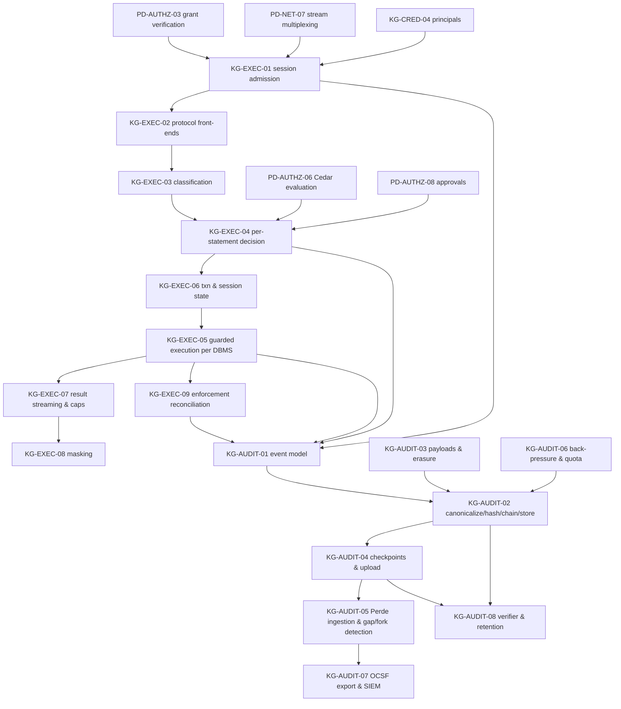
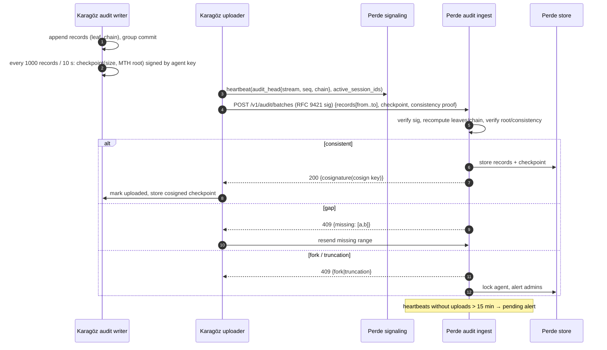

# 31 — Karagöz: Query Execution and Audit (canonical algorithm catalog)

> Status: **canonical, implementation-ready**. Date: 2026-11-11. Audience: implementers of Karagöz's policy enforcement point (PEP), its protocol front-ends and per-DBMS execution guards, its audit subsystem, and Perde's audit ingestion.
> Conventions, notation, evidence tags, verification anchors (`V1#…`, `V2 Pnn`) and priority tags are defined in `30-karagoz-enrollment-discovery-credentials.md` §0. Machine codes are dotted (`authz.deny.write_in_read_mode`); Fluent IDs replace `.` with `-`.
> Clean-room: Teleport (AGPL), Bytebase enterprise (source-available) and NetBird server parts (AGPL) are prose-only sources. Permissive sources (libpg_query BSD-3, pg_query.rs MIT, sqlparser-rs Apache-2.0, sqruff Apache-2.0, pgls MIT) are referenced by file; no code is copied.

## 0. Overview

### 0.1 The PEP pipeline (one picture)

```
StreamOpen ─► KG-EXEC-01 admission ─► (per statement) KG-EXEC-02 front-end decode
          ─► KG-EXEC-03 classify ─► KG-EXEC-04 decide (grant ∧ Cedar ∧ profile ∧ approvals ∧ guardrails)
          ─► KG-EXEC-06 txn/session control ─► KG-EXEC-05 guarded execution (per DBMS)
          ─► KG-EXEC-07 stream + caps ─► KG-EXEC-08 mask ─► KG-EXEC-09 reconcile anomalies
          ─► KG-AUDIT-01/02 record (every step that decides)
```

The **authoritative security boundary is the database principal's privileges** (KG-CRED-04) plus the server-side transaction/session envelope (KG-EXEC-05). The classifier is early denial, UX, attribution and object-level policy — never the only line (sql-tooling-05 §2 item 1; access/05 §3.8; verified bypasses in V1#pg-ro-escapes, V1#mysql-ro, V1#sqlite-ro).

### 0.2 Dependency map and priorities



| Spec | Name | Priority |
|---|---|---|
| KG-EXEC-01 | Session admission at the agent | v1 |
| KG-EXEC-02 | Protocol front-ends (PostgreSQL v3, MySQL, native RPC) | v1 (PG wire + native RPC); v1.x (MySQL wire, others via RPC) |
| KG-EXEC-03 | Statement classification (effect model) | v1 (PG, MySQL, Redis, Mongo); v1.x (SQL Server, ClickHouse, MariaDB specifics) |
| KG-EXEC-04 | Per-statement authorization decision | v1 |
| KG-EXEC-05 | Per-DBMS guarded execution | v1 (PG, MySQL, Redis); v1.x (Mongo, ClickHouse, SQL Server, MariaDB); later (SQLite at the agent, Oracle) |
| KG-EXEC-06 | Transaction and session-state control | v1 |
| KG-EXEC-07 | Result streaming, limits and cancellation | v1 |
| KG-EXEC-08 | Result masking | v1 (direct-column masks, fail-closed); v1.x (full lineage transforms, views, Mongo/Redis paths) |
| KG-EXEC-09 | Enforcement reconciliation and anomaly handling | v1 |
| KG-AUDIT-01 | Audit event model and AI attribution | v1 |
| KG-AUDIT-02 | Canonicalization, hashing, chaining and durable store | v1 |
| KG-AUDIT-03 | Payload separation, redaction and erasure | v1 |
| KG-AUDIT-04 | Merkle checkpoints, batching, upload, cosigning (agent side) | v1 |
| KG-AUDIT-05 | Perde ingestion: verification, gap/fork/truncation detection | v1 |
| KG-AUDIT-06 | Back-pressure, fail-closed and disk quota | v1 |
| KG-AUDIT-07 | OCSF export and SIEM sinks | v1 (JSONL/webhook/syslog OCSF); v1.x (managed connectors, EE) |
| KG-AUDIT-08 | Verifier CLI and retention | v1 (verifier); v1.x (retention tiers) |
| (phase 0) | Bypass-corpus conformance harness against Docker servers (KG-EXEC-05 tests) | phase 0 |

### 0.3 Conflicts between sources resolved in this file

| # | Conflict | Sources | Decision |
|---|---|---|---|
| E1 | Transaction control in read mode: "deny TxnControl; agent owns transactions" vs "allow BEGIN/COMMIT/ROLLBACK; rewrite `BEGIN` → `BEGIN READ ONLY`" | sql-tooling-05 §3.2 vs access/05 ALG-AUTHZ-03 step 6 | **Agent-mediated transactions (KG-EXEC-06):** transaction-control statements are never passed through raw in read mode; the agent implements them (user `BEGIN` → agent opens a pinned RO txn; user `COMMIT`/`ROLLBACK` → agent `ROLLBACK`s and returns the expected command tag). This satisfies both "agent owns transactions" and SQL-editor usability. |
| E2 | MySQL executable comments: "treat any `/*!` as unknown → deny" vs "expand all bodies regardless of version gate and union effects" | access/05 ALG-AUTHZ-03 edge 9 vs sql-tooling-05 ALG-SQL-SAFE-01 step 4 | **Expand and union** (sql-tooling-05); if the expanded stream does not parse → deny. Verified necessary: MySQL 8.0/8.4 execute a whole `DROP TABLE` inside `/*!50000 … */` (V1#mysql-comments). |
| E3 | Mongo `$where` / `$function` in read mode: "allow with timeout" vs JS execution as unknown | access/05 edge 17 vs effect taxonomy | Classified `ProceduralCode` + `ResourceHeavy`; **denied in the built-in read profiles**, allowlistable per org for human actors with `maxTimeMS`; always denied for AI actors. Verified they run under the `read` role (V1#mongo-read). |
| E4 | Masking strictness order: `reject > null > full > hash > partial > pass` vs `full > partial > hash > none` | access/05 ALG-MASK-01 vs mcp/02 ALG-MCP-16 | **access/05 order.** `partial` discloses real characters; `hash` discloses only equality within the org key scope. Hacivat's local masks may add, never remove (mcp/02 §3.12.2). |
| E5 | Audit upload channel: `AuditBatch` over the signaling WebSocket vs batch upload endpoint | networking/05 ALG-PERDE-02 vs access/05 ALG-AUDIT-02 | **HTTPS batch endpoint** (`POST /v1/audit/batches`, ≤ 4 MiB zstd). A large batch on the single signaling WebSocket would head-of-line-block reliable `Revoke` messages. Signaling heartbeats still carry the audit head for pending/withheld detection. |
| E6 | Audit record format: canonical JSON with simple `prev_hash` chain vs deterministic CBOR with leaf + chain + Merkle checkpoints | mcp/02 §3.13 vs access/05 ALG-AUDIT-01/02 | **access/05** for Karagöz (and the shared `hv-audit` crate); Hacivat's local MCP audit may reuse the crate. |
| E7 | Canary `txid_current_if_assigned() IS NULL` as "no-write proof" | sql-tooling-05 original | **Corrected by V1#pg-canary:** tripwire only. It stays NULL after `dblink_exec` and `COPY … TO PROGRAM`, and turns non-NULL after `LOCK … ACCESS EXCLUSIVE`, temp-table DML and `txid_current()`. |
| E8 | `txid_current()` "blocked in RO transactions" | sql-tooling-05 §3.4, datagrip/04 | **Refuted by V1#pg-canary:** it succeeds and assigns an XID. Classified `AdminControl`-adjacent "XID probe" → denied in read profiles (also prevents canary false alarms). |
| E9 | `CREATE TEMP TABLE` as an RO-transaction bypass | sql-tooling-05 P26, access/04 §3.14 | **Partially (V1#pg-ro-temp, V1#mysql-ro):** creation is blocked inside RO transactions on PG and MySQL; DML on pre-existing temp objects, `DECLARE … WITH HOLD` and `LISTEN` are allowed. `WriteTemp`/`SessionState` remain denied in read profiles; `DISCARD ALL`/`COM_RESET_CONNECTION` at session end. |

---

## 1. KG-EXEC — query execution at the agent

### KG-EXEC-01: Session admission at the agent

- **Priority:** v1.
- **Problem:** Turn an incoming QUIC stream into an authorized database session bound to a verified user, device, grant and least-privilege DB principal — or reject it with a stable code — without contacting Perde synchronously.
- **Sources merged:** ALG-PERDE-05 steps 2–5 and ALG-PERDE-06 steps 2–4 (networking/05); ALG-AUTHZ-01 steps 8–10 and ALG-AUTHZ-02 (`connect`) (access/05); ALG-EPH-01 (access/04) via KG-CRED-04; ALG-SECENG-07 principal resolution (access/03); ALG-ACCESS-T01 (role-set decision, Teleport model, prose); mcp/02 §3.12.1 (identity propagation, `ai_delegation`).
- **Inputs / outputs:** In: QUIC connection with TLS-authenticated peer `E_c` (iroh `remote_id()`), control stream 0 with `Authenticate {grants[], presentation_sigs[]}`, a new bidi stream with `StreamOpen {v, kind ∈ {db_session, cancel, introspect, rpc}, resource_id, session_id, resume_token?, resume_offset?, db_params {database, requested_tier?, application_name}, client_features, priority, ai_delegation?}`. Out: `StreamAccept {session_id, effective_tier, effective_permissions, masks_active, resume_token, server_features}` or `StreamReject {code, message_key, params}`; a `SessionContext`; audit `db.session.start` / `db.session.denied`.
- **Algorithm:**
  1. **Connection gate** (iroh `after_handshake` hook, PD-NET-03): accept only peers with a pending `IncomingIntent` or a valid cached grant; otherwise accept the QUIC connection cheaply but require `Authenticate` on stream 0 within 5 s, else close with `grant_missing` (anti-abuse, networking/05 ALG-PERDE-03 edge 11; T11).
  2. **Grant verification** for each presented grant: PD-AUTHZ-03 (Biscuit signature chain, `cep == E_c`, exporter-bound presentation signature, audience, time, revocation, policy epoch, Datalog checks). Cache by `H(G)` for its remaining validity. Cap 64 grants per connection.
  3. **Stream open:** read the first length-prefixed `StreamOpen` (≤ 64 KiB). The client may pipeline DB startup bytes; buffer ≤ 64 KiB until admission completes, else discard and reject (`protocol_violation`).
  4. **Resource resolution:** `resource_id` → attached `DiscoveredDb` (KG-DISC-06). Unknown, not attached, `suspended` (identity change) or `gone` → reject `unknown_resource` / `db.suspended_identity_changed` / `target_disappeared`.
  5. **Grant selection:** among valid grants on this connection, those whose authority facts name this agent and this database; choose the one with the highest tier ≤ `requested_tier` (default: lowest tier that the client requested; clients request explicitly — principle of least privilege). None → `forbidden`.
  6. **Narrowing:** `effective_tier = min(grant mode, attenuation-allowed ops (AI blocks), local floor (`hacivat.readonly`, `/etc/karagoz/policy.d/*.cedar` forbids), Cedar `connect` decision context)`. If `ai_delegation` is present or any attenuation block declares `actor_kind("ai_agent")`: principal becomes `AiAgent::"<session>"` (parent user) and the org AI policy applies (PD-AUTHZ-04/06).
  7. **Cedar `connect`** (PD-AUTHZ-06) with context `{mfa_age_s, device_trust, actor_kind, mcp_client, request_ids, channel_kind (p2p|relay from the selected iroh path), time}`. Deny → `forbidden` with determining policy ids in audit.
  8. **Staleness and offline policy** (PD-AUTHZ-07): if revocation view is older than `max_staleness` and strict mode → `agent_revocation_stale`. If the agent is `pending_approval` → `agent.pending_approval`.
  9. **Relay policy:** if org/agent `relay_policy = direct_only` and the connection's selected path is relay → hold the stream (do not open upstream) up to `direct_wait` (10 s) then reject `direct_path_unavailable` (PD-NET-05).
  10. **Admission control:** per-agent and per-user limits (`max_sessions_per_agent` default 512, `max_sessions_per_grant` 8, `max_concurrent_bidi_streams` 256 per connection); exceed → `agent_overloaded {retry_after_ms}`.
  11. **Principal:** KG-CRED-04 `ensure(tier = effective_tier, scope from grant `db_scope` facts)`; AI sessions always get **dedicated** principals/connections, never shared with the user's human sessions (mcp/02 §3.9).
  12. **Upstream connect** via KG-DISC-05 session candidates (scram path), with the principal; apply the session-init script for the engine and tier (KG-EXEC-05). Failure → `upstream_unreachable` / `upstream_auth_failed` / `upstream_tls_failed` (engine text passed through as data, untranslated).
  13. **Accept:** send `StreamAccept`; start the session monitor (grant expiry with refresh window, idle `max_session_idle` default 8 h, `max_session_duration`, revocation subscription — access/01 ALG-ACCESS-T06 analogue); write `db.session.start` (KG-AUDIT-01).
  14. **Grant expiry while streaming:** at `exp − 2 min` notify the client on stream 0 (`GrantExpiring`); a refreshed grant presented in-band re-runs steps 2–7 (tier may only decrease mid-session); after `exp + grace` (read 5 min, write 0) reset with `grant_expired` and close the upstream cleanly (PG `Terminate`).
- **Data structures:** `SessionContext {session_id, user, device, org, agent, db, effective_tier, scope, mask_profile, actor {kind, on_behalf_of, mcp_client?, model?, delegation_ids[]}, request_ids, mfa_age_s, grant_ids, revocation_ids, exp, channel_kind}`; `SessionTable {session_id → (ctx, upstream, stream ids, counters)}`.
- **Complexity / performance notes:** grant verification ≈ 50 µs per block + < 1 ms Datalog (cached per connection); provisioning 10–50 ms (lease reuse avoids it for subsequent sessions); one stream-open RTT, pipelinable.
- **Decision:** Chosen: admission at stream granularity, grants presented once per connection, principal per lease. Rejected: per-connection-only authorization (one connection carries many sessions/resources); synchronous Perde check (violates offline operation and "Perde not in the data path").
- **Verification status:** design-level; iroh hook names (`EndpointHooks::after_handshake`) [Observed: networking/04 §3.4, networking/05 §3.2.1]; `SET ROLE` non-containment (why principals are per tier) Confirmed V1#set-role.
- **Rust placement:**
  ```rust
  // karagoz::exec::admission
  pub async fn admit(conn: &PeerConn, open: StreamOpen, grants: &GrantCache, inv: &Inventory,
                     policy: &PolicyEngine, creds: &CredManager) -> Result<AdmittedSession, StreamReject>;
  pub struct AdmittedSession { pub ctx: SessionContext, pub upstream: Box<dyn Upstream>, pub frontend: FrontendKind }
  ```
  Uses `hv-net::PeerConn` (no iroh types), `hv-grant::GrantVerifier`, `hv-policy::PolicyEngine`.
- **Threats addressed:** T3 (client impersonation: `cep` binding), T5 (revocation/staleness), T11 (DoS: grant within 5 s, admission limits), T15 (0-RTT disabled for `StreamOpen`), A6 insider bounded by tier and principal.
- **Edge cases (exhaustive list):** grant for another agent (`wrong_audience`); stolen grant from another device (`grant_not_bound_to_peer`); resource exists but grant scope excludes the requested database (`forbidden`); 257th stream (`stream_limit`), client queues; agent overloaded; upstream DB down; upstream requires client cert (agent-held, override); `requested_tier` higher than grant → reject, never silently downgrade without telling the client (accept with lower tier only if the client set `allow_downgrade`); AI session requesting write tier while org AI policy caps at read → `forbidden.ai_policy`; resume token presented (PD-NET-08 path) → handled before step 11; DB `suspended` mid-session → existing sessions terminated with `db.suspended_identity_changed`; agent restart → all sessions lost (unless parked state existed only in memory → `resume_expired`); pipelined startup bytes exceed 64 KiB → reject; MySQL `COM_CHANGE_USER` or PG re-startup inside a session → `protocol_violation` (identity switching).
- **Test cases (input → expected):** valid read grant + `StreamOpen` → accepted, principal `hv_…_r` visible in `pg_stat_activity` (`postgres:17`); grant signed by unknown kid → `unknown_signing_key`; `cep` ≠ TLS peer → `grant_not_bound_to_peer`; DB suspended → reject; 300 concurrent `SELECT 1` sessions → 256 accepted, rest queued client-side; read grant + `requested_tier=write` → reject `forbidden`; AI-attenuated grant → principal is a separate `hv_…_r` from the user's human session; `direct_only` with relay path → `direct_path_unavailable` after 10 s and zero upstream connections opened.
- **Prior art and evidence:** networking/05 ALG-PERDE-05/06; access/05 ALG-AUTHZ-01/02; Teleport agent-as-PEP (access/01 §5.1, prose).
- **i18n notes:** every reject is `{code, message_key, params}` (networking/05 §6); engine error texts passed through verbatim and labelled "Database said: …" by the client.
- **Used by:** Karagöz; Hacivat (client of the protocol).

### KG-EXEC-02: Protocol front-ends (PostgreSQL v3 termination, MySQL, native RPC)

- **Priority:** v1 (PostgreSQL v3 wire front-end; native RPC `hv.exec.v1` for all engines); v1.x (MySQL wire front-end); later (TDS, Mongo OP_MSG, RESP pass-through front-ends).
- **Problem:** The QUIC session stream must carry something both Hacivat drivers and the PEP can work with: the PEP needs statement boundaries, parameters and result metadata; Hacivat's drivers (and external tools via the loopback forwarder) speak native wire protocols.
- **Sources merged:** ALG-PERDE-06 step 4 (networking/05: stream carries the DB wire protocol terminated by a protocol-aware proxy); ALG-SECENG-07 (access/03: PG front-end termination, startup, auth substitution, cancel mapping, error responses that keep the session usable); access/05 ALG-MASK-01 step 6 ("native RPC mode" vs "wire-proxy mode"); mcp/02 §3.12.1 (operation envelope for AI calls).
- **Decision:** **Two front-ends, one PEP core.**
  - `db_session` streams speak the **native wire protocol** terminated by Karagöz (PG v3 in v1; MySQL in v1.x). Used by Hacivat's drivers (in-process stream adapter) and by external tools through the loopback forwarder.
  - `rpc` streams speak **`hv.exec.v1`**, a typed protobuf request/response protocol (`Execute {sql | command, params, options}` → `RowDescription`, `RowBatch`, `Complete`, `Error`) used by Hacivat's AI broker (structured operations with `ai_delegation`), by engines without a wire front-end yet (Redis, MongoDB, ClickHouse, SQL Server in v1), and wherever the agent must control the result schema (masking type changes).
  - Rejected: blind byte pass-through (no statement boundaries → no PEP); a single universal RPC only (breaks `psql`/third-party tools and driver features such as `COPY`, notifications, cancel); per-engine wire front-ends for everything in v1 (too much protocol surface for v1).
- **Algorithm (PG v3 front-end, summarized from access/03 ALG-SECENG-07 with our decisions):**
  1. Startup: bound length (≤ 10 000 bytes). `SSLRequest` → `'N'` (the QUIC stream is already E2E-encrypted and authenticated); `GSSENCRequest` → `'N'`; second SSLRequest → disconnect.
  2. `CancelRequest(pid, key)` arriving on a `kind=cancel` stream → map via `cancel_map[(pid,key)] → upstream (pid,key)`; open a fresh upstream connection, send the cancel; close silently; unknown keys ignored (no oracle).
  3. `StartupMessage` 3.0/3.2: parse parameters; `user` is ignored (the principal comes from admission); `database` must be within scope; `options` are **stripped** of `-c` settings that could weaken controls (`default_transaction_read_only`, `transaction_read_only`, `role`, `session_authorization`, `search_path` outside scope, `client_encoding`, `standard_conforming_strings`); `replication=…` → reject unless explicitly granted (never in v1); unsupported `_pq_.*` → `NegotiateProtocolVersion`.
  4. Send `AuthenticationOk` (the client never supplies a DB password); relay upstream `ParameterStatus`; replace upstream `BackendKeyData` with a proxy-issued `(ppid, pkey)` (random; longer keys for protocol 3.2).
  5. Relay loop: client→server messages pass the PEP hooks — `Query` (simple: split + classify all statements, KG-EXEC-03), `Parse` (classify at Parse; remember by statement name; unnamed statement replaced per Parse), `Bind`/`Describe`/`Execute`/`Sync`/`Close`/`Flush`, `FunctionCall` (`F`, deny by default), `CopyData/CopyDone/CopyFail` (only within an allowed `COPY`), `Terminate`. Server→client: `RowDescription`/`DataRow` through masking (KG-EXEC-08), `CommandComplete` tags to counters and KG-EXEC-09, `ErrorResponse` passed through (with DETAIL masking when masks are active), `ReadyForQuery` with the **virtual** transaction status computed by KG-EXEC-06.
  6. Denials: `ErrorResponse(S=ERROR, C=42501, M=<English message with code>, H=<hint with message_id>)` followed by `ReadyForQuery` with the correct status, so the session stays usable.
  7. Loopback forwarder variant (Hacivat compatibility mode): the forwarder requires a one-time local credential at the DB-protocol level (PG cleartext password over the local socket, checked by Hacivat before opening the session stream) or a Unix socket with mode 0600 (networking/05 ALG-PERDE-06 step 9; T14).
- **Algorithm (MySQL front-end, v1.x):** server greeting from Karagöz; client auth accepted without a password (or one-time local credential for the forwarder); capabilities: **never** `CLIENT_MULTI_STATEMENTS`, **never** `CLIENT_LOCAL_FILES`; `COM_QUERY` and `COM_STMT_PREPARE` classified; `COM_CHANGE_USER`, `COM_BINLOG_DUMP*`, `COM_REGISTER_SLAVE` denied; `COM_RESET_CONNECTION` handled by the agent; `KILL QUERY` mapped to the cancel stream.
- **Algorithm (native RPC `hv.exec.v1`):** `Execute {request_id, text | structured_command (Mongo command document, Redis argv), params[], options {max_rows, max_bytes, timeout_ms, fetch_size}}` → `RowDescription {columns[{name, type, masked_rule?}]}` → `RowBatch*` → `Complete {tag, rows_affected?, truncated}` | `Error {code, message_key, params, db_error?{sqlstate|code, message (verbatim)}}`. Cursor-style paging via `Fetch {handle}`; `Cancel {request_id}` in-band.
- **Data structures:** `PreparedRegistry {name → ClassifiedStatement}` per session; `CancelMap`; `VirtualTxnState` (KG-EXEC-06).
- **Complexity:** per message O(1) except classification; framing overhead negligible.
- **Verification status:** front-end behaviour is design-level from access/03 (PgBouncer/Hoop prior art); PG protocol facts [Observed in source docs]. The transaction-status byte requirement follows from E1.
- **Rust placement:** `karagoz::exec::frontend::{pg, mysql, rpc}` with a common trait:
  ```rust
  #[async_trait] pub trait Frontend: Send {
      async fn next_request(&mut self) -> Result<FrontendRequest>;   // Statement{text, params, portal?} | Cancel | Terminate | Copy…
      async fn send_rows(&mut self, desc: &RowDesc, rows: RowStream<'_>) -> Result<()>;
      async fn send_complete(&mut self, tag: CommandTag, txn: VirtualTxnStatus) -> Result<()>;
      async fn send_error(&mut self, e: &ClientVisibleError, txn: VirtualTxnStatus) -> Result<()>;
  }
  ```
  Wire parsing with our own codec over `bytes`; `pgwire` crate (MIT/Apache) may be evaluated for message codecs [Inferred: check license/version].
- **Threats addressed:** identity switching via protocol (re-startup, `COM_CHANGE_USER`), `LOAD DATA LOCAL INFILE` client-file exfiltration, multi-statement smuggling (M2), session-weakening startup options (access/03 step 8), T14 (forwarder).
- **Edge cases:** clients sending `sslmode=require` toward the in-process stream (Hacivat configures `sslmode=disable` for the stream adapter; third-party tools use the forwarder); `COPY FROM STDIN` (classified as write); pipelined extended-protocol messages before `Sync`; portal suspension; `Parse` of a named statement then `Execute` after a classification-relevant `SET` (denied anyway in read); PG 18 protocol 3.2 cancel keys; startup split across QUIC frames (buffer until complete).
- **Test cases:** `psql "host=127.0.0.1 port=<forwarder> sslmode=disable"` through the forwarder with the one-time credential → works; without → rejected; `psql -c 'SELECT 1; DELETE FROM t'` (simple query multi-statement) → whole message denied as a unit, session remains usable (`ReadyForQuery` received); `options=-c default_transaction_read_only=off` → stripped (verify `SHOW default_transaction_read_only` = on); `replication=database` → rejected; cancel of `SELECT pg_sleep(60)` → cancelled within 1 s (`postgres:17`).
- **Prior art:** access/03 ALG-SECENG-07 (PgBouncer, Hoop); Teleport DB proxy (prose).
- **i18n notes:** error `M` text English + code; Hacivat renders `message_key` from the `H`/RPC field.
- **Used by:** Karagöz; Hacivat.

### KG-EXEC-03: Statement classification (effect model)

- **Priority:** v1 (PostgreSQL, MySQL, Redis, MongoDB); v1.x (SQL Server, ClickHouse, MariaDB-specific syntax, SQLite at the agent).
- **Problem:** Determine conservatively the effects, touched objects and decision-relevant reasons of a request, identically in Hacivat (advisory, UX) and Karagöz (authoritative), failing closed on anything not understood.
- **Sources merged:** ALG-SQL-SAFE-01 and ALG-SQL-SAFE-03 (clients/sql-tooling-05, canonical algorithm, effect taxonomy §3.2, PG catalogue §3.3–3.4, bypass catalogue §3.5); access/05 §3.8 classification table and ALG-AUTHZ-03 steps 1–4; mcp/02 ALG-MCP-11 (multi-engine fail-closed, flags used by the AI broker); V1#pg-ro-escapes, V1#pg-canary, V1#mysql-comments, V1#redis-acl, V1#mongo-read, V1#sqlite-ro.
- **Inputs / outputs:** In: `(text | structured command, dialect, server_version, lex_modes (agent-pinned), catalog: Option<CatalogView> (functions with volatility/language/secdef/extension, operators, casts, views), mode context)`. Out: `SafetyReport {items: [StmtReport {effects: EffectSet, class: CoarseClass, reads, writes, calls, flags, reasons, confidence: Exact|Conservative}], decision_hint}` + `fingerprint` (PG: libpg_query fingerprint; others: own normalizer) + normalized text (literals → `?`).
- **Effect taxonomy (canonical, from sql-tooling-05 §3.2):** `ReadData, ReadMetadata, InfoDisclosure, LockRows, LockTables, AdvisoryLock, WriteData, WriteTemp, SequenceAdvance, Ddl, Dcl, PrivilegeChange, TxnControl, SessionState, ProceduralCode, DynamicSql, ExternalFileRead, ExternalFileWrite, ExternalNetwork, ProcessExec, AdminControl, Notify, ResourceHeavy, Unknown`. Coarse class = highest of `Unknown > AdminControl/ProcessExec/External* > Dcl/PrivilegeChange > Ddl > WriteData/SequenceAdvance/WriteTemp > Lock* > TxnControl/SessionState/ProceduralCode/DynamicSql/Notify > ReadData/ReadMetadata/InfoDisclosure`.
- **Algorithm (from ALG-SQL-SAFE-01 with merged decisions):**
  1. **Pre-checks:** size ≤ 1 MiB (configurable), no NUL, valid UTF-8 for SQL engines, lexer without error tokens → else `Deny(LexError)`.
  2. **Client-command pre-pass:** psql meta-commands (`\copy`, `\!`, `\gexec`), MySQL `DELIMITER`, T-SQL `GO [n]` → `Deny(ClientCommand)` (these never legitimately reach the agent).
  3. **Split:** execution requires exactly one statement per request for engines with the extended protocol (PG `Parse`, MySQL `COM_STMT_PREPARE`); simple-query messages with several statements are classified as a whole batch (max effect) and executed only if every statement is allowed (SQL Server: one batch).
  4. **MySQL/MariaDB executable comments (E2):** build an expanded token stream with every `/*!…*/` and `/*M!…*/` body inlined regardless of version gate; classify expanded and non-expanded streams; union effects; expanded stream fails to parse → `Deny(ParseError)`.
  5. **Parse strictly:** PG → libpg_query (`pg_query` crate, grammar of PG 18.6 — V2 P36); others → our strict dialect parser and, when enabled, sqlparser-rs (0.64.0, 16 dialects — V2 P37, S33) as second opinion; any parse failure → `Deny(ParseError)`; both succeed → union.
  6. **Top-level dispatch** by statement kind (PG node table §3.3 of sql-tooling-05; analogous tables per dialect).
  7. **Deep walk** (iterative, depth-limited): relation references → `reads`/`writes`; data-modifying CTEs → `WriteData`; locking clauses and table hints → `LockRows`/`LockTables`; `SELECT … INTO` → `Ddl + WriteData`; `EXPLAIN` with any truthy `ANALYZE` spelling → effects of the inner statement; **plain `EXPLAIN` → `ReadMetadata` + full function assessment of the inner statement** (verified: plain EXPLAIN of a mislabelled IMMUTABLE function committed a dblink write inside a RO transaction — V1#pg-ro-escapes, P21); under read profiles an EXPLAIN whose inner statement has any non-read effect is denied; `COPY` direction/target (`TO STDOUT` read-export, `FROM` write, file → `External*`, `PROGRAM` → `ProcessExec`); `SET`/`set_config` with variable-name flags (non-literal names → `Unknown`); procedural statements (`DO`, `CALL`, `EXECUTE`, anonymous blocks) → `ProceduralCode` (+`Unknown` for opaque targets); string literals passed to SQL-executing functions (`query_to_xml`, `dblink_exec`, `sp_executesql`, `PREPARE … FROM @s`) → `DynamicSql`.
  8. **Function/operator/cast assessment** (ALG-SQL-SAFE-03): resolve names exactly as the server would with the **agent-pinned** `search_path` (`pg_catalog` first); denylist by name regardless of schema for builtin-looking names (`public.pg_sleep` denied); allowlist of pure builtins per dialect/version; catalog metadata for user functions (PG `provolatile`, `prolang`, `prosecdef`, `prokind`, extension membership; MySQL `SQL_DATA_ACCESS`, `SECURITY_TYPE`); unknown → `Unknown`. Denylist content includes the verified escapes: `pg_terminate_backend`, `pg_cancel_backend`, advisory locks (session locks survive ROLLBACK — V1#pg-ro-escapes), `set_config`, `lo_export` (writes server files in RO txn — V1#pg-ro-escapes), `lo_import`, `pg_read_file*`, `pg_ls_dir`, `dblink*`, `pg_notify`, replication-slot functions (`pg_create_physical_replication_slot` survives ROLLBACK), `pg_logical_emit_message`, `pg_switch_wal`, `pg_stat_reset*`, `txid_current`/`pg_current_xact_id` (assign XIDs — E8), `query_to_xml*`, `pg_sleep*`; MySQL `GET_LOCK` (survives ROLLBACK — V1#mysql-ro), `RELEASE_LOCK`, `SLEEP`, `BENCHMARK`, `LOAD_FILE`, `SOURCE_POS_WAIT`, `LAST_INSERT_ID(expr)`; SQL Server `xp_*`, `sp_OA*`, `OPENROWSET`, `OPENQUERY`, `OPENDATASOURCE`, `NEXT VALUE FOR`; ClickHouse table functions `url`, `s3`, `remote`, `mysql`, `postgresql`, `file`, `jdbc`, `odbc`, `hdfs`.
  9. **Non-SQL engines:** Redis → map each command (incl. queued `MULTI`/`EXEC` contents and `EVAL` bodies as `ProceduralCode`) to its ACL categories from `COMMAND INFO` (`@read`, `@write`, `@admin`, `@dangerous`, `@scripting`, …); `@dangerous ∩ @read` (`KEYS`, `SORT_RO`) → `ResourceHeavy`; `FUNCTION FLUSH/LOAD/DELETE/RESTORE` and `SCRIPT FLUSH` → `AdminControl` (V1#redis-acl). MongoDB → typed command classification: `find`/`aggregate` without write stages/`count`/`distinct`/`listCollections` → read; `aggregate` with `$out`/`$merge` → `WriteData` (cross-database targets → also `ExternalNetwork`-class "cross-scope write", V1#mongo-read); `$where`/`$function`/`$accumulator`/`mapReduce` → `ProceduralCode + ResourceHeavy` (E3); `insert/update/delete/findAndModify/createIndexes/drop` → write/ddl; `killOp`, `shutdown`, `setParameter` → admin.
  10. **Object resolution:** fully qualify `reads`/`writes` with the pinned `search_path`/default database; unresolved → "not granted" for object policy; views marked as reads of the view (optional expansion for masking lineage, KG-EXEC-08).
  11. **Fingerprint + normalized text** for audit (literals → `?`).
- **Data structures:** `EffectSet` (u32 bitflags), `ReasonCode` enum with args, per-dialect versioned data files `allow.toml`, `deny.toml`, `extensions.toml`, statement-kind tables; `ObjRef {db, schema, name, kind}`.
- **Complexity / performance notes:** O(statement size) + hash-map catalog lookups; libpg_query parse µs–ms; per-session catalog cache invalidated on DDL in session or every 5 min.
- **Decision:** Effect model + server-grammar parser + conservative unions. Rejected: prefix heuristics (pgcli/mycli; trivially bypassable — sql-tooling-05 §2 item 3); regex classifiers; single coarse label; trusting Hacivat's verdict (mcp/02 §3.12.2: Karagöz always re-classifies).
- **Verification status:** effect assignments for PG RO-transaction behaviour **Confirmed** (V1#pg-ro-blocked, V1#pg-ro-escapes) with corrections E7–E9; MySQL comments and hints **Confirmed** (V1#mysql-comments: `MAX_EXECUTION_TIME(500)` interrupts `SLEEP(2)`, `SET_VAR(sql_mode=…)` does not change lexing of the same statement, `SET_VAR(transaction_read_only=0)` does not lift RO); Redis categories **Confirmed** (V1#redis-acl); Mongo **Partially** (V1#mongo-read); PG 13–15, logical slots, Oracle, ClickHouse `SETTINGS` handling remain unverified (sql-tooling-05 §7).
- **Rust placement:** shared crate `hv-sql-safety` (Apache-2.0; used by Hacivat and Karagöz):
  ```rust
  pub fn classify(input: &Request, dialect: Dialect, ver: &ServerVersion, modes: &LexModes,
                  catalog: Option<&dyn CatalogView>) -> SafetyReport;
  pub trait CatalogView { fn function(&self, name: &QualName, argc: usize) -> Option<FnMeta>;
                          fn operator(&self, op: &OpRef) -> Option<FnMeta>; fn cast(&self, c: &CastRef) -> Option<FnMeta>;
                          fn view_def(&self, v: &QualName) -> Option<&str>; }
  bitflags! { pub struct EffectSet: u32 { const READ_DATA = 1; const READ_METADATA = 1<<1; /* … */ const UNKNOWN = 1<<23; } }
  ```
  Crates: `pg_query` 18.1.0 (V2 P36), `sqlparser` 0.64.0 (V2 S33), our lexers per dialect.
- **Threats addressed:** sql-tooling-05 §3.1 threat model (custom malicious client, prompt-injected AI); bypass rows P1–P30, M1–M16, S1–S12, L1–L7, C1–C5, O1–O7.
- **Per-DBMS matrix (classifier must-deny list for read profiles, beyond plain writes):**
  | Engine | Must be classified non-read (verified escapes in **bold**) |
  |---|---|
  | PostgreSQL | **LOCK TABLE (any mode)**, **advisory locks**, **pg_terminate_backend**, **NOTIFY/pg_notify**, **SET / set_config / SET ROLE**, **COPY TO PROGRAM / TO file**, **lo_export**, **dblink_exec**, **postgres_fdw writes via remote functions**, **pg_create_physical_replication_slot**, **pg_logical_emit_message**, **pg_switch_wal**, **CHECKPOINT / pg_stat_reset**, **txid_current**, **DECLARE … WITH HOLD**, **LISTEN**, **DML on pre-existing temp tables**, **EXPLAIN of unknown/volatile functions**, `SELECT … FOR UPDATE/SHARE`, data-modifying CTEs, `SELECT INTO`, `EXPLAIN ANALYZE <write>`, `DO`, `CALL`, `PREPARE/EXECUTE`, `pg_read_file`, `pg_sleep`, `query_to_xml` |
  | MySQL 8.0/8.4 | **DDL** (executes inside `START TRANSACTION READ ONLY` via implicit commit), **LOCK TABLES** (ends RO txn), **GET_LOCK** (survives ROLLBACK), **executable comments** (`/*!…*/` incl. whole statements), **`SET SESSION TRANSACTION READ WRITE` / `SET @@transaction_read_only=0`**, **`CREATE TEMPORARY TABLE`** and temp DML, `SELECT … FOR UPDATE/LOCK IN SHARE MODE`, `INTO OUTFILE/DUMPFILE`, `LOAD DATA`, `LOAD_FILE`, `HANDLER`, `XA`, `PREPARE … FROM`, user variables `SET @x`, `SLEEP/BENCHMARK`, `SET_VAR`/`MAX_EXECUTION_TIME` hints above the ceiling |
  | MariaDB | as MySQL plus **`/*M! … */`** comments (executed by MariaDB, ignored by MySQL) |
  | SQL Server | `EXEC`/`sp_executesql`, `xp_cmdshell`, `OPENROWSET/OPENQUERY/OPENDATASOURCE`, `EXECUTE AS`/`REVERT`/`SETUSER`, `NEXT VALUE FOR`, `WAITFOR`, `sp_set_session_context`, `SELECT … INTO #t`, locking hints (`TABLOCKX`, `UPDLOCK`, `HOLDLOCK`), `BULK INSERT`, `BACKUP`, `DBCC`, `KILL`, `SET QUOTED_IDENTIFIER OFF` |
  | SQLite (later at agent; Hacivat now) | **`ATTACH` (writable new file even from `mode=ro`)**, **`VACUUM INTO` (works on `mode=ro`/`-readonly`)**, **`PRAGMA query_only=0`**, **`PRAGMA writable_schema`**, temp table writes, `load_extension` |
  | ClickHouse | table functions `url/s3/remote/mysql/postgresql/file/jdbc/odbc/hdfs`, `SET`/`SETTINGS` above ceilings, `SYSTEM`, `KILL QUERY`, `OPTIMIZE`, `ALTER … DELETE/UPDATE` mutations, `INSERT INTO FUNCTION` |
  | MongoDB | **`$out`/`$merge` (incl. cross-database)**, **`$where`/`$function`/`$accumulator`** (E3), `mapReduce`, write/ddl commands, `killOp`, `setParameter` |
  | Redis/Valkey | **`KEYS`/`SORT_RO`** (in `@read ∩ @dangerous`), **`FUNCTION FLUSH/LOAD/DELETE/RESTORE`**, **`SCRIPT FLUSH`**, `EVAL`/`FCALL` (procedural), `CLIENT KILL/PAUSE`, `CONFIG`, `PUBLISH`, `SELECT <db>` outside scope, `FLUSH*`, `DEBUG`, `MONITOR` |
- **Edge cases (exhaustive list; superset of sql-tooling-05 ALG-SQL-SAFE-01 edge list):** empty or comment-only input; trailing `;` plus comment; `INTO` inside UNION branches; `INSERT … SELECT` from writing CTE; `WITH RECURSIVE` + writing CTE; `EXPLAIN (FORMAT JSON, ANALYZE)` vs `(ANALYZE false|off|0)`; `EXPLAIN EXECUTE s`; `EXPLAIN CREATE TABLE AS` (denied conservatively); `COPY (SELECT …) TO STDOUT` (read-export); `COPY (DELETE … RETURNING *) TO STDOUT` (write); `\copy` (client command); schema-qualified and quoted function names (`pg_catalog.pg_sleep`, `"pg_sleep"`, `PG_SLEEP` with dialect case folding — ASCII only, never Turkish locale folding, V1#pg-turkish); overloaded denylisted names in user schemas (deny by name); `SELECT … FOR UPDATE SKIP LOCKED`; `FOR KEY SHARE`; `LOCK TABLE … IN ACCESS SHARE MODE`; `SET LOCAL statement_timeout = 0` (raises ceiling → deny); `SHOW ALL` (InfoDisclosure); `VALUES (1)`; `TABLE t`; `PREPARE` of a SELECT; `DECLARE c CURSOR FOR …` without HOLD; `FETCH ALL`; MySQL `SELECT … INTO @v`; `REPLACE`, `INSERT IGNORE`, `ON DUPLICATE KEY UPDATE`; MySQL `--` vs `--1` comment rule; `#` comments; T-SQL batches with `IF`/`WHILE`/`TRY`; `SELECT … INTO #t`; `WAITFOR DELAY`; SQLite allowlisted `PRAGMA table_info(t)`; ClickHouse `SETTINGS max_threads=1` (allowlisted below ceiling); `numbers(1e12)` (ResourceHeavy); Unicode identifiers and homoglyphs (identifiers compared exactly, keywords ASCII); NUL bytes; parser depth/size limits; classifier version older than server syntax (`Deny(ParseError)` with "upgrade agent" reason); `search_path` shadowing (pinned path; P17/P18); user-defined operators/casts (resolve or `Unknown`, P19); views or RLS calling volatile functions (P20; RO txn contains writes, privileges contain the rest).
- **Test cases (→ decision under the `read_only` profile; PG unless noted):** the 21 cases of sql-tooling-05 ALG-SQL-SAFE-01 plus: `EXPLAIN SELECT f_imm_dblink()` with catalog showing a non-allowlisted plpgsql function → Deny; `SELECT txid_current()` → Deny; `DECLARE c CURSOR WITH HOLD FOR SELECT 1` → Deny; `LISTEN ch` → Deny; `SELECT lo_export(424242, '/tmp/x')` → Deny; `SELECT pg_create_physical_replication_slot('rs1')` → Deny; MySQL `/*!50000 DROP TABLE t */` → Deny (Ddl via expansion); MySQL `SELECT /*+ SET_VAR(transaction_read_only=0) */ 1` → Deny (SET_VAR hint); Redis `KEYS *` → Deny; Redis `SORT_RO lst` → Deny; Redis `FUNCTION FLUSH` → Deny; Mongo `aggregate([{$out:{db:"scratch",coll:"x"}}])` → Deny; Mongo `find({$where:"…"})` → Deny; SQLite `VACUUM INTO '/tmp/c.db'` → Deny. Property test: for 10⁵ sqlsmith-like generated PG statements, whenever the server-side guard (KG-EXEC-05 with classifier disabled) reports a write, the classifier never returned Allow.
- **Prior art and evidence:** sql-tooling-05 [Observed: `pg_query.rs/src/parse_result.rs:59-270`; pgls destructive rules; pgcli/mycli heuristics as anti-pattern]; access/05 §3.8; mcp/02 ALG-MCP-11.
- **i18n notes:** reasons are `ReasonCode` + typed args (`fn.denylisted {name}`); SQL fragments rendered as code spans, never translated; keyword matching ASCII-only.
- **Used by:** Karagöz (authoritative), Hacivat (advisory, MCP gating), Perde (approval-card rendering).

### KG-EXEC-04: Per-statement authorization decision

- **Priority:** v1 (profiles, Cedar, grant lattice, object policy, guardrails); v1.x (statement approvals, rule chains in detect/protect mode).
- **Problem:** For each classified request, decide allow / deny / require-approval, combining the grant's ceiling, org policy (Cedar), the local floor, the tier profile, object-level scope, AI restrictions, approvals and guardrails — returning precise reasons and the determining policies for audit.
- **Sources merged:** ALG-AUTHZ-03 steps 4–7 (access/05); ALG-AUTHZ-02 (Cedar evaluation, delegated to PD-AUTHZ-06); ALG-SQL-SAFE-01 step 9–10 (policy profiles, object policy); ALG-SECENG-09 (ordered rule chain with detect/protect rollout, access/03); ALG-SECENG-08 / ALG-BYTEBASE-06 (statement-bound approvals); ALG-MCP-10 steps 5–8 (AI effective level, budgets, masked-column restrictions) (mcp/02).
- **Inputs / outputs:** In: `SessionContext`, `SafetyReport`, Cedar engine with snapshot + floors, approval objects presented with the statement (PD-AUTHZ-09), rule chain (optional), guardrail config. Out: `Decision {Allow{plan} | Deny{code, reasons, determining_policies} | RequireApproval{request_template}}` + audit record.
- **Algorithm:**
  1. **Profile check (tier → built-in profile):** `read` → `read_only` (allow only `ReadData`, `ReadMetadata`, allowlisted `InfoDisclosure`; `EXPLAIN` without execution allowed if inner statement is read-only); `write` → `read_write_dml` (adds `WriteData`, `SequenceAdvance`, `LockRows`; `TxnControl` via KG-EXEC-06; still denies `Ddl`, `Dcl`, `PrivilegeChange`, `External*`, `ProcessExec`, `AdminControl`, `Notify`, `DynamicSql`, `ProceduralCode` unless allowlisted); `ddl` → adds `Ddl`; `admin` → no classifier denial except `PrivilegeChange`, `ProcessExec`, `External*` which require explicit Cedar permit of `query.admin` with `context.classifier.flags` containing them; `Unknown` → denied in read/write/ddl, allowed in admin with audit flag `unknown_allowed`.
  2. **Action mapping for Cedar:** coarse class → `Action::"query.read" | "query.write" | "query.ddl" | "query.admin"`; plus `Action::"export"` for read-export (`COPY … TO STDOUT`, RPC export option) and `Action::"unmask"` when the request asks to bypass masks.
  3. **Grant lattice:** action ≤ grant mode (`read < write < ddl < admin`; `export`, `unmask` separate flags) and ≤ every attenuation block's allowed operations (PD-AUTHZ-04).
  4. **Cedar evaluation** (PD-AUTHZ-06) per referenced object when object-level policies exist (any deny → deny batch), else per database; context includes `classifier {category, flags, objects}`, `actor_kind`, `mfa_age_s`, `request_ids`, `channel_kind`, `time`. Any `forbid` (incl. operator floors) wins.
  5. **Object scope:** `reads ∪ writes ∪ calls` must lie within the grant's `db_scope` facts and AI object rules (deny globs from org AI policy); unresolved objects count as not granted unless the profile allows "unresolved → let the DB raise 'does not exist'" for read-only (mcp/02 step 8 behaviour, safe because privileges bound it).
  6. **AI restrictions** (when `actor_kind = ai_agent`): org AI policy max level; `propose_write` operations must arrive with an approval (step 7); `UNKNOWN` never allowed; `$where`-class procedural code never allowed; budgets (rows/bytes/time, mcp/02 §3.8.2) attached to the plan; masked columns may not appear in predicates/expressions under the strict AI profile (`MASKED_COLUMN_EXPRESSION`).
  7. **Approvals:** if Cedar returns a permit only under a template that requires `context.request_id` (elevation), or the guardrail policy marks the category as approval-required (`DROP`, `TRUNCATE`, unbounded `UPDATE/DELETE` for AI, all AI writes), require a valid **approval object** bound to the exact statement bytes + params + db + agent (PD-AUTHZ-09), unexpired, unconsumed, signed by a trusted approval key (or the user's device key for AI self-approval when org policy allows); mark consumed atomically before execution. Missing → `RequireApproval` (client may create a request, PD-AUTHZ-08).
  8. **Rule chain (optional, v1.x):** ordered org rules (access/03 ALG-SECENG-09) over `{principal, group, database, client_kind, kind, fingerprint_hash, fingerprint regex (RE2)}` → verdict combined with forbid-overrides (deny > review > allow); per-rule-set mode `DETECTING` (log `would_deny`) or `PROTECTING`.
  9. **Guardrails → plan:** statement timeout (server-side setting), lock timeout, max rows/bytes (cut + `truncated`), `UPDATE/DELETE` without `WHERE` → confirmation (human, via client UX) or approval (AI), mask plan (KG-EXEC-08).
  10. Return the decision with `determining_policy_ids`, reasons, and the plan; audit (`db.query` or `db.query.denied`).
- **Data structures:** `ExecutionPlan {envelope: EnvelopeKind, timeouts, caps, mask_plan, approval_consumed?, budgets}`; per-session decision cache keyed by `(fingerprint_hash, objects, policy_epoch, revocation_epoch)`.
- **Complexity:** Cedar ~10–100 µs for hundreds of policies; cached per statement shape.
- **Decision:** Conjunction of independent layers (grant ∧ Cedar ∧ profile ∧ approvals); any layer can only narrow. Rejected: single policy engine evaluating everything (loses offline Biscuit bound when snapshot is stale); approvals bound to fingerprints by default (fingerprint binding allows replay with different literals — exact bytes default, fingerprint only when the approval says `binding=fingerprint`).
- **Verification status:** design-level; the necessity of every layer is grounded in verified bypasses (§KG-EXEC-03 matrix).
- **Rust placement:** `karagoz::exec::decide::{decide, Decision, ExecutionPlan}` calling `hv-policy::PolicyEngine::is_authorized` and `hv-grant::ApprovalVerifier`.
- **Threats addressed:** A6 (insider bounded), AI lethal trifecta (mcp/02 §3.1.4: writes need human approval, masks applied before data leaves), T4 partially (local floors cannot be overridden by Perde).
- **Edge cases:** policy snapshot newer than grant (`pe` lower than `min_policy_epoch` → reject at admission); new `forbid` pushed after grant issuance → enforced per statement; approval object for the same SQL with different params → hash mismatch → deny; approval consumed concurrently by two sessions → one wins (persistent consumed set); classifier says `Unknown` in admin mode → allowed + flagged; AI asks for `EXPLAIN ANALYZE` of a read → allowed only at READ level (mcp/02 step 6); object-level policy and `SELECT *` on a view over a denied table → view expansion (if catalog has the definition) else deny when object policies exist.
- **Test cases:** analyst on prod non-PII, `SELECT * FROM orders` → allow, determining `analyst-read`; same on DB labelled `pii=true` → deny; AI actor with user write role → `UPDATE` denied by `forbid-ai-write`; floor `hacivat.readonly=true` → admin `DROP TABLE` denied; `DELETE FROM t WHERE id=5` with approval for `id=5` → allow once, second time → `approval_consumed`; with `id=6` → `approval_mismatch`; rule chain in DETECTING mode matching → allowed + `would_deny` audited.
- **Prior art:** access/05 ALG-AUTHZ-03; access/03 ALG-SECENG-08/09 (Hoop/ProxySQL); access/02 ALG-BYTEBASE-06 (statement-pinned JIT, prose); mcp/02 ALG-MCP-10.
- **i18n notes:** `authz.deny.*` codes (`write_in_read_mode`, `object_not_granted {object}`, `approval_required`, `approval_mismatch`, `ai_write_forbidden`); object names inserted as code spans.
- **Used by:** Karagöz; Hacivat (same function in advisory mode).

### KG-EXEC-05: Per-DBMS guarded execution

- **Priority:** v1 (PostgreSQL, MySQL 8.x, Redis); v1.x (MongoDB, ClickHouse, SQL Server, MariaDB); later (SQLite at the agent, Oracle). **Phase 0:** the bypass-corpus harness.
- **Problem:** Execute an authorized request so that, even if the classifier misses something, server-side mechanisms prevent persistent or external effects for the read tier, keep the session state from leaking across requests, and bound resource use.
- **Sources merged:** ALG-SQL-SAFE-02 (sql-tooling-05, canonical envelopes); sql-tooling-05 §3.6 (server-side mechanisms); access/04 §3.14 (read-only matrix) and §3.15; mcp/02 §3.9 (AI session settings); verification V1#pg-ro-pin, V1#pg-ro-blocked, V1#pg-ro-escapes, V1#pg-ro-temp, V1#pg-canary, V1#pg-discard, V1#mysql-ro, V1#mysql-comments, V1#mysql-super-ro, V1#sqlite-ro, V1#redis-acl, V1#mongo-read.
- **Per-DBMS matrix (read tier; write/ddl tiers drop the RO pieces but keep pinning, timeouts and resets):**
  | Engine | Authoritative layer | Session init (once per upstream connection) | Per-request envelope | Verified residual escapes (handled by classifier + privileges) | Post-exec checks | Reset |
  |---|---|---|---|---|---|---|
  | PostgreSQL 16/17/18 | principal with `hacivat_read` (`pg_read_all_data` or schema grants), no `pg_signal_backend`, `pg_read_server_files`, `pg_write_server_files`, `pg_execute_server_program`, `REPLICATION`, no EXECUTE on `dblink*` | `SET search_path = pg_catalog, <scope schemas>; SET client_encoding = 'UTF8'; SET standard_conforming_strings = on; SET statement_timeout, lock_timeout, idle_in_transaction_session_timeout`; role default `default_transaction_read_only=on`; `application_name = 'hacivat:<session_id>[ ai:<client>]'` | `BEGIN ISOLATION LEVEL REPEATABLE READ READ ONLY` → `SELECT 1` (**pins the snapshot: afterwards `SET TRANSACTION READ WRITE`, `SET transaction_read_only=off`, `set_config(…)` fail with "must be set before any query", `RESET` fails** — V1#pg-ro-pin) → user statement via extended protocol (`Parse` unnamed, `Bind`, `Describe`, `Execute(max_rows)` with portal suspension) → canary `SELECT txid_current_if_assigned()` → `ROLLBACK` (pipelined) | **LOCK TABLE any mode; advisory locks (session-level survive ROLLBACK); pg_terminate_backend; SET/SET ROLE; COPY TO PROGRAM/file; lo_export; dblink_exec (separate session, commits); postgres_fdw remote writes (rolled back with our ROLLBACK, committed only on COMMIT); replication slot creation (survives ROLLBACK); pg_logical_emit_message; pg_switch_wal; CHECKPOINT; pg_stat_reset; plain EXPLAIN evaluating mislabelled IMMUTABLE functions; txid_current; DECLARE WITH HOLD; LISTEN; DML on pre-existing temp tables** (V1#pg-ro-escapes, V1#pg-ro-temp). NOTIFY is only delivered on COMMIT → neutralized by our ROLLBACK | canary non-NULL → anomaly (tripwire only, E7); server reply "there is no transaction in progress" to our ROLLBACK → user statement ended the txn → anomaly; command tag not in the read set → anomaly | at session end / anomaly: `DISCARD ALL` **outside** any transaction block (it fails inside one — V1#pg-discard) or close the connection; `pg_advisory_unlock_all()` if a lock function slipped |
  | MySQL 8.0 / 8.4 | principal with role `hacivat_read` only (`SELECT, SHOW VIEW` on scope); no `FILE, PROCESS, SUPER, EXECUTE, LOCK TABLES, CREATE TEMPORARY TABLES, CONNECTION_ADMIN` | never `CLIENT_MULTI_STATEMENTS`, `LOCAL INFILE` disabled; `SET SESSION sql_mode = '<pinned>'`, `SET NAMES utf8mb4`, `SET SESSION max_execution_time`, `lock_wait_timeout`, `innodb_lock_wait_timeout`, **`SET SESSION TRANSACTION READ ONLY`** (this, not `START TRANSACTION READ ONLY`, is what blocks DDL — V1#mysql-ro (k)) | `START TRANSACTION READ ONLY` → statement (`COM_STMT_PREPARE/EXECUTE` or `COM_QUERY` if not preparable) → `ROLLBACK` | **DDL inside `START TRANSACTION READ ONLY` executes via implicit commit and later DML commits (session RO + privileges stop it); `LOCK TABLES` ends the RO txn; `GET_LOCK` survives ROLLBACK; `/*!…*/` executes code incl. whole statements; session RO trivially reset by `SET SESSION TRANSACTION READ WRITE` / `SET @@transaction_read_only=0`; inside an RO txn `SET TRANSACTION READ WRITE` fails (1568); DML on pre-existing temp tables allowed; `CREATE TEMPORARY TABLE` blocked (1792); `SELECT … FOR UPDATE` blocked (1792)** (V1#mysql-ro, V1#mysql-comments) | affected rows > 0 or OK packet with `SERVER_STATUS_IN_TRANS` cleared unexpectedly → anomaly; `SELECT IS_USED_LOCK` not needed (GET_LOCK denied) | `COM_RESET_CONNECTION` at session end / anomaly (clears user vars, temp tables, GET_LOCK locks) |
  | MySQL `super_read_only` replicas | server-wide (not per user); admins can switch it off and `read_only` stays ON (V1#mysql-super-ro) | as above | as above | temp tables and `GET_LOCK` still work under `super_read_only` | — | — |
  | MariaDB 10.6+ | as MySQL | as MySQL (`max_statement_time` instead of `max_execution_time`) | as MySQL | as MySQL + `/*M!…*/` executes | as MySQL | as MySQL |
  | SQL Server 2022 | `db_datareader` + `DENY INSERT, UPDATE, DELETE, ALTER, EXECUTE, CONTROL, IMPERSONATE`; no server roles | `SET XACT_ABORT ON; SET LOCK_TIMEOUT n; SET QUOTED_IDENTIFIER ON`; `ApplicationIntent=ReadOnly` when an AG readable secondary exists | `BEGIN TRAN` → batch → `IF @@TRANCOUNT > 0 ROLLBACK` (0 → user ended the txn → anomaly) | no session-level RO mode exists; ownership chaining through dbo procs (closed by DENY EXECUTE) [Inferred] | `@@ROWCOUNT` on DML tags → anomaly | `sp_reset_connection` |
  | SQLite (later at agent; Hacivat local now) | file opened `SQLITE_OPEN_READONLY` | `SQLITE_DBCONFIG_DEFENSIVE`, authorizer denying `SQLITE_ATTACH`, `SQLITE_DETACH`, `SQLITE_PRAGMA` (except allowlist), `VACUUM`; `PRAGMA query_only=1`; limits; no `load_extension` | `sqlite3_prepare_v2` must consume the whole text; `sqlite3_stmt_readonly` must be true (not sufficient alone: true for BEGIN/COMMIT/ATTACH); progress-handler timeout | **`ATTACH` of a new file is writable even from a `mode=ro` main connection; `VACUUM INTO` works on `mode=ro` and `-readonly`; `query_only=1` blocks both but leaves a 0-byte file; `query_only` can be reset by the session; `writable_schema=1` accepted; temp tables writable** (V1#sqlite-ro) | file size/mtime unchanged | close connection |
  | ClickHouse | user with settings profile `readonly=1` (+ constraints) and only `SELECT` grants; source grants (`URL`, `S3`, `REMOTE`, `FILE`) revoked | none (HTTP is stateless; native protocol session) | per-query settings `max_execution_time`, `max_result_rows`, `result_overflow_mode='break'`, `max_result_bytes` — only if lower than the profile ceiling | `readonly=1` handling of query-level `SETTINGS` **not verified** (V1 §1 not tested) → conformance test | `written_rows` in query summary > 0 → anomaly | — |
  | MongoDB 7 | principal with **only** `read` roles on scope (never `readWrite` anywhere — cross-DB `$out` V1#mongo-read) | read preference per setting | typed commands only, aggregation stage allowlist, `maxTimeMS` | **`$where`/`$function` run under `read`** (V1#mongo-read) → classifier | `nInserted/nModified/nRemoved` > 0 → anomaly | end sessions (`endSessions`) |
  | Redis / Valkey 7 | ACL `-@all +@read +@connection -@dangerous` (never `+@scripting`) | `CLIENT SETNAME hacivat:<session>`; `SELECT <db>` fixed by scope | command allowlist; `MULTI` contents classified; value size pre-check (`STRLEN`/`MEMORY USAGE`) for budgets | with `+@read -@write` only, `KEYS`/`SORT_RO` remain (hence `-@dangerous`); `+@scripting` after `-@write` re-grants `FUNCTION` writes (V1#redis-acl) | `NOPERM` from server on an allowed command → `classifier_miss` | connection close |
- **Algorithm:**
  1. Check out the upstream connection bound to the session principal (never the admin/discovery credential; refuse to run the read tier on a principal whose capability probe shows superuser, `pg_write_all_data` membership, or `@write` ACLs — sql-tooling-05 §5 item 2).
  2. Run the session init once (table); verify critical pins after init (`SHOW default_transaction_read_only`, `SELECT @@session.transaction_read_only`) and refuse the session if they did not apply.
  3. Execute with the per-request envelope (or, within a user transaction, the KG-EXEC-06 virtual-transaction variant).
  4. Stream results (KG-EXEC-07), masking (KG-EXEC-08).
  5. Post-exec checks → KG-EXEC-09.
  6. Reset at session end or on anomaly; on anomaly also quarantine the pool for that principal and drop the connection.
- **Data structures:** `trait ExecutionGuard { fn session_init(&self, tier: Tier) -> Vec<Stmt>; async fn run(&mut self, plan: &ExecutionPlan, req: &Request, out: &mut dyn RowSink) -> Result<Outcome>; async fn reset(&mut self) -> Result<()>; }` implemented per engine.
- **Complexity / performance notes:** PG adds two round trips per autocommit request (`BEGIN…SELECT 1` and canary+`ROLLBACK`), both pipelinable with the user statement in the extended protocol (one network flush); MySQL one extra; negligible against relay RTTs.
- **Decision:** Defence in depth with per-request RO envelopes and pinned snapshots. Rejected: relying on `default_transaction_read_only` alone (user can SET it off); relying on `super_read_only` (server-wide, admin-switchable); `SET ROLE` privilege dropping (V1#set-role).
- **Verification status:** PG envelope behaviour **Confirmed** on 16.15/17.11/18.6; MySQL **Confirmed** on 8.0.46/8.4.13; SQLite **Confirmed** on 3.54.1; Redis **Confirmed** on 7.4.12; Mongo **Partially** on 7.0.45; ClickHouse `readonly` profiles, SQL Server permissions, MariaDB, PG hot standby, PG 13–15, logical slots: **not verified** (V1 §1).
- **Rust placement:** `karagoz::exec::guard::{pg, mysql, mariadb, mssql, sqlite, clickhouse, mongo, redis}`; drivers `tokio-postgres` (extended protocol, portal suspension via `query_raw`/`bind` + `execute` with row limits — to verify API), `mysql_async`, `tiberius`, `mongodb`, `fred`/`redis`, `clickhouse` (HTTP).
- **Threats addressed:** sql-tooling-05 security goal for read: no persistent change, no external side effects, bounded resources, no access outside granted objects.
- **Edge cases:** PG hot standby (already RO; envelope still fine); PgBouncer transaction pooling between Karagöz and PG (session SETs lost → use `SET LOCAL` inside the envelope; `DISCARD ALL` may be disallowed → prefer direct connections); statements that cannot run in a transaction block (`VACUUM`, `CREATE DATABASE`) → fail (denied anyway); long cursor streaming exceeding `idle_in_transaction_session_timeout` while the client is slow (raise for read-only streaming sessions or buffer up to cap); MySQL `max_execution_time` applies to SELECT only; SQL Server default READ COMMITTED locking reads can block writers (recommend RCSI; snapshot isolation if enabled); replicas lagging (inform user); driver auto-retry (disabled).
- **Test cases (phase 0 harness → v1 CI):** run every row of sql-tooling-05 §3.5 (P1–P30, M1–M16, S1–S12, L1–L7, C1–C5) plus the V1 scripts as an integration suite against `postgres:16`, `postgres:17`, `postgres:18`, `mysql:8.0`, `mysql:8.4`, `mariadb:11`, `redis:7`, `valkey/valkey:8`, `mongo:7`, `clickhouse/clickhouse-server:24.8`, `mcr.microsoft.com/mssql/server:2022-latest` (amd64), `keinos/sqlite3` — twice: (a) **classifier disabled**: server layers alone must block every persistent-write case in P1–P10, M2, M7–M9, S3, L1–L2, C1, C3 for a read-tier principal, and the remaining verified escapes must be detected by post-exec checks or contained by privileges (e.g. `dblink_exec` fails because the read principal has no EXECUTE on dblink); (b) **classifier enabled**: every case denied before execution. Extra: `COMMIT` smuggled with the classifier disabled → agent detects txn termination and discards the connection; SECURITY DEFINER writing function → fails under RO; `SELECT pg_advisory_lock(42)` slipped with classifier disabled → lock released by `DISCARD ALL` at session end.
- **Prior art and evidence:** sql-tooling-05 ALG-SQL-SAFE-02; pgls typecheck fresh connections [Observed: `pgls_typecheck/src/lib.rs:62-68`]; Anthropic archived Postgres MCP server RO-bypass via `COMMIT; DROP …` (mcp/01, V2 P6) as the canonical failure this envelope prevents.
- **i18n notes:** none user-facing beyond error codes; `application_name` values ASCII `[a-z0-9:-]` only.
- **Used by:** Karagöz; Hacivat direct-connection "read-only toggle" reuses the same guards locally.

### KG-EXEC-06: Transaction and session-state control

- **Priority:** v1.
- **Problem:** Let SQL-editor users work with transactions (consistent multi-statement reads, multi-statement writes) while the agent keeps control of transaction boundaries and session state, so read-only envelopes cannot be escaped and state cannot leak across requests.
- **Sources merged:** sql-tooling-05 §3.2 (`TxnControl`/`SessionState` denied, agent owns transactions), P4–P7, P10, P26; access/05 ALG-AUTHZ-03 step 6 (`BEGIN` → `BEGIN READ ONLY`); mcp/02 ALG-MCP-10 step 8 (Hacivat owns transactions for AI); V1#pg-ro-pin, V1#mysql-ro, V1#pg-discard; resolution E1.
- **Algorithm:**
  1. **Virtual transaction state machine** per session: `Idle → InTxn(kind ∈ {ReadOnlyPinned, ReadWrite}) → Idle | Failed(InTxn)`; reported to the client via the PG `ReadyForQuery` status byte (`I`, `T`, `E`) or MySQL server status flags, synthesized by the front-end.
  2. **Read tier:**
     - `BEGIN`/`START TRANSACTION` [isolation level, `READ ONLY`, `DEFERRABLE`] → agent sends `BEGIN ISOLATION LEVEL <requested or REPEATABLE READ> READ ONLY` + `SELECT 1` (PG) / `START TRANSACTION READ ONLY` (MySQL) / `BEGIN TRAN` (SQL Server) → state `InTxn(ReadOnlyPinned)` → client receives tag `BEGIN`.
     - `BEGIN READ WRITE`, `SET TRANSACTION READ WRITE`, `SET SESSION CHARACTERISTICS … READ WRITE`, `SET default_transaction_read_only = off`, `SET @@transaction_read_only = 0` → deny (`authz.deny.write_in_read_mode`).
     - `SAVEPOINT`, `RELEASE`, `ROLLBACK TO SAVEPOINT` inside `InTxn` → pass through (harmless in RO).
     - `COMMIT`/`END`/`ROLLBACK` → agent sends `ROLLBACK`; client receives the tag it expects (`COMMIT` or `ROLLBACK`).
     - Statements in `Idle` → per-request envelope (KG-EXEC-05).
     - Statements in `InTxn` → executed inside the open RO txn, followed by the canary (PG) without ending the txn.
     - `idle_in_transaction` beyond policy (default 10 min for read sessions) → agent rolls back, state `Idle`, client notified via the next response (`txn_aborted_idle`).
  3. **Write / DDL tiers:** `BEGIN`/`COMMIT`/`ROLLBACK`/`SAVEPOINT` pass through (classified `TxnControl`, allowed); still denied: `PREPARE TRANSACTION`, `COMMIT PREPARED`, `ROLLBACK PREPARED`, `XA *`, procedures with internal COMMIT outside explicit blocks are `ProceduralCode`; MySQL DDL implicitly commits → client warned via notice `txn.implicit_commit` before execution when inside `InTxn`.
  4. **Session state:** `SessionState` effects are denied in v1 for all tiers except agent-managed parameters: `StreamOpen.db_params` (`database`, schema list → pinned `search_path` within scope, `application_name` suffix, `TimeZone`) and v1.x allowlisted SETs (`search_path` to in-scope schemas with object re-resolution, `statement_timeout`/`lock_timeout` lower than ceilings, `TimeZone`, `DateStyle`, `IntervalStyle`, `extra_float_digits`). `RESET ALL`, `DISCARD`, `SET ROLE`, `SET SESSION AUTHORIZATION`, `SET client_encoding`/`NAMES`, `SET sql_mode`, `SET standard_conforming_strings`, `LISTEN`/`UNLISTEN`, SQL-level `PREPARE`/`EXECUTE`/`DEALLOCATE`, `DECLARE … WITH HOLD` → denied.
  5. **Protocol-level prepared statements** (PG `Parse` named statements, MySQL `COM_STMT_PREPARE`) are allowed: classified at prepare time, remembered by name, re-checked at execute against the current policy epoch.
  6. **Reset:** at session end (or after an anomaly) PG `DISCARD ALL` outside a transaction block, MySQL `COM_RESET_CONNECTION`, SQL Server `sp_reset_connection`; parked sessions (PD-NET-08) keep state by design until resume or expiry.
- **Data structures:** `VirtualTxn {state, isolation, opened_at, statements, savepoints}`; `PreparedRegistry`.
- **Complexity:** O(1) per statement.
- **Decision:** E1 (agent-mediated). Rejected: pure denial of `BEGIN` (breaks consistent multi-statement reads and every SQL editor script with `BEGIN`); raw pass-through with rewrite only (`COMMIT` would end the RO envelope and let subsequent statements run outside it — P7).
- **Verification status:** snapshot pin **Confirmed** (V1#pg-ro-pin); MySQL `SET TRANSACTION READ WRITE` inside RO txn fails 1568 **Confirmed**; DDL implicit commit **Resolved** (V1#mysql-ro (b)); `DISCARD ALL` inside a txn block fails **Confirmed** (V1#pg-discard).
- **Rust placement:** `karagoz::exec::txn::{VirtualTxn, on_txn_control, on_session_state}`.
- **Threats addressed:** P4–P7, P10, P26, M8, M9, M14, S3.
- **Edge cases:** user `ROLLBACK` while `Idle` (PG warns "no transaction in progress" → synthesize the warning); nested `BEGIN` (PG warning, MySQL implicit commit — in read tier the agent ignores the second `BEGIN` and emits the engine-typical warning); error inside `InTxn` → state `Failed` (PG semantics: further statements error until `ROLLBACK`) — the agent mirrors this and only sends the real `ROLLBACK` when the client ends the txn; client disconnect during `InTxn` → `ROLLBACK`; resume after network loss with an open txn (PD-NET-08) keeps it parked; `COMMIT AND CHAIN` → read tier: treated as ROLLBACK + new RO txn.
- **Test cases:** read tier: `BEGIN; SELECT * FROM t; COMMIT;` → client sees `BEGIN`, rows, `COMMIT`; server log shows `BEGIN … READ ONLY`, `SELECT 1`, `ROLLBACK`; `BEGIN; SET TRANSACTION READ WRITE` → denied; `BEGIN ISOLATION LEVEL SERIALIZABLE; SELECT …` → server receives SERIALIZABLE READ ONLY; idle 11 min in txn → rolled back, next statement gets `txn_aborted_idle`; write tier MySQL `BEGIN; INSERT …; CREATE TABLE x(a int)` → notice `txn.implicit_commit` then executed (`mysql:8.4`).
- **Prior art:** sql-tooling-05 ALG-SQL-SAFE-02; Supabase/Datadog MCP RO-bypass incidents (mcp/01) as motivation.
- **i18n notes:** notices are codes; `txn.implicit_commit` explanation localized client-side.
- **Used by:** Karagöz.

### KG-EXEC-07: Result streaming, limits and cancellation

- **Priority:** v1.
- **Problem:** Stream results from the DB to Hacivat with bounded agent memory, per-session fairness, caps for rows/bytes/time (stricter for AI), and fast cancellation.
- **Sources merged:** ALG-PERDE-06 steps 5–7 (networking/05: flow control, priorities, cancel streams); ALG-SQL-SAFE-02 step 6 (caps, server-side cancel); ALG-MCP-12 and mcp/02 §3.8.2 budgets (rows ≤ 1 000, bytes ≤ 256 KiB framed, cell ≤ 2 000 chars, timeout ≤ 30 s for AI); access/05 ALG-AUTHZ-03 step 7.
- **Algorithm:**
  1. **Backpressure, not buffering:** PG `Execute(max_rows = fetch_size)` with portal suspension (default 1 000 rows per batch); MySQL server-side cursors or streaming result sets; Mongo cursor `batchSize`; Redis `SCAN`-based iteration for browse tools. The agent writes batches to the QUIC stream; when the stream's flow-control window is exhausted the agent stops fetching (QUIC per-stream window 2 MiB, auto-tuned to 16 MiB; connection window 32 MiB — networking/05).
  2. **Caps:** `max_rows`, `max_bytes` from the plan (human defaults: unlimited rows for interactive results streamed with backpressure, `max_bytes_per_request` 2 GiB, export path explicit; AI defaults from mcp/02); on cap → cancel server-side (PG `CancelRequest` on a side connection or close portal; MySQL `KILL QUERY`), mark `truncated`, audit.
  3. **Priority:** interactive sessions highest, introspection next, bulk export lowest (noq `SendStream::set_priority`, higher value first: interactive 2, introspection 1, bulk 0 — networking/05 ALG-PERDE-06 step 7).
  4. **Cancellation:** client `kind=cancel` stream (PG `CancelRequest` mapping, MySQL `KILL QUERY` from the admin connection — requires `CONNECTION_ADMIN`, SQL Server attention in-band, Mongo `killOp` by the admin) → effect within 1 s; QUIC `RESET_STREAM`/`STOP_SENDING` on the session stream → abort session (close upstream).
  5. **Timeouts:** server-side statement timeout set per plan; agent watchdog `timeout + 5 s` → cancel + reset.
  6. **Counters** for audit: rows returned, bytes, batches, duration split (queue, exec, stream), truncation.
- **Complexity:** agent memory per session ≤ one batch + QUIC buffers (bounded by window).
- **Decision:** server-cursor streaming with QUIC backpressure (rejected: agent-side full buffering — unbounded memory on large results).
- **Verification status:** MySQL `MAX_EXECUTION_TIME` hint interrupts `SLEEP` **Confirmed** (V1#mysql-comments); noq priority API [Observed: networking/05 `send_stream.rs:230`].
- **Rust placement:** `karagoz::exec::stream::{RowSink, Batcher, Caps}`; `hv-net::SessionStream::set_priority`.
- **Threats addressed:** DoS via huge results (A8), AI context flooding (mcp/02), bulk export starving interactive work.
- **Edge cases:** single row larger than the window (flow control handles; cap on a single cell for AI → `truncated_cell`); client stops reading entirely → upstream blocks on send (desired) until idle timeout; cancel racing completion (ignore unknown); MySQL `max_execution_time` only for SELECT; Postgres `COPY TO STDOUT` streaming (CopyData backpressure); Redis pub/sub sessions (denied in read v1); Mongo change streams (denied in v1).
- **Test cases:** `SELECT generate_series(1, 1e7)` with a slow consumer → agent RSS stays < 64 MiB; AI `run_read_query` returning 5 000 rows → 1 000 rows + `truncated` + handle; cancel `SELECT pg_sleep(60)` → cancelled ≤ 1 s, `pg_stat_activity` shows no active query; 1 GB export + interactive query → interactive p99 latency ≤ 2× idle baseline.
- **Prior art:** networking/05 ALG-PERDE-06; mcp/02 ALG-MCP-12.
- **i18n notes:** truncation notices are codes; numbers formatted client-side (Turkish `1.000 satır`).
- **Used by:** Karagöz; Hacivat.

### KG-EXEC-08: Result masking

- **Priority:** v1 (direct-column masks from the sensitive catalog; fail-closed when lineage is unknown and masking rules exist); v1.x (full lineage transform classes, view expansion, Mongo/Redis field paths, error-detail masking patterns per engine).
- **Problem:** Apply column-level masks to result streams (and exports, AI outputs) according to policy, correctly for derived columns, failing closed when the source of a column cannot be determined.
- **Sources merged:** ALG-MASK-01 (access/05, canonical streaming design); ALG-BYTEBASE-04 (access/02: lineage, predicate refusal, error replacement, misalignment refusal — prose); ALG-MCP-16 (mcp/02: detection incl. Turkish TCKN/IBAN/phone, masks before data reaches the model, Karagöz authoritative); resolution E4.
- **Inputs / outputs:** In: classified statement AST, catalog with semantic labels (`pii.email`, `pii.tckn`, `pii.phone`, `pii.iban`, `pii.card`, `secret`, …) from Perde-approved labels, `hacivat.masking.*` hints and admin-approved suggestions; session `mask_profile`; unmask grants; driver column metadata. Out: `MaskPlan {per output column: Pass | Rule(rule) | Reject}`, transformed stream, audit `masked_columns`.
- **Algorithm:**
  1. **Lineage** per output column through aliases, expressions, CTEs, subqueries, `UNION` (per position), joins, window/aggregate functions; transform class `identity | preserving | aggregate_safe (count, count distinct) | aggregate_revealing (min, max, string_agg, array_agg, json_agg) | opaque (UDF, unknown)`. v1 computes `identity` lineage for direct column references and treats every other expression over a sensitive source as `preserving` (masked).
  2. Lineage unknown (parse failure, `SELECT *` from unknown function, dynamic SQL) and any referenced object has a sensitive column → `Reject` statement (`masking_lineage_unknown`) or `mask_all` per profile.
  3. Per output column: strictest rule among sensitive sources, order **`reject > null > full > hash > partial > pass`** (E4); `aggregate_safe` → pass; others → apply; `opaque` over sensitive source → strictest of (rule, `full`).
  4. Unmask grant (PD-AUTHZ-08 kind `unmask`) → pass, audit `unmasked=true`.
  5. **Apply** per row in the encoder (streaming): `full` → fixed token `••••` (numbers → NULL per profile); `partial(email)` first char + domain; `partial(phone)` last 2–4 digits; `partial(tckn)` last 2; `partial(card)` last 4; `hash` → `base32(HMAC-SHA256(org_mask_key ‖ semantic, value))[0..16]` (deterministic per org; key delivered encrypted to the agent; rotation per org policy); `null`; `date_trunc(year|month)`; `range(bucket)`.
  6. **Type safety:** RPC mode may change the declared type (agent owns the schema); wire mode keeps the DB-declared type: text → masked text, numeric/binary → NULL.
  7. **Predicates:** strict profile and AI profile deny predicates/expressions on columns of class `secret`, `pii.tckn`, `pii.card` (inference channel, `MASKED_COLUMN_EXPRESSION`); default profile allows and documents the limitation.
  8. **Errors:** when masks are active, drop or pattern-mask `DETAIL` texts that echo values (unique violation `Key (email)=(…)`), and `RAISE` payloads.
  9. Mark result metadata `masked: rule_id` per column (Hacivat icon); export paths and clipboard reuse the plan; Hacivat local masks can add, never remove.
- **Data structures:** `SensitiveCatalog {(db, schema, table, column) → semantic}`, `MaskProfile {semantic → rule}`, `MaskPlan`.
- **Complexity:** lineage O(AST); per-cell O(len); HMAC ~1 µs per value.
- **Decision:** agent-side streaming masks with lineage (rejected: server-side DDM — engine-specific, needs DB config, equally inference-prone; client-side masks — never authoritative).
- **Verification status:** design-level; detectors' Turkish formats (TCKN checksum) [Inferred: public algorithm].
- **Rust placement:** `karagoz::exec::mask::{plan, apply, MaskRule}`; lineage in `hv-sql-safety::lineage` (shared with Hacivat for display hints).
- **Threats addressed:** casual exposure of PII, AI context minimization (mcp/02 lethal trifecta); explicitly **not** a guarantee against inference (predicates, timing, aggregates).
- **Edge cases (exhaustive, from access/05 ALG-MASK-01):** `SELECT *` expansion and table altered between plan and execution (compare driver columns; mismatch → fail closed); aliases; `concat`; `substring`; `count(DISTINCT email)` pass; `max(salary)` mask; `CASE WHEN ssn LIKE '1%'` mask; JSON extraction from sensitive JSON columns; views (expand) and materialized views (own catalog entries); UDF returning sensitive data from non-sensitive input (`opaque`); `COPY (query) TO STDOUT`; `RETURNING`; type mismatch after masking; NULL stays NULL (documented); binary → NULL; set operations with coercion; recursive CTE (fixed point); huge rows; error messages echoing values; `EXPLAIN` output (pass); Mongo projections with `$` operators (opaque).
- **Test cases:** `SELECT email FROM users` with `partial` → `a•••@x.com`; `SELECT lower(email) FROM users` → masked; `SELECT count(*), count(distinct email)` → pass; join `users`/`orders` → only email masked; table gains a `tckn` column catalogued `pii.tckn` → masked; unparseable statement on DB with masks → reject; unique-violation detail → masked; AI profile `SELECT id FROM users WHERE tckn = '…'` → `MASKED_COLUMN_EXPRESSION`.
- **Prior art:** access/05 ALG-MASK-01; access/02 ALG-BYTEBASE-04 (prose); mcp/02 ALG-MCP-16.
- **i18n notes:** mask tokens are language-neutral symbols; rule names localized in UI.
- **Used by:** Karagöz (authoritative); Hacivat (display, additional local masks); Perde (catalog/profile admin).

### KG-EXEC-09: Enforcement reconciliation and anomaly handling

- **Priority:** v1.
- **Problem:** Detect when the classifier and the database disagree, treat a write that slipped through as a security incident, and turn disagreements into signal.
- **Sources merged:** ALG-AUTHZ-03 step 9 (access/05: `classifier_miss`, `enforcement_gap`); ALG-SQL-SAFE-02 step 7 (canary, txn-ended detection, pool quarantine); V1#pg-canary.
- **Algorithm:**
  1. **DB denial mapping** → `denied_by_db`: PG `42501`, `25006`; MySQL `1142`, `1792`, `1044`; SQL Server `229`, `3906`; Mongo `Unauthorized (13)`; Redis `NOPERM`; ClickHouse `READONLY (164)`, `ACCESS_DENIED (497)`. If the classifier had allowed it → audit `classifier_miss=true` (normal, valuable signal; no session action).
  2. **Enforcement gap** (classifier said read, DB executed a write): PG command tag `INSERT|UPDATE|DELETE|MERGE|COPY` with count > 0, canary non-NULL, or "no transaction in progress" on our `ROLLBACK`; MySQL affected rows > 0 or unexpected implicit-commit status; SQL Server `@@TRANCOUNT = 0` before our ROLLBACK or DML row counts; Mongo write counts; ClickHouse `written_rows > 0` → **high severity**: terminate the session, drop and quarantine the upstream connection, audit `security.enforcement_gap {fingerprint, evidence}`, push a security event to Perde immediately (reliable signaling message), and switch the agent's classifier for that DB into "strict" (deny all `Conservative`-confidence statements) until an operator acknowledges.
  3. Canary false alarms (`LOCK … ACCESS EXCLUSIVE`, temp DML, `txid_current`) cannot occur for allowed statements because they are classified non-read (E7/E8); if they occur, they are real misclassifications → step 2.
- **Data structures:** per-DB `anomaly_state {strict_until_ack, last_gap}`.
- **Decision:** treat gaps as incidents with automatic tightening (rejected: log-only).
- **Verification status:** canary semantics **Partially/Refuted** as documented (V1#pg-canary); error codes per engine [Observed in V1 outputs: 42501, 25006, 1142, 1792, 1044, NOPERM, Unauthorized].
- **Rust placement:** `karagoz::exec::reconcile::{on_outcome, Anomaly}`.
- **Threats addressed:** classifier bugs (sql-tooling-05 §7 TOCTOU, parser differentials), defence-in-depth visibility.
- **Edge cases:** DB error unrelated to permission (constraint violation) → pass through; write by a trigger on an allowed read (impossible in RO txn; in write tier normal); `pg_stat_statements` reset by admin (irrelevant).
- **Test cases:** with a test hook that forces the classifier to return `Allow` for `INSERT` on a read principal → DB `42501` → `classifier_miss`; with a write-capable principal deliberately misconfigured and the hook → row inserted → `enforcement_gap`, session terminated, Perde receives the event, next `Conservative` statement denied.
- **i18n notes:** security events are codes; admin e-mails localized.
- **Used by:** Karagöz; Perde (alerts).

```mermaid
sequenceDiagram
    autonumber
    participant H as Hacivat (device key D)
    participant P as Perde
    participant K as Karagöz (agent key A)
    participant DB as PostgreSQL
    H->>P: ConnectRequest(agent, db_orders, tier=read)
    P->>P: RBAC/Cedar/MFA/approvals → mint Biscuit grant (cep=D, aep=A, mode=read, exp=10m)
    P-->>H: ConnectGrant(grant, agent PeerAddr)
    P-->>K: IncomingIntent(client PeerAddr, grant_id)
    H->>K: QUIC connect (direct or relay; TLS raw keys, ALPN perde/db/1)
    H->>K: stream 0: Authenticate(grant, sig_D(exporter‖H(grant)))
    K->>K: PD-AUTHZ-03 verify (sig chain, cep==D, aud, time, revocations, epoch, Datalog)
    H->>K: stream n: StreamOpen(db_orders, session_id) + PG startup
    K->>K: KG-EXEC-01 admission (Cedar connect, staleness, relay_policy, limits)
    K->>DB: (lease miss) karagoz_admin: CREATE ROLE hv_…_r … (KG-CRED-04)
    K->>DB: connect as hv_…_r (scram) + session init (pins, RO default)
    K-->>H: StreamAccept(effective tier read) ; AuthenticationOk ; ReadyForQuery(I)
    H->>K: Query("SELECT email, total FROM orders o JOIN users u …")
    K->>K: KG-EXEC-03 classify → ReadData {orders, users}; KG-EXEC-04 decide → Allow + mask plan
    K->>DB: BEGIN RR READ ONLY; SELECT 1; Parse/Bind/Execute(1000); SELECT txid_current_if_assigned(); ROLLBACK
    DB-->>K: rows (batches)
    K->>K: KG-EXEC-08 mask email; KG-EXEC-09 checks (canary NULL, tags OK)
    K-->>H: RowDescription(masked: email) + DataRows + CommandComplete + ReadyForQuery(I)
    K->>K: KG-AUDIT-02 append db.query (fingerprint, decision, rows, masked_columns)
```

---

## 2. KG-AUDIT — local hash-chained audit and Perde ingestion

### KG-AUDIT-01: Audit event model and AI attribution

- **Priority:** v1.
- **Problem:** Define what Karagöz records, with which fields, so that every authorization decision and every data-plane action is attributable (human vs AI, device, grant, request), privacy-minimized, and exportable.
- **Sources merged:** access/05 §3.9 (record types), §3.10 (privacy), §3.12 (OCSF mapping); ALG-PERDE-05 step 9 (networking/05: agent's record is authoritative for data-plane events); mcp/02 §3.13 (AI event fields, DB-side attribution tags); access/04 (`db.user.*`, `db.credential_source.changed`).
- **Record types (canonical):**
  | Type | Key fields |
  |---|---|
  | `stream.start` / `stream.rotate` | `prev_stream_id?`, `prev_stream_last_chain?`, reason (`first_start`, `store_lost`, `key_rotation`), key_epoch |
  | `agent.enrolled`, `agent.start`, `agent.stop`, `agent.key_rotated`, `agent.conflict` | version, config hash, policy epoch |
  | `policy.snapshot.applied`, `revocation.applied`, `attachlist.applied` | epoch, hash |
  | `db.session.start` | session_id, user, device, org, actor {kind ∈ human\|ai_agent\|automation, on_behalf_of, client {name, version, paired_client_id, evidence_hash}, model? (asserted), tool?, prompt_ref? (opaque), delegation [block revocation ids]}, grant revocation id, request ids, db stable key, engine, DB principal name, tier, channel {kind p2p\|relay, path kind, relay region?}, mfa_age_s, determining policy ids |
  | `db.session.end` | reason (`client_close`, `grant_expired`, `revoked`, `idle`, `agent_shutdown`, `target_disappeared`, `resume_expired`, `anomaly`), counts {stmts, denied, rows_out, rows_affected}, bytes |
  | `db.session.denied` | stream-level rejection code + reasons |
  | `db.query` | session_id, seq_in_session, fingerprint (normalized), fingerprint_hash, text commitment + payload ref, effects/class/flags, decision + determining policies, objects, rows returned/affected, timings (queue, exec, stream µs), error SQLSTATE/code, masked columns, truncated, txn id (virtual), approval {request_id, consumed}? , classifier_miss? |
  | `db.query.denied` | as above without execution fields + deny code |
  | `db.result.export` | format, rows, bytes, destination class (file, clipboard, MCP), mask profile |
  | `db.user.provisioned / deactivated / deleted / orphan_cleaned / irrevocable` | DB principal, tier, scope hash, lease |
  | `db.credential_source.changed`, `guard.secret_revealed` | source codes, env names (never values) |
  | `security.enforcement_gap`, `security.unsigned_relocation`, `security.peer_identity_mismatch` | evidence |
  | `audit.checkpoint`, `audit.degraded`, `audit.recovered`, `audit.discarded` | size, root, signature / counts |
- **Rules:** query text is stored only in the payload store (KG-AUDIT-03), on by default but literal-redacted for resources labelled `pii=true` or when PII-like literals are detected (email, IBAN incl. `TR` IBAN, TCKN with checksum, `+90 5xx` phones, Luhn cards); result data never by default; AI prompt text never leaves the device (only `prompt_ref`); every field is a code or structured value, never a localized string.
- **DB-side attribution:** `application_name`/`program_name`/`APP_NAME` = `hacivat:<session_id>` (+ ` ai:<client_label>`), and for AI sessions an SQL comment prefix `/* hacivat:ai client=<label> call=<call_id> */` built only from `[a-z0-9-]` (no comment injection) — mcp/02 §3.13.
- **Rust placement:** `hv-audit::event::{AuditEvent, Actor, …}` (Apache-2.0, shared with Hacivat local audit); constructors in `karagoz::audit::emit`.
- **Decision / Verification / Threats:** structured, code-only, privacy-separated records (rejected: logging full statements and results by default — PII/KVKK exposure); OCSF class 6005 activity ids confirmed V2 S26; T13 (repudiation: "the AI did it" ambiguity resolved by actor kinds, mcp/02 A16).
- **Edge cases:** actor kind asserted by an attenuation block but no MCP bridge flag → `ai_agent` (more restrictive interpretation); model id self-reported → marked `asserted`; extremely long statements → payload size cap with `truncated` flag (commitment over full text computed streaming); sessions resumed (PD-NET-08) → `db.session.resumed` (same session_id).
- **Test cases:** AI session → `db.session.start.actor.kind = ai_agent`, delegation ids equal the grant's attenuation block revocation ids; query on `pii=true` DB with literal `'12345678950'` (valid TCKN) → payload text has `?` for the literal.
- **i18n notes:** records are language-neutral; Perde's viewer renders `message_id` + args; OCSF `message` in English (SIEM convention).
- **Used by:** Karagöz, Perde, Hacivat (local AI audit reuses the schema).

### KG-AUDIT-02: Canonicalization, hashing, chaining and durable store

- **Priority:** v1.
- **Problem:** Produce an append-only, crash-safe, verifiable sequence of audit records on the agent, with a single writer and deterministic encoding.
- **Sources merged:** ALG-AUDIT-01 (access/05, canonical); ALG-ACCESS-T08 (access/01: durable SQLite queue, adoption after crash, never purge unacked); mcp/02 §3.13 (simple chain, superseded per E6); RFC 6962 leaf/node prefixes (verified V2 S15).
- **Algorithm:**
  1. **Stream identity:** `stream_id = H("hv-stream" ‖ agent_id ‖ start_ts ‖ random128)`; a new stream starts at first start, after unrecoverable local store loss, or after key rotation; first record `stream.start {prev_stream_id?, prev_stream_last_chain?, reason}`.
  2. **Payload split** (KG-AUDIT-03) before hashing: sensitive fields replaced by commitments.
  3. **Canonicalize** the body with deterministic CBOR (RFC 8949 §4.2.1 core deterministic encoding: shortest integers, map keys sorted bytewise, no indefinite lengths, no floats — durations in integer µs), `canon_v = 1`.
  4. **Hash:** `leaf_i = H(0x00 ‖ "hv-audit-v1" ‖ stream_id ‖ u64be(seq_i) ‖ u64be(ts_ms_i) ‖ canon(body_i))`; `chain_i = H("hv-chain" ‖ chain_{i−1} ‖ leaf_i)`, `chain_0 = H("hv-chain-genesis" ‖ stream_id)`. Store both (`leaf` for Merkle, `chain` for linear verification).
  5. **Durability:** single SQLite transaction (WAL, `synchronous=FULL`) writing `records`, `payloads`, `stream_head(seq, chain)`; group commit every ≤ 5 ms or 64 records.
  6. **Ordering:** one writer task per stream assigns `seq`; producers use a bounded channel (capacity 4 096); back-pressure per KG-AUDIT-06.
  7. **Clock anomalies:** ordering by `seq`; record `clock_anomaly` when `ts_i < ts_{i−1} − 1 s`.
- **Data structures:** `records(stream_id, seq, ts, type, body BLOB, leaf, chain, uploaded_at?, checkpoint_size?)` PK `(stream_id, seq)`; `payloads(leaf, field, salt, value, expires_at)`; `stream_head(stream_id, seq, chain, compact_range)`.
- **Complexity:** two hashes + CBOR encode per record (µs); fsync amortized.
- **Decision:** deterministic CBOR + dual leaf/chain hashes (rejected: JSON JCS — larger, float pitfalls; chain-only — no efficient inclusion/consistency proofs; Teleport's unchained queue — no tamper evidence).
- **Verification status:** RFC 6962 prefix construction confirmed (V2 S15); rest design-level.
- **Rust placement:** `hv-audit::{canon, chain, record}` (Apache-2.0); `karagoz::audit::store::{AuditWriter, append}` over `rusqlite`; CBOR via `ciborium` + our canonical encoder (tested against RFC 8949 vectors).
- **Threats addressed:** T13 (audit tampering after anchoring), A7 partially (root can still drop *unshipped* events — residual).
- **Edge cases:** crash mid-transaction (atomic; seq continuity); local DB corruption → new stream with `reason=store_lost` (Perde flags the old stream's tail gap); erasure (payload rows only); huge text (payload cap + streaming commitment); disk full (KG-AUDIT-06); clock backwards.
- **Test cases:** recompute chain from records → equals `stream_head`; delete record 5 of 10 → verification fails at 6; alter a body byte → fail; delete payload of record 3 → verification passes, text unavailable; `kill -9` during a 10 k-record burst → no seq gaps after restart; canonical encoder vs fixed vectors (map key ordering, integer widths).
- **Prior art:** access/05 ALG-AUDIT-01; access/01 ALG-ACCESS-T08 (prose).
- **i18n notes:** none (machine data).
- **Used by:** Karagöz; Hacivat local audit (crate reuse).

### KG-AUDIT-03: Payload separation, redaction and erasure

- **Priority:** v1.
- **Problem:** Keep the chain verifiable while allowing erasure of personal data (KVKK/GDPR) and minimizing what is stored by default.
- **Sources merged:** access/05 §3.10 and ALG-AUDIT-01 step 2; mcp/02 §3.13 (`statement_text_redacted`, results not stored).
- **Algorithm:**
  1. For each sensitive field `f` (query text, literals, prompt_ref, sampled rows when enabled): `salt_f` = 16 random bytes; `commit_f = H("hv-commit" ‖ salt_f ‖ f)`; store `(leaf, field, salt_f, f, expires_at)` in `payloads`; the body keeps `commit_f`.
  2. Redaction before storage: literal redaction for `pii=true` resources and PII-detected literals (TCKN checksum on digits 10–11, `TR` IBAN mod-97, Luhn, email, `+90 5xx`), replacing literals with `?` in the stored text (the commitment covers the redacted text; the raw text is never stored in that case).
  3. **Erasure:** delete payload rows (agent and Perde, plus a tombstone record `audit.payload_erased {leaf, field, reason, request_id}` appended to the stream); chain and Merkle verification remain valid (the commitment reveals nothing without the salt).
  4. **Retention:** payloads may expire earlier than metadata (`payload_retention` per org).
- **Edge cases:** erasure requested for data already exported to a SIEM (cannot reach external copies — documented); legal hold overrides erasure; payload for a record not yet uploaded (erase locally; upload carries the tombstone).
- **Test cases:** erase payload of record 3 → `karagoz audit verify` passes; text no longer retrievable at agent and Perde; TCKN literal in a `pii=true` query never appears in `state.db` (grep).
- **Decision / Verification / Rust / Threats:** salted commitments (rejected: unsalted hashes — dictionary-attackable for short literals); design-level; `hv-audit::payload`; privacy compliance (KVKK/GDPR, access/05 §3.10).
- **i18n notes:** PII detectors include Turkish formats.
- **Used by:** Karagöz, Perde.

### KG-AUDIT-04: Merkle checkpoints, batching, upload and cosigning (agent side)

- **Priority:** v1.
- **Problem:** Ship records to Perde efficiently and give both sides non-repudiable anchors, so that neither the agent nor Perde can later rewrite history alone.
- **Sources merged:** ALG-AUDIT-02 agent steps 1–4 (access/05; C2SP tlog-checkpoint and cosignature); ALG-PERDE-02 `AuditBatch`/`AuditAck` (networking/05, transport superseded per E5); ALG-ACCESS-T08 (retry, idempotency).
- **Algorithm:**
  1. **Checkpoint** every `N = 1 000` records or `T = 10 s` (whichever first), and on session end and shutdown: `root = MTH(leaves[0, size))` per RFC 6962 (leaves already prefixed `0x00`; nodes `H(0x01 ‖ l ‖ r)`; split at the largest power of two < n), maintained incrementally as a compact range (O(log n) per append).
  2. **Signed note** (C2SP style): line 1 origin `audit.karagoz/<org_id>/<agent_id>/<stream_id>`; line 2 decimal `size`; line 3 base64 `root`; no extension lines; signature by the agent endpoint key (key epoch recorded). Append record `audit.checkpoint {size, root, sig}` *after* the checkpoint it describes (covered by the next one).
  3. **Upload** `POST /v1/audit/batches` over HTTPS to Perde (pinned TLS), authenticated with an HTTP Message Signature (RFC 9421, Ed25519, agent key) covering `content-digest`, `date`, a Perde-issued nonce (from the last `Welcome`/ack) and the path. Body (zstd, ≤ 4 MiB): `{stream_id, from_seq, records[from..to], payloads[] (unless org disables payload upload), checkpoint(size = to+1), consistency_proof(last_cosigned_size → size)}`. Idempotent by `(stream_id, seq)`. Retry with exponential backoff + jitter (1 s → 5 min).
  4. **Ack:** HTTP 200 returns Perde's cosignature over the checkpoint (Ed25519 by the `cosign` key, C2SP cosignature with timestamp); the agent verifies it, stores it, marks records `uploaded`. Records stay locally for `local_keep` (default 7 days) after cosigning, then are pruned (never before cosigning).
  5. **Heartbeat linkage:** every signaling heartbeat carries `audit_head {stream_id, seq, chain}` and `active_session_ids` so Perde can detect withheld uploads (KG-AUDIT-05).
  6. **Air-gapped / Perde unreachable:** records accumulate (quota KG-AUDIT-06); optional agent-direct SIEM export (KG-AUDIT-07) continues.
- **Data structures:** `checkpoints(stream_id, size, root, agent_sig, perde_cosig?, cosigned_at?)`; `upload_cursor(stream_id, next_seq)`.
- **Complexity:** O(log n) per append for the compact range; one signature per checkpoint; batch upload O(records).
- **Decision:** Merkle checkpoints + external cosigning over HTTPS (rejected: chain-only with no external anchor — tail truncation undetectable; public transparency log for v1 — overkill, kept possible because checkpoints are standard signed notes).
- **Verification status:** C2SP formats [Observed: access/05 sources]; RFC 6962 confirmed V2 S15; RFC 9421 usage design-level.
- **Rust placement:** `hv-audit::{merkle::CompactRange, checkpoint::{SignedNote, Cosignature}}`; `karagoz::audit::upload::{Uploader, Batch}` (`reqwest`, `zstd`, `httpsig` or own RFC 9421 implementation — check crate maturity).
- **Threats addressed:** T13 (tampering, truncation after cosign), A4 partially (Perde cannot rewrite agent history: agent holds cosigned checkpoints and the agent's signature).
- **Edge cases:** batch reordering (idempotent apply); Perde restored from backup and lost newer cosignatures → agent presents its stored cosigned checkpoint as proof; Perde rejects with `fork`/`truncation` → agent stops uploading that stream, raises `audit.rejected` health, keeps records; key rotation mid-stream → `stream.rotate`, new stream signed with the new key; upload larger than 4 MiB → split; clock skew in `date` header → Perde allows ± 5 min, else `clock_skew`.
- **Test cases:** 10 k records → 10 checkpoints, all cosigned; drop batch 3 in transit → Perde reports gap, agent re-sends, gap closes; agent rewrites record 50 after cosigning (test hook) → Perde reports fork, agent locked; signature over a modified body → 401; replayed request → nonce rejected.
- **Prior art:** access/05 ALG-AUDIT-02; Teleport audit uploader (no tamper evidence, prose).
- **i18n notes:** none.
- **Used by:** Karagöz, Perde.

### KG-AUDIT-05: Perde ingestion: verification, gap / fork / truncation detection

- **Priority:** v1.
- **Problem:** Verify every uploaded batch, cosign only consistent history, and classify anomalies so operators can tell an offline agent from a tampered one.
- **Sources merged:** ALG-AUDIT-02 Perde steps 5–8 (access/05, canonical); networking/05 T13; ALG-OPENCORE-01 (audit ingest is ENFORCEMENT class — never gated).
- **Algorithm:**
  1. Authenticate the request (RFC 9421 signature with the agent's current or overlap key epoch; agent not `locked`/`decommissioned`).
  2. Verify the checkpoint signature; recompute each record's `leaf` and `chain` from the stored `chain_{from_seq−1}`; verify the Merkle root (or consistency proof from the last cosigned checkpoint plus new leaves).
  3. **Classify:**
     - `from_seq > last_seq + 1` → **gap** `[last+1, from−1]`: quarantine the batch, request the missing range; agent reply `not_available` → permanent gap, alert.
     - overlapping seq with different leaf → **fork**: reject, lock the agent (`agent.locked.audit_fork`), alert (tampering or clone — ties to KG-ENROLL-03).
     - checkpoint `size < last_cosigned_size` or inconsistent with a cosigned checkpoint → **truncation/rewrite**: reject, alert, never cosign (C2SP consistency rule).
     - new `stream_id` whose `stream.start.prev_stream_id`/`prev_stream_last_chain` does not link to the latest known stream head → **unlinked stream**: accept, flag (expected only after documented store loss).
     - heartbeats arrive but no upload for > `pending_threshold` (15 min) while `audit_head.seq > last_seq` → **pending/withheld** alert ("agent alive but not uploading audit").
  4. Cosign valid checkpoints; persist records (partitioned by org/day), checkpoints and stream state.
  5. **Cross-check with issued grants:** Perde knows grants it issued and sessions reported in heartbeats; a session id seen in heartbeats whose `db.session.start` never arrives within `T` → `missing_session_audit` alert.
  6. Index for search (user, db, actor kind, decision, fingerprint, time); apply retention (KG-AUDIT-08) by deleting records while **keeping checkpoints** (tiny), so continuity metadata survives deletion.
- **Data structures:** `audit_streams(stream_id, agent_id, key_epoch, last_seq, last_chain, last_cosigned_size, last_root, status ∈ {healthy, pending, gap, fork, truncated, unlinked})`, `audit_records`, `audit_checkpoints`, `audit_gaps`.
- **Complexity:** O(batch) hashes; O(log n) consistency proofs.
- **Decision / Verification:** as access/05 (rejected: trusting agent-reported health without recomputation); design-level.
- **Rust placement:** `perde::audit_ingest::{verify_batch, classify, cosign}` (AGPL) using `hv-audit` (Apache-2.0) verification functions — identical code to the OSS verifier.
- **Threats addressed:** T13, A6/A7 (tampering, withholding), clone detection support.
- **Edge cases:** agent offline for days → large backlog in chunks; org data deletion per retention; erasure tombstones mirrored; Perde DB restore → accepts agent-presented cosigned checkpoint and re-ingests; two agents with the same key → forks at the same seq → lock.
- **Test cases:** normal flow → `healthy`; gap then fill → `healthy` with `gap_resolved` event; truncation attempt (agent resets seq to a lower value with a new root) → rejected, alert; unlinked stream after store loss → flagged; withheld uploads 20 min with heartbeats → `pending` alert; heartbeat session id without `db.session.start` → `missing_session_audit`.
- **i18n notes:** alert e-mails localized per recipient; stream statuses are codes.
- **Used by:** Perde; OSS verifier.



### KG-AUDIT-06: Back-pressure, fail-closed and disk quota

- **Priority:** v1.
- **Problem:** Decide what happens when audit cannot be written or shipped, without silently losing records.
- **Sources merged:** ALG-AUDIT-01 steps 6–7 (access/05); ALG-ACCESS-T08 (QueueFull, never purge unacked without an audited operator action); access/05 §2 item 19 (fail-closed rules).
- **Algorithm:**
  1. Writer channel full → statements wait up to 100 ms; still full → deny new statements with `audit_unavailable` (fail closed), unless org/agent policy `audit_degraded_mode = allow_reads`, in which case read-tier statements proceed, and when the writer recovers an `audit.degraded {from, to, unlogged_counts}` record is written (honest gap).
  2. Unacknowledged records exceeding `quota` (default 1 GiB) → same as step 1 (never delete unacked records).
  3. Local disk free < 5 % → same, plus health alert.
  4. Operator escape hatch: `karagoz audit purge --unacked --reason …` requires a root-owned confirmation file and writes an `audit.discarded` record first (reported to Perde when reachable).
- **Edge cases:** writer task panics → supervisor restarts it, statements wait; SQLite `SQLITE_BUSY` from an external process → retry; quota reached while Perde is unreachable for days (air-gapped without SIEM export) → documented: configure agent-direct export or raise quota.
- **Test cases:** fill quota with Perde unreachable → new statements denied `audit_unavailable`; with `allow_reads` → reads proceed, `audit.degraded` written after recovery with exact counts; purge command without confirmation file → refused.
- **Decision / Verification / Rust / Threats:** fail-closed by default (rejected: drop oldest — silent loss); design-level; `karagoz::audit::backpressure`; T13, availability trade-off (product decision listed in §3).
- **i18n notes:** `audit_unavailable` surfaced to users as a localized message explaining the agent cannot record activity.
- **Used by:** Karagöz.

### KG-AUDIT-07: OCSF export and SIEM sinks

- **Priority:** v1 (canonical OCSF JSON; generic HTTPS webhook with HMAC, syslog RFC 5424/5425, JSONL files/object storage — all free); v1.x (managed connectors: Splunk HEC, Datadog, Sentinel, Chronicle, S3 Object Lock archive — EE).
- **Problem:** Export audit to customer SIEMs in a standard shape, carrying chain metadata so SIEM-side verification is possible.
- **Sources merged:** access/05 §3.12; access/06 §5.2 (generic SIEM export free; managed connectors paid); V2 S26 (OCSF Datastore Activity class 6005, activity ids in 1.3).
- **Algorithm:**
  1. Map records to OCSF **Datastore Activity (class_uid 6005)**: `db.session.start` → Connect; `db.query` read → Query/Read; write → Write/Update/Delete by statement kind; DDL → Create/Delete; denied → same activity with `status = Failure` and `status_detail = deny code`; `type_uid = class_uid × 100 + activity_id`. Non-datastore records (agent lifecycle, provisioning) → OCSF Account Change / Entity Management classes or `unmapped`.
  2. Chain metadata under a profile/`unmapped`: `hacivat.stream_id`, `hacivat.seq`, `hacivat.leaf`, `hacivat.chain`, `hacivat.checkpoint_size`; record `uid = stream_id:seq` for SIEM dedupe (delivery is at-least-once).
  3. Export from Perde (aggregated) by default; **agent-direct export** for air-gapped setups (same format, same sinks).
  4. Payload text included only if the org enables it for that sink.
- **Edge cases:** SIEM back-pressure → per-sink cursor with retry; sink misconfiguration → alert, no data loss in core store; erasure cannot reach exported copies (documented).
- **Test cases:** `db.query` (read) → OCSF JSON validated against the OCSF 1.3 schema (class 6005, activity Query); duplicate delivery → same `uid`.
- **Decision / Verification / Rust / Threats:** OCSF as canonical shape (rejected: CEF-only); V2 S26 Confirmed; `hv-audit::ocsf` (Apache-2.0, mapping), sinks in `perde::audit_export` (core) and `perde_ee::siem_connectors` (EE); T13 (external copies).
- **i18n notes:** OCSF `message` English; no localized text in exports.
- **Used by:** Perde, Karagöz (air-gapped).

### KG-AUDIT-08: Verifier CLI and retention

- **Priority:** v1 (verifier); v1.x (hot/cold retention tiers).
- **Problem:** Let anyone (customer, auditor) verify audit integrity independently, and apply retention without breaking verifiability.
- **Sources merged:** access/05 §3.11 recommendation, §5.1 item 5, §3.10 retention; ALG-OPENCORE-03 (data features keep data on downgrade).
- **Algorithm:** `karagoz audit verify [--stream id] [--from seq]` recomputes leaves/chain, Merkle roots, checks agent signatures and Perde cosignatures, reports gaps/erasures; `perde audit verify --org … --export file.jsonl` does the same over exports (needs records + checkpoints). Retention: hot (searchable) default 90 days, cold (compressed, chain-verified) default 1 year, payloads shorter; deleting records keeps checkpoints; agent-local retention = until cosigned + `local_keep` (7 days); legal hold overrides; downgrade never deletes data (paid long-term archive becomes read-only, core store unaffected).
- **Test cases:** verify a 1 M-record stream export in < 30 s; tamper one record in the export → exact seq reported; erased payload → reported as `erased`, chain valid.
- **Decision / Verification / Rust / Threats:** OSS verifier in `hv-audit` (Apache-2.0) so trust does not depend on Perde; design-level; T13, A4.
- **i18n notes:** verifier CLI messages localized (`karagoz-cli.ftl`); JSON output stable English codes.
- **Used by:** Karagöz, Perde, auditors.

---

## 3. Open items for this file

1. **Audit fail-closed default** (`audit_unavailable` blocks statements when the queue/quota is full) vs availability (`allow_reads`): product decision per edition; the spec defaults to fail-closed.
2. **MySQL wire front-end in v1 or v1.x:** v1 ships PG wire + native RPC; MySQL users in v1 go through Hacivat's RPC-capable driver path only (no third-party MySQL tools through the forwarder).
3. **Session-state allowlist** (`SET search_path` etc.) deferred to v1.x; v1 editors must set schema via connection parameters — confirm UX acceptability.
4. **Unverified engines** (ClickHouse `readonly=1` with query `SETTINGS`, SQL Server permissions, MariaDB `/*M!*/`, PG 13–15, logical slots) must pass the phase-0/CI bypass harness before being labelled "read-only enforced".
