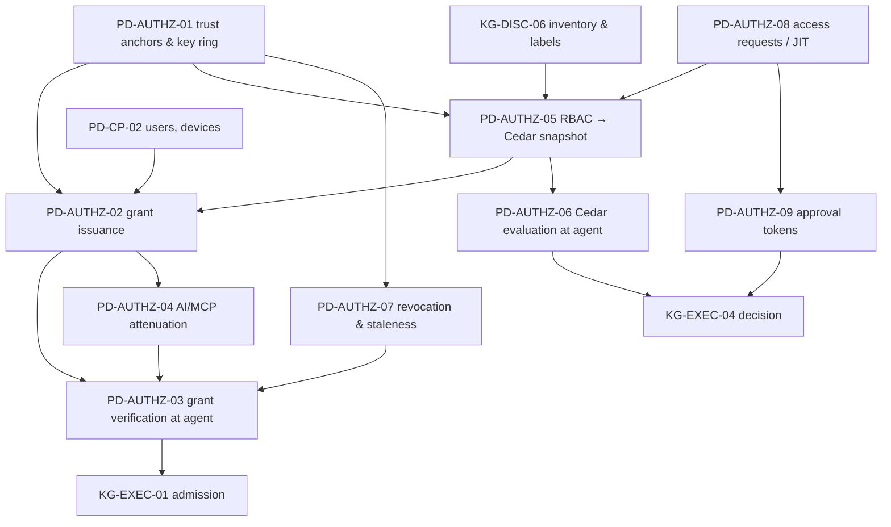
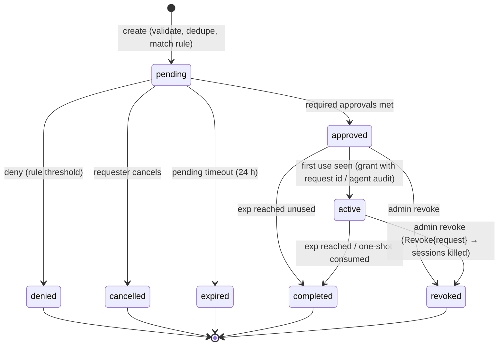

# 32 — Perde: Authorization (grants, attenuation, policy, revocation, approvals)

> Status: **canonical, implementation-ready**. Date: 2026-11-11. Audience: implementers of Perde's authorization service, the shared grant/policy crates used by Karagöz and Hacivat, and Hacivat's AI attenuation.
> Conventions, notation, evidence tags, verification anchors (`V1#…`, `V2 Pnn`) and priority tags are defined in `30-karagoz-enrollment-discovery-credentials.md` §0.
> Clean-room: Teleport (AGPL) and Bytebase enterprise code are described in prose only. Biscuit (Apache-2.0 spec and `biscuit-auth` crate), Cedar (Apache-2.0, `cedar-policy` crate) and C2SP specs (CC-BY-4.0) are used as published.

## 0. Overview

### 0.1 Architecture in one paragraph

Perde decides **who may get what** (RBAC with label selectors + ABAC conditions, compiled to Cedar), mints **short-lived Biscuit grants** bound to the client device key (`cep`) and the agent key (`aep`), distributes **signed per-agent policy snapshots**, and pushes **revocations**. Karagöz decides **offline** whether each stream and each statement is allowed: grant checks (Biscuit) ∧ snapshot policies and local floors (Cedar) ∧ execution profile (KG-EXEC-04). Hacivat can **attenuate** a grant for an AI agent without contacting Perde. Approvals (JIT elevation, statement approvals, AI write proposals) produce either Cedar template links or **approval tokens** verified at the agent. A fully compromised Perde can still mint grants (residual risk T4); local floors, agent-side audit of every grant, key-change visibility and (later) org-root co-signing limit and expose that.

### 0.2 Dependency map and priorities



| Spec | Name | Priority |
|---|---|---|
| PD-AUTHZ-01 | Trust anchors and key ring | v1 (separate keys, rotation chain); later (org root co-signing, HSM) |
| PD-AUTHZ-02 | Session grant issuance (Biscuit, key-bound) | v1 |
| PD-AUTHZ-03 | Grant verification at the agent (offline) | v1 |
| PD-AUTHZ-04 | Attenuation for AI / MCP sessions | v1 (read-only, table scope, TTL, sealed); v1.x (write proposals with approvals) |
| PD-AUTHZ-05 | RBAC with label selectors → Cedar compilation and signed snapshots | v1 |
| PD-AUTHZ-06 | Cedar evaluation at the agent, with local floors | v1 |
| PD-AUTHZ-07 | Revocation: short TTL + push + staleness cutoff + session kill | v1 |
| PD-AUTHZ-08 | Access requests / JIT approvals state machine | v1.x (single-approver free); later (multi-stage, reviews, ChatOps — EE) |
| PD-AUTHZ-09 | Approval tokens (owner approval, co-approval, statement binding) | v1.x |

### 0.3 Conflicts between sources resolved in this file

| # | Conflict | Sources | Decision |
|---|---|---|---|
| A1 | Grant format: COSE_Sign1 / PASETO v4.public vs Biscuit v3 | networking/05 ALG-PERDE-05 step 1 vs access/05 §3.2 | **Biscuit v3** (Ed25519, Datalog ≥ 3.2 for third-party blocks): offline verification, **offline attenuation** for AI agents, third-party blocks for approvals, per-block revocation ids. Wrapped in a `GrantV1` facade so PASETO v4.public can replace it (fallback documented in access/05 §7-1). |
| A2 | One Perde signing key (`K_perde`) vs separated keys | networking/05 §3.3.1 vs access/05 §5.2 | **Separated keys with roles** (`grant`, `policy`, `approval`, `cosign`, `relay_ticket`, `control`), each Ed25519 with `kid`, rotated independently, chained via `SigningKeysUpdate`. Limits the blast radius of one key compromise. |
| A3 | Clock skew: 60 s on both `nbf` and `exp` vs skew on `nbf` only | networking/05 vs access/05 | **60 s on `nbf` only; `exp` strict.** Clients refresh at 2/3 TTL, so strict `exp` costs nothing; agents with skew > 5 min refuse grants (`agent_clock_untrusted`). |
| A4 | TTL defaults: 10 min (max 1 h) vs 5–15 min with agent cap 24 h | networking/05 vs access/05 | Default **10 min**, Perde issue maximum **1 h**, agent hard cap `max_grant_lifetime` **1 h** (configurable up to 24 h for break-glass/automation identities). |
| A5 | `offline_grace` (15 min) vs `max_staleness` (5 min hosted) | networking/05 ALG-PERDE-05 step 7 vs access/05 ALG-REVOKE-01 | One parameter **`max_staleness`**, default **15 min**, org-configurable 0 … 24 h; strict mode on by default. A "high-security" preset sets 5 min. |
| A6 | Existing sessions when the agent is stale | networking/05 ("may keep, policy") vs access/05 ("optionally terminate write sessions") | Keep read sessions until grant `exp` (+ read grace); **terminate write/ddl/admin sessions** at staleness (policy `terminate_writes_on_stale = true`). |
| A7 | Post-expiry grace | networking/05 (read 5 min, write 0) vs access/05 (terminate at `exp` unless renewed) | In-band refresh is the normal path; if it does not arrive: read sessions get **5 min** grace, write/ddl/admin **0**. |
| A8 | Approval token format: device-signed COSE/JWS vs Biscuit third-party block by an approval key | mcp/02 ALG-MCP-13 vs access/05 ALG-REQ-01 | **Biscuit approval tokens** whose root key is either an org approval key (co-approval / reviewer approval) or the user's registered device key (owner approval of AI proposals, if org policy allows). One token library, one verifier. |
| A9 | Label selector regex semantics: values that look like `^…$` are regexes (Teleport) vs explicit prefix | access/01 ALG-ACCESS-T02 note | **Explicit `re:` prefix** for regex values; everything else literal or `*`. Regexes compiled with RE2 semantics (`regex` crate). |
| A10 | Condition language: CEL on bindings (Bytebase) vs Cedar | access/02 ALG-BYTEBASE-01 vs access/05 §3.7 | **Cedar** for both definition (compiled) and edge evaluation; CEL rejected (expression language, not a policy system; Bytebase's malformed-CEL-skips-binding pitfall). |
| A11 | Self-approval of AI-originated actions | access/05 ALG-REQ-01 (owner may not approve unless rule permits) vs mcp/02 (local user approval is the default human-in-the-loop) | Two flows: **AI write proposals** (mcp/02) — owner approval is allowed by default on non-production resources and requires an additional co-approval on production (org policy `ai_writes`); **access requests** (elevation/unmask/export) created by an AI on a user's behalf — the owner may not self-approve unless the rule says `owner_approval: allowed`. |

---

## 1. Specifications

### PD-AUTHZ-01: Trust anchors and key ring

- **Priority:** v1 (role-separated keys, rotation chain, pinning); later (org-root co-signing, HSM/KMS custody).
- **Problem:** Define which keys sign what, how agents and clients learn and pin them, and how they rotate — so a single key compromise has bounded effect and every rotation is verifiable offline.
- **Sources merged:** networking/05 §3.3.1 (key table), §3.3.4 (trust anchors and pinning), ALG-PERDE-02 `SigningKeysUpdate`, ALG-PERDE-05 step 8; access/05 §5.2 item 1 (key separation), ALG-AGENT-01 step 10 (CA overlap); access/06 ALG-OPENCORE-02 (license keys are separate and never touch enforcement).
- **Key roles:**
  | Role | Signs | Verified by | Rotation | Custody |
  |---|---|---|---|---|
  | `grant` | Biscuit grant authority blocks | Karagöz | quarterly + on incident | DB-encrypted / KMS (v1.x) |
  | `policy` | policy snapshots, AttachLists, engine-spec updates | Karagöz, docker-guard | quarterly | same |
  | `approval` (≥ 1, optionally per approver group) | approval tokens (co-approval) | Karagöz | on demand | optionally offline/HSM/second-admin device (dual control) |
  | `cosign` | audit checkpoint cosignatures | Karagöz, verifier | yearly | same |
  | `relay_ticket` | RelayTickets | relays | quarterly | relay-reachable secret store |
  | `control` | receipts, AgentCert, `AgentKeyChanged`, `PerdeMoved`, `SigningKeysUpdate` | Karagöz, Hacivat | yearly, overlap ≥ 2 renewal cycles | most protected (offline-capable) |
  | TLS | HTTPS/WSS/relay TLS | everyone | ACME 60–90 d | standard |
  | org root (later) | co-signs high-privilege policies/grants | Karagöz (if configured) | rare | org admin offline |
  | license (vendor) | license tokens (PD-CP-04) | Perde only | per release | vendor; never used by agents |
- **Algorithm:**
  1. Each key has `{kid (16 bytes, random), role, public_key, not_before, not_after, status ∈ {next, current, retiring, retired, compromised}}`.
  2. Enrollment delivers the full ring (KG-ENROLL-02); Hacivat receives `control`, `grant` (for diagnostics only), `approval` keys at sign-in.
  3. **Rotation:** publish `next` key ≥ 7 days before use via `SigningKeysUpdate {keys[], issued_at, sig_by_current_control}` (reliable signaling); switch issuance to it at `not_before`; old key `retiring` until every artefact it signed has expired (grants ≤ 1 h, snapshots until superseded, tickets ≤ 1 h), then `retired`.
  4. **`control` key rotation** is a chain: the update is signed by the current `control` key; an agent accepts a new `control` key only via such a chain (no TOFU after enrollment). Lost chain (agent offline across two rotations) → the agent can still verify because the ring update carries the full chain of `control` signatures.
  5. **Compromise:** mark `compromised`; push `SigningKeysUpdate` removing it and set `min_policy_epoch` (PD-AUTHZ-07) so every grant/snapshot signed under it is rejected; if the `control` key itself is compromised → agents must re-enroll (documented; mitigated by offline custody).
  6. **Clients pin agents** (TOFU on first grant, PD-AUTHZ-03 step 3) and accept agent key changes only via `AgentKeyChanged` signed by `control` (KG-ENROLL-04).
- **Data structures:** `KeyRing {keys: Vec<KeyEntry>, control_chain: Vec<ChainLink>}` persisted in `enrollment.json`/Hacivat keychain; Perde `signing_keys` table (private keys encrypted with a KEK from config/KMS).
- **Complexity:** O(keys).
- **Decision:** role-separated Ed25519 keys (A2). Rejected: single key (networking/05 original); X.509 PKI for all artefacts (heavier, no benefit for raw-key transport).
- **Verification status:** design-level.
- **Rust placement:** `hv-grant::keys::{KeyRing, KeyEntry, verify_chain}` (Apache-2.0); `perde::keys::{rotate, mark_compromised}` (AGPL).
- **Threats addressed:** T4 (blast radius of Perde key compromise), T2 (impersonation via key substitution), networking/05 T16 (pins).
- **Edge cases:** agent offline for months → ring update carries the full `control` chain since its last known key; two `current` keys of one role during overlap → both accepted for verification, issuance uses the newest; clock skew around `not_before` → issuance waits for Perde time; self-hosted reinstall with new keys → agents refuse (`unknown_control_key`) → operator re-runs the install command (KG-ENROLL-05).
- **Test cases:** rotate `grant` key → old grants valid until `exp`, new grants with new kid accepted; forged `SigningKeysUpdate` signed by `grant` key → rejected (wrong role); compromise `grant` key → grants with that kid rejected within one signaling round trip; agent offline across two `control` rotations → accepts chain.
- **Prior art:** networking/05 §3.3.1; access/05 §5.2; Teleport CA rotation phases (prose); C2SP signed-note key ids.
- **i18n notes:** key fingerprints shown in UI are hex/base32 data; event names are codes (`keys.rotated`, `keys.compromised`).
- **Used by:** Perde, Karagöz, Hacivat, relays.

### PD-AUTHZ-02: Session grant issuance (Biscuit, key-bound)

- **Priority:** v1.
- **Problem:** Issue a short-lived capability that tells exactly one agent that exactly one user, on exactly one device, may open sessions to specific databases with a maximum mode and scope — verifiable offline, useless when stolen, attenuable, revocable.
- **Sources merged:** access/05 §3.2–3.3 (Biscuit choice and fact vocabulary), §3.4 (proof of possession), ALG-AUTHZ-01 inputs; networking/05 ALG-PERDE-05 step 1 (claims `cep`, `aep`, `res`, `pe`, `ctx`), ALG-PERDE-03 step 1 (`ConnectRequest` → `ConnectGrant`); access/01 ALG-ACCESS-T01 (role-set decision with preconditions such as MFA, prose); access/06 ALG-OPENCORE-05 (capability issuance defines a billable active user).
- **Inputs / outputs:** In: `ConnectRequest {target_agent_id, resources[{db_id, tier?, scope?}], purpose?, client_capabilities}` on the authenticated signaling session of a device; device record (key, user binding, trust, approval status); user session freshness (OIDC `auth_time`, MFA method/time); RBAC/Cedar decision (PD-AUTHZ-05/06 "what-if" engine); active requests; agent status and key. Out: `ConnectGrant {grant (Biscuit bytes), agent_addr: PeerAddr, agent_pins[endpoint_id], session_hint}` or `ConnectDenied {reason_code, reason_params}`; `IncomingIntent` to the agent; audit `grant.issued`.
- **Algorithm:**
  1. **Preconditions:** device `active` (not pending approval, not revoked), bound to the signaling user; user `active`; OIDC session fresh within org policy (default 12 h); MFA freshness for resources whose policy requires it (`context.mfa_age_s < N`), else `ConnectDenied{mfa_required}` (client triggers step-up); agent `active` and online (else `agent_offline {last_seen}`); org not locked.
  2. **Authorization:** for each requested resource evaluate Perde's Cedar engine with the same schema and snapshot logic agents use (PD-AUTHZ-06) for `Action::"connect"` and the requested tier action; compute the maximum permitted tier ≤ requested; collect required masks (`mask_profile`) and active request ids that contributed (template-linked permits). Deny → `ConnectDenied{forbidden, determining_policies (ids only if the user may see them)}`.
  3. **Authority block** (signed by the `grant` key; `rootKeyId = kid`), facts (our vocabulary, ASCII identifiers):
     ```
     grant_id("grt_…"); org("org_…"); user("usr_…"); device("dev_…", "ed25519/<cep hex>");
     agent("agt_…", "ed25519/<aep hex>"); issuer("<perde_instance_id>");
     database("agt_…", "db_…"); mode("db_…", "read");            // per resource
     db_scope("db_…", "app", "*");                                // optional (schema, table pattern)
     mask_profile("db_…", "default"); policy_epoch(4812); request("req_…");   // optional
     mfa(1762869720, "webauthn"); device_trust("managed"); actor_kind("human");
     check if time($t), $t <= <exp>;                              // no skew on exp (A3)
     check if time($t), $t >= <nbf − 60>;
     check if channel_peer_key($k), $k == "ed25519/<cep hex>";   // proof of possession
     check if agent_id($a), $a == "agt_…";                        // audience
     ```
     `nbf = now`, `exp = now + ttl` (default 10 min, max 1 h, A4); multiple resources on the same agent may share one grant (cap 16 resources).
  4. **Optional third-party blocks:** dual-control approval blocks for high-risk grants (write/admin/unmask on resources labelled `dual_control=true`), signed by an `approval` key (PD-AUTHZ-09); org-root co-signature (later).
  5. **Address book:** `agent_addr` = current `PeerAddr` (relay URL + direct addresses within the org's disclosure policy) and `agent_pins` = endpoint id(s) (two during key rotation overlap).
  6. **Simultaneous intent:** in the same server tick send `IncomingIntent {client_endpoint_id, client_addr, grant_id, expires_at}` to the agent (pre-warm, PD-NET-04).
  7. **Idempotency:** `ConnectRequest.msg_id` LRU (10 min) returns the same grant for retransmits.
  8. **Refresh:** Hacivat sends `GrantRefresh {grant_id}` at 2/3 TTL while sessions are open; Perde re-runs steps 1–3 (policy re-evaluation is where revocations and MFA expiry bite) and returns a new grant (new `grant_id`) presented in-band (KG-EXEC-01 step 14).
  9. **Audit:** `grant.issued {grant_id, user, device, agent, resources, modes, exp, request_ids, policy_epoch}`; this is also the billing signal for active users (PD-CP-08).
- **Data structures:** `IssuedGrant {grant_id, revocation_ids[], user, device, agent, resources, exp, policy_epoch}` retained until `exp` (revocation lookup, audit cross-check KG-AUDIT-05).
- **Complexity:** Cedar evaluation per resource (µs); one Ed25519 signature per grant; token size ~0.5–1.5 KB.
- **Decision:** Biscuit grants bound to device key and agent key (A1). Rejected: bearer tokens (stolen token = access); long-lived device certificates carrying roles (slow revocation); JWT with algorithm negotiation (RFC 8725 pitfalls).
- **Verification status:** design-level; Biscuit semantics (authority/attenuation blocks, third-party blocks requiring Datalog ≥ 3.2, revocation ids from signatures, default trust scope) [Observed: Biscuit SPECIFICATIONS.md via access/05].
- **Rust placement:**
  ```rust
  // hv-grant (Apache-2.0) — facade, no biscuit types in the public API
  pub struct GrantClaims { pub grant_id: GrantId, pub org: OrgId, pub user: UserId, pub device: DeviceId, pub cep: EndpointId,
                           pub agent: AgentId, pub aep: EndpointId, pub resources: Vec<ResourceGrant>, pub nbf: u64, pub exp: u64,
                           pub policy_epoch: u64, pub request_ids: Vec<RequestId>, pub mfa: Option<MfaFact>, pub actor_kind: ActorKind }
  pub struct GrantV1(Vec<u8>);
  pub trait GrantIssuer { fn issue(&self, c: &GrantClaims, extra: &[ThirdPartyBlock]) -> Result<GrantV1>; }
  // perde::authz::issue (AGPL)
  pub async fn connect_request(ctx: &DeviceSession, req: ConnectRequest) -> Result<ConnectGrant, ConnectDenied>;
  ```
  Crates: `biscuit-auth` (Apache-2.0; pin a version supporting Datalog v3.3 and third-party blocks — check current major), `cedar-policy` (check current 4.x).
- **Threats addressed:** networking/05 T3 (client impersonation: `cep`), T5 (short TTL), T4 partially (agent audits every grant; dual control); access/05 §3.4 (relay/channel misuse).
- **Edge cases (exhaustive list):** device revoked between `ConnectRequest` and issuance (re-check in the issuing transaction); user in two roles giving different tiers (max permitted ≤ requested); resource detached between request and issuance → deny `unknown_resource`; agent key rotation in progress → two pins; agent `pending_approval` → `agent_pending_approval`; MFA step-up loop protection (max 3 prompts per 10 min); Perde clock skew vs agent (agents enforce their own skew rules); grant size growth with many resources → cap 16; AI-originated `ConnectRequest` (Hacivat MCP bridge flag) → Perde sets `actor_kind("ai_agent")` in the authority block when Hacivat declares it (more restrictive; Hacivat cannot lower it later); org policy forbids relay for a resource → `relay_policy` hint included in `session_hint`.
- **Test cases:** analyst requesting read on prod non-PII → grant with `mode(read)`, exp = now+10 min; same requesting write → `forbidden`; MFA older than 12 h on a DB requiring fresh MFA → `mfa_required`; revoked device → `device_revoked`; retransmitted `ConnectRequest` (same msg_id) → same grant; grant token decoded → authority block contains exactly the facts listed, no secrets.
- **Prior art:** access/05 §3.3; networking/05 ALG-PERDE-05; Teleport certificate-embedded identity with request ids and MFA (prose); DPoP/RFC 9449 `cnf` analogue.
- **i18n notes:** `ConnectDenied` reason codes (`net.connect.denied.agent_offline`, `authz.deny.mfa_required`, …) rendered by Hacivat; parameters typed (times as Unix seconds, formatted client-side).
- **Used by:** Perde (issuer), Hacivat (bearer), Karagöz (verifier).

### PD-AUTHZ-03: Grant verification at the agent (offline)

- **Priority:** v1.
- **Problem:** Decide whether a presented grant authorizes sessions on this agent for this peer, without contacting Perde, while honouring revocations, policy epochs, attenuations and clock limits.
- **Sources merged:** ALG-AUTHZ-01 (access/05, canonical); ALG-PERDE-05 steps 2–9 and edge cases (networking/05); networking/04 §5.1 (`export_keying_material` for channel binding).
- **Inputs / outputs:** In: grant bytes `G`, presentation signature `σ = Sign_device("hv-grant-present-v1" ‖ exporter ‖ H(G))` where `exporter = export_keying_material(32, label "EXPORTER-hv-grant", context = H(G))` of the QUIC connection; channel facts `{peer_key = TLS-authenticated E_c, channel_kind p2p|relay}`; local state `{key ring, revocation set R + epoch, snapshot P (epoch, min_policy_epoch), agent_id, aep, clock trust}`. Out: `Verified(GrantView)` or `Rejected(code)`; audit `grant.presented` / `grant.rejected` (code + check index, never the token).
- **Algorithm:**
  1. **Size and structure:** `|G| ≤ 16 KiB`, ≤ 8 blocks; parse; unknown Datalog version → reject (spec mandates). `rootKeyId` → `grant` key; unknown kid → `unknown_signing_key` (trigger async ring refresh).
  2. **Signature chain** verification (Biscuit). Sealed or attenuable both accepted; AI tokens are expected sealed (PD-AUTHZ-04).
  3. **Channel PoP:** authority `device(_, key)` must equal `peer_key` (`grant_not_bound_to_peer`); verify `σ` with `key` over the connection exporter (`grant_presentation_invalid`) — prevents presenting a grant captured on another connection even by the same device process.
  4. **Audience:** authority `agent(aid, aep)` must equal own `agent_id` and own current (or overlap) endpoint key (`wrong_audience`).
  5. **Revocation:** compute revocation ids of all blocks; any ∈ `R.block_ids` → `grant_revoked`; fact-level revocations: `grant_id`, `user`, `device`, each `request`, `agent`, `org_lock` → `grant_revoked{type}`.
  6. **Epochs:** `policy_epoch(e) < P.min_policy_epoch` → `stale_grant`. `e > P.epoch` → request snapshot fetch; if unreachable: strict mode → `agent_policy_stale`, lenient → continue (grant checks still bound it).
  7. **Clock trust:** if `|agent_time − last Perde server_time| > 5 min` (measured at signaling) → `agent_clock_untrusted` (refuse all grants until fixed).
  8. **Staleness:** revocation view older than `max_staleness` (A5) and strict → `agent_revocation_stale`.
  9. **Authorizer run** with facts `time(now)`, `agent_id(self)`, `channel_peer_key(peer_key)`, `channel_kind(kind)`, `requested_db(db)`, `requested_mode(mode)`, `mcp_client(c)` (only from Hacivat-signed session metadata), and agent-wide policies: `check if database($a, $d), agent_id($a), requested_db($d)`; `check if mode($d, $m), requested_db($d), mode_allows($m, requested_mode)`; then `allow if true`. Limits: max facts 1 000, iterations 100, time 1 ms. Failing check → `grant_check_failed {block, index}`.
  10. **Agent hard cap:** `exp − nbf ≤ max_grant_lifetime` (default 1 h) else `grant_lifetime_exceeded`.
  11. **Extract `GrantView`:** user, device, org, resources with `mode = min(authority mode, every attenuation block's allowed ops)`, scope, mask profile, request ids, mfa, `actor_kind = ai_agent` if any block declares it or the MCP bridge flag is set (never lowered by a later block), delegation revocation ids, `exp = min(all time checks)`.
  12. Cache by `H(G)` until `exp`; re-verify revocation on every new stream and on every revocation push.
- **Data structures:** `GrantCache {H(G) → GrantView}`, `RevocationSet` (PD-AUTHZ-07), `KeyRing`.
- **Complexity:** Ed25519 verify ~50 µs per block; Datalog < 1 ms; total < 1 ms.
- **Decision:** offline verification with exporter-bound presentation (rejected: online introspection — Perde in the data path; plain bearer grants).
- **Verification status:** design-level; `export_keying_material` availability on iroh connections [Observed: networking/04 §5.1, `connection.rs:1115`] → phase-0 check that it is exposed through our `hv-net` facade.
- **Rust placement:** `hv-grant::verify::{GrantVerifier, GrantView, VerifyError}`; Karagöz wires facts from `hv-net::PeerConn::{remote_id, export_keying_material, path_kind}`.
  ```rust
  pub struct GrantVerifier<'a> { ring: &'a KeyRing, rev: &'a RevocationSet, snap: &'a SnapshotMeta, me: AgentSelf, clock: ClockTrust }
  impl GrantVerifier<'_> { pub fn verify(&self, g: &[u8], pres_sig: &Signature, ch: &ChannelFacts, req: &RequestedAccess) -> Result<GrantView, VerifyError>; }
  ```
- **Threats addressed:** T3 (stolen grant useless without device key), T5 (revocation, staleness), T2 (aep audience), networking/05 T15 (0-RTT disabled for presentation).
- **Edge cases (exhaustive list):** agent clock wrong by > skew (refuse; health `clock_skew`); Perde `grant` key compromise (kid removed + `min_policy_epoch`); replay by another device (`cep`); grant for another agent (`aep`); resource no longer attached (`unknown_resource` at stream open); user removed mid-session (`Revoke{user}`); revocation set never synced (fresh agent) → reject all until first sync; extremely long-lived grant (cap); attenuation block adding facts like `mode("db","admin")` → ignored (non-authority facts are not trusted by default scope — tested explicitly); P-256 device keys (Secure Enclave) → supported by Biscuit, `peer_key` comparison uses the canonical key encoding; many grants per connection (cap 64); `max_sessions_per_grant` (8); local policy narrower than the grant (narrowing applied, UI shows "restricted by agent policy").
- **Test cases:** valid grant → accept; flip one byte → signature failure; valid grant presented by another device key → `grant_not_bound_to_peer`; valid grant presented with a signature over another connection's exporter → `grant_presentation_invalid`; AI block restricting to `orders` → session accepted, statement on `customers` denied later (KG-EXEC-04); revoked authority block id → reject; revoked AI block only → AI token rejected, original user token still accepted; `exp` 30 s in the past → reject (no exp skew); `nbf` 50 s in the future → accept; attenuation block with `mode("db_…","admin")` fact → effective mode unchanged; agent disconnected 20 min with `max_staleness = 15 min` → `agent_revocation_stale`; signing-key rollover chain → accepted; broken chain → rejected.
- **Prior art:** access/05 ALG-AUTHZ-01; networking/05 ALG-PERDE-05.
- **i18n notes:** codes only; Hacivat renders (`net.access.revoked`, `authz.grant.expired`, …).
- **Used by:** Karagöz (PEP); Hacivat (pre-flight checks on its own grants).

```mermaid
sequenceDiagram
    autonumber
    participant H as Hacivat
    participant M as Hacivat MCP broker
    participant P as Perde
    participant K as Karagöz
    H->>P: ConnectRequest(db_orders, read)
    P->>P: preconditions, Cedar, MFA → authority block (cep=D, aep=A, exp)
    P-->>H: ConnectGrant(G0)
    M->>M: AI tool call on db_orders → effective level READ (ALG-MCP-10)
    M->>M: attenuate G0 → G1 (+ block: ops=read, tables=[orders], exp=+5m, actor ai_agent, mcp_client); seal
    M->>K: Authenticate(G1, sig_D(exporter‖H(G1))) on a dedicated AI connection/session
    K->>K: verify chain, cep, aud, revocation ids (G0 block + G1 block), checks
    K-->>M: AuthOK(mode=read, scope=orders, actor=ai_agent)
    Note over P,K: Admin revokes the AI delegation (block id of G1) or the user
    P->>K: Revoke(block_id | user) [reliable]
    K->>K: kill matching sessions ≤ 1 s, audit revocation.applied
```

### PD-AUTHZ-04: Attenuation for AI / MCP sessions

- **Priority:** v1 (read-only, table scope, short TTL, sealed, actor attribution); v1.x (write proposals carrying approval tokens, PD-AUTHZ-09).
- **Problem:** Let Hacivat's local MCP broker give an AI agent strictly less authority than the signed-in user — offline, per call or per AI session — so that Karagöz can enforce AI-specific limits and attribute actions, and so that a prompt-injected agent can never gain more than the narrowed token.
- **Sources merged:** access/05 §3.3 (attenuation block example), ALG-AUTHZ-01 step 8, §3.9 (AI attribution); mcp/02 §3.8 (AI levels and modifiers), §3.12 (identity propagation, `ai_delegation` as narrowing, Karagöz re-classifies), ALG-MCP-10 step 5 (effective level), ALG-MCP-11; access/06 §5.2 (AI controls free).
- **Inputs / outputs:** In: user grant `G0` (from PD-AUTHZ-02); MCP call context `{paired_client_id, client_label, evidence_hash, client_info_asserted, call_id}`; effective AI level `L_eff = min(L_conn, L_client, L_env, L_org, L_agent)` (mcp/02); object rules; budgets. Out: attenuated, sealed grant `G1`; audit linkage (block revocation id).
- **Algorithm:**
  1. Compute `L_eff` (mcp/02 ALG-MCP-10 step 5). `METADATA` → operations `{metadata}`; `READ` → `{read}`; `READ_PROPOSE` → `{read}` plus write operations only together with an approval token per statement (PD-AUTHZ-09).
  2. Append an attenuation block signed with a fresh ephemeral key (Biscuit attenuation) containing **only checks and informational facts**:
     ```
     actor_kind_claim("ai_agent");                        // informational; Karagöz derives actor from block presence
     mcp_client_claim("<paired_client_id>", "<evidence_hash>");
     check if operation($op), ["read"].contains($op);
     check if table($db, $s, $t), $db == "db_…", [["app","orders"],["app","customers"]].contains([$s,$t]);   // object rules
     check if time($t), $t <= <now + ai_ttl (default 5 min, ≤ G0 exp)>;
     check if mcp_client($c), $c == "<paired_client_id>";   // authorizer provides from Hacivat-signed session metadata
     ```
  3. **Seal** `G1` (no further attenuation by downstream components).
  4. Open a **dedicated AI connection/session** (never reuse the user's human sessions) and present `G1` (PD-AUTHZ-03). Hacivat sends Hacivat-signed session metadata `{mcp_client, call_id, paired_client evidence}` on stream 0 so the agent can inject `mcp_client` and `operation`/`table` facts per statement.
  5. **Karagöz interpretation:** `actor_kind = ai_agent` whenever any block declares it **or** the session metadata says so; Cedar principal `AiAgent::"<session>"` with parent `User::"u"` (PD-AUTHZ-06); org-wide `forbid` for AI writes and AI-specific masks apply; per-statement authorizer runs with `operation(<class>)` and `table(...)` facts so the block's checks bind each statement.
  6. Budgets (rows/bytes/time) travel in session metadata and are enforced agent-side additionally (KG-EXEC-07).
- **Data structures:** `AiDelegation {grant: GrantV1, block_revocation_id, client, level, expires_at}` cached per (client, connection) in Hacivat.
- **Complexity:** one Ed25519 signature per attenuation (µs); token grows by ~200–400 B.
- **Decision:** Biscuit offline attenuation (rejected: asking Perde for a separate AI grant per call — breaks offline use and adds latency; PASETO second token chained by `parent_jti` — reimplements half of Biscuit, access/05 §3.2).
- **Verification status:** Biscuit attenuation semantics (blocks can only add checks; non-authority facts untrusted by default) [Observed: Biscuit spec via access/05]; design-level otherwise.
- **Rust placement:** `hv-grant::attenuate::{Attenuator, AiScope}` (used by `hacivat::ai::broker`); Karagöz side in `hv-grant::verify` + `karagoz::exec::decide`.
- **Threats addressed:** mcp/02 attack catalogue (A1–A16: prompt injection leading to destructive SQL, exfiltration, repudiation — A16), access/05 §3.9 attribution.
- **Edge cases:** AI level dropped mid-session (Hacivat stops presenting/refreshing; Karagöz enforces token TTL ≤ 5 min); user's `G0` refreshed → Hacivat re-attenuates; org AI policy stale in Hacivat (`POLICY_STALE` → METADATA for managed connections, mcp/02 §3.12.4) — Karagöz independently applies the latest snapshot; AI requests a table outside the scope → statement denied by block check; attenuation block that tries to add `mode` facts → ignored; Hacivat compromised → can only use what the user could (device key) — bounded by user grant; revocation of the AI block id kills only the AI's delegated sessions.
- **Test cases:** AI READ on `orders` only → `SELECT * FROM customers` denied (`grant_check_failed`), `SELECT * FROM orders` allowed with actor `ai_agent` in audit; AI token at 5 min + 1 s → rejected; revoke AI block id → AI session killed, user's human session continues; attempt to unseal/append to `G1` → verification fails.
- **Prior art:** access/05 §3.3; mcp/02 §3.12; genai-toolbox claim-bound parameters (mcp/02, Apache-2.0, cited for the "values from identity, never from the model" principle).
- **i18n notes:** model-facing text English (mcp/02 §3.14); human consent/approval UI localized.
- **Used by:** Hacivat (attenuator), Karagöz (enforcer), Perde (org AI policy in snapshots).

### PD-AUTHZ-05: RBAC with label selectors → Cedar compilation and signed snapshots

- **Priority:** v1.
- **Problem:** Give org admins a role model they understand (roles bound to groups/users over label-selected databases, with conditions), compile it into Cedar policies, and distribute to each agent exactly the policy slice it needs, signed and versioned.
- **Sources merged:** access/05 §3.6 (RBAC + label selectors + ABAC, not ReBAC), §3.7 (Cedar mapping and examples), ALG-POLICY-01 (snapshot compilation and distribution); access/01 ALG-ACCESS-T01 (deny-overrides role matching, preconditions), ALG-ACCESS-T02 (selector and expression semantics), ALG-ACCESS-T07 (object-level permissions from labels); access/02 ALG-BYTEBASE-01 (conditioned role bindings, expiry, pitfalls); networking/05 ALG-PERDE-02 `PolicyUpdate`.
- **Model (Perde, user-facing):**
  - `Role {id, name (display, Unicode), permissions: [connect, query.read, query.write, query.ddl, query.admin, export, unmask, approve, agents.manage, …], builtin: bool}`; built-ins: `viewer` (metadata), `analyst` (read), `developer` (read+write), `dba` (ddl+admin), `auditor` (audit read), `org_admin`. Custom roles are free (access/06 §5.2).
  - `RoleBinding {id, subjects: [user|group|service_identity], role, resources: Selector, conditions: {mfa_max_age?, time_window?, device_trust?, actor_kinds?, channel?: p2p_only?, ip_classes?}, expires_at?, effect: allow|deny}`.
  - `Selector {labels: Map<key, [value | "*" | "re:<RE2>"]>, expression?: CedarExpr}` over database resource labels (from `hacivat.labels.*`, auto labels, admin-assigned labels, plus built-ins `engine`, `agent`, `agent.label.<k>`).
  - Object-level rules (v1.x): `ObjectRule {resources, object_selector (schema/table globs or object labels), permissions, effect}` (Teleport T07 analogue).
- **Selector semantics (from T02 with A9):** empty selector → matches nothing; `{"*": ["*"]}` → matches every database (including unlabeled); each key must exist in the labels; value list entry matches literally, `*` matches any value, `re:` entries are full-match RE2; keys case-sensitive ASCII; expression optional; selector ∧ expression for allow; for deny: (labels set ∧ match) ∨ (expression set ∧ true) (greedy deny, T02/T01 semantics).
- **Compilation algorithm (Perde):**
  1. Validate bindings (unknown roles, invalid regex, expression type errors against the Cedar schema) → reject at save time (never "skip at evaluation", unlike Bytebase's malformed-CEL pitfall).
  2. For each binding emit Cedar: allow → `permit (principal in <subject entity>, action in [<actions of role>], resource) when { <selector compiled> && <conditions compiled> };` deny → `forbid (…)`. Selector compiles to `resource.labels has <k> && resource.labels.<k> == "<v>"` disjunctions (regex values via a precomputed label-match attribute `resource.matches has "<binding_id>"` because Cedar has no regex — Perde evaluates regex selectors at compile time against the known inventory and emits explicit `resource in [...]` sets, re-compiled when inventory labels change).
  3. Org-wide built-in policies: `forbid` AI writes unless the org enables AI proposals with approvals; `forbid` relay channel for resources labelled `direct_only=true`; MFA requirements.
  4. Access-request templates (PD-AUTHZ-08) as Cedar templates with `?principal`/`?resource` slots; approved requests become template-linked policies with `context.request_id == R && context.time < exp`.
  5. **Per-agent slice:** include policies whose resource scope can match any database of that agent (static analysis on `resource ==`/`in`/label constraints; undecidable → include); include principal entities only for users/groups referenced by included policies (privacy: agents never learn the full directory); include entities for this agent's databases with labels; include AI policy entities.
  6. Validate the slice with the Cedar schema; compute `schema_hash`.
  7. Sign `Snapshot {org, agent_id, epoch, min_policy_epoch, issued_at, cedar_policies, cedar_schema_hash, entities, attach_list, approval_rules, ai_policy, mask_profiles, revocation_epoch_hint}` with the `policy` key.
  8. On any change: bump org `epoch`; push `PolicyUpdate {epoch}` notifications; agents fetch the full snapshot (`GET /v1/agents/{id}/snapshot` with `If-None-Match: epoch`) — simple and robust; deltas are a later optimization.
- **Agent apply algorithm:** verify signature, schema hash, monotonic epoch (reject rollback), `agent_id`; parse and validate with Cedar; merge local floors (`/etc/karagoz/policy.d/*.cedar`, forbid-only; a `permit` in a floor file is a startup error); apply atomically; audit `policy.snapshot.applied {epoch, hash}`; invalidate decision caches.
- **Cedar schema (canonical v1):** entity types `User` (parents `Group`, `Role`), `Group`, `Role`, `Device`, `AiAgent` (parent `User`), `ServiceIdentity`, `Agent`, `Database` (attrs `labels: Record`, `engine`, `env`, parent `Agent`), `Table` (parent `Database`, attrs `labels`); actions `connect`, `query.read`, `query.write`, `query.ddl`, `query.admin`, `export`, `unmask`, `approve`; context `{mfa_age_s: Long, device_trust: String, actor_kind: String, mcp_client?: String, request_ids: Set<String>, channel_kind: String, time: Long, classifier?: {category: String, flags: Set<String>, objects: Set<String>}}`.
- **Data structures:** Perde `roles`, `role_bindings`, `access_request_links`, `policy_epochs`, compiled cache per agent `(epoch, hash, bytes)`.
- **Complexity:** compilation O(bindings × databases) for regex selectors; per-agent slice O(policies); snapshot sizes typically < 100 KB.
- **Decision:** RBAC + label selectors + ABAC conditions compiled to Cedar (rejected: ReBAC/Zanzibar for DB access — requires online checks the P2P agent cannot make; OPA/Rego — heavier and less analyzable; CEL — A10). ReBAC may still be used *inside* Perde for org/team membership and compiled down.
- **Verification status:** design-level; Cedar properties (default deny, forbid overrides, templates, schema validation) [Inferred: Cedar docs/OOPSLA 2024 paper, via access/05].
- **Rust placement:** `hv-policy` (Apache-2.0): `schema.cedarschema`, `Snapshot`, `SnapshotVerifier`, `PolicyEngine` (wraps `cedar_policy::Authorizer`); `perde::authz::compile::{compile_org, slice_for_agent}` (AGPL).
- **Threats addressed:** A6 insiders (deny-overrides), T12 (agents learn only needed principals), T4 partially (local floors cannot be overridden by snapshots), Bytebase anti-patterns (skip-on-error).
- **Edge cases (exhaustive list):** user directory too large → only referenced users embedded (group membership enters via grants' facts and refresh); label change on a database → epoch bump and re-slice; regex selector matching a newly discovered database → recompilation on inventory change; binding expiry (`expires_at`) → compiled as `context.time < T` and pruned at the next epoch after expiry; template-link explosion (many approved requests) → prune expired links on epoch bump, cap active links per org (default 1 000); snapshot apply failure → keep previous, alert; rollback attempt → reject; floor file with syntax error → agent refuses to start with a clear message; MySQL `db_names` semantic gap (Teleport T01 note) → Perde scopes are per logical database and Karagöz enforces object scope itself (KG-EXEC-04 step 5), so `USE other` is denied.
- **Test cases:** add a binding → epoch+1 → agent applies within seconds (signaling round trip); tampered snapshot → rejected; floor `permit` → startup error; analyst binding `{env: [prod], pii: [re:^false$]}` → prod non-PII DBs only; deny binding `{"*":["*"]}` for group `contractors` → denies everything for them regardless of allows; binding with invalid regex → save rejected (HTTP 422); agent without DBs matching a policy → policy absent from its slice; user referenced only by a policy for another agent → absent from this agent's entities.
- **Prior art:** access/05 ALG-POLICY-01; access/01 ALG-ACCESS-T01/T02/T07 (Teleport, prose); access/02 ALG-BYTEBASE-01 (prose).
- **i18n notes:** role and group display names Unicode NFC; identifiers ASCII; Cedar text ASCII; UI renders policy explanations from codes; Turkish case pitfalls → never locale-lowercase label keys/values (ASCII comparisons only).
- **Used by:** Perde (authoring, compilation, explain), Karagöz (evaluation).

### PD-AUTHZ-06: Cedar evaluation at the agent, with local floors

- **Priority:** v1.
- **Problem:** Evaluate an action against the snapshot plus local floors with full context, returning a decision and an explanation, failing closed on evaluation errors in `forbid` policies.
- **Sources merged:** ALG-AUTHZ-02 (access/05, canonical); ALG-ACCESS-T01 (preconditions like MFA, prose); mcp/02 §3.8.2 (AI modifiers), §3.12.2.
- **Algorithm:**
  1. **Principal:** `User::"u"`; if `actor_kind = ai_agent` → `AiAgent::"<session>"` with parent `User::"u"` (so human permits written as `principal == User::"u"` do not apply automatically; permits written as `principal in User::"u"` do, and the org default template includes `forbid` for AI writes).
  2. **Context:** `{mode_from_grant, mfa_age_s, device_trust, actor_kind, mcp_client, request_ids, channel_kind, time, classifier}`.
  3. Evaluate floors (forbid-only) ∪ snapshot with `is_authorized`: any `forbid` → deny; else any `permit` → allow; else deny.
  4. Intersect with the grant: action ≤ grant mode (lattice `read < write < ddl < admin`; `export`, `unmask` separate flags); both must allow.
  5. **Errors:** Cedar treats an erroring policy as not applying; a snapshot whose `forbid` policies can error is rejected at load time by schema validation, so a forbid can never silently disappear; if an error still occurs at runtime → deny (fail closed) and audit `policy.eval_error`.
  6. Return `{decision, determining_policy_ids, errors}` for audit; cache per `(session, action, resource, classifier signature)` until snapshot/revocation/inventory generation changes.
- **Complexity:** ~10–100 µs for hundreds of policies.
- **Decision:** Cedar at the edge (A10). Rejected: evaluating only at Perde (P2P data path).
- **Verification status:** design-level.
- **Rust placement:** `hv-policy::PolicyEngine::{is_authorized, explain}`; Perde uses the identical code for the "what-if/explain" UI.
- **Threats addressed:** T4 partially (local floors), A6 (deny-overrides), AI write forbids.
- **Edge cases:** resource labels change after session start (inventory generation invalidates caches; re-evaluated on next statement); principal missing from snapshot (grant issued after snapshot) → deny `unknown_principal` and trigger fetch; AI agent acting for a user whose role is revoked mid-session → revocation push kills it anyway; `hacivat.readonly=true` label → floor forbids writes even for admins.
- **Test cases:** analyst on prod non-PII read → allow (`analyst-read`); same on PII DB → deny; AI write with user write role → deny (`forbid-ai-write`); floor read-only label → admin write denied; policy with a type error in a `forbid` → snapshot rejected at load.
- **Prior art:** access/05 ALG-AUTHZ-02; Teleport deny-overrides (prose).
- **i18n notes:** "restricted by agent policy" shown when a floor determined the decision (`authz.deny.local_floor`).
- **Used by:** Karagöz; Perde (explain).

### PD-AUTHZ-07: Revocation: short TTL + push + staleness cutoff + session kill

- **Priority:** v1.
- **Problem:** Propagate revocations within seconds, survive disconnections without losing them, bound the damage when propagation fails, and kill sessions that became unauthorized.
- **Sources merged:** ALG-REVOKE-01 (access/05, canonical); ALG-PERDE-05 step 7, ALG-PERDE-02 `Revoke` and edge 7 (networking/05); ALG-ACCESS-T06 (live-session monitor, locks, strict vs best-effort, prose); sequence networking/05 §5.4.4; A5–A7.
- **Revocation entry types:** `grant_block_id` (Biscuit revocation id — kills a grant and all its attenuations, or only an AI delegation if it is the attenuation block's id), `grant_id`, `user`, `device`, `request`, `role` (implemented as epoch bump + entries for affected grants), `agent`, `org_lock` (single entry for org-wide emergencies), `min_policy_epoch`. Each `{epoch, type, value, until, reason, issued_by}`; `until` = max lifetime of anything it could match (e.g. a grant entry lives until that grant's `exp`).
- **Algorithm:**
  1. **Perde:** on admin action (remove user, disable device, revoke request, lock agent, emergency org lock) append entries to the org revocation log with `revocation_epoch += 1`, bump `policy_epoch` when roles change, and push `Revoke {entries[], epoch}` as a **reliable** signaling message to every connected agent of the org (and `Revoked` notices to affected clients).
  2. **Agent apply:** apply entries in epoch order; gap (missing epoch) → fetch the range (`GET /v1/agents/{id}/revocations?from=`); persist `RevocationSet` (survives restart); for each entry terminate matching active sessions within 1 s (stream reset `revoked`, upstream closed cleanly), deactivate principals if the lease belongs only to revoked subjects (KG-CRED-06); audit `revocation.applied {epoch, entries}`.
  3. **Heartbeat sync:** every signaling heartbeat (25 s) carries the current `revocation_epoch`; agent behind → fetch. On reconnect (`resumed=false`) → fetch from last applied epoch.
  4. **Staleness:** `last_sync` = time of the last heartbeat ack whose epoch matched. If `now − last_sync > max_staleness` (default 15 min): strict mode → refuse **new** sessions and grant presentations (`agent_revocation_stale`); terminate write/ddl/admin sessions (A6); read sessions continue until grant `exp` + read grace (A7). Lenient mode → allow but flag sessions `stale_authz=true` in audit.
  5. **Fresh agent** (never synced) → reject all sessions until the first sync (unless an explicit offline-install mode is configured).
  6. **Pruning:** drop entries after `until`.
  7. **Client side:** Hacivat drops cached grants matching `Revoked` notices and shows the localized message.
- **Data structures:** `RevocationSet {epoch, by_type: HashMap<Type, HashSet<Value>>, entries: BTreeMap<epoch, Entry>, last_sync}` persisted in `state.db`.
- **Complexity:** O(1) lookups; O(entries) memory bounded by `until` pruning.
- **Decision:** short TTL + reliable push + staleness cutoff (rejected: CRL polling only — minutes of latency; online checks — P2P/offline conflict).
- **Verification status:** design-level.
- **Rust placement:** `hv-grant::revocation::{RevocationSet, Entry}`; `karagoz::control::revocation::{apply, staleness_monitor}`; `perde::authz::revocation::{append, push, range}`.
- **Threats addressed:** networking/05 T5 (revoked user keeps access ≤ `max_staleness` when isolated), access/01 lock model.
- **Edge cases:** Perde partition → staleness logic; huge burst (org-wide lock) → single `org_lock` entry; out-of-order delivery → epoch ordering; agent restart → persisted set reloaded then sync before accepting sessions; revocation of a request mid-session using it → kill; revocation arrives while a principal is being provisioned → per-DB mutex ordering (KG-CRED-06); clock jumps → monotonic timers for staleness.
- **Test cases:** revoke a user → their session killed within one push (< 1 s after delivery), audit present; cut the agent's network for 30 s while revoking → delivered on resume, sessions killed within 1 s of delivery; network cut 20 min with `max_staleness=15 min` → new sessions refused, write sessions terminated at 15 min, read sessions continue until grant exp + 5 min; revoke only an AI attenuation block id → AI session killed, human session unaffected; epoch gap (3 → 5) → agent fetches 4 before applying 5.
- **Prior art:** access/05 ALG-REVOKE-01; networking/05 ALG-PERDE-05; Teleport locks and session monitor (prose).
- **i18n notes:** `net.access.revoked` (EN "Your access was revoked by an administrator." / TR "Erişiminiz bir yönetici tarafından kaldırıldı."); `authz.agent_stale` explains that the agent lost contact with Perde.
- **Used by:** Perde, Karagöz, Hacivat.

### PD-AUTHZ-08: Access requests / JIT approvals state machine

- **Priority:** v1.x (request kinds elevation, statement, unmask, export; single-step approval rules `{group, count}` incl. count > 1 — free); later (multi-stage ordered approval, risk-based routing, scheduled access, access reviews/certifications, ChatOps — EE, with invariant I2).
- **Problem:** Represent just-in-time access with multi-party approval, expiry and revocation, in a way the offline agent can enforce, including requests originated by AI agents on a user's behalf.
- **Sources merged:** ALG-REQ-01 (access/05, canonical state machine); ALG-ACCESS-T04 (threshold resolution, reviewer constraints, prose); ALG-BYTEBASE-03 (rule matching, ordered roles, invalidation on content change, prose) and ALG-BYTEBASE-06 (statement-pinned JIT grant, prose); ALG-SECENG-08 (approval bound to exact statement bytes + params, dedupe); ALG-MCP-13 (AI proposal state machine; co-approval); ALG-OPENCORE-01 I2 (lapse never relaxes); A11.
- **States:** `pending`, `approved`, `denied`, `cancelled`, `expired` (pending timeout), `active` (first use observed in agent audit), `completed` (duration ended or one-shot consumed), `revoked`.
- **Algorithm:**
  1. **Create** `{kind ∈ {elevation, statement, unmask, export}, requester (user | ai_agent on behalf of user), targets (db ids or selector), mode, duration ≤ max, justification, statement bytes + params (statement kind), ticket_ref?}` → validate targets exist; compute `stmt_set_hash` for statement kind (PD-AUTHZ-09); **dedupe**: an identical live request (same requester, same hash/targets/mode) → return it; per-user rate limit (AI: 10 pending, 3 rejections in 10 min → 10 min cooldown, mcp/02); match the approval rule (first rule whose conditions on target labels, mode, kind, actor kind match; free rules are single-step `{required: [{group, count}], forbid_self_approval: true, owner_approval: forbidden|allowed, require_mfa_for_reviewers: true, max_duration}`; no matching rule → org default rule, never "no approval required" unless the org explicitly configured auto-approval for that rule); state `pending`; notify reviewers (localized e-mail/web; ChatOps EE).
  2. **Review(approve)** by an eligible reviewer: reviewer ≠ requester; for AI-originated requests the human on whose behalf it acts counts as requester unless `owner_approval: allowed` (A11); reviewer must be in a required group at review time, and MFA-fresh if required; the same reviewer counts once; a reviewer in multiple groups is assigned to maximize satisfaction (bipartite matching; brute force for small sizes). All `{group, count}` satisfied → `approved`.
  3. **Review(deny)** → `denied` (single deny by default; threshold if the rule says so).
  4. **Cancel** by requester → `cancelled`; **timeout** (default 24 h) → `expired`.
  5. **On approved:**
     - elevation / unmask / export → create a Cedar template-linked policy (`context.request_id == R && context.time < exp`), bump epoch, push snapshot; the requester's next grant includes `request("R")`.
     - statement → issue an approval token (PD-AUTHZ-09) bound to `stmt_set_hash`, agent, db, tier, `nbf`, `exp`, single-use nonce; delivered to the requester's Hacivat (and attachable as a third-party block to the next grant, or presented standalone with the statement).
  6. `approved` + first use observed (grant issued containing `R`, or agent audit `request_consumed`) → `active`.
  7. `active|approved` + `exp` → `completed`; statement kind + execution reported → `completed` (agent records `request_consumed` and keeps the consumed nonce, so replays fail even offline).
  8. `approved|active` + admin revoke → `revoked` → revocation entry `request` (PD-AUTHZ-07) → agent kills sessions using it.
  9. **Content change invalidation:** a request whose statement bytes, targets or mode change is a new request (hash-bound); prior approvals never carry over (Bytebase lesson).
  10. **Break-glass:** pre-authorized emergency role → immediate `approved` + mandatory post-hoc review task + high-severity alert; grants issued under break-glass are tagged in audit.
  11. **Entitlement lapse (EE rules):** if a multi-stage rule was configured and the license lapses, evaluation continues under the stricter configured rule or falls back to the stricter free equivalent (single approver required) — never to "no approval" (I2, PD-CP-04).
- **Data structures:** `AccessRequest {id, kind, requester{user, actor_kind, client?}, targets, mode, duration, justification, stmt_set_hash?, statement_preview (masked, truncated), rule_id, rule_snapshot, state, reviews[{reviewer, decision, at, groups_counted, mfa_at}], approval_token_ids[], created_at, expires_at, activated_at?, completed_at?}`.
- **Complexity:** O(reviews × groups) per review; bipartite matching tiny.
- **Decision:** single state machine for human and AI requests with hash-bound statements (rejected: Bytebase's "approval feature off ⇒ no approval" behaviour; fingerprint-bound approvals by default — exact bytes default).
- **Verification status:** design-level.
- **Rust placement:** `perde::authz::requests::{create, review, cancel, expire_job, on_approved}` (AGPL core: single-step rules); `perde_ee::approvals::{multistage, risk_routing, reviews}` behind the `ApprovalWorkflowEngine` trait (PD-CP-05).
  ```rust
  pub trait ApprovalWorkflowEngine: Send + Sync {
      fn match_rule(&self, req: &AccessRequest, rules: &[ApprovalRule]) -> RuleMatch;
      fn on_review(&self, req: &mut AccessRequest, review: Review, now: Ts) -> Transition;   // never weaker than SingleStepEngine
  }
  ```
- **Threats addressed:** A6 (insider self-approval), AI-originated escalation (A11), replay (single-use), T5 (request revocation).
- **Edge cases (exhaustive list):** reviewer loses eligibility before threshold (re-evaluated at each review); target DB disappears → `expired` with reason; duration > max → clamp and note; approval during Perde→agent partition (template cannot reach the agent → elevation unusable until sync; statement approvals still work because the token travels with Hacivat); clock skew → `exp` checks strict, `nbf` with skew; AI spamming requests → rate limit + dedupe; requester is an admin → own approval ignored; review arriving after expiry → rejected; approve twice from two windows → idempotent; request for a resource with `dual_control=true` → requires an approval key signer outside the requester's control.
- **Test cases:** rule `{admins: 2}` → two different admins approve → `approved`; same admin twice → still `pending`; requester admin self-approval → ignored; statement approval for `DELETE FROM t WHERE id=5` executed with `id=6` → denied (hash mismatch); executed twice → second denied (consumed); revoke during an active elevation session → session terminated; AI-originated elevation, owner tries to approve with `owner_approval: forbidden` → rejected; license lapse with a multi-stage rule → still requires approvals.
- **Prior art:** access/05 ALG-REQ-01; access/01 ALG-ACCESS-T04 (prose); access/02 ALG-BYTEBASE-03/06 (prose); access/03 ALG-SECENG-08; mcp/02 ALG-MCP-13.
- **i18n notes:** request state codes (`request.state.approved`), localized notifications per recipient (PD-CP-07); statement previews are code (never translated), AI rationale labelled "Written by the AI — it may be wrong or manipulated" (localized label, untranslated content).
- **Used by:** Perde (state machine), Karagöz (enforcement via snapshot/tokens), Hacivat (request UI, MCP "request approval" tool).



### PD-AUTHZ-09: Approval tokens (owner approval, co-approval, statement binding)

- **Priority:** v1.x.
- **Problem:** Carry a human decision ("this exact change may run once, here, until T") to the offline agent in a non-forgeable, replay-proof form, for both access-request statement approvals and AI write proposals.
- **Sources merged:** ALG-MCP-13 steps 4, 11–12 (mcp/02: proposal hash, owner approval signed by device key, Perde co-approval, nonce single-use at Karagöz, schema fingerprint); access/05 §3.3 third-party approval block and ALG-REQ-01 step 5; access/03 ALG-SECENG-08 (bind params and db role, dedupe); A8, A11.
- **Token format:** a standalone Biscuit whose root key is the **approver key**:
  - `kind = owner`: root = the user's registered device key (allowed only where org `ai_writes.owner_approval = allowed` and only for AI proposals made on that user's behalf);
  - `kind = co`: root = an org `approval` key (reviewer decisions via Perde, dual control);
  Authority facts: `approval("<request_or_proposal_id>", "<stmt_set_hash hex>", "<agent_id>", "<db_id>", "<tier>", <nbf>, <exp>, "<nonce 128-bit>"); approver("<user_id>", "<kind>"); binding("exact" | "fingerprint"); schema_fp("<hex>")?`.
- **Hash binding:** `stmt_set_hash = H("hv-approval-v1" ‖ agent_id ‖ db_id ‖ tier ‖ u32(n) ‖ for each i: (sql_i UTF-8 bytes exactly as proposed) ‖ canonical_cbor(params_i) ‖ u8(transaction_flag))` — exact bytes, no normalization (mcp/02); `binding = fingerprint` replaces `sql_i` by the libpg_query/own fingerprint and must be explicitly chosen by the approver UI.
- **Agent verification (per statement set, inside KG-EXEC-04 step 7):**
  1. Root key ∈ trusted approval keys from the key ring **or** (kind owner) equals the device key of the presenting grant's `device` fact and the snapshot's `approval_rules` allow owner approval for this resource/category.
  2. Recompute `stmt_set_hash` from the incoming statements and params; compare.
  3. `agent_id`, `db_id`, `tier` match; `nbf − 60 ≤ now ≤ exp` (exp strict).
  4. Nonce ∉ persistent consumed set → atomically insert (single use; TTL ≥ token lifetime); concurrent use → exactly one wins.
  5. Required approval combination from the snapshot rule satisfied (e.g. production AI writes: `owner ∧ co`; dual-control resources: `co` from a key not held by the requester's org role).
  6. Optional `schema_fp` → recompute fingerprint of referenced objects (catalog query) → mismatch `approval_schema_changed`.
  7. Execute (KG-EXEC-05/06; transactional where the engine allows, with `expected_rows_affected_max` checks for AI proposals → rollback on exceed); audit `approval.consumed {proposal_hash, approvers}`.
- **Data structures:** `ConsumedNonces(nonce PK, consumed_at, expires_at)` in `state.db`; Perde `approval_tokens(id, request_id, kind, approver, exp, consumed_by_agent?)`.
- **Complexity:** one Biscuit verify + hash over statements per approved execution.
- **Decision:** one token type for all approvals (A8). Rejected: JWS/COSE approval tokens (second crypto format); approvals as Cedar templates only (cannot bind exact bytes or be single-use offline).
- **Verification status:** design-level.
- **Rust placement:** `hv-grant::approval::{ApprovalToken, ApprovalVerifier, stmt_set_hash}`; Hacivat `hacivat::ai::proposals` signs owner approvals with the device key (keychain); Perde `perde::authz::requests::issue_approval_token`.
- **Threats addressed:** TOCTOU and replay of approved writes (mcp/02 A8), forged approvals, AI self-escalation.
- **Edge cases:** owner and co approvals race (nonce per token; agent requires both before execution — first execution attempt with only one waits/denies `awaiting_coapproval`); schema changed between approval and execution → `SCHEMA_CHANGED`; non-transactional DDL engines partially applied → `failed` with list of executed statements (warned in review UI); bidi/zero-width characters in SQL → hash covers raw bytes, UI shows visible escapes (CVE-2021-42574 class); app crash during execution → PG `txid_status` decides, others `INTERRUPTED (unknown outcome)`.
- **Test cases:** owner approval on non-prod AI proposal → executes once; same token again → `approval_consumed`; prod AI proposal with owner only → `awaiting_coapproval`; add Perde co-approval → executes; token for `id=5` with statement `id=6` → mismatch; token signed by an unknown key → `approval_invalid`; schema change between approval and execution → `approval_schema_changed`.
- **Prior art:** mcp/02 ALG-MCP-13 (Supabase hash-bound confirmation, prior art); access/03 ALG-SECENG-08 (Hoop); access/02 ALG-BYTEBASE-06 (prose).
- **i18n notes:** approval UI localized; typed confirmation of connection names compares exact strings (no case folding).
- **Used by:** Hacivat, Perde, Karagöz.

---

## 2. Open items for this file

1. **`max_staleness` default (15 min) and strict mode on by default** trade availability for revocation safety; hosted vs self-hosted defaults are a product decision (5 min "high security" preset available).
2. **Owner approval of AI writes on non-production resources by default** (A11) — product decision; production always requires co-approval.
3. **Org-root co-signing / dual control** for high-privilege grants is specified as a third-party block slot but deferred (later); decide by customer demand (networking/05 §7.3-6).
4. **Biscuit adoption risk:** pin `biscuit-auth` and Datalog version; benchmark 3–4-block token sizes over the P2P handshake in phase 0 (access/05 §7-1).
