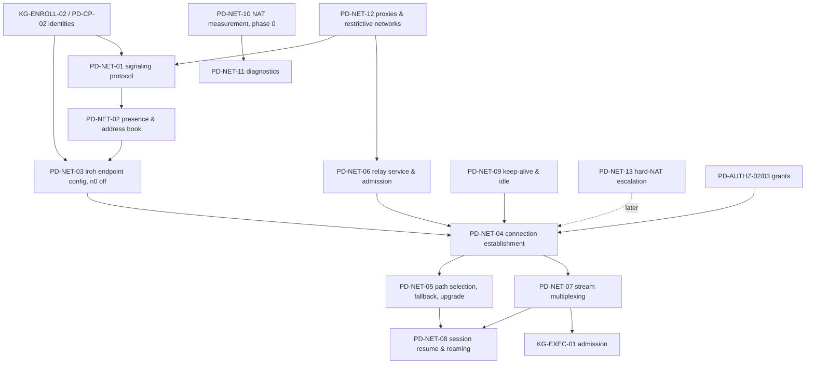

# 33 — Perde: Networking (signaling, iroh data plane, relays, sessions)

> Status: **canonical, implementation-ready**. Date: 2026-11-11. Audience: implementers of Perde signaling/presence/relays, the shared `hv-net` facade over iroh 1.x, and the Hacivat/Karagöz network layers.
> Conventions, notation, evidence tags, verification anchors and priority tags are defined in `30-karagoz-enrollment-discovery-credentials.md` §0. The recommended architecture is networking/05 (iroh 1.x, Option A, weighted score 169/180); this file turns it into canonical specs and resolves its open conflicts.
> Clean-room: NetBird `signal/`, `relay/`, `management/` (AGPL) and Teleport (AGPL) are prose-only prior art. iroh/iroh-relay/noq (MIT OR Apache-2.0), Tailscale client (BSD-3), Headscale (BSD-3), rust-libp2p (MIT), str0m (MIT) are referenced by file.

## 0. Overview

### 0.1 Verified facts this file relies on

- iroh **1.0** released 2026-06-15 with stable wire protocol and Rust API; 1.4.1 is the latest release at the studied commit, `main` at 1.5.0; unstable surfaces are gated behind `unstable-net-report` and `unstable-custom-transports`; constants: path keep-alive 5 s, direct-path idle 15 s, relay-path idle 30 s, ≤ 8 multipath paths; license MIT OR Apache-2.0 — **Confirmed** (V2 P15, P16).
- "AWS NAT Gateway always symmetric; Azure NAT Gateway symmetric": **sourced only from Tailscale's 2025-10-21 blog** (neither AWS nor Azure documents EIM/EDM behaviour); GCP Cloud NAT's "EIM requires static port allocation" is **vendor-documented** (V2 P19, S40; §3 note). Treat AWS/Azure as a measured third-party observation to re-measure in phase 0 (PD-NET-10), not a guarantee.
- Tailscale "well north of 90 %" direct (2025) — Confirmed (V2 P20); libp2p DCUtR 70 % ± 7.1 % from 4.4 M attempts (preprint arXiv:2510.27500; the IMC '26 paper is the retitled arXiv:2604.12484) — Confirmed with corrected venue (V2 S7); ProbeLab 2026 hole-punching numbers — Confirmed (V2 S8).
- RFC numbers cited (6455, 8446 §7.5, 9266, 9000, 9001, 8445, 8656, 4787, 8085, 9298, 10069 Multipath QUIC) — mappings Confirmed (V2 P21, S16).

### 0.2 Dependency map and priorities



| Spec | Name | Priority |
|---|---|---|
| PD-NET-01 | Signaling protocol over WebSocket/443 | v1 (WebSocket); v1.x (long-poll fallback) |
| PD-NET-02 | Presence and address book (Perde-fed address lookup) | v1 |
| PD-NET-03 | iroh endpoint configuration with n0 services off | **phase 0** (spike) → v1 |
| PD-NET-04 | Connection establishment and hole-punch orchestration | phase 0 → v1 |
| PD-NET-05 | Path selection, relay fallback and upgrade, `relay_policy` | v1 (default selector + policy gate); v1.x (custom selector extensions) |
| PD-NET-06 | Relay service: map, home relay, admission (RelayTicket), forwarding, limits | v1 (embedded relay, tickets); v1.x (quotas, org caps, multi-region); later (peer relays) |
| PD-NET-07 | Stream multiplexing for DB sessions | v1 |
| PD-NET-08 | Session resume and roaming | v1 (QUIC migration + reconnect); v1.x (parked sessions + replay) |
| PD-NET-09 | Keep-alive and idle-connection policy | v1 |
| PD-NET-10 | NAT measurement: lab matrix and field study | **phase 0** |
| PD-NET-11 | Connectivity diagnostics ("Why is this relayed?") | v1 (path badge, basic causes); v1.x (full cause/remedy matrix) |
| PD-NET-12 | Corporate proxies and restrictive networks | v1 (HTTP CONNECT proxy, env/PAC); v1.x (long-poll signaling); later (relay without WebSocket, NTLM/Negotiate) |
| PD-NET-13 | Hard-NAT escalation (birthday port probing) | later (off by default) |

### 0.3 Conflicts between sources resolved in this file

| # | Conflict | Sources | Decision |
|---|---|---|---|
| N1 | ALPN `perde/db/1` vs `hacivat/db/1` | networking/05 vs networking/04 §5.1 | **`perde/db/1`** (+ `ConnectOptions::with_additional_alpns` for evolution). |
| N2 | Heartbeat 25 s (signaling) vs 15 s (revocation sync) | networking/05 ALG-PERDE-02/09 vs access/05 ALG-REVOKE-01 | **25 s** default with adaptive tuning; revocations are pushed, not polled; staleness is measured from heartbeat acks (PD-AUTHZ-07). |
| N3 | Cloud NAT "always symmetric" stated as fact | networking/05 §2 item 10, §3.10 | Re-labelled: AWS/Azure behaviour is a **Tailscale-reported measurement**, GCP is documented (V2 P19). Planning assumptions stand (size relays for 10–30 % relayed sessions) but phase 0 must measure. |
| N4 | "TCP/443 WebSocket fallback inherent" for all restrictive networks | networking/05 §3.8.6 vs networking/04 §7-5 | The iroh relay transport is **WebSocket-only**; proxies that strip `Upgrade` break the relay even though signaling can fall back to long-poll. v1 documents this; a non-WebSocket relay transport (custom transport, unstable API) is a later item. |
| N5 | Home-relay hysteresis: iroh "< 2/3 of current" vs ALG-NAT-01 "≥ 10 ms and ≥ 1/3" | networking/04 ALG-IROH-04 vs networking/01 ALG-NAT-01 step 12 | Home relay selection is **delegated to iroh** (2/3 rule). ALG-NAT-01 hysteresis applies only to our own measurement tool. |
| N6 | `net_report` use for diagnostics while it is unstable API | networking/05 §3.9 vs networking/04 §7-11 | Enable `unstable-net-report` **only** in the `hv-net` facade behind a cargo feature `diag-netreport`, with an exact iroh version pin; the product's diagnostics degrade gracefully when the feature is off. |
| N7 | Session resume in MVP | networking/05 Phase 2 / open question 8 | **v1.x.** v1 ships QUIC migration, immediate reconnect and an explicit "session lost; open transactions rolled back" UX. |
| N8 | Relay admission tickets in Phase 2 | networking/05 §5.3 | **v1** (an un-ticketed relay is an open bandwidth proxy, T8); quotas and per-org aggregate caps v1.x. |

---

## 1. Specifications

### PD-NET-01: Signaling protocol over WebSocket/443

- **Priority:** v1 (WebSocket transport, auth, envelope, catalogue, resume, rate limits); v1.x (long-poll fallback).
- **Problem:** Provide one long-lived, authenticated, firewall-friendly control channel from every Hacivat device and Karagöz agent to Perde that carries presence, addresses, connection intents, grants, revocations, policy/key pushes and inventory — never database payload.
- **Sources merged:** ALG-PERDE-02 (networking/05, canonical); ALG-NB-02 (NetBird signal, prose: E2E-encrypted offer/answer relaying, gRPC); ALG-TS-06 (Tailscale long-poll map streaming with deltas); networking/05 §3.4 rationale; access/05 ALG-REVOKE-01 (epoch in heartbeats); E5 of file 31 (audit batches not on this channel).
- **Inputs / outputs:** In: node identity key, Perde URL + pins, local network events, application requests. Out: ordered, acknowledged message stream in both directions; callbacks into connection manager, policy, revocation and inventory modules.
- **Algorithm:**
  1. **Transport:** WebSocket (RFC 6455) over HTTPS TCP/443 at `wss://<perde>/v1/signal`, subprotocol `perde.signal.v1`; one protobuf `Envelope` per binary frame, max 64 KiB; larger payloads chunked (`Chunk {msg_id, index, total, bytes}`, reassembly ≤ 4 MiB, 30 s).
  2. **Authentication inside TLS:** server `ServerHello {server_nonce, server_time, instance_id, protocol_versions}`; node `Hello {node_kind (client|agent), endpoint_id, protocol_version, software_version, capabilities[], resume_session_id?, last_acked_server_seq?, machine_id_hash (agents), sig}` with `sig = Sign_sk("perde-signal-v1" ‖ instance_id ‖ server_nonce ‖ tls_exporter)` and `tls_exporter` = 32 bytes, label `EXPORTER-perde-signal` (RFC 8446 §7.5; channel binding RFC 9266). Server verifies key ∈ active agents/devices; for devices also the user's OIDC session freshness (default 12 h); replies `Welcome {session_id, heartbeat_interval, policy_epoch, revocation_epoch, relay_map, relay_ticket, server_seq_base, resumed}`.
  3. **TLS interception:** exporter mismatch (TLS-terminating proxy) → refuse unless org policy `allow_tls_interception = true` (then `channel_binding = optional`, warning in diagnostics; T16).
  4. **Envelope:** `{seq (u64 per direction), ack (highest contiguous seq received), msg_id (UUIDv7), reply_to?, ttl_ms?, body (oneof)}`; reliable messages buffered until acked; on resume (≤ 120 s) unacked messages with `seq > peer ack` are retransmitted; duplicates dropped by seq; ephemeral messages (`ttl_ms`) dropped instead of retransmitted after expiry.
  5. **Catalogue:**
     - Liveness: `Ping {t, revocation_epoch, audit_head? (agents), active_session_ids? (agents)}` / `Pong {t, revocation_epoch}`; every `heartbeat_interval` (25 s, N2); server closes after 3 missed.
     - Presence: `PresenceSubscribe {agent_ids[]}`, `PresenceUpdate {endpoint_id, state online|offline|degraded, at}` (PD-NET-02).
     - Addressing: `AddrUpdate {relay_url, direct_addrs[{addr, kind local|qad|portmap|ipv6|external, observed_at}], net_report_summary}` (debounced 1 s); `PeerAddr {endpoint_id, relay_url, direct_addrs[], valid_until}`.
     - Connection intent: `ConnectRequest` → `ConnectGrant | ConnectDenied` (PD-AUTHZ-02); `IncomingIntent` to agents.
     - Hole-punch coordination: `PunchRequest/PunchAck` — **reserved**, unused with iroh (QNT coordinates inside the QUIC connection); kept for NET-D11 fallback transports and PD-NET-13.
     - Authorization lifecycle: `GrantRefresh`, `Revoke {entries[], epoch}` (reliable), `Revoked` (client notice), `PolicyUpdate {epoch}`, `AttachListUpdate`.
     - Agent lifecycle: `AgentApproved`, `AgentDisabled`, `RenewRequest/RenewResponse/RenewAck` (KG-ENROLL-03), `RotateKey` (KG-ENROLL-04), `AgentKeyChanged` (to clients), `PerdeMoved`, `SigningKeysUpdate`, `RelayTicketUpdate`.
     - Inventory: `InventoryDiff` / `InventoryAck` (KG-DISC-06).
     - Security events: `SecurityEvent {code, evidence}` (reliable, e.g. `enforcement_gap`).
     - Telemetry (opt-in): `PathReport`, `NetReport`.
     - Errors: `Error {code, message_key, params, retry_after_ms?}` — never English sentences.
  6. **Ordering/idempotency:** handlers idempotent on `msg_id`; 10-min LRU of processed msg_ids for non-idempotent requests (`ConnectRequest`).
  7. **Flow control:** ≤ 256 unacked reliable messages per direction; when full the sender stops reading application requests; server sends `Error{slow_consumer}` and closes if the window stays full 60 s.
  8. **Reconnect:** full-jitter backoff `random(0, min(30 s, 500 ms · 2^n))`, reset after 60 s connected; immediate reconnect on OS network change / wake (PD-NET-08); resume with `resume_session_id`.
  9. **Rate limits (server):** per session 50 msg/s burst 200; `ConnectRequest` 5/s per device; `AddrUpdate` 2/s; pre-auth connection caps per IP; exceed → `Error{rate_limited, retry_after_ms}`.
  10. **Versioning:** major/minor; unknown protobuf fields ignored; unknown `oneof` variant on a reliable message → `Error{unsupported_message}`; refuse only on major mismatch ("update required").
  11. **Long-poll fallback (v1.x):** `POST /v1/signal/poll` (HTTP/1.1 or HTTP/2) carrying the same envelopes with seq/ack semantics; selected after two failed WebSocket upgrades within 10 s; diagnostics shows `signal_transport=longpoll`.
  12. **Horizontal scale:** sticky routing per session at the load balancer; presence and push fan-out across Perde replicas via PostgreSQL `LISTEN/NOTIFY` (or a pub/sub) (PD-CP-06).
- **Data structures:** per session `{session_id, node, outbound: VecDeque<Envelope>, next_seq, peer_acked, processed (LRU), subscriptions}`; presence index `endpoint_id → {session_id, last_addr, last_seen}` (soft state).
- **Complexity / performance notes:** O(1) per message; ≤ 512 KiB worst-case memory per session, ~10 KiB typical; 100 k concurrent WebSockets per mid-size Rust node is realistic (TLS dominates CPU).
- **Decision:** WebSocket/443 + protobuf + seq/ack resume + exporter channel binding (rejected: gRPC streaming — HTTP/2 end-to-end requirement breaks behind many proxies/LBs (NetBird documents reverse-proxy requirements); signaling only over the relay (Tailscale CallMeMaybe-over-DERP) — relays must stay policy-free and Perde needs a channel for grants, revocations, inventory).
- **Verification status:** design-level; RFC mappings confirmed (V2 P21).
- **Rust placement:** schemas in `hv-proto::signal` (`prost`, package `perde.v1`, Apache-2.0); client in `hv-signal-client` (Apache-2.0; used by Hacivat and Karagöz; `tokio-tungstenite` + `rustls` with exporter access — verify that the chosen TLS stack exposes `export_keying_material` on the client connection); server `perde::signal::{SessionActor, Router, Presence}` (AGPL; `axum` WebSocket).
  ```rust
  pub struct SignalClient { /* … */ }
  impl SignalClient {
      pub async fn connect(cfg: SignalConfig, id: &dyn NodeSigner) -> Result<(Self, mpsc::Receiver<Inbound>)>;
      pub async fn send_reliable(&self, body: Body) -> Result<MsgId>;
      pub fn send_ephemeral(&self, body: Body, ttl: Duration);
      pub async fn request(&self, body: Body, timeout: Duration) -> Result<Body>;   // msg_id/reply_to correlation
  }
  ```
- **Threats addressed:** T10 (DoS: pre-auth limits), T16 (interception: channel binding), T12 (presence only to authorized subscribers), T5 (reliable revocations).
- **Edge cases (exhaustive list):** proxy strips `Upgrade` (long-poll, v1.x; relay limitation N4); proxy idle timeout shorter than heartbeat (PD-NET-09 tuning); two sessions for one endpoint id (same machine id → newest wins, older `superseded`; different → `conflict`, KG-ENROLL-03); Perde restart/failover (`resumed=false` → nodes resend `AddrUpdate`, re-subscribe, agents resend full inventory snapshot); clock skew (timestamps informational; liveness monotonic); message > 64 KiB (chunking); lost revocation (reliable + epoch check on every reconnect); agent offline at `ConnectRequest` (`agent_offline {last_seen}`); agent saturated (`agent_busy {retry_after_ms}`); `AddrUpdate` flood (cap 32 addresses, reject non-unicast; server forwards as-is otherwise); address-hint poisoning (receivers pace probes, PD-NET-04 step 6; T9); everything blocked by an allow-list proxy (diagnostics lists exact host:port); TLS-intercepting proxy without org opt-in (refuse); Hacivat offline mode (signaling never started; local connections work — README requirement).
- **Test cases:** kill TCP with 10 unacked messages, reconnect in 5 s → `resumed=true`, all 10 delivered once in order; reconnect after 200 s → `resumed=false`, full resync, no duplicate `ConnectGrant` applied; replay a captured `Hello` on a new TLS connection → signature fails; `Revoke` while the agent link is down 30 s → delivered on resume, streams closed ≤ 1 s; 1 000 `ConnectRequest`/s → rate limited after burst, pings unaffected; unknown oneof from a newer server → `unsupported_message`, session continues; mitmproxy with a trusted CA in path → channel binding failure → refused (and accepted with `allow_tls_interception`).
- **Prior art and evidence:** networking/05 ALG-PERDE-02; NetBird signal (networking/03, prose); Tailscale `/ts2021` Noise-over-HTTP upgrade and long-poll map (networking/02); Firezone portal (networking/05 sources).
- **i18n notes:** `Error.message_key` codes (`net.connect.denied.agent_offline`…) mapped to Fluent IDs by replacing `.` with `-`; no sentences on the wire; region names localized client-side from region codes.
- **Used by:** Hacivat, Karagöz, Perde.

### PD-NET-02: Presence and address book (Perde-fed address lookup)

- **Priority:** v1.
- **Problem:** Tell an authorized client where an agent can be reached (relay URL, direct addresses) and whether it is online — without publishing endpoint ids or addresses to any third-party directory, and without leaking tenants to each other.
- **Sources merged:** ALG-PERDE-02 presence/addressing and §3.4 ("Perde as address book, not as candidate shuttle"); ALG-PERDE-03 step 2 (custom address lookup; n0 DNS/pkarr disabled); ALG-IROH-02 (pkarr/DNS publication — rejected for hosted, possible self-hosted minimal mode); networking/04 §3.4 (`AddressLookup` trait, `MemoryLookup`); NET-D2; T12.
- **Algorithm:**
  1. Nodes publish `AddrUpdate` on change (debounced 1 s) from their iroh endpoint's address watcher (`watch_addr`): home relay URL + direct addresses filtered by local policy (`addr_filter` excludes Docker bridges, corporate VPN interfaces by org policy, link-local).
  2. Perde stores the latest per endpoint id (soft state) with `observed_at`; presence `online` while a signaling session exists, `degraded` when heartbeats are late, `offline` after 3 missed heartbeats.
  3. **Disclosure policy:** an agent's addresses are sent only to clients holding a fresh grant for that agent (`ConnectGrant.agent_addr`) or subscribed via `PresenceSubscribe` for agents they are authorized to see (`agents.view` + at least one bindable resource); direct addresses only if org setting `disclose_direct_addrs = authorized_clients` (default) — never `public`. Agents never learn about other agents.
  4. Each node's `hv-net` endpoint uses a **Perde-fed `AddressLookup`** implementation (`PerdeAddressLookup`): `resolve(endpoint_id)` returns the last `PeerAddr` received for that id (from `ConnectGrant`, `IncomingIntent`, `PeerAddr` pushes); `publish()` is a no-op (publication happens via signaling). No pkarr publisher, no DNS resolver.
  5. On `AddrUpdate` from a peer with an open connection, Perde pushes `PeerAddr` to the other side; the facade inserts it so iroh treats it as a remote-candidate change and starts a new NAT-traversal round (PD-NET-05 step 5).
  6. Self-hosted "minimal mode" (later): an `iroh-dns-server`-compatible endpoint inside Perde for deployments that want address lookup without signaling; off by default.
- **Data structures:** `AddressBook {endpoint_id → (PeerAddr, observed_at, session_id)}`; client-side cache in the lookup with `valid_until`.
- **Complexity:** O(1); fan-out proportional to authorized subscribers.
- **Decision:** Perde-fed lookup (rejected: n0 public DNS/pkarr — leaks endpoint ids/IPs to a third party, breaks self-hosting promise (NET-D2); mDNS/DHT lookup crates).
- **Verification status:** iroh `AddressLookup` trait and builder methods [Observed: networking/04 §3.4–3.5]; design-level otherwise.
- **Rust placement:** `hv-net::lookup::PerdeAddressLookup` implementing iroh's `AddressLookup`/`AddressLookupBuilder` (kept inside the facade); `perde::presence::{AddressBook, Disclosure}`.
- **Threats addressed:** T12 (cross-tenant leak, endpoint ids not public), T9 (address poisoning bounded by probe pacing), T11 (agent addresses only to authorized clients).
- **Edge cases:** lookup returns an address for a different endpoint id (iroh ignores; we never insert mismatched ids); stale addresses after agent move (iroh still races relay path; new `AddrUpdate` refreshes); agent behind a load balancer (not supported for QUIC; `--listen-udp` with a fixed public address recommended); multiple Perde replicas (address book replicated via pub/sub, last-writer-wins by `observed_at`).
- **Test cases:** unauthorized user subscribes to presence of an agent → no updates; authorized client receives `PeerAddr` with relay URL and direct addresses; org setting `disclose_direct_addrs = never` → relay URL only, connection still succeeds via relay then direct (QNT discovers candidates inside the connection); grep of DNS traffic during a connection → no queries to n0 domains.
- **Prior art:** networking/05 §3.4; networking/04 ALG-IROH-02 (rejected path documented).
- **i18n notes:** presence states rendered client-side ("online", "last seen 5 minutes ago" with Turkish plural rules `one/other`).
- **Used by:** Perde, Hacivat, Karagöz.

### PD-NET-03: iroh endpoint configuration with n0 services off

- **Priority:** phase 0 (spike: verify every builder call and default below against the pinned iroh version) → v1.
- **Problem:** Configure iroh so that no traffic or metadata ever reaches n0's public infrastructure, identities are our enrollment keys, relays and address lookup are Perde's, desktop OS side effects are controlled, and iroh types never leak into product code.
- **Sources merged:** networking/04 §3.4 (builder/presets API), §5.1 (embedding pseudocode), §7 items 7–11 (risks: n0 defaults, same-key reuse, desktop prompts, `fast-apple-datapath`, unstable APIs); networking/05 §3.2.1, NET-D1/D2/D11, §5.2 crate layout; V2 P15/P16.
- **Algorithm (both node kinds):**
  1. `Endpoint::builder(presets::Minimal)` — **never** `presets::N0` or `N0DisableRelay` (they install n0 pkarr/DNS lookup and/or n0 relays). Build-time guard: the `hv-net` crate does not enable any feature that pulls n0 defaults, and a unit test asserts that the resulting endpoint's relay map contains only Perde URLs and that no address-lookup service other than `PerdeAddressLookup` is registered.
  2. `.secret_key(identity)` (agent key from KG-ENROLL-02; device key from the OS keychain for Hacivat). Never share a key across processes (relay eviction `SameEndpointIdConnected`, networking/04 ALG-IROH-01 edge 13).
  3. `.alpns(vec![b"perde/db/1"])` (N1).
  4. `.relay_mode(RelayMode::Custom(perde_relay_map))` from `Welcome.relay_map`; runtime changes via `insert_relay`/`remove_relay`; relay auth token = current `RelayTicket` (PD-NET-06).
  5. `.clear_address_lookup().address_lookup(PerdeAddressLookup)` (PD-NET-02).
  6. `.hooks(AcceptPolicy)` — agents: `after_handshake` rejects endpoint ids without a pending `IncomingIntent` or valid cached grant only when admission control is under pressure; otherwise accepts and requires `Authenticate` within 5 s (KG-EXEC-01 step 1). Clients: `before_connect` refuses dialing endpoint ids that are not pinned for the target agent.
  7. `.proxy_from_env()` / `.proxy_url(url)` per PD-NET-12.
  8. `.addr_filter(…)`: exclude Docker bridge networks, `docker0`, link-local, and (org policy) corporate VPN interfaces.
  9. Agents: `.external_addr(addr)` when `--listen-udp <ip:port>` with a known public mapping is configured (NET-D10); bind the UDP socket to the configured port.
  10. `.portmapper_config(…)`: agents default **on** (servers, SOHO routers); Hacivat desktop default **off** on macOS and Windows (SSDP multicast triggers firewall prompts), user-toggleable.
  11. `.transport_config(…)`: keep iroh defaults for keep-alive/idle (refuses per-path keep-alive > 5 s); set `max_concurrent_bidi_streams` = 256 (agent side), stream receive window 2 MiB (auto-tune to 16 MiB), connection window 32 MiB; **0-RTT disabled** for our ALPN (never call `into_0rtt`) (T15).
  12. Default features review: disable `fast-apple-datapath` for the notarized macOS build unless review approves private API use; `unstable-net-report` only under `diag-netreport` (N6); `qlog` only in debug builds.
  13. Version pinning: exact `=1.4.x` (or the minor chosen in phase 0) for `iroh` and `iroh-relay`; `noq` follows transitively; `cargo-deny` bans duplicate QUIC stacks; upgrades gated by the phase-0 NAT lab regression suite (PD-NET-10).
  14. **Facade:** `hv-net` exposes no iroh types (swap-ability to NET-D11 custom QUIC). Public API sketch:
  ```rust
  pub struct NetNode { inner: iroh::Endpoint /* private */ }
  pub struct NetConfig { pub identity: Secret<[u8; 32]>, pub alpns: Vec<Alpn>, pub relay_map: RelayMap, pub relay_ticket: Option<RelayTicket>,
                         pub proxy: ProxyConfig, pub listen_udp: Option<SocketAddr>, pub external_addrs: Vec<SocketAddr>,
                         pub iface_filter: IfaceFilter, pub portmapper: bool, pub accept_policy: Arc<dyn AcceptPolicy> }
  impl NetNode {
      pub async fn bind(cfg: NetConfig) -> Result<Self>;
      pub fn endpoint_id(&self) -> EndpointId;
      pub fn watch_addr(&self) -> impl Stream<Item = PeerAddr>;
      pub fn set_peer_addr(&self, p: PeerAddr);                  // feeds PerdeAddressLookup
      pub fn set_relay_map(&self, m: RelayMap); pub fn set_relay_ticket(&self, t: RelayTicket);
      pub async fn connect(&self, peer: &PeerAddr, alpn: &Alpn) -> Result<PeerConn, ConnectError>;
      pub async fn accept(&self) -> Option<IncomingConn>;
      pub async fn network_change(&self);
      pub fn diagnostics(&self) -> NetDiagnostics;               // richer with diag-netreport
  }
  pub struct PeerConn { /* … */ }
  impl PeerConn {
      pub fn remote_id(&self) -> EndpointId;
      pub async fn open_session(&self, prio: Priority) -> Result<SessionStream>;
      pub async fn accept_session(&self) -> Result<SessionStream>;
      pub fn selected_path(&self) -> PathView;                    // Direct{v4|v6, rtt} | Relay{region, rtt}
      pub fn path_events(&self) -> impl Stream<Item = PathEvent>;
      pub fn export_keying_material(&self, label: &[u8], ctx: &[u8], out: &mut [u8; 32]) -> Result<()>;
      pub fn close(&self, code: AppCode, reason: &[u8]);
  }
  ```
- **Data structures:** `NetConfig`, `RelayMap {regions: [{code, nodes: [{url, quic_port, weight}]}]}`.
- **Complexity:** n/a (configuration).
- **Decision:** iroh with every n0 service overridden behind our facade (NET-D1, NET-D2; rejected: WireGuard + own ICE + netstack — score 115/180, years of effort; libp2p — relay v2 limits; custom QUIC — kept as exit plan NET-D11; WebRTC/str0m — only if a browser peer becomes a goal).
- **Verification status:** builder methods and presets **Observed** in networking/04 §3.4 at commit `d18a684`; iroh 1.0 stability and constants **Confirmed** (V2 P15/P16). Phase-0 tasks: (a) confirm `export_keying_material` and path APIs are reachable without unstable features; (b) confirm relay `auth_token` header delivery and `AccessControl` behaviour; (c) confirm portmapper toggling; (d) confirm no n0 traffic with a packet capture.
- **Rust placement:** `hv-net` (Apache-2.0) wrapping `iroh`/`iroh-relay` (MIT OR Apache-2.0).
- **Threats addressed:** T12 (no public discovery), T15 (0-RTT off), T2/T3 (TLS raw-key identities), T17 (pinned deps, cargo-deny).
- **Edge cases:** iroh minor upgrade changes defaults (pinned; lab regression); `RelayMode::Custom` with an empty map (relay disabled → only direct addresses; `relay_only` policy then fails explicitly); env `IROH_FORCE_STAGING_RELAYS` set on a host → ignored by our build (assert relay map after bind; refuse to start otherwise); key file shared by two processes (detected by relay eviction metric → health alert).
- **Test cases:** packet capture during bind/connect/idle 10 min → no DNS/HTTPS to n0 domains (`*.iroh.link`, `*.n0.computer`); relay map after bind equals Perde's; `IROH_FORCE_STAGING_RELAYS=1` → node refuses to start; 0-RTT attempt in a test client → stream rejected; two processes with the same key → eviction detected and reported.
- **Prior art:** networking/04 §5.1; networking/05 §3.2.1.
- **i18n notes:** iroh error strings are English free text → mapped to our codes; raw text only in a "details" pane (networking/04 §6).
- **Used by:** Hacivat, Karagöz (and Perde relays via iroh-relay).

### PD-NET-04: Connection establishment and hole-punch orchestration

- **Priority:** phase 0 (spike: Postgres session over iroh between two NATed hosts with a self-hosted relay) → v1.
- **Problem:** Given an authorized `ConnectRequest`, establish a mutually authenticated QUIC connection that carries data as soon as possible (relay or direct), moves to a direct path whenever one exists, uses the relay only as long as needed, and never lets Perde or relays read data.
- **Sources merged:** ALG-PERDE-03 (networking/05, canonical); ALG-IROH-01 (networking/04: fan-out of Initials, QNT rounds, probe limits); ALG-TS-01 (Tailscale disco/CallMeMaybe, prior art); ALG-P2P-01 (libp2p DCUtR RTT/2 synchronization, prior art); ALG-NB-03 (NetBird ICE with relay fallback, prose); ALG-NAT-02/03 (networking/01 candidates, checks); sequence diagrams networking/05 §5.4.2.
- **Inputs / outputs:** In: client `NetNode`, `ConnectGrant` (incl. agent `PeerAddr`, pins), agent `NetNode` with `IncomingIntent`, relay map, `relay_policy ∈ {allow (default), direct_only, relay_only}`. Out: `PeerConn` with ≥ 1 validated path and an initial classification; metrics `connect_ms`, `first_direct_ms`, `path_kind` transitions.
- **Algorithm:**
  1. Client sends `ConnectRequest`; Perde authorizes (PD-AUTHZ-02) and in the same tick returns `ConnectGrant` to the client and `IncomingIntent` to the agent (arrival skew ≈ |RTT_c − RTT_a| / 2).
  2. Client inserts `agent_addr` into its `PerdeAddressLookup`; agent inserts `client_addr`.
  3. **Agent pre-warm:** on `IncomingIntent`, the agent may send a small number of path-opening probes toward the client's advertised direct addresses (opens its own NAT mappings ~½ RTT earlier; paced per step 6). With iroh, the authoritative punching happens once the client's connection reaches the agent via the relay.
  4. Client `connect(agent_addr, "perde/db/1")`; iroh fans out QUIC Initials to **all** known addresses: the agent's home relay URL (via the client's relay connection, always works if both reach the relay over UDP or TCP/443) and every advertised direct address (wins immediately for public IPs, `--listen-udp` ports, same LAN). Each fan-out send has a 3 s timeout, ≤ 16 in flight.
  5. Handshake on the first answering path: TLS 1.3 with raw public keys; client verifies `remote_id == grant.aep` (pinned); agent learns `E_c` and later verifies `grant.cep == E_c`. Mismatch → `peer_identity_mismatch` (security audit on both sides).
  6. **Hole punching inside the connection (QNT):** the agent advertises candidates as `ADD_ADDRESS`; the client sends one `REACH_OUT` per local candidate over the existing (possibly relayed) path and off-path `PATH_CHALLENGE` probes to each agent candidate; the agent answers each `REACH_OUT` by probing every client candidate, so both NATs see outbound packets at about the same time. Limits: ≤ 32 addresses per side, ≤ 9 probes per address per round with exponential backoff from ~33 ms capped at 2 s (≈ 4 s per round), re-punch at most every 5 s unless candidates change, plus a 60 s check that upgrades connections lacking an IP path with RTT ≤ 10 ms. A `PATH_RESPONSE` from an un-advertised port still opens a path (one endpoint-dependent side with a predictable peer). Perde is not in this loop.
  7. When a direct path validates (`PATH_CHALLENGE`/`PATH_RESPONSE`), selection follows PD-NET-05.
  8. **`relay_policy`:** `allow` → application data may flow over the relay until direct validates (relay sees ciphertext only); `direct_only` → the handshake may traverse the relay (no DB payload), but the application opens no DB stream until the selected path is IP, waiting up to `direct_wait` (10 s), else `direct_path_unavailable` + diagnostics; `relay_only` → selector restricted to relay paths (compliance, fixed egress IP).
  9. Hard-NAT escalation → PD-NET-13 (later, off).
  10. Record timings and path transitions for diagnostics/telemetry (PD-NET-11).
- **Data structures:** `ConnAttempt {grant_id, peer, started_at, policy, state: Resolving|Handshaking|RelayedUp|Direct|Failed, timings}`; connection pool `ConnPool {agent_id → PeerConn}` in Hacivat (one connection per (device, agent)).
- **Complexity / performance notes:** time-to-first-query over relay ≈ QUIC 1-RTT handshake via relay + signaling RTT (≈ 100–300 ms intra-continent); holepunch typically completes within 1–3 RTT after the relayed connection is up. QNT worst case ≈ 0.7 MB probes per round at 32×32 candidates; realistic < 100 KB.
- **Decision:** relay-first race + in-connection hole punching (iroh), Perde only as authorizer and address book. Rejected: Perde shuttling ICE candidates per probe round (NetBird model; load proportional to probe rounds and more moving parts); Tailscale disco keys (path discovery inside authenticated QUIC instead).
- **Verification status:** iroh algorithm and limits **Observed** at `d18a684` (networking/04 §3.6, `n0_nat_traversal.rs:19-32,300-344`, `remote_state.rs:52-66,540-567,793-867`); success rates unverified for our topologies → PD-NET-10.
- **Rust placement:** `hv-net::NetNode::connect` (dialer), `karagoz::net::accept_loop`, `hacivat::perde_client::conn_pool`; Perde `perde::signal::connect_flow` (grant + intent in one tick).
- **Threats addressed:** T1 (E2E), T2/T3 (pinned identities), T9 (probe pacing caps), T11 (grant within 5 s after connect), T12 (no public directory).
- **Edge cases (exhaustive list):** agent offline (no grant); agent online in signaling but its relay connection down (direct if public/EIM; else wait for agent relay reconnect, total timeout 20 s); both sides behind endpoint-dependent NAT (relay persists; diagnostics `both_symmetric_nat` with remedies); same LAN (local candidates win); same public IP behind one NAT (needs hairpinning, else relay); agent in Docker bridge (extra NAT, usually port-preserving EIM conntrack — generally punchable) vs `--network=host`; IPv6 on both sides (direct v6 through stateful firewalls via simultaneous send); UDP fully blocked on the client (relay over TCP/443 only; `direct_only` fails explicitly); grant expires mid-handshake (stream open rejected; client refreshes once); wrong endpoint id from a poisoned address book (`peer_identity_mismatch`); unknown client without intent (accept, require grant within 5 s); multiple Hacivat windows (connection pool reuse); IDS on client network flags probes (pacing; spray off); relay restart (`Restarting{reconnect_in}` handled by iroh, relay path idle 30 s covers it).
- **Test cases (network-namespace lab, PD-NET-10):** both EIM/EIF → direct within 1 s, relay bytes ≈ handshake only; client EIM/APDF + agent EIM/APDF → direct within 3 s; client EDM + agent EIM/EIF → direct; client EDM + agent EIM/APDF → direct in ≥ 80 % of runs; both EDM → relayed (spray off); UDP blocked on client → relayed over TCP/443 within 5 s; `direct_only` with both EDM → `direct_path_unavailable` after 10 s and zero DB-stream bytes on the relay; wrong agent key in address book → `peer_identity_mismatch`; phase-0 spike: `psql` through the in-process stream adapter between two hosts → `SELECT 1` TTFB measured.
- **Prior art:** networking/05 ALG-PERDE-03; networking/04 ALG-IROH-01; networking/02 ALG-TS-01; networking/04 ALG-P2P-01; networking/03 ALG-NB-03 (prose).
- **i18n notes:** connection states rendered from codes (`net.status.connecting`, `net.path.relayed {region}`).
- **Used by:** Hacivat (initiator), Karagöz (responder), Perde (authorizer + address book).

```mermaid
sequenceDiagram
    autonumber
    participant H as Hacivat (device key D)
    participant P as Perde signaling
    participant R as Relay (agent's home region)
    participant K as Karagöz (agent key A, public IP or --listen-udp)
    Note over H,K: Case 1 — direct path available immediately
    H->>P: ConnectRequest(agent, db)
    par
        P-->>H: ConnectGrant(grant cep=D aep=A, PeerAddr{relay, direct: [203.0.113.7:7843]})
    and
        P-->>K: IncomingIntent(client PeerAddr, grant_id)
    end
    H->>R: QUIC Initial → A (via relay)
    H->>K: QUIC Initial → 203.0.113.7:7843 (direct, parallel)
    K-->>H: Handshake completes on the direct path first (TLS RPK; H checks A)
    H->>K: stream 0 Authenticate(grant, exporter sig); stream n StreamOpen
    Note over H,K: path selected = direct v4; relay path kept warm as backup
```

```mermaid
sequenceDiagram
    autonumber
    participant H as Hacivat (home NAT, EIM/APDF)
    participant P as Perde signaling
    participant R as Relay
    participant K as Karagöz (cloud private subnet, NAT gateway)
    Note over H,K: Case 2 — relay first, then hole punch; or stays relayed
    H->>P: ConnectRequest
    par
        P-->>H: ConnectGrant(PeerAddr{relay R, direct: [qad 198.51.100.4:41234]})
    and
        P-->>K: IncomingIntent(PeerAddr{relay, direct: [qad 192.0.2.10:55001]})
    end
    K->>H: pre-warm probes to 192.0.2.10:55001 (paced)
    H->>R: QUIC Initial → A
    R->>K: forward (opaque)
    K-->>R: Handshake
    R-->>H: Handshake (connection up over relay; data may flow if relay_policy=allow)
    K->>H: ADD_ADDRESS (agent candidates) [inside QUIC]
    H->>K: REACH_OUT per client candidate [inside QUIC, via relay]
    par simultaneous probes
        H->>K: PATH_CHALLENGE → agent candidates (off-path)
    and
        K->>H: PATH_CHALLENGE → client candidates (off-path)
    end
    alt a NAT mapping matches (EIM on at least one side, or predictable peer)
        K-->>H: PATH_RESPONSE → direct path validated → selected (PD-NET-05)
    else both endpoint-dependent (e.g. agent behind a symmetric NAT gateway and client on CGNAT)
        Note over H,K: stays relayed; re-punch on candidate change (≥ 5 s) and every 60 s; diagnostics explain why
    end
```

### PD-NET-05: Path selection, relay fallback and upgrade, `relay_policy`

- **Priority:** v1 (iroh default selector + application policy gate); v1.x (custom selector extensions).
- **Problem:** Choose continuously which validated path carries traffic so that direct paths are preferred, flapping is avoided, IPv6/IPv4 and multiple interfaces are handled, the relay is used only when no direct path works, and `relay_policy` is honoured.
- **Sources merged:** ALG-PERDE-04 (networking/05, canonical); iroh `BiasedRttPathSelector` (networking/04 §3.7); ALG-TS-02 (Tailscale trust windows, `betterAddr`, prior art); ALG-NB-03 (NetBird priority lattice, prose); ALG-NAT-03 (networking/01).
- **Algorithm:**
  1. **Tiers:** IP paths (v4/v6) primary; relay backup, selected only when no primary path is validated; cross-tier switches immediate (validated direct replaces relay at once; loss of the last direct path falls back to the already-open relay path at once).
  2. **Within a tier:** `biased_rtt = rtt + bias(kind)` with `bias(ipv6) = −3 ms`, `bias(ipv4) = 0`; switch from current `c` to candidate `n` only if `biased_rtt(n) ≤ biased_rtt(c) − 5 ms`.
  3. **v1.x custom selector** (`Builder::path_selector`): interface penalties (+20 ms cellular/tethered when Wi-Fi/Ethernet validated, +10 ms corporate VPN interface); pathological-direct guard (best direct RTT > 2 × relay RTT + 50 ms for ≥ 30 s → demote to backup); optional loss weighting; must preserve steps 1–2 invariants. (Open: whether the interface type is visible to the selector or must be derived from the local address — networking/05 §7.3-2.)
  4. **Liveness:** QUIC's per-path keep-alive 5 s, direct idle 15 s, relay idle 30 s; loss detection ~3 × RTT PTO for paths with traffic; on network change iroh pings all paths and re-triggers punching on major changes.
  5. **Upgrade triggers while relayed:** connection start; candidate change on either side (incl. Perde-pushed `PeerAddr`); major network change; 60 s timer while no IP path with RTT ≤ 10 ms; ≤ 1 round per 5 s if candidates unchanged.
  6. **Relay stays warm:** home relay connection always up; the relay path of an established connection stays open as backup.
  7. **Policy gate:** `direct_only` → DB streams opened only when `selected_path` is IP; if selection changes to relay mid-session, the application pauses writes on session streams for up to `direct_wait` (10 s), then resets them with `direct_path_lost`; `relay_only` → selector restricted to relay paths (custom selector, v1.x; v1 implements `relay_only` by building the endpoint with IP transports cleared via `clear_ip_transports()`); relay down under `relay_only` → `relay_unavailable` (no silent direct fallback).
  8. **Events:** map iroh `PathEvent::{Opened, Closed, Selected}` to `path_changed {from, to, reason}`; UI rate-limited to 1 update per 2 s; record in session audit (`channel.kind`).
- **Data structures:** `PathView {kind, remote, rtt, selected, since}`; `PolicyGate {relay_policy, paused_since?}`.
- **Complexity:** O(|paths|), ≤ 8 paths; only the QUIC client side closes redundant IP paths.
- **Decision:** adopt iroh's default selector unchanged for v1 (it already implements "relay only as fallback"); rejected: Tailscale-style dual sending during untrusted windows (QUIC multipath makes it unnecessary).
- **Verification status:** constants **Observed** (`biased_rtt_path_selector.rs:18-23,80-104`: IPv6 advantage 3 ms, switching threshold 5 ms) and **Confirmed** (V2 P16 for keep-alive/idle constants).
- **Rust placement:** `hv-net::path::{PathView, PolicyGate}`; v1.x `hv-net::path::ProductSelector` implementing iroh's `PathSelector` inside the facade.
- **Threats addressed:** compliance requirements (`direct_only`, `relay_only`), T1 (relay sees ciphertext only even when selected).
- **Edge cases (exhaustive):** asymmetric choices (multipath tolerates; only the client prunes); direct path with small PMTU (QUIC DPLPMTUD per path, ALG-NAT-06; never assume relay MTU); relay region failure while relayed (relay actor reconnects ≈ 1–2 s or moves region; peers learn via `AddrUpdate`); Wi-Fi → cellular (new candidates, new round; old paths time out after 15 s); captive portal (PD-NET-08); NAT rebinding on a quiet path (QUIC path validation); both peers switch simultaneously (reordering tolerated); IPv4 20 ms vs IPv6 19 ms with IPv4 current → no switch (16 > 15); lossy direct path with good RTT (default ignores loss; v1.x weighting); `direct_only` hiccup < 10 s → paused then resumed, zero relay bytes.
- **Test cases:** relay 40 ms; direct v4 12 ms validates at 1.2 s → selected immediately, relay kept; direct v4 50 ms vs relay 45 ms → direct stays; current v4 20 ms, v6 16 ms → switch (13 ≤ 15); current v4 20 ms, v6 19 ms → no switch; drop all UDP → relay selected ≤ 15 s worst case, typically ≤ 1 s under traffic, zero stream errors; `direct_only` both symmetric → `direct_path_unavailable` after 10 s; network change on client → new round within 1 s (`holepunch_attempts` increments).
- **Prior art:** networking/05 ALG-PERDE-04; networking/02 ALG-TS-02; networking/03 ALG-NB-03 (prose).
- **i18n notes:** `net.path.direct`, `net.path.direct_ipv6`, `net.path.relayed {region}` (region display name localized from CLDR via region code).
- **Used by:** Hacivat, Karagöz.

### PD-NET-06: Relay service: map, home relay, admission (RelayTicket), forwarding, limits

- **Priority:** v1 (iroh-relay embedded in `perde serve`, standalone `perde relay`, RelayTicket admission, per-client rate limits, metrics); v1.x (per-plan quotas, per-org aggregate caps, multi-region hosted fleet, per-IP caps in `on_connect`); later (peer relays inside customer networks, QAD-only vantage nodes in more regions).
- **Problem:** Provide fallback relays that are close, reachable over UDP and TCP/443, admit only enrolled endpoints, cannot be abused as free bandwidth or open proxies, and are cheap to operate and self-host.
- **Sources merged:** ALG-PERDE-08 (networking/05, canonical); ALG-IROH-03 (relay handshake, forwarding, rate limiting, `AccessControl`); ALG-IROH-04 (net report, preferred relay 2/3 rule); ALG-TS-03/04 (DERP home region, mesh — prior art); ALG-NB-04 (NetBird relay HMAC tokens not bound to peer id — the gap we fix; prose); ALG-P2P-02 (libp2p circuit relay limits — why not used); networking/05 §3.8 (role, cost model, geo, TCP/443), §3.11 (ports).
- **Algorithm:**
  1. **Relay map distribution:** in `Welcome` and on change: `{region_id, region_code, nodes[{url, quic_port (QAD, 7842/udp), weight}]}`; self-hosted default: one region = the Perde host (relay on path `relay` of the 443 listener; QAD on 7842/udp). Within a region, Perde assigns each endpoint one node by **rendezvous hashing** of its endpoint id and puts only that node in the endpoint's map (iroh then selects at region granularity).
  2. **Home relay selection:** iroh net report (≤ 5 relays probed, full report every 5 min, switch only if new latency < 2/3 of current home's) (N5).
  3. **RelayTicket:** `COSE_Sign1_relay_ticket({endpoint_id, org_id, quota_class, region: <code>|*, iat, exp (1 h)})`, delivered in `Welcome` and refreshed via `RelayTicketUpdate` 5 min before `exp`; the node configures it as the relay `auth_token` (sent as `Authorization: Bearer`).
  4. **Admission (relay side):** the iroh-relay handshake proves key possession (TLS-exporter-bound header, or challenge/response fallback); the embedded relay's `AccessControl::on_connect(&ClientRequest)` verifies the ticket signature offline with the pinned `relay_ticket` key, requires `ticket.endpoint_id == proven endpoint_id` (fixes the NetBird gap), `exp` not passed, region matches; deny reasons are stable codes (`ticket_expired`, `ticket_wrong_endpoint`, `ticket_missing`, `org_quota_exhausted`) surfaced via `RelayStatus::auth_denied_reason` and localized client-side. Third-party/standalone relays without the key can use iroh-relay's HTTP access callback to Perde (5 min positive / 30 s negative cache).
  5. **Forwarding:** stateless by destination endpoint id; opaque QUIC-encrypted datagrams ≤ 64 KiB; per-destination queue 512, drop on overflow (QUIC retransmits end to end); `EndpointGone` notifications; dialers connect to the **destination's** home relay (iroh model, no inter-relay mesh in v1).
  6. **Rate limiting:** iroh-relay per-client receive token bucket (`client_rx {bytes_per_second, max_burst_bytes}`) set from `quota_class` (e.g. 4 MiB/s sustained, 16 MiB burst paid; 1 MiB/s free tier); when empty the relay stops reading (TCP backpressure) and notifies once `RateLimited`. v1.x embedding layer adds per-org aggregate caps (sample per-client buckets every second, scale rates down), per-source-IP concurrent connection cap (50) in `on_connect`, a global accept-rate limiter before TLS; persistent abuse → ticket revocation and org notification.
  7. **Ticket expiry on a long-lived relay connection:** the client reconnects to the relay with the new ticket shortly before `exp` (relay path is backup; brief reconnect is acceptable) — networking/05 §7.3-3.
  8. **Observability:** relayed bytes per org/endpoint (billing, quotas, cost dashboards), connections, denies by reason, queue drops; Prometheus endpoint on 9090 bound to localhost/private network.
- **Data structures:** `RelayMap`; relay-side `Clients {endpoint_id → (conn, bucket, org)}`; `RelayTicket`.
- **Complexity / performance notes:** I/O bound; multi-Gbit/s per node; cost dominated by egress (networking/05 §3.8.4: ≈ USD 0.10 per active user per month on a hyperscaler at `f = 0.25` — Inferred planning number).
- **Decision:** iroh-relay embedded (DERP descendant, WebSocket on 443, Ed25519-authenticated) with signed tickets. Rejected: TURN (RFC 8656) as primary (less proxy-friendly, per-pair allocations); libp2p circuit relay v2 (coordination relay, default limits 2 min / 128 KiB per circuit); DERP-compatible reimplementation (only if leaving iroh, NET-D11).
- **Verification status:** iroh-relay `AccessControl`, `auth_token`, limits **Observed** (networking/04 §3.11; `iroh-relay/src/server.rs:190-213,280-360,490-520`); "connection-accept limits reserved and not enforced" → our embedding layer must implement them; ports **Observed** (`iroh-relay/src/defaults.rs:7-16`).
- **Rust placement:** `perde::relay::{EmbeddedRelay, TicketAccessControl}` (AGPL, embedding `iroh_relay::server`); `perde relay` subcommand; ticket format in `hv-proto::relay::RelayTicket` (Apache-2.0; the relay protocol spec itself is iroh's, MIT/Apache).
- **Threats addressed:** T8 (relay abuse), T1/T2 (relay cannot decrypt or impersonate), A2 (malicious relay operator sees only ciphertext, endpoint ids and IPs — residual metadata), T10 (DoS: caps).
- **Edge cases:** ticket expiry during a long relayed session (refresh + reconnect); region outage (next-best region; peers learn via `AddrUpdate`); node behind a TLS-intercepting proxy (relay TLS pin/exporter fails → challenge fallback works; WebSocket blocked → relay unusable, N4); split-horizon self-hosted relay URL (internal vs external DNS; Perde config lists both and serves per-client maps); IPv6-only client with IPv4-only relay (dual-stack required); relay map change while connected (connect to the new home before dropping the old); same endpoint id connected twice (older evicted — key sharing detection).
- **Test cases:** node without ticket → denied at handshake (`ticket_missing`); ticket for another endpoint → `ticket_wrong_endpoint`; expired ticket → `ticket_expired`; 100 MiB burst through a 4 MiB/s limit → sustained ≈ limit, no disconnect, one `RateLimited`; region latency 30 → 25 ms → no switch; 30 → 15 ms → switch; self-hosted single binary: relay reachable on `wss://perde.example/relay` through the same 443 listener and QAD on 7842/udp.
- **Prior art:** networking/05 ALG-PERDE-08; networking/04 ALG-IROH-03/04; networking/02 ALG-TS-03/04; networking/03 ALG-NB-04 (prose).
- **i18n notes:** relay deny codes localized client-side; region display names from CLDR by `region_code` (e.g. `ist` → "İstanbul").
- **Used by:** Perde (operator), Hacivat, Karagöz.

### PD-NET-07: Stream multiplexing for DB sessions

- **Priority:** v1.
- **Problem:** Carry many concurrent database sessions between one device and one agent over one P2P connection with isolation (no head-of-line blocking), fairness, flow control, cancellation and clean error mapping.
- **Sources merged:** ALG-PERDE-06 (networking/05, canonical); networking/04 §5.1 (open_bi/accept_bi, stream visible after first write); KG-EXEC-02 (front-ends).
- **Algorithm:**
  1. One QUIC connection per (device, agent), pooled in Hacivat; idle close per PD-NET-09.
  2. **Stream 0** (first client-initiated bidi) = control: `Authenticate`, `GrantRefresh`, `GrantExpiring`, `Revoked`, `Ping`, `SessionList`, AI session metadata, telemetry; length-prefixed protobuf frames (varint length, ≤ 1 MiB).
  3. **Each DB session = one new client-initiated bidi stream:** first frame `StreamOpen` (KG-EXEC-01), answer `StreamAccept` or `StreamReject {code, message_key, params}` + FIN; after accept the stream carries the DB wire protocol or `hv.exec.v1` (KG-EXEC-02).
  4. **Cancellation:** `kind=cancel` stream referencing `session_id` → engine-specific cancel at the agent; `RESET_STREAM`/`STOP_SENDING` on a session stream = abort session (agent closes upstream).
  5. **Flow control:** per-stream receive window 2 MiB (auto-tune ≤ 16 MiB), connection window 32 MiB, `max_concurrent_bidi_streams` 256 client→agent (agent opens none in v1); backpressure propagates to the upstream DB socket (KG-EXEC-07).
  6. **Priority:** interactive 2, introspection 1, bulk export 0 (noq: higher first).
  7. **Error mapping** (application stream reset codes, varint): `0x0 normal`, `0x1 forbidden`, `0x2 grant_expired`, `0x3 revoked`, `0x4 upstream_unreachable`, `0x5 upstream_auth_failed`, `0x6 agent_overloaded`, `0x7 protocol_violation`, `0x8 session_timeout`, `0x9 resume_expired`, `0xA direct_path_lost`, `0xB target_disappeared`.
  8. **Hacivat integration:** in-process stream adapters (drivers accepting `AsyncRead + AsyncWrite`, e.g. `tokio-postgres::Config::connect_raw`) — preferred; loopback forwarder (`127.0.0.1:<ephemeral>` or Unix socket 0600 / named pipe with ACL) requiring a one-time local credential at the DB-protocol level — compatibility mode, shown explicitly in UI (T14).
  9. **0-RTT disabled** for `StreamOpen` (replay of non-idempotent DB operations, RFC 9001 §9.2; T15).
- **Data structures:** Hacivat `ConnPool`, `Session {session_id, stream_id, resource_id, state, bytes, opened_at, resume_token?}`; Karagöz `SessionTable`.
- **Complexity:** stream creation free at the transport + 1 RTT `StreamOpen/Accept` (pipelinable; agent buffers ≤ 64 KiB of early DB bytes).
- **Decision:** stream per session over one connection (rejected: one connection per session — handshake cost, more NAT state; multiplexing over a single TCP/WebSocket — cross-session head-of-line blocking).
- **Verification status:** QUIC stream semantics [Observed: RFC 9000 §2–4]; noq priority API [Observed: `send_stream.rs:230`].
- **Rust placement:** `hv-net::SessionStream` (wraps iroh `SendStream`/`RecvStream`), `hv-proto::stream::{StreamOpen, StreamAccept, StreamReject, ResetCode}`; Hacivat `hacivat::perde_client::{conn_pool, forwarder}`; Karagöz `karagoz::net::session_router`.
- **Threats addressed:** T14 (forwarder), T15 (0-RTT), T11 (stream limits).
- **Edge cases:** 257th session (client queues, "too many concurrent sessions"); agent overloaded (`retry_after`); upstream down; half-close after `Terminate`; very large single row (flow control); client crash (idle timeout closes connection → agent closes upstreams unless parked, PD-NET-08); upstream TLS validation failure (`upstream_tls_failed`); Postgres `COPY`; MySQL `LOAD DATA LOCAL INFILE` (disabled); Redis pub/sub and Mongo change streams (denied in v1); drivers that cannot take a custom stream (forwarder).
- **Test cases:** 100 parallel `SELECT 1` sessions → all succeed, p99 overhead < 1 RTT vs single; 1 GB export + interactive query → interactive p99 ≤ 2× idle baseline; reset a session stream mid-query → upstream backend terminated (`pg_stat_activity`); cancel stream → `pg_sleep(60)` cancelled ≤ 1 s; forbidden resource → `StreamReject{forbidden}` + audit; forwarder without local credential → rejected.
- **Prior art:** networking/05 ALG-PERDE-06; HTTP/3 stream-per-request (RFC 9114); `tailscale serve`/`tsnet` (networking/02).
- **i18n notes:** reset codes mapped to Fluent IDs in Hacivat; engine error text passed through verbatim.
- **Used by:** Hacivat, Karagöz.

### PD-NET-08: Session resume and roaming

- **Priority:** v1 (path-layer roaming via QUIC migration and iroh re-punching; immediate reconnect; explicit session-lost UX); v1.x (parked upstream sessions with byte-offset replay).
- **Problem:** Keep database sessions usable across laptop network changes, NAT rebinding, sleep/wake, captive portals and VPN toggles, and make unavoidable loss of state explicit (open transactions cannot survive a dead upstream connection).
- **Sources merged:** ALG-PERDE-07 (networking/05, canonical); networking/05 §5.4.3 sequence; ALG-NAT-01 network-change triggers (networking/01); iroh network-change handling (networking/04 §3.13; CHANGELOG 1.4.0); Mosh philosophy (prior art).
- **Algorithm (three layers, fastest first):**
  1. **Path layer (no connection loss):** on OS network change (macOS `NWPathMonitor`, Linux netlink `RTM_NEWADDR/DELADDR/NEWROUTE`, Windows `NotifyIpInterfaceChange`; debounced 250 ms): call `NetNode::network_change()` (iroh rebinds, re-gathers addresses, pings paths, re-punches on major change); publish `AddrUpdate`; the peer receives `PeerAddr`; QUIC migration keeps the connection across the client's new 4-tuple (agent validates with `PATH_CHALLENGE`); the relay path recovers fastest.
  2. **Connection layer:** the QUIC connection survives outages shorter than idle timeouts (15 s direct, 30 s relay). If it dies (sleep, agent restart): on wake/network-up reconnect immediately (first attempt no backoff, then 250 ms → 8 s with jitter); re-`Authenticate` with cached grants (still valid) or `GrantRefresh` via signaling; if Perde is unreachable but the grant is valid and the agent's address is cached, proceed (data plane independent of control plane while grants are valid).
  3. **Session layer (v1.x resume):** for each session stream that was open, `StreamOpen{resume_token, resume_offset}`. Karagöz keeps the upstream DB connection and a **replay buffer** of upstream→client bytes for `resume_grace` (default 120 s, policy max 15 min, 0 disables) after the stream vanished without a clean close. When resume is enabled the session stream uses thin framing `Data{bytes}` / `Ack{offset}` (ack every 64 KiB or 1 s). On resume the agent verifies the token (bound to `session_id`, client endpoint id, grant user), checks `offset` within the buffered range, retransmits from `resume_offset`; the client retransmits its unacked bytes. Buffer overflow (8 MiB per session) or grace elapsed → `resume_expired`. **v1 behaviour:** no parking; the agent closes upstreams when the stream dies; Hacivat shows "Session to {database} was lost while you were offline. Open transactions were rolled back." and reconnects a fresh session re-running only idempotent setup (never user statements).
  4. **Sleep handling:** before sleep (if notified) send `Ping{going_to_sleep}` on control streams (v1.x: agent extends grace to policy max); flush audit-relevant client state. After wake (notification or clock jump `wall_delta − monotonic_delta > 5 s`): mark paths suspect, trigger layers 1–3 immediately; UI "Reconnecting…" (target < 2 s on a working network). Opt out of macOS App Nap while sessions are open.
  5. **Captive portal:** HTTPS to Perde returns non-TLS/redirect, or the HTTP `generate_204` probe fails the challenge → state `captive_portal`; stop aggressive retries (one attempt per 10 s); localized hint.
  6. **VPN toggling:** treated as a network change; exclude VPN-only routes from direct candidates when org policy forbids split-tunnel P2P.
- **Data structures:** (v1.x) `ResumeState {session_id, token, client_sent, client_acked_by_agent, unacked_client_bytes (ring), agent_sent, agent_acked}`; Karagöz `ParkedSession {upstream, replay_ring ≤ 8 MiB, parked_at, grace_until, owner (user, device)}`; total parked memory cap 256 MiB (evict oldest).
- **Complexity:** framing overhead ≈ 0.1 % in resume mode.
- **Decision:** v1 explicit loss, v1.x resume (N7). Rejected: silent auto-reconnect that re-runs user statements (data corruption risk); SSH-style no resume as the end state (bad UX, networking/05).
- **Verification status:** QUIC migration (RFC 9000 §9) [Observed]; iroh network-change handling [Observed: CHANGELOG 1.4.0 "Update local addresses on network change (#4605)"]; resume is design-level and requires property-based tests and fuzzing of the framing (networking/05 §7.1-6).
- **Rust placement:** `hacivat::perde_client::roaming::{NetworkMonitor, SleepMonitor, ReconnectPolicy}`; `hv-net::NetNode::network_change`; v1.x `hv-proto::stream::resume::{DataFrame, AckFrame}`, `karagoz::net::parking::ParkedSessions`.
- **Threats addressed:** resume token theft (useless without device key, `cep` binding); exactly-once semantics at the DB protocol layer (property tests).
- **Edge cases (exhaustive):** sleep longer than `resume_grace` (explicit loss); agent restarted while client slept (`resume_expired`); DB killed the parked idle connection (`idle_in_transaction_session_timeout`) → transport resumes, DB error passed through; new network blocks UDP (relay over TCP/443); same IP but changed NAT mapping (QUIC rebinding); two devices resuming one session (token bound to device → second rejected); clock jump backward (monotonic timers); IPv6 privacy address rotation (path layer); Wi-Fi flapping (debounce 250 ms; net reports ≥ 1 s apart); Perde unreachable after wake but agent reachable via cached address (continue); relay region down (secondary region).
- **Test cases:** switch Wi-Fi → Ethernet during `SELECT generate_series(1, 1e7)` → completes, zero errors (v1); suspend 60 s with resume enabled → session resumes, open transaction intact (v1.x); suspend 10 min → explicit `resume_expired` dialog, new session; kill agent during suspend → `resume_expired`; captive portal Wi-Fi → `captive_portal` within 3 s, ≤ 1 attempt / 10 s; IPv6 address rotation → no visible disruption.
- **Prior art:** networking/05 ALG-PERDE-07; Tailscale rebind/ReSTUN (networking/02); Mosh (Winstein & Balakrishnan 2012).
- **i18n notes:** `net.status.reconnecting`, `net.session.resume_expired {database}` (EN/TR in networking/05 §6), captive-portal hint localized.
- **Used by:** Hacivat (primary), Karagöz (parked sessions, v1.x), Perde (grant refresh, address updates).

```mermaid
sequenceDiagram
    autonumber
    participant H as Hacivat
    participant P as Perde
    participant R as Relay
    participant K as Karagöz
    Note over H: network change (Wi-Fi → tethering)
    H->>H: debounce 250 ms; NetNode::network_change()
    H->>R: reconnect home relay (new 4-tuple)
    H->>P: signaling resume (Hello resume_session_id) + AddrUpdate
    P-->>K: PeerAddr(client new addrs)
    H->>K: QUIC continues (relay backup), migration to new 4-tuple
    K-->>H: PATH_CHALLENGE / PATH_RESPONSE; re-punch → direct
    Note over H: sleep 90 s → QUIC idle timeout (30 s) → connection dead
    alt v1.x resume enabled
        K->>K: park sessions (upstream kept, replay ring), grace 120 s
        H->>K: wake: new QUIC (relay-first), Authenticate(grant or refreshed)
        H->>K: StreamOpen(session_id, resume_token, resume_offset)
        K-->>H: StreamAccept(resumed) + replay from offset
    else v1
        K->>K: close upstreams on stream loss (open txns rolled back by the DB)
        H->>H: show "session lost; open transactions were rolled back"; open a fresh session
    end
```

### PD-NET-09: Keep-alive and idle-connection policy

- **Priority:** v1.
- **Problem:** Keep NAT mappings, relay connections and signaling alive at minimal cost across networks with UDP timeouts from ~30 s to hours, respecting iroh's fixed liveness constants.
- **Sources merged:** ALG-PERDE-09 (networking/05, canonical); ALG-NAT-05 (networking/01, adaptive NAT-timeout discovery — not used in v1); NetBird lazy connections (networking/03 prose, 15 min inactivity); V2 P16 constants; N2.
- **Algorithm:**
  1. Inside an open QUIC connection liveness is iroh's (path keep-alive 5 s, direct idle 15 s, relay idle 30 s; per-path keep-alive > 5 s refused) — far below any NAT UDP timeout; the product controls *how long connections exist*, not keep-alive intervals.
  2. **Lazy connections:** a (device, agent) connection opens on the first session and closes after `conn_idle_close` with zero sessions (10 min on battery, 30 min on AC).
  3. **Home relay connection** kept while Hacivat runs signed in / always for agents; relay pings every 15 s double as TCP NAT keep-alive.
  4. **Signaling heartbeat** 25 s; after ≥ 2 premature closes at a consistent idle age `t` (proxy idle timeout) set `max(10 s, 0.6·t)`; on battery without open sessions 55 s if the last 3 intervals at 25 s showed no premature close; proxies with a fixed *total* lifetime → reconnect + resume, tuning disabled after detection.
  5. ALG-NAT-05 adaptive discovery is not run in v1 (no idle punched paths are kept; re-punch on demand).
  6. Agents cap concurrent client connections (`max_client_connections` default 1 000) and close idle ones LRU.
- **Data structures:** `ConnIdleTimer`, `HeartbeatTuner {premature_closes, interval}`.
- **Complexity:** ≈ 1 PING / 5 s / path per open connection (< 0.1 kbit/s); relay pings dominate at fleet scale (1 M endpoints ≈ 67 k pings/s).
- **Decision:** connection lifetime control instead of keep-alive tuning (rejected: per-path keep-alive tuning — iroh refuses > 5 s; always-on connections — battery and agent load).
- **Verification status:** constants Confirmed (V2 P16).
- **Rust placement:** `hacivat::perde_client::idle`, `hv-signal-client::heartbeat::HeartbeatTuner`, `karagoz::net::conn_limits`.
- **Threats addressed:** availability/battery; T11 (agent connection caps).
- **Edge cases:** laptop sleep with an open connection (dies after 15/30 s; PD-NET-08); CGNAT with ≤ 30 s timeouts (5 s keep-alive covers); App Nap timer coalescing (opt out while sessions open); thousands of idle client connections on one agent (cap + LRU).
- **Test cases:** open a session, close it, wait 10 min on battery → QUIC connection closed, relay connection remains; lab NAT with 30 s UDP timeout, session idle 10 min → still usable; proxy idle timeout 30 s → after two closes heartbeat becomes 18 s and closes stop; App Nap simulation with an open session → no loss.
- **Prior art:** networking/05 ALG-PERDE-09; WireGuard `PersistentKeepalive = 25`; RFC 8085 §3.5; RFC 9308 §3.2.
- **i18n notes:** none user-facing.
- **Used by:** Hacivat, Karagöz, Perde.

### PD-NET-10: NAT measurement: lab matrix and field study

- **Priority:** **phase 0** (blocking for v1 commitments on direct-connection rates, relay sizing and the iroh minor-version pin).
- **Problem:** No public, methodology-backed hole-punch success rate exists for iroh, and the cloud-NAT claims for AWS/Azure are third-party observations (V2 P19). Measure, before promising, how often Hacivat ↔ Karagöz connects directly in realistic topologies, how fast, and how much traffic would be relayed.
- **Sources merged:** networking/05 §5.3 Phase 0, §3.9 (SLOs), §3.10 (remedies), §7.3-1 (unknown real-world rate); ALG-NAT-01 (networking/01: detection procedure and lab test cases); ALG-IROH-04 (net report; ≥ 2 QAD vantage points needed for `mapping_varies_by_dest`); networking/04 §5.2 item 6 (patchbay/netns tests), §7-3; V2 P19, P20, S7, S8.
- **Algorithm:**
  1. **Lab (`perde-natlab`, Linux network namespaces + nftables):** topologies reproducing networking/01's matrix: EIM/EIF (full cone), EIM/APDF (`MASQUERADE`), EDM random (`MASQUERADE --random-fully`), sequential allocator, double NAT (CGNAT `100.64.0.0/10` + home NAT), UDP blocked, UDP/443 only, IPv6-only with NAT64/DNS64 (Jool/Tayga), hairpin on/off, Docker bridge in front of the agent, short UDP timeouts (30 s). Two relays with QAD in different namespaces (two vantage points). Every pair of client/agent NAT types × `relay_policy`.
  2. **Measurements per run:** `connect_ms` (TTFB of `SELECT 1` through the in-process PG adapter), `first_direct_ms`, final path kind, probe count/bytes, relay bytes, NAT classification from our probe (ALG-NAT-01 subset implemented in `perde-natlab` independent of iroh's unstable API) vs iroh's report (with `diag-netreport`).
  3. **Field study (opt-in design partners, telemetry with consent):** agents on AWS private subnet + NAT Gateway, Azure NAT Gateway, GCP Cloud NAT (dynamic ports vs static ports + EIM), EC2/VM with public IP, `--listen-udp` + security group rule, Kubernetes pod, on-prem behind enterprise firewall; clients on home NAT, corporate network (incl. TLS-intercepting proxy), CGNAT/mobile tethering, hotel Wi-Fi. Report distributions, not anecdotes.
  4. **Outputs:** (a) direct-rate table per topology, (b) relay byte share `f` for the cost model (networking/05 §3.8.4), (c) validation or correction of the AWS/Azure assumptions, (d) go/no-go for the pinned iroh minor, (e) SLO baselines (p50 TTFB < 500 ms; p90 time-to-direct < 3 s when direct is possible), (f) regression suite for future iroh upgrades.
  5. **Acceptance for v1:** lab expectations of PD-NET-04 test cases met; field data from ≥ 3 cloud topologies collected; diagnostics (PD-NET-11) correctly explain every relayed lab case.
- **Data structures:** `RunRecord {topology, client_nat, agent_nat, policy, connect_ms, first_direct_ms, path_kind, relay_bytes, probes, classification}`; aggregated CSV/Parquet.
- **Complexity:** lab matrix ≈ 10 NAT types² × 3 policies × N repetitions; automate in CI (nightly).
- **Decision:** measure ourselves (rejected: relying on vendor/third-party percentages — Tailscale ≥ 90 % (fleet), DCUtR 70 % ± 7.1 %, n0 "95 % of data" — none isolates laptop ↔ private-subnet agent).
- **Verification status:** this spec *is* the verification step; it addresses V2 P19's caveat directly.
- **Rust placement:** `tools/perde-natlab` (Apache-2.0) using `hv-net`; netns orchestration scripts in `tools/natlab/`.
- **Threats addressed:** none directly; reduces business risk (relay cost, latency) and prevents false claims.
- **Edge cases:** lab NAT emulation fidelity (nftables vs real CGN behaviours: port-block allocation, arbitrary pooling) — record limits; telemetry privacy (IPs redacted, consent, KVKK/GDPR); iroh behaviour differences across minors (run suite per candidate pin).
- **Test cases:** the 12 ALG-NAT-01 test cases (classification) and the 8 PD-NET-04 cases (connectivity) pass in the lab; a GCP Cloud NAT with static port allocation + EIM yields direct connections to an EIM/APDF client; the same with dynamic port allocation recorded as measured (no assumption).
- **Prior art:** Tailscale `natlab`; libp2p `hole-punching-tests`; iroh patchbay tests (networking/04); ProbeLab and Trautwein et al. methodology (V2 S7/S8).
- **i18n notes:** none (internal tooling, English).
- **Used by:** engineering (phase 0), Perde product decisions.

### PD-NET-11: Connectivity diagnostics ("Why is this relayed?")

- **Priority:** v1 (path badge, `karagoz doctor`, basic causes `direct_ok`, `udp_blocked_local`, `holepunch_in_progress`, `policy_relay_only`, `unknown`); v1.x (full cause/remedy matrix including peer summary, IPv6 filtering, cloud-specific remedies, support bundles).
- **Problem:** Give users and operators an explainable, localizable answer per agent connection: path type, latency, NAT behaviour on both ends, and an actionable remedy.
- **Sources merged:** ALG-PERDE-10 (networking/05, canonical); ALG-NAT-01 report fields; ALG-IROH-04 report; networking/05 §3.10 remedies; `tailscale netcheck`/`status` and `netbird status -d` (prior art).
- **Algorithm:**
  1. Inputs: local net report (UDP v4/v6, reflexive addresses, `mapping_varies_by_dest` (needs ≥ 2 QAD vantage points), portmap, captive portal, preferred relay and latencies) — from iroh with `diag-netreport`, else from our minimal probe; the peer's summary (`PeerAddr.net_report_summary`); live path stats.
  2. If the selected path is direct → `cause = direct_ok`.
  3. Else evaluate in order: `udp_blocked_local` → `udp_blocked_peer` → `both_symmetric_nat` → `local_symmetric_peer_filtered` → `ipv6_filtered` → `policy_relay_only` → `holepunch_in_progress` (< 10 s since connect) → `unknown`.
  4. Remedies from cause: `both_symmetric_nat` → [`agent_public_ip`, `agent_udp_port_forward` (`karagoz --listen-udp` + firewall/security-group rule), `gcp_static_port_allocation`, `use_ipv6`, `nat_instance`]; `udp_blocked_local` → [`ask_it_allow_udp`, `relay_tcp_ok`]; `udp_blocked_peer` → agent-side remedies.
  5. Export as JSON for support bundles; IPs redacted by default, revealed on explicit consent.
  6. `karagoz doctor` / `hacivat doctor` print the same structure (localized; `--json` stable codes).
- **Edge cases:** peer summary unavailable (older agent) → local side only, said explicitly; single relay configured → mapping variance `unknown` (cannot claim symmetric NAT); captive portal; TLS interception detected (`tls_intercepted`).
- **Test cases:** table-driven fixtures of net reports → expected cause codes; lab cases from PD-NET-10 → causes match the lab's ground truth.
- **Decision / Verification / Rust / Threats:** explainable causes with remedies (rejected: raw NAT-type labels); fixtures; `hv-net::diag::{diagnose, Diagnosis}`; reduces support load, nudges toward direct paths (cost).
- **i18n notes:** `net.diag.*` keys (networking/05 §6: e.g. `net.diag.both_symmetric_nat` EN/TR examples); numbers/durations formatted per locale ("12 ms", "1,5 MB/sn"); IPs and hostnames wrapped in Unicode isolation marks when interpolated.
- **Used by:** Hacivat (UI), Karagöz (`karagoz doctor`), Perde (admin dashboard).

### PD-NET-12: Corporate proxies and restrictive networks

- **Priority:** v1 (explicit HTTP(S) proxy via env/config/PAC for signaling, relay and enrollment; Basic proxy auth; TLS-interception detection and org opt-in); v1.x (long-poll signaling fallback, proxy idle-timeout tuning); later (non-WebSocket relay transport, NTLM/Negotiate proxy auth).
- **Problem:** Keep Hacivat and Karagöz working behind corporate HTTP proxies, TLS-intercepting middleboxes, UDP-blocking firewalls and allow-list egress — and fail with precise, actionable diagnostics when they cannot.
- **Sources merged:** networking/05 §3.8.6 (proxy support, PAC, NTLM open question), ALG-PERDE-02 edges 1, 2, 12, 13, §7.1-4, §7.3-4; networking/04 ALG-IROH-03 (relay via HTTP CONNECT incl. `Proxy-Authorization`; WebSocket-only; TLS exporter fallback to challenge), §7-5; ALG-NAT-01 edges 7–10 (UDP/443 only, captive portals, HTTPS interception); N4.
- **Algorithm:**
  1. **Proxy discovery:** explicit config → `HTTPS_PROXY`/`HTTP_PROXY`/`NO_PROXY` → OS settings (macOS SystemConfiguration, Windows WinHTTP/PAC via WPAD where configured) → none. Applied identically to enrollment HTTPS, signaling WebSocket, audit upload, and the iroh relay connection (`proxy_url`/`proxy_from_env`; iroh 1.4.0 sends correct `Proxy-Authorization` and routes pkarr through the proxy — pkarr unused by us).
  2. **Proxy auth:** Basic supported in v1; NTLM/Negotiate (Kerberos) [Unknown in the Rust HTTP stack used by iroh-relay's client and ours] → later; diagnostics report `proxy_auth_unsupported {scheme}`.
  3. **TLS interception:** detected by channel-binding mismatch (signaling) and pin mismatch (enrollment); refuse unless org policy `allow_tls_interception = true` (T16); relay auth falls back from exporter header to challenge/response automatically.
  4. **UDP blocked:** relay over TCP/443 (WebSocket) is the data path; `direct_only` policy fails explicitly with `udp_blocked_local`.
  5. **Upgrade stripped by proxy:** signaling → long-poll (v1.x); relay → unusable (N4) → diagnostics `relay_websocket_blocked` + the exact host:port and path list to allow (`wss://<perde>/v1/signal`, `wss://<relay>/relay`, `udp/7842` optional, `udp` high ports for direct).
  6. **Allow-list egress:** documentation and `doctor` print the minimal list: TCP 443 to Perde and relay hosts; optional UDP 7842 (QAD) and UDP to peers for direct paths; for agents optionally inbound UDP `--listen-udp` port.
  7. **Proxy idle timeouts:** heartbeat tuning (PD-NET-09).
- **Edge cases:** PAC returning `DIRECT` for Perde but proxy for relays (honour per-URL); proxy requiring auth only for some hosts; SOCKS proxies (not supported in v1; documented); IPv6-only proxy; split-tunnel VPN policies (PD-NET-08 step 6); captive portals (PD-NET-08 step 5).
- **Test cases:** squid with Basic auth in the lab → enrollment, signaling, relay all work; squid with WebSocket upgrade denied → signaling long-poll (v1.x) and diagnostics `relay_websocket_blocked`; mitmproxy with a trusted CA → refused, then accepted with org opt-in (warning shown); all UDP blocked → relayed over TCP/443 within 5 s.
- **Decision / Verification / Rust / Threats:** uniform proxy handling via the facade and one HTTP client config (rejected: per-component proxy logic); iroh proxy support [Observed: CHANGELOG 1.4.0]; `hv-net::proxy::ProxyConfig`, `hv-signal-client::transport::{ws, longpoll}`; T16.
- **i18n notes:** diagnostics and remedies localized; host:port lists untranslated.
- **Used by:** Hacivat, Karagöz.

### PD-NET-13: Hard-NAT escalation (birthday port probing)

- **Priority:** later (off by default; not available in v1).
- **Problem:** Connect pairs where one side has an endpoint-dependent, unpredictable mapping and the other side's filtering blocks the unpredictable port — which iroh's QNT cannot solve.
- **Sources merged:** ALG-NAT-04 (networking/01: birthday-paradox probing, budgets), ALG-PERDE-03 step 9 and NET-D9 (networking/05); V2 S17 (birthday table recomputed), S20 (Tailscale has no birthday code).
- **Algorithm (if implemented):** only when exactly one side is hard and the other easy (never both-hard), org policy `allow_port_spray = true`; coordination via signaling `PunchRequest`; budget ≤ 256 sockets, ≤ 2 048 probes, ≤ 20 s, backoff, org kill switch, abort on ICMP admin-prohibited; requires upstream work in iroh/noq or a custom transport.
- **Edge cases / threats:** looks like a port scan to IDSs (T9); battery and socket limits on laptops.
- **Test cases:** lab one-hard/one-easy pair → success probability matches the birthday table (`1 − (1 − 256/65535)^k`).
- **Decision / Verification / Rust:** deferred (NET-D9); table confirmed (V2 S17); would live behind `hv-net` as a custom transport.
- **i18n notes:** policy toggle text localized with a warning.
- **Used by:** Hacivat, Karagöz (later).

---

## 2. Open items for this file

1. **Relay without WebSocket** (proxies that strip `Upgrade`): no answer in iroh 1.x stable API (N4); decide whether to invest in a custom transport (unstable API) or accept that such networks cannot use Perde.
2. **NTLM/Negotiate proxy authentication** support in the Rust HTTP stacks [Unknown].
3. **Session resume** shipped in v1.x (N7) — product decision if design partners require it for v1.
4. **iroh minor pin** chosen after phase-0 lab; `noq` fork risk tracked (networking/04 §7-1).
5. **Hosted telemetry default** (networking/05 §3.9: hosted default on) needs a KVKK/GDPR review before launch.
