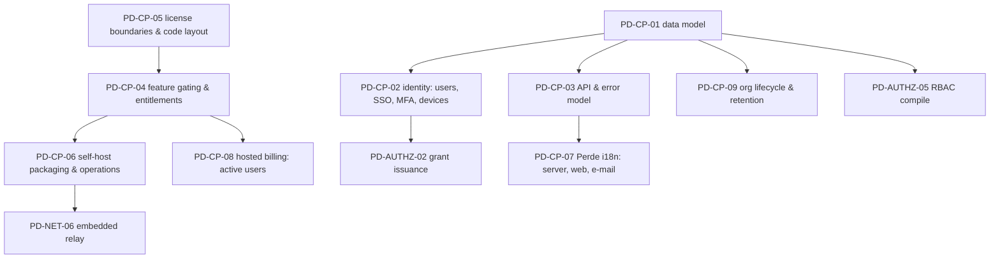
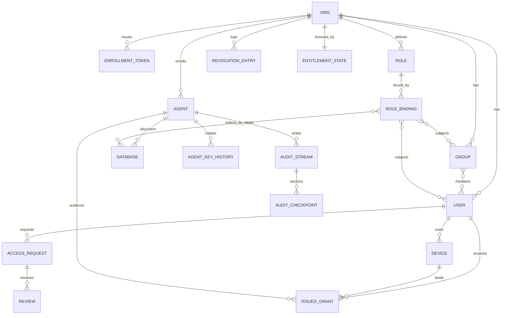

# 34 — Perde: Control Plane (data model, identity, open-core gating, packaging, i18n)

> Status: **canonical, implementation-ready**. Date: 2026-11-11. Audience: implementers of the Perde server, web panel, packaging, licensing mechanics and localization.
> Conventions, notation, evidence tags, verification anchors and priority tags are defined in `30-karagoz-enrollment-discovery-credentials.md` §0.
> Licensing context (access/06 recommendation, adopted here): **Hacivat and Karagöz Apache-2.0; shared protocol/SDK crates Apache-2.0; Perde core AGPL-3.0-only; paid modules in `ee/` under a source-available commercial license (`LicenseRef-Perde-EE`); "security is never paywalled".** This is engineering research, not legal advice; counsel must review before the first public release (access/06 header).
> Clean-room: Bytebase enterprise code, Teleport (AGPL) and NetBird server parts (AGPL) are prose-only sources.

## 0. Overview

### 0.1 Dependency map and priorities



| Spec | Name | Priority |
|---|---|---|
| PD-CP-01 | Control-plane data model and tenancy invariants | v1 |
| PD-CP-02 | Identity: users, SSO (OIDC/SAML), MFA, Hacivat device registration | v1 (OIDC, local accounts + WebAuthn/TOTP, devices); v1.x (SAML, device approval workflows, posture); later (SCIM — EE) |
| PD-CP-03 | API and error model | v1 |
| PD-CP-04 | Open-core feature gating and entitlements (no security paywall) | v1 (registry, ENFORCEMENT invariant, Community behaviour); v1.x (license tokens, grace, downgrade handling) |
| PD-CP-05 | License boundaries and code layout | v1 (enforced in CI from the first commit) |
| PD-CP-06 | Self-host packaging and operations | v1 (single binary, SQLite/PostgreSQL, ACME, compose, systemd); v1.x (HA replicas — EE, Helm) |
| PD-CP-07 | Perde i18n: server API, web panel, e-mail | v1 (EN + TR) |
| PD-CP-08 | Hosted billing: fair active-user counting | v1.x (hosted launch) |
| PD-CP-09 | Org lifecycle, data retention and deletion | v1 (create/delete/export, retention defaults); v1.x (legal hold, residency) |

### 0.2 Conflicts between sources resolved in this file

| # | Conflict | Sources | Decision |
|---|---|---|---|
| P1 | HA / multi-replica Perde: described as a standard self-hosting option (PostgreSQL + LISTEN/NOTIFY) vs a paid self-host feature | networking/05 §3.11 vs access/06 §5.2 | **Single-node Perde (SQLite or PostgreSQL) is free; running ≥ 2 serving replicas requires the `ha` entitlement** (EE). Without it, additional replicas refuse to serve; the primary is never stopped (ALG-OPENCORE-03). Hosted includes HA. |
| P2 | Crate names `perde-proto`, `perde-net`, `perde-grants` for crates shared with Hacivat/Karagöz | networking/05 §5.2 vs access/06 ALG-OPENCORE-04 (shared crates must be Apache-2.0, rank 0) | Shared crates are renamed **`hv-*`** (`hv-proto`, `hv-net`, `hv-signal-client`, `hv-grant`, `hv-policy`, `hv-audit`, `hv-sql-safety`) plus `hacivat-l10n`; the `perde-` prefix is reserved for AGPL Perde crates so license rank is visible from the name. |
| P3 | Relay licensing: "relay + signaling open (with core)" vs "relay protocol Apache, reference relay AGPL" | networking/05 §7.3-9 vs access/06 §7.3 | Both hold: the relay **wire protocol** is iroh-relay's (MIT OR Apache-2.0) and our ticket format lives in `hv-proto` (Apache-2.0); Perde's **relay service** (`perde::relay`, embedding iroh-relay with admission/quotas) is AGPL core. Third parties can build compatible relays. |
| P4 | Fluent message IDs vs dotted wire codes (`net.connect.denied.agent_offline`) | networking/05 §6 vs i18n/01 §3.5.8 (Fluent IDs `[a-zA-Z0-9_-]`) | Wire carries dotted **codes**; the Fluent ID is derived by replacing `.` with `-` (`net-connect-denied-agent_offline`). The CI validator (ALG-I18N-04) checks that every code in the code registry has a message in `en`. |
| P5 | Org-level AI governance features: free vs paid | mcp/02 (AI controls in Hacivat), access/06 §5.2 | Per access/06: AI enforcement (read-only clamp, approvals verification, masks, attribution) **free**; org-scale AI governance (per-agent AI identities inventory, anomaly detection) **paid**. |

---

## 1. Specifications

### PD-CP-01: Control-plane data model and tenancy invariants

- **Priority:** v1.
- **Problem:** Define the persistent model for organizations, people, devices, agents, databases, roles and the security artefacts around them, with invariants that make cross-tenant leaks and identity confusion structurally impossible.
- **Sources merged:** networking/05 ALG-PERDE-01 (`EnrollmentToken`, `Agent`), §3.3 (keys, devices), ALG-PERDE-02 (sessions, presence); access/05 §4 data structures (`agents`, `streams`, snapshots, requests); access/04 §5.2 (inventory never stores secrets); access/01 ALG-ACCESS-T05 (origins); access/02 ALG-BYTEBASE-01 (role bindings with expiry, prose); access/06 ALG-OPENCORE-01/02 (entitlements, installation id); i18n/01 §3.5.3 (locale settings per user).
- **Entities (canonical; all ids UUIDv7 unless noted; every tenant-owned row carries `org_id`):**
  | Entity | Key fields | Notes |
  |---|---|---|
  | `Org` | `org_id, slug (ASCII), display_name (Unicode NFC), status (active\|locked\|deleting\|deleted), default_language, settings {relay_policy, max_staleness, strict_staleness, allow_tls_interception, disclose_direct_addrs, ai_policy, approval_rules, retention, require_agent_approval, require_device_approval, readable_db_usernames}` | settings are versioned; changes bump `policy_epoch` where relevant |
  | `User` | `user_id, org_id, idp_subject {issuer, sub}?, local_login?, email, display_name, status (invited\|active\|suspended\|deleted), language, regional_format, time_zone, mfa_factors[], last_login_at` | language/format per i18n/01 §3.5.3 |
  | `Group`, `GroupMember` | `group_id, org_id, name, source (local\|idp\|scim)` | IdP groups synced on login (SCIM is EE) |
  | `Device` | `device_id, org_id, user_id, endpoint_id (32 B, unique), name, os, app_version, status (pending\|active\|revoked), key_protection, posture {os_version, disk_encryption (reported)}, registered_at, last_seen_at` | bound to exactly one user |
  | `ServiceIdentity` (later) | `id, org_id, name, endpoint_id, owner_user_id, status` | automation/CI; billed separately |
  | `Agent` | `agent_id, org_id, endpoint_id (unique), status (pending_approval\|active\|disabled\|conflict\|locked\|replaced\|decommissioned), labels, host_facts, version, generation, pending_ack_generation, key_epoch, enrolled_by_token, approved_by?, last_seen_at, last_machine_id_hash` | KG-ENROLL |
  | `AgentKeyHistory` | `agent_id, key_epoch, endpoint_id, valid_from, valid_to` | audit verification across rotations |
  | `EnrollmentToken` | `token_id (10 B), hash, org_id, created_by, expires_at, max_uses, uses, ephemeral, requires_approval, auto_labels, allowed_source_cidrs, cloud_binding, revoked_at, exhausted_at` | KG-ENROLL-01 |
  | `Database` | `db_id, org_id, agent_id, stable_key, origin, engine, version, kind, name, description, resource_labels, attach_status (pending\|attached\|suspended\|ignored\|gone), provisioning_mode, cred_source (code+params), capabilities, findings[], generation, image_digest, first_seen, last_seen` | **never** credentials (access/04 §5.2-3); unique `(agent_id, stable_key)` |
  | `Role`, `RoleBinding`, `ObjectRule` | PD-AUTHZ-05 | bindings may expire |
  | `AccessRequest`, `Review`, `ApprovalTokenRecord` | PD-AUTHZ-08/09 | |
  | `IssuedGrant` | `grant_id, org_id, user_id, device_id, agent_id, resources, exp, policy_epoch, revocation_ids[]` | kept until `exp` (+ audit cross-check window) |
  | `RevocationEntry` | `org_id, epoch, type, value, until, reason, issued_by` | PD-AUTHZ-07 |
  | `PolicyEpoch`, `SnapshotCache` | `org_id, epoch, min_policy_epoch`; `(agent_id, epoch, hash, bytes)` | |
  | `SigningKey` | `kid, role, public_key, encrypted_private_key, not_before, not_after, status` | PD-AUTHZ-01 |
  | `RelayRegion`, `RelayNode` | `region_code, display_code, nodes[{url, quic_port, weight}]` | PD-NET-06 |
  | `AuditStream`, `AuditRecord`, `AuditCheckpoint`, `AuditGap` | KG-AUDIT-05 | records partitioned by org/day |
  | `EntitlementState`, `License` | `installation_id, license_token, effective {plan, features, limits, grace_until, previously_entitled}` | PD-CP-04 |
  | `EmailOutbox` | `id, org_id, recipient_user_id, template_id, args, locale (frozen at enqueue), status` | PD-CP-07 |
  | `WebSession`, `ApiToken` (v1.x) | standard | |
- **Invariants:**
  1. **Tenant isolation:** every query on tenant data is scoped by `org_id` through a single repository layer; on PostgreSQL, row-level security policies (`org_id = current_setting('perde.org_id')`) as defence in depth; integration tests attempt cross-org access for every endpoint.
  2. `endpoint_id` is globally unique across `Agent` and `Device` (and service identities); a collision rejects registration (`key_in_use`).
  3. Secrets: Perde stores only hashes of enrollment secrets, encrypted signing keys (KEK), and no database credentials of any kind.
  4. Identifiers are ASCII and compared byte-wise; display names are Unicode NFC and never used as keys (Turkish `I/ı` hazards, i18n/02).
  5. Deletion is soft first (`status = deleted`, tombstones), hard after the retention/export window (PD-CP-09); audit checkpoints survive record deletion (KG-AUDIT-05).
  6. Monotonic versions: `policy_epoch`, `revocation_epoch`, per-agent inventory `generation` never decrease (restores handled by explicit re-sync rules).
- **Data structures:** SQL schema managed by forward-only migrations (`perde migrate`), identical for SQLite and PostgreSQL where possible (feature differences isolated in the repository layer: RLS and `LISTEN/NOTIFY` only on PostgreSQL).
- **Complexity:** standard OLTP; audit records are the only high-volume table (partitioned).
- **Decision:** relational model with explicit tenancy column (rejected: database-per-tenant for hosted v1 — operational cost; schemaless documents — weak invariants).
- **Verification status:** design-level.
- **Rust placement:** `perde::store::{schema, repo, migrations}` (AGPL) using `sqlx` (SQLite + PostgreSQL; version to check); ids via `uuid` v7.
- **Threats addressed:** T12 (cross-tenant leak), A3 (other tenant), Perde DB compromise yields no DB credentials.
- **Edge cases:** user in two orgs (two `User` rows, one IdP subject per org; devices per org-user); agent moved between orgs (not supported: re-enroll); org renamed (slug change creates redirects, ids stable); SQLite single-writer limits (documented scale ceiling for SQLite installs: ~hundreds of agents; recommend PostgreSQL above that).
- **Test cases:** API fuzz across two orgs → zero cross-org reads/writes; duplicate `endpoint_id` registration → rejected; migrations up from every released version on both SQLite and PostgreSQL (`postgres:16`, `postgres:17`) → schema equal to fresh install.
- **Prior art:** networking/05 data structures; access/05 data structures; Bytebase/Teleport resource models (prose).
- **i18n notes:** per-user `language`, `regional_format`, `time_zone`; org `default_language`.
- **Used by:** Perde.



### PD-CP-02: Identity: users, SSO (OIDC/SAML), MFA, Hacivat device registration

- **Priority:** v1 (OIDC login, local accounts with WebAuthn/TOTP for self-host, MFA enforcement, device registration, logout/revocation); v1.x (SAML 2.0, device approval, posture reporting, OIDC back-channel logout); later (SCIM directory sync — EE).
- **Problem:** Authenticate humans to Perde (web panel and Hacivat), bind Hacivat installations to users through device keys, enforce MFA and session freshness, and make offboarding effective — without paywalling authentication.
- **Sources merged:** networking/05 §3.3.3 (Hacivat device registration: OAuth 2.0 Authorization Code + PKCE with loopback redirect (RFC 8252) or Device Authorization Grant (RFC 8628); device key in OS keychain; device approval; logout deletes key and revokes device); access/06 §3.4 and §5.2 (OIDC and SAML free for self-host, MFA free, SCIM paid, deprovisioning via back-channel logout free); access/05 §3.3 (`mfa`, `device_trust` facts); ALG-NB-06 (NetBird login expiration and peer approval — prose).
- **Algorithm:**
  1. **Web login:** OIDC Authorization Code + PKCE against the org's IdP (any compliant provider; never "GitHub only"); local accounts (self-host) with password (Argon2id) + mandatory WebAuthn or TOTP when the org enforces MFA. SAML 2.0 SP (v1.x; free on self-host, included from the first paid hosted tier). JIT user provisioning on first login (if the org allows); IdP groups mapped to Perde groups on each login.
  2. **Hacivat sign-in:** system browser with Authorization Code + PKCE and loopback redirect (`127.0.0.1:<random>`), or Device Authorization Grant for headless/SSO-restricted environments. Perde issues an access token + refresh token stored in the OS keychain.
  3. **Device registration:** Hacivat generates `sk_D` (Ed25519; P-256 Secure Enclave optional) in the keychain; `GET /v1/devices/challenge` → nonce; `POST /v1/devices {device_name, os, app_version, endpoint_public_key, posture?, proof = Sign_D("perde-device-v1" ‖ instance_id ‖ nonce ‖ endpoint_public_key ‖ user_id)}` with the user's access token; Perde checks global key uniqueness, binds device ↔ user; status `active`, or `pending` if org `require_device_approval` (admin approves; analogous to NetBird peer approval and Tailscale device approval).
  4. **Session freshness:** signaling `Hello` for a device requires a valid user session (refresh-token-backed) with `auth_time` within org policy (default 12 h); grants carry `mfa(time, method)`; resources may require fresh MFA (`ConnectDenied{mfa_required}` → step-up in the browser).
  5. **Logout / offboarding:** Hacivat logout deletes `sk_D` and calls `DELETE /v1/devices/{id}` → device `revoked` → revocation entry (PD-AUTHZ-07) kills sessions; user suspension/deletion → `Revoke{user}`; OIDC back-channel logout (v1.x) and SCIM deprovisioning (EE) map to the same path. Deprovisioning paths keep working even when an EE entitlement lapses (ALG-OPENCORE-01 step 6).
  6. **Posture (v1.x):** reported OS version and disk encryption (not proven without MDM) → `device_trust` fact (`unmanaged|reported|managed`); device attestation is a paid feature (access/06).
- **Data structures:** `User`, `Device`, `WebSession`, OIDC/SAML provider config per org (`issuer`, `client_id`, secrets in the KEK-encrypted store), `DeviceChallenge`.
- **Complexity:** standard.
- **Decision:** authentication free (OIDC + SAML self-host + MFA), provisioning automation paid (SCIM) — the "authentication free, provisioning automation paid" line from access/06 §3.4. Rejected: SSO tax (sso.tax listing, security contradiction for a privileged-access product).
- **Verification status:** design-level; market facts about SSO gating confirmed in access/06 (Teleport CE GitHub-only SSO, Bytebase) [Observed].
- **Rust placement:** `perde::identity::{oidc, saml (v1.x), local, mfa::{webauthn, totp}, devices}` (AGPL); crates `openidconnect`, `webauthn-rs`, `totp-rs`, `argon2`, `samael` or equivalent for SAML (license/maturity to check); Hacivat `hacivat::perde_client::auth`.
- **Threats addressed:** T3 (device keys), A5 (stolen laptop: device revocation, keychain storage), offboarding failures, T5.
- **Edge cases:** IdP down (existing sessions continue until freshness window; new logins fail with `auth.idp_unavailable`); user changes email at the IdP (stable `sub` is the key); same user, multiple devices (independent keys); reinstall of Hacivat (new device; old one shows `last_seen` and can be revoked); clock skew in OIDC tokens (±60 s); SAML-only IdPs common in Turkish enterprises and universities (access/06 §5.2) → SAML in v1.x is a priority; Device Grant polling interval obeyed.
- **Test cases:** OIDC login with Keycloak (`quay.io/keycloak/keycloak` image) → user JIT-created with groups; Hacivat device registration → `active`; org requires device approval → `pending`, grants refused (`device_pending_approval`) until approved; logout → device revoked, active session killed within one revocation push; MFA freshness 12 h exceeded on a resource requiring MFA → `mfa_required`.
- **Prior art:** networking/05 §3.3.3; NetBird ALG-NB-06 (prose); Tailscale device approval (networking/02).
- **i18n notes:** login pages and MFA prompts localized (`perde-web.ftl`); OIDC `ui_locales` passed from the user's chain; e-mails per recipient language.
- **Used by:** Perde, Hacivat.

### PD-CP-03: API and error model

- **Priority:** v1.
- **Problem:** Give the web panel, Hacivat, Karagöz and third-party tooling a stable, versioned API whose errors are machine-actionable and localizable without English sentences being the contract.
- **Sources merged:** i18n/01 §3.5.4 (Perde server API error body), §3.5.8 (stable codes `AREA-NNNN`), ALG-I18N-01 (Perde request locale chain); networking/05 §6 item 1; access/06 §5.3 item 4 (`FeatureNotEntitled{feature_id, minimum_plan}`); ALG-PERDE-02 idempotency rules.
- **Algorithm / rules:**
  1. **Versioned REST/JSON** under `/v1/…` for management; signaling and data-plane control are protobuf (PD-NET-01); OpenAPI spec generated from code (`utoipa`) and published (Apache-2.0 for the spec).
  2. **Error body:** `{code: "authz.deny.write_in_read_mode", legacy_code?: "PRD-AUTH-0001", message: "<English>", message_id: "authz-deny-write_in_read_mode", args: {…typed…}, localized_message?: "<per Accept-Language>", retry_after_ms?, request_id}`. The web panel renders from `message_id` + `args`; `localized_message` is a convenience for API clients.
  3. **Idempotency:** mutating endpoints accept `Idempotency-Key` (24 h store); signaling uses `msg_id` LRU (10 min).
  4. **Pagination:** cursor-based (`next_cursor`), stable ordering by id (UUIDv7 ≈ time order).
  5. **Authentication:** web session cookie (SameSite=Lax, HttpOnly) for the panel; OAuth access tokens for Hacivat; agent HTTP calls (audit upload, snapshot fetch) signed with RFC 9421 (agent key); API tokens for automation (v1.x).
  6. **Rate limits** per principal and per IP (429 with `retry_after_ms`).
  7. **Entitlement errors:** `402`-class business error `entitlement.denied {feature, minimum_plan}` — never for ENFORCEMENT-class features (PD-CP-04 invariant I1).
- **Data structures:** code registry `codes.yaml` (code, http_status, message_id, args schema, area) → generated Rust enum + TS types + Fluent ID checks.
- **Decision:** codes + typed args with optional server-side localization (rejected: English-only messages as contract; server-only localization — breaks client-side re-rendering and caching).
- **Verification status:** design-level.
- **Rust placement:** `perde::api::{error::ApiError, codes (generated)}`, `axum` handlers; `hv-proto` for shared codes used by agents/clients.
- **Threats addressed:** information disclosure via verbose errors (codes only; object names only when visible to the caller).
- **Edge cases:** unknown code from a newer server in an older client → generic localized fallback with the code shown; args containing user-provided Unicode → bidi-isolated when rendered; `Accept-Language` absent → org default → `en`.
- **Test cases:** every code in `codes.yaml` has an `en` Fluent message and matching args (CI); request with `Accept-Language: tr-TR` → `localized_message` Turkish; same request with profile language `en` → English UI, but `localized_message` follows the profile chain (profile wins, ALG-I18N-01 test 8).
- **Prior art:** i18n/01; Bytebase typed plan errors (prose).
- **i18n notes:** see PD-CP-07.
- **Used by:** Perde, Hacivat, Karagöz, integrators.

### PD-CP-04: Open-core feature gating and entitlements (no security paywall)

- **Priority:** v1 (feature registry, ENFORCEMENT invariant, Community behaviour, EE artefact behaving as Community without a license); v1.x (signed license tokens, grace periods, downgrade handling, hosted subscriptions through the same token path).
- **Problem:** Decide whether a Perde feature is available to a tenant such that losing a license can never weaken security enforcement, UI and API always agree, self-hosted (even air-gapped) installs verify entitlements offline, and downgrades never lose data or silently relax restrictions.
- **Sources merged:** ALG-OPENCORE-01 (fail-secure entitlement evaluation, invariants I1/I2), ALG-OPENCORE-02 (offline-verifiable Ed25519 license token), ALG-OPENCORE-03 (downgrade and data retention), access/06 §5.2 (feature split decision matrix), §5.3 (implementation guidance), stewardship promise (§5.1); ALG-BYTEBASE-05 (signed license gating observed, prose; anti-patterns: masking/approvals silently off on FREE); V2 P23 (Bytebase license facts), P22 (Teleport CE binary license), P17/P18 (NetBird AGPL split).
- **Feature classes and the canonical split (adopted from access/06 §5.2):**
  | Class | Meaning | Examples |
  |---|---|---|
  | `ENFORCEMENT` | anything Karagöz enforces, or Perde needs to produce enforcement artefacts | enrollment, discovery, zero-credential connect, P2P/relay connectivity (self-host), RBAC with label selectors, **custom roles**, grant signing, policy compilation, revocation, read-only enforcement and classification, ephemeral DB users, **column masking**, single-approver JIT + statement-pinned approvals (verification at agent), AI controls (read-only clamp, approval verification, masks, attribution), local audit + hash chaining + upload + gap detection, audit ingest, tamper-evidence verification |
  | `CORE` (free, not enforcement) | security basics and operability | SSO via OIDC; **SAML on self-host**; MFA enforcement; audit search/export with operator-chosen retention (self-host); generic SIEM export (OCSF JSON over webhook/syslog/file); basic agent self-update; single-node packaging |
  | `PAID` (`ee/`) | scale, governance, compliance, convenience | SCIM/directory sync; multi-stage approval workflows, risk routing, scheduled access, access reviews/certifications; ChatOps approvals; managed SIEM connectors and long-term managed archive; PII auto-classification; session/result recording storage + replay UI; device trust/attestation; org-scale AI governance; HA/multi-replica Perde (self-host), multi-region relay fleet management; fleet agent management (staged rollouts); custom branding/domains; compliance report packs (SOC 2, ISO 27001, KVKK/GDPR); SLA support |
- **Invariants:** **I1** — no `ENFORCEMENT`-class feature may have `min_plan ≠ community` (CI test over `features.yaml`). **I2** — a lapsed license may remove convenience but never relax a restriction: paid policy features that were configured keep being evaluated (more restrictive), or fall back to the stricter free equivalent (e.g. "single approver required"), never to "no approval". **I3** — Karagöz contains **no license code at all**; it verifies only policy/grant/approval signatures (makes the promise structurally auditable).
- **Algorithm (evaluation, ALG-OPENCORE-01):**
  1. Look up the feature in the registry (generated from `perde/features.yaml`: `{id, class, min_plan, readonly_behavior, i18n name/description ids}`); unknown → `Denied(unknown_feature)` + internal error metric.
  2. `class == ENFORCEMENT` → `Allowed` unconditionally.
  3. `ent ← effective_entitlements(tenant, now)` (cached ≤ 60 s; invalidated on license upload).
  4. `feature ∈ ent.features` → `Allowed`.
  5. `feature ∈ ent.previously_entitled ∧ now < ent.grace_until` → `Allowed` + warning banner.
  6. `feature ∈ ent.previously_entitled` (grace over) → `ReadOnly`: existing configuration keeps working where it restricts or deprovisions (I2; SCIM deletions continue, additions blocked), edits blocked, deletion allowed, data visible/exportable.
  7. Else `Denied(minimum_plan)` → API `entitlement.denied`.
- **Algorithm (license token, ALG-OPENCORE-02):** compact token, header `alg = EdDSA` only (reject everything else, no negotiation); `kid` ∈ embedded key set with validity windows (rotation via releases); verify signature over canonical payload; claims `iss = perde-licensing`, `aud = perde-selfhosted`, `nbf ≤ now + 5 min`, supported version, `installation_id` match when present (trials always bound); `grace_until = expires_at + grace_days` (default 14); `now > grace_until` → Community + `previously_entitled`; persist "last verified now" and treat `now < last_seen − 24 h` as clock rollback (`now := last_seen`). Hosted tenants use the same token path (issued by billing) so there is one entitlement code path.
- **Algorithm (downgrade, ALG-OPENCORE-03):** diff old/new sets; per lost feature apply `readonly_behavior`: data features keep data read/export-only and route new events to the core store (core audit is never gated); policy features keep evaluating (I2) with edits blocked except deletion; integration features keep deprovisioning/delete paths and pause creates; scale features refuse additional replicas, never stop the primary; emit `entitlement.changed`; notify org owners (localized).
- **Code mechanics (access/06 §5.3):** gate at the **API boundary** only; EE as plug-ins behind core traits (`ApprovalWorkflowEngine`, `DirectoryProvisioner`, `AuditSink`, `Classifier`, `ReplicaCoordinator`), core ships free implementations; two artefacts per release — `perde` (AGPL core, `ee/` stripped at build) and `perde-ee` (core + ee) — and `perde-ee` without a license behaves exactly like Community; no phone-home requirement (air-gapped banks); optional anonymous telemetry opt-in with HMAC-anonymized identifiers.
- **Data structures:** `features.yaml`; `EntitlementState {installation_id, plan, features, limits {users, agents, ha_replicas}, not_before, expires_at, grace_until, previously_entitled, last_seen_now}`; `entitlement_changes` log.
- **Complexity:** O(1) after cache; one Ed25519 verify per refresh.
- **Decision:** AGPL core + `ee/` source-available + offline Ed25519 license with fail-secure semantics (rejected: Bytebase-style "masking/approvals off on FREE" (security regression on non-payment); Teleport v16-style binary license restrictions on the community build (backlash, V2 P22); BSL/FSL for the core (non-OSI; fork risk, access/06 §3.3); SSO tax).
- **Verification status:** license facts of comparables confirmed (V2 P17, P18, P22, P23, P24); mechanics design-level.
- **Rust placement:** `perde::entitlements::{registry (build-time codegen from features.yaml), evaluate, license::{verify, LicenseToken}, downgrade}` (AGPL); `perde_ee::*` implementations registered at startup when entitled; web panel consumes the same registry (generated TS) for UI gating.
  ```rust
  pub enum Availability { Allowed { warning: Option<GraceWarning> }, ReadOnly, Denied { minimum_plan: Plan } }
  pub fn availability(feature: FeatureId, ent: &EntitlementState, now: Ts) -> Availability;   // ENFORCEMENT => Allowed
  ```
- **Threats addressed:** "security paywall" reputational and safety risk; license-key bypass accepted (no DRM in the security path, access/06 §7.1-6); clock rollback.
- **Edge cases (exhaustive, from ALG-OPENCORE-01/02/03):** feature renamed (aliases); license lists features unknown to this version (ignore, log); downgrade mid-flight of a paid approval (complete under captured rules); clock rollback (last-seen rule); multi-replica cache disagreement ≤ 60 s; air-gapped renewal by file upload; hosted payment failure (same as expiry); SCIM deprovisioning during ReadOnly (continues); feature in base plan and add-on; trial end; self-host → hosted migration (re-derive); offline Karagöz (never consults entitlements); token truncated/whitespace; duplicate `kid`; key retired but license still valid (`iat` within key window); seats below active users (no lockout; block new invites; banner); legal hold on audit overrides deletion; re-upgrade restores edit capability.
- **Test cases:** `policy.compile` with no license → Allowed; `scim.configure` on Community → `Denied(min=business)`; license expired yesterday, grace 14 d, `approvals.multistage.create` → Allowed + warning; after 15 d → ReadOnly, existing multi-stage rules still enforced, creation blocked; `alg=RS256` token → Invalid; payload bit flip → Invalid; wrong installation id → Invalid; clock set back a year → no resurrection; Business → Community with 3 multi-stage rules → still enforced, edit disabled, delete allowed; HA lost with 3 replicas → replicas 2–3 refuse to serve after restart, primary unaffected; CI: every ENFORCEMENT feature has `min_plan = community`.
- **Prior art:** access/06 ALG-OPENCORE-01/02/03; Bytebase plan matrix shared with UI (prose); Teleport entitlements enumeration (prose); GitLab stewardship promise.
- **i18n notes:** feature names/descriptions and upgrade copy from the registry as message ids (`feature-scim-name`, `entitlement-denied {feature, minimum_plan}`); plan names translatable display strings over stable ids; ASCII-only case folding of feature ids (Turkish `toLowerCase("SCIM")` → `scım` hazard); prices formatted per locale in integer minor units (`₺1.234,56` vs `$1,234.56`).
- **Used by:** Perde (server and web panel).

```mermaid
flowchart LR
    REQ[API request needs feature f] --> REG{f in registry?}
    REG -- no --> DEN0[Denied unknown_feature + metric]
    REG -- yes --> CLS{class(f) = ENFORCEMENT?}
    CLS -- yes --> ALLOW[Allowed (I1)]
    CLS -- no --> ENT[effective entitlements (license or hosted subscription)]
    ENT --> HAS{f entitled?}
    HAS -- yes --> ALLOW2[Allowed]
    HAS -- no --> PREV{previously entitled?}
    PREV -- no --> DEN[Denied minimum_plan]
    PREV -- yes --> GRACE{now < grace_until?}
    GRACE -- yes --> WARN[Allowed + banner]
    GRACE -- no --> RO[ReadOnly: keep restrictive evaluation (I2), block edits, allow delete/export]
```

### PD-CP-05: License boundaries and code layout

- **Priority:** v1 (from the first commit).
- **Problem:** Keep the AGPL core from depending on EE code, permissive crates from depending on AGPL code, and every file license-declared — automatically — so the open-core split cannot drift.
- **Sources merged:** ALG-OPENCORE-04 (access/06); access/06 §5.1 (licenses per component, CLA/DCO, trademarks, stewardship promise); networking/05 §5.2 (crate layout, renamed per P2); V2 P18 (NetBird prose LICENSE vs REUSE.toml drift, `combined/`).
- **Layout (canonical):**
  | Path / crate | License (SPDX) | Rank | Contents |
  |---|---|---|---|
  | `crates/hv-proto` | Apache-2.0 | 0 | protobuf schemas `perde.v1` (signaling, control stream, stream open, inventory, relay ticket), install-token parser |
  | `crates/hv-net` | Apache-2.0 | 0 | iroh facade (PD-NET-03), lookup, path policy, diagnostics |
  | `crates/hv-signal-client` | Apache-2.0 | 0 | signaling client (PD-NET-01) |
  | `crates/hv-grant` | Apache-2.0 | 0 | Biscuit grant facade, verifier, attenuator, approvals, key ring, revocation set |
  | `crates/hv-policy` | Apache-2.0 | 0 | Cedar schema, snapshot format/verify, `PolicyEngine` |
  | `crates/hv-audit` | Apache-2.0 | 0 | audit record format, canonical CBOR, chain, Merkle, checkpoints, OCSF mapping, verifier |
  | `crates/hv-sql-safety` | Apache-2.0 | 0 | classifier, lineage, function lists |
  | `crates/hacivat-l10n` + `locales/` | Apache-2.0 (FTL files under the component license; translations via CLA/DCO of the component) | 0 | i18n runtime and catalogs |
  | `hacivat/` | Apache-2.0 (or MIT OR Apache-2.0) | 0 | desktop client |
  | `karagoz/` | Apache-2.0 | 0 | agent (+ guard) |
  | `perde/` (`perde-core`, `perde-relay`, `perde-web` sources) | AGPL-3.0-only | 1 | control plane, signaling, relay service, web panel |
  | `ee/` (`perde-ee-*`) | LicenseRef-Perde-EE | 2 | paid modules behind core traits |
  | `docs/` | CC-BY-4.0 | — | documentation |
- **Algorithm (CI, ALG-OPENCORE-04):** (1) load `REUSE.toml`/SPDX headers → path → license; (2) every file resolves to exactly one license and every license text exists in `LICENSES/`; (3) build the dependency graph (Cargo metadata; TS import graph for the web panel); (4) edge `a → b` allowed iff `rank(L(a)) ≥ rank(L(b))` (permissive may not import AGPL or EE; AGPL may not import EE; EE plugs in through registered traits only); (5) build and test the Community artefact from a tree with `ee/` deleted; (6) verify SBOM licenses per component; (7) compare prose `LICENSE` statements with `REUSE.toml` (NetBird drift lesson).
- **Contribution terms:** CLA (license grant, not assignment) for Perde core and EE (needed for dual licensing / AGPL alternative for AGPL-averse enterprises); DCO for Hacivat, Karagöz and `hv-*`; trademarks "Hacivat", "Karagöz", "Perde" registered with a published trademark policy; stewardship promise published on day one (features never move from free to paid; security enforcement and fixes never paywalled; released versions never relicensed; EE relicensed to AGPL if maintenance stops).
- **Edge cases:** generated code inherits the license of its schema (protobuf in `hv-proto` → Apache); vendored third-party code keeps its own license (exempt list with SPDX ids); test fixtures; i18n files ship with the component license; build scripts; Perde web panel depending on an Apache UI kit (allowed, rank 0 → 1).
- **Test cases:** Karagöz crate imports `perde-core` → CI fails; `perde-core` imports `ee/scim` → fail; `ee/scim` imports `perde-core` → pass; new file without header outside REUSE coverage → fail; Community build with `ee/` removed → compiles and passes tests.
- **Decision / Verification / Rust / Threats:** directory-based boundaries (rejected: Bytebase's "any code controlling feature, permission, role and plan enablement" fuzzy boundary, V2 P23); facts confirmed V2 P18/P23; CI tool `xtask license-check` (Apache-2.0); protects the open-core promise and fork-risk management (access/06 §7.1).
- **i18n notes:** license texts are not translated (English authoritative); optional non-binding Turkish summaries in docs.
- **Used by:** all repositories (CI).

### PD-CP-06: Self-host packaging and operations

- **Priority:** v1 (single binary, SQLite default / PostgreSQL option, ACME, embedded relay and QAD, compose, systemd, migrations, backups, upgrades); v1.x (HA replicas — EE, Helm chart, extra relay regions); later (Kubernetes operator).
- **Problem:** Make self-hosting Perde a one-binary affair with minimal firewall rules, predictable upgrades and safe backups — while the hosted service runs the same code.
- **Sources merged:** networking/05 §3.11 (single binary subcommands, storage, TLS, ports, compose/Helm, Karagöz install, upgrades), §3.9 (observability), §3.8.5 (regions); access/06 §5.3 items 5–7 (no phone-home, two artefacts); P1.
- **Algorithm / layout:**
  1. **Binary `perde`** (Rust, static where possible) with subcommands: `serve` (HTTPS API + web panel + signaling + embedded iroh-relay + QAD + audit ingest), `relay` (relay-only node for extra regions; QAD-only mode `--no-relay` for cheap vantage points), `migrate` (forward-only migrations; refuses to run against a newer schema), `admin` (`create-admin`, `create-token`, `rotate-keys`, `export-org`), `doctor` (ports, TLS, DNS, clock, DB, relay reachability, QAD vantage count), `license` (`show`, `install <file>`).
  2. **Storage:** SQLite (default, single node; WAL; documented scale ceiling) or PostgreSQL 15+ (recommended beyond small teams; required for HA).
  3. **TLS:** built-in ACME (TLS-ALPN-01 or HTTP-01) or user-provided certificates; or behind a reverse proxy supporting WebSockets (documented headers/timeouts: idle ≥ 120 s, no buffering on `/v1/signal` and `/relay`). Relay over the same 443 listener (path `relay`).
  4. **Ports:** 443/tcp (API, panel, WSS signaling, relay WebSocket); 80/tcp optional (ACME HTTP-01, relay captive-portal probe `generate_204`); 7842/udp (QAD, ALPN `/iroh-qad/0`); 9090/tcp metrics (bind localhost/private). No 3478/udp unless STUN compatibility is added later. Recommend ≥ 2 QAD vantage points (one extra `perde relay --no-relay` VM) so `mapping_varies_by_dest` is measurable (networking/04 ALG-IROH-04 edge).
  5. **Config:** one TOML file + env overrides; secrets via files (`*_FILE`); KEK for signing keys from file/env/KMS (v1.x KMS); key material backed up separately from the DB.
  6. **Packaging:** Docker image `perde` (non-root, read-only rootfs, volume for data), Docker Compose (`perde` + optional `postgres:17`), systemd unit for bare metal; Helm chart v1.x.
  7. **Observability:** OpenTelemetry metrics/traces; Prometheus endpoint; relay byte counters per org; structured JSON logs (English, codes + message ids).
  8. **HA (EE `ha` entitlement):** multiple `perde serve` replicas behind a load balancer with sticky WebSocket sessions; presence and push fan-out via PostgreSQL `LISTEN/NOTIFY`; leader election for singleton jobs (expiry sweeps, epoch compaction) via `pg_try_advisory_lock`; without entitlement, non-primary replicas refuse to serve (`entitlement.denied ha`), primary unaffected.
  9. **Upgrades:** Perde advertises minimum agent/client protocol versions in `Welcome`; agents/clients refuse only on major mismatch; agent auto-update only if enabled, signed releases (minisign/sigstore); Perde DB migrations run before serving; rollback = restore backup (forward-only migrations).
  10. **Backups/restore:** DB dump + key material; on restore, monotonic counters may regress → agents resend inventory snapshots, revocation epochs are re-published (`revocation_epoch` jump forward by a large constant to stay monotonic for agents), audit ingest accepts agent-presented cosigned checkpoints (KG-AUDIT-05).
  11. **Karagöz install script** served by Perde at `/install.sh` (KG-ENROLL-06) with the release public key embedded.
- **Data structures:** `perde.toml` schema (versioned), `installation_id` generated at first boot.
- **Decision:** single binary + embedded relay (rejected: multi-service deployments for small self-hosters; separate relay license).
- **Verification status:** iroh-relay default ports and QAD [Observed: `iroh-relay/src/defaults.rs:7-16`]; design-level otherwise.
- **Rust placement:** `perde::cli`, `perde::serve`, `perde::relay`, `perde::doctor`; `axum`, `tokio`, `rustls-acme` (or `instant-acme`; check), `opentelemetry`.
- **Threats addressed:** T10 (DoS: limits in front), T17 (signed releases), key custody (KEK separate from DB backups).
- **Edge cases:** reverse proxy that buffers WebSockets (doctor detects by echo test); clock skew on the Perde host (doctor; grants and tickets depend on it); restoring an old backup (monotonic jump procedure); SQLite on network filesystems (refuse); split-horizon DNS for relay URLs (per-client relay maps); IPv6-only hosts.
- **Test cases:** `docker compose up` on a clean VM → enroll a Karagöz from another VM, connect Hacivat, run a query (end-to-end smoke in CI with `docker:27-dind`); `perde doctor` on a host with 7842/udp blocked → warns about NAT classification; restore yesterday's backup → agents reconnect, inventories resync, no revocation is "forgotten" (revoked user remains revoked after restore — revocation log replay from audit/admin journal); start a second replica without `ha` → refuses.
- **Prior art:** networking/05 §3.11; Headscale single-binary self-hosting (networking/02); NetBird combined server (networking/03, prose).
- **i18n notes:** `perde` CLI human output localized (`perde-server.ftl`/CLI chain), logs English; web panel per user.
- **Used by:** self-hosters, hosted operations.

### PD-CP-07: Perde i18n: server API, web panel, e-mail

- **Priority:** v1 (English + Turkish; adding a language = adding files, no code change).
- **Problem:** Localize every human-facing Perde surface (web panel, API error convenience text, e-mails, CLI) from one catalog set shared with Hacivat and Karagöz, with correct Turkish formatting and no locale-sensitive identifier handling.
- **Sources merged:** i18n/01 (D-I18N-01…10; ALG-I18N-01 locale negotiation — Perde request and e-mail contexts; ALG-I18N-02 per-message fallback; ALG-I18N-03 pseudo-localization; ALG-I18N-04 CI validation; §3.4 web side; §3.5 architecture, per-component policy, fallback chains, error architecture, bidi marks in machine contexts); networking/05 §6; access/06 §6 (feature/plan names, currency); V2 P28/P29 (Crowdin/Weblate facts), P31 (fluent-rs `NUMBER()` not locale-aware), P32 (MF2/ICU4X status), S34 (CLDR 49 Turkish number symbols).
- **Algorithm:**
  1. **Catalogs:** `locales/<bcp47>/{common.ftl, perde-server.ftl, perde-web.ftl, perde-email.ftl, karagoz-cli.ftl, hacivat-*.ftl}` + `locale.toml` (`tag`, `native_name`, `english_name`, `direction`, `status`, `min_completeness`); directory-driven discovery at build time (Rust `build.rs`, Vite `import.meta.glob`); adding a language = new folder.
  2. **Per-request chain (server, ALG-I18N-01 "Perde request"):** `user.profile.language` → `perde_lang` cookie → `Accept-Language` (parse, drop `q=0`, stable sort by q, cap 16, ignore `*`) → `org.default_language` → `en`; formatting locale = explicit regional setting → first *requested* tag (not the matched catalog) → chain[0] maximized; cache by raw header + profile language (LRU 1 000).
  3. **Server runtime:** `fluent_bundle::concurrent` bundles built once per locale at startup (shared parsed resources via `Arc`); per-message fallback (ALG-I18N-02); custom `NUMBER`/`DATETIME` functions and formatter backed by ICU4X (fluent-rs built-in `NUMBER()` only pads fraction digits and is locale-insensitive — V2 P31); `LIST` via `icu_list` (Turkish "a, b ve c").
  4. **API errors:** `{code, message (English), message_id, args, localized_message?}` (PD-CP-03); `message_id = code with '.' → '-'` (P4).
  5. **Web panel:** `@fluent/bundle` (+ `@fluent/react` if React) consuming the same FTL files; generated TypeScript types for message ids and argument shapes (compile-time safety comparable to `fl!`); `<html lang dir>` updated on switch; data-derived numbers formatted by the server or by `Intl` with parity tests (`l10n-parity.ftl` fixtures run in Rust and JS CI).
  6. **E-mails:** rendered in the **recipient's** chain (`recipient.profile.language` → `org.default_language` → `en`), never the sender's; locale frozen at enqueue (`EmailOutbox.locale`); subject, preheader, HTML and plain-text parts all from `perde-email.ftl`; bidi isolation marks stripped from `Subject` and headers (machine sinks), kept in bodies; dates/times in the recipient's time zone.
  7. **Overlay:** runtime overlay directories disabled for the Perde server in production unless `PERDE_L10N_OVERLAY_DIR` is set by an admin (no filesystem-controlled strings in e-mails by default).
  8. **CI (ALG-I18N-04):** syntax/Junk, missing/obsolete ids, variable-set and attribute-set equality vs `en`, term references, plural/selector sanity per CLDR categories (Turkish `one`/`other`), forbidden characters, key naming, unused ids, length budgets, code-registry coverage (every API/wire code has an `en` message), markup parity.
  9. **Pseudo-locales** `en-XA`, `ar-XB`, `tr-XT` (Turkish stress `İıŞşĞğ`) in dev builds; screenshot tests of the panel in `en`, `tr`, `en-XA`, `ar-XB`.
  10. **Translation process:** Weblate (Libre hosting if accepted; self-hosted fallback) with one component per FTL file; PR-based; Crowdin not used (its OSS terms exclude projects with related commercial products — V2 P28).
- **Turkish-specific rules:** never locale-sensitive case mapping on identifiers, feature ids, label keys, region codes, protocol tokens (ASCII-only folding); Turkish number format via ICU4X CLDR data (decimal `,`, group `.`, percent `%#,##0` prefix — V2 S34); no runtime suffix concatenation after placeholders (restructure messages); currency TRY with integer minor units and e-Fatura/e-Arşiv considerations for hosted billing (access/06 §6); relative times with `one`/`other` plurals.
- **Data structures:** `L10nRuntime {generation, bundles per locale (ui + machine variants), formatters}`; generated `message_ids.rs` / `l10n-ids.d.ts`.
- **Complexity:** per request O(|chain|) message lookups; bundles shared.
- **Decision:** Fluent everywhere (rejected: rust-i18n — no CLDR plural selection; ICU MF1 — apostrophe pitfalls in Turkish; MF2 — no production Rust implementation yet, V2 P32).
- **Verification status:** fluent-rs `NUMBER()` behaviour Confirmed (V2 P31); MF2/ICU4X status Confirmed (V2 P32); Weblate/Crowdin facts Confirmed (V2 P28/P29); CLDR Turkish symbols Confirmed (V2 S34).
- **Rust placement:** `hacivat-l10n` (shared crate, Apache-2.0) used by `perde::l10n` (server) and `perde::email`; web panel `perde-web/src/l10n`; `cargo xtask l10n check|new <tag>|report|types`.
- **Threats addressed:** e-mail content injection via overlays (disabled), mis-addressed language (recipient chain), information leaks via untranslated debug strings (codes only).
- **Edge cases (from ALG-I18N-01 tests):** profile `en` + header `tr-TR` → English UI, Turkish formats; `Accept-Language: tr;q=0, en` → `[en]`; `az` request → `[en]` (never `tr`); recipient without language and org without default → `en`; queued e-mail after the recipient changes language → frozen locale used (documented); RTL future locales → `dir` attribute and isolation marks in bodies.
- **Test cases:** API error in Turkish chain → `localized_message` Turkish with correctly formatted numbers (`1.234,5`); approval e-mail to a Turkish reviewer triggered by an English-UI requester → Turkish e-mail; CI fails when a Turkish message drops a variable; parity test Rust vs JS for `{ $count -> [one] … *[other] … }` in `tr`; `toLowerCase` lint finds no locale-sensitive calls on identifiers in the web panel.
- **Prior art:** i18n/01 (Firefox/Pontoon, COSMIC i18n-embed); networking/05 §6 examples.
- **i18n notes:** this spec is the i18n note for Perde.
- **Used by:** Perde server, web panel, e-mail pipeline, CLI.

### PD-CP-08: Hosted billing: fair active-user counting

- **Priority:** v1.x (hosted launch).
- **Problem:** Bill hosted Perde per active user without penalizing occasional break-glass use or AI identities, and without data-path visibility (P2P).
- **Sources merged:** ALG-OPENCORE-05 (access/06, canonical); access/06 §5.4 pricing sketch; PD-AUTHZ-02 step 9 (grant issuance as the activity signal).
- **Algorithm:** a human user is active in a period if Perde issued ≥ 1 database-access grant to them or they performed an admin action (logins alone do not count); service accounts / AI identities counted separately (first N free, lower unit price); break-glass-only users (≤ 1 grant via an approved emergency request) not billed; dedupe by stable user id across regions; free tier ≤ 5 billable users and ≤ 3 agents with full SSO/MFA/RBAC/masking/single-approver JIT/30-day audit; late audit uploads go to the next period after a grace window.
- **Edge cases:** IdP user merges (stable subject); user deleted mid-period (counted if active before); grant issued but never used (counted; optional refinement from agent `db.session.start`); time zones (UTC periods).
- **Test cases:** 10 users logged in, 4 got grants → 4 billable; one emergency-only user → 3; 2 AI identities → separate bucket; user active in two regions → 1.
- **Decision / Verification / Rust / Threats:** per-active-user with published prices (rejected: per-agent tax for small teams; "contact us" for SSO); design-level; `perde::billing` (hosted-only module, AGPL core or EE per operations choice — hosted billing integration lives in `ee/`); none.
- **i18n notes:** invoices and prices localized (TRY/USD, Turkish e-invoice requirements).
- **Used by:** Perde (hosted).

### PD-CP-09: Org lifecycle, data retention and deletion

- **Priority:** v1 (create, invite, export, delete with export window; retention defaults); v1.x (legal hold, data residency for hosted regions).
- **Problem:** Create and dismantle organizations safely: revoke everything on deletion, keep data exportable for a window, apply retention per KVKK/GDPR expectations, and never delete silently.
- **Sources merged:** access/05 §3.10 (retention defaults, erasure, KVKK/GDPR), KG-AUDIT-03/08; ALG-OPENCORE-03 (downgrade never deletes data; hosted non-payment: export window then contractually defined deletion); networking/05 §3.11 (`perde admin`).
- **Algorithm:**
  1. **Create:** self-host first org + admin via `perde admin create-admin` (one-time bootstrap token printed to the console); hosted sign-up via OIDC/e-mail verification.
  2. **Retention defaults:** audit hot (searchable) 90 days, cold (compressed, chain-verified) 1 year, payloads (query text) shorter by org policy; agent-local until cosigned + 7 days; operator-chosen retention is free on self-host (access/06).
  3. **Erasure requests:** delete payloads (KG-AUDIT-03) and personal profile data; keep pseudonymous audit metadata where a legal basis exists (security logging), documented.
  4. **Org deletion:** `status = deleting` → revoke all enrollment tokens, issue `org_lock` revocation (all sessions killed), `AgentDisabled` to agents (agents keep their local audit until acknowledged/exported, then stop), export bundle available (JSONL OCSF + checkpoints + verifier) for 30 days → hard delete except checkpoints required by legal hold; audit `org.deleted` retained in the operator's system log.
  5. **Hosted non-payment:** grace → read-only → export window → contractual deletion (never silent; notifications localized to org owners).
  6. **Legal hold (v1.x):** overrides deletion and erasure for scoped data.
- **Edge cases:** agents offline during org deletion (receive `AgentDisabled` on reconnect; tokens invalid anyway); erasure vs legal hold conflicts (hold wins, logged); exports containing payloads (encrypted with an org-provided key).
- **Test cases:** delete org → all grants rejected at agents within one push, export downloadable for 30 days, after 30 days records gone and checkpoints retained; erasure request for a user → payload texts unavailable, chain verifies.
- **Decision / Verification / Rust / Threats:** explicit, staged deletion with export (rejected: immediate hard delete); design-level; `perde::orgs::{lifecycle, export, erasure}`; KVKK/GDPR compliance (not legal advice).
- **i18n notes:** deletion and export notifications localized per recipient; export formats are language-neutral.
- **Used by:** Perde.

---

## 2. Open items for this file (product decisions)

1. **Perde core license:** AGPL-3.0-only (recommended) vs FSL-1.1-Apache-2.0 (fallback if investors require explicit non-compete) — access/06 §7.3.
2. **SAML pricing on hosted:** free on self-host; "included in the first paid hosted tier" vs free hosted tier as well.
3. **HA as a paid self-host feature (P1)** vs free HA to win regulated self-hosters (banks) — revenue vs adoption.
4. **CLA before the first external Perde contribution** — must be decided before accepting contributions (dual-licensing depends on it).
5. **Hosted telemetry default on** and **hosted data residency (Türkiye region)** — KVKK review.
