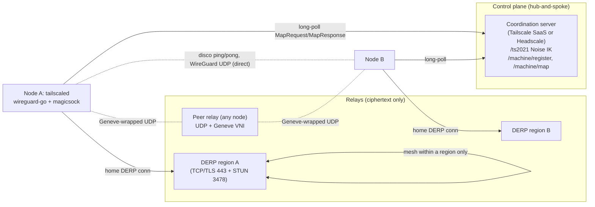
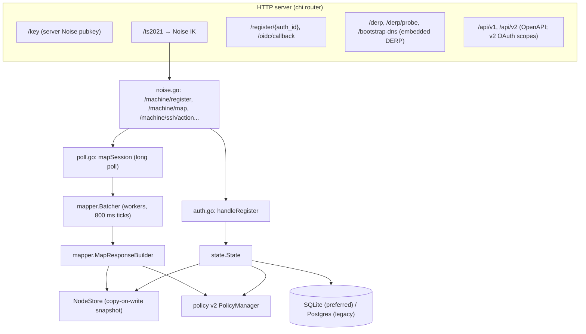

# 02 — Tailscale (magicsock, disco, DERP, netcheck, portmapper, peer relays, control protocol) and Headscale

> Research document for the Hacivat product family. Scope item 2 of the networking research track.
> Companion documents: `01-nat-traversal-fundamentals.md`, `03-netbird.md`, `04-iroh-libp2p-webrtc.md`, `05-perde-network-architecture-options.md`.

---

## 1. Scope and sources

### 1.1 What this document covers

How the most widely deployed "P2P-first, relay-as-fallback" overlay works end to end, at implementation depth:

- **Tailscale client** (`tailscaled`): the `magicsock` connection multiplexer, the per-peer endpoint state machine (path discovery, `bestAddr`, trust windows, heartbeats, upgrade/downgrade), the **disco** discovery protocol (all wire messages present at the studied commit), **DERP** relay protocol (client and server, mesh, WebSocket mode, rate limits, admission control), **netcheck** (NAT and latency probing, home-DERP choice with hysteresis), **portmapper** (NAT-PMP / PCP / UPnP-IGD), endpoint discovery and publication, **peer relays** (`net/udprelay`, Geneve-encapsulated UDP relays run by ordinary nodes), the key model, the Noise-IK control transport, the `register`/`map` long-poll protocol and its delta semantics, and the WireGuard integration.
- **Headscale**: the open-source coordination server — HTTP/Noise endpoints, data model, registration flows (pre-auth keys, interactive, OIDC), policy v2 compilation into packet filters and peer visibility, change batching and MapResponse generation, embedded DERP, database choice, and documented scaling limits.

Out of scope here (covered in other documents): RFC-level NAT fundamentals (doc 01), NetBird (doc 03), iroh/libp2p/WebRTC stacks (doc 04), and the final Perde/Karagöz/Hacivat architecture decision (doc 05). Section 5 of this document only lists Tailscale-derived recommendations that doc 05 should consume.

### 1.2 Sources

| Source | Version / commit | License | How used |
|---|---|---|---|
| `github.com/tailscale/tailscale` (cloned to `.refs/repos/tailscale`) | `7b2c32b9138b0ab2321910c7eaa8e81b24919dce` (2026-11-10) | **BSD-3-Clause** (`LICENSE`) | Primary evidence: read-only source reading, no build/run |
| `github.com/juanfont/headscale` (cloned to `.refs/repos/headscale`) | `443f3a0ecd76e9697eb01bd09a616340963e0b79` (2026-11-11), CHANGELOG head "0.30.0 (unreleased)" | **BSD-3-Clause** (`LICENSE`) | Primary evidence for the open-source control server |
| `github.com/tailscale/wireguard-go` (dependency, not cloned) | `v0.0.0-20261110220948-9e10ef9af415` per `go.mod:129` | MIT | Referenced only |
| Tailscale blog "How NAT traversal works" — https://tailscale.com/blog/how-nat-traversal-works | fetched 2026-11-11 | Proprietary text | Design rationale, birthday-paradox numbers |
| Tailscale blog "How Tailscale works" — https://tailscale.com/blog/how-tailscale-works | fetched 2026-11-11 | Proprietary text | Control/data plane split |
| Tailscale KB "DERP servers" — https://tailscale.com/kb/1232/derp-servers | fetched 2026-11-11 | Proprietary text | Operational DERP facts |
| Tailscale KB "Peer relays" — https://tailscale.com/kb/1591/peer-relays | fetched 2026-11-11 ("Last validated Feb 4, 2026") | Proprietary text | Peer relay configuration |
| Headscale docs in repo (`docs/about/faq.md`, `config-example.yaml`) | same commit as above | BSD-3-Clause | Scaling and DB statements |

**Licensing notes for reuse.** Both studied codebases are BSD-3-Clause. A future Rust implementation may port algorithms and constants freely with attribution (retain the copyright notice and disclaimer in `THIRD_PARTY_NOTICES`). This document nevertheless follows the research rules: no source is pasted; all logic is restated in prose or our own pseudocode, with file and line citations so an implementer can verify. Blog/KB text is proprietary and is only paraphrased.

### 1.3 Evidence tag conventions

`[Observed: path:line]` refers to the Tailscale clone unless prefixed with `headscale/`. Line numbers are for the commits above.

---

## 2. Executive summary

1. **Architecture**: hub-and-spoke control plane (keys + policy + endpoints only) and a mesh data plane; DERP relays carry only ciphertext and also act as the **signaling side channel** for hole punching [Observed: blog "How Tailscale works"; `derp/derp.go:1-20`].
2. **Every connection starts relayed and upgrades**: until a direct UDP path has answered a disco ping, packets go over the peer's *home DERP*; when a path is "trusted" packets go only direct; when trust lapses, packets are sent on **both** the stale UDP path and DERP [Observed: `wgengine/magicsock/endpoint.go:635-655`].
3. **Trust window is 6.5 s**, renewed by each pong; **heartbeat pings every 3 s** while the session is active; a session is idle after **45 s** without outbound traffic [Observed: `wgengine/magicsock/magicsock.go:4176-4211`].
4. **Path scoring** (`betterAddr`): direct beats peer-relay; otherwise latency percentage points plus bonuses (loopback +50, link-local +30, private +20, IPv6 +10) with a ≥1-point hysteresis; same address with larger probed MTU wins [Observed: `endpoint.go:2065-2150`].
5. **Re-probing policy**: full discovery whenever not direct or trust expired; otherwise every **60 s** unless current latency ≤ **5 ms** ("good enough") [Observed: `endpoint.go:1006-1023`, `magicsock.go:4185,4205`].
6. **Disco** is a tiny NaCl-box protocol (magic `TS💬`, 32-byte sender disco key, 24-byte nonce, then sealed `type|version|payload`), with **9 message types** at this commit: Ping, Pong, CallMeMaybe, BindUDPRelayEndpoint(+Challenge,+Answer), CallMeMaybeVia, AllocateUDPRelayEndpointRequest/Response [Observed: `disco/disco.go:5-57`].
7. **Hole punching = simultaneous disco pings**: the initiator pings every candidate (opening its NAT/firewall), then sends **CallMeMaybe** with its own endpoints over DERP; the receiver resets ping rate limits and pings back all of them [Observed: `endpoint.go:1428-1467`, `endpoint.go:2156-2236`].
8. **CallMeMaybe only goes out with fresh endpoints** (< 27 s since last STUN); otherwise a re-STUN is forced first [Observed: `magicsock.go:2712-2752`, `magicsock.go:4210`].
9. **Endpoint discovery** publishes typed candidates to control: local interface, STUN, portmapped, `STUN4LocalPort` (hard-NAT guess: STUN IP + fixed local port), explicitly configured; cloud metadata public IPs are added [Observed: `magicsock.go:1293-1461`, `tailcfg/tailcfg.go:1391-1400`].
10. **Periodic re-STUN every 20–26 s** (randomised, just under the common 30 s UDP NAT timeout) while not idle [Observed: `magicsock.go:910-930`].
11. **netcheck** probes DERP regions' STUN (UDP 3478), falls back to HTTPS and ICMP latency when UDP is blocked, detects "mapping varies by destination IP" (hard NAT) and port-mapping services; a report takes at most **5 s** [Observed: `net/netcheck/netcheck.go:58-88, 686-735, 832-1064`].
12. **Home DERP stickiness**: keep the old region unless the new one is ≥ **10 ms** better *and* better than 2/3 of the old latency; history window ≈ 5 min; never move home while disconnected from control [Observed: `netcheck.go:1373-1545`, `wgengine/magicsock/derp.go:159-225`].
13. **DERP protocol**: TCP/TLS on 443 (HTTP Upgrade "DERP" or WebSocket subprotocol "derp"), 5-byte frame header (1-byte type + BE uint32 length), 21 frame types, routing purely by 32-byte Curve25519 public key, server keep-alive every 60 s + jitter, 64 KiB max packet [Observed: `derp/derp.go:28-134`].
14. **DERP mesh**: servers in a region share a pre-shared **mesh key**, subscribe to each other's connection lists (`WatchConns` → `PeerPresent/PeerGone`) and forward with `ForwardPacket` (src+dst keys) — stateless forwarding keyed by public key [Observed: `cmd/derper/mesh.go`, `derp/derp.go:72-120`].
15. **Peer relays (since client 1.86)**: any node can run a UDP relay; endpoints are allocated over DERP, bound with a 3-way challenge handshake (BLAKE2s MAC over VNI/generation/peer key/src addr), and carried in **Geneve** headers (VNI); preference is direct > peer relay > DERP [Observed: `net/udprelay/server.go`, `disco/disco.go:296-658`; KB peer-relays].
16. **Control transport** is Noise **IK** (`Noise_IK_25519_ChaChaPoly_BLAKE2s`) over an HTTP upgrade at `/ts2021`, max frame 4096 bytes; map responses are length-prefixed (4-byte little-endian) zstd JSON, ≤ 256 MiB [Observed: `control/controlbase/handshake.go:27-40`, `control/controlbase/conn.go:26-34`, `control/controlclient/direct.go:1468-1493`].
17. **Map streaming** is a long-poll with keep-alives and delta encoding (`PeersChanged`, `PeersRemoved`, `PeersChangedPatch`, `OnlineChange`, `PeerSeenChange`; `nil` = unchanged); client watchdog **120 s** [Observed: `tailcfg/tailcfg.go:2008-2240`, `direct.go:1021`].
18. **Headscale** computes per-node filters and peer lists from a policy (grants/ACLs), uses a copy-on-write NodeStore and a batcher (default **800 ms** batch delay) that coalesces changes and sends deltas; keep-alive every **50 s + ≤9 s jitter** [Observed: `headscale/hscontrol/mapper/batcher.go`, `headscale/hscontrol/poll.go:26,70`, `headscale/hscontrol/types/config.go:643`].
19. **Headscale scope**: single tailnet, SQLite strongly preferred (Postgres "highly discouraged"), "can likely handle 100s of devices" when the network is calm; whole-world recomputation on changes is the bottleneck [Observed: `headscale/docs/about/faq.md:59-108`, `headscale/config-example.yaml:182-186`].
20. **Biggest lessons for Perde**: (a) start on relay, upgrade continuously; (b) use the relay as the signaling channel to avoid a separate round-trip service; (c) relays must be key-routed, stateless, and blind; (d) authorization is enforced at the receiving node (packet filter), not at the control plane — directly matches the Karagöz requirement.

---

## 3. Detailed findings

### 3.1 System architecture



- Control distributes **public keys, endpoints, home DERP region, DERP map, packet filter, DNS config**; private keys never leave nodes [Observed: blog "How Tailscale works"; `tailcfg/tailcfg.go:372-700` Node fields].
- Data plane: WireGuard packets over whatever path magicsock chooses; WireGuard (and therefore the overlay) is end-to-end encrypted irrespective of path.
- Policy is **enforced on the receiving node** by a packet filter derived from `MapResponse.PacketFilter(s)` [Observed: blog; `tailcfg/tailcfg.go:2125-2140`; Headscale `ReduceFilterRules` in §3.13].
- Asymmetric relaying: A sends to B's **home** DERP region; B sends to A's home DERP [Observed: blog; `endpoint.go:79` `derpAddr` is the peer's home; `magicsock/derp.go:339` creates connections to non-home regions on demand].

### 3.2 Key model

| Key | Type | Lifetime / storage | Purpose | Evidence |
|---|---|---|---|---|
| **Machine key** (`mkey:`) | Curve25519 | Long-lived, per device install | Noise IK static key for the control channel; identifies the *machine* to control | `types/key/machine.go:24-31`; `controlbase/handshake.go:63` (`ClientDeferred(machineKey, controlKey, ...)`) |
| **Control server key** | Curve25519 | Long-lived, fetched from `/key` | Responder static key in Noise IK (client must know it in advance — IK pattern) | `controlbase/handshake.go:63-70`; `headscale/hscontrol/app.go:530` |
| **Node key** (`nodekey:`) | Curve25519 | Rotated on re-auth; has `KeyExpiry` | WireGuard static public key **and** DERP address (DERP routes by it) | `types/key/node.go:29-40`; `tailcfg.go` `Node.Key`, `Node.KeyExpiry`; `endpoint.go:69` |
| **Disco key** (`discokey:`) | Curve25519 | **Regenerated on every start** | NaCl box keys for disco messages; lets nodes do path discovery without touching WireGuard state | `types/key/disco.go:23,77-82,219-239`; `endpoint.go:765-770` comment "disco keys reset on startup" |
| **DERP server key** | Curve25519 (a NodePublic) | Long-lived per derper | Sent in `FrameServerKey`; seals `FrameServerInfo`; also embedded in a TLS "metacert" CN `derpkey<hex>` for fast start | `derp/derp.go:72`; `derp/derpconst/derpconst.go`; `derphttp_client.go:477-505` |
| **DERP mesh key** | 32-byte PSK (64 hex chars) | Operator-managed file | Authenticates DERP servers to each other; grants `WatchConns`, `ForwardPacket`, `ClosePeer`; exempt from rate limits | `cmd/derper/derper.go:75`; `derpserver.go:1786-1797`, `1562-1568` |
| **Network-lock (TKA) key** (`nlpub:`) | Ed25519 | Per node | Tailnet Lock: trusted nodes sign node keys so a compromised control plane cannot inject peers | `types/key/tl.go:21-28`; `tailcfg.go` `RegisterRequest.NLKey`, `NodeKeySignature`; `tka/` |
| **Challenge key** (`chalpub:`) | Curve25519 | Ephemeral | Control-issued node-key challenge | `types/key/chal.go:19` |
| **Hardware attestation key** | platform key | Optional | Attests device in `MapRequest` | `types/key/hardware_attestation.go:20`; `tailcfg.go` `MapRequest.HardwareAttestationKey` |

Important design separation [Inferred from the above]: the **identity used for routing at relays (node key)** is the same as the WireGuard identity, so a relay can route without any additional state; the **disco key** is decoupled so path probing can be authenticated (only known peers' disco keys are accepted — `magicsock.go:2265-2285`) while being cheap to rotate.

### 3.3 Control protocol (ts2021)

#### 3.3.1 Transport

- Client connects with HTTP(S) to `/ts2021` asking `Upgrade: tailscale-control-protocol`; the **first Noise handshake message is embedded in the HTTP request header** `X-Tailscale-Handshake` to save one RTT [Observed: `control/controlhttp/constants.go:24-26`; `controlhttpcommon.go:10,15`; `controlbase/handshake.go:52-62` comment].
- Noise pattern **IK** with `Noise_IK_25519_ChaChaPoly_BLAKE2s`; prologue = `"Tailscale Control Protocol v" + version` [Observed: `controlbase/handshake.go:27-46`].
- Message types: 1 initiation, 2 response, 3 error, 4 record; initiation header 5 bytes; transport frames capped at **4096 bytes** (plaintext ≤ 4096 − 3 − 16) [Observed: `controlbase/messages.go:10-26`; `controlbase/conn.go:26-34`].
- Over the Noise conn, ordinary HTTP/2 requests are made: `POST /machine/register`, `POST /machine/map`, plus auxiliary endpoints (SSH action, set-DNS, c2n) [Observed: `headscale/hscontrol/noise.go:165-205`].
- Dial: control may push a `ControlDialPlan` to steer future dials; port 80 interception is detected and 443 forced [Observed: `controlhttp/constants.go` `DialPlan`, `logPort80Failure`; `direct.go:1330-1337`].
- Rate limiting: on 429 the client honours `Retry-After` or waits 5–10 s random [Observed: `direct.go:603-631`].

#### 3.3.2 Registration (`/machine/register`)

`RegisterRequest` carries capability `Version`, `NodeKey`, `OldNodeKey` (rotation), `NLKey`, `Auth` (auth key / OAuth), `Expiry` (a past expiry = logout), `Followup` (wait on interactive URL), `Hostinfo`, `Ephemeral`, signatures, `Tailnet` [Observed: `tailcfg/tailcfg.go:1320-1390`]. `RegisterResponse` returns `User`, `Login`, `NodeKeyExpired`, `MachineAuthorized`, `AuthURL` (interactive), `NodeKeySignature`, `Error`.

Flow [Observed: `direct.go:641-910`; Headscale `auth.go:51-180`]:
1. Client generates node key; sends register with `Auth.AuthKey` (pre-auth) or without (interactive).
2. Interactive: server answers with `AuthURL`; client opens browser and re-sends register with `Followup=AuthURL`; server blocks until the user completes login (Headscale `waitForFollowup`, `auth.go:332`).
3. Pre-auth key: synchronous; server validates key (not revoked, not expired, not used unless reusable) and creates/re-registers the node [Observed: `headscale/hscontrol/types/preauth_key.go:93-132`].
4. Node-key rotation: `OldNodeKey` identifies the previous registration.

#### 3.3.3 Map long-poll (`/machine/map`)

`MapRequest` fields (selected): `Version`, `Compress:"zstd"`, `KeepAlive:true`, `NodeKey`, `DiscoKey`, `Stream`, `Hostinfo`, `MapSessionHandle`/`MapSessionSeq` (resumption), `Endpoints` + parallel `EndpointTypes`, `TKAHead`, `OmitPeers`, `ReadOnly`, `DebugFlags` [Observed: `tailcfg/tailcfg.go:1438-1570`; `direct.go:1090-1145`].

Two request shapes:
- **Streaming poll**: `Stream=true, KeepAlive=true` — server holds the HTTP response open and writes a sequence of MapResponses.
- **Lite endpoint update**: `Stream=false, OmitPeers=true` — client pushes new endpoints/hostinfo, server just returns 200 [Observed: `headscale/hscontrol/poll.go:144-163`].

Framing: each MapResponse = 4-byte **little-endian** length + zstd-compressed JSON; max **256 MiB** compressed [Observed: `direct.go:1468-1493`]. Keep-alive message is `{"KeepAlive":true}` and is fast-pathed [Observed: `direct.go:1460`, `1496-1500`]. A client watchdog of **120 s** aborts a stalled stream [Observed: `direct.go:1021,1275`].

`MapResponse` delta semantics [Observed: `tailcfg/tailcfg.go:2008-2240`; `control/controlclient/map.go:550-600`]:
- First non-keepalive message must contain `Node` (self) — client errors otherwise [Observed: `direct.go:1361-1367`].
- `Peers` non-empty ⇒ full replacement (all other peer deltas ignored).
- Otherwise apply `PeersRemoved`, then `PeersChanged` (full node replace/add), then `PeersChangedPatch` (field-level: DERP region, endpoints, keys, online, last seen, cap map), `PeerSeenChange`, `OnlineChange`.
- `DERPMap`, `DNSConfig`, `Node`, `SSHPolicy`, etc.: **nil means unchanged**.
- `PacketFilter` = base filter; `PacketFilters` = named filters, `"*": nil` clears all named filters.
- `PingRequest` asks the client to prove liveness (HTTP to a URL); `PopBrowserURL`; `ControlTime`; `ControlDialPlan`.

### 3.4 WireGuard integration

- Tailscale uses its **fork of wireguard-go in userspace on all platforms** [Observed: `go.mod:129`; `wgengine/userspace.go:308-310`]. Kernel WireGuard is not used because magicsock must sit *under* WireGuard as its `conn.Bind` to multiplex disco/STUN/DERP on the same socket and to switch paths per packet [Observed: `magicsock.go:3524-3590` `Bind()`, `connBind.Open`] [Inferred: kernel WG cannot be given a custom bind].
- Each peer is presented to wireguard-go as an `endpoint` whose "address" is a **fake** `fakeWGAddr`; magicsock decides the real path on every `Send` [Observed: `endpoint.go:72,619-624`].
- DERP is addressed internally as `127.3.3.40:<regionID>` (`DerpMagicIP`) [Observed: `tailcfg/tailcfg.go:3074-3081`].
- **Lazy peers**: the engine installs a peer lookup function so wireguard-go creates peers on demand (`SetPeerConfigFunc`, `SyncDevicePeer`, `ScheduleHandshakeOnUserSend`) instead of configuring thousands of peers eagerly [Observed: `wgengine/userspace.go:682-725`].
- Inbound packets with unknown source but a WireGuard initiation get a `lazyEndpoint` that is resolved from the initiation's public key [Observed: `magicsock.go:4585-4650`].
- Default UDP port 41641 [Observed: `cmd/tailscaled/tailscaled.go:119`].

### 3.5 magicsock

#### 3.5.1 Packet demultiplexing on one UDP socket

All of STUN, naked disco, Geneve+disco, naked WireGuard and Geneve+WireGuard arrive on the same socket and are distinguished by byte patterns: STUN has `0x01` at byte 1; WireGuard's first byte is 1–4 with bytes 1–3 zero; disco starts with `0x54 0x53 0xf0 0x9f`; Geneve has protocol `0x7A11` (disco) or `0x7A12` (WireGuard) at bytes 2–3 [Observed: `magicsock.go:2126-2230`; `net/packet/geneve.go:13-24`]. Socket buffers are set to 7 MiB [Observed: `magicsock.go:90`].

Design implication [Inferred]: one socket per address family for everything keeps the NAT mapping discovered by STUN identical to the one used for data — a hard requirement for hole punching.

#### 3.5.2 Endpoint (candidate) discovery — `determineEndpoints`

Order of collection [Observed: `magicsock.go:1293-1461`]:
1. **Port mapping**: cached UPnP/PMP/PCP mapping, or start creating one (`EndpointPortmapped`).
2. **netcheck report** (§3.7): global v4/v6 STUN addresses (`EndpointSTUN`); `GetGlobalAddrs` includes the lowest-latency address plus any other address observed **more than once** (handles firewalls that hand out new mappings per STUN session, e.g. some Palo Alto devices) [Observed: `netcheck.go:137-169`].
3. **Hard-NAT guess**: if `MappingVariesByDestIP` is true and the local port is fixed, add *STUN IPv4 + local port* (`EndpointSTUN4LocalPort`) in case the user configured a static port forward [Observed: `magicsock.go:1354-1364`].
4. Debug "pretend endpoints" (`EndpointExplicitConf`).
5. **Cloud metadata** public IPs with the local port (`EndpointLocal`) [Observed: `magicsock.go:1376-1393`].
6. **Endpoint tracker**: re-add recently seen non-local endpoints for `5m10s` so transient STUN misses do not remove candidates [Observed: `magicsock.go:1407-1409`; `endpoint_tracker.go:22`].
7. User static endpoints (`EndpointExplicitConf`).
8. **Local interface addresses** with the bound port (`EndpointLocal`); loopback only if nothing else exists.

Endpoint types [Observed: `tailcfg/tailcfg.go:1391-1400`]: 0 unknown, 1 local, 2 stun, 3 portmap, 4 stun4localport, 5 explicitconf.

Publication: `setEndpoints` suppresses the very first update until a DERP map or a STUN result exists; changed sets are pushed to control (lite map request) [Observed: `magicsock.go:968-1007`].

Refresh cadence: after each update, if not idle, schedule a periodic re-STUN at a random **20–26 s** ("just under 30 s, a common UDP NAT timeout") [Observed: `magicsock.go:910-930`]. Periodic re-STUN stops when there are no peers, no key, network down, or idle > 45 s (unless control forces background STUN) [Observed: `magicsock.go:3763-3792`]. Port-mapping changes trigger re-STUN [Observed: `magicsock.go:3794`]. If the last netcheck could not send IPv4, rebind sockets first [Observed: `magicsock.go:944-952`].

#### 3.5.3 Per-peer endpoint state (`endpoint` struct)

Key fields [Observed: `endpoint.go:60-107`]:
- `derpAddr` — peer's home DERP (fallback/bootstrap path).
- `bestAddr` (`addrQuality{epAddr, relayServerDisco, latency, wireMTU}`), `bestAddrAt`, `trustBestAddrUntil`.
- `endpointState map[AddrPort]*endpointState` — per candidate: `lastPing`, `lastGotPing` (learned from inbound ping, not in netmap), `lastGotPingTxID` (dedupe raw socket vs UDP socket), `callMeMaybeTime`, ring of up to **64** pong replies, netmap index [Observed: `endpoint.go:453-490`].
- `sentPing map[TxID]sentPing` with per-ping timeout timer, purpose and size.
- `heartBeatTimer`, `lastSendExt` (outbound packets from WireGuard or CLI), `lastSendAny`, `lastRecvWG`, `lastRecvUDPAny`, `lastFullPing`, `lastUDPRelayPathDiscovery`.
- `probeUDPLifetime` (optional), `heartbeatDisabled` ("silent disco"), `isWireguardOnly`, `relayCapable`.

`epAddr` = `AddrPort` + optional Geneve VNI; `isDirect()` = valid, not DERP magic IP, no VNI [Observed: `endpoint.go:2032-2041`].

Candidate lifecycle:
- From netmap (control-provided endpoints).
- From inbound pings (`addCandidateEndpoint`) — learned at runtime, expire after `sessionActiveTimeout` (45 s) without a new ping; table pruned above 100 entries [Observed: `endpoint.go:1815-1853`, `510-523`].
- From CallMeMaybe — kept while advertised; the previous CallMeMaybe set is replaced [Observed: `endpoint.go:2156-2210`].

#### 3.5.4 Send path and path selection

On every WireGuard send [Observed: `endpoint.go:1112-1215`, `635-655`]:
1. If peer key expired → error.
2. `addrForSendLocked(now)`: if `bestAddr` valid and `now ≤ trustBestAddrUntil` → UDP only. Else return the (possibly stale) `bestAddr` **and** `derpAddr` → **send on both**.
3. If not direct or trust expired: `sendDiscoPingsLocked(now, sendCallMeMaybe=true)` (rate-limited per candidate to 5 s) and possibly start peer-relay discovery.
4. Note outbound activity → start heartbeat timer (3 s) if not running.
5. If no UDP and no DERP address known, fall back to the DERP region the peer last contacted us from (`fallbackDERPRegionForPeer`).
6. On "bad endpoint" send errors (e.g. host unreachable) clear `bestAddr` and that candidate's state [Observed: `endpoint.go:1145-1150, 1865-1879`].

WireGuard-only peers (no disco, e.g. external WireGuard exit nodes): choose lowest-latency candidate from ICMP pings, IPv6 preferred on ties; random pick with a 1 s trust when nothing is known [Observed: `endpoint.go:662-711`].

#### 3.5.5 `betterAddr` — path comparison (hysteresis)

Restated [Observed: `endpoint.go:2065-2150`]:
- Same `epAddr`: better only if larger `wireMTU`.
- Any valid beats invalid.
- Non-Geneve (direct) always beats Geneve (peer relay).
- Points: the faster of the two gets `100 − 100·fast/slow` points (percentage faster).
- Bonuses: loopback +50, link-local unicast +30, private (RFC 1918 / ULA) +20; IPv6 +10.
- If `aPoints ≤ 1 && bPoints == 0` → not better (≤1 % improvement is ignored: anti-flap).
- Else better iff `aPoints > bPoints`.

Consequence: a private LAN path at 2 ms beats a public path at 1.9 ms; IPv6 wins ties; a 200 ms → 199 ms improvement never triggers a switch.

#### 3.5.6 Pong handling

`handlePongConnLocked` [Observed: `endpoint.go:1934-2030`]:
1. Look up `sentPing[txid]`; unknown txid → not ours.
2. Latency = now − sent time; record pong (latency, from, reported src) in the candidate's ring.
3. Learn `epAddr → nodeKey` mapping (`peerMap.setNodeKeyForEpAddr`) so future inbound WireGuard packets from that address are attributed without trial decryption.
4. If not DERP: candidate quality = (addr, latency, MTU implied by ping size). If `betterAddr(candidate, bestAddr)` **or the current best is untrusted** → switch `bestAddr`.
5. If the pong came for the current best → update latency, `bestAddrAt = now`, `trustBestAddrUntil = now + 6.5 s`.

Pong payload includes the source address the responder saw (`Src`), effectively a STUN reflexive address for free [Observed: `disco/disco.go:249-260`].

#### 3.5.7 Heartbeat and re-probing

`heartbeat()` runs every **3 s** while there is outbound user traffic [Observed: `endpoint.go:874-947`]:
- If `now − lastSendExt > 45 s` → session idle: stop heartbeating (and optionally schedule a UDP-lifetime probe).
- Else, ping the current best UDP address (`pingHeartbeat`) — this keeps the NAT mapping alive and refreshes trust.
- If `wantFullPingLocked` → ping all candidates and send CallMeMaybe.
- If peer relays are configured and wanted → relay path discovery.

`wantFullPingLocked` [Observed: `endpoint.go:1006-1023`]: true if best is not direct, never full-pinged, or trust expired; false if latency ≤ 5 ms; true if ≥ 60 s since last full ping.

`wantUDPRelayPathDiscoveryLocked` [Observed: `endpoint.go:965-1004`]: only if peer relay servers exist, peer is relay-capable (capability version ≥ 121, `magicsock.go:2940-2942`), best is not a trusted direct path, and ≥ 30 s since last discovery; true when trust expired or ≥ 60 s since last.

#### 3.5.8 UDP path lifetime probing ("silent disco" research)

Optional: probes NAT session timeout "cliffs" of **10 s, 30 s, 60 s** at most once per **24 h**, only by the node with the lexicographically lower disco key; each probe is sent at `cliff − 2 s` of inactivity with ±0.25 s scheduling tolerance; cycle ends on all pongs or a timeout [Observed: `endpoint.go:160-335, 749-872`]. This is a measurement facility to eventually lengthen keep-alives. It shows Tailscale treats NAT timeout as an empirical, per-path quantity.

#### 3.5.9 Path MTU probing

When peer MTU probing is enabled, discovery pings are sent at several padded sizes (separate v4/v6 size lists); a pong at size S proves wire MTU ≥ S; `bestAddr.wireMTU` tracks it, and `betterAddr` prefers larger MTU on the same address [Observed: `endpoint.go:1388-1400, 1896-1932`; `peermtu.go`]. Disco ping `Padding` exists for this [Observed: `disco/disco.go:134-149`].

#### 3.5.10 Inbound disco handling

`handleDiscoMessage` [Observed: `magicsock.go:2232-2560`]:
1. Extract sender disco key from header; ignore if node is stopped.
2. Sender must be a **known peer's disco key** (or an active relay server handshake); otherwise drop (`metricRecvDiscoBadPeer`). This is the anti-amplification / anti-spoofing gate.
3. Record UDP receive time; open the NaCl box with the precomputed shared key; failure → drop silently (often an old disco key after restart).
4. Dispatch: Ping → `handlePingLocked`; Pong → `handlePongConnLocked`; CallMeMaybe (must arrive via DERP) → `handleCallMeMaybe`; relay messages → `relayManager`.

`handlePingLocked` [Observed: `magicsock.go:2600-2710`]: Geneve pings go to relayManager; for naked UDP pings, add the source as a candidate for every endpoint sharing that disco key (dedupe by TxID), then reply with Pong carrying the observed source. Repeated pings from the same source within 5 s are treated as heartbeats (log-suppressed).

#### 3.5.11 Link changes, rebind, roaming

- `Rebind()` rebinds sockets (trying to keep the current port), closes DERP connections whose local address is no longer on the default interface, and calls `resetEndpointStates` → each endpoint's `noteConnectivityChange` clears `bestAddr` and all candidate state [Observed: `magicsock.go:3994-4025`; `endpoint.go:1881-1894`].
- Effect: after a Wi-Fi change, the next packet sees an untrusted best address, so it goes over DERP **and** triggers full discovery + CallMeMaybe; the path re-upgrades within roughly one RTT to DERP plus one disco round trip [Inferred from the send path].
- `SetNetworkUp(false)` suppresses sends and STUN [Observed: `magicsock.go:2774-2793`].

#### 3.5.12 DERP usage inside magicsock

- One connection to the **home** region (`myDerp`) is kept; connections to other regions are opened on demand to reach peers whose home is elsewhere and closed after **60 s** without writes (checked every 15 s) [Observed: `magicsock/derp.go:1077-1085, 997-1042`].
- Each DERP region has a write queue of depth **32** [Observed: `magicsock/derp.go:332`].
- Home change notifies all active DERP clients via `NotePreferred` [Observed: `magicsock/derp.go:251-299`].
- If netcheck finds no region (UDP blocked and HTTPS failed), pick a deterministic fallback: keep the current home or choose pseudo-randomly [Observed: `magicsock/derp.go:114-157`].
- `SetOnlyTCP443` mode exists for networks where only TCP 443 works [Observed: `magicsock/derp.go:798`; `netcheck.go:835` `OnlyTCP443`].

### 3.6 Disco protocol — complete wire format (commit 7b2c32b)

#### 3.6.1 Envelope

```
offset  len  field
0       6    magic "TS💬" = 54 53 f0 9f 92 ac
6       32   sender disco public key (Curve25519)
38      24   nonce (random)
62      n    NaCl box (XSalsa20-Poly1305, precomputed shared key) of:
               0   1  message type
               1   1  message version (0 today; receivers ignore trailing bytes)
               2   …  type-specific payload
```
[Observed: `disco/disco.go:5-25, 35-40`; `types/key/disco.go:77-82, 219-239`; `magicsock.go:2054-2071`]

When sent through a peer relay, the envelope is prefixed by an 8-byte **Geneve** header (RFC 8926) with protocol `0x7A11` and the endpoint's 24-bit VNI; the Geneve "control" bit marks relay handshake messages [Observed: `magicsock.go:2046-2058`; `net/packet/geneve.go:13-24`]. WireGuard through a peer relay uses protocol `0x7A12`.

All multi-byte integers are big-endian. Addresses are 16-byte IPv6 (IPv4-mapped for v4) + 2-byte port (`epLength = 18`) [Observed: `disco/disco.go:219`].

#### 3.6.2 Message catalogue

| Type | Name | Transport | Payload layout (after 2-byte header) | Evidence |
|---|---|---|---|---|
| 0x01 | **Ping** | UDP direct, DERP, Geneve | TxID[12] ‖ optional sender NodeKey[32] ‖ zero padding (MTU probe). Parsing is lax: an all-zero key region is treated as padding | `disco.go:134-191` |
| 0x02 | **Pong** | reply on same path | TxID[12] ‖ observed source IP[16] ‖ port[2] (30 bytes) | `disco.go:249-284` |
| 0x03 | **CallMeMaybe** | DERP only | N × (IP[16] ‖ port[2]); empty or misaligned payload ⇒ no endpoints | `disco.go:193-247` |
| 0x04 | **BindUDPRelayEndpoint** | client→relay (Geneve, control bit) | Common[72]: VNI u32 ‖ Generation u32 (≠0) ‖ RemoteKey (other client's disco key)[32] ‖ Challenge[32] (padding here) | `disco.go:296-415` |
| 0x05 | **BindUDPRelayEndpointChallenge** | relay→client | Common[72], Challenge = server MAC | `disco.go:417-440` |
| 0x06 | **BindUDPRelayEndpointAnswer** | client→relay | Common[72], Challenge echoed | `disco.go:442-465` |
| 0x07 | **CallMeMaybeVia** | DERP only | UDPRelayEndpoint: ServerDisco[32] ‖ ClientDisco[2×32] ‖ LamportID u64 ‖ VNI u32 ‖ BindLifetime i64 ns ‖ SteadyStateLifetime i64 ns ‖ N×(IP[16]‖port[2]) (N ≥ 1) | `disco.go:539-658` |
| 0x08 | **AllocateUDPRelayEndpointRequest** | DERP only, to relay node | ClientDisco[2×32] ‖ Generation u32 | `disco.go:467-505` |
| 0x09 | **AllocateUDPRelayEndpointResponse** | DERP only, from relay node | Generation u32 ‖ UDPRelayEndpoint (as above) | `disco.go:507-537` |

Design properties worth copying [Inferred]:
- **Versioned, forward-compatible TLV-lite**: type + version + "ignore trailing bytes".
- **Authenticated and confidential** without WireGuard involvement; messages from unknown keys are dropped before decryption (cheap filter).
- **Ping carries the sender node key** to resolve disco-key→node-key ambiguity (one disco key may map to several nodes with node sharing) [Observed: `disco.go:137-147`; `magicsock.go:2566-2598`].
- **Pong = free STUN**.

### 3.7 netcheck — NAT and latency probing

#### 3.7.1 Report contents

`Report` [Observed: `netcheck.go:90-135`]: `UDP`, `IPv4`, `IPv6`, `IPv4CanSend`, `IPv6CanSend`, `OSHasIPv6`, `ICMPv4`, `MappingVariesByDestIP` (hard NAT), `UPnP`/`PMP`/`PCP` (tri-state), `PreferredDERP`, `RegionLatency` / `RegionV4Latency` / `RegionV6Latency`, `GlobalV4`/`GlobalV6` + observation counters, `CaptivePortal`.

Hairpinning is **no longer** tested [Observed: `netcheck.go:334-336` comment "We no longer send hairpin checks"].

#### 3.7.2 Timeouts and constants

| Constant | Value | Evidence |
|---|---|---|
| `ReportTimeout` | 5 s | `netcheck.go:61` |
| `stunProbeTimeout` (then switch to HTTPS) | 3 s | `netcheck.go:66` |
| `icmpProbeTimeout` | 1 s | `netcheck.go:69` |
| `httpsProbeTimeout` | = ReportTimeout | `netcheck.go:75` |
| `defaultActiveRetransmitTime` | 200 ms | `netcheck.go:81` |
| `defaultInitialRetransmitTime` | 100 ms | `netcheck.go:87` |
| `enoughRegions` | 3 | `netcheck.go:276-286` |
| `numIncrementalRegions` | 3 | `netcheck.go:441` |
| `fullReportInterval` | 5 min | `netcheck.go:1379` |
| `preferredDERPAbsoluteDiff` | 10 ms | `netcheck.go:1387` |
| `PreferredDERPFrameTime` | 8 s | `netcheck.go:1392` |
| `PreferredDERPKeepAliveTimeout` | 2 × 60 s | `netcheck.go:1401` |

#### 3.7.3 Probe plan

- **Initial / full** plan: for every region (except `NoMeasureNoHome`), 3 tries across the region's nodes at delays 0, 100, 200 ms, over v4 and/or v6 depending on interface state and node config [Observed: `netcheck.go:559-590`].
- **Incremental** plan: sort regions by last latency; take the fastest 3 **plus the current home** (always included to avoid flapping on one bad sample); the fastest two and home get 2 tries (home gets 4); slower dual-stack regions alternate v4/v6; delay per try = `try × max(1.2 × lastLatency, 200 ms)` plus `try × 50 ms` for try > 1 [Observed: `netcheck.go:455-557`].
- Full report forced every 5 min, or if the last report had no UDP and saw a captive portal [Observed: `netcheck.go:877-888`].
- Once 3 regions answered, a timer of `max observed latency` (×2 on full reports) stops remaining probes [Observed: `netcheck.go:692-704`].
- **Hard NAT detection**: the first IPv4 STUN reply sets `GlobalV4`; any later reply with a **different** `ip:port` sets `MappingVariesByDestIP = true` (endpoint-dependent mapping) [Observed: `netcheck.go:716-730`].
- **UDP blocked**: if no UDP reply within 3 s, measure HTTPS latency to each region (and ICMP in parallel) and log "UDP is blocked, trying HTTPS" [Observed: `netcheck.go:978-1020`]. On JS/WASM-like platforms, an HTTP-only check does `HEAD https://<node>/derp/probe` twice and times the second [Observed: `netcheck.go:1079-1148`].
- **Captive portal detection** runs only in full reports, stopped early when UDP works [Observed: `netcheck.go:940-952`].
- **Port-mapping probe** runs concurrently (§3.8).

#### 3.7.4 Preferred (home) DERP selection

See ALG-TS-03. Inputs are the current report, a ≈5 min history (`fullReportInterval + ReportTimeout`), optional server-side `DERPHomeParams.RegionScore` multipliers, recent DERP activity, and a forced preference [Observed: `netcheck.go:1406-1545`; `tailcfg/derpmap.go:51`].

### 3.8 portmapper

- Services: **NAT-PMP** and **PCP** on gateway UDP 5351, **UPnP IGD** via SSDP on UDP 1900 (unicast to gateway first, then multicast 239.255.255.250, both `ssdp:all` and `InternetGatewayDevice:1`) [Observed: `net/portmapper/portmapper.go:812-830, 1236-1258, 975-1070`].
- `Probe`: one 250 ms window sending PMP public-address request, PCP ANNOUNCE and SSDP; results cached ("saw recently") for **10 min** to avoid re-probing [Observed: `portmapper.go:106-110, 896-930`].
- Mapping order in `createOrGetMapping` [Observed: `portmapper.go:553-806`]:
  1. Reuse existing mapping until `RenewAfter`; renewal asks for the same external port.
  2. If both PMP and PCP disabled → UPnP only.
  3. If a probe ran in the last 5 s and saw neither PMP nor PCP → UPnP directly.
  4. Prefer **PCP** only if PCP was seen recently and PMP was not; otherwise **PMP** (external address request + UDP map request).
  5. On read timeout (250 ms) → fall back to UPnP.
  6. PCP responses are matched by a 12-byte nonce (reused for renewals).
- Lifetimes: requested **7200 s** (RFC-recommended 2 h) for PMP, PCP and UPnP; **renew at half** the granted lifetime [Observed: `portmapper.go:814, 764-770`; `pcp.go:30, 149-155`; `upnp.go:568-570`].
- Gateway must be IPv4 and in a private range [Observed: `portmapper.go:560-566`].
- A new mapping triggers `ReSTUN("portmap-changed")` so the portmapped endpoint is published [Observed: `magicsock.go:3794`].

### 3.9 DERP — Designated Encrypted Relay for Packets

#### 3.9.1 Connection establishment

1. TCP connect to `node.HostName:443` (or `DERPPort`; port 3340 in plain-HTTP debug mode), racing IPv4 and IPv6 (IPv4 delayed 200 ms if IPv6 preferred), **1.5 s** per node, nodes of a region tried in order, `STUNOnly` nodes skipped; overall connect budget 10 s; HTTP CONNECT proxy supported [Observed: `derp/derphttp/derphttp_client.go:342-362, 637-860`].
2. TLS. If TLS 1.3 and the server certificate chain contains the **metacert** (CN `derpkey<hex>`), the client learns the server key and protocol version from TLS and uses **fast start**: sends `GET /derp` with `Upgrade: DERP`, `Connection: Upgrade`, `Derp-Fast-Start: 1`, and immediately starts the DERP handshake without waiting for `101` [Observed: `derphttp_client.go:477-545`; `derp/derp.go:164-170`].
3. Otherwise wait for `HTTP/1.1 101 Switching Protocols` [Observed: `derpserver/handler.go:34-75`].
4. Optional header `Ideal-Node: <name of Region.Nodes[0]>` lets the server know the client is not on its ideal node (load-balancing hint) [Observed: `derp/derp.go:160-164`; `derphttp_client.go:518-520`].
5. **WebSocket mode**: `Upgrade: websocket` with subprotocol `derp`; clients use it on JS/WASM or when forced by `TS_DEBUG_DERP_WS_CLIENT` [Observed: `derpserver/websocket.go:21-60`; `derphttp_client.go:326-337, 403-425`].

#### 3.9.2 Frame format and types

Header: `type u8 ‖ length u32 BE` (5 bytes); max data packet 64 KiB; frames > 10 MiB refused on write [Observed: `derp/derp.go:28-38, 299-313`].

| Type | Name | Direction | Payload |
|---|---|---|---|
| 0x01 | ServerKey | S→C | magic `DERP🔑` (8B) ‖ server pubkey 32B ‖ future |
| 0x02 | ClientInfo | C→S | client pubkey 32B ‖ nonce 24B ‖ naclbox(JSON ClientInfo) |
| 0x03 | ServerInfo | S→C | nonce 24B ‖ naclbox(JSON ServerInfo) |
| 0x04 | SendPacket | C→S | dst pubkey 32B ‖ packet |
| 0x05 | RecvPacket | S→C | (v2) src pubkey 32B ‖ packet |
| 0x06 | KeepAlive | S→C | empty |
| 0x07 | NotePreferred | C→S | 1 byte: 1 = this is my home |
| 0x08 | PeerGone | S→C | pubkey 32B ‖ reason (0 disconnected, 1 not here) |
| 0x09 | PeerPresent | S→watchers | pubkey 32B ‖ [IP 16B ‖ port 2B] ‖ [flags] ‖ [len ‖ app name] |
| 0x0a | ForwardPacket | mesh S→S | src 32B ‖ dst 32B ‖ packet |
| 0x10 | WatchConns | mesh C→S | empty (requires mesh key) |
| 0x11 | ClosePeer | mesh C→S | pubkey 32B |
| 0x12 | Ping | either | 8 bytes |
| 0x13 | Pong | either | echoed 8 bytes |
| 0x14 | Health | S→C | UTF-8 error text, empty clears |
| 0x15 | Restarting | S→C | reconnectIn ms u32 ‖ tryFor ms u32 |

[Observed: `derp/derp.go:66-134`]. `PeerPresentFlags`: regular, mesh peer, prober, not-ideal [Observed: `derp/derp.go:150-158`]. Protocol version 2 [Observed: `derp/derp.go:46-49`].

`ClientInfo` JSON: `meshKey`, `version`, `CanAckPings`, `IsProber`, `AppName` [Observed: `derp/derp_client.go:219-242`]. `ServerInfo` JSON: `version`, optional token-bucket hints (bytes/s, burst) used by the client's send rate limiter [Observed: `derp/derp.go:306-313`; `derp_client.go:509-522, 776-791`].

Authentication of the client: `ClientInfo` is NaCl-sealed **from the client's private node key to the server's public key**, which proves possession of the node private key; the server then optionally runs admission (§3.9.5) [Observed: `derpserver.go:1961-2000`].

#### 3.9.3 Server internals

- **Routing table**: `clients: key → clientSet{activeClient, dup}`; duplicates (same key connected twice) are tracked and both flagged; the most recent is active [Observed: `derpserver.go:904-962`].
- **Lookup**: local active client → enqueue; else, if a mesh forwarder is registered for the key (`clientsMesh[dst]`) → `ForwardPacket` to the peer DERP; else drop with reason *unknown destination* and send `PeerGone(NotHere)` to the sender (rate-limited) [Observed: `derpserver.go:1480-1560`].
- **Per-client send queues**: depth **32** (configurable), **separate queue for disco** packets so discovery is not starved by data, **head drop** on overflow ("prioritizing fresher packets") [Observed: `derpserver.go:88-91, 1688-1730`].
- Write timeout 2 s (30 s for mesh peers); keep-alive every **60 s + rand(5 s)** [Observed: `derpserver.go:88-91, 2674-2680`].
- **Rate limiting** (experimental): per-client *receive* token bucket (bytes/s, burst ≥ 64 KiB + 32), implemented as read pacing so TCP flow control provides backpressure; mesh peers exempt; reloadable from JSON on SIGHUP [Observed: `derpserver.go:660-730, 1562-1635`; `cmd/derper/derper.go:93`].
- Linux XDP fast path for the STUN server exists (`derp/xdp`) [Observed: directory listing].

#### 3.9.4 Mesh (regional high availability)

[Observed: `cmd/derper/mesh.go:1-79`; `derp/derp.go:84-120`; `derpserver.go:964-1160, 2968-3105`]
1. All DERP servers in a region share a mesh key (`--mesh-psk-file`, 64 hex chars) and are listed in `--mesh-with=a,b,c` (own name allowed).
2. Each server dials every other as a privileged client (`MeshKey` in ClientInfo) and sends `WatchConns`.
3. The watched server floods `PeerPresent` for all connected clients, then streams `PeerPresent`/`PeerGone` changes.
4. The watcher registers `AddPacketForwarder(peerKey, meshClient)`; multiple forwarders per key are supported (`multiForwarder`).
5. When a local client sends to a key not connected locally but known via mesh, the server sends `ForwardPacket(src, dst, payload)` to the forwarder; the receiving server delivers it as `RecvPacket(src)`.
6. Mesh is **per region only**; cross-region relaying does not exist — the sender connects directly to the recipient's home region.

#### 3.9.5 Admission control (`verify-clients`)

- `--verify-clients`: ask the local `tailscaled` (`WhoIsNodeKey`) whether the connecting node key belongs to the tailnet [Observed: `derpserver.go:1800-1830`; `derper.go:83`].
- `--verify-client-url`: POST `{NodePublic, Source}` to an admission controller (5 s timeout, 4 KiB response cap); `--verify-client-url-fail-open` default **true** [Observed: `derpserver.go:1832-1865`; `derper.go:84-85`].
- `--disallow-app-names` rejects advertised app names; mesh peers bypass verification [Observed: `derpserver.go:1800-1812`].

#### 3.9.6 `derper` deployment flags (selected)

`-a :443`, `--http-port 80`, `--stun-port 3478`, `--stun` (default on), `--derp` (default on), `--certmode letsencrypt|manual|gcp`, `--hostname`, `--acme-ip-certs`, mesh flags, verify flags, `--accept-connection-limit/-burst`, `--rate-config`, `--tcp-keepalive-time 10m`, `--tcp-user-timeout 15s`, `--tcp-write-timeout 2s`, bootstrap DNS names [Observed: `cmd/derper/derper.go:58-110`].

#### 3.9.7 DERP map

`DERPMap{HomeParams{RegionScore}, Regions map[id]Region, OmitDefaultRegions}`; `DERPRegion{RegionID, RegionCode, RegionName, Lat/Long, Avoid, NoMeasureNoHome, Nodes[]}`; `DERPNode{Name, RegionID, HostName, CertName, IPv4, IPv6 ("none" disables), STUNPort, STUNOnly, DERPPort, InsecureForTests, STUNTestIP, CanPort80}` [Observed: `tailcfg/derpmap.go:19-300`]. Clients cache the DERP map so DERP works when control is down [Observed: KB DERP servers].

### 3.10 Peer relays (`net/udprelay`, `feature/relayserver`, `magicsock/relaymanager.go`)

Purpose: a cheap, UDP-native relay hop run by a customer's own node (e.g. a VM in the same VPC as hard-NAT servers) that is preferred over DERP [Observed: `net/udprelay/server.go:4-7`; KB peer relays: order direct → peer relay → DERP; clients ≥ 1.86].

Enabling [Observed: KB]: `tailscale set --relay-server-port=<udp port>` on the relay node; a policy **grant** with app capability `tailscale.com/cap/relay` from client sources to relay destinations. In code, a node treats a peer as a relay candidate if that peer holds `tailscale.com/cap/relay-target` toward it in the packet filter and its capability version ≥ 121 [Observed: `magicsock.go:2996-3060`; `tailcfg/peercap/peercap.go:59-62`] [Inferred: control translates the `cap/relay` grant into reverse-direction `relay-target` caps].

Server state [Observed: `server.go:58-130`]: one disco key for the server's lifetime; endpoints keyed by **sorted pair of client disco keys** and by **VNI** (1 … 2²⁴−1); monotonic **LamportID** per allocation; MAC secrets rotated every **2 min** (current + previous accepted); bind lifetime **30 s**, steady-state lifetime **5 min** without bidirectional traffic; `ServerRetryAfter` 3 s when not ready.

Protocol sequence (ALG-TS-01 covers the general punch; this is the relay variant):
1. Client A (wanting a better path to B) sends `AllocateUDPRelayEndpointRequest{ClientDisco:[A,B], Generation}` to the relay node **over DERP** (relay node's home region); request timeout 10 s with a single retry after 3 s if `ErrServerNotReady` [Observed: `relaymanager.go:1036-1100`].
2. Relay replies `AllocateUDPRelayEndpointResponse{Generation, ServerDisco, ClientDisco, LamportID, VNI, lifetimes, AddrPorts}`.
3. A sends `CallMeMaybeVia` (same endpoint description) to B over DERP [Observed: `relaymanager.go:860-885`].
4. Each client independently performs the **3-way bind** to one of `AddrPorts` with Geneve control bit: `Bind{VNI, Gen≠0, RemoteKey=other client}` → server replies `Challenge` with MAC = BLAKE2s-keyed(secret, VNI ‖ Gen ‖ RemoteKey ‖ observed src addr:port) → client sends `Answer` echoing it → server binds that leg to the source address [Observed: `server.go:132-251`]. The handshake is bounded by `min(BindLifetime, 30 s)` [Observed: `relaymanager.go:931-932`].
5. Clients disco-ping each other **through** the relay (Geneve VNI); a pong makes the relay path a candidate, installed via `udpRelayEndpointReady` if current best is untrusted, on the same relay server, or worse [Observed: `endpoint.go:113-137`].
6. Data: the relay forwards any Geneve packet from bound leg 0 to leg 1 and vice versa, counting bytes; unbound or unknown sources are dropped; the relay never decrypts WireGuard [Observed: `server.go:287-315`].
7. Duplicate/racing allocations are resolved by `(ServerDisco, LamportID)` — higher LamportID wins [Observed: `udprelay/endpoint/endpoint.go:24-40`; `relaymanager.go:760-800`].

Why the challenge contains the observed source address [Inferred]: it proves return routability of the claimed address (anti-spoofing / reflection), exactly like a QUIC Retry token or a STUN-with-cookie.

### 3.11 Published success rates and numbers

- "How NAT traversal works" estimates that STUN + firewall traversal + relay fallback yields "a direct connection over 90% of the time"; this is an author's estimate, not a measured statistic [Observed: blog, fetched 2026-11-11].
- Birthday-paradox numbers from the same post (one hard side opening 256 ports, easy side probing random ports): 50 % at 174 probes, 64 % at 256, 98 % at 1024, 99.9 % at 2048; at 100 packets/s, half of attempts connect in < 2 s. Two hard NATs: ≈170 000 probes per side for 99.9 % (~28 min) — "not looking good for any kind of interactive connectivity" [Observed: blog].
- Note: the current client code contains **no birthday-paradox port spraying**; the only hard-NAT accommodation in endpoint discovery is the `STUN4LocalPort` guess (§3.5.2), and peer relays are the product answer for hard-NAT pairs [Observed: absence in `magicsock`; `magicsock.go:1354-1364`; KB peer relays].
- DERP fleet: "Most regions have at least three DERP servers"; 28 listed locations at fetch time [Observed: KB DERP servers].

### 3.12 Headscale — architecture



[Observed: `headscale/hscontrol/app.go:527-566`; `noise.go:62,165-205`; package layout]

- Minimum supported client at this commit: **Tailscale v1.84.0** [Observed: `headscale/CHANGELOG.md:5`].
- Scope: "a _single_ Tailscale network (tailnet), suitable for a personal use, or a small open-source organisation" [Observed: `headscale/docs/about/faq.md:3-10`].

#### 3.12.1 Data model

[Observed: `headscale/hscontrol/db/schema.sql`]
- `users(id, name, display_name, email, provider_identifier, provider, profile_pic_url, timestamps, deleted_at)`; uniqueness rules allow the same name across providers but unique provider identifiers and unique local names (`schema.sql:7-45`).
- `credentials(id, kind ∈ {api, authkey, oauth_client, oauth_token}, identifier, hash, user_id, description, scopes, tags, reusable, ephemeral, used, last_seen, client_id, created_at, expiration, revoked, created_by_token)` — one table for API keys, pre-auth keys and OAuth; secrets are 256-bit server-generated and stored as **SHA-256** (bcrypt legacy being phased out by 0.32) (`schema.sql:46-70`; `CHANGELOG.md:38-62`).
- `nodes(id, machine_key, node_key, disco_key, endpoints, host_info, ipv4, ipv6, last_control_address, hostname, given_name, user_id (NULL for tagged nodes), register_method, tags, auth_key_id, ephemeral, last_seen, expiry, approved_routes, auto_approved_routes, timestamps)` (`schema.sql:72-104`).
- `policies(id, data, ...)` — the policy document can live in the DB or a file (`schema.sql:106-114`).
- Pre-auth key format: `hskey-auth-<identifier>-<secret>` [Observed: `headscale/hscontrol/db/preauth_keys.go:86, 231-240`]; keys must be tagged **or** user-owned (`preauth_keys.go:98-101`).

#### 3.12.2 Registration flows

[Observed: `headscale/hscontrol/auth.go:51-180, 330-566`]
1. Validate requested expiry. **Past expiry ⇒ logout** (takes precedence even if an auth key is present; deleted nodes get `NodeKeyExpired` rather than consuming the key).
2. `Auth == nil`: restart of an existing node → return current state (only if the Noise session's **machine key matches** the stored node — prevents node-key-only impersonation, `auth.go:43-50, 100-110`).
3. `Followup` present → wait for the interactive registration to complete (URL length ≤ 2048).
4. `Auth.AuthKey` present → `HandleNodeFromPreAuthKey`: validate (not revoked, not expired, reusable or unused), determine tags from the key, find an existing node by machine key + user for re-registration, else create; mark single-use keys used.
5. Otherwise interactive: create an `AuthID`, return `AuthURL = /register/<auth_id>`; an admin runs `headscale nodes register` or the user completes **OIDC** (`/oidc/callback`, `/register/confirm/{auth_id}`).
6. Ephemeral nodes are garbage-collected after `node.ephemeral.inactivity_timeout` (default **120 s**) after their map session ends [Observed: `headscale/hscontrol/types/config.go:637`; `poll.go:127-133`].

#### 3.12.3 Policy v2 → packet filters and peer visibility

- Policy language: Tailscale-compatible **grants** and legacy ACLs, groups, tags (+tag owners), hosts, autogroups (`autogroup:self`, `autogroup:member`, `autogroup:internet`...), `via` grants for routes, node attributes, SSH rules [Observed: `headscale/hscontrol/policy/v2/types.go`, `compiled.go:263-500`, `filter.go`].
- Compilation produces `[]tailcfg.FilterRule{SrcIPs, DstPorts[{IP, Ports}], IPProto, CapGrant}` plus matchers. Global rules are compiled once; `autogroup:self` and `via` force a **per-node** path (`needsPerNodeFilter`) [Observed: `compiled.go:762-830`; `policy.go:1082-1113`].
- **Per-node filter** = `ReduceFilterRules(node, rules)`: keep only destinations that are the node's own IPs or covered by its subnet/exit routes; CapGrant rules reduced separately [Observed: `headscale/hscontrol/policy/policyutil/reduce.go`]. Cached per node until policy/node changes.
- **Peer visibility** (`BuildPeerMap`) is **symmetric**: A and B see each other if any matcher lets A reach B or B reach A, or they belong to the same user; exit nodes additionally list sources holding internet capabilities. Implementation trick: for each node compute a bitset of matchers where it is a source and one where it is a destination; A→B iff `src(A) ∧ dst(B) ≠ 0` — O(n·m) set evaluation plus O(n²) word ANDs [Observed: `headscale/hscontrol/policy/v2/policy.go:831-1015`].
- Enforcement is on the destination node (Tailscale client packet filter); Headscale itself never sees data.

#### 3.12.4 Change propagation: NodeStore, batcher, mapper

- **NodeStore**: copy-on-write snapshot (`atomic.Pointer[Snapshot]`), reads never block, writes are queued and batched (`node_store_batch_size`, `node_store_batch_timeout` default 500 ms) to amortise peer recomputation [Observed: `headscale/hscontrol/state/node_store.go:105-133`; `config.go:645-646`].
- **Change** records: `Reason, TargetNode, OriginNode, IncludeSelf, IncludeDERPMap, IncludeDNS, IncludeDomain, IncludePolicy, PeersChanged, PeersRemoved, PeerPatches, SendAllPeers, DeletedNodes, RequiresRuntimePeerComputation, PingRequest` [Observed: `headscale/hscontrol/types/change/change.go:15-60`].
- **Batcher** [Observed: `headscale/hscontrol/mapper/batcher.go`]: ticker at `tuning.batch_change_delay` (default **800 ms**, `config.go:643`), worker pool (`tuning.batcher_workers`), work channel `workers × 200`. `addToBatch`: deleted nodes are removed and their sessions closed; a **full** change collapses all pending changes per node; targeted changes go to one node; broadcasts to all. `processBatchedChanges`: at most **one in-flight bundle per node** (ordering), dedupe policy changes, coalesce peer deltas into one frame. Offline node state is cleaned after **15 min** (checked every 5 min).
- **Mapper**: `buildFromChange` assembles only the requested parts (self, DERP map, DNS, domain, packet filters + SSH policy, full peer list or `PeersChanged`/`PeersRemoved`, visible `PeerPatches`, ping request); policy changes compute removed peers by diff against what the node was last sent [Observed: `headscale/hscontrol/mapper/mapper.go:343-421`; `batcher.go:84-176`].
- **Map session** [Observed: `headscale/hscontrol/poll.go`]: keep-alive every **50 s + rand(0–9 s)**; initial MapRequest applied to state *before* `Connect` (so routes are known before HA primary election); on disconnect wait up to **15 s** for reconnection before marking offline (matches SaaS behaviour); writes bounded by a 5 s grace on shutdown.

#### 3.12.5 Embedded DERP and DB

- Optional embedded DERP (`derp.server.enabled`) with region id default 999, `verify_clients: true`, STUN listener required (`0.0.0.0:3478`), auto-added to the DERP map; external DERP maps loaded from URLs (default Tailscale's) and files, refreshed every 3 h [Observed: `headscale/config-example.yaml:70-136`].
- DB: SQLite default; "using Postgres is highly discouraged as it is only supported for legacy reasons" [Observed: `config-example.yaml:182-186, 215-217`].
- Scaling: the FAQ explains the "world map" recomputation bottleneck: large calm networks (1000 servers) and small busy networks (80 laptops) are fine; large busy networks may never catch up [Observed: `docs/about/faq.md:59-108`].

---

## 4. Algorithm specifications

### ALG-TS-01: Disco ping/pong and CallMeMaybe hole-punch orchestration (as implemented)

- **Problem**: Two nodes, each behind arbitrary NAT/firewalls, know each other's candidate endpoints (from control and/or CallMeMaybe) and share a relay (DERP). Open a direct UDP path with no dedicated signaling server and minimal latency.
- **Inputs / outputs**: Inputs — local disco keypair; peer disco public key; peer candidate set (netmap endpoints + CallMeMaybe endpoints + learned-from-ping endpoints); peer home DERP region; own fresh endpoint list (with timestamp). Outputs — pongs that feed ALG-TS-02 (path selection); inbound pings that create candidates; a CallMeMaybe sent over DERP.
- **Algorithm**:
  1. *Trigger (initiator A)*: an outbound packet to B finds no trusted direct path (`!isDirect(best) || now > trustUntil`), or heartbeat decides `wantFullPing` (ALG-TS-02 step 5).
  2. *Ping all candidates*: for each candidate c of B: if c is stale (`shouldDelete`), delete it; skip if `now − c.lastPing < 5 s` (`discoPingInterval`); else record `sentPing[txid]={to:c, at:now, purpose:discovery, timer: 5 s}` and send `Ping{TxID, NodeKey=A.nodeKey}` sealed to B's disco key, directly over UDP from the **same socket** used for data. With PMTU probing enabled, send one ping per probe size.
  3. *Signal*: if at least one ping was sent and B's DERP address is known, enqueue CallMeMaybe: if A's endpoints were refreshed within 27 s, send `CallMeMaybe{MyNumber = A.lastEndpoints}` to B via B's home DERP; otherwise register a one-shot callback, force `ReSTUN("refresh-for-peering")`, and send after the refresh completes.
  4. *Receiver B on CallMeMaybe* (accepted only via DERP from a known disco key): mark previous CallMeMaybe endpoints for deletion; for each advertised endpoint (skipping IPv6 link-local) add/refresh candidate with `callMeMaybeTime=now`; delete previously-advertised endpoints that are absent; **zero `lastPing` for all candidates** (bypass the 5 s rate limit) and ping all candidates without sending its own CallMeMaybe; optionally start peer-relay discovery.
  5. *Receiver of a Ping* (either side, on UDP): drop if sender disco key unknown or box fails; if TxID equals the last seen TxID for that source → duplicate, drop; add the source address as a runtime candidate for every node using that disco key (refresh `lastGotPing`); if the ping is unambiguous (embedded node key matches exactly one node), map `src → nodeKey`; reply `Pong{TxID, Src=observed source}` to the source over the same path (UDP or DERP).
  6. *Receiver of a Pong*: see ALG-TS-02 step 3.
  7. *Timeout*: after 5 s without pong, remove `sentPing[txid]` (for heartbeat-for-lifetime pings, record a cliff failure).
  8. Because both sides now send pings to each other's public mappings within ~1 DERP RTT, each NAT has an outbound mapping/permission toward the other, and one of the crossing pings (or the subsequent replies) traverses — classic simultaneous open.
- **Data structures**: per peer `endpointState` map keyed by `ip:port` (`lastPing`, `lastGotPing`, `lastGotPingTxID`, `callMeMaybeTime`, pong ring[64]); `sentPing` map keyed by 12-byte TxID; `isCallMeMaybeEP` set; global `onEndpointRefreshed` callbacks; `peerMap` indexes by node key, disco key, and `epAddr`.
- **Complexity / performance notes**: O(k) pings per discovery round (k candidates, typically 2–8); pings are ~100 bytes; rounds are rate-limited to one per candidate per 5 s except right after CallMeMaybe. Candidate table pruned at 100 entries. Total time to direct ≈ DERP RTT (CallMeMaybe) + UDP RTT, usually < 1 s for cone NATs [Inferred].
- **Edge cases (exhaustive list)**:
  1. Peer does not support disco (old/WireGuard-only) → no pings; ICMP-latency selection instead.
  2. B's home DERP unknown → pings still sent, no CallMeMaybe; B learns A only from A's pings if they arrive.
  3. A's endpoints stale (> 27 s) → CallMeMaybe delayed until re-STUN finishes; DERP keeps carrying data meanwhile.
  4. A's NAT is endpoint-dependent (hard) → A's STUN endpoint is wrong for B; B's pings to it fail; A's pings to B succeed if B is easy → B learns A's real mapping from the ping source and pongs back (works one-hard/one-easy).
  5. Both hard → no direct path; peer relay or DERP remains.
  6. Ping arrives on raw socket and UDP socket (Linux) → dedupe by TxID.
  7. Old disco key in flight after restart → box open fails, silently dropped.
  8. One disco key mapped to multiple nodes (node sharing/account switch) → candidate added to all; pong attributed via `sentPing`; reply sent without node key.
  9. CallMeMaybe with zero or misaligned endpoints → treated as empty: deletes previous CallMeMaybe candidates, still triggers pings to remaining ones.
  10. CallMeMaybe arriving over UDP → not accepted (contract: DERP only).
  11. IPv6 link-local endpoints → ignored (zone-less).
  12. Peer node key expired → send fails with `errExpired`; no discovery.
  13. Network down → sends suppressed.
  14. Ping from a source while `debugNeverDirectUDP` → ignored (test knob).
  15. Packet loss of all pings → retried on the next heartbeat (3 s) subject to the 5 s per-candidate limit.
  16. Candidate learned only from inbound ping and no further pings for 45 s → deleted.
  17. Simultaneous CallMeMaybe from both sides → both reset rate limits; harmless duplicate pings.
  18. Large MTU probe pings dropped by path → small ping still succeeds; best address keeps smaller MTU.
- **Test cases (input → expected)**:
  1. A and B on the same LAN; candidates include private addresses → first pong from private address; `bestAddr` = private; DERP used only for the first packets.
  2. A full-cone, B port-restricted cone, both with fresh STUN → after CallMeMaybe, B's ping to A's STUN address succeeds and A's earlier ping opened B's... expected: direct within 1 DERP RTT + 1 UDP RTT.
  3. A's endpoints refreshed 40 s ago → CallMeMaybe not sent until ReSTUN completes; assert ReSTUN reason `refresh-for-peering`.
  4. B receives CallMeMaybe listing {X, Y}, previously had CallMeMaybe {Y, Z} → Z deleted, X added, all `lastPing` zeroed, pings to X and Y sent immediately.
  5. Duplicate ping with identical TxID from same source → exactly one pong.
  6. Ping from unknown disco key → no pong, bad-peer counter incremented.
  7. Ping over DERP from known node → pong over DERP to that node key.
  8. All pings time out → `sentPing` empty after 5 s, `bestAddr` unchanged (DERP continues).
  9. CallMeMaybe payload length 17 → parsed as empty list.
  10. Two nodes share disco key K; ping from K at S → S added as candidate to both endpoints; pong sent with zero dstKey.
- **Prior art and evidence**: `wgengine/magicsock/endpoint.go:1335-1467, 1815-1853, 2156-2236`; `magicsock.go:2232-2760`; `disco/disco.go`; RFC 8445 (ICE) connectivity checks are the standard analogue but Tailscale omits ICE priorities/nomination in favour of latency scoring.
- **Used by**: Hacivat | Karagöz (peers); Perde only as relay/signaling channel.

### ALG-TS-02: Relay-first, upgrade-to-direct path selection with trust windows and hysteresis

- **Problem**: Decide per packet which path(s) to use (direct UDP, peer relay, DERP), keep the chosen path alive, detect its death quickly, and switch to better paths without flapping.
- **Inputs / outputs**: Inputs — per-peer `bestAddr{addr, vni, relayServerDisco, latency, wireMTU}`, `trustBestAddrUntil`, `derpAddr`, pong events, time, send errors, link-change events. Outputs — destination set for each send (UDP, DERP, or both), heartbeat pings, discovery triggers.
- **Algorithm**:
  1. *Send decision*: if `best` valid and `now ≤ trustUntil` → send UDP only. Else send to `best` (if any) **and** to DERP. If neither known, use the DERP region the peer last used to reach us; else fail.
  2. *Discovery on send*: if `best` not direct or trust expired → run ALG-TS-01 step 2–3; if peer relays exist and `wantRelayDiscovery` → allocate/handshake relay endpoints.
  3. *Pong received for txid sent to addr a with latency L and size s*: `cand = {a, L, mtu(s)}`. If `betterAddr(cand, best)` or `now > trustUntil` → `best = cand`. If `best.addr == a` → `best.latency = L; bestAt = now; trustUntil = now + 6.5 s`.
  4. *Relay endpoint ready* (pong via peer relay): install if current best untrusted, or same relay server (rebinding), or `betterAddr` says so; set `trustUntil = now + 6.5 s`.
  5. *Heartbeat* every 3 s while `now − lastSendExt ≤ 45 s`: ping `best` (if UDP); if `wantFullPing` (not direct, or never, or trust expired, or (latency > 5 ms and ≥ 60 s since last full ping)) → full discovery; if `wantRelayDiscovery` (relays configured, peer capable, not trusted-direct, ≥ 30 s since last, and (trust expired or ≥ 60 s)) → relay discovery. Reschedule.
  6. *Idle*: when `now − lastSendExt > 45 s`, stop heartbeats; NAT mappings may expire; next send restarts at step 1 (likely untrusted ⇒ dual send).
  7. *Hard failures*: send error classified as "bad endpoint" → clear best and that candidate's history. Link change / rebind → clear best and all candidate history.
  8. `betterAddr(a, b)`: as in §3.5.5 (direct > relay; percentage points + loopback 50 / link-local 30 / private 20 / IPv6 10; ≤1-point improvement ignored; same address → larger MTU).
- **Data structures**: `addrQuality`; per-candidate pong ring of 64; monotonic clock values; heartbeat timer.
- **Complexity / performance notes**: constant work per packet (two comparisons); dual sending during the ≤ few-second untrusted window doubles bandwidth briefly; heartbeat cost ≈ 1 small packet / 3 s / active peer. Detection of a dead direct path ≤ 6.5 s (trust expiry) after the last pong; during that window packets may be lost, after it they are duplicated to DERP.
- **Edge cases (exhaustive list)**:
  1. First packet ever: no best → DERP only + discovery.
  2. Pong from an address not equal to the pinged address (NAT rewrite) → `sentPing.to` is used as the path; mismatch logged.
  3. Pong arrives via DERP (CLI ping) → does not affect `bestAddr`.
  4. Two candidates within 1 % latency → no switch (hysteresis).
  5. Private 10 ms vs public 9 ms → private wins (bonus 20 > ~10 points).
  6. IPv6 vs IPv4 equal latency → IPv6 wins.
  7. Direct 80 ms vs peer relay 20 ms → direct still wins (relay always lower preference).
  8. Best path silently dies while idle → first send after idle sees expired trust → dual send.
  9. Asymmetric loss (pongs lost) → trust expires, dual-send continues while pings retry; DERP keeps traffic flowing.
  10. Clock: monotonic time used, so wall-clock jumps (sleep) do not extend trust incorrectly [Inferred from `mono.Time`].
  11. Laptop sleep → on wake, trust expired; netmon link change triggers rebind/reset.
  12. Latency ≤ 5 ms → no periodic re-probing (saves battery) unless trust lapses.
  13. Same relay server re-handshake with new source address → must replace best, or the relay would drop packets from the old binding.
  14. Heartbeats disabled by control (silent disco) → trust lapses after 6.5 s; dual-send more often.
  15. WireGuard-only peer → random candidate with 1 s trust until latency known.
- **Test cases (input → expected)**:
  1. best=A (trusted), send at t → UDP only.
  2. best=A, trust expired → UDP to A and DERP.
  3. best=A@50 ms, pong from B@40 ms public → switch to B (20 points vs 0).
  4. best=A@50 ms, pong from B@49.6 ms → no switch.
  5. best=A@10 ms public v4, pong from B@10 ms public v6 → switch to B.
  6. best=relay@20 ms, pong from direct@100 ms → switch to direct.
  7. Heartbeat with latency 3 ms and last full ping 5 min ago → no full ping.
  8. Heartbeat with latency 30 ms and last full ping 61 s ago → full ping + CallMeMaybe.
  9. No outbound traffic for 46 s → heartbeat stops.
  10. Send returns EHOSTUNREACH → best cleared; next send dual.
- **Prior art and evidence**: `endpoint.go:113-137, 635-655, 874-1023, 1112-1215, 1856-1894, 1934-2150`; `magicsock.go:4176-4228`; RFC 8445 §8 (nomination) for contrast.
- **Used by**: Hacivat | Karagöz.

### ALG-TS-03: DERP home region selection and failover

- **Problem**: Choose one "home" relay region per node: the address peers send to when no direct path exists, and the signaling mailbox. It must be close (latency) but stable (peers learn it via control with delay).
- **Inputs / outputs**: Inputs — current netcheck report (region latencies via STUN or HTTPS), report history (≤ 5 min 5 s), previous home, last-activity time per region, optional `RegionScore` multipliers, forced region, control connectivity, DERP map. Output — `PreferredDERP` and home connection; `NotePreferred` to servers; home published to control.
- **Algorithm**:
  1. Append report to history; prune entries older than `fullReportInterval + ReportTimeout`.
  2. `bestRecent[r]` = min latency over history; multiply by `RegionScore[r]` if > 0.
  3. Among regions in the *current* report that can serve DERP (not STUN-only), choose `cand` minimising `bestRecent`; remember `oldCur` = current-report latency (scaled) of previous home.
  4. If changing and the old region is accessible (has current latency, or a DERP frame was received from it since the report started or within 8 s): keep old if `oldCur − bestAny < 10 ms` **or** `bestAny > (2/3)·oldCur`.
  5. If a forced region exists in the map and it had a latency sample or recent activity → use it.
  6. If no region chosen but the old home was heard from within 2 × 60 s → keep old.
  7. In magicsock: if not connected to control and a home already exists → **do not change** (peers could not learn it). If report gives 0 → fallback: keep current or pick pseudo-random region.
  8. On change: set home, `NotePreferred(true)` on the new connection and `false` on others, start connecting, publish event; control receives the new home via the next map request.
  9. DERP client failover inside a region: nodes tried in order with 1.5 s per node; region unreachable ⇒ next netcheck chooses another region.
- **Data structures**: map time → report; map region → latency; per-region last-activity timestamps.
- **Complexity / performance notes**: O(R · H) per report (regions × history ≤ ~10). Incremental reports probe ≤ 4 regions, so steady-state cost is tiny.
- **Edge cases (exhaustive list)**:
  1. UDP blocked → HTTPS latencies used; still selectable.
  2. Everything blocked → no latency; keep old if recently active; else random fallback.
  3. Old home removed from DERP map → ignored for stickiness.
  4. Region marked `Avoid` → excluded from incremental sorting unless it is the current home.
  5. `NoMeasureNoHome` → never probed, never home.
  6. STUN-only region fastest → cannot be home.
  7. Single noisy high sample on home → history minimum + "home always probed" prevents a flap.
  8. Control disconnected → no home change (unless no home at all).
  9. `RegionScore` < 1 makes a region artificially more attractive (operator steering).
  10. Homeless mode (`SetHomeless`) → no home; node reachable only directly.
  11. Forced region down (no sample, no activity) → normal selection.
- **Test cases (input → expected)**:
  1. Old=A 30 ms, new B 25 ms → keep A (diff < 10 ms).
  2. Old=A 30 ms, B 15 ms → 15 > 20? no; diff 15 ≥ 10 → switch to B.
  3. Old=A 100 ms, B 80 ms → 80 > 66.7 → keep A.
  4. Old=A no STUN reply but DERP frame 3 s ago, B 20 ms → A accessible with oldCur=0 → diff test `0 − 20 < 10` true → keep A.
  5. Old=A unreachable (no latency, no activity), B 50 ms → switch to B.
  6. No latency anywhere, old A heard 90 s ago → keep A; heard 130 s ago → 0 → magicsock fallback keeps A as current home.
  7. Forced C with sample → C.
- **Prior art and evidence**: `net/netcheck/netcheck.go:1373-1545, 411-557`; `wgengine/magicsock/derp.go:114-299`.
- **Used by**: Hacivat | Karagöz (client side); Perde (relay map publication).

### ALG-TS-04: DERP frame forwarding and regional mesh (stateless forwarding by public key)

- **Problem**: Relay opaque packets between clients addressed only by public key, across several servers in a region, without per-flow state, with bounded memory and fair treatment of signaling traffic.
- **Inputs / outputs**: Inputs — authenticated client connections (key K), `SendPacket(dst, payload)` frames, mesh watch streams. Outputs — `RecvPacket(src, payload)` to the destination, `ForwardPacket` to a peer server, `PeerGone` notifications, drop counters.
- **Algorithm**:
  1. *Accept*: send `ServerKey`; read `ClientInfo` (≤ 1 MiB), open the NaCl box from the claimed client key — success proves key possession; verify protocol version; run admission (mesh key ⇒ trusted; else local-tailscaled / admission URL / app-name denylist); send sealed `ServerInfo`.
  2. *Register*: `clients[K].add(conn)`; if another conn exists for K, mark both duplicates, make the newest active; record `remoteIP → K`; broadcast `PeerPresent(K, ip:port, flags)` to watchers (mesh peers).
  3. *SendPacket from S to D*: apply S's receive rate limit by pacing reads; look up D: local active conn → enqueue `{src:S, payload}`; else mesh forwarder for D → `ForwardPacket(S, D, payload)`; else drop (reason unknown-dest or dup-client) and, rate-limited, send `PeerGone(D, NotHere)` to S.
  4. *Enqueue*: choose disco queue if payload starts with disco magic, else data queue; queue depth 32; if full, drop the **oldest** packet; wake the writer if queue was empty.
  5. *Writer*: drain queues into `RecvPacket(src, payload)` frames; flush; per-write deadline 2 s (30 s for mesh); on keep-alive timer (60 s + rand 5 s) send `KeepAlive`; answer `Ping` with `Pong`.
  6. *Disconnect*: remove conn; if K has no conns left, broadcast `PeerGone` to watchers and notify senders that recently sent to K (`PeerGone(K, Disconnected)`).
  7. *Mesh*: each server dials all others with the mesh key and `WatchConns`; on `PeerPresent(K)` add forwarder `K → that server`; on `PeerGone(K)` remove it; on mesh conn loss remove all forwarders learned from it (reason `MeshConnBroke`, local-only code `0xf0`).
  8. *ForwardPacket received from a mesh peer*: deliver to local D as `RecvPacket(src)`; never re-forward (one hop) [Inferred from single lookup + local delivery].
  9. *ClosePeer(K)* from a mesh peer: close K's local connection (load balancing).
- **Data structures**: concurrent map key → clientSet; `clientsMesh` key → forwarder (possibly multi); per-client bounded ring queues ×2; watcher list; per-client token bucket.
- **Complexity / performance notes**: O(1) per packet; memory ≈ connections × 2 × 32 × packet size; no per-flow state; the server never decrypts payloads. Throughput limited by TCP (head-of-line) and one TLS stream per client.
- **Edge cases (exhaustive list)**:
  1. Destination connected to two servers in the region → multiple forwarders; any works.
  2. Destination connected twice to the same server → duplicate; packets go to the active (newest) conn; if only duplicates in ambiguous state → drop with dup reason.
  3. Destination in another region → not this server's problem; sender must dial that region.
  4. Mesh link down → forwarders removed, packets to remote-only clients dropped until reconnection.
  5. Payload > 64 KiB → frame rejected / connection closed.
  6. Unknown frame types → skipped (≤ 64 KiB + 32) for forward compatibility.
  7. Slow receiver → head drops; disco packets have their own queue so discovery continues.
  8. Rate-limited sender → reads paused; TCP backpressure; other clients unaffected.
  9. Client without mesh key sends `WatchConns`/`ClosePeer`/`ForwardPacket` → connection closed.
  10. Admission URL unreachable → fail-open by default (risk).
  11. Server restart → `Restarting` frame advises reconnect delay and duration.
- **Test cases (input → expected)**:
  1. A and B on server S1; A sends to B → B receives `RecvPacket(src=A)`.
  2. A on S1, B on S2 (meshed) → S1 forwards, B receives with src=A.
  3. A sends to unknown key → no delivery, A gets `PeerGone(NotHere)`.
  4. 40 data packets burst to slow B → 8 oldest dropped (head drop), counter +8.
  5. Disco packet during data flood → delivered via disco queue.
  6. Non-mesh client sends `WatchConns` → closed.
  7. B disconnects after A sent to B → A receives `PeerGone(B, Disconnected)`.
- **Prior art and evidence**: `derp/derp.go`; `derp/derpserver/derpserver.go:904-1160, 1480-1760, 1786-2000, 2674-3105`; `cmd/derper/mesh.go`; TURN (RFC 8656) is the standards analogue but allocates per-peer relayed transport addresses (stateful) instead of key routing.
- **Used by**: Perde (relay component).

### ALG-TS-05: Headscale policy compilation to per-node packet filter and peer visibility

- **Problem**: From a central policy (users, groups, tags, grants/ACLs, autogroups, routes) produce, for each node, (a) the list of peers it should know about and (b) the reduced packet filter it must enforce on inbound traffic.
- **Inputs / outputs**: Inputs — policy document; users; nodes with IPs, tags, owner, approved subnet routes, exit status. Outputs — `peers[node] → []nodeID`; `filter[node] → []FilterRule{SrcIPs, DstPorts, IPProto, CapGrant}`; SSH policy per node; node capability maps.
- **Algorithm**:
  1. Parse and validate policy; resolve aliases (users, groups, tags, hosts, autogroups, IP prefixes) to IP sets.
  2. Compile each grant/ACL into source IP strings and destination `NetPortRange`s; rules that depend on the viewing node (`autogroup:self`, `via`) are kept as per-node templates (`needsPerNodeFilter = true`).
  3. Global matchers = compiled rules converted into (src set, dst set) matchers.
  4. *Peer map*: if no per-node rules — for each node i compute bitsets `src(i)` (matchers whose sources contain i's IPs or overlap its subnet routes) and `dst(i)` (matchers whose destinations contain i's IPs, overlap its routes, or are "the internet" when i is an exit node). For each unordered pair (i, j): linked if `src(i)∧dst(j)` or `src(j)∧dst(i)` non-zero or same user ⇒ add both directions. Exit-node special case: sources of internet capabilities are listed on exit nodes only. If per-node rules exist — compute per-node matchers (global + self + via) and test all four directions per pair.
  5. *Filter for node n*: unreduced = global rules (or per-node compiled rules); reduced = keep each rule only with destinations equal to n's own addresses or covered by n's subnet/exit routes; CapGrant rules reduced by destination; cache by node id.
  6. On policy/user/node change: invalidate caches (global or per-node), emit `Change{IncludePolicy, RequiresRuntimePeerComputation}`; batcher computes new peers, diffs against previously sent peers to emit `PeersRemoved`.
- **Data structures**: compiled grants; matchers with IP-set (`netipx.IPSet`) sources/destinations; per-node caches (`filterRulesMap`); bitset words of 64 matchers.
- **Complexity / performance notes**: peer map O(n·m) membership tests + O(n²·⌈m/64⌉) word ANDs; per-node path O(n²·m). Headscale FAQ identifies this "world map" as the bottleneck for large, churny networks.
- **Edge cases (exhaustive list)**:
  1. One-way rule (admin → server) → both see each other (symmetric visibility) but only server's filter admits admin.
  2. Same-user devices always peers, even without rules.
  3. Tagged nodes have no user (user_id NULL) — not "same user" as their creator.
  4. Subnet router visibility via route overlap.
  5. Exit nodes and `autogroup:internet`.
  6. Empty policy → default allow-all or deny-all depending on configuration (`noRulesFilter`) [Observed: `filter.go:135`] [Unknown: exact default at this commit — verify].
  7. Rules referencing unknown users/tags → validation error or empty resolution.
  8. `autogroup:self` → per-node compilation path.
  9. `via` grants (route steering) → per-node only, excluded from global filter.
  10. Node IP change → cache invalidation and recompute.
  11. Wildcard sources `*` vs "danger-all" semantics.
- **Test cases (input → expected)**:
  1. Rule `group:dba → tag:db:5432`; nodes L (dba user), K (tag:db) → peers L↔K; K filter: src L IPs, dst K:5432; L filter: empty.
  2. Add node M (unrelated user) → M has no peers except own user's nodes.
  3. Remove rule → next map to L contains `PeersRemoved:[K]`; K filter empty.
  4. `autogroup:self` rule → each user's devices see only each other.
  5. Subnet router R with route 10.0.0.0/24 and rule to 10.0.0.5:22 → R is peer of the source; R filter contains dst 10.0.0.5:22.
- **Prior art and evidence**: `headscale/hscontrol/policy/v2/policy.go:831-1135`; `compiled.go`; `filter.go`; `policyutil/reduce.go`.
- **Used by**: Perde (authorization compiler) and Karagöz (enforcement point).

### ALG-TS-06: Control long-poll map streaming with deltas

- **Problem**: Keep thousands of nodes' views (peers, keys, endpoints, home DERP, filters, DNS) current with low bandwidth and bounded server work, surviving reconnects.
- **Inputs / outputs**: Client inputs — node key, disco key, endpoints, hostinfo, capability version. Server inputs — state changes. Outputs — stream of MapResponses (full then deltas, keep-alives); client-side netmap.
- **Algorithm**:
  *Client*:
  1. Open Noise IK session to `/ts2021`; `POST /machine/map` with `Stream=true, KeepAlive=true, Compress=zstd, Endpoints+Types, Hostinfo, DiscoKey`.
  2. Loop: arm 120 s watchdog; read 4-byte LE length (≤ 256 MiB) and the zstd JSON; if KeepAlive → continue; first non-keepalive must include `Node`; apply: if `Peers` non-empty replace all; else remove `PeersRemoved`, upsert `PeersChanged`, apply `PeersChangedPatch`, `OnlineChange`, `PeerSeenChange`; keep previous DERP map/DNS/filters where nil; apply named packet filters (`"*": nil` clears).
  3. Answer `PingRequest`s; honour `ControlDialPlan`.
  4. Endpoint changes → separate lite request `Stream=false, OmitPeers=true` (doesn't disturb the stream).
  5. On stream error → reconnect with backoff; server sends full map again.
  *Server (Headscale)*:
  6. Apply the initial MapRequest to state; `Connect(node)` (online, HA primaries); register session with batcher; send full map.
  7. Every batch tick (800 ms): for each node with pending changes and nothing in flight, coalesce (full supersedes; dedupe policy; merge peer deltas) and enqueue one work item; worker builds the response (only requested parts; visibility-filtered patches; `PeersRemoved` from diff) and writes it.
  8. Keep-alive every 50 s + jitter ≤ 9 s.
  9. On disconnect: wait ≤ 15 s for reconnection before `Disconnect` (offline), so flapping clients do not churn peers; ephemeral nodes scheduled for GC.
- **Data structures**: client `peers map[NodeID]NodeView`; server per-node pending change list, in-flight flag, last-sent peer set; NodeStore snapshot.
- **Complexity / performance notes**: steady state = keep-alives only (~ tens of bytes compressed per minute per node); a single peer endpoint change costs O(peers of that node) patches; a policy change costs O(n) full peer recomputes.
- **Edge cases (exhaustive list)**:
  1. First message lacks Node → client aborts.
  2. Message larger than limit → abort.
  3. Watchdog fires (half-open TCP) → reconnect.
  4. Duplicate session for a node (fast reconnect) → old session's cleanup must not mark node offline (session generation counting).
  5. Node deleted mid-session → batcher closes its sessions; client must re-authenticate.
  6. Node key expired → map refused; client re-registers.
  7. Join storm → per-node coalescing prevents channel overflow.
  8. Full change while deltas pending → collapse to full.
  9. Peers changed but none visible to recipient → no frame.
  10. Server shutdown while write blocked by HTTP/2 flow control → write deadline 5 s.
  11. Client older capability version → server tailors fields (Headscale min v1.84).
- **Test cases (input → expected)**:
  1. Connect → first frame full (Node, Peers, DERPMap, filters).
  2. Peer P changes endpoints → next frame has `PeersChangedPatch[P]` only.
  3. Peer P deleted → `PeersRemoved:[P]`.
  4. 100 node joins within 800 ms → one coalesced frame per recipient.
  5. No change for 60 s → exactly one keep-alive per ~50–59 s.
  6. Client reconnects within 10 s → node never shown offline to peers.
  7. Policy change → recipients get new filters and removed peers by diff.
- **Prior art and evidence**: `control/controlclient/direct.go:1021-1500`, `map.go:550-700`; `tailcfg/tailcfg.go:1438-1570, 2008-2240`; `headscale/hscontrol/poll.go`, `mapper/batcher.go`, `mapper/mapper.go:343-421`.
- **Used by**: Perde (server) | Hacivat, Karagöz (clients).

---

## 5. Implications for Hacivat / Karagöz / Perde

Concrete recommendations (for doc 05 to adopt or reject):

1. **Adopt "relay-first, upgrade continuously"** semantics: first byte of a DB session must flow immediately via the Perde relay while hole punching runs in parallel; switch to direct when a probe answers. Trust-window model (≈ 6.5 s trust renewed by 3 s heartbeats, dual-send when untrusted) is a proven, simple design to copy. Consider making constants configurable and reporting them in diagnostics.
2. **Use the relay connection as the signaling channel** (CallMeMaybe-over-DERP pattern). Each Karagöz agent and Hacivat client keeps one long-lived outbound TLS/443 (or QUIC) connection to its home Perde relay region; candidate exchange messages are end-to-end encrypted to the peer's discovery key so Perde cannot read or forge them. This removes a separate signaling hop and works through corporate proxies.
3. **Route relay traffic by public key, statelessly, per region with a mesh** — the DERP model. Avoid TURN-style allocations for the default relay. Keep separate queues for control/discovery vs data and head-drop under pressure.
4. **Discovery messages must be authenticated with peer keys and accepted only from peers in the current authorization map** (disco drops unknown keys before decryption). For Karagöz this is the first authorization gate; the second is the per-stream authorization (§7 open questions).
5. **Enforce authorization at the destination** (Karagöz), using a server-compiled, per-node reduced policy (Headscale `ReduceFilterRules` approach) plus symmetric peer visibility. Perde compiles; Karagöz enforces and audits locally — satisfies the README hard requirement.
6. **Separate key roles**: (a) long-lived device identity (Ed25519/X25519) registered at enrollment; (b) per-boot discovery key; (c) control-channel key. Rotate discovery keys on restart to limit replay; bind data-plane encryption to the long-lived key pinned by Perde.
7. **Endpoint discovery checklist** for Karagöz (servers in clouds): local interface addresses, STUN reflexive from ≥ 2 servers (detect endpoint-dependent mapping), cloud metadata public IPs, port mapping (rare in clouds; useful for Hacivat at home), operator-configured static endpoint (e.g. a security-group-opened UDP port) — Tailscale's `EndpointExplicitConf`/`--relay-server-static-endpoints` shows operators need this knob.
8. **Re-STUN cadence 20–26 s randomised** while active; idle sessions stop keep-alives after 45 s; heartbeats only for active sessions. For DB sessions (long-lived, sometimes idle for minutes), we must decide whether to keep paths warm (cost) or re-punch on demand (latency) — Tailscale chooses re-punch on demand.
9. **Home relay selection with hysteresis** (10 ms absolute and 2/3 relative thresholds, home always re-probed, never move home while disconnected from Perde).
10. **Plan for a "peer relay" tier**: a Karagöz agent with a reachable UDP port could act as a relay for other agents in the same VPC (Tailscale peer-relay design: allocation over the main relay, 3-way MAC challenge bind binding to observed source address, VNI demux, 30 s bind / 5 min idle lifetimes). This is a cost lever for the hosted Perde offering.
11. **Control protocol shape**: long-poll/stream with keep-alives (≈ 50–60 s), deltas with "nil = unchanged" semantics, session handle + sequence for resumption, zstd compression; batch server-side changes (~800 ms) and coalesce per recipient. Avoid Headscale's whole-world recompute by indexing authorization per agent/database.
12. **Avoid kernel WireGuard; avoid owning a TUN device** for Hacivat: Tailscale needs userspace WireGuard to own the socket; Hacivat needs only application streams, so a userspace QUIC (or Noise-over-UDP) transport is simpler (doc 04/05).
13. **DERP admission**: provide verify-clients equivalent from day one (relay asks Perde, or validates a short-lived token signed by Perde) and default to **fail-closed** for the hosted service (DERP defaults to fail-open).
14. **Observability**: mirror `tailscale status` path labels — `direct`, `peer-relay`, `relay(<region>)` — and expose latency, MTU, last pong, trust remaining. Tailscale's metric names (`magicsock_send_derp`, `..._peer_relay`, `..._udp`) are a good taxonomy.
15. **Self-hosting parity**: Headscale proves a single-binary control server with embedded relay + STUN and SQLite is what self-hosters want; Perde self-hosted should ship the same shape (control + signaling + relay + STUN in one binary, relay separable for scale).

---

## 6. i18n considerations

- All protocol fields are machine-oriented (keys, enums, numeric reason codes). Keep **reason codes numeric/enumerated** on the wire (as DERP `PeerGoneReason`, disco types) and localize only in Hacivat/Perde UIs.
- DERP `FrameHealth` carries **free-text English** error messages from server to client [Observed: `derp/derp.go:122-127`]; Perde's equivalent should send an error **code + parameters** so Hacivat can render Turkish/English text without server changes.
- Region names (`RegionName`, `RegionCode`) are displayed to users; Perde should send a stable code and let clients localize names (e.g. "Frankfurt" / "Frankfurt"; "Istanbul" / "İstanbul") — note Turkish dotted/dotless I casing when normalizing codes: use ASCII-only lowercase codes on the wire, never locale-sensitive lowercasing.
- Path labels in UI (`direct`, `relay`, `peer relay`) must be translation keys, not protocol strings.
- Headscale's OIDC and registration pages are English-only templates [Observed: `headscale/hscontrol/templates`]; Perde's enrollment web pages need message catalogs from day one.
- Hostnames/given names: Headscale sanitizes to DNS labels (≤ 63 chars) [Observed: schema `given_name varchar(63)`]; Turkish characters in device names (ç, ğ, ı, ö, ş, ü) need a deterministic transliteration or IDNA policy for any DNS-like naming Perde exposes.

---

## 7. Risks, pitfalls, open questions

### Risks and pitfalls

1. **Hard NAT × hard NAT** (common for cloud NAT gateways with endpoint-dependent mapping on *both* sides) does not punch with Tailscale's current algorithm; traffic stays on relays unless a peer relay or port-forward exists. Hosted Perde relay costs must budget for this population. [Observed: §3.11]
2. **TCP relay head-of-line blocking**: DERP runs over one TLS/TCP stream per client; DB result streaming through it will see latency spikes under loss. A QUIC-based relay (doc 04) mitigates.
3. **Dual-send during untrusted windows** doubles relay egress briefly; for heavy DB result sets this may be material — consider sending only via relay when the direct path is merely *untrusted* but recently good, or bounding dual-send bytes.
4. **Fail-open admission** (`verify-client-url-fail-open` default true) is unsafe for a multi-tenant relay; Perde must fail closed.
5. **Disco key churn on restart** means first packets after a Karagöz restart can be dropped until peers learn the new disco key from control; Perde must push key changes quickly (Tailscale also has a TSMP disco-key advertisement path: `magicsock.go:4677`).
6. **Whole-network recomputation** (Headscale) does not scale to thousands of agents with churny laptops; Perde needs incremental authorization indices.
7. **Policy symmetric visibility** reveals the existence and endpoints of servers to clients that can reach them — acceptable for Tailscale, but for Karagöz we may prefer **asymmetric** visibility (agents learn about clients only at session setup).
8. **Captive portals / TLS-intercepting proxies** break DERP fast-start (metacert) and may break WebSocket upgrades; keep a plain HTTP/1.1 Upgrade path and an HTTPS CONNECT proxy path.
9. **Licensing**: BSD-3 allows reuse, but our Rust implementation will not reuse Go code directly; attribution still recommended when porting constants/algorithms closely.

### Open questions

1. [Unknown] Exact control-side translation of `tailscale.com/cap/relay` grants into `relay-target` peer capabilities (only the client side is open source; Headscale `collectRelayTargetIPs` in `compiled.go:717` suggests an implementation to study further).
2. [Unknown] Real-world distribution of direct vs relayed connections in Tailscale's fleet — no measured public figure found; the "> 90 %" is an estimate.
3. [Unknown] Whether Tailscale plans to adopt birthday-paradox spraying; current code has none.
4. [Open] Should Perde use per-stream authorization (DB-level, user-level) on top of node-level filters? Tailscale only filters at IP/port/capability level; Karagöz must authorize per database/user/action and audit, which requires an application-layer handshake carrying a Perde-signed grant.
5. [Open] For laptops that sleep, is Tailscale's "re-punch on demand" latency acceptable for interactive SQL (first query after wake goes via relay for ~0.5–2 s)? Likely yes.
6. [Unknown] Headscale's default when the policy is empty at this commit (allow-all vs deny-all) — check `noRulesFilter` and config docs before relying on it.
7. [Open] Whether to support DERP-protocol compatibility (to reuse `derper` binaries operationally) or design a QUIC relay — doc 05 decision.
