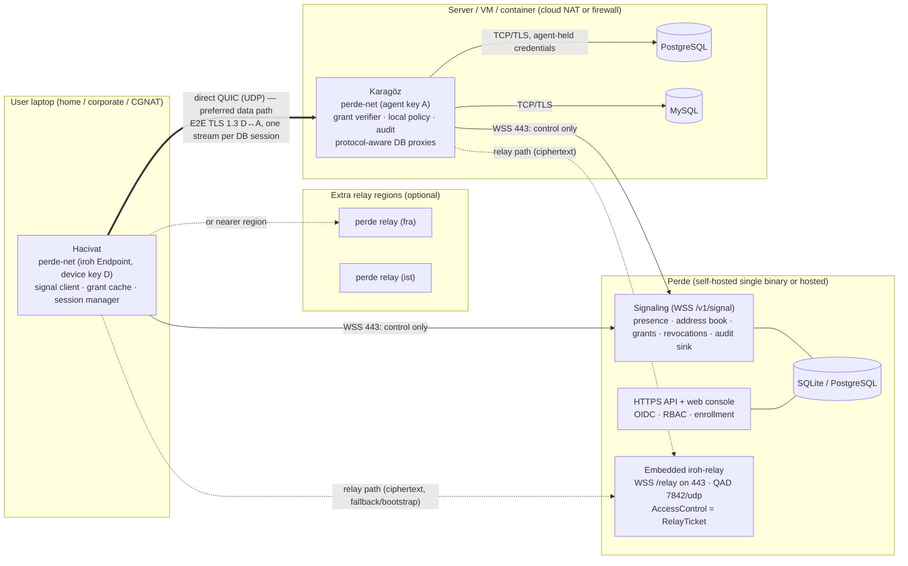

# Perde / Karagöz / Hacivat Network Architecture Options

> Research document — networking/05. Status: proposal for review. Date: 2026-11-11.
> Builds on: [01-nat-traversal-fundamentals.md](01-nat-traversal-fundamentals.md), [02-tailscale-and-headscale.md](02-tailscale-and-headscale.md), [03-netbird.md](03-netbird.md), [04-iroh-libp2p-webrtc.md](04-iroh-libp2p-webrtc.md).

## 1. Scope and sources

### 1.1 Scope

This document turns the networking research (docs 01–04) into a concrete, implementation-grade network architecture for the Hacivat product family:

- **Hacivat** — Rust desktop database client on user laptops (home NAT, corporate NAT/proxies, CGNAT, hotel Wi-Fi, tethering). Must work fully offline without an account; networking features are opt-in after "Sign in to Perde".
- **Karagöz** — agent on production servers / VMs / containers (often private subnets behind cloud NAT gateways or firewalls; outbound-only connectivity preferred). Terminates database protocols, enforces authorization, writes audit.
- **Perde** — control plane + rendezvous/signaling; relay **only as fallback**; self-hostable and hosted.

It covers: choice of data-plane technology (iroh vs embedded WireGuard vs libp2p vs custom QUIC vs WebRTC), identity and enrollment, signaling protocol, end-to-end encryption, key pinning and stream authorization, multiplexing of database sessions, reconnection/roaming, relay design (forwarding, rate limits, abuse, cost, geo, TCP/443 fallback), observability, self-hosting packaging, a recommended architecture with sequence diagrams, and a threat model. Algorithm specs for product-specific procedures are in §4 (ALG-PERDE-01 … 10); generic NAT-traversal algorithms are referenced from docs 01–04.

### 1.2 Sources

| Source | Version / commit | License | How used |
|---|---|---|---|
| iroh (n0-computer/iroh) — crates `iroh`, `iroh-relay`, `iroh-base`, `iroh-dns`, `iroh-dns-server` | commit `d18a684ec870ccb8a4deb69d7c52b456e100f874` (2026-11-10); latest release 1.4.1 (2026-10-21), `main` at 1.5.0 [Observed: .refs/repos/iroh/CHANGELOG.md:7; iroh/Cargo.toml:3]; 1.0.0 released 2026-06-15 with stable wire protocol and API (doc 04 §3.1) | MIT OR Apache-2.0 | Primary candidate data plane; API surface read directly |
| noq (n0's QUIC implementation, quinn fork with multipath + QNT) | 1.4.0 as iroh dependency [Observed: .refs/repos/iroh/iroh/Cargo.toml:44-46]; source clone at `577359636cbf47fd3997d98c1ff47d77f20b497b` | MIT OR Apache-2.0 (copyright quinn developers + N0, Inc.) [Observed: .refs/repos/noq/LICENSE-MIT] | QUIC transport under iroh; stream priority API |
| Tailscale | `7b2c32b9138b0ab2321910c7eaa8e81b24919dce` (2026-11-10) | BSD-3-Clause | Prior art: magicsock, disco, DERP, control protocol (doc 02) |
| Headscale | `443f3a0ecd76e9697eb01bd09a616340963e0b79` (2026-11-11) | BSD-3-Clause | Prior art: coordination server, ACL → netmap (doc 02) |
| NetBird | `eb2aa2847097c4a241da77f86577a87122a14792` (2026-11-11) | BSD-3-Clause (client etc.); **AGPL-3.0** for `management/`, `signal/`, `relay/`, `combined/` [Observed: .refs/repos/netbird/LICENSE:1-2] | Prior art: signal/relay/setup keys/posture (doc 03) — prose only for AGPL parts |
| rust-libp2p | `b5a7224ed4bf894ed344d25ebd92642abc13517a` (2026-11-11) | MIT | Alternative (DCUtR, circuit relay v2) (doc 04) |
| str0m | `8e0067cca6a45ae4ea0532148d08a3d803d29841` (2026-11-06) | MIT | Alternative ICE / WebRTC (doc 04) |
| Teleport | `1283425b60ec5f60d509ba4c791183d452923ff7` (2026-08-25) | **AGPL-3.0** | Prior art for bound-keypair joining (prose only) |
| Firezone blog "Nothing on the wire but WireGuard" (T. Eizinger, 2026-08-19) | web | Firezone code Apache-2.0 | Prior art: ICE-less WireGuard path agent, relay design |
| Tailscale blog "Improving NAT traversal, part 1" (2025-10-15) and "part 2: challenges in cloud environments" (2025-10-21) | web | — | Direct-connection rates, cloud NAT behaviours |
| M. Seemann & C. Huitema, "A p2p Vision for QUIC" (2024-10-26) | web | — | QUIC address discovery / NAT traversal drafts, MASQUE relaying |
| Mullvad GotaTun announcement (2025-12) | web | GotaTun fork of BoringTun (BoringTun is BSD-3-Clause) | WireGuard-in-Rust option status |
| RFCs: 6455 (WebSocket), 8446 §7.5 (TLS exporters), 9266 (tls-exporter channel binding), 9000/9001/9002 (QUIC), 9221 (QUIC datagrams), 9298 (CONNECT-UDP), 8252 (OAuth for native apps), 8628 (device grant), 9449 (DPoP), 9052 (COSE), 7250 (TLS raw public keys), 8445 (ICE), 8656 (TURN), 4787 (NAT behaviour), 8085 (UDP guidelines) | — | IETF | Normative references |
| Kubernetes bootstrap tokens & `kubeadm join --discovery-token-ca-cert-hash` | docs | Apache-2.0 | Enrollment token pinning prior art |

All local clones are under `.refs/repos/<name>`, shallow, read-only; nothing was built or executed.

## 2. Executive summary

1. **Recommended data plane: iroh 1.x** (Rust, MIT/Apache-2.0; 1.0 shipped 2026-06-15 with wire protocol and Rust API declared stable; 1.4.1 is the latest release at our commit) — QUIC with Ed25519 endpoint identities, TLS 1.3 end-to-end encryption, relay-assisted holepunching, multipath path selection, network-change handling, proxy support, metrics — wrapped in an internal `perde-net` facade so it can be replaced (§3.2, NET-D1, NET-D11).
2. **Use iroh's extension points instead of forking it:** custom relay map (`RelayMode::Custom`), pluggable address lookup (`Builder::address_lookup`), pluggable `PathSelector`, connection `EndpointHooks` (`before_connect`, `after_handshake`), relay `AccessControl` with per-client HTTP request inspection, relay `auth_token`, `proxy_url`, `external_addr` [Observed: .refs/repos/iroh/iroh/src/endpoint.rs:529-849; iroh-relay/src/server.rs:280-360].
3. **Perde never touches query bytes except as a relay of ciphertext.** Perde = identity, policy, address book, grant issuer, presence, audit sink, relay operator.
4. **Signaling:** one WebSocket/TLS-443 session per node with protobuf envelopes, seq/ack resume, TLS-exporter channel binding, long-poll fallback (ALG-PERDE-02).
5. **Enrollment:** single-use, 1-hour, hashed-at-rest install tokens with optional embedded server-key pin (kubeadm-style); agent generates its Ed25519 key locally and proves possession against a server nonce (ALG-PERDE-01).
6. **Authorization at the agent:** Perde issues short-lived (10 min) signed grants bound to the client's endpoint key (`cep`) and the agent's (`aep`); Karagöz verifies offline, narrows by local policy, audits locally, honours reliable revocation, and fails closed after `offline_grace` (ALG-PERDE-05).
7. **Multiplexing:** one QUIC connection per (device, agent); one bidirectional stream per DB session; stream 0 for control; DB wire protocols are terminated by Karagöz's protocol-aware proxies with agent-held credentials (ALG-PERDE-06).
8. **Roaming:** QUIC migration + iroh re-holepunch for live changes; product-level **session resume** (parked upstream DB connection + byte-offset replay, default 120 s) for sleep/blackouts; explicit "session lost" when beyond grace (ALG-PERDE-07).
9. **Relay:** iroh-relay embedded in `perde serve` (single-binary self-hosting), standalone `perde relay` for extra regions; admission via Perde-signed `RelayTicket` carried as relay auth token; per-connection/org rate limits; TCP/443 WebSocket fallback inherent (ALG-PERDE-08).
10. **Cloud reality check:** AWS NAT Gateway is always symmetric, Azure NAT Gateway symmetric by default, GCP Cloud NAT symmetric unless static-port EIM is enabled [Observed: Tailscale blog pt-2, 2025-10-21]. Agents in private subnets will often be relayed unless remedied (IPv6, `--listen-udp` + firewall rule/public IP, GCP EIM, NAT instance). Diagnostics must explain this (ALG-PERDE-10).
11. **Expected direct rate:** Tailscale reports "well north of 90 %" direct connections fleet-wide [Observed: Tailscale blog pt-1, 2025-10-15]; the largest public measurement (libp2p DCUtR, 4.4 M attempts, 85 k networks, 167 countries) found 70 % ± 7.1 % hole-punch success, 97.6 % of successes on the first attempt [Observed: doc 01 §3.17, doc 04 §2 item 16]; n0 says it is "normal to see 95 %" of connection data go direct but publishes no punch success rate (doc 04 §3.15). Plan for ≈ 85–95 % direct when Karagöz has a public IP or EIM egress and ≈ 50–70 % when it sits behind AWS/Azure NAT Gateway; size relays for 10–30 % relayed sessions (doc 01 §3.17) [Inferred].
12. **WireGuard option** (BoringTun/GotaTun or wireguard-go + own ICE + DERP-like relay + userspace netstack) is proven at scale (Tailscale, NetBird, Firezone) but costs far more engineering, carries IP packets rather than streams, and needs a netstack to avoid admin/TUN privileges on desktops (§3.2).
13. **libp2p** is too general and its circuit relay v2 is designed as a limited coordination relay, not a data fallback; **WebRTC** (str0m) is attractive only if a browser client becomes a goal (§3.2).
14. **Disable n0's public discovery and relays by default** to avoid leaking endpoint ids/IPs to third parties and to make self-hosting complete (NET-D2).
15. **`relay_policy`** per org/agent: `allow` (default), `direct_only` (no DB stream until a direct path is validated), `relay_only` (§ALG-PERDE-03).
16. **Threat model** (§3.12): main residual risk is a fully compromised Perde minting grants; mitigations are agent-local narrowing, agent-side audit of every grant, key-change visibility, and optional org-root co-signing (v2).
17. **i18n:** no English sentences on the wire; every network/auth error is a code + params rendered by the client; Turkish-safe identifier handling (§6).

## 3. Detailed findings and design analysis

### 3.1 Requirements and constraints

#### 3.1.1 Functional requirements
- R1. Hacivat connects to databases attached to Karagöz agents in other networks without inbound firewall changes on either side (default).
- R2. Data path is direct P2P whenever any direct path exists; relay only as fallback; Perde never sees plaintext.
- R3. Agent install = one command; no credentials typed by the user.
- R4. Authorization and audit enforced at Karagöz (P2P traffic bypasses Perde).
- R5. Many concurrent DB sessions per user per agent (SQL editor tabs, schema browser, background introspection, exports).
- R6. Survive laptop sleep/wake and network changes gracefully.
- R7. Self-hostable with minimal moving parts; also offered as multi-region hosted service.
- R8. Diagnostics that explain *why* a connection is relayed and how to fix it.
- R9. i18n (EN + TR) for every user-facing message.

#### 3.1.2 Traffic profile of database sessions [Inferred: from DB client usage patterns]
- Mostly small request/response exchanges (queries, metadata) — **latency-dominated**, so RTT and relay detours matter more than throughput.
- Occasional bulk transfers (result sets of 10⁴–10⁷ rows, exports, `COPY`) — **throughput** matters, flow control must stop the agent from buffering unboundedly.
- Long idle periods with sessions held open (an editor tab left open for hours; open transactions) — **keep-alive cost** and **resume semantics** matter.
- Session state lives in the upstream DB connection (transactions, temp tables, session variables) — losing the upstream TCP connection is user-visible; hence session resume (ALG-PERDE-07).

#### 3.1.3 Network environments
| Side | Typical environment | NAT/firewall behaviour (see doc 01) |
|---|---|---|
| Hacivat | home router (usually EIM, often APDF), corporate network (stateful firewall, sometimes UDP blocked, HTTP proxy, TLS interception), CGNAT/mobile tethering (EDM common), hotel Wi-Fi (captive portal) | mixed; UDP blocked in a minority of corporate networks |
| Karagöz | cloud private subnet behind managed NAT gateway (symmetric/EDM: AWS always, Azure default, GCP default) [Observed: Tailscale pt-2]; VM with public IP (easy); on-prem server behind enterprise firewall; Kubernetes pod (extra SNAT layer); Docker bridge (extra NAT; Linux conntrack usually port-preserving) | often hard; outbound-only preferred by operators |

Consequence: the "agent behind symmetric NAT" case is common, so the design must (1) make relayed operation good (low-latency regional relays), (2) make the remedy explicit and easy (§3.10), and (3) measure.

### 3.2 Data-plane options

#### 3.2.1 Option A — Build on iroh (recommended)

**What we get** [Observed: .refs/repos/iroh at d18a684; details in doc 04]:
- `Endpoint` identity = Ed25519 `SecretKey`/`EndpointId`; `Builder::secret_key` lets us supply Karagöz's/Hacivat's persisted key [Observed: iroh/src/endpoint.rs:529].
- QUIC via `noq` 1.4 (n0's quinn-derived QUIC with multipath) [Observed: iroh/Cargo.toml:44-46]; ALPN-based protocol dispatch (`Builder::alpns`, :544).
- Relay transport with `RelayMode::{Disabled, Default, Staging, Custom(RelayMap)}` [Observed: iroh/src/endpoint.rs:1999-2011] — we use `Custom` with Perde's relay map; `Default`/`Staging` would use n0's public relays.
- Pluggable address lookup (`Builder::address_lookup`, `clear_address_lookup`) [Observed: :594-614] — implement `PerdeAddressLookup` fed by signaling `PeerAddr` messages; no public DNS/pkarr publishing.
- Pluggable path selection (`Builder::path_selector(Arc<dyn PathSelector>)`) [Observed: :827-849]; default `BiasedRttPathSelector` = "lowest biased RTT wins, with stickiness against flapping", relay classified as **backup transport** used only when no primary (direct) path is available, IPv6 RTT advantage 3 ms, switching threshold 5 ms [Observed: iroh/src/socket/biased_rtt_path_selector.rs:1-60]. This already implements the "relay only as fallback" semantics; ALG-PERDE-04 can be realised as a custom selector if the default proves insufficient.
- Connection hooks: `EndpointHooks::before_connect` (reject outgoing attempts before any packet) and `after_handshake` (reject incoming/outgoing after TLS with known remote endpoint id and ALPN, with QUIC close code/reason) [Observed: iroh/src/endpoint/hooks.rs:9-95] — Karagöz uses `after_handshake` to drop connections from endpoint ids with no pending `IncomingIntent`/grant (anti-abuse, T11).
- `external_addr` to advertise a manually opened/forwarded port (§3.10 `--listen-udp`) [Observed: :660]; `addr_filter` to exclude interfaces (e.g. corporate VPN, Docker bridges) [Observed: :626]; `proxy_url`/`proxy_from_env` for corporate HTTP proxies [Observed: :699-710]; `portmapper_config`, `net_report_config` [Observed: :795-807]; `add_custom_transport` [Observed: :822] (escape hatch, e.g. a future WebSocket-to-Perde transport).
- Observability: `Connection::paths()`, `paths_stream()`, `path_events()` [Observed: iroh/src/endpoint/connection.rs:1184-1216]; `Endpoint::net_report()` watcher, `home_relay_status()` [Observed: iroh/src/endpoint.rs:1406-1455]; `metrics()`; optional qlog.
- iroh-relay server: embeddable, `AccessControl` trait with `on_connect(&ClientRequest) -> Access::{Allow, Deny{reason}}` where `ClientRequest` exposes the handshake-proven `EndpointId`, protocol version and the client's HTTP request parts (headers) [Observed: iroh-relay/src/server.rs:190-213, 280-360]; client side supports an `auth_token` in relay config [Observed: iroh/src/socket/transports/relay/actor.rs:213-318]. Default ports: HTTPS 443, HTTP 80, relay QUIC (QAD) 7842/udp, metrics 9090 [Observed: iroh-relay/src/defaults.rs:7-16].

**Fit:** excellent — streams (not packets) map 1:1 to DB sessions; Rust in-process (no TUN, no admin rights, no netstack); E2E via TLS 1.3 to endpoint keys; relay over 443; self-hostable relay as a library; permissive license.

**How holepunching works at this commit** (details doc 04 §3.6): iroh no longer uses Tailscale-style disco packets; since 0.96 it uses QUIC multipath (noq) plus "n0 QUIC NAT Traversal" (QNT), a variant of `draft-seemann-quic-nat-traversal-02`, where candidates travel inside the encrypted connection (`ADD_ADDRESS`/`REACH_OUT`/`REMOVE_ADDRESS`) and probes are QUIC `PATH_CHALLENGE`s; successful probes become additional multipath paths of the same connection. Address discovery uses QUIC Address Discovery (QAD) against relays on UDP 7842 instead of STUN.

**Concerns:**
- Dependency on a single vendor's stack including its own quinn fork `noq` — `noq` types are part of iroh's public semver surface (doc 04 §3.1) — mitigate with the `perde-net` facade, exact version pinning, and NET-D11.
- n0's public relays are "intended for development and hobby use, not production" and public DNS/pkarr lookup would leak endpoint ids to n0 (doc 04 §3.11, §3.9) — we must run our own relays and address lookup (NET-D2); this is also what self-hosting requires.
- No birthday-paradox port spraying in iroh; QNT handles one endpoint-dependent side when the other is predictable, but both-hard pairs stay relayed (doc 04 §3.6 item 7). ALG-NAT-04 would need upstream work or a custom transport.
- Probes reuse the active connection ID (noted in noq as a short-term RFC 9000 deviation that makes paths linkable) — a privacy, not confidentiality, issue (doc 04 §3.6 item 3).
- Default features include `fast-apple-datapath` (private Apple APIs for batched sends) and the portmapper (SSDP multicast can trigger macOS firewall prompts) — review for the notarized macOS Hacivat build; likely disable portmapper on desktop by default or behind a setting (doc 04 §3.1, §3.13).
- Relay-first bootstrap: first packets may traverse the relay (encrypted; `direct_only` policy available).
- No public, methodology-backed hole-punch success rate for iroh (doc 04 §3.15) — Phase 0 measurement required.

#### 3.2.2 Option B — Embed WireGuard (BoringTun / GotaTun / wireguard-go) + own ICE + own relay

**Components needed:** WireGuard implementation (BoringTun — BSD-3-Clause, Rust; Mullvad's **GotaTun** fork of BoringTun released Dec 2025, audited, shipping on Android since app 2025.10 [Observed: Mullvad announcement via cyberinsider/techradar summaries]; wireguard-go — MIT, Go, would require cgo/FFI from Rust — Mullvad attributed >85 % of Android crash reports to wireguard-go/Go-Rust mixing [Observed: same]); ICE agent (str0m's sans-IO ICE, MIT — doc 04; or reimplement Tailscale-style disco); relay (DERP-like, reimplemented from doc 02's frame description, or TURN); a userspace TCP/IP stack (smoltcp, or gVisor netstack as in Tailscale `tsnet`) because a TUN device requires administrator rights on macOS/Windows and is unacceptable for a desktop DB client.

**Pros:** proven model at very large scale (Tailscale, NetBird, Firezone); packet-level tunnel can carry any TCP protocol unchanged; WireGuard's minimal, well-audited crypto; key rotation built in.
**Cons:** we would build ~70 % of iroh ourselves (ICE/disco, relay, holepunch timing, roaming, path selection, portmapping, netcheck); TCP-in-UDP tunnel inside a userspace netstack adds a second congestion controller, MTU issues (WireGuard overhead 60/80 bytes; tunnel MTU 1280–1420), and a netstack attack surface; two liveness authorities (ICE vs WireGuard) caused "split-brain" failures for Firezone under overload until they moved to an ICE-less design [Observed: Firezone blog 2026-08-19]; per-session authorization must be done at L4 inside the agent anyway.
**Effort:** very high (person-years to reach Tailscale/NetBird quality).

#### 3.2.3 Option C — rust-libp2p (QUIC + DCUtR + circuit relay v2 + identify/AutoNAT)

**Pros:** MIT; complete toolkit; DCUtR coordinates simultaneous open with RTT/2 timing (doc 04 ALG-P2P-01); QUIC transport available.
**Cons:** large abstraction surface (Swarm/NetworkBehaviour) not needed for a hub-and-spoke system with a trusted coordinator; circuit relay v2 defaults (reservations 1 h, max 128; circuits limited to 2 min / 128 KiB) make it a coordination relay for DCUtR, not a data-plane fallback, without retuning or a custom relay (doc 04 §2 item 15, ALG-P2P-02); DCUtR success 70 % ± 7.1 % in the IPFS measurement (doc 04 §3.15) — no advantage over iroh's approach; no WebSocket-on-443 relay story comparable to iroh-relay out of the box [Inferred: doc 04 §3.16].
**Effort:** medium-high; less fit than iroh.

#### 3.2.4 Option D — Custom QUIC on quinn (+ own relay + own holepunch)

**Pros:** full control; quinn is MIT/Apache, mature; could adopt IETF drafts (QUIC Address Discovery `OBSERVED_ADDRESS`, NAT traversal `ADD_ADDRESS`/`PUNCH_ME_NOW`, MASQUE CONNECT-UDP relaying RFC 9298 + connect-udp-listen) as they standardise [Observed: Seemann & Huitema 2024-10-26].
**Cons:** essentially re-implementing iroh (which already ships QAD and multipath-based holepunching — doc 04); standards not final; high effort and risk.
**Role:** **fallback plan** (NET-D11) if iroh becomes unsuitable — our protocols above the transport (signaling, grants, stream framing) are transport-agnostic.

#### 3.2.5 Option E — WebRTC data channels (str0m sans-IO, or webrtc-rs)

**Pros:** standard ICE/STUN/TURN; browser interoperability (a future web console could talk directly to agents); str0m is MIT, sans-IO, actively maintained, used in production (Firezone used its ICE agent before going ICE-less [Observed: Firezone blog]).
**Cons:** DTLS + SCTP + SDP machinery that a non-browser DB tunnel does not need; SCTP data channels have weaker flow-control ergonomics than QUIC streams; str0m leaves the TURN client to the embedder; webrtc-rs re-architected onto a sans-IO core and shipped 0.20 (2026-07-31) as self-described alpha-grade while the 0.17 line is maintenance-only (doc 04 §2 items 17-18). Only compelling if browser↔agent connectivity or RFC 8445 interoperability becomes a requirement; str0m's standalone ICE agent (`is` crate) is the component we would reuse.

#### 3.2.6 Scoring

Weights reflect README priorities (direct P2P, agent-side enforcement, self-hosting, Rust-native) and delivery risk. Scores 1 (poor) – 5 (excellent). [Inferred: scoring is the author's judgement based on docs 01–04 and the source survey above]

| Criterion (weight) | A iroh | B WireGuard+ICE+netstack | C libp2p | D custom QUIC | E WebRTC (str0m) |
|---|---|---|---|---|---|
| Direct-path success & upgrade quality (5) | 4 | 5 | 3 | 3 (initially) | 4 |
| Relay fallback incl. TCP/443 & proxies (4) | 5 | 3 (must build) | 2 | 2 | 3 (TURN/TLS) |
| Fit to stream-per-DB-session (4) | 5 | 2 (needs netstack) | 4 | 5 | 3 |
| No admin/TUN on desktop (4) | 5 | 3 (netstack) | 5 | 5 | 5 |
| E2E security model simplicity (4) | 5 | 4 | 4 | 4 | 3 |
| Self-hosting simplicity (3) | 5 (embedded relay) | 3 | 3 | 3 | 3 (TURN) |
| Engineering effort (5, higher = less effort) | 5 | 1 | 3 | 1 | 2 |
| Dependency/vendor risk (3, higher = less risk) | 3 | 4 | 4 | 5 | 4 |
| License fit (2) | 5 | 5 | 5 | 5 | 5 |
| Observability hooks (2) | 5 | 3 | 3 | 4 | 3 |
| **Weighted total (max 180)** | **169** | **115** | **127** | **126** | **123** |

Weighted total = Σ weight × score (weights sum to 36). Example, A: 5·4 + 4·5 + 4·5 + 4·5 + 4·5 + 3·5 + 5·5 + 3·3 + 2·5 + 2·5 = 169. The ranking (A ≫ C ≈ D ≈ E > B) is robust: changing any single cell by ±1 changes a total by at most 5, which never closes the 42-point gap between A and the runner-up. B's low score is driven by engineering effort, not by quality — B is the most proven model in production.

**Recommendation:** Option A (iroh) with Option D as the documented exit path.
### 3.3 Identity, enrollment and key hierarchy

#### 3.3.1 Keys in the system

| Key | Type | Generated by | Stored | Purpose | Rotation |
|---|---|---|---|---|---|
| Agent endpoint key `sk_A` | Ed25519 | Karagöz on host | `/var/lib/karagoz/identity.key` (0600); optionally TPM/KMS-wrapped later | Data-plane identity (QUIC/TLS raw public key = iroh EndpointId), signaling auth, relay auth | On demand / yearly; ALG-PERDE-01 edge 13 |
| Device endpoint key `sk_D` | Ed25519 | Hacivat on first Perde login | OS keychain (macOS Keychain, Windows DPAPI/Credential Manager, Linux Secret Service; file fallback 0600) | Data-plane identity for the device; grant binding (`cep`) | On logout/login or yearly |
| User session | OIDC tokens | IdP via Perde | Keychain | Proves the human; required to obtain grants | IdP policy |
| Perde signing keys `K_perde` | Ed25519 (`kid`) | Perde | Perde DB / KMS / file | Signs grants, receipts, relay tickets, key-change notices | Scheduled; chained (`SigningKeysUpdate`) |
| Perde TLS key | ECDSA/RSA (WebPKI or private CA) | Perde / ACME | Perde | HTTPS/WSS/relay TLS | ACME 60–90 d |
| Org root key (optional, v2) | Ed25519 | Org admin offline | Offline | Co-signs high-privilege policies; limits damage of a compromised Perde (T4) | Rare |

**Why one key per node for everything (transport + signaling auth):** it removes a class of binding bugs (the key you authenticate to Perde with is the key the peer sees in TLS) — the same choice Tailscale made for node keys and iroh made for EndpointId [Observed: docs 02, 04]. Tailscale additionally separates a *machine key* (long-lived, control-plane Noise) from a *node key* (rotatable, data-plane) and a *disco key* (path discovery) [Observed: doc 02]; we do not need disco keys because path discovery happens inside the authenticated QUIC connection (iroh), and machine/node separation can be added later if device re-auth without data-plane rekey becomes important.

#### 3.3.2 Karagöz enrollment

Specified in **ALG-PERDE-01**. Key decisions: (1) private key generated on host, never transmitted; (2) single-use, short-lived, hashed-at-rest tokens with an optional embedded server pin (kubeadm-style), (3) reusable tokens only with approval or ephemeral semantics; (4) proof-of-possession bound to server nonce and server instance id; (5) idempotent retry after lost response.

#### 3.3.3 Hacivat device registration

Hacivat is usable without any account (README hard requirement). When the user chooses "Sign in to Perde":
1. OAuth 2.0 Authorization Code + PKCE in the system browser with a loopback redirect (RFC 8252), or Device Authorization Grant (RFC 8628) for headless/SSO-restricted environments; Perde federates to the org's IdP (OIDC/SAML) or uses local accounts in self-hosted mode.
2. Hacivat generates `sk_D` and registers `{device_name, os, app_version, endpoint_public_key, proof}` with the user's access token; org policy may require **device approval** (admin approves new devices; analogous to NetBird peer approval and Tailscale device approval [Observed: docs 02, 03]) and posture checks (OS version, disk encryption — reported, not proven, unless an MDM integration exists).
3. Device key is bound to the user. Logging out deletes `sk_D` and revokes the device in Perde.

#### 3.3.4 Trust anchors and pinning

- Agent trusts `K_perde` (pinned at enrollment) for grants; Perde TLS identity pinned via token pin or WebPKI.
- Client trusts Perde (WebPKI/pin) to tell it agent endpoint ids, then pins per agent (TOFU) and requires signed key-change notices.
- Neither side trusts the relay for anything but liveness; relays cannot decrypt (QUIC E2E) and cannot impersonate (TLS with raw public keys pinned to endpoint ids).

### 3.4 Signaling between Hacivat/Karagöz and Perde

Specified in **ALG-PERDE-02**. Design rationale:

- **WebSocket over TLS 443** beats gRPC streaming for reach: gRPC requires HTTP/2 end-to-end, and many corporate proxies and some load balancers downgrade to HTTP/1.1 or buffer responses; NetBird uses gRPC for both management and signal and documents reverse-proxy requirements for HTTP/2/gRPC [Observed: doc 03]. Tailscale uses Noise-over-HTTP with an HTTP/1.1 Upgrade (`/ts2021`) precisely to survive proxies [Observed: doc 02]. A long-poll fallback covers the remaining proxies.
- **Protobuf envelope with seq/ack and resume** gives at-least-once delivery for security-relevant messages (revocations) across reconnects, while ephemeral hints (addresses) are TTL-bound.
- **Channel binding** (TLS exporter) makes signaling authentication MITM-resistant even if WebPKI is subverted, unless the operator explicitly allows TLS interception.
- **Perde as address book, not as candidate shuttle.** With iroh, Perde only needs to provide `EndpointAddr`-equivalent data (endpoint id, relay URL, direct addresses); the fine-grained candidate exchange and simultaneous-send coordination run inside the (relayed) QUIC connection. This keeps Perde's signaling load proportional to *connections opened*, not to *probe rounds*, and keeps NAT-traversal logic in one well-tested library. With WireGuard/str0m options, Perde would also carry ICE offers/answers/candidates (NetBird model).
- **Presence** is soft state on Perde (rebuilt from hellos); clients subscribe only to agents they are authorized to see (no tenant enumeration).
- **Why not signal only over the relay (Tailscale's CallMeMaybe-over-DERP pattern, doc 02 §5 item 2)?** For the data-plane coordination we effectively do — QNT frames ride inside the QUIC connection, which initially runs over the relay. But Perde still needs an authenticated control session per node for things the relay cannot do: authorization decisions (grants), presence, revocation delivery, policy and relay-map pushes, enrollment state, and audit upload. Keeping that on a separate WebSocket keeps relays stateless and policy-free (they only check a ticket), lets relays be deployed in regions where no control plane runs, and lets a self-hoster scale the two independently.

### 3.5 End-to-end encryption, key pinning and authorization of streams

1. **E2E by construction.** All data-plane bytes are QUIC packets encrypted with keys negotiated by TLS 1.3 between the two endpoint keys. Relays forward opaque datagrams addressed by endpoint id; Perde never sees data-plane keys. This holds for iroh (QUIC over relay) and for the WireGuard option (WireGuard over DERP/TURN) alike [Observed: docs 02, 04].
2. **Who can open a stream to an agent:** only a peer that (a) completes TLS with an endpoint key, and (b) presents a Perde-signed grant bound to that key (`cep`) naming this agent (`aep`) and the resource — **ALG-PERDE-05**. Verification is local at Karagöz, offline-capable, with reliable revocation push and a fail-closed `offline_grace`.
3. **Agent-side final say.** Local policy can only narrow; audit is written at the agent (README hard requirement: authorization and audit enforceable at Karagöz).
4. **Residual trust in Perde:** Perde can mint grants and could lie about agent keys. Mitigations: TOFU pinning + signed key-change notices visible to users; optional agent-local allow-lists; optional org root key co-signing (v2); transparency log of grants/key changes (append-only, hash-chained audit at agents makes undetected abuse harder because agents log every grant used). See threat model §3.12.

### 3.6 Multiplexing many DB sessions over one P2P connection

Specified in **ALG-PERDE-06**. Summary of choices:
- One QUIC connection per (device, agent); one bidirectional stream per DB session; stream 0 as control.
- QUIC streams give per-session flow control and no cross-session head-of-line blocking (unlike multiplexing over a single TCP or WebSocket). Loss on one stream does not stall others [Observed: RFC 9000 §2].
- WireGuard option would instead carry IP packets; DB sessions become TCP connections over a userspace netstack (gVisor netstack in Tailscale's `tsnet`, smoltcp in Rust) — workable but heavier: TCP-over-UDP tunnel with its own congestion control *inside* WireGuard, MTU fragmentation concerns, and a netstack attack surface [Inferred: from doc 02 tsnet/netstack description and general TCP-in-tunnel behaviour].
- Integration with Hacivat drivers via in-process stream adapters (preferred) or authenticated loopback forwarders (compat).

### 3.7 Reconnection and roaming

Specified in **ALG-PERDE-07**. QUIC connection migration covers address changes while both endpoints are alive; iroh additionally re-gathers addresses and re-holepunches on network change [Observed: .refs/repos/iroh/CHANGELOG.md 1.4.0 "Update local addresses on network change (#4605)"]. The product-level addition is **session resume with parked upstream connections and byte-offset replay**, which makes short sleeps and network blips invisible even when the QUIC connection itself died, and makes long outages *explicit* (open transactions rolled back) rather than silently broken.

### 3.8 Relay design

#### 3.8.1 Role
Relays exist for (1) bootstrap — first packets of every connection when no direct path is known yet, (2) fallback when NATs/firewalls defeat hole punching (both-symmetric NAT, UDP blocked), (3) holepunch coordination channel. Relays are **not** in the trust base.

#### 3.8.2 Protocol choice
Adopt **iroh-relay** (MIT/Apache-2.0) unmodified where possible: a DERP descendant using HTTP/1.1+TLS upgraded to WebSocket (sub-protocol `iroh-relay-v2`) on TCP/443 (passes HTTP proxies via CONNECT incl. `Proxy-Authorization`), Ed25519 client authentication bound to the TLS session via exporter, a small frame set (datagram / datagram-batch / EndpointGone / Ping / Pong / Restarting / Status), best-effort forwarding keyed by destination endpoint id (drops when the destination is absent or its 512-deep queue is full — QUIC retransmits end to end), 64 KiB max datagram, 15 s server pings, and QUIC Address Discovery (QAD) as the STUN replacement [Observed: doc 04 §3.10–3.11]. Embeddable as a library into the Perde binary for single-binary self-hosting, and runnable standalone (`perde relay`) for geo-distribution. Alternative if not iroh: a DERP-compatible relay (BSD-3 Tailscale `derp` package is Go; we would reimplement in Rust from the documented frame format, doc 02) or TURN (RFC 8656) via a Rust TURN server — rejected as primary because TURN-over-TCP/TLS on 443 is less proxy-friendly than WebSocket and TURN allocations are per-peer-pair state.

#### 3.8.3 Rate limiting and abuse
ALG-PERDE-08: admission by Perde-signed `RelayTicket`, per-connection/org token buckets, no address-directed forwarding, per-IP connection caps, metrics. Hosted service: anycast or GeoDNS front with DDoS protection; relays in 3–6 regions initially (e.g. Frankfurt, Ashburn, Oregon, Singapore, São Paulo, Istanbul — Turkish user base is a stated i18n target).

#### 3.8.4 Cost model (hosted)
Relayed bytes are the only significant cost. Let `U` = active users, `s` = average DB traffic per active user per day, `f` = fraction of bytes that end up relayed.
- With Tailscale reporting "well north of 90 %" direct connections in typical conditions [Observed: https://tailscale.com/blog/nat-traversal-improvements-pt-1, 2025-10-15], but Karagöz frequently running behind cloud NAT gateways that are symmetric (AWS NAT Gateway always; Azure NAT Gateway by default; GCP Cloud NAT unless static port allocation/EIM is enabled) [Observed: https://tailscale.com/blog/nat-traversal-improvements-pt-2-cloud-environments, 2025-10-21], *our* `f` may be much worse than Tailscale's fleet average: if the client is also behind a symmetric NAT (CGNAT/mobile hotspot/some corporate firewalls), the pair is relayed. Planning assumption, consistent with doc 01 §3.17: size for `f = 0.10–0.30` of sessions relayed (byte share possibly higher, since relayed pairs skew toward enterprise users with heavier usage) until telemetry exists [Inferred].
- Example: 1 000 active users × 200 MB/day × f = 0.25 ⇒ 50 GB/day ≈ 1.5 TB/month of session traffic relayed. Every relayed byte enters the relay once and leaves it once; clouds that bill only egress therefore bill each relayed byte once, in whichever direction it travels [Inferred: relay forwards both directions; ingress free on major clouds]. At hyperscaler egress list prices of roughly USD 0.05–0.09/GB ⇒ ≈ USD 75–135/month; on flat-rate providers with large included traffic quotas the marginal cost ≈ server rent only [Inferred: typical public price lists; verify at procurement time].
- Per-user relay cost is therefore ≈ `s × f × 30 × price` ≈ 200 MB × 0.25 × 30 × USD 0.07/GB ≈ USD 0.10 per active user per month on a hyperscaler — small relative to a paid seat, but unbounded for heavy exporters, hence per-plan quotas (ALG-PERDE-08).
- Levers: improve `f` (§3.10 agent UDP port option, IPv6, port mapping), per-plan relay quotas, and placing relays on flat-traffic providers.

#### 3.8.5 Geo distribution and selection
Home relay per node by latency with hysteresis; dialer connects to the destination's home relay (no inter-relay mesh needed for correctness); per-region HA via multiple nodes and rendezvous hashing. Mesh (DERP-style) is a later optimisation if both peers must share one region (doc 02).

#### 3.8.6 TCP/443 fallback
Relay over WebSocket/TLS on 443 is the universal fallback; it is also the path when UDP is blocked. Explicit HTTP proxy support (`HTTPS_PROXY`, PAC files on Windows/macOS, proxy auth NTLM/Kerberos is an open question) is needed for corporate laptops; iroh exposes proxy configuration for relay connections and pkarr requests [Observed: .refs/repos/iroh/CHANGELOG.md 1.4.0 "Send pkarr requests through the endpoint's proxy", "Send correct Proxy-Authorization credentials"].

### 3.9 Observability

| Signal | Where measured | Exposed as |
|---|---|---|
| Path kind per connection (direct v4 / direct v6 / relay(region) / mixed) | iroh connection path watchers (doc 04) | Hacivat status badge per DB connection; `karagoz status`; Perde dashboard |
| RTT (smoothed), loss, congestion window | QUIC stats (quinn/noq `ConnectionStats`/path stats) | tooltip, diagnostics panel, telemetry |
| Time-to-first-byte, time-to-direct | ALG-PERDE-03 timers | telemetry histograms (SLO: p50 TTFB < 500 ms; p90 time-to-direct < 3 s when direct possible) |
| Relayed bytes per org / node | relay counters | billing, quotas, cost dashboards |
| Net report (NAT behaviour, UDP, IPv6, portmap, captive portal, relay latencies) | ALG-NAT-01 | `hacivat doctor`, `karagoz doctor`, ALG-PERDE-10 |
| Signaling health (connected, transport ws/longpoll, last ack) | ALG-PERDE-02 | status, alerts |
| Auth decisions, stream opens/closes | Karagöz audit | audit log (access/ docs) |

Format: OpenTelemetry metrics/traces from Perde and relays (Prometheus scrape endpoint in self-hosted mode); clients send aggregated, privacy-preserving telemetry only when enabled (hosted default on, self-hosted default to own Perde, never to the vendor without consent). qlog (RFC draft) traces available behind a debug flag (iroh `qlog` feature [Observed: .refs/repos/iroh/iroh/Cargo.toml:156]).

### 3.10 Improving direct-connection odds for Karagöz (servers behind cloud NAT)

Ranked by impact for the common "agent in a private subnet behind a managed NAT gateway" case:
1. **IPv6**: if the VPC and client have IPv6, stateful-firewall hole punching works without NAT (doc 01). Recommend dual-stack subnets.
2. **Inbound UDP port on the agent**: `karagoz --listen-udp 0.0.0.0:7843` + security group / firewall rule + (if private subnet) an NLB/UDP forward, or a public IP on the instance. Tailscale recommends public IP + open UDP port as "often the simplest and most effective option" [Observed: Tailscale pt-2 blog]. The agent then advertises a stable, publicly reachable candidate (behaves like EIM/EIF).
3. **GCP Cloud NAT static port allocation (EIM)** — documented configuration snippet [Observed: Tailscale pt-2 blog].
4. **Self-managed Linux NAT instance** (conntrack is typically port-preserving) instead of a managed NAT gateway.
5. **UPnP/NAT-PMP/PCP** on SOHO routers (Karagöz on office/home servers) — iroh includes a portmapper [Observed: .refs/repos/iroh/iroh/src/portmapper.rs].
6. **Peer relay inside the customer network** (Tailscale "peer relays" concept, doc 02): a Karagöz instance with a public UDP port relays for other agents in the same VPC — keeps relayed traffic inside the customer's cloud and off Perde. Candidate v2 feature.
7. **Birthday-paradox port spraying** (ALG-NAT-04) — last resort, off by default.

### 3.11 Self-hosting packaging

- **Single binary `perde`** (Rust): subcommands `serve` (API + web console + signaling + embedded relay + QAD + optional DNS/pkarr-equivalent address lookup), `relay` (relay-only node for extra regions), `migrate`, `admin` (create first admin, tokens), `doctor`.
- **Storage:** SQLite (default, single node) or PostgreSQL (HA, multiple Perde replicas behind a load balancer with sticky WebSocket sessions and cross-node presence via Postgres LISTEN/NOTIFY).
- **TLS:** built-in ACME (TLS-ALPN-01 / HTTP-01) or user-provided cert; or behind a reverse proxy that supports WebSockets (documented headers/timeouts). Relay over the same 443 listener (path-routed) for minimal firewall rules.
- **Ports:** 443/tcp (HTTPS API + web console, WSS signaling, relay WebSocket on path `relay`); 80/tcp (ACME HTTP-01 and the relay's captive-portal/`generate_204` endpoint — optional); 7842/udp (iroh-relay QUIC Address Discovery, ALPN `/iroh-qad/0`; needed for NAT classification and reflexive addresses); 9090/tcp metrics (bind to localhost/private network) [Observed: .refs/repos/iroh/iroh-relay/src/defaults.rs:7-16; doc 04 §3.11]. No 3478/udp unless STUN compatibility is added. Extra QAD-only nodes (`enable_relay = false`) can be deployed cheaply to improve `mapping_varies_by_dest` detection (doc 04 §7 item 14).
- **Docker Compose** (`perde` + optional `postgres`), Helm chart later; systemd unit for bare metal. Configuration via one TOML file + env overrides; secrets via files.
- **Karagöz install:** `curl -fsSL https://<perde>/install.sh | sh -s -- --token prd1_…` (Linux systemd/OpenRC, macOS launchd), PowerShell for Windows, container image `karagoz` with `KARAGOZ_TOKEN` env and a volume for `/var/lib/karagoz`, Kubernetes DaemonSet/Deployment manifests later. Static musl binary to avoid glibc drift.
- **Upgrades:** Perde advertises minimum agent/client protocol versions (ALG-PERDE-02 versioning); agents auto-update only if enabled (signed releases, minisign/sigstore).

### 3.12 Threat model

**Assets:** database contents; database credentials held by Karagöz; agent/device private keys; Perde signing keys; grants; audit logs; availability of access; metadata (who connects to what, IPs).

**Adversaries:** (A1) passive/active network attacker (incl. hostile Wi-Fi, ISP); (A2) malicious or compromised relay operator; (A3) other tenant on hosted Perde; (A4) compromised Perde (hosted operator insider or self-hosted admin gone rogue); (A5) stolen/compromised user laptop; (A6) malicious insider user with legitimate access; (A7) compromised agent host; (A8) internet scanners/DoS; (A9) leaked enrollment tokens (CI logs, shell history, screenshots).

| # | Threat (STRIDE) | Adversary | Mitigation | Residual risk |
|---|---|---|---|---|
| T1 | Eavesdrop/modify DB traffic (I, T) | A1, A2 | QUIC/TLS 1.3 E2E between endpoint keys; relay sees ciphertext only | Traffic analysis (sizes/timing) by relay |
| T2 | Impersonate agent to client (S) | A1, A2 | TLS raw-public-key auth to pinned endpoint id from grant; TOFU pin + signed key-change notices | First-use trust in Perde |
| T3 | Impersonate client to agent (S) | A1, A2, A9 | Grant `cep` binding to TLS-authenticated client key; device keys in keychain | Malware on unlocked laptop (A5) |
| T4 | Perde mints malicious grants / lies about keys (S, E) | A4 | Agent-local narrowing policy & allow-lists; agent-side audit of every grant (detectable); optional org-root co-signing (v2); key-change visibility | A fully compromised Perde with no co-signing can grant access — documented |
| T5 | Revoked user keeps access (E) | A6 | Short grant TTL (10 min), reliable revocation push, `policy_epoch`, `offline_grace` fail-closed | Up to `offline_grace` if agent isolated from Perde |
| T6 | Enrollment token theft (S) | A9 | Single-use, 1 h TTL, hashed at rest, secret-scanner prefix, approval for reusable tokens, cloud-identity binding option | Window between leak and use |
| T7 | Agent key theft from host (S) | A7 | 0600 key file, optional TPM/KMS wrapping (v2), revocation + re-enroll | Root on host = game over for that agent (it holds DB creds anyway) |
| T8 | Relay abuse as free bandwidth / proxy (D, E) | A3, A8 | RelayTicket admission, per-org caps, forwarding only between authenticated endpoints | Legit tenants consuming quota |
| T9 | Using candidates for reflection/amplification or scanning (D) | A6, A8 | Probe pacing & caps (≤32 addrs, ≤1 probe/100 ms/addr, stop after 5 s), port spray off by default | Small-scale probe traffic toward advertised IPs |
| T10 | DoS on Perde signaling (D) | A8 | Rate limits before auth, connection caps, cheap rejection, horizontal scale | Hosted DDoS needs upstream protection |
| T11 | DoS on agent via data-plane (D) | A8 | Agent only accepts connections whose grant arrives within 5 s; QUIC address validation/retry tokens; optional `direct addrs` disclosure only to authorized clients (Perde never publishes agent addrs publicly) | Agent public UDP port can be scanned if `--listen-udp` used |
| T12 | Cross-tenant metadata leak (I) | A3 | Presence/addr only to authorized subscribers; endpoint ids not published in public DNS (iroh public pkarr discovery disabled) | Relay operators see endpoint ids and IPs |
| T13 | Audit tampering (R) | A6, A7 | Hash-chained local audit, shipped to Perde with acks; gaps detectable | Root on agent host can drop unshipped events |
| T14 | Local port forwarder used by other local processes (E) | local malware | In-process transport preferred; forwarder requires one-time local credential or Unix socket 0600 | Same-user malware |
| T15 | Replay of 0-RTT data causing duplicate DB writes (T) | A1 | 0-RTT disabled for DB streams | — |
| T16 | Downgrade of signaling via TLS-intercepting proxy (T) | A1 (corp proxy) | TLS exporter channel binding; explicit org opt-in to allow interception | Orgs that opt in trust their proxy |
| T17 | Supply chain (malicious update) | — | Signed releases, reproducible builds goal, pinned dependencies (cargo-deny) | Upstream crate compromise |

### 3.13 Recommended architecture (overview)



**Responsibilities in one table**

| Concern | Hacivat | Karagöz | Perde |
|---|---|---|---|
| Identity | device key in OS keychain; user OIDC session | agent key on disk (0600) | signing keys, TLS keys, registry of endpoint ids |
| Enrollment | OIDC + device registration (§3.3.3) | install token → key registration (ALG-PERDE-01) | token issuance, approval workflow |
| Addressing | publishes `AddrUpdate`; consumes `PeerAddr` via custom address lookup | same | address book (soft state), presence |
| NAT traversal | iroh (QAD, QNT, multipath) | iroh | QAD on relays; nothing in the hot loop |
| Relay | connects to home relay (ticket) | same | operates relays, admission, quotas |
| Authorization | obtains grants, presents them | verifies grants, narrows by local policy, enforces per stream | evaluates RBAC/approvals, signs grants, pushes revocations |
| Data | DB drivers over QUIC streams | DB protocol termination, credential injection | never (except opaque relay forwarding) |
| Audit | local client-side log (optional) | authoritative data-plane audit, hash-chained, shipped | storage, search, retention |
| Observability | path badge, diagnostics | `karagoz doctor`, metrics | dashboards, relay metrics, telemetry |
## 4. Algorithm specifications

The algorithms below are the **Perde-product-specific** specifications. Generic NAT-traversal algorithms are specified canonically in the sibling documents and are referenced, not duplicated:

| Topic requested | Canonical spec | Product binding in this doc |
|---|---|---|
| NAT type detection (netcheck-style) | ALG-NAT-01 (doc 01); prior art ALG-IROH-04, Tailscale netcheck (doc 02) | ALG-PERDE-10 (diagnostics report) |
| Candidate gathering | ALG-NAT-02 (doc 01) | delegated to iroh `socket`/`net_report` (§3.2.1) |
| Connectivity checks & path selection | ALG-NAT-03 (doc 01); ALG-TS-02 (doc 02); ALG-IROH-01 (doc 04) | ALG-PERDE-04 |
| Simultaneous open / hole-punch orchestration via signaling | ALG-TS-01, ALG-P2P-01 | ALG-PERDE-03 |
| Birthday-paradox hard-NAT strategy | ALG-NAT-04 (doc 01) | ALG-PERDE-03 step 9 (gated, off by default) |
| Relay fallback & upgrade-to-direct | ALG-TS-02, ALG-NB-03, ALG-IROH-01 | ALG-PERDE-04 |
| Keep-alive interval adaptation | ALG-NAT-05 (doc 01) | ALG-PERDE-09 |
| Enrollment token → agent identity | ALG-NB-01 (doc 03); Headscale pre-auth keys (doc 02 §3.12) | ALG-PERDE-01 |
| Signaling message protocol | ALG-NB-02 (prior art) | ALG-PERDE-02 |
| Stream multiplexing for DB sessions | — | ALG-PERDE-06 |
| Reconnection / roaming | — | ALG-PERDE-07 |
| Stream authorization (grants) | — | ALG-PERDE-05 |
| Relay selection & admission | ALG-TS-03, ALG-IROH-03 | ALG-PERDE-08 |

---

### ALG-PERDE-01: Enrollment token → agent identity

- **Problem:** Turn a single shell command pasted by an operator (`curl … | sh -s -- --token …`) into a durable, cryptographically strong Karagöz identity bound to exactly one Perde organization, without the operator typing credentials, without the private key ever leaving the host, and without trusting the network path beyond what the token itself pins.
- **Inputs / outputs:**
  - Inputs (agent side): enrollment token string `T`; optional `--perde-url` override; optional `--labels k=v,…`; host facts (hostname, OS, arch, machine-id hash, cloud instance identity document if available); local state directory `S` (default `/var/lib/karagoz`, `0700`, owned by the agent's service user).
  - Inputs (Perde side): token table, org table, agent table, Perde signing key set `K_perde` (Ed25519; current + next), relay map, policy.
  - Outputs (agent): `S/identity.key` (Ed25519 secret key, `0600`), `S/enrollment.json` (agent_id, org_id, perde_url, pinned Perde server SPKI hash(es), pinned `K_perde` public keys with key ids, relay map snapshot, enrolled_at), audit event `agent.enrolled`.
  - Outputs (Perde): `agents` row (agent_id, org_id, endpoint_id = public key, labels, status=`pending_approval` or `active`), token `uses` incremented atomically, audit event.
- **Algorithm:**
  1. **Token format.** `T = "prd1_" || base32(token_id[10 bytes]) || "_" || base32(secret[32 bytes]) || "_" || base32(pin[16 bytes])`, where `pin = first 16 bytes of SHA-256(SPKI of Perde's TLS leaf or CA)`; the pin segment is optional for the hosted service (WebPKI is used) and mandatory for self-hosted installations that use a private CA. A CRC-32 or 2-character checksum suffix catches copy/paste damage before any network call. The `prd1_` prefix makes the token greppable by secret scanners (GitHub secret scanning partner pattern can be registered later).
  2. **Server-side storage.** Perde stores `token_id`, `H = SHA-256(secret)` (high-entropy secret ⇒ a slow KDF is unnecessary; constant-time compare), `org_id`, `created_by`, `expires_at` (default 1 h, max 30 d), `max_uses` (default 1; `null` = unlimited for autoscaling fleets), `uses`, `ephemeral` flag (agent auto-deleted N minutes after last seen), `auto_labels`, `requires_approval` flag, `revoked_at`.
  3. **Install script fetch.** The one-liner fetches the installer over HTTPS. The script itself contains no secret; the token is passed as an argument (documented to be piped from an env var in CI to avoid shell history: `KARAGOZ_TOKEN=… sh`).
  4. **Key generation.** The agent generates an Ed25519 keypair from the OS CSPRNG *before* contacting Perde. If `S/identity.key` already exists and `S/enrollment.json` names the same Perde URL, abort with `already_enrolled` unless `--force-reenroll` (prevents accidental identity churn when the one-liner is re-run by configuration management).
  5. **TLS connect with pin.** The agent opens HTTPS to `perde_url`. If the token carries a pin, the agent verifies that some certificate in the presented chain has an SPKI hash whose first 16 bytes equal `pin` (in addition to, not instead of, normal validation when a WebPKI chain is available; *instead of* WebPKI only when `--insecure-skip-webpki` style private-CA mode is chosen by the token). Mismatch ⇒ abort `pin_mismatch` with no secret disclosed.
  6. **Challenge.** `POST /v1/enroll/challenge {token_id}` → `{nonce (32 random bytes), server_time, perde_instance_id}`. The nonce is stored server-side for 120 s, single-use. (Rate-limited per source IP and per token_id; unknown token ids receive an indistinguishable response to prevent token-id enumeration.)
  7. **Enroll request.** `POST /v1/enroll {token_id, secret, endpoint_public_key, host_facts, labels, proof}` where `proof = Ed25519.sign(sk, "perde-enroll-v1" || perde_instance_id || token_id || nonce || endpoint_public_key || SHA-256(canonical(host_facts)))`. Proof-of-possession binds the request to this key and this server instance (prevents a captured request being replayed to another Perde).
  8. **Server verification (single DB transaction, serializable or `SELECT … FOR UPDATE`):**
     a. Look up token by `token_id`; verify `constant_time_eq(SHA-256(secret), H)`; verify not revoked, not expired, `uses < max_uses`.
     b. Verify nonce exists, unexpired, unused; mark used.
     c. Verify `proof` signature.
     d. Verify `endpoint_public_key` is not already registered (globally unique; a collision indicates key reuse or an attack ⇒ reject `key_in_use`).
     e. Optional attestation: if host facts include a cloud instance identity document, verify its signature against the cloud provider's published certificate and record the instance id (enables "token may only be used from AWS account X" policies, analogous to cloud-identity join methods in Teleport — prior art only, see §3.3).
     f. Insert agent row; `uses += 1`; if `uses == max_uses` set `exhausted_at`; emit audit `agent.enrolled {agent_id, token_id, source_ip, host_facts_hash}`.
     g. Status = `pending_approval` if `requires_approval` or org policy demands, else `active`.
  9. **Response.** `{agent_id, org_id, status, perde_signing_keys: [{kid, public_key, not_after}], perde_spki_pins: [...], relay_map, signaling_url, enrollment_receipt}` where `enrollment_receipt = Perde.sign("perde-receipt-v1" || agent_id || endpoint_public_key || org_id || enrolled_at)`. The agent verifies the receipt with the returned signing keys (consistency check), then persists state atomically (write temp file, `fsync`, `rename`, `fsync` directory).
  10. **First signaling session.** The agent connects to `signaling_url` and authenticates with ALG-PERDE-02 `Hello` (challenge-response with the identity key). If `status == pending_approval`, the agent stays connected, reports discovered databases (metadata only, per access/ research), but refuses all data-plane streams until an `AgentApproved` control message arrives.
  11. **Secret hygiene.** The agent never writes `T` to disk or logs; the installer scrubs it from the generated systemd unit/env file. Perde never logs the secret segment (log redaction by prefix pattern).
- **Data structures:** `EnrollmentToken {token_id, hash, org_id, expires_at, max_uses, uses, ephemeral, auto_labels, requires_approval, revoked_at, created_by}`; `Agent {agent_id (UUIDv7), org_id, endpoint_id (32 bytes), labels, status, enrolled_at, last_seen_at, version, host_facts, approved_by, key_rotated_at}`; `EnrollmentState` file on agent.
- **Complexity / performance notes:** Two round trips; one Ed25519 sign on agent, two verifies on server; O(1) DB work. Token lookup by primary key; no table scan. Enrollment storms (autoscaling 1000 instances with one reusable token) are bounded by per-token rate limits (e.g. 50/s) and the nonce table TTL.
- **Edge cases (exhaustive list):**
  1. Token expired between challenge and enroll → reject `token_expired`; agent prints localized message with the creation hint.
  2. Two hosts race to use a single-use token → exactly one wins (transactional `uses` check); loser gets `token_exhausted`.
  3. Token pasted with trailing whitespace / line-wrap / smart quotes → normalize (trim, strip zero-width chars), then checksum check; checksum failure → `token_malformed` without network call.
  4. Clock skew on agent: no dependency (server nonce, server-side expiry). Agent prints a warning if `|server_time − local_time| > 5 min` because grant validation (ALG-PERDE-05) depends on clocks.
  5. Re-running installer on an enrolled host → `already_enrolled`, exit 0 if same org (idempotent), non-zero otherwise.
  6. Container restart with ephemeral filesystem → new identity each time; must use a reusable `ephemeral` token so dead identities are garbage-collected; documentation recommends mounting `S` as a volume.
  7. VM image cloned *after* enrollment (golden image contains `identity.key`) → two agents with one key. Detection: Perde sees two concurrent signaling sessions for one endpoint_id from different machine-id hashes → mark agent `conflict`, refuse both data planes, alert admin. Prevention: installer documentation + `karagoz reset-identity` for image pipelines.
  8. TLS interception proxy on the agent's network (corporate MITM) → pin mismatch on hosted service only if the pin is in the token; for hosted, WebPKI + optional pin; give actionable message that mentions proxy CA.
  9. Self-hosted Perde behind reverse proxy that terminates TLS → pin must be the proxy's SPKI; Perde admin UI computes the pin from the configured public URL by probing it.
  10. Perde URL change (migration) → tokens carry no URL; enrolled agents follow a signed `PerdeMoved` control message (signed by `K_perde`) with new URL + pins; never accept unsigned redirects.
  11. Token revoked after agent enrolled → existing agents unaffected (token is not a credential after enrollment); revocation of agents is separate.
  12. Lost agent key (disk wiped) → re-enroll with a new token; old agent row stays `offline` and may be deleted; Hacivat clients that pinned the old endpoint_id see a key-change event signed by Perde (ALG-PERDE-05 §pinning).
  13. Key rotation (scheduled) → agent generates new key, sends `RotateKey {new_pub, sig_old(new_pub||nonce), sig_new(old_pub||nonce)}` on the authenticated signaling session; Perde updates endpoint_id with an overlap window where both are valid for in-flight connections.
  14. Hardware without good entropy at early boot (cloud-init) → use `getrandom()` blocking semantics; never fall back to time-seeded RNG.
  15. Enrollment from a forbidden network (org restricts source CIDRs) → `source_not_allowed`.
  16. `max_uses = null` token leaked publicly → rate limit + `requires_approval` recommended default for reusable tokens; admin can revoke and bulk-delete agents enrolled by `token_id`.
  17. Agent state directory not writable → fail before contacting Perde (no token consumption).
  18. Enroll response lost after server commit (network drop) → agent retries `POST /v1/enroll` with the same key and token; server sees `endpoint_public_key` already registered **by this token_id** within the last 10 minutes → return the same response (idempotent replay) instead of `key_in_use`.
- **Test cases (input → expected):**
  1. Valid single-use token, fresh host → `active` agent, token `uses=1`, files `0600/0700`, audit event present.
  2. Same token second host → `token_exhausted`, no agent row created.
  3. Token with altered last char → `token_malformed` locally (checksum), zero HTTP calls (assert with mock server).
  4. Token pin ≠ server SPKI → abort before sending secret (assert mock server never received `/v1/enroll`).
  5. Replay captured `/v1/enroll` body to the same server → nonce used ⇒ `nonce_invalid`.
  6. Replay to a different Perde instance → `perde_instance_id` mismatch ⇒ signature invalid.
  7. 100 parallel enrolls with `max_uses=10` → exactly 10 succeed.
  8. Response dropped after commit, retry within 10 min → identical agent_id returned.
  9. Cloned image: two sessions same key, different machine-id hash → both refused data plane, `agent.conflict` audit.
  10. `requires_approval` → agent connects, data-plane stream attempt returns `agent_pending_approval`.
- **Prior art and evidence:** NetBird setup keys (reusable/one-off, usage limit, expiry, auto-groups, ephemeral; note NetBird's *default* key is reusable, unlimited, 30 days — we deliberately choose stricter defaults) — ALG-NB-01 and constants table in doc 03 [Observed: doc 03, `types/setupkey.go:189-192`]; Headscale pre-auth keys `hskey-auth-<identifier>-<secret>`, 256-bit server-generated secrets stored as SHA-256, reusable/ephemeral/tagged, validated as not revoked/expired/used during registration [Observed: doc 02 §3.12, `hscontrol/db/preauth_keys.go:86,231-240`, `schema.sql:46-70`]; Kubernetes `kubeadm join --token <id>.<secret> --discovery-token-ca-cert-hash sha256:<spki>` which pins the control-plane CA via SPKI hash embedded alongside the token [Observed: https://kubernetes.io/docs/reference/access-authn-authz/bootstrap-tokens/]; Teleport "bound keypair" joining (AGPL; prose only): a join token is bound to a client-generated keypair, with challenge-response proof of possession, rotation requests and recovery counters [Observed: .refs/repos/teleport@1283425b lib/join/boundkeypair/boundkeypair.go:60-210 doc comments].
- **Used by:** Karagöz (client of the flow), Perde (server), Hacivat (analogous device registration via OIDC instead of token; see §3.3.3).

---

### ALG-PERDE-02: Signaling message protocol (Perde ⇄ Hacivat / Karagöz)

- **Problem:** Provide a single long-lived, authenticated, firewall-friendly control channel from every Hacivat device and every Karagöz agent to Perde that carries presence, address updates, connection intents, grants, revocations, policy pushes and audit upload — while never carrying database payload bytes (those go on the P2P data plane or, as fallback, the relay).
- **Inputs / outputs:** Inputs: node identity key, Perde URL + pins, local network events, application requests. Outputs: an ordered, acknowledged message stream in both directions; callbacks into the connection manager.
- **Algorithm:**
  1. **Transport.** WebSocket (RFC 6455) over HTTPS on TCP/443 at `wss://<perde>/v1/signal`, subprotocol `perde.signal.v1`. Rationale: traverses HTTP proxies via `CONNECT`, survives TLS-intercepting proxies when the org installs the proxy CA, works from browsers (future web console). Optional optimisation (not v1): the same message schema over a QUIC stream or HTTP/3 WebTransport. Payload encoding: Protocol Buffers (schema evolution with field numbers; Rust `prost`), one message per binary WebSocket frame, max frame 64 KiB (larger payloads, e.g. audit batches, are chunked).
  2. **Authentication (inside the TLS session).**
     1. Server sends `ServerHello {server_nonce, server_time, instance_id, protocol_versions_supported}`.
     2. Node sends `Hello {node_kind (client|agent), endpoint_id, protocol_version, software_version, capabilities[], resume_session_id?, last_acked_server_seq?, sig}` where `sig = Ed25519.sign(sk, "perde-signal-v1" || instance_id || server_nonce || tls_exporter)`; `tls_exporter` = 32 bytes from the TLS exporter (RFC 5705 / RFC 8446 §7.5, label `"EXPORTER-perde-signal"`) — channel binding so a MITM that terminates TLS cannot relay the signature into its own session. (When a corporate TLS-intercepting proxy sits in the path, channel binding fails by design; org policy may allow `channel_binding=optional` with a warning in diagnostics.)
     3. Server verifies the key is a known, non-revoked agent or device; for Hacivat devices, the user's session must also be valid (device key ↔ user binding + OIDC session freshness ≤ policy, e.g. 12 h).
     4. Server replies `Welcome {session_id, heartbeat_interval, policy_epoch, relay_map, server_seq_base, resumed: bool}`.
  3. **Envelope.** Every message: `Envelope {seq (u64, per-direction, monotonically increasing), ack (highest contiguous seq received from peer), msg_id (UUIDv7, for request/response correlation), reply_to?, ttl_ms?, body (oneof)}`. Reliable messages are kept in an outbound buffer until acked; `ack` piggybacks on every message and on heartbeats. On resume (`Hello.resume_session_id`, within 120 s), each side retransmits unacked messages with seq > peer's last ack; duplicates are discarded by seq. Ephemeral messages (address hints, heartbeats) set `ttl_ms` and are dropped rather than retransmitted after expiry.
  4. **Message catalogue (body oneof).**
     - Liveness: `Ping {t}`, `Pong {t}` (every `heartbeat_interval`, default 25 s; server closes after 3 missed).
     - Presence: `PresenceUpdate {endpoint_id, state: online|offline|degraded, at}` (server → subscribed clients for agents they may access); agents never learn about other agents.
     - Addressing: `AddrUpdate {relay_url, direct_addrs[{addr, kind: local|stun|qad|portmap|ipv6, observed_at}], net_report_summary}` (node → server, debounced 1 s, sent on change); `PeerAddr {endpoint_id, relay_url, direct_addrs[], valid_until}` (server → node).
     - Connection intent: `ConnectRequest {target_agent_id, resources[], purpose?, client_capabilities}` (client → server) → `ConnectGrant {grant (ALG-PERDE-05 token), agent_addr: PeerAddr, agent_pins[], session_hint}` or `ConnectDenied {reason_code, reason_params}`; server simultaneously sends `IncomingIntent {client_endpoint_id, client_addr: PeerAddr, grant_id, expires_at}` to the agent so it can pre-warm (resolve, start sending path probes — ALG-PERDE-03).
     - Hole-punch coordination: `PunchRequest {peer, my_addrs[], round, at}` / `PunchAck` — **optional**; used only when the data-plane library cannot coordinate punching over the relay path itself (with iroh it can, see §3.2.1). Kept in the schema for the WireGuard/custom-QUIC options.
     - Authorization lifecycle: `GrantRefresh {grant_id}` → `ConnectGrant`; `Revoke {grant_ids[] | client_endpoint_id | user_id, reason}` (server → agent; agent closes matching streams within 1 s); `PolicyUpdate {policy_epoch, delta | full}`.
     - Agent lifecycle: `AgentApproved`, `AgentDisabled`, `RotateKey…`, `PerdeMoved`, `SigningKeysUpdate {keys[], sig_by_previous}`.
     - Telemetry (opt-in for self-hosted): `PathReport {peer, path_kind, rtt_ms, loss, bytes, since}`, `NetReport {…}`.
     - Audit: `AuditBatch {first_seq, events[], hash_chain_head}` (agent → server, reliable) → `AuditAck {upto_seq}`.
     - Errors: `Error {code, message_key, params, retry_after_ms?}` — `message_key` is an i18n key, never an English sentence (§6).
  5. **Ordering & idempotency.** Per-direction seq gives total order; handlers must be idempotent on `msg_id` (server keeps a 10-minute LRU of processed msg_ids per session for non-idempotent operations such as `ConnectRequest`).
  6. **Flow control & backpressure.** Max 256 unacked reliable messages per direction; when exceeded the sender stops reading application requests (backpressure) and the server sends `Error{code=slow_consumer}` then closes if the window stays full for 60 s.
  7. **Reconnect.** Exponential backoff with full jitter: `delay = random(0, min(cap, base·2^n))`, base 500 ms, cap 30 s; reset after 60 s connected. Immediate (no-delay) reconnect on OS network-change or wake-from-sleep events (ALG-PERDE-07). Attempt resume with `resume_session_id`.
  8. **Rate limits.** Server-side token buckets: per session 50 msg/s burst 200; `ConnectRequest` 5/s per device; `AddrUpdate` 2/s. Exceed ⇒ `Error{rate_limited, retry_after_ms}`.
  9. **Versioning.** `protocol_version` major/minor; unknown fields ignored (protobuf), unknown `oneof` variants answered with `Error{unsupported_message}` if reliable; server advertises `protocol_versions_supported`; a node refuses only on major mismatch and shows "update required".
- **Data structures:** per-session `{session_id, node, outbound_buffer (VecDeque<Envelope>), next_seq, peer_acked, processed_msg_ids (LRU), subscriptions}`; server-side presence index `agent_id → {session_id, last_addr, last_seen}` (in-memory, replicated via Postgres LISTEN/NOTIFY or a pub/sub when Perde is horizontally scaled).
- **Complexity / performance notes:** O(1) per message; memory per session ≈ buffer (≤256 × ~1 KiB) + LRU ⇒ < 512 KiB worst case, ~10 KiB typical. 100 k concurrent WebSockets on one mid-size node is realistic for Rust (tokio + tungstenite/axum) — heartbeat CPU is dominated by TLS record processing.
- **Edge cases (exhaustive list):**
  1. Corporate proxy strips `Upgrade` → fall back to HTTP/2 long-poll transport (`POST /v1/signal/poll`) with the same envelope semantics (seq/ack); diagnostics reports `signal_transport=longpoll`.
  2. Proxy idle-timeout shorter than heartbeat (some proxies kill idle at 30 s) → heartbeat interval negotiated down to 15 s when the client detects repeated closes at ~N s (ALG-PERDE-09 applied to the signaling channel).
  3. Two sessions for the same endpoint_id (laptop reconnect races old session) → newest wins; older receives `Error{superseded}` and closes; unacked messages migrate to the new session by resume semantics.
  4. Server restart / failover → sessions lost; nodes reconnect with jitter; resume fails (`resumed=false`) ⇒ nodes resend full `AddrUpdate` and re-subscribe; server rebuilds presence from fresh hellos (presence is soft state).
  5. Clock skew → message timestamps are informational; liveness uses local monotonic clocks.
  6. Message exceeds 64 KiB → sender chunks (`Chunk {msg_id, index, total, bytes}`); receiver reassembly bounded to 4 MiB and 30 s.
  7. Revocation must not be lost → `Revoke` is reliable; additionally agents poll `policy_epoch` on every reconnect and fetch a full revocation list if their epoch is stale.
  8. Agent offline when `ConnectRequest` arrives → `ConnectDenied{agent_offline, last_seen}`; client may subscribe to presence and retry automatically when online.
  9. Agent online but saturated → `ConnectDenied{agent_busy, retry_after_ms}` from the agent's admission control, relayed by Perde.
  10. Malicious node floods `AddrUpdate` with thousands of addresses → cap 32 direct addrs, drop private/link-local addresses not useful to the peer only on the receiving node (the server forwards as-is but caps count), reject non-unicast.
  11. Address hint poisoning (node advertises a victim's IP to induce probe traffic toward it — the classic ICE amplification concern) → the peer only sends small, rate-limited probes (≤ 1 probe / 100 ms / addr, ≤ 32 addrs, stop after 5 s without response), consistent with RFC 8445 pacing; see threat T9.
  12. Long-poll fallback and WebSocket both blocked (allow-list proxy) → `perde.url` must be allow-listed by IT; diagnostics reports exact host:port list to request.
  13. TLS-intercepting proxy ⇒ channel-binding mismatch ⇒ refuse unless org policy `allow_tls_interception=true`.
  14. Hacivat in offline mode (no login) → signaling never started; local-only database connections work (README hard requirement: fully offline).
- **Test cases (input → expected):**
  1. Kill TCP mid-stream with 10 unacked messages, reconnect in 5 s → resumed=true, all 10 delivered exactly once in order.
  2. Reconnect after 200 s → resumed=false, full state resync, no duplicate `ConnectGrant` applied (msg_id LRU on client).
  3. Replay a captured `Hello` on a new TLS connection → signature fails (different nonce and exporter).
  4. Send `Revoke` while agent link is down for 30 s → delivered on resume; matching streams closed within 1 s of delivery.
  5. Flood 1000 `ConnectRequest`/s → rate limited after burst; legitimate pings unaffected.
  6. Unknown oneof variant from newer server → older client replies `unsupported_message` and continues.
  7. Proxy blocks WebSocket → long-poll transport established within 2 attempts; end-to-end connect still succeeds.
- **Prior art and evidence:** NetBird Signal: gRPC bidirectional stream relaying E2E-encrypted offer/answer/candidate envelopes keyed by WireGuard public keys (ALG-NB-02, doc 03); Tailscale control protocol: Noise-IK-authenticated HTTP/2 long-poll `MapRequest/MapResponse` streams with deltas and keep-alives (ALG-TS-06, doc 02); Firezone portal: "reliable signaling channel" used to exchange candidates [Observed: https://firezone.dev/blog/nothing-on-the-wire-but-wireguard]. WebSocket RFC 6455; TLS exporters RFC 8446 §7.5; channel binding RFC 9266 (`tls-exporter`).
- **Used by:** Hacivat, Karagöz, Perde.

---

### ALG-PERDE-03: Connection establishment and hole-punch orchestration via Perde

- **Problem:** Given an authorized `ConnectRequest`, establish a QUIC connection between a Hacivat device and a Karagöz agent that (a) succeeds as fast as possible, (b) moves to a direct path whenever one exists, and (c) uses the relay only as long as no direct path works, while (d) never letting Perde or the relay read data.
- **Inputs / outputs:** Inputs: client endpoint (iroh `Endpoint` or equivalent), `ConnectGrant` (incl. agent `PeerAddr`), agent endpoint with `IncomingIntent`, relay map, org policy `relay_policy ∈ {allow (default), direct_only, relay_only}`. Output: an established, mutually authenticated QUIC connection with ≥1 validated path and an initial path classification; metrics (time-to-first-byte, time-to-direct).
- **Algorithm:**
  1. Client sends `ConnectRequest`; Perde authorizes (RBAC, posture, approval workflow — access/ docs) and responds with `ConnectGrant` while concurrently sending `IncomingIntent` to the agent (both within the same server tick so arrival skew ≈ |RTT_client − RTT_agent|/2).
  2. Client feeds `agent_addr` (endpoint_id, relay_url, direct_addrs) into its address book (iroh: a custom `AddressLookup` implementation backed by Perde — §3.2.1; the public n0 DNS/pkarr lookup is **disabled** so endpoint ids never leak to third parties).
  3. Agent feeds `client_addr` into its address book, and (optimisation) immediately starts sending path-opening probes toward the client's advertised direct addresses (this is the "both sides send at once" requirement of UDP hole punching; with iroh this happens when the client's connection attempt reaches the agent via relay and the holepunch logic runs; the `IncomingIntent` pre-warm lets the agent also open its own NAT mappings ~½ RTT earlier).
  4. Client dials `connect(agent_addr, ALPN="perde/db/1")`. With iroh, before any path is selected the QUIC Initial packets are fanned out to **all** known addresses of the remote — the relay URL and every IP address [Observed: doc 04 §2 item 4, `remote_state.rs:793-867`]: (a) via the agent's home relay (always works if both can reach the relay over UDP or TCP/443); (b) directly to each advertised agent address (wins immediately if the agent has a public IP / forwarded `--listen-udp` port / same LAN).
  5. Handshake completes on whichever path answers first (TLS 1.3 with raw public keys / self-signed cert carrying the endpoint key; both sides verify the peer's endpoint id equals the expected one — client: equals `grant.agent_endpoint_id`; agent: equals `grant.client_endpoint_id`).
  6. Holepunch phase (iroh QNT, ALG-IROH-01): the agent (QUIC server side) advertises its candidates inside the encrypted connection as `ADD_ADDRESS` frames; the client (QUIC client side, which drives rounds) sends one `REACH_OUT` per local candidate over the existing — possibly relayed — path and simultaneously sends off-path `PATH_CHALLENGE` probes to every agent candidate; the agent answers `REACH_OUT` by probing every client candidate, so both NATs see outbound packets toward each other at about the same time. Up to 9 probes per address per round, exponential back-off from `initial_rtt/10` (33.3 ms) capped at 2 s, ≈ 4 s per round; ≤ 32 addresses; re-punch at most every 5 s unless candidates change; plus a 60 s check that upgrades connections without a "good enough" (≤ 10 ms) IP path [Observed: doc 04 §3.6, `n0_nat_traversal.rs:19-32,300-344`, `remote_state.rs:52-66,540-567`]. A `PATH_RESPONSE` from an un-advertised port (agent behind an endpoint-dependent NAT, client predictable) still opens a path (doc 04 §3.6 item 7). Perde is not involved in this loop — it only supplied the initial addresses and the grant.
  7. When a direct path validates (QUIC PATH_CHALLENGE/RESPONSE), traffic shifts to the best path according to ALG-PERDE-04 scoring.
  8. **`relay_policy` enforcement.**
     - `allow`: application data may flow over relay until direct validates (lowest latency to first query; relay sees only ciphertext).
     - `direct_only`: the client opens the connection (handshake may traverse the relay — it carries no DB payload) but the **application layer** does not open DB streams until a selected path satisfies `is_ip()` (iroh `Connection::paths()` / `PathEvent::Selected`, doc 04 §3.8); wait up to `direct_wait` (default 10 s) then fail with `direct_path_unavailable` and a diagnostics report. (Alternative stricter variant: configure the endpoint with relay disabled — then the handshake itself needs both sides to know direct addresses via Perde and fire simultaneously; success rate drops for EIM-but-filtered NATs because nobody opens the agent-side mapping first — mitigated by step 3 pre-warm.)
     - `relay_only`: for debugging / compliance-mandated egress via a known IP.
  9. **Hard-NAT escalation (off by default; not available in v1).** iroh's QNT already succeeds when exactly one side has an endpoint-dependent mapping and the other is predictable (doc 04 §3.6 item 7). For the remaining case (one side hard *and* the other side's filtering blocks the hard side's unpredictable port), ALG-NAT-04 birthday probing would be needed; iroh has no such logic, so it would require upstream work in noq/iroh or a custom transport. If implemented later: only when one side is hard and the other easy (never both-hard), org policy `allow_port_spray=true`, budget per doc 01 §5.1 item 10 (≤ 256 sockets, ≤ 2048 probes, ≤ 20 s, back-off, org kill switch), coordinated with `PunchRequest` signaling, because probing many ports looks like a port scan to IDSs. Diagnostics always explains why a pair is relayed.
  10. Record `connect_ms`, `first_direct_ms`, `path_kind` transitions and report them (ALG-PERDE-10).
- **Data structures:** `ConnAttempt {grant_id, peer, started_at, policy, state: Resolving|Handshaking|RelayedUp|Direct|Failed, timings}`.
- **Complexity / performance notes:** Expected time-to-first-query over relay ≈ 1 RTT(client→relay→agent) for QUIC 1-RTT handshake + signaling RTT to Perde (≈ 2–3 relay RTTs ≈ 100–300 ms intra-continent). Holepunch typically completes in 1–3 RTT after the relayed connection is up (Tailscale and iroh report sub-second upgrades in the common case — see docs 02/04).
- **Edge cases (exhaustive list):**
  1. Agent offline → grant not issued (ALG-PERDE-02 edge 8).
  2. Agent online in signaling but its relay connection is down → client connects directly if agent has public/EIM addresses, else waits for agent relay reconnect (agent publishes `AddrUpdate` with new relay) — total timeout 20 s.
  3. Both sides behind EDM/symmetric NAT (e.g. both in AWS private subnets behind NAT Gateway) → relay path persists; diagnostics says "Both networks use symmetric NAT; direct connection is not possible" (localized) and recommends public IP / UDP port forward / Karagöz `--listen-udp` with security group rule (§3.10).
  4. Same LAN (Hacivat on office LAN with the server) → local addresses succeed first; hairpin not needed.
  5. Same public IP, different LANs behind one NAT (hairpin required) → succeeds only if NAT hairpins; else relay.
  6. Agent in Docker with `--network=host` vs bridge: bridge adds a second NAT (Docker MASQUERADE is usually port-preserving EIM on Linux conntrack) → generally still punchable; documented.
  7. IPv6 available on both sides → direct IPv6 usually succeeds through stateful firewalls via simultaneous send; prefer if RTT within 10 % of IPv4 (ALG-PERDE-04).
  8. UDP fully blocked on client network → relay over TCP/443 (WebSocket) only; direct impossible; policy `direct_only` fails with explicit message.
  9. Grant expires mid-handshake → agent rejects stream open (not connection); client refreshes grant and retries once.
  10. Endpoint id mismatch in TLS (Perde served a wrong/poisoned address book) → hard failure `peer_identity_mismatch`, security audit event on both sides.
  11. Agent receives connection from a client endpoint without a matching `IncomingIntent`/grant → accepts the QUIC connection (cheap) but refuses every stream until a valid grant is presented on the control stream; connection closed after 5 s without grant (anti-abuse).
  12. Port-spray triggers IDS on client network → off by default; when on, budget enforced; abort on ICMP admin-prohibited responses.
  13. Multiple Hacivat windows connecting to same agent → reuse a single QUIC connection per (device, agent) (connection pool), many streams (ALG-PERDE-06).
- **Test cases (input → expected):** (network-namespace test harness modelled on Tailscale `natlab` / libp2p `hole-punching-tests`, see docs 02 and 04)
  1. Both EIM/EIF (full cone) → direct within 1 s, relay bytes ≈ handshake only.
  2. Client EIM/APDF, agent EIM/APDF → direct within 3 s.
  3. Client EDM (symmetric), agent EIM/EIF → direct (agent accepts any source).
  4. Client EDM, agent EIM/APDF → direct usually via agent probing client's observed port then client re-probes; acceptance ≥ 80 % of runs in harness.
  5. Both EDM → relayed; port-spray off ⇒ stays relayed; port-spray on with port-preserving-but-EDM NATs ⇒ some success; random-port EDM ⇒ birthday success probability per ALG-NAT-04.
  6. UDP blocked on client → relayed over TCP/443 within 5 s.
  7. `direct_only` with both EDM → `direct_path_unavailable` after 10 s, zero DB stream bytes on relay.
  8. Wrong agent key in address book → `peer_identity_mismatch`.
- **Prior art and evidence:** ALG-TS-01/02 (Tailscale disco + magicsock), ALG-IROH-01 (iroh relay-first + holepunch over QUIC), ALG-P2P-01 (libp2p DCUtR RTT/2 synchronisation), ALG-NB-03 (NetBird ICE + relay fallback); RFC 8445 §6/§7 (pacing, checks); RFC 5128 §3.3–3.4.
- **Used by:** Hacivat (initiator), Karagöz (responder), Perde (authorizer + address book).

---

### ALG-PERDE-04: Relay fallback and upgrade-to-direct (path selection policy with hysteresis)

- **Problem:** Choose which validated path carries traffic, continuously, so that direct paths are preferred, flapping is avoided, IPv6/IPv4 and multiple interfaces are handled, relay is used only when no direct path works, and org policy (`relay_policy`) is honoured.
- **Inputs / outputs:** Inputs: set of open paths `P = {p}` of a connection, each with `kind ∈ {ipv4, ipv6, relay(url), custom}`, RTT (`PathStats`), loss/congestion state, validation state, local interface class (Ethernet/Wi-Fi/cellular/VPN — from OS), org `relay_policy`. Output: the selected path (QUIC multipath status `Available`, others `Backup`); events `path_changed{from,to,reason}`; probe/re-punch schedule.
- **Algorithm:**
  1. **Tiers.** IP paths (v4/v6) are *primary*; relay paths are *backup* and are selected only when no primary path is validated. Switching **across** tiers is immediate (a validated direct path always replaces the relay; loss of the last direct path immediately falls back to relay). This is exactly iroh's default `BiasedRttPathSelector` [Observed: .refs/repos/iroh/iroh/src/socket/biased_rtt_path_selector.rs:18-23,80-104] and is adopted unchanged for v1.
  2. **Within a tier:** sort by `biased_rtt = rtt + bias(kind)` with `bias(ipv6) = −3 ms`, `bias(ipv4) = 0`; switch from current `c` to candidate `n` only if `biased_rtt(n) ≤ biased_rtt(c) − 5 ms` (stickiness) [Observed: same file, constants `IPV6_RTT_ADVANTAGE = 3 ms`, `RTT_SWITCHING_MIN = 5 ms`].
  3. **Product extension (v2, via custom `PathSelector`, `Builder::path_selector`, doc 04 §3.7):** add interface penalties — `+20 ms` for a cellular/tethered interface when a Wi-Fi/Ethernet path is validated, `+10 ms` for a corporate-VPN interface — and a *pathological-direct guard*: if the best direct path's RTT exceeds `2 × relay RTT + 50 ms` for ≥ 30 s (e.g. a direct path hair-pinned through a distant VPN concentrator), demote it to backup. The custom selector must preserve the cross-tier and stickiness invariants of steps 1–2.
  4. **Liveness / failure detection** is QUIC's: per-path keep-alive every 5 s, direct-path idle timeout 15 s, relay-path idle timeout 30 s [Observed: doc 04 §3.7, `socket.rs:105-137`]; QUIC loss detection reacts faster (≈ 3 × RTT PTO) for paths carrying traffic. On network change iroh pings all paths immediately and re-triggers hole punching on a major change [Observed: doc 04 §3.13].
  5. **Upgrade attempts while relayed:** new NAT-traversal round on connection start, on any candidate change on either side, on (major) network change, and on a 60 s timer while no IP path with RTT ≤ 10 ms exists; at most one round per 5 s if candidates did not change [Observed: doc 04 §3.6, `remote_state.rs:52-66,540-567`]. Perde adds one more trigger: an `AddrUpdate` from the peer (relayed as `PeerAddr`) is pushed into the address book, which iroh treats as a remote-candidate change.
  6. **Relay stays warm.** The endpoint stays connected to its home relay; the relay path of an established connection remains open as backup, so fallback costs only failure detection, never a new handshake.
  7. **Policy gate.** `relay_policy = direct_only` → the application refuses to open DB streams unless the selected path `is_ip()`; if the selected path changes to relay mid-session, open streams are **paused** (application stops writing) for up to `direct_wait` (10 s) and then reset with `direct_path_lost`. `relay_only` → custom selector that only selects relay paths.
  8. **Events.** Map iroh `PathEvent::{Opened, Closed, Selected}` [Observed: doc 04 §3.8] to `path_changed` UI/telemetry events; UI rate-limited to 1 update / 2 s.
- **Data structures:** iroh-internal path list; product-side `PathView {kind, remote, rtt, selected, since}` per connection; `PolicyGate {relay_policy, paused_since?}`.
- **Complexity / performance notes:** O(|P|) per evaluation, |P| ≤ 8 (iroh `MAX_MULTIPATH_PATHS = 8`); only the QUIC client side closes redundant IP paths (avoids both sides abandoning different paths) [Observed: doc 04 §3.7].
- **Edge cases (exhaustive list):**
  1. Asymmetric choices: each side may consider different paths "best"; multipath QUIC tolerates this; only the client prunes paths.
  2. Direct path validates but its PMTU is small (black hole for large packets): QUIC DPLPMTUD with black-hole detection per path (doc 04 §3.13; ALG-NAT-06) — never shift bulk traffic assuming relay MTU.
  3. Relay region failure while relay is the selected path: relay actor reconnects (≈ 1–2 s) or moves to another region; peers learn the new home relay via `AddrUpdate`.
  4. Wi-Fi → cellular handover: new local interface ⇒ new candidates ⇒ new round; old paths time out after 15 s.
  5. Captive portal on new Wi-Fi: all paths fail ⇒ ALG-PERDE-07.
  6. NAT rebinding on a quiet direct path: the peer sees a new 4-tuple; QUIC path validation (RFC 9000 §9.3) handles it.
  7. Both peers switch simultaneously ⇒ transient reordering, tolerated by QUIC.
  8. IPv4 RTT 20 ms vs IPv6 22 ms ⇒ biased 20 vs 19 ⇒ IPv6 selected only if it is ≥ 5 ms better than the current one, so if IPv4 is current, no switch (stickiness) — documented expected behaviour.
  9. Very lossy direct path with good RTT: loss is not part of the default bias; QUIC congestion control limits damage; v2 custom selector may add loss weighting.
  10. Relay-only policy with relay down ⇒ connection fails with `relay_unavailable` (no silent direct fallback, to honour compliance policies).
  11. Direct-only policy and path flips to relay for < 10 s (e.g. Wi-Fi hiccup) ⇒ streams paused, then resumed — no data on relay.
- **Test cases (input → expected):**
  1. Relay 40 ms; direct v4 12 ms validates at t=1.2 s → selected path becomes direct immediately (cross-tier switch), relay path stays open as backup.
  2. Direct v4 50 ms, relay 45 ms → direct remains selected (tier rule).
  3. Current v4 20 ms, v6 validates at 16 ms → biased 13 ms ≤ 20 − 5 ⇒ switch to v6.
  4. Current v4 20 ms, v6 at 19 ms → biased 16 ms > 15 ⇒ no switch.
  5. Kill direct path (drop all UDP) → selected = relay within ≤ 15 s worst case (idle timeout), typically ≤ 1 s under traffic (PTO); zero stream errors.
  6. `direct_only`, both sides symmetric NAT → no DB stream opened; error `direct_path_unavailable` after 10 s; relay byte counters show only QUIC handshake/control bytes.
  7. Network change on client → new NAT-traversal round observed (`holepunch_attempts` metric increments) within 1 s.
- **Prior art and evidence:** iroh `BiasedRttPathSelector` and QNT scheduling (doc 04 §3.6–3.7); Tailscale magicsock `bestAddr` + trust window (≈ 6.5 s trust renewed by 3 s heartbeats) and betterAddr thresholds (ALG-TS-02, doc 02); NetBird priority lattice Relay < TURN-ICE < direct with hot standby (ALG-NB-03, doc 03); Firezone deterministic pair scores and asymmetric path choice [Observed: https://firezone.dev/blog/nothing-on-the-wire-but-wireguard]; RFC 8445 §5.1.2 priorities; RFC 9000 §9 migration.
- **Used by:** Hacivat, Karagöz.

---

### ALG-PERDE-05: Stream authorization with Perde-signed grants (verified at Karagöz)

- **Problem:** Because data flows P2P, Karagöz must itself decide whether an incoming stream may reach a given database with given permissions — without calling Perde synchronously (Perde may be unreachable, and must not be in the data path) — while still honouring revocations quickly.
- **Inputs / outputs:** Inputs at agent: TLS-authenticated peer endpoint id `E_c`; grant token `G` presented on the control stream; pinned Perde signing keys `K_perde`; local revocation set; local policy overrides; clock. Output: `Authorized{grant_id, user_id, device_id, resources→permissions, expires_at}` or `Denied{code}`; audit events.
- **Algorithm:**
  1. **Grant format.** A compact signed token (COSE_Sign1 with EdDSA, or PASETO v4.public; not JWT-with-alg-negotiation). Claims: `v=1`, `kid`, `iss=perde_instance_id`, `org`, `sub=user_id`, `dev=device_id`, `cep=E_c` (client endpoint id — **proof-of-possession binding**), `aep=agent endpoint id`, `aid=agent_id`, `res=[{resource_id, perms (e.g. read|write|admin|ddl), masks?, row_limits?}]`, `iat`, `nbf`, `exp` (default 10 min, max 1 h), `jti` (grant id), `pe` (policy_epoch), `ctx` (optional: approval id, ticket ref).
  2. On QUIC connection accept, the agent waits for stream 0 (control). First message must be `Authenticate {grants[]}` within 5 s.
  3. For each grant: verify signature with `K_perde[kid]` (reject unknown kid); verify `aep == own endpoint id` and `aid == own agent id`; verify `cep == E_c` from the TLS handshake (a stolen grant is useless without the client's private key); verify `nbf − skew ≤ now ≤ exp + skew` (skew 60 s); verify `jti ∉ revoked`, `sub ∉ revoked_users`, `dev ∉ revoked_devices`, `pe ≥ min_policy_epoch` (agent's knowledge of a newer mandatory epoch invalidates older grants).
  4. Intersect claimed permissions with **local agent policy** (e.g. agent-level `max_permission=read` for production, or "deny DDL") — local policy can only narrow.
  5. Stream open (ALG-PERDE-06) names a `resource_id`; the agent authorizes the stream against the union of currently valid grants for that connection; denial returns `StreamReject{code=forbidden}`.
  6. **Expiry while streaming.** A DB session outliving its grant is allowed to continue until `exp + grace` (default 0 for write sessions, 5 min for read sessions — policy), during which the client must present a refreshed grant on the control stream (`GrantRefresh` via Perde). After that the stream is reset with `grant_expired` (the DB session is closed cleanly at the protocol level where the Karagöz DB proxy can do so, e.g. Postgres `Terminate`).
  7. **Revocation.** Revocations arrive via signaling (`Revoke`) — reliable, and also re-synced via `policy_epoch` on reconnect. On receipt: close affected streams within 1 s; record audit. If the agent has been disconnected from Perde for longer than `offline_grace` (default 15 min; policy-configurable, could be 0 for high-security orgs), it **stops accepting new grants** (fail-closed) but may keep existing sessions (policy). This bounds the "revoked-but-agent-can't-hear" window.
  8. **Pinning.** Client pins the agent's endpoint id per agent_id (TOFU on first grant; stored locally). Any change must arrive as a Perde-signed `AgentKeyChanged{agent_id, old, new, reason, sig}` *and* is shown to the user once ("Agent prod-db-1 identity changed on <date> (re-enrolled)"). Agent pins `K_perde` from enrollment; key rollover via `SigningKeysUpdate` signed by the previous key (chain).
  9. **Audit.** Every authorization decision and every stream open/close is recorded locally (append-only, hash-chained) and shipped to Perde (ALG-PERDE-02 `AuditBatch`). The agent's record is authoritative for data-plane events.
- **Data structures:** `GrantCache {jti → (claims, verified_at)}`, `RevocationSet {jti set, user set, device set, min_policy_epoch}` (persisted to survive agent restarts), `KeyRing {kid → (pk, not_after)}`.
- **Complexity / performance notes:** One Ed25519 verify (~50 µs) per grant per connection; cached by `jti`.
- **Edge cases (exhaustive list):** agent clock wrong by > skew (agent refuses all grants → health check flags `clock_skew` via signaling `server_time` comparison); Perde signing key compromise (rotate kid, push `SigningKeysUpdate`, set `min_policy_epoch`; old kid removed ⇒ all old grants invalid); grant replay by a different device (fails `cep` check); grant for another agent (fails `aep`); grant with resource the agent no longer has (stream reject `unknown_resource`); user removed from org while session open (Revoke by user); offline agent fail-closed policy vs availability trade-off; local policy narrower than Perde role (narrowing applied; UI shows "restricted by agent policy"); self-hosted Perde admin is malicious (can mint grants — inherent; mitigations in threat model T4: optional agent-local allow-list of user ids, and optional "dual control" where a second org-held key must co-sign high-privilege grants — open question); many grants on one connection (cap 64 per connection).
- **Test cases (input → expected):** valid grant → authorized; grant signed by unknown kid → `unknown_signing_key`; `cep` ≠ TLS peer → `grant_not_bound_to_peer`; expired by 61 s → `grant_expired`; revoked jti → `grant_revoked`; agent disconnected 20 min with `offline_grace=15m` → new grants refused `agent_offline_from_perde`, existing streams continue (policy default); local policy read-only + grant write → session opened read-only; signing key rollover chain verified → accepted; broken chain → rejected.
- **Prior art and evidence:** Tailscale/Headscale compile ACLs into per-node packet filters pushed in the netmap, enforced at the receiving node (ALG-TS-05, doc 02); NetBird enforces policies via per-peer firewall rules computed by management (ALG-NB-05, doc 03); OAuth 2.0 DPoP-style proof-of-possession binding (RFC 9449) inspires `cep`; COSE (RFC 9052), PASETO v4.
- **Used by:** Karagöz (verifier), Perde (issuer), Hacivat (bearer, bound to device key).

---

### ALG-PERDE-06: Stream multiplexing for database sessions

- **Problem:** Carry many concurrent database sessions (queries, result streaming, cancel requests, schema introspection, long-lived idle sessions) between one Hacivat device and one Karagöz agent over a single P2P connection, with isolation (no head-of-line blocking between sessions), fairness, flow control, cancellation and clean error mapping.
- **Inputs / outputs:** Inputs: established QUIC connection (ALPN `perde/db/1`), authorized grants (ALG-PERDE-05), session requests from Hacivat (driver-level or local-forwarder-level). Outputs: per-session bidirectional byte stream between Hacivat's DB driver and the database (via Karagöz's protocol-aware proxy), plus per-session control.
- **Algorithm:**
  1. **One connection per (device, agent)** pair, pooled in Hacivat; idle connection closed after 10 min without streams (configurable), reopened on demand.
  2. **Stream 0 (first client-initiated bidi stream) = control stream:** carries `Authenticate`, `GrantRefresh`, `Revoke` notifications (agent→client), `Ping`, `SessionList`, `Telemetry`. Length-prefixed protobuf frames (varint length, max 1 MiB).
  3. **Each DB session = one new client-initiated bidirectional QUIC stream.** First frame (length-prefixed): `StreamOpen {v, kind (db_session|cancel|introspect|file_transfer), resource_id, session_id (UUIDv7, client-chosen), resume_token?, resume_offset?, db_params (database name, requested role, application_name), client_features, priority}`. Agent answers `StreamAccept {session_id, server_features, effective_permissions, resume_token}` or `StreamReject {code, message_key, params}` then FIN.
  4. After accept, the stream carries the **database wire protocol** (e.g. PostgreSQL v3 frontend/backend messages, MySQL protocol, TDS, RESP, MongoDB OP_MSG) between Hacivat and Karagöz's **protocol-aware proxy**, which terminates the client side and holds the upstream TCP/TLS connection to the actual database using credentials it owns (credential injection, enforcement, auditing — designed in access/ docs). The networking layer is payload-agnostic.
  5. **Cancellation.** PostgreSQL's out-of-band `CancelRequest` (and MySQL `KILL QUERY` on a separate connection, SQL Server attention packets in-band) is mapped to a short-lived `kind=cancel` stream referencing `session_id`; Karagöz performs the engine-specific cancel against the upstream. QUIC `RESET_STREAM`/`STOP_SENDING` on the session stream means "abort session" (agent closes upstream connection).
  6. **Flow control.** QUIC per-stream receive window 2 MiB (auto-tuned up to 16 MiB for bulk results), connection window 32 MiB; `max_concurrent_bidi_streams` 256 client→agent (agent opens none in v1). Back-pressure propagates naturally: a slow grid renderer stops reading → stream window closes → Karagöz proxy stops reading the upstream socket → DB server blocks on send (desired behaviour; avoids unbounded buffering on the agent).
  7. **Priority.** Interactive sessions priority 0 (highest), introspection 1, bulk export 2 (QUIC send-stream priority, `SendStream::set_priority(i32)` [Observed: .refs/repos/noq@577359636c noq/src/send_stream.rs:230]; higher value = sent first, so interactive = 2, introspection = 1, bulk = 0 in noq terms), so a 2 GB export does not starve the SQL editor.
  8. **Error mapping.** Stream reset error codes (application-defined, varint): `0x0 normal`, `0x1 forbidden`, `0x2 grant_expired`, `0x3 revoked`, `0x4 upstream_unreachable`, `0x5 upstream_auth_failed`, `0x6 agent_overloaded`, `0x7 protocol_violation`, `0x8 session_timeout`, `0x9 resume_expired`. Hacivat maps each to an i18n key (§6).
  9. **Hacivat integration modes.**
     - *In-process transport* (preferred): Hacivat's drivers accept any `AsyncRead + AsyncWrite` stream (e.g. `tokio-postgres::Config::connect_raw`), so the QUIC stream is handed directly to the driver — no local port, no exposure to other local processes.
     - *Loopback forwarder* (compatibility, and for external tools like `psql`): Hacivat listens on `127.0.0.1:<ephemeral>` (or a Unix socket `0600` on macOS/Linux, named pipe with ACL on Windows); each accepted TCP connection opens a new session stream. Because any local process can connect to a loopback port, the forwarder requires a per-forwarder random password at the DB protocol level (Karagöz proxy validates a one-time local credential instead of the real DB password) or is restricted to Unix sockets. Shown explicitly in UI.
  10. **Idle sessions.** QUIC keeps the connection alive (keep-alive ALG-PERDE-09); DB-level idle timeouts are the database's concern; Karagöz enforces `max_session_idle` (policy, default 8 h) and `max_session_duration`.
- **Data structures:** Hacivat `ConnPool {agent_id → Connection}`, `Session {session_id, stream_id, resource_id, state, bytes_in/out, opened_at, resume_token}`; Karagöz `SessionTable` (same + upstream socket handle, audit context).
- **Complexity / performance notes:** Stream open costs 0 RTT extra at the transport (QUIC stream creation is free) + 1 RTT for `StreamOpen/Accept` (can be pipelined: client may send DB startup bytes immediately after `StreamOpen`; agent buffers ≤ 64 KiB until authorization completes, else discards). Throughput on a direct path is bounded by QUIC congestion control (CUBIC/BBR in quinn/noq) and crypto (~1–3 Gbit/s per core with AES-GCM); far above typical DB client needs.
- **Edge cases (exhaustive list):** stream limit exhausted (257th session) → client queues and shows "too many concurrent sessions"; agent overloaded → `agent_overloaded` reject with `retry_after`; upstream DB down → `upstream_unreachable` with engine error text passed through as data (not translated); half-close semantics (client FIN after `Terminate` → agent closes upstream write side then stream); very large single row (> window) — flow control handles; client crash → QUIC idle timeout closes connection → agent closes upstream sessions (unless resume enabled); TLS to upstream DB fails due to cert validation → reported as `upstream_tls_failed`; DB requiring client certs → agent-held; Postgres `COPY` streams; MySQL `LOAD DATA LOCAL INFILE` (dangerous — agent proxy must disable by default); Redis pub/sub long-lived sessions (no idle timeout by default); MongoDB change streams; driver that cannot take a custom stream (use forwarder); 0-RTT data on reconnection (disabled for `StreamOpen` to avoid replay of non-idempotent DB operations — QUIC 0-RTT replay risk RFC 9001 §9.2).
- **Test cases (input → expected):** 100 parallel `SELECT 1` sessions → all succeed, p99 overhead < 1 RTT vs single session; 1 GB export + interactive query → interactive p99 latency within 2× idle baseline; reset session stream mid-query → upstream backend terminated (verify `pg_stat_activity`); cancel stream → running `pg_sleep(60)` cancelled within 1 s; forbidden resource → `StreamReject{forbidden}` and audit entry; loopback forwarder without local credential → rejected.
- **Prior art and evidence:** QUIC streams and flow control (RFC 9000 §2–4); HTTP/3 stream-per-request model (RFC 9114); Teleport database proxy terminates DB protocols and injects identity (access/ docs); `tailscale serve`/`tsnet` userspace TCP forwarding (doc 02); iroh ALPN + `open_bi`/`accept_bi` protocol handlers (doc 04).
- **Used by:** Hacivat, Karagöz.

---

### ALG-PERDE-07: Reconnection and roaming (laptop sleep, Wi-Fi change, IP change)

- **Problem:** Keep the user's database sessions usable across the events laptops experience daily — interface changes, NAT rebinding, sleep/wake, captive portals, VPN toggling — with the minimum user-visible disruption, and make loss of state explicit when it cannot be avoided (open transactions cannot survive a dead upstream connection).
- **Inputs / outputs:** Inputs: OS network-change notifications (macOS `NWPathMonitor`/SCDynamicStore, Linux netlink `RTM_NEWADDR/RTM_DELADDR/RTM_NEWROUTE`, Windows `NotifyIpInterfaceChange`), sleep/wake notifications (macOS `NSWorkspaceDidWakeNotification`/IOKit power, Windows `WM_POWERBROADCAST`, Linux logind `PrepareForSleep`), monotonic-vs-wall clock jumps, QUIC path events, signaling session state. Outputs: path re-validation, signaling resume, connection re-establishment, session resume or explicit session loss events.
- **Algorithm (three layers, fastest first):**
  1. **Path layer (no connection loss).** On network change: (a) rebind/refresh local sockets and interface list; (b) re-run net report (ALG-NAT-01) quickly (QAD/STUN to 2 servers, 1 s budget); (c) publish `AddrUpdate` via signaling; (d) peer receives `PeerAddr` and both run holepunch (ALG-PERDE-03 step 6) for new paths; (e) meanwhile QUIC continues on whichever existing path still works — the relay path recovers fastest because it only needs a fresh outbound TCP/UDP flow from the roaming side. QUIC connection migration (RFC 9000 §9) keeps the connection id stable across the client's new 4-tuple; the agent validates the new path with PATH_CHALLENGE.
  2. **Connection layer.** The QUIC connection survives outages shorter than the path idle timeouts — 15 s for direct paths and 30 s for relay paths in iroh [Observed: doc 04 §3.7] — because the relay path is backup and reconnects transparently. If the QUIC connection dies (outage longer than that, e.g. sleep; agent restarted): on wake/network-up, reconnect immediately (no back-off for the first attempt), then back-off with jitter (250 ms → 8 s cap). Re-`Authenticate` with cached grants; if expired, `GrantRefresh` through signaling (needs Perde reachable; if Perde is unreachable but grant still valid, proceed).
  3. **Session layer (resume).** For each session stream that was open, Hacivat attempts `StreamOpen{resume_token, resume_offset}`. Karagöz keeps the upstream DB connection and a **replay buffer** of upstream→client bytes for `resume_grace` (default 120 s, policy max 15 min; 0 disables) after the stream vanished without a clean close. Both sides track byte offsets of data sent/acked at the application level (`ack` frames every 64 KiB or 1 s on the session stream's framing — the session stream therefore uses a thin framing layer `Data{bytes} / Ack{offset}` when resume is enabled). On resume: agent verifies token (bound to session_id, client endpoint id, grant user) and offset ≤ buffered range; retransmits from `resume_offset`; client retransmits its unacked client→upstream bytes. If the buffer overflowed (cap 8 MiB per session) or grace elapsed → `resume_expired`; Hacivat surfaces "Session to <db> was lost while offline; open transactions were rolled back" and reconnects a fresh session (re-running only idempotent session setup like `SET search_path`, never user statements).
  4. **Sleep handling.** Before sleep (if notified): send `Ping` with `going_to_sleep=true` on control streams so agents extend resume grace for this client to policy max; flush audit. After wake: detect via notification or clock jump (`wall_delta − monotonic_delta > 5 s`); mark all paths suspect; trigger layer 1–3 immediately; UI shows "Reconnecting…" for at most the time it takes (target < 2 s on a working network).
  5. **Captive portal.** If HTTPS to Perde returns a non-TLS or redirect page / known captive-portal probe fails → state `captive_portal`; stop aggressive retries (poll every 10 s); show localized hint.
  6. **VPN toggling** (corporate VPN on/off changes routes/default interface): treated as network change; additionally exclude VPN-only routes from direct candidate selection when org policy says so (some orgs forbid split-tunnel P2P).
- **Data structures:** `ResumeState {session_id, token, client_sent, client_acked_by_agent, unacked_client_bytes (ring), agent_sent, agent_acked}`; Karagöz `ParkedSession {upstream, replay_ring (≤ 8 MiB), parked_at, grace_until, owner(user, device)}`.
- **Complexity / performance notes:** Replay buffers cost memory on the agent: worst case `parked_sessions × 8 MiB`; cap total parked memory (default 256 MiB) and evict oldest. Framing overhead for resume mode ≈ 0.1 %.
- **Edge cases (exhaustive list):** sleep longer than `resume_grace` (most overnight sleeps) → explicit loss; agent restarted while client slept (parked sessions gone) → `resume_expired`; DB server killed the idle upstream connection while parked (Postgres `idle_in_transaction_session_timeout`) → resume succeeds at transport level but DB returns error — passed through; client moved to a network where UDP is blocked → relay over TCP/443; client's new network has the same IP (DHCP reassigned) but NAT changed mapping → QUIC handles rebinding; two devices of the same user resuming the same session → token bound to device ⇒ second rejected; resume token theft → useless without device key (`cep` binding); clock jump backward (manual time change) → monotonic clocks for timers; IPv6 privacy address rotation (RFC 8981) every few hours → new local address ⇒ path layer; Wi-Fi flapping every few seconds → debounce network-change handling (250 ms) and rate-limit net reports (≥ 1 s apart); Perde unreachable after wake but agent reachable via cached address and direct path → continue (data plane independent of control plane while grants valid); relay region down → secondary region.
- **Test cases (input → expected):** switch Wi-Fi→Ethernet during a running `SELECT generate_series(1,1e7)` → result completes, zero errors; suspend 60 s with `resume_grace=120 s` → session resumes, open transaction intact; suspend 10 min → explicit `resume_expired` dialog, new session; kill agent during suspend → `resume_expired`; captive portal Wi-Fi → state `captive_portal` within 3 s, no tight retry loop (≤ 1 attempt / 10 s); IPv6 address rotation → no visible disruption.
- **Prior art and evidence:** QUIC connection migration & NAT rebinding (RFC 9000 §9); Tailscale magicsock rebind on link change and `ReSTUN` (doc 02); iroh network-change handling (`CHANGELOG 1.4.0: update local addresses on network change` [Observed: .refs/repos/iroh/CHANGELOG.md]); Mosh state-synchronization roaming (Winstein & Balakrishnan, USENIX ATC 2012) for the "survive long disconnections" philosophy; SSH has no resume (motivating example of bad UX).
- **Used by:** Hacivat (primary), Karagöz (parked sessions), Perde (grant refresh, address updates).

---

### ALG-PERDE-08: Relay selection, admission and abuse control

- **Problem:** Provide fallback relays that are geographically close, reachable over UDP and TCP/443, admit only enrolled Perde nodes, cannot be abused as free bandwidth or open proxies, and are cheap to operate and to self-host.
- **Inputs / outputs:** Inputs: relay map (regions → relay nodes with URLs, QAD/STUN ports, capacity weight), node net report latencies, org quotas, node credentials. Output: home relay per node; admission decisions; per-node/org rate limiting; metrics.
- **Algorithm:**
  1. **Relay map distribution.** Perde serves the map in `Welcome` and on change; each entry `{region_id, region_code, nodes[{url, quic_port, weight, tls_pins?}], stun/qad endpoints}`. Self-hosted default: one region = the Perde host itself.
  2. **Home relay selection.** Delegated to iroh's net report: preferred relay = best latency over the last 5 minutes, and the current home is kept unless the new candidate's latency is below 2/3 of the current home's latency; full report every 5 min, probes to ≤ 5 relays (QAD + HTTPS) [Observed: doc 04 §3.12, `net_report.rs:132,764-826`]. Tailscale uses the same 2/3 relative rule plus a 10 ms absolute floor (doc 02 §5 item 9). Within a region (multiple relay nodes behind one region code) Perde publishes per-node URLs and assigns nodes by rendezvous hashing of the endpoint id (stable assignment, even spread); the relay map given to a node contains only its assigned node per region, so iroh's selection operates at region granularity.
  3. **Admission.** The iroh-relay handshake proves endpoint key possession (TLS-exporter-bound signature header, or challenge/response fallback) [Observed: doc 04 §3.10]. The embedded relay's `AccessControl::on_connect(&ClientRequest)` then decides, using the proven `endpoint_id` and the request's bearer token (`Authorization: Bearer …`, set on the client via the relay `auth_token`) [Observed: doc 04 §3.11; .refs/repos/iroh/iroh-relay/src/server.rs:190-213,280-360; iroh/src/socket/transports/relay/actor.rs:213-318]. Token = short-lived Perde-signed `RelayTicket{endpoint_id, org_id, quota_class, relay_region|*, exp}`; the relay verifies the signature offline with `K_perde` and requires `ticket.endpoint_id == proven endpoint_id` (fixes the NetBird gap where relay tokens are not bound to the claimed peer id — doc 03 §5.2). Fallback mode for third-party relays: iroh-relay's built-in `http { url, bearer_token }` callback to Perde with a 5-minute positive / 30 s negative cache. Deny reasons are stable machine codes (`ticket_expired`, `ticket_wrong_endpoint`, `org_quota_exhausted`) surfaced to clients via `RelayStatus::auth_denied_reason` and localized client-side (§6).
  4. **Forwarding.** Stateless forwarding keyed by destination endpoint id; packets are opaque (QUIC-encrypted end-to-end); no buffering beyond a small per-client queue (drop on overflow — the transport retransmits). Cross-node forwarding inside a region via mesh (DERP-style) or by both peers connecting to the *destination's* home relay (iroh model — no mesh required); v1 adopts the latter.
  5. **Rate limiting.** iroh-relay provides a per-client receive token bucket (`Limits.client_rx = {bytes_per_second, max_burst_bytes}`); when empty the relay *stops reading* from that client (TCP backpressure, no drop) and notifies once with `Status::RateLimited`; off by default; connection-accept limits exist in config but are "reserved and not enforced" [Observed: doc 04 §3.11, `server.rs:490-520`]. Perde sets `client_rx` from `ticket.quota_class` (e.g. 4 MiB/s sustained, 16 MiB burst for paid; 1 MiB/s for free tier) and implements, in the embedding layer, what iroh lacks: per-org aggregate caps (sum of per-client buckets sampled every second; excess ⇒ reduce per-client rates), per-source-IP concurrent-connection cap (e.g. 50) enforced in `on_connect`, and a global accept-rate limiter in front of the TLS listener. Persistent abuse ⇒ ticket revocation (deny at next connect) and org notification.
  6. **Abuse classes covered:** unauthenticated use (admission), bandwidth farming by a legitimate but abusive tenant (org caps + billing), traffic reflection/amplification (relay only forwards to authenticated, connected endpoints; no address-directed forwarding), DoS on relay (connection caps, SYN cookies at OS, upstream DDoS protection for hosted).
- **Data structures:** `RelayMap`, `HomeRelaySelector{history[3], current, since}`, relay-side `Clients{endpoint_id → (conn, bucket, org)}`.
- **Complexity / performance notes:** Relays are I/O bound; iroh-relay and DERP-style servers sustain multi-Gbit/s per node; cost is dominated by **egress bandwidth** (see cost model §3.8.4).
- **Edge cases:** relay ticket expiry during a long relayed session (node refreshes ticket via signaling 5 min before exp and presents on the open relay connection); region outage (fallback to next-best region; peers learn via `AddrUpdate`); node behind TLS-intercepting proxy (relay over TLS fails pin ⇒ policy dependent); split-horizon self-hosted relay URL (internal vs external DNS); IPv6-only client with IPv4-only relay (dual-stack relays required); relay map change while connected (graceful migration: connect to new home before dropping old).
- **Test cases:** node without ticket → relay rejects at handshake; ticket for other endpoint → reject; burst 100 MiB through 4 MiB/s limit → sustained rate ≈ limit, no disconnect; region latency changes 30 ms→25 ms → no switch; 30 ms→20 ms twice → switch.
- **Prior art and evidence:** DERP regions/home selection/mesh (ALG-TS-03/04, doc 02); iroh-relay access control and rate limits (ALG-IROH-03, doc 04); NetBird relay HMAC auth tokens (ALG-NB-04, doc 03); TURN allocations/permissions (RFC 8656) as the standards-track analogue.
- **Used by:** Perde (relay service), Hacivat, Karagöz.

---

### ALG-PERDE-09: Keep-alive and idle-connection policy

- **Problem:** Keep NAT/firewall mappings, relay connections and the signaling channel alive at minimal cost (battery, bandwidth, server load) across networks whose UDP mapping timeouts range from ~30 s to hours, while respecting the fixed liveness constants of the data-plane library.
- **Inputs / outputs:** Inputs: connection state (number of open DB sessions), path kinds, power state (AC/battery), signaling transport (WebSocket vs long-poll), observed premature-close history. Outputs: when to keep a QUIC connection open, signaling heartbeat interval, whether to run adaptive timeout discovery.
- **Algorithm:**
  1. **Inside an open QUIC connection, liveness is iroh's:** per-path keep-alive PING every 5 s, direct-path idle timeout 15 s, relay-path idle timeout 30 s; iroh refuses per-path keep-alive > 5 s [Observed: doc 04 §3.7, `socket.rs:105-145`, `quic.rs:477-526`]. 5 s is far below any observed NAT UDP timeout (RFC 4787 REQ-5 demands ≥ 2 min, but many CPEs use 30–60 s — doc 01 §3.3/§3.15), so mappings never expire while a connection exists. The product therefore does **not** tune per-path keep-alives; it controls *how long connections exist*.
  2. **Lazy connections.** A (device, agent) QUIC connection is opened on the first session and closed after `conn_idle_close` with zero open sessions (default 10 min on battery, 30 min on AC; NetBird's lazy-connection inactivity threshold is 15 min [Observed: doc 03 constants, `lazyconn/inactivity/manager.go:15-18`]). Reopening costs one connection setup (relay-first, ≈ 1 relay RTT) plus a hole-punch round in the background.
  3. **Home relay connection** is kept for as long as Hacivat runs signed-in (client) / always (agent); relay ping every 15 s (iroh relay client/server pings) [Observed: doc 04 §3.10]. This doubles as NAT keep-alive for the TCP flow.
  4. **Signaling heartbeat** (ALG-PERDE-02): default 25 s; if ≥ 2 premature closes are observed at a consistent idle age `t` (corporate proxy idle timeout), set heartbeat to `max(10 s, 0.6·t)`; on battery and without open sessions, 55 s if the last 3 heartbeat intervals at 25 s showed no premature close.
  5. **Adaptive NAT-timeout discovery (ALG-NAT-05)** is only used for *idle direct reachability without a QUIC connection* — i.e. if a future version keeps a punched-but-idle path warm for faster reconnect. v1 does not (re-punch on demand, as Tailscale does — doc 02 §5 item 8), so ALG-NAT-05 is not run in v1.
- **Data structures:** `ConnIdleTimer {last_session_closed_at}`; `HeartbeatTuner {premature_closes: Vec<Duration>, interval}`.
- **Complexity / performance notes:** Per open connection ≈ 1 PING/5 s/path (~ 50 B) ⇒ < 0.1 kbit/s; per agent with 100 idle-but-connected clients ≈ 20 packets/s — negligible. Relay ping 15 s × N endpoints dominates relay packet rate at scale (1 M endpoints ⇒ ~67 k pings/s fleet-wide).
- **Edge cases (exhaustive list):** laptop sleeps with an open connection (connection dies after 15/30 s idle; ALG-PERDE-07 session resume); CGNAT with very short (≤ 30 s) timeouts (5 s keep-alive covers it); proxy that kills WebSocket after fixed *total* lifetime (not idle) — reconnect + resume, heartbeat tuning ineffective and disabled after detection; battery saver modes that throttle timers (macOS App Nap — Hacivat must opt out of App Nap while it has open sessions); agent with thousands of idle client connections (cap via `conn_idle_close` + max concurrent connections per agent, LRU close of idle ones).
- **Test cases (input → expected):** open 1 session, close it, wait 10 min on battery → QUIC connection closed, relay connection remains; NAT with 30 s UDP timeout in the lab, session idle 10 min → session still usable (keep-alives at 5 s); proxy idle timeout 30 s → after two closes at ~30 s, heartbeat becomes 18 s, no further closes; App Nap simulation (timer coalescing) with open session → no connection loss.
- **Prior art and evidence:** iroh constants (doc 04 §3.7: "tailscale uses 45 s at the WireGuard session level with 3 s heartbeats"); Tailscale heartbeat 3 s and session-active window (ALG-TS-02, doc 02); WireGuard `PersistentKeepalive = 25` recommendation; RFC 8085 §3.5 (keep-alive ≥ 15 s guidance for generic apps); RFC 9308 §3.2 (QUIC idle timeout and NAT); NetBird lazy connections (doc 03).
- **Used by:** Hacivat, Karagöz, Perde.

---

### ALG-PERDE-10: Connectivity diagnostics report ("Why is this relayed?")

- **Problem:** Give users and operators an explainable, localizable answer for each agent connection: path type, latency, NAT behaviour on both ends, and an actionable remedy.
- **Inputs / outputs:** Inputs: local net report (ALG-NAT-01 fields: udp, ipv4/ipv6 reachability, mapping_varies_by_dest, hairpin, portmap availability, captive portal, preferred relay & latencies), the peer's summary (received in `PeerAddr.net_report_summary`), live path stats. Output: `Diagnosis {path_kind, rtt_ms, cause_code, remedy_codes[], details}` rendered via i18n keys.
- **Algorithm:**
  1. If path direct → `cause=direct_ok`.
  2. Else evaluate in order: `udp_blocked_local` → `udp_blocked_peer` → `both_symmetric_nat` → `local_symmetric_peer_filtered` → `policy_relay_only` → `holepunch_in_progress` (< 10 s since connect) → `unknown`.
  3. Remedies mapped from cause: e.g. `both_symmetric_nat` → [`agent_public_ip`, `agent_udp_port_forward`, `gcp_static_port_allocation`, `use_ipv6`]; `udp_blocked_local` → [`ask_it_allow_udp_443` (if QUIC to relay on 443/udp), `relay_tcp_ok`].
  4. Export as JSON for support bundles; redact IP addresses by default (privacy), reveal on explicit user consent.
- **Edge cases:** peer summary unavailable (older agent) → evaluate local side only and say so; both IPv6-capable but firewall blocks inbound v6 → `ipv6_filtered`.
- **Test cases:** fixtures of net reports → expected cause codes (table-driven).
- **Prior art:** `tailscale netcheck` / `tailscale status` / `tailscale ping` (doc 02), NetBird `netbird status -d` P2P vs Relayed (doc 03), iroh `ConnectionType` watcher (doc 04).
- **Used by:** Hacivat (UI), Karagöz (`karagoz doctor` CLI), Perde (admin dashboard).
## 5. Implications for Hacivat / Karagöz / Perde (concrete recommendations)

### 5.1 Decision record (proposed)

| ID | Decision | Status | Rationale (sections) |
|---|---|---|---|
| NET-D1 | Data plane = **iroh** (QUIC, Ed25519 endpoint ids, relay + holepunching), pinned minor version, behind an internal `perde-net` crate facade | Proposed | §3.2 scoring; Rust-native; MIT/Apache; post-1.0 |
| NET-D2 | Disable n0 public discovery/relays by default; Perde provides address lookup and relays (hosted or self-hosted) | Proposed | Privacy (T12), independence, self-hostability |
| NET-D3 | Signaling = WebSocket/TLS 443 with protobuf envelopes, seq/ack resume, TLS-exporter channel binding, long-poll fallback | Proposed | ALG-PERDE-02, §3.4 |
| NET-D4 | Authorization = Perde-signed, key-bound, short-lived grants verified offline at Karagöz; reliable revocation; fail-closed after `offline_grace` | Proposed | ALG-PERDE-05, README hard requirement |
| NET-D5 | One QUIC connection per (device, agent); one bidi stream per DB session; control stream 0; DB wire protocol inside streams terminated by Karagöz protocol-aware proxy | Proposed | ALG-PERDE-06 |
| NET-D6 | Session resume with parked upstream + replay buffer (default 120 s) | Proposed | ALG-PERDE-07 |
| NET-D7 | Relay = iroh-relay embedded in `perde serve`, standalone `perde relay` for regions; admission via RelayTicket | Proposed | ALG-PERDE-08, §3.8 |
| NET-D8 | `relay_policy` per org/agent: allow (default) / direct_only / relay_only | Proposed | ALG-PERDE-03 step 8 |
| NET-D9 | No birthday port spraying in v1 (iroh lacks it); if added later, opt-in per org, one-hard/one-easy only, strict budget | Proposed | ALG-NAT-04, ALG-PERDE-03 step 9, T9 |
| NET-D10 | Agent `--listen-udp` option + documentation for cloud NAT remedies | Proposed | §3.10 |
| NET-D11 | Fallback plan if iroh becomes unsuitable: custom QUIC on quinn + DERP-style relay reimplemented in Rust, keeping the same signaling/grant/stream protocols (they are transport-agnostic by design) | Proposed | §3.2 Option D |

### 5.2 Crate / module layout (Rust workspace, shared by Hacivat and Karagöz)

- `perde-proto` — protobuf schemas (signaling, control stream, stream open/accept, grants), generated with `prost`; versioned package `perde.v1`. Shared by all three components (Perde server can be Rust or any language using the same `.proto`).
- `perde-net` — facade over iroh: `NetNode::bind(identity, relay_map, address_lookup)`, `connect(agent) -> PeerConn`, `PeerConn::open_session(resource) -> SessionStream`, `path_events()`, `diagnostics()`. No iroh types in its public API (swap-ability, NET-D11).
- `perde-signal-client` — WebSocket client with resume, backoff, long-poll fallback, OS network/sleep hooks.
- `perde-grants` — grant encode/verify, revocation set, key ring.
- `karagoz-proxy-<engine>` — protocol-aware proxies (access/ docs).
- `perde-relay` — thin wrapper embedding iroh-relay with Perde admission + metrics.

### 5.3 Phased delivery

1. **Phase 0 (spike, 2–3 weeks):** iroh echo of a Postgres session between two hosts with a self-hosted iroh-relay; measure TTFB, time-to-direct, throughput; network-namespace NAT lab (EIM/EIF, EIM/APDF, EDM, UDP-blocked) reproducing doc 01's matrix.
2. **Phase 1 (MVP):** enrollment (ALG-PERDE-01), signaling (ALG-PERDE-02 without long-poll), grants (ALG-PERDE-05), DB session streams (ALG-PERDE-06) with in-process Postgres driver + loopback forwarder, path badge, `karagoz doctor`.
3. **Phase 2:** session resume (ALG-PERDE-07), relay tickets & quotas (ALG-PERDE-08), long-poll fallback, multi-region relays, diagnostics with causes/remedies (ALG-PERDE-10), telemetry.
4. **Phase 3:** peer relays in customer networks, org root key co-signing, TPM/KMS key storage, opt-in port spraying, HA Perde.

### 5.4 Sequence diagrams

#### 5.4.1 Agent enrollment

```mermaid
sequenceDiagram
    autonumber
    actor Op as Operator
    participant K as Karagöz (host)
    participant P as Perde API
    participant DB as Perde DB
    Op->>P: Create enrollment token (org, TTL 1h, max_uses 1)
    P->>DB: store token_id, SHA-256(secret), policy
    P-->>Op: one-liner with prd1_<id>_<secret>_<pin>
    Op->>K: curl …/install.sh | sh -s -- --token prd1_…
    K->>K: verify checksum, generate Ed25519 sk_A (local only)
    K->>P: TLS (verify WebPKI and/or SPKI pin) POST /v1/enroll/challenge {token_id}
    P-->>K: {nonce, instance_id, server_time}
    K->>P: POST /v1/enroll {token_id, secret, pk_A, host_facts, sig_A(nonce‖instance_id‖…)}
    P->>DB: BEGIN; check token (hash, ttl, uses); consume nonce; verify sig; insert agent; uses+=1; COMMIT
    P-->>K: {agent_id, org_id, K_perde keys, relay_map, signaling_url, receipt}
    K->>K: verify receipt, persist state atomically (0600/0700)
    K->>P: WSS /v1/signal Hello(sig_A over nonce‖TLS exporter)
    P-->>K: Welcome(session_id, policy_epoch, relay_map)
    K->>P: AddrUpdate(relay_url, direct_addrs, net_report)
    K->>P: Inventory (discovered databases — access/ docs)
```

#### 5.4.2 Hacivat opens a database session (relay-first, upgrade to direct)

```mermaid
sequenceDiagram
    autonumber
    participant H as Hacivat (device key D)
    participant P as Perde (signaling)
    participant R as Relay (agent's home region)
    participant K as Karagöz (agent key A)
    participant DB as Database
    H->>P: ConnectRequest(agent_id, resources)
    P->>P: RBAC / approval / posture
    par
        P-->>H: ConnectGrant(grant{cep=D, aep=A, res, exp}, agent PeerAddr)
    and
        P-->>K: IncomingIntent(client PeerAddr, grant_id)
    end
    K->>K: pre-warm: send path probes to client direct addrs
    H->>R: QUIC Initial to A (via relay, by endpoint id)
    H->>K: QUIC Initial / probes to A's direct addrs (parallel)
    R->>K: forward (opaque)
    K-->>H: TLS 1.3 handshake (raw public keys; H checks A, K checks D)
    Note over H,K: Connection up (possibly relayed). Holepunch inside QUIC: addresses exchanged, simultaneous probes
    H->>K: stream 0: Authenticate(grant)
    K->>K: verify grant sig (K_perde), cep==D, aep==A, exp, revocations, local policy
    K-->>H: AuthOK(effective permissions)
    H->>K: stream n: StreamOpen(resource, session_id) + DB startup bytes
    K->>DB: TCP/TLS connect with agent-held credentials
    K-->>H: StreamAccept + DB protocol bytes
    Note over H,K: PATH_CHALLENGE/RESPONSE validates direct path → traffic moves to direct; relay kept warm
    K->>P: AuditBatch(stream opened, user, resource)
```

#### 5.4.3 Roaming: Wi-Fi → tethering, then sleep/wake

```mermaid
sequenceDiagram
    autonumber
    participant H as Hacivat
    participant P as Perde
    participant R as Relay
    participant K as Karagöz
    Note over H: Network change event (new interface)
    H->>H: rebind sockets, quick net report (≤1 s)
    H->>R: reconnect home relay (new 4-tuple)
    H->>P: signaling resume (Hello resume_session_id) + AddrUpdate
    P-->>K: PeerAddr(client new addrs)
    H->>K: QUIC continues on relay path; migration to new 4-tuple
    K-->>H: PATH_CHALLENGE / PATH_RESPONSE on new path(s)
    Note over H,K: holepunch new direct path; sessions uninterrupted
    Note over H: Laptop sleeps 90 s (QUIC idle timeout 30 s → connection dead)
    K->>K: park sessions (upstream DB conns kept, replay buffer), grace 120 s
    Note over H: Wake (clock jump detected)
    H->>P: signaling reconnect (immediate)
    H->>K: new QUIC connection (relay-first), Authenticate(grant or refreshed grant)
    H->>K: StreamOpen(session_id, resume_token, resume_offset)
    K-->>H: StreamAccept(resumed) + replay from offset
    Note over H,K: user sees no error; >120 s would yield explicit "session lost" dialog
```

#### 5.4.4 Revocation

```mermaid
sequenceDiagram
    autonumber
    actor Admin
    participant P as Perde
    participant K as Karagöz
    participant H as Hacivat
    Admin->>P: Remove user U from role / disable device D
    P->>P: policy_epoch += 1
    P->>K: Revoke(user=U) [reliable, seq/ack]
    K->>K: close U's streams (≤1 s), add to RevocationSet, audit
    K-->>H: stream reset code=revoked; control: Revoked
    H->>H: show localized "Access revoked by administrator"
    Note over K: If K is cut off from P > offline_grace → refuse new grants (fail-closed)
```

### 5.5 Requirements traceability

| Requirement (README) | Where satisfied |
|---|---|
| Data path direct whenever possible | ALG-PERDE-03/04, §3.10, NET-D8/D9/D10 |
| Perde must not carry query traffic except relay fallback | Signaling carries no payload (ALG-PERDE-02); relay only forwards ciphertext; `direct_only` policy |
| Authorization and audit enforceable at Karagöz | ALG-PERDE-05, ALG-PERDE-06 (agent-terminated DB protocol), agent audit |
| Self-hostable | §3.11 single binary, embedded relay, SQLite default |
| Single-command agent install | ALG-PERDE-01 |
| Hacivat works offline with no login | Signaling/identity only after opt-in sign-in (ALG-PERDE-02 edge 14) |
| i18n from day one | §6 |

## 6. i18n considerations

1. **No English sentences on the wire.** Every user-visible condition crossing a process boundary (signaling `Error`, `ConnectDenied`, `StreamReject`, stream reset codes, diagnostics causes/remedies) is a stable machine code plus typed parameters (`message_key = "net.connect.denied.agent_offline"`, `params = {agent_name, last_seen}`); clients render in the user's locale. Server-originated text (e.g. DB engine error messages) is passed through verbatim and labelled as such ("Database said: …"), never translated.
2. **Catalog keys for networking UX** (initial set; English / Turkish examples):
   - `net.path.direct` — "Direct" / "Doğrudan"
   - `net.path.relayed` — "Relayed via {region}" / "{region} üzerinden aktarılıyor"
   - `net.path.direct_ipv6` — "Direct (IPv6)" / "Doğrudan (IPv6)"
   - `net.status.reconnecting` — "Reconnecting…" / "Yeniden bağlanılıyor…"
   - `net.diag.both_symmetric_nat` — "Both networks use symmetric NAT, so a direct connection is not possible." / "Her iki ağ da simetrik NAT kullandığı için doğrudan bağlantı kurulamıyor."
   - `net.diag.udp_blocked_local` — "Your network blocks UDP; traffic is relayed over HTTPS." / "Ağınız UDP trafiğini engelliyor; trafik HTTPS üzerinden aktarılıyor."
   - `net.session.resume_expired` — "The session to {database} was lost while you were offline. Open transactions were rolled back." / "Çevrim dışıyken {database} oturumu kapandı. Açık işlemler geri alındı."
   - `net.access.revoked` — "Your access was revoked by an administrator." / "Erişiminiz bir yönetici tarafından kaldırıldı."
   - `enroll.token.expired` — "This install token has expired. Create a new one in Perde." / "Bu kurulum belirtecinin süresi dolmuş. Perde'de yenisini oluşturun."
3. **Turkish-specific pitfalls in this domain:** never use locale-sensitive case mapping on protocol tokens, hostnames, region codes, or enum strings (Turkish dotless/dotted i: `"INFO".to_lowercase()` vs Turkish rules — Rust's `to_lowercase` is locale-independent, but JavaScript/Java `toLowerCase()` in the web console and any ICU usage must use root locale for identifiers); token prefixes (`prd1_`) are ASCII-only and case-sensitive; base32 alphabet chosen without `I`/`i` ambiguity issues by using lowercase RFC 4648 base32 and rejecting non-ASCII input with a clear error.
4. **Numbers, durations, units:** RTT "12 ms", data volumes "1,5 GB" (Turkish decimal comma) — format with ICU4X/Fluent number formatting; relative times ("last seen 5 minutes ago" / "5 dakika önce görüldü") via CLDR plural rules (Turkish has `one`/`other`).
5. **CLI output** (`karagoz`, `perde`) is localizable too (LANG/LC_MESSAGES), but machine-readable output (`--json`) uses stable codes only. Logs stay English (operators grep them); user-facing CLI messages are translated.
6. **Region names** in relay maps: store `region_code` (e.g. `fra`, `ist`) and localize display names from CLDR territory/city data on the client, not from server strings.
7. **Bidirectional text**: not needed for v1 (EN/TR are LTR), but keep IP addresses/hostnames wrapped in Unicode isolation marks when interpolated, to be safe for future RTL locales.

## 7. Risks, pitfalls, open questions

### 7.1 Risks
1. **Cloud NAT reality** — managed NAT gateways are symmetric (AWS always, Azure by default, GCP unless EIM/static ports) [Observed: Tailscale pt-2 blog]; if most customers run Karagöz in private subnets, relay share `f` may be high, raising cost and latency. Mitigation: §3.10 remedies surfaced by diagnostics; peer relays (v2); measure early in Phase 0 with real customer-like topologies.
2. **Dependency on iroh/noq evolution** — iroh moved quickly through 0.x (including a complete hole-punching redesign in 0.96) before declaring wire/API stability at 1.0 (2026-06-15); it relies on its own quinn fork (`noq`) [Observed: .refs/repos/iroh/iroh/Cargo.toml:3,44-46; doc 04 §3.1]. Unstable surfaces we might want (`unstable-net-report`, `unstable-custom-transports`) are excluded from semver. Mitigation: `perde-net` facade, exact pins, avoid unstable features in v1, NET-D11 fallback plan, upstream contributions.
3. **Relay-first data exposure policy** — with `relay_policy=allow`, early query bytes traverse the relay (encrypted). Some compliance regimes may still forbid traffic through third-party infrastructure → `direct_only` or self-hosted relays.
4. **Corporate networks** — UDP blocked, TLS interception, proxy auth (NTLM/Kerberos) — may block signaling or relay; long-poll fallback and proxy support needed; proxy authentication beyond Basic is an open question for Rust HTTP stacks.
5. **Grant model vs. Perde compromise** — a compromised Perde can authorize access (T4). Org root co-signing adds complexity; decide by customer demand.
6. **Session resume semantics** — replaying bytes after resume must be exactly-once at the DB protocol layer; bugs here corrupt sessions. Requires property-based tests and fuzzing of the resume framing.
7. **Desktop OS constraints** — background networking during App Nap (macOS), Windows Defender Firewall prompts on first UDP bind (users clicking "Cancel" blocks inbound UDP — direct paths then depend on outbound-initiated punching only); signing/notarization for network entitlements.
8. **Battery/CPU** of always-on signaling + relay connection on laptops; mitigate by connecting signaling only while Hacivat runs and the user is signed in (no background daemon in v1).

### 7.2 Pitfalls to avoid
- Treating ICE/holepunch health and transport health separately (Firezone's "split-brain" experience — two liveness authorities disagreed under overload) [Observed: https://firezone.dev/blog/nothing-on-the-wire-but-wireguard]. In our design the QUIC connection is the single authority for path liveness.
- Running STUN/QAD/keepalive probes on different sockets than data (mappings differ under EDM NATs) — iroh uses the same socket; keep it that way.
- Publishing endpoint ids or addresses to public discovery (privacy leak, tenant enumeration).
- Locale-sensitive lowercasing of identifiers (Turkish i).
- Logging tokens/grants; logging full IPs in telemetry without consent.
- Enabling QUIC 0-RTT for DB traffic (replay).
- Unauthenticated loopback forwarders.
- Assuming the agent's clock is right (grant validation) — monitor skew.

### 7.3 Open questions
1. [Unknown] Real-world direct-connection rate for "laptop ↔ agent in cloud private subnet" — needs Phase 0 measurement; no public dataset isolates this topology.
2. [Resolved → verify in Phase 0] Path-selection hooks: iroh exposes `Builder::path_selector(Arc<dyn PathSelector>)` with per-path four-tuple and stats in `PathSelectionContext`, so ALG-PERDE-04 step 3 extensions are implementable without forking (doc 04 §3.7). Open: whether local interface type (cellular/VPN) is visible to the selector or must be derived from the local address.
3. [Resolved → verify in Phase 0] Relay admission: embedded iroh-relay's `AccessControl::on_connect(&ClientRequest)` sees the proven endpoint id and the bearer token; clients set it via the relay `auth_token` (doc 04 §3.11). Open: how a client refreshes the token on a long-lived relay connection without reconnecting (likely reconnect at ticket expiry — acceptable since the relay is backup).
4. [Unknown] Enterprise proxy authentication (NTLM/Negotiate) support in the Rust HTTP stack used by iroh-relay client and our signaling client.
5. Should Perde server be Rust (shared crates, embedded iroh-relay) — strongly suggested — or another language with relay as separate process?
6. Org-root-key co-signing UX and recovery.
7. Peer relays inside customer networks: who is allowed to be a relay, and how is it advertised without leaking topology?
8. Is session resume needed for MVP, or is explicit reconnect acceptable initially?
9. Licensing of Perde open-core split: relay + signaling likely open (self-hosting promise); multi-region relay fleet management and billing in the closed part.
10. [Unknown] Whether iOS/iPadOS or Android clients will ever exist (affects keep-alive and background constraints); current scope is desktop only.
